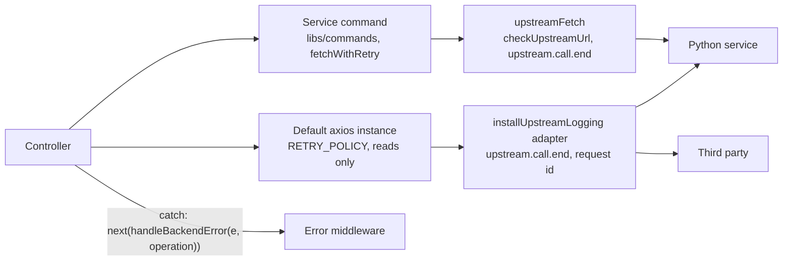

# Node libs: errors and upstream calls — agent guide

This guide covers `libs/errors/` (what a failed request tells the caller, and how a Python service's error becomes a Node answer) and `libs/http/` (how Node calls the other PipesHub services, and which calls are retried). Read it before you add an error class, map a failed call, add a call to another service, or change retries.

Repo-wide rules are in the root [AGENTS.md](../../../../../AGENTS.md); its "Logging and errors" section already says that a Python 4xx `detail` reaches the user. The middlewares that answer and log a failed request have their own guide: [middlewares/AGENTS.md](./middlewares/AGENTS.md). The logging contract is [docs/logging.md](../../../../../docs/logging.md); for calls, read its ["Upstream calls (Node)"](../../../../../docs/logging.md#upstream-calls-node) section.

## How it fits



- `index.ts` instruments the default axios instance (`installUpstreamLogging(axios)`) and installs its retries (`axiosRetry(axios, RETRY_POLICY)`). The knowledge base's own axios instance is instrumented in `modules/knowledge_base/utils/utils.ts`.
- `registerAppUpstreams` (`modules/tokens_manager/config/config.ts`) registers the service base URLs from config with `addUpstreams`. Only those bases can be reached through `upstreamFetch`.
- A controller that catches a failed call passes `handleBackendError(error, operation)` to `next`. The error middleware then logs it once and answers (see the middlewares guide).

## Files

| File | What it does |
| --- | --- |
| `errors/base.error.ts` | `BaseError` (code, message, status, metadata) and `withCause` |
| `errors/http.errors.ts` | `HttpError` and one class per status (`BadRequestError`, `InternalServerError`, `ServiceUnavailableError`, …) |
| `errors/backend-error.ts` | `handleBackendError`, `unansweredCallError`, `unansweredKind`, `safeCause`, `stringifyErrorDetail` |
| `errors/reader-friendly.ts` | `markClientSafe`, `isClientSafeError`, `READER_WRITTEN_MESSAGES`, `serverFailureMessage`, `keepDeliberateWording` |
| `errors/*.errors.ts` (Kafka, Redis, etcd, database, storage, …) | Infrastructure errors: `BaseError`s, not `HttpError`s, so the error middleware replaces their text on a 5xx |
| `http/upstream-call.ts` | `upstreamFetch`, `checkUpstreamUrl`, `installUpstreamLogging`, `upstreamTarget`, the `upstream.call.end` line |
| `http/retry-policy.ts` | `RETRY_POLICY` for the default axios instance |
| `commands/command.interface.ts` | `BaseCommand`: `buildUrl` (checks the URL), `sanitizeHeaders` (adds the request id), `fetchWithRetry` |
| `utils/error-class.ts` | `classifyError`, `levelFor`: the class and level of a failure |

## Rules

**Map a failed call to another PipesHub service with `handleBackendError(error, operation)`.** It reads every shape the service commands and axios return. A `BaseError` passes through unchanged, so mapping twice is safe. It logs nothing: the call's `upstream.call.end` and the error middleware's `http.request.error` report the failure. Tested in `backend-error.test.ts`.

**A 4xx keeps the service's words; a 5xx gets ours.** For the 4xx statuses `errorForStatus` names (400, 401, 403, 404, 409 and 422 among them) the message is the body's `detail`, `reason`, `message` or `msg`. A FastAPI validation array is joined by `stringifyErrorDetail`, never shown as `[object Object]`. Any other status becomes a 500 with `serverFailureMessage(operation)`, carrying `{ status }` as its cause so the log classes it `upstream_5xx`, not `internal`. The upstream's own 5xx text stays in that service's log, under the same request id. Because the 4xx words reach the user, the Python side must keep them client-safe (root guide).

**Write `operation` as the end of "PipesHub tried to …".** For example `'create the organisation'`. `serverFailureMessage` builds the sentence and lowercases a leading capital.

**429, 503 and 504 are transient and keep `Retry-After`.** `transientError` keeps a 429's own words. A 503 or 504 keeps the service's words only when `isReaderWritten` matches them; otherwise the reader gets a fixed sentence and a retry hint. The `retry-after` header travels as `metadata.retryAfter`, and the error middleware sends it on.

**A call that got no answer is 503, or 504 on a timeout.** `unansweredKind` is the one definition of "unreachable" (fetch's `fetch failed`, a network code in the cause, axios with a request and no response, a `TimeoutError`). Both `unansweredCallError` and `classifyError` use it. The error middleware applies `unansweredCallError` to any error that is not a `BaseError`, so a thrown fetch failure anywhere answers 503 with `SERVICE_UNAVAILABLE_MESSAGE`. A body whose detail is the string `ECONNREFUSED` is also a 503. Tested in `backend-error.test.ts` ("when the service cannot be reached", "unansweredCallError").

**Never put the HTTP client's or a caught error's text in front of a reader.** `handleBackendError` ignores the error's own message when it says "status code" (axios's `Request failed with status code 503`). A cause with no status goes through `safeCause`, which turns a `SyntaxError` into `response was not valid JSON` because `JSON.parse`'s message quotes the body.

**Never build an `HttpError` from caught or upstream text.** The error middleware shows any `HttpError` message as written, 5xx included. Use `serverFailureMessage(operation)` for a failure, `markClientSafe` on an error whose sentence you wrote, and `keepDeliberateWording` for a guard clause's `HttpError` caught by the same `catch` that handles an outage. `no-caught-text-in-5xx.test.ts` walks `src/` and fails on an `InternalServerError` built from `error.message`, `String(error)` or a response's data.

**A service's 5xx sentence is shown only from the allowlist.** To let one through, add the exact text to `READER_WRITTEN_MESSAGES` with a comment naming the file and constant it comes from, and a case in `backend-error-reaches-client.test.ts`. Matching is exact after whitespace is collapsed; a sentence that only looks readable is not enough.

**Attach a cause with `withCause`, not by building a message.** It adds a non-enumerable `cause`, so the log line shows why and the response body never carries it. An existing cause is kept.

**Calls to PipesHub services go through a service command or `upstreamFetch`; third parties use axios or an SDK.** `checkUpstreamUrl` refuses anything that is not an `http:`/`https:` URL without credentials under a registered base, by whole path segments and after decoding, so `..%2F` cannot climb out. A redirect is followed only to a URL that passes the same check. A refused URL is never sent, writes no `upstream.call.end`, answers 500, and is not retried (`isUpstreamRefusal`). Never send a third-party URL through `upstreamFetch`. Tested in `upstream-call.test.ts` ("upstreamFetch sends only to a registered PipesHub service", "follows a redirect only to a registered service").

**The request id goes to PipesHub services only.** A command adds it in `sanitizeHeaders` (`injectRequestHeaders`). A direct `upstreamFetch` call adds `injectRequestHeaders` to its own headers; `upstreamFetch` does not. The axios adapter sets it only when `upstreamTarget(url).internal` is true, replacing any `x-request-id` copied from the client.

**Each attempt writes one `upstream.call.end`; do not log the call again.** Success is DEBUG, a failure is at its class's level, and nothing in the line carries the URL, headers, body or error text. The fields and levels are in docs/logging.md, ["Upstream calls (Node)"](../../../../../docs/logging.md#upstream-calls-node).

**The default axios instance retries reads only.** `RETRY_POLICY` retries GET, HEAD and OPTIONS (`isSafeRequestError`) up to 3 times with exponential backoff. It never retries a write, a call we cancelled, a timeout, or a 4xx other than a 429; a 429 is retried only when its `Retry-After` is 5 seconds or less. A replayed PUT writes a second revision and a replayed DELETE answers 404 for a delete that worked. `index.ts` is the only file allowed to install retries; `retry-policy.test.ts` fails when any other file under `src/` imports axios-retry's default export.

**A service command's `fetchWithRetry` retries any attempt that threw, whatever the method.** `fetch` throws only when no answer came, so a write whose connection dropped can be sent again. It stops on an abort and on a refused URL. A command class whose call must not repeat passes `fetchWithRetry` a `shouldRetry` predicate, as `ConnectorServiceCommand` does for timeouts; a caller cannot set one.

## Decisions

- **An unreachable service answers 503, not 500** (#4949). A 500 told the reader and the log that our code broke when a service was down.
- **5xx wording is an allowlist, not a filter.** Earlier code guessed from a message's shape whether it was readable. `connector-service connection refused at 10.0.0.4` reads like a sentence and still names our topology, so only text we wrote or listed in `READER_WRITTEN_MESSAGES` is shown.
- **A mapped 5xx carries `{ status }` as its cause** (#5630), so an upstream 500 is `upstream_5xx` at WARNING on the request's lines, not an ERROR blamed on Node.
- **One `upstream.call.end` per attempt, written by the transport** (#5630), so no call site logs its calls and a retry is visible as a new line.
- **Service calls go only to registered bases** (#6192). `upstreamFetch` used to pass any URL to `fetch`, and `buildUrl` checked only the scheme and credentials. One check (`checkUpstreamUrl`) now covers commands and raw callers, and a command is refused before its retry loop instead of being retried.
- **The default instance retries reads only** (#6290). Retrying every method resent writes the upstream had already applied.

## Changing this code

### Adding a call to a PipesHub service

- [ ] Use the service's command, or `upstreamFetch` with `injectRequestHeaders` on the headers.
- [ ] The service's base URL is registered in `registerAppUpstreams`.
- [ ] Path params pasted into the URL are guarded (middlewares guide).
- [ ] On failure, `next(handleBackendError(error, '<what PipesHub tried to do>'))`, with no log line of your own.
- [ ] A write that must not be repeated passes `retries: 1` (`ConnectorServiceCommand`, or `executeConnectorCommand(..., { retries: 1 })`); it applies to `execute()` only. There a timeout is not retried, but a dropped connection is, up to three attempts by default; `executeStream()` makes up to three attempts and retries a timeout too.

### Adding a call to a third party

- [ ] Use axios or the vendor's SDK, never `upstreamFetch`.
- [ ] Forward no `x-request-id` or MCP relay header.
- [ ] A retry for a write is designed explicitly, not inherited from `RETRY_POLICY`.

### Adding an error class or a message

- [ ] A new HTTP status error extends `HttpError` in `http.errors.ts`; its message is written for the reader.
- [ ] A new infrastructure error extends `BaseError`, not `HttpError`, so its text stays in the log.
- [ ] A new status in `errorForStatus` keeps the 4xx/5xx split and gets a case in `backend-error.test.ts`.
- [ ] A Python 5xx sentence meant for readers goes in `READER_WRITTEN_MESSAGES`, with its source named and a test.

### Editing the retry policy or upstream registry

- [ ] Retries stay installed only in `index.ts`.
- [ ] `retry-policy.test.ts` and `upstream-call.test.ts` still pass, and docs/logging.md "Upstream calls (Node)" still describes the behaviour.

### Removing

- [ ] Removing a reader-written message from Python also removes it from `READER_WRITTEN_MESSAGES` and its test.

## Tests

From `backend/nodejs/apps`, run the whole suite with `npm test`. Select tests with `--grep` and a `describe` title; a file path on the mocha command line still runs the whole suite, because `.mocharc` sets `spec`.

```bash
npx cross-env TS_NODE_PROJECT=tsconfig.test.json mocha --grep 'handleBackendError|unansweredCallError'
npx cross-env TS_NODE_PROJECT=tsconfig.test.json mocha --grep 'upstream-call'
npx cross-env TS_NODE_PROJECT=tsconfig.test.json mocha --grep 'RETRY_POLICY'
npx cross-env TS_NODE_PROJECT=tsconfig.test.json mocha --grep 'a 500 never repeats what the failure said'
```

| Test file (`tests/libs/`) | Pins |
| --- | --- |
| `errors/backend-error.test.ts` | 4xx words kept, 5xx replaced, transient statuses, unreachable, logs nothing |
| `errors/backend-error-reaches-client.test.ts` | What the mapper writes is what the client sees; the allowlist |
| `errors/no-caught-text-in-5xx.test.ts` | No `InternalServerError` built from caught or upstream text anywhere in `src/` |
| `http/upstream-call.test.ts` | One line per attempt, registered destinations, redirects, the axios adapter |
| `http/upstream-call.flow.test.ts` | What a request logs about its upstream call |
| `http/retry-policy.test.ts` | Reads only, which failures retry, installed only in `index.ts` |
| `commands/command.interface.test.ts` | `fetchWithRetry` and `buildUrl` |

## Keeping this file true

When you change a rule, a decision, a file or symbol named here, or a checklist step, update this file in the same PR. If the change touches the error middleware or the path-param guards, update [middlewares/AGENTS.md](./middlewares/AGENTS.md) too. Cite files and symbols, not line numbers.
