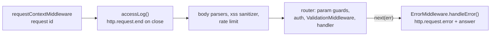

# Node middlewares — agent guide

Every request to the Node API passes through this folder: the request context, the access line, validation, path-param guards and, last, the error middleware that answers and logs a failed request. Read this before you change a file here, add a router, or write a route that answers its own errors.

Repo-wide rules are in the root [AGENTS.md](../../../../../../AGENTS.md); read its "Logging and errors" section first. The parent guide [libs/AGENTS.md](../AGENTS.md) covers the error classes and calls to other services. The logging contract is [docs/logging.md](../../../../../../docs/logging.md).

## How it fits

`app.ts` mounts the shared middlewares in this order:



- `accessLog()` is mounted before the body parsers so their 400 and 413 answers get an access line too.
- `ErrorMiddleware.handleError()` is mounted last (`configureErrorHandling` in `app.ts`). It writes the request's one failure line and the JSON error body.
- The access line is written when the response closes. If the error middleware marked the response (`markRequestError`), the access line takes that class.

## Files

| File | What it does |
| --- | --- |
| `error.middleware.ts` | `ErrorMiddleware.handleError()`: maps the error, writes `http.request.error`, answers or closes the connection |
| `access-log.middleware.ts` | `accessLog()`, `routeTemplate`, `routeParams`, `markRequestError` |
| `safe-path-params.middleware.ts` | `guardPathParams`, `bindPathLogFields`, `INVALID_PATH_SEGMENT_MESSAGE` |
| `validation.middleware.ts` | `ValidationMiddleware.validate(schema, options)`: array guard, then the zod parse |
| `request.context.ts` | `requestContextMiddleware`: sanitises `X-Request-ID` and binds it for the request |
| `auth.middleware.ts`, `require-scopes.middleware.ts`, `require-session-auth.middleware.ts` | Authentication, OAuth scope checks, in-person-only routes |
| `rate-limit.middleware.ts`, `email-rate-limit.middleware.ts` | IP and per-address rate limits |
| `operator-key-guard.middleware.ts` | Refuses query parameter names that could act as MongoDB operators |
| `xss-sanitization.middleware.ts`, `no-framing.middleware.ts` | Input sanitising and anti-framing headers |
| `../utils/error-class.ts` | `classifyRequestError`, `levelFor`: the class and level both lines use |

## Rules

**The error middleware writes the one failure line for a request.** A controller or middleware passes the failure to `next(err)` and does not log it too (root [AGENTS.md](../../../../../../AGENTS.md), "Logging and errors"). `writeRequestError` logs `http.request.error` at `levelFor(classifyRequestError(...))`, so a 4xx is WARNING and only our own failures are ERROR. Tested in `error.middleware.test.ts` ("log level").

**A route that answers its own errors marks the response.** The OpenAI-compatible API (before or inside its stream), the skills proxy and the OAuth provider write their own error body, so the error middleware never runs. They call `markRequestError(res, errorClass)` so the access line still reads `outcome=failure` with the right class. See docs/logging.md, ["Routes that answer their own errors (Node)"](../../../../../../docs/logging.md#routes-that-answer-their-own-errors-node).

**A failure after the headers went out is still logged, and then the connection is closed.** `handleError` logs first, then `closeStartedResponse` destroys a response that has not ended, so the client sees a cut transfer instead of waiting. Never leave a half-sent response open. Tested in `error.middleware.started-response.test.ts`.

**Parser and router rejections answer 4xx with a fixed sentence.** `bodyParserError` maps body-parser's `type` (`entity.parse.failed`, `entity.too.large`, …) to 400, 413 or 415, because its own message quotes the body. `malformedPathError` maps Express's `URIError` with `status === 400` (bad percent-encoding) to 400 with `INVALID_PATH_SEGMENT_MESSAGE`, because its message quotes the path. A `URIError` from our own `decodeURIComponent` has no `status`, so it stays a 500. Neither original error is kept as the cause. Tested in `error.middleware.test.ts` ("body-parser rejections", "a path segment Express cannot decode") and `kb.routes.malformed-uri.http.test.ts`.

**A 5xx keeps its message only when we wrote it.** `handleBaseError` keeps the message when `isClientSafeError(error)`, `isReaderWritten(error.message)` or `error instanceof HttpError`. Any other 5xx `BaseError` (Kafka, Redis, Mongo, etcd, serialization errors) gets code `INTERNAL_ERROR` and `INFRASTRUCTURE_FAILURE_MESSAGE`; its text stays in the log. An error that is not a `BaseError` and that no mapper recognises is answered the same way by `handleUnknownError`. Because any `HttpError` counts as our wording, never build one from caught text (see [libs/AGENTS.md](../AGENTS.md)). Tested in `error.middleware.test.ts` ("Infrastructure errors", "Unknown error handling").

**A stack never reaches a client, and `metadata` is echoed only in development.** `sanitizeErrorResponse` strips `stack` and `stackTrace` keys at any depth. With `NODE_ENV` set to `development` or `dev`, the body also carries the error's `metadata` (never for a replaced 5xx). The integration and hot-reload compose files default to `NODE_ENV=development`, so treat `metadata` as client-visible: no secrets, raw values or upstream text. `accessNotices` goes at the top level in every mode, and `metadata.retryAfter` becomes a `Retry-After` header only when it is delay-seconds or an HTTP date (`isValidRetryAfter`). Tested in `error.middleware.test.ts` ("Response sanitization").

**The error body matches the published spec.** The OpenAPI error schema (`modules/api-docs/pipeshub-openapi.yaml`) sets `additionalProperties: false`, so a new field in the body must be added there in the same change. Tested in `error-body-matches-the-spec.test.ts`.

**Guard every path param you paste into another service's URL, then bind the ids.** Call `guardPathParams(router, ...names)` once per router. It answers 400 for `/ \ ? # %`, control characters and dot segments, including ones that only appear after trimming. Then call `bindPathLogFields(router, { param: 'field_id' })`. It binds a value only when it is id-shaped (`isShownId`) for a key ending in `_id`, or name-shaped (`SHOWN_NAME`) for any other key, so an email or a file path is never bound. Register the guard first, so only a checked value is bound. Tested in `safe-path-params.middleware.test.ts`; its "every router that pastes path params into a service URL guards them" list names each router and its params.

**A route-param value that is not an id is logged by its name only.** `routeParams` gives the `params` field of `http.request.error`: an id as sent, anything else as `[not an id]`. The access line carries the route template (`routeTemplate`) and no URL, query or params. A line written before routing, where no template exists (the rate limiters, the XSS middleware), logs `pathForLog(req)`: the path with each non-id segment as `[not an id]`, by the same rule, never `req.path` or `req.originalUrl`. Tested in `access-log.middleware.test.ts` ("routeParams"), `error.params-values.test.ts` and `middleware-raw-path.test.ts`.

**A validation refusal names the field and the rule, never the value.** `ValidationMiddleware` turns a `ZodError` into a 400 `ValidationError` whose entries have `value: ''`. Before the parse, the array guard (`findArrayLengthViolation`) refuses an oversized array, object or nesting depth. A schema callback that throws on the input becomes a 400 with `UNREADABLE_REQUEST_MESSAGE`, because the thrown text could quote the value. Our own `BaseError` thrown from a schema keeps its status (a 503 stays a 503). The refusal is logged once, by the error middleware, at WARNING with class `bad_request`. Tested in `validation.log-line.test.ts`, `validation.schema-throw.test.ts`, `validation.error-body.test.ts` and `validation.array-guard.test.ts`.

**Catch a rejected promise in an async middleware and pass it to `next`.** The app runs Express 4 (`express ^4.22.1` in `package.json`), which does not catch a rejection from an async handler; the request is never answered and has no failure line. `ValidationMiddleware.validate` wraps its body in `try`/`catch` and calls `next(error)` for this reason.

**Every POST, PUT and PATCH route runs `ValidationMiddleware`.** A route without it must be in `ROUTES_WITHOUT_VALIDATION` with a reason. A handler that reads `req.body` unchecked is how a `{"$ne": null}` reaches a Mongo filter. Tested in `route-validation-coverage.test.ts`, which also fails when an allowlisted route no longer exists or gained validation.

## Decisions

- **One failure line, written by the error middleware.** Controllers used to log what they passed on, so one failure became several lines at different levels. The error middleware now writes `http.request.error` and the access line writes `http.request.end` (#5516). Logging at every layer was rejected.
- **Close a started response instead of leaving it open.** Express's own final handler destroys the socket; the error middleware used to return without doing so, and the client waited until its own timeout (#5637).
- **Middleware lines mask the path too** (#6396). The rate limiters and the XSS middleware logged the path as sent, so an email in a URL reached the log; neither redactor removed it.
- **A malformed percent-encoding is a 400 with a fixed sentence** (#6387). Passing Express's `URIError` on as a 500 was rejected: the 500 classed a client mistake as our bug, and its message carried the raw path.
- **A schema refusal is WARNING `bad_request`, logged once** (#6367), not an ERROR: it is the caller's mistake. A schema callback that throws is a 400, not a 500 (#6386).
- **Param values that are not ids stay out of the logs** (#6388). Logging every param and redacting later was rejected: a param can hold an email or a file name.

## Changing this code

### Adding a router or route

- [ ] Every param that goes into another service's URL is in `guardPathParams`, and the router is added to the list in `safe-path-params.middleware.test.ts`.
- [ ] Ids every line of the request should carry are bound with `bindPathLogFields`, after the guard, under the field name the Python service uses.
- [ ] A POST, PUT or PATCH route has `ValidationMiddleware.validate(...)`, or an entry with a reason in `ROUTES_WITHOUT_VALIDATION`.
- [ ] Failures go to `next(err)`. If the route writes its own error body, it calls `markRequestError`.
- [ ] The route is in `pipeshub-openapi.yaml` (root rule).

### Adding or editing a middleware

- [ ] An `async` middleware catches and calls `next(error)`.
- [ ] It writes no failure line of its own for an error it passes on.
- [ ] Its position in `app.ts` is deliberate: before `accessLog()` it gets no access line for what it refuses, and after `ErrorMiddleware.handleError()` it never runs on a failure.
- [ ] A new field in the error body is added to the OpenAPI error schema.

### Editing the error middleware

- [ ] A new mapping for a non-`BaseError` drops the original message when it can quote the body, the path or a value.
- [ ] A 5xx that is not our own wording still gets `INFRASTRUCTURE_FAILURE_MESSAGE`.
- [ ] Logging stays inside `logRequestError`'s `try`, so a logging failure never changes the answer.

### Removing

- [ ] Removing a guarded param or a route also removes it from the router list in `safe-path-params.middleware.test.ts` and from `ROUTES_WITHOUT_VALIDATION`; the coverage test fails on a stale entry.

## Tests

From `backend/nodejs/apps`, run the whole suite with `npm test`. A file path on the mocha command line does not narrow the run, because `.mocharc` sets `spec`; select tests with `--grep` and a `describe` title:

```bash
npx cross-env TS_NODE_PROJECT=tsconfig.test.json mocha --grep 'ErrorMiddleware'
npx cross-env TS_NODE_PROJECT=tsconfig.test.json mocha --grep 'safe path params'
npx cross-env TS_NODE_PROJECT=tsconfig.test.json mocha --grep 'ValidationMiddleware'
npx cross-env TS_NODE_PROJECT=tsconfig.test.json mocha --grep 'Every write route validates its input'
```

| Test file (`tests/libs/middlewares/` unless noted) | Pins |
| --- | --- |
| `error.middleware.test.ts` | Mapping, 5xx replacement, sanitising, log level |
| `error.middleware.started-response.test.ts` | Logged once, then the connection closed |
| `error.middleware.leak.test.ts` | A failed axios call is logged without its request, headers or body |
| `error.params-values.test.ts` | No non-id param value on any line |
| `access-log.middleware.test.ts` | One access line per request, route template, `routeParams` |
| `safe-path-params.middleware.test.ts` | The guard, the binding, and every router that needs them |
| `validation.*.test.ts` | Refusal body, log line, array guard, schema throws |
| `route-validation-coverage.test.ts` | Every write route validates |
| `tests/libs/errors/error-body-matches-the-spec.test.ts` | The error body matches the OpenAPI schema |
| `tests/contract/schema-callback-throw.test.ts` | No mounted schema throws on caller input |

## Keeping this file true

When you change a rule, a decision, a file or symbol named here, the middleware order in `app.ts`, or a checklist step, update this file in the same PR. Cite files and symbols, not line numbers.
