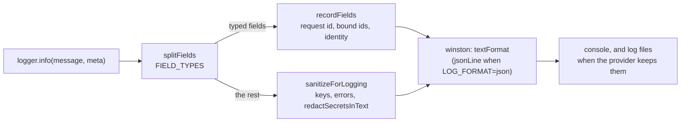

# Node logger and log redaction — agent guide

This guide covers only the Node logger (`logger.service.ts`) and the redaction it applies (`../utils/log-redaction.utils.ts`). Read it before you change either file, add a typed log field, or change what is redacted. The other services in this folder (Kafka, Redis, Mongo, telemetry, …) are not covered here.

Repo-wide rules are in the root [AGENTS.md](../../../../../../AGENTS.md); read its "Logging and errors" section first. The parent guide [libs/AGENTS.md](../AGENTS.md) covers errors and calls to other services, and [middlewares/AGENTS.md](../middlewares/AGENTS.md) the access line and the error line. The logging contract is [docs/logging.md](../../../../../../docs/logging.md): ["Line shape"](../../../../../../docs/logging.md#line-shape), ["Field values in text"](../../../../../../docs/logging.md#field-values-in-text), ["Redaction"](../../../../../../docs/logging.md#redaction), ["Personal data"](../../../../../../docs/logging.md#personal-data) and ["Conventions"](../../../../../../docs/logging.md#conventions).

## How it fits



- `logWithLevel` does all of it, once, when the level is enabled. The caller's file and line come from the stack; frames of `logger.service.ts` and the audit wrappers (`AUDIT_FRAME`) are skipped.
- Ids bound with `bindLogContext` (`libs/context/request-context.ts`, keys in `LOG_CONTEXT_KEYS`) and the request's org and user are added to every line of the request.
- A logging provider (`structured-logging/index.ts`, chosen by `structuredLoggingProvider` in `src/edition.ts`) picks the console format, whether `error.log` and `combined.log` are written, and how the org and user ids are shown (`shownIdentity`).
- `index.ts` calls `Logger.applyEnv()` after dotenv, so `LOG_LEVEL` and `LOG_FORMAT` from `.env` apply. A command whose stdout is its result calls `Logger.consoleToStderr()`.

## Files

| File | What it does |
| --- | --- |
| `logger.service.ts` | `Logger`, `FIELD_TYPES`, `EVENT_FIELD_KEYS`, `splitFields`, the text and JSON formats, and the shared checks `isShownId`, `isPipesHubId`, `isTeamId`, `SNAKE_TOKEN`, `EVENT_NAME`, `formatTextValue` |
| `structured-logging/index.ts` | `StructuredLoggingProvider`, `getProvider` |
| `audit.ts` | `audit()`: one audit line per decision, built on the logger's checks |
| `../utils/log-redaction.utils.ts` | `redactSecretsInText`, `redactSensitiveQueryParams`, `redactHeadersForLog`, `redactQueryForLog`, `redactLogMetadata`, `axiosErrorForLog` |
| `backend/python/app/utils/url_redaction.py`, `sensitive_names.py`, `log_redaction.py` | The Python twins of the redaction file |

## Rules

**A `meta` key becomes a field only when its value has the field's type.** `splitFields` checks each key against `FIELD_TYPES`; anything else stays in `metadata`. So `status` is always an integer HTTP status, `actor` and `target` must pass `isShownId`, `group_id` and `key_id` must be PipesHub ids, and `reason`, `code` and `error_class` must be snake_case tokens (`SNAKE_TOKEN`). Only the table's own keys count, so `valueOf` or `constructor` in a payload never becomes a field. Tested in `logger.fields-json.test.ts` ("call-site fields").

**A new typed field changes `FIELD_TYPES`, `EVENT_FIELD_KEYS` and docs/logging.md together.** A key in `FIELD_TYPES` alone is lifted out of `metadata` but never printed, because the text and JSON formats print only the keys listed in `EVENT_FIELD_KEYS` (through `TEXT_FIELD_KEYS` and `JSON_FIELD_KEYS`). Name it as Python does and list it in "Conventions". Keep its check tight: in the text format, typed fields are not redacted (only the message, `metadata` and the stack are), so a check that accepts any string is a leak.

**One `Logger.getInstance({ service })` per module.** Each service name gets one logger, made with `Object.create(root)`, so all of them share one winston logger and its transports. The level is process-wide: a `level` passed to any `getInstance` or `new Logger` call changes it for every logger. Tested in `logger.module-loggers.test.ts` ("one service name per caller").

**`new Logger(config)` does not go through `getInstance`.** Tests stub `getInstance`, and `new Logger` must keep working under the stub. The constructor creates the root once and returns `Logger.forService(config)`.

**In tests, stub `Logger.prototype`; never assign to a logger instance.** An assigned `instance.warn` shadows the class method for every later file in the same mocha worker. `tests/helpers/logger-isolation-global.ts` puts the method back and fails the run, naming the test. Use `tests/helpers/mock-logger.ts` and `log-capture.ts` for assertions.

**Redact in `logWithLevel`, not in the `printf`.** The file transports run winston's `json()` after the text format, and it re-serialises the record, so anything cleaned only inside `printf` reaches the file raw. The message goes through `redactSecretsInText`, and `metadata` through `sanitizeForLogging`, which masks credential-named keys (`isSensitiveKey`; numbers are kept), replaces a buffer with its size and marks cycles. `textFormat` then runs `redactLogMetadata` on `metadata` (`redactMetadata`), which rewrites the record, so the file sees it too.

**An error is logged by what it says, never by what it carried.** `serializeError` logs an axios error through `axiosErrorForLog` (name, code, status, method and a redacted URL; no headers or body), and any other error as name, code, redacted message, and `statusCode` and `metadata` for a `BaseError`, following `cause`. The stack is kept on ERROR lines only. Tested in `logger.module-loggers.test.ts` ("error serialisation") and `logger.fields-json.test.ts` ("stack only at ERROR").

**`log-redaction.utils.ts` is kept in step with the Python redactors.** The query names (`SENSITIVE_QUERY_PARAMS`), the credential words (`CREDENTIAL_WORDS`), the nesting depth and the 8 KiB cap on a logged URL match `url_redaction.py` and `sensitive_names.py`; `redactSecretsInText` matches `log_redaction.py`. Nothing tests the two runtimes together, so change both in the same PR and add the same case to `log-redaction.utils.test.ts` and `test_url_redaction.py` or `test_log_redaction.py`. Every pattern must stay linear in the input, because a URL or Referer comes from anyone before authentication; see "redaction on adversarial input".

**`console.*` bypasses the logger and its redaction.** Nothing redacts a `console.error`. Use a `Logger` in server code.

**Do not call `logRequest`.** It logs `req.path` and `req.params` as sent, and nothing in `src/` calls it. A request is logged by the access line (middlewares guide).

## Decisions

- **One logger per module, sharing the root's transports** (#5510). One shared instance took the name of whichever module registered last, so one failure could relabel every later line. `Object.create(root)` keeps stubs on `Logger.prototype` and the root working.
- **A field must have its type** (#5516), so a field name means the same thing in every line and both runtimes, and free text never reaches the ` | k=v` suffix.
- **Errors are logged from an allowlist** (#5428, #5510). An axios error carries its config, headers and body.
- **Redaction is linear-time, and logged URLs are capped** (#4345), in both runtimes.
- **A string's secrets and a JSON parse error's quoted text are redacted everywhere** (#6368), including inside `metadata` and the stack.

## Changing this code

### Adding a typed field

- [ ] A check in `FIELD_TYPES` as narrow as the value allows, and the key in `EVENT_FIELD_KEYS`.
- [ ] The name matches the Python field, and docs/logging.md "Conventions" lists it.
- [ ] A case in `logger.fields-json.test.ts` with a value of the wrong type that stays in `metadata`.

### Editing redaction

- [ ] The same change in the Python twin, with the same test case on both sides.
- [ ] A new name list entry goes in `log-redaction.utils.ts` and `sensitive_names.py`.
- [ ] docs/logging.md "Redaction" still describes what is kept and what is masked.

### Editing the logger

- [ ] Redaction stays in `logWithLevel` (and `redactMetadata`); the `printf` only prints.
- [ ] The level check stays before `getCallerInfo`, which captures a stack.
- [ ] `new Logger` still works with `getInstance` stubbed.

### Removing

- [ ] Removing a typed field removes it from `FIELD_TYPES`, `EVENT_FIELD_KEYS` and docs/logging.md, and the call sites that pass it.

## Tests

From `backend/nodejs/apps`, run the whole suite with `npm test`. Select tests with `--grep` and a `describe` title; a file path on the mocha command line still runs the whole suite, because `.mocharc` sets `spec`.

```bash
npx cross-env TS_NODE_PROJECT=tsconfig.test.json mocha --grep 'Logger'
npx cross-env TS_NODE_PROJECT=tsconfig.test.json mocha --grep 'libs/services/structured-logging'
npx cross-env TS_NODE_PROJECT=tsconfig.test.json mocha --grep 'log-redaction.utils|redactSecretsInText|redaction on adversarial input|logging cap'
```

For the Python twin, from `backend/python`: `pytest tests/unit/utils/test_url_redaction.py tests/unit/utils/test_log_redaction.py`.

| Test file (`tests/libs/` unless noted) | Pins |
| --- | --- |
| `services/logger.fields-json.test.ts` | Typed fields, stack only at ERROR, `LOG_FORMAT`, redaction in every output, `applyEnv` |
| `services/logger.module-loggers.test.ts` | One logger per service, text and JSON lines, error serialisation |
| `services/logger.service.test.ts` | Level, constructor, `getInstance`, `sanitizeForLogging` |
| `services/structured-logging.test.ts` | The provider and its wiring |
| `utils/log-redaction.utils.test.ts` | URL, header, query, metadata and text redaction; adversarial input; the cap |
| `tests/helpers/logger-isolation-global.ts` | Fails a run whose test assigned a method on a logger instance |

## Keeping this file true

When you change a rule, a decision, a file or symbol named here, or a checklist step, update this file in the same PR. A change to the Python twins that changes what is redacted updates this file too. Cite files and symbols, not line numbers.
