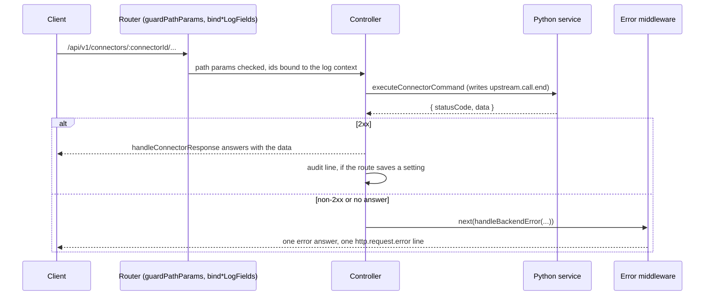

# Node feature modules — agent guide

Each folder here is one feature of the Node API: its routes, controllers and services. Many of them do little more than check auth and pass the request on to a Python service. Read this before you add or change a route in any module, and read the module's own guide (table at the end) when it has one.

Repo-wide rules are in the root [AGENTS.md](../../../../../AGENTS.md). Errors and the HTTP client are in [libs/AGENTS.md](../libs/AGENTS.md); the error middleware, `guardPathParams`, `bindPathLogFields` and validation are in [libs/middlewares/AGENTS.md](../libs/middlewares/AGENTS.md). What a request logs is in [docs/logging.md](../../../../../docs/logging.md).

## How it fits



These modules use the whole pattern (`executeConnectorCommand`, then `handleConnectorResponse`, failures through `handleBackendError` to `next`): `tokens_manager`, `knowledge_base`, `toolsets`, `mcp_servers`, `api_toolsets` and `local_repos`. `crawling_manager` uses `executeConnectorCommand` and `handleBackendError` with its own `handleConnectorResponse` in `controller/cm_controller.ts`, which returns the connector instead of answering. `artifacts`, `projects`, `enterprise_search` and `auth` call `executeConnectorCommand` and map failures with `handleBackendError` without the response helper.

## Files

| File | What it does |
| --- | --- |
| `tokens_manager/utils/connector.utils.ts` | The shared proxy helpers: `executeConnectorCommand`, `handleConnectorResponse`, `handleBackendError`, `bindConnectorLogFields`, and the Local FS desktop refusals |
| `../libs/errors/backend-error.ts` | The real `handleBackendError`: maps a service's answer to an `HttpError` (a 4xx keeps the service's words, a 5xx gets `operation` in plain words) |
| `../libs/middlewares/safe-path-params.middleware.ts` | `guardPathParams` and `bindPathLogFields` |
| `../libs/commands/connector_service/connector.service.command.ts` | `ConnectorServiceCommand`, which `executeConnectorCommand` wraps |
| `configuration_manager/utils/config-audit.ts` | `auditSettingsChange`, the `config.<section>.<action>` audit line |

## Rules

**A proxied call is `executeConnectorCommand`, then `handleConnectorResponse`; a failure goes to `next`, never answered or logged at the call site.**
`handleConnectorResponse` throws `handleBackendError(...)` on a non-2xx and a `NotFoundError` on a 2xx with no body, so the catch block only does `next(handleBackendError(error, operation))`. `handleBackendError` returns an error that is already mapped unchanged, so mapping twice is safe. The call's `upstream.call.end` and the error middleware's `http.request.error` are the request's lines; a `logger.error` in the catch would log the failure twice. See [docs/logging.md](../../../../../docs/logging.md) "Connector proxy (Node)", "Toolset and MCP server proxies (Node)" and "Knowledge base (Node)". Pinned by `tests/modules/tokens_manager/routes/connectors.routes.logging-once.test.ts`.

**A route that answers its own error logs it itself.**
Streams whose headers are already out (the KB record stream and upload batch) cannot reach the error middleware, so they write their own line. Only do this when `next` cannot work, and add the route to "Routes that answer their own errors (Node)" in [docs/logging.md](../../../../../docs/logging.md).

**An audit line goes on the line after `handleConnectorResponse(...)` returns, in the handler.**
`auditSettingsChange('connector', 'update', { target, reason })` in `tokens_manager/controllers/connector.controllers.ts` and `oauth.controllers.ts`, and the same call for `toolset`, `mcp_server` and `api_toolset` in the `toolsets`, `mcp_servers` and `api_toolsets` controllers (#6398), runs only when the helper did not throw, so only a 2xx Node read gets a line. Never write it from a `res.on('finish')` middleware: a client that leaves before the answer must still get its line. The events and reasons are in "Configuration audit events (Node)" in [docs/logging.md](../../../../../docs/logging.md). Pinned by `tests/modules/tokens_manager/routes/connectors.routes.settings-audit.test.ts` (including "a save whose client left before the service answered is still one audit line").

**Register `guardPathParams` first, then the log-field binding, before the routes.**
`guardPathParams` refuses a path param that would add a segment to the service URL; `bindPathLogFields` (or `bindConnectorLogFields`, its connector version) then puts only checked values on every line of the request. Both are `router.param` handlers, so they run in the order registered. Every param a handler pastes into a service URL is guarded. Examples: `tokens_manager/routes/connectors.routes.ts`, `knowledge_base/routes/kb.routes.ts`, `toolsets/routes/toolsets_routes.ts`, `mcp_servers/routes/mcp_servers.routes.ts`. `crawling_manager` binds `connector_id` with `bindLogContext` only after its access check ("Crawling jobs (Node)" in docs/logging.md).

**Keep `handleBackendError` in `connector.utils.ts` a function, not `export { … } from`.**
A re-export compiles to a getter, and the suites for `toolsets` and `mcp_servers` replace the property with `sinon.stub(connectorUtils, 'handleBackendError')`. The comment on the export says so.

**A Local FS desktop refusal is answered with `respondLocalFsDesktopRefusal`, not `handleBackendError`.**
Python refuses a Local FS sync with a 409 whose `detail` starts with a code (`DESKTOP_OFFLINE`, `DESKTOP_UNCLAIMED`, `DESKTOP_OWNED_BY_OTHER_DEVICE`). `handleBackendError` would turn it into a plain `ConflictError` the client cannot branch on, so `toggleConnectorInstance` checks `localFsRefusalFromBackend(response)` before `handleConnectorResponse` and answers the 409 with `code` and `details` itself. Node's own pre-check (`localFsSyncRefusal`, in the toggle and in `resyncConnectorRecords`) answers the same way. The helpers are pinned by `tests/modules/tokens_manager/utils/connector.utils.test.ts`; the settings-audit test pins that the refusal writes no audit line.

**Do not reshape a service's error answer in the module.**
`handleBackendError` already decides what the reader sees: a Python 4xx `detail` as written, a 5xx replaced by the operation in plain words. See [libs/AGENTS.md](../libs/AGENTS.md).

**A call that can run long sets its own timeout, with a comment saying why.**
`executeConnectorCommand` takes `{ timeoutMs, retries }`. `api_toolsets` sets `API_TOOLSETS_PROXY_TIMEOUT_MS` above the longest Python-side work, and `local_repos` sets `LOCAL_REPOS_PROXY_TIMEOUT_MS` for a batch of files.

## Decisions

- **Failures are logged once, by the error middleware** (#5516, #6268). Call sites used to log and then pass the error on, so one failure was two or three lines without the connector. Rejected: logging in each controller, which cannot know the error's class or the request's final status.
- **Audit lines are written by the handler, not by a response hook** (#6392). Rejected: a `res.on('finish')` middleware, which loses the line when the browser leaves before the answer and has to guess whether the service saved anything.
- **`handleBackendError` lives in `libs/errors/backend-error.ts` and is re-exported from `connector.utils.ts`.** Every module that calls a PipesHub service maps failures the same way; the re-export keeps existing imports and test stubs working.
- **Local FS refusals keep their code** (#3139). The desktop app needs to tell "offline", "never set up" and "owned by another device" apart.

## Changing this code

### Adding a proxied route
- Use `executeConnectorCommand` and `handleConnectorResponse` from `tokens_manager/utils/connector.utils.ts`; do not write another response helper.
- Catch with `next(handleBackendError(error, '<operation in plain words>'))`. No `logger.error` or `logger.warn` for a failure you pass on.
- `encodeURIComponent` each path param in the service URL, add it to the router's `guardPathParams`, and bind its id with `bindPathLogFields` after the guard.
- If the route saves a setting, call `auditSettingsChange` after `handleConnectorResponse` and add the event to the table in "Configuration audit events (Node)".
- Keep `backend/nodejs/apps/src/modules/api-docs/pipeshub-openapi.yaml` in sync (root AGENTS.md).

### Adding a module
- Add its routes, controller and tests under `tests/modules/<module>/`. Follow the rules above for any call to a Python service.
- If it needs rules of its own, write `<module>/AGENTS.md` with a `CLAUDE.md` holding `@AGENTS.md`, and add it to the table below.

### Removing a route
- Remove its `guardPathParams` and binding entries if no other route uses the param, its OpenAPI entry, and any audit row in docs/logging.md.

## Tests

From `backend/nodejs/apps`:

```bash
npm test
npx cross-env TS_NODE_PROJECT=tsconfig.test.json mocha --grep 'Connector routes: a request is logged once'
npx cross-env TS_NODE_PROJECT=tsconfig.test.json mocha --grep 'Connector settings saved by the connector service'
```

- `tests/modules/tokens_manager/routes/connectors.routes.logging-once.test.ts`: one failure line, `connector_id` on every line, nothing from the controller.
- `tests/modules/tokens_manager/routes/connectors.routes.settings-audit.test.ts`: one audit line per 2xx save, none for a non-2xx, a timeout or a Local FS refusal.
- `tests/modules/tokens_manager/routes/toolsets.routes.settings-audit.test.ts`: the same for toolset, MCP server and API toolset saves.
- `tests/modules/tokens_manager/utils/connector.utils.test.ts`: `handleBackendError` mapping, `handleConnectorResponse`, the Local FS refusal helpers.
- `tests/modules/{toolsets,mcp_servers,api_toolsets,local_repos,crawling_manager}/`: each proxy's controller and routes.

## Module guides

| Guide | Covers |
| --- | --- |
| [user_management/AGENTS.md](./user_management/AGENTS.md) | Users, groups, teams, org settings: the admin invariants and the user audit lines |

## Keeping this file true

When a rule, decision, helper name, file or checklist here changes, update this file in the same PR, and add a row to the table above when a module gets its own guide. Cite files and symbols, not line numbers.
