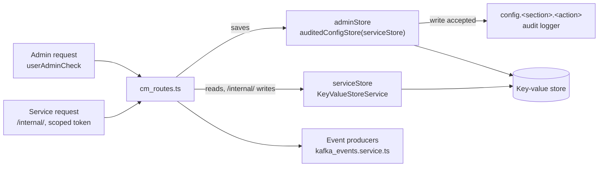

# Configuration manager — agent guide

This module serves the org's settings under `/api/v1/configurationManager`: sign-in methods, SMTP, file storage, AI models, web search, Slack bots, public URLs, platform flags and connector OAuth apps, all kept in the key-value store. Read this before you add or change a settings route, change how a setting is stored, or touch the audit line a save writes.

Rules shared by every Node module are in [../AGENTS.md](../AGENTS.md); repo-wide rules are in the root [AGENTS.md](../../../../../../AGENTS.md). Errors and the error middleware are in [libs/AGENTS.md](../../libs/AGENTS.md) and [libs/middlewares/AGENTS.md](../../libs/middlewares/AGENTS.md). What these routes log is in [docs/logging.md](../../../../../../docs/logging.md), sections ["Configuration manager (Node)"](../../../../../../docs/logging.md#configuration-manager-node) and ["Configuration audit events (Node)"](../../../../../../docs/logging.md#configuration-audit-events-node).

## How it fits



- `createConfigurationManagerRouter` builds two views of one store. `serviceStore` is the plain `KeyValueStoreService`. `adminStore` is the same store wrapped by `auditedConfigStore`, so each `set`, `delete` or successful `compareAndSet` writes one audit line after the store accepted it.
- Handlers are factories that take the store they write through (`createSmtpConfig(adminStore, ...)`, `setAtlassianOauthConfig(serviceStore)` on the `/internal/` twin). The route picks the store; the handler does not know which it got.
- Other modules write the same audit event family with `auditSettingsChange` after a proxied save; that rule is in the parent guide.

## Files

| File | What it does |
| --- | --- |
| `routes/cm_routes.ts` | Every `/configurationManager` route, the `serviceStore` / `adminStore` split, auth and validation per route |
| `controller/cm_controller.ts` | The handlers: storage, SMTP, sign-in, platform, Slack bots, web search, AI models, public URLs |
| `utils/config-audit.ts` | `configSection`, `auditedConfigStore`, `auditConfigChange`, `auditSettingsChange` |
| `utils/maskConfigSecrets.ts` | `CONFIG_SECRET_PLACEHOLDER`, the `mask*Config` helpers, `restoreSecretPlaceholders` |
| `utils/secretReveal.ts` | `canRevealSecrets`: the admin's `?reveal=true`, refused for an OAuth-app token |
| `services/aiModelsConfig.repository.ts` | `AiModelsConfigRepository`: `read`, `replace`, `mutate` of the AI models document |
| `paths/paths.ts` | `configPaths`, the store key of each setting |
| `services/kafka_events.service.ts` | `SyncEventProducer`, `EntitiesEventProducer`, `AiConfigEventProducer` |
| `services/migration.service.ts`, `services/migrations/` | Boot-time migrations of stored settings |
| `validator/validators.ts` | The zod schemas the routes validate with |

## Rules

**An admin route that saves a setting is given `adminStore`, never `serviceStore`.**
The audit line comes from the store wrapper, so a handler built with `serviceStore` saves silently. `serviceStore` is for reads and for `/internal/` routes, where a service saves what it owns; the comments next to both in `cm_routes.ts` say so. Pinned by `config-audit.test.ts` ("covers the 37 admin write routes", which lists each route with its exact events, and "what is not audited" for the internal writes).

**A save writes no INFO line of its own.**
The audit line is the record of the change. The HTTP test asserts that a save produces only the audit line and the access line at INFO or above.

**A new store key gets a section.**
`configSection` maps a key to its section by prefix; a key no entry matches is audited as `config.other.*`. Add the prefix to `SECTIONS` in `utils/config-audit.ts`, a case to the `configSection` table in `config-audit.test.ts`, and the row to the section table in docs/logging.md.

**A setting saved through another store writes its own line.**
The MCP access policy is saved through `McpAccessPolicyStore`, not the wrapped store, so `putMcpAccessPolicy` in `modules/mcp/routes/mcp-access.routes.ts` calls `auditConfigChange(configPaths.mcpAccessPolicy, 'update')` after the write. Do the same for any other store, and only after the write succeeded.

**The audit line names the section, never the key, a field or a value.**
`auditSettingsChange` takes only `target` (shown when it is a PipesHub id) and `reason` (a snake_case code). Do not add fields to it.

**Never log a stored value, or text that quotes one.**
`JSON.parse`'s message quotes the start of the text it could not read. Attach a failed parse as the cause through `safeCause(error)` (`libs/errors/backend-error.ts`), which replaces it with `response was not valid JSON`, as `parseSlackBotStore` does. An AI model the health check refuses logs one WARNING `ai_model.health_check.failed` with `model_type`, `provider` and `status`, never the provider's text, which can quote the key. Pinned by `cm.logging-once.test.ts` ("stored settings that do not parse", "AI model health checks") and `cm_controller.storedJsonParse.test.ts`.

**A list setting is rewritten with compare-and-set, never read then `set`.**
Slack bots, web search providers and the AI models document hold many entries in one key. Their writes use `compareAndSet` and retry when another write landed first; AI models go through `AiModelsConfigRepository.mutate` or `replace`. A plain `set` after a read drops a concurrent change. Slack bot settings that cannot be decrypted or parsed refuse the write (`SLACK_BOT_SETTINGS_UNREADABLE`) rather than starting from an empty list that would overwrite every bot. Pinned by `cm_controller.storedSettings.test.ts` ("retries after a concurrent write…", "refuses to add a bot instead of replacing every stored bot…").

**Secrets leave masked unless the admin asked to see them.**
Unless `HIDE_SECRET_CONFIG` is `false` (unset hides them), a read masks secret fields with `CONFIG_SECRET_PLACEHOLDER` unless `canRevealSecrets(req)`, which an OAuth-app token never passes. A save that gets the placeholder back keeps the stored value (`restoreSecretPlaceholders`) and refuses a placeholder with nothing to restore. Pinned by `cm_controller.authSecrets.test.ts`.

**Every route says who may call it.**
`/internal/` routes check a scoped service token first and never take a user session; every other route needs a signed-in user and `userAdminCheck`, except the routes in `MEMBER_ROUTES` and `PUBLIC_ROUTES` of `cm_routes.guards.test.ts`, which walks the real router.

**Read `/services/storage` and `/services/endpoints` with `parseKvObject`.**
Older writers stored these keys as a JSON string of JSON; `parseKvObject` (`libs/utils/kv-object.utils.ts`) reads both forms. Write them back with one `JSON.stringify`.

## Decisions

- **Audit at the store, not in each handler** (#6377). One wrapper covers the 37 admin write routes, and a new route that is given `adminStore` gets its line with no code. Rejected: a line in every handler, which a new route would forget. The wrapper is a `Proxy` whose other members are bound to the real store, so a reconnect never forks it.
- **A compare-and-set that did not write has no line** (#6377), so a retried write is one line.
- **Failures are logged once, by the error middleware** (#6353). Handlers used to log a failure and pass it on, with the provider's text and the stored settings in the line.
- **Unencrypted keys are one JSON layer, read in both forms** (#6363). A Python writer used to store `/services/endpoints` and `/services/storage` as a JSON string of JSON, which broke Node's start. Writes are now one layer, and Node reads both so values already stored keep working without a rewrite.

## Changing this code

### Adding a settings route
- Validate the body with a schema from `validator/validators.ts`, and guard it with `userAdminCheck` unless it belongs in `MEMBER_ROUTES` (then add it there with a reason).
- Pass `adminStore` to a handler that saves. Add the route and its events to `ADMIN_WRITES` in `config-audit.test.ts` and update the route count.
- For a new key: add it to `configPaths`, its section to `SECTIONS`, and the docs/logging.md row.
- Mask its secrets on read and restore placeholders on save, as the existing settings do.
- Keep `backend/nodejs/apps/src/modules/api-docs/pipeshub-openapi.yaml` in sync (root AGENTS.md).

### Adding an `/internal/` route
- Use `authMiddleware.scopedTokenValidator(...)` and `serviceStore`; add it to `INTERNAL_WRITES` ("what is not audited") in `config-audit.test.ts`.

### Editing a stored setting's shape
- Values already stored must still read: either read both shapes (as `parseKvObject` does) or add a boot-time migration in `services/migrations/` and run it from `MigrationService` (`migration.service.ts`), as `web_search_duckduckgo_default.migration.ts` is.

### Removing a route or setting
- Remove it from `ADMIN_WRITES` (and the count), its `SECTIONS` entry if nothing else saves under that prefix, its docs/logging.md row and its OpenAPI entry.

## Tests

From `backend/nodejs/apps`:

```bash
npx cross-env TS_NODE_PROJECT=tsconfig.test.json mocha --grep 'Configuration audit events'
npx cross-env TS_NODE_PROJECT=tsconfig.test.json mocha --grep 'Configuration manager routes log each failure once'
npx cross-env TS_NODE_PROJECT=tsconfig.test.json mocha --grep 'Configuration manager routes: who may call them'
npx cross-env TS_NODE_PROJECT=tsconfig.test.json mocha --grep 'Configuration manager stored settings'
```

- `tests/modules/configuration_manager/config-audit.test.ts`: the section map, the wrapper, every admin write route over HTTP, what is not audited.
- `tests/modules/configuration_manager/cm.logging-once.test.ts`: one failure line per request, no stored or provider text.
- `tests/modules/configuration_manager/routes/cm_routes.guards.test.ts`: who may call each route.
- `tests/modules/configuration_manager/controller/`: handlers, secrets, stored-settings races, unparseable values.

## Keeping this file true

When a rule, decision, helper, file or checklist here changes, update this file in the same PR. If the audit events change, update docs/logging.md "Configuration audit events (Node)" too. Cite files and symbols, not line numbers.
