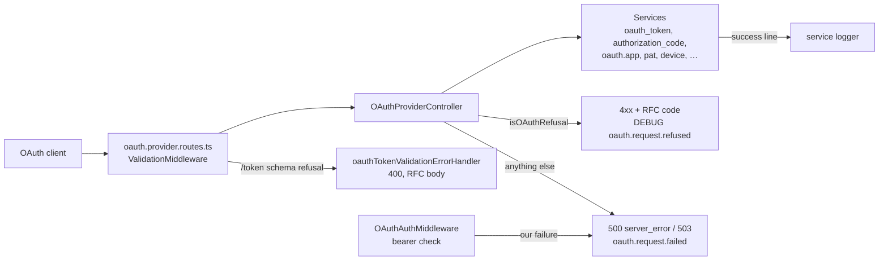

# OAuth provider — agent guide

This module makes PipesHub an OAuth 2.0 authorization server: the `/api/v1/oauth2` endpoints (authorize, token, revoke, introspect, device flow, dynamic client registration), the `/.well-known` discovery documents, OAuth app management (`/api/v1/oauth-clients`), personal access tokens (`/api/v1/personal-access-tokens`), service tokens and agent registration. Read this before you change how a grant, a token or an app is checked, answered or logged.

Rules shared by every Node module are in [../AGENTS.md](../AGENTS.md); repo-wide rules are in the root [AGENTS.md](../../../../../../AGENTS.md), including never logging a token. These endpoints answer their own errors, so read "A route that answers its own errors marks the response" in [libs/middlewares/AGENTS.md](../../libs/middlewares/AGENTS.md). What they log is in [docs/logging.md](../../../../../../docs/logging.md), section ["Routes that answer their own errors (Node)"](../../../../../../docs/logging.md#routes-that-answer-their-own-errors-node). Delegation is described in [docs/service-account-delegation.md](../../../../../../docs/service-account-delegation.md).

## How it fits



- Controllers call services and turn a failure into an answer with the helpers in `utils/oauth-failure.ts`. They do not log a success.
- Services do the store writes and write the one line for a change that worked.
- `OAuthAuthMiddleware` (`middlewares/oauth.auth.middleware.ts`) checks a bearer token and its scopes on routes that accept OAuth access tokens.

## Files

| File | What it does |
| --- | --- |
| `utils/oauth-failure.ts` | `isOAuthRefusal`, `oauthErrorCode`, `oauthErrorBody`, `logOAuthRefusal`, `logOAuthServerFailure`, `answerOAuthServerFailure`, `OAUTH_SERVER_FAILURE` |
| `controller/oauth.provider.controller.ts` | `/authorize`, `/token`, `/revoke`, `/introspect`, `/register`, device endpoints |
| `middlewares/oauth.token-validation-error.middleware.ts` | `oauthTokenValidationErrorHandler`: a `/token` body the schema refuses, in RFC shape |
| `middlewares/oauth.auth.middleware.ts` | `OAuthAuthMiddleware`: bearer check, `insufficient_scope` |
| `middlewares/oauth.redirect.middleware.ts` | Sends a browser without a session to the frontend's sign-in page |
| `services/oauth_token.service.ts` | Issue, refresh (with rotation and reuse detection), revoke, introspect |
| `services/authorization_code.service.ts`, `oauth.device.service.ts`, `token-exchange.service.ts` | The grants |
| `services/oauth.app.service.ts`, `pat.service.ts`, `agent-registration.service.ts`, `service-token.service.ts`, `delegation.service.ts` | Apps, personal access tokens, registrations, service tokens, delegations |
| `routes/*.ts` | One router per area; `app.ts` mounts them |

## Rules

**A failure is either the client's refusal or ours; `isOAuthRefusal` decides.**
A refusal is an `OAuthError` with a 4xx status, or one of `DELIBERATE_REFUSALS` (`BadRequestError`, `NotFoundError`, `UnauthorizedError`, `ForbiddenError`). Anything else is ours whatever its status: a `DecryptionError` (400) after a key change, a `ConflictError` from a lock timeout, a unique-constraint error, a driver error. Do not add a status class to `DELIBERATE_REFUSALS`; throw one of the four, or an `OAuthError` subclass, on purpose. Pinned by `oauth.provider.failures.test.ts` ("answers our … 500 server_error, at ERROR, without its text").

**A refusal is answered in RFC 6749 shape with its own code.**
`oauthErrorBody` gives `{ error, error_description }` (plus `state` on `/authorize`). The controller answers 400, or 401 for `invalid_client` and 403 for `access_denied`. A dead, rotated or unknown refresh token must map to `invalid_grant` (`InvalidGrantError`, `InvalidTokenError`, `ExpiredTokenError`, `NotFoundError` or `UnauthorizedError`): clients drop a refresh token only on `invalid_grant`. `server_error` is never a refusal's code. Pinned by the "answers … with no line above DEBUG" cases of `oauth.provider.failures.test.ts`.

**Our failure is answered with `answerOAuthServerFailure`, never with our text.**
It answers `500 server_error` with `OAUTH_SERVER_FAILURE`. `/revoke` and the bearer check pass `503`, which answers `temporarily_unavailable`, so the client keeps the token and retries instead of dropping one that may be fine. `/authorize` redirects with `server_error` and `/introspect` still answers `active: false`; both call `logOAuthServerFailure` themselves. Pinned by `oauth.provider.failures.test.ts` ("POST /revoke", "POST /introspect", "GET /authorize") and `oauth.auth.middleware.test.ts`.

**One line per failure, from the helpers.**
A refusal is one DEBUG `oauth.request.refused` with `code` (`logOAuthRefusal`); a `/token` body the schema refuses adds `errors`, each issue's `field` and `code`, never a value. Our failure is one `oauth.request.failed` at `levelFor(classifyRequestError(error, 500))`, which also marks the access line. Do not add a `logger.error` beside them.

**A change that worked is logged by the service that wrote it, never also by the controller.**
An OAuth app, a personal access token, a grant, a delegation or an agent registration gets its line next to the store write. `PatController` and `OAuthAppController` take no logger; `OAuthAppController` writes only the `config.oauth_client.*` audit line (`auditSettingsChange`). A step the change runs keeps its own line (`OAuth tokens generated`, `All tokens revoked for app`). Pinned by `pat.controller.test.ts` and `oauth.app.controller.test.ts` ("… writes no log line of its own").

**Log fields are snake_case ids, and no key contains "token".**
The user a token is minted for or revoked from is `target_user_id`; the request's user is `user_id`. A personal access token's id is `pat_id`: the logger masks any key containing `token`, `secret` or `credential` (`isSensitiveKey` in `libs/services/logger.service.ts`), so `tokenId` printed `[REDACTED]`. A personal access token's name is never logged. The service suites check every log call with `createSnakeCaseLogKeyGuard` (`tests/helpers/mock-logger.ts`).

**Deleting an OAuth app revokes its tokens in `OAuthAppService.deleteApp`, once.**
The service marks the app revoked and revokes its tokens before marking it deleted. The controller must not revoke them again. Pinned by `oauth.app.controller.test.ts` ("revokes the tokens once, after the app stops minting new ones").

**The `/authorize` redirect never logs the query.**
It is unvalidated client input, and `login_hint` is usually an email (`oauth.redirect.middleware.ts`).

## Decisions

- **The provider answers its own failures as 500 or 503** (#6327). `/token` used to answer our failures as `400 server_error` with the error's own text, `/revoke` answered 200 for a revocation it failed to write, and the bearer check answered a store outage 401. A dead refresh token was `server_error` instead of `invalid_grant`. Rejected: one generic 4xx for everything, which tells a client to drop a token that may still be good.
- **A control character in a client id, secret, code or token is refused by the schema** (#6327), and one in the Basic header is `401 invalid_client` before any read, because PostgreSQL cannot store it and its error would read as our failure.
- **Success lines come from the service only** (#6369). The controller and the service both logged each change, three lines for one authorization-code grant.
- **One token sweep per app delete; snake_case fields in every service; no query on the redirect line** (#6389).

## Changing this code

### Adding an endpoint
- Catch every failure: `isOAuthRefusal(error)` then the refusal answer, else `answerOAuthServerFailure` (pass `503` where the RFC tells the client to retry).
- Validate the body with `ValidationMiddleware`; a token-style endpoint needs an RFC-shaped schema refusal like `oauthTokenValidationErrorHandler`.
- Add it to "Routes that answer their own errors (Node)" in docs/logging.md and to the OpenAPI file.

### Adding a grant or a token kind
- Throw `InvalidGrantError` (or another `OAuthError`) for a refusal, never a generic `Error`.
- Log its success in the service, with `client_id` and `target_user_id`, and check the service suite's log calls with `createSnakeCaseLogKeyGuard`.

### Editing refusal or failure handling
- Keep `oauthErrorCode` and the status table in `oauth.provider.failures.test.ts` in step.

### Removing
- Remove its route, its docs/logging.md mention and its OpenAPI entry.

## Tests

From `backend/nodejs/apps`:

```bash
npx cross-env TS_NODE_PROJECT=tsconfig.test.json mocha --grep 'OAuthProviderController failures'
npx cross-env TS_NODE_PROJECT=tsconfig.test.json mocha --grep 'POST /token validation errors'
npx cross-env TS_NODE_PROJECT=tsconfig.test.json mocha --grep 'OAuthAuthMiddleware'
npx cross-env TS_NODE_PROJECT=tsconfig.test.json mocha --grep 'PatController|OAuthAppController'
```

- `tests/modules/oauth_provider/controller/oauth.provider.failures.test.ts`: refusal vs our failure on each endpoint, the status and code table, one line each.
- `tests/modules/oauth_provider/routes/oauth.provider.routes.test.ts`: the `/token` schema refusals.
- `tests/modules/oauth_provider/services/`: each service's success lines and their fields.

## Keeping this file true

When a rule, decision, helper, file or checklist here changes, update this file in the same PR. If what these endpoints answer or log changes, update docs/logging.md too. Cite files and symbols, not line numbers.
