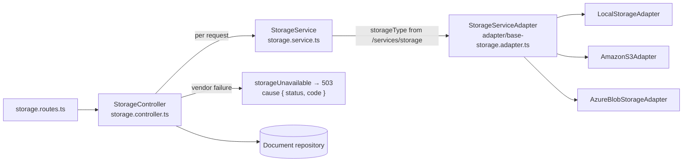

# Storage — agent guide

This module stores files (uploaded documents, their versions, artifact sets and cached paid results) in the configured blob store: a local disk, Amazon S3 or Azure Blob Storage. Its routes are under `/api/v1/document`. Read this before you change a storage route or controller, a provider, or how a storage failure is answered and logged.

Rules shared by every Node module are in [../AGENTS.md](../AGENTS.md); repo-wide rules are in the root [AGENTS.md](../../../../../../AGENTS.md). Error classes and the error middleware are in [libs/AGENTS.md](../../libs/AGENTS.md) and [libs/middlewares/AGENTS.md](../../libs/middlewares/AGENTS.md). What storage logs is in [docs/logging.md](../../../../../../docs/logging.md), section ["Storage (Node)"](../../../../../../docs/logging.md#storage-node). The storage settings are saved by the configuration manager ([configuration_manager/AGENTS.md](../configuration_manager/AGENTS.md)).

## How it fits



- `StorageController.initializeStorageAdapter` reads the storage settings from the configuration manager's `/internal/storageConfig` route, caches them in the module, and drops the cache when the `/services/storage` key changes (`watchStorageType`). It then builds a `StorageService`, which picks the provider by `storageType` (`s3`, `azureBlob`, `local`).
- Every provider implements `StorageServiceInterface` (`services/storage.service.ts`). Callers use it through `StorageServiceAdapter`, never a provider class directly.
- Document rows (paths, versions, the per-vendor `s3` / `azureBlob` / `local` URL fields) are in the document repository (`libs/repositories/document/`), with a `mongo.ts` and a `pg.ts`.

## Files

| File | What it does |
| --- | --- |
| `routes/storage.routes.ts` | The routes, almost all under `/internal/`, called by the other PipesHub services |
| `controllers/storage.controller.ts` | Upload, read, versions, copy, move, removal, purge, artifact sets, paid results |
| `controllers/storage.upload.service.ts` | Uploads: direct-to-vendor for large files, placeholders, idempotent retries |
| `controllers/storage.write-window.ts` | `withWriteWindow`, which every byte-changing write runs inside |
| `controllers/storage.fingerprint.ts` | The verified document read (`?verify=1`) |
| `storage.service.ts` | `StorageService`: picks and builds the provider |
| `services/storage.service.ts` | `StorageServiceInterface`: required and optional provider methods |
| `adapter/base-storage.adapter.ts` | `StorageServiceAdapter`: delegates, rejects an optional method the provider lacks |
| `providers/{local-storage,s3,azure}.provider.ts` | The three providers; `s3-client.ts` is the AWS SDK v3 client they use |
| `providers/vendor-failure.ts` | `vendorFailure`, `storageCause` |
| `utils/utils.ts` | `storageUnavailable`, `writeToStorage`, `getStorageVendor`, `isValidStorageVendor` |
| `utils/s3-health-check.util.ts` | `validateS3Capabilities`, run when an admin saves S3 settings |
| `../../libs/errors/storage.errors.ts` | `StorageError` and its subclasses; `vendorText` |

## Rules

**A provider wraps a vendor error with `vendorFailure(error)`, never with its text.**
Wrap it as a `StorageError` subclass with a fixed message and `{ ...vendorFailure(error) }` as metadata. `vendorFailure` keeps the vendor's HTTP status and code and puts the text in `originalError`, which the `StorageError` constructor moves out of the metadata into `vendorText`, so the error middleware never logs it. Vendor text can quote the bucket, the object path and the file name. Only the S3 settings check reads `vendorText` (`formatError` in `s3-health-check.util.ts`), for the admin's dialog; on main it also puts that text in its own WARN lines ("S3 read check failed" and the other `S3 ... check failed` lines), so do not copy that pattern. Pinned by `vendor-failure.test.ts` ("provider wraps keep the vendor status and code") and `tests/libs/errors/storage.errors.test.ts`.

**A vendor failure on a write, a removal or a read check is a 503 from `storageUnavailable`.**
`storageUnavailable(message, error)` returns, it does not throw: write `throw storageUnavailable(...)` (or pass it to `next`), or the handler carries on after the failed write. It is a `ServiceUnavailableError` whose cause is `storageCause(error)`, `{ status, code }`, so the error middleware's WARNING `unavailable` line says why (`AccessDenied`, `SlowDown`, `ENOENT`) and nothing else. The message is for the uploader: `STORAGE_WRITE_FAILED_MESSAGE` for a write, a sentence saying what was kept for a removal or a check. Write nothing to the log yourself. Pinned by `storage.logging-once.test.ts` ("a write storage refuses", "a removal storage refuses").
One exception: a hard delete (`?hard=true`) whose blob cleanup fails logs one WARN with `storageCause`, removes the record anyway and answers 200, so the document is gone even when files are left behind ("a hard delete" in the same test).

**A vendor read that fails stays a 500.**
A provider's `StorageError` on a read reaches the error middleware as ERROR `internal`, with the vendor status and code in its metadata. Changing that status is a change to docs/logging.md "Storage (Node)" too. Pinned by `storage.logging-once.test.ts` ("a read storage refuses").

**Per-operation lines are DEBUG, with the object path and never its URL.**
An upload, update, read, copy, rename or removal that worked writes nothing at INFO or above. A signed or object URL is never logged. Ids go in fields (`document_id`, `connector_id`), never in the message. Pinned by `storage.logging-once.test.ts` ("a write that succeeds").

**A write that changes a stored document's bytes runs inside `withWriteWindow`.**
The window registers a writer token before the first byte and removes it after, so the verified read (`storage.fingerprint.ts`) never trusts a fingerprint taken mid-write. Pinned by `storage.write-window.test.ts`.

**An optional provider method is optional at run time too.**
`StorageServiceAdapter` rejects with "… not implemented for this storage provider" when the configured provider lacks a method (`conditionalCapabilities` instead answers "no conditional operations"). Today only the local provider has `writeObject`, `writeObjectIfAbsent`, `writeObjectIfMatch`, `openObject` and `locateDocuments`, and only S3 and Azure have `objectExists` and `signObjectUrl`. Call one only on a path that runs on a provider that has it, or implement it in every provider.

**Read the stored storage settings with `parseKvObject`.**
`/services/storage` may hold the old two-layer JSON form (`libs/utils/kv-object.utils.ts`). Every reader in this module uses it. An unset key is read as `'{}'`, and `parseKvObject(storageConfig) || storageTypes.LOCAL` in `StorageService.initialize` never falls back to local, because `{}` is truthy: the type is `undefined` and `initializeStorageAdapter` throws "Unsupported storage type". Only `StorageController.getConfiguredStorageType` defaults to `local`.

## Decisions

- **A storage failure is one line whose cause names the vendor's status and code** (#6376). Storage code used to log the vendor's text and then throw a 503 with no cause, so one failure was up to three lines and a misconfigured bucket read like a throttle. Rejected: logging the vendor error at the failure site.
- **Vendor text lives outside the error's metadata** (#6390). Kept in `metadata.originalError`, it reached the log and, in development, the answer. The local provider also wraps a raw `fs` failure of `openObject` and `listObjects`, so an absolute path never reaches a line.

## Changing this code

### Adding a provider
- Implement `StorageServiceInterface` in `providers/<name>.provider.ts`; wrap every vendor error with `vendorFailure`.
- Add the vendor to `StorageVendor`, `storageTypes` (`configuration_manager/constants/constants.ts`), `isValidStorageVendor`, `getStorageVendor`, and the `switch` in `StorageService.initializeStorageAdapter`, with its config type in `config/storage.config.ts`.
- Saving its settings: a case in `createStorageConfig` (`configuration_manager/controller/cm_controller.ts`) and its schema in `configuration_manager/validator/validators.ts`.
- Its URL field on the document: the `Document` type, `DocumentPatch`, both document repositories (`mongo.ts`, `pg.ts`) and a PostgreSQL migration under `backend/db/` (root AGENTS.md).
- Search `storage.controller.ts` and `storage.upload.service.ts` for `StorageVendor.` branches (direct upload, URL fields, local-only paths) and decide each one.
- Add a backend to `tests/stores/storage-adapters.itest.ts` and `.github/workflows/storage-backends.yml` if an emulator exists.

### Adding a provider method
- Required if every provider can serve it; otherwise optional, with the delegating method in `StorageServiceAdapter` and a test for the rejection.

### Adding or changing a route
- Pass vendor failures through `storageUnavailable` (writes, removals, checks) or let the provider's `StorageError` through (reads). Keep the OpenAPI file in sync.

### Removing
- Removing a vendor also removes its URL field handling and leaves existing rows readable.

## Tests

From `backend/nodejs/apps`:

```bash
npx cross-env TS_NODE_PROJECT=tsconfig.test.json mocha --grep 'Storage routes log each failure once'
npx cross-env TS_NODE_PROJECT=tsconfig.test.json mocha --grep 'vendorFailure|storageCause|provider wraps keep the vendor status and code'
npx cross-env TS_NODE_PROJECT=tsconfig.test.json mocha --grep 'AmazonS3Adapter|AzureBlobStorageAdapter|LocalStorageAdapter'
npx cross-env TS_NODE_PROJECT=tsconfig.test.json mocha --grep 'withWriteWindow'
```

- `tests/modules/storage/storage.logging-once.test.ts`: status, level and cause of each failure; no vendor text, path or URL on any line.
- `tests/modules/storage/providers/`: each provider with its SDK stubbed.
- Real servers: `tests/stores/storage-adapters.itest.ts` runs one backend per process (`STORAGE_IT_BACKEND=s3` with MinIO, or `azure` with Azurite); `.github/workflows/storage-backends.yml` shows the environment it needs.

## Keeping this file true

When a rule, decision, helper, file or checklist here changes, update this file in the same PR. If what storage logs changes, update docs/logging.md "Storage (Node)" too. Cite files and symbols, not line numbers.
