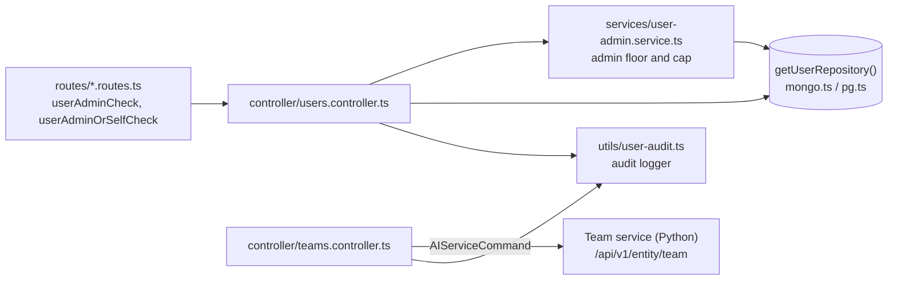

# User management — agent guide

This module owns users, groups, teams, service accounts and the org's own settings in the Node API (`/api/v1/users`, `/api/v1/userGroups`, `/api/v1/teams`, `/api/v1/org`, `/api/v1/service-accounts`). Read this before you change how a user is created, invited, restored, promoted, demoted, deleted or edited, or before you add an audit line here.

Rules shared by every Node module are in [../AGENTS.md](../AGENTS.md); repo-wide rules are in the root [AGENTS.md](../../../../../../AGENTS.md). The audit events and their reasons are in [docs/logging.md](../../../../../../docs/logging.md) "User and group audit events (Node)" and "Org settings, team and service-account audit events (Node)". The user store itself is `libs/repositories/user/` ([README](../../libs/repositories/user/README.md)).

## How it fits



- **Users and groups** live in the document store, through the repositories. Who may call a route is decided by `userAdminCheck` and `userAdminOrSelfCheck`, which read the role through `isUserOrgAdmin`.
- **Teams** live in the graph and are written by the team service (Python). Node checks the request, forwards it, and writes the audit lines from the service's answer.

## Files

| File | What it does |
| --- | --- |
| `services/user-admin.service.ts` | `MAX_ORG_ADMINS`, `isUserOrgAdmin`, `assertCanDemoteAdmin`, `assertCanPromoteAdmin`, and the guarded writes `saveUserEnsuringOrgRetainsAdmin`, `saveUserEnsuringAdminCap`, `createUserEnsuringAdminCap`, `writeEnsuringAdminCap` |
| `controller/users.controller.ts` | Create, update, delete, invite (`processInvites`), resend, profile fields |
| `controller/userGroups.controller.ts` | Groups and group membership |
| `controller/teams.controller.ts` | Team proxy; `TEAM_REFUSALS` maps the team service's status to an audit reason |
| `controller/org.controller.ts` | Org create, update, delete, logo, onboarding |
| `services/service-accounts.service.ts` | Service accounts and their keys |
| `utils/user-audit.ts` | `USER_AUDIT_REASONS`, `userRefusal`, `auditUserRefusal`, `auditUserChange`, `auditMemberships`, `auditTeamMembers` |
| `middlewares/userAdminCheck.ts`, `userAdminOrSelfCheck.ts` | Route guards on the caller's role |

## Rules

**An org always keeps an admin and has at most `MAX_ORG_ADMINS` (5).**
Any write that can make or unmake an admin goes through `user-admin.service.ts`: a demotion through `saveUserEnsuringOrgRetainsAdmin`, a promotion through `saveUserEnsuringAdminCap`, a create as admin through `createUserEnsuringAdminCap`, an admin invite through `writeEnsuringAdminCap`. Never set `role` with a plain `updateProfile` or `setRole` outside them. The `assertCan*` checks alone are only a fast refusal; the count that holds is the one the guarded write makes. Pinned by `tests/modules/user_management/services/user-admin.service.test.ts` and the real-store races in `tests/stores/mongo-transactions.itest.ts` and `tests/stores/pg-identity-checks.itest.ts`.

**The guarded writes have two paths, and both must stay.**
`unitsAreAtomic(rsAvailable)` (`libs/repositories/doc-store.ts`) is true on PostgreSQL and on a MongoDB replica set: the helper locks the org's admin changes (`lockOrgAdminChanges`), writes and counts in one transaction. On a standalone MongoDB it runs under the org's admin-role lease (`withAdminLease`), confirms the lease with `lease.confirm()` before a demotion is saved or a grant is undone, re-counts, and undoes the write when the org went over the cap or lost its last admin. A change that touches one path is tested on both.

**Restore and invite bring an account back as a member, never as an admin.**
`restoreByEmails` sets `role: 'member'` in both stores; an admin invite then promotes, inside `writeEnsuringAdminCap`. The restore is recorded (`ACCOUNT_RESTORED` activity) before any account comes back, and nothing is restored when that record fails. Pinned by the identity contract test "restoreByEmails brings a removed admin back as a member" (`tests/stores/contract/identity.contract.ts`).

**Only a member is deleted, judged at the moment of the write.**
`deleteUser` refuses a non-member (`not_member`) and then calls `markDeleted(..., { onlyMember: true })`, so a user promoted after the check is not removed. The `ACCOUNT_DELETED` activity is recorded first; if it cannot be written, nothing is deleted. A failed create takes its account back the same way, and keeps it (an audit `partial`, reason `kept_after_failure`) when removing it could leave the org without an admin.

**A profile write never lands on a removed account.**
`updateProfile` in the user repository matches only a live account at the write, and returns `null` when it was removed after the read. Callers treat `null` as "User not found". Pinned by the identity contract test "updateProfile writes fields; null for a removed or other-organisation account".

**One audit line per change, written right after the write, with ids only.**
Use the helpers in `utils/user-audit.ts`. A success is `auditUserChange(event, userId, reason?)`; group and team membership lines are `auditMemberships` and `auditTeamMembers`, one per user and group or team. A refusal is tagged where it is thrown with `userRefusal(error, reason)`, and the handler that ends the request calls `auditUserRefusal(event, error, ...)` once; it writes a line only when the reason is in that event's `USER_AUDIT_REASONS` list. The tag is never in the answer. `audit()` (`libs/services/audit.ts`) prints a target that is not an id as `reason=invalid_id`, so never pass an email or a name. Pinned by `tests/modules/user_management/user-audit.http.test.ts`, `org-team-sa-audit.http.test.ts` and `utils/user-audit.test.ts`.

**Messages to the client never name the email.**
Refusals say "A user with this email already exists", not the address. A 4xx message reaches the reader as written, so the same goes for any new one.

**Team changes are audited from the team service's answer only.**
`teams.controller.ts` writes `team.*` success lines after the service answered 200, and `teamRefusal` tags a 403, 404 or 409 as `not_owner`, `not_found` or `name_taken` (`protected_team` for deleting the All team). Node saves nothing about a team itself. Pinned by the "teams" block of `org-team-sa-audit.http.test.ts`.

## Decisions

- **The admin cap is enforced in the write, not before it** (#6251, #6269). A check-then-write let two creates or two bulk invites pass the limit together. Rejected: a pre-check alone.
- **Standalone MongoDB uses a per-org lease instead of a transaction** (#6284). There are no multi-document transactions without a replica set, so admin-role changes take turns. Rejected: compensating writes without a lease, which could leave an org with no admin.
- **Delete removes only a live member, in the write** (#6297); **a failed create takes back its account only when the org keeps an admin** (#6355). A promotion that raced the delete or the create's undo could otherwise remove the admin another change counted on.
- **A profile write is conditional on the account being live** (#6354), so an edit read before a delete does not bring fields back onto it.
- **A restore grants nothing** (#6364). An invite used to bring a removed admin back as an admin without passing the cap.
- **A team edit the team service refuses or fails changes nothing** (#6207, in the Python team service). That is what lets Node audit only what the service accepted.

## Changing this code

### Adding a write that changes a role
- Route it through the matching helper in `services/user-admin.service.ts`, passing `this.config.rsAvailable === 'true'`.
- If no helper fits, add one there with both paths (transaction and lease), not in the controller.
- Write `user.role.change` with `promote`, `demote` or `new_admin` after the write.
- Add a race to `tests/stores/mongo-transactions.itest.ts` and `pg-identity-checks.itest.ts`.

### Adding an audit event or reason
- Add the reason to `UserAuditReason` and to the event's list in `USER_AUDIT_REASONS`.
- Add the row to the table in docs/logging.md, in the same PR.
- Add an HTTP test in `user-audit.http.test.ts` or `org-team-sa-audit.http.test.ts`.

### Adding a user store method
- Implement it in `libs/repositories/user/mongo.ts` and `pg.ts` and cover it in `tests/stores/contract/identity.contract.ts` (root AGENTS.md, "A document change covers both document stores").

### Removing a route
- Remove its audit rows from docs/logging.md and its OpenAPI entry.

## Tests

From `backend/nodejs/apps`:

```bash
npm test
npx cross-env TS_NODE_PROJECT=tsconfig.test.json mocha --grep 'user-admin.service'
npx cross-env TS_NODE_PROJECT=tsconfig.test.json mocha --grep 'user and group audit lines'
npx cross-env TS_NODE_PROJECT=tsconfig.test.json mocha --grep 'org, team and service-account audit lines'
```

- `tests/libs/repositories/user/mongo-admin-lease.test.ts`: the lease itself.
- Real stores (need running databases; CI runs them in `.github/workflows/storage-backends.yml` and `pg-stores.yml`): `tests/stores/mongo-transactions.itest.ts` runs once with `MONGO_IT_URI` pointing at a replica set and `REPLICA_SET_AVAILABLE=true`, and once at a standalone MongoDB with `REPLICA_SET_AVAILABLE=false`; `npm run test:pg-stores` covers PostgreSQL.

## Keeping this file true

When a rule, decision, helper, file or checklist here changes, update this file in the same PR. Cite files and symbols, not line numbers.
