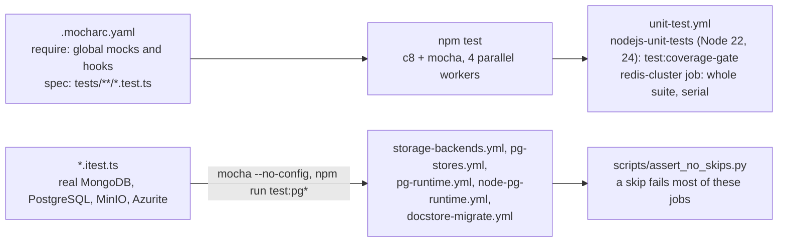

# Node test suite — agent guide

The Mocha suite for the Node API (`backend/nodejs/apps`): unit tests that run on every pull request, and real-store tests (`*.itest.ts`): the module MongoDB and Redis ones in the unit-test job (`test:itest`), the rest in their own workflows, though some are run by none (see below). Read this before you add or move a test, a helper or a global hook, or before you change `.mocharc.yaml`, `.c8rc.json` or the test scripts in `package.json`.

Repo-wide rules are in the root [AGENTS.md](../../../../AGENTS.md). Setup, the npm scripts and coverage reports are in [README.md](./README.md); this file adds what it does not say. How each module's tests are run is in that module's guide (for example [libs/middlewares/AGENTS.md](../src/libs/middlewares/AGENTS.md)).

## How it fits



- `.mocharc.yaml` loads the global mocks and root hooks before any test file, runs `tests/**/*.test.ts` in 4 parallel workers, with a 10 s timeout per test.
- `*.itest.ts` files do not match that glob. Each workflow runs them with `--no-config` and names the files (or a glob) itself. `test:itest` (`tests/modules/**/*.mongo.itest.ts` and `*.redis.itest.ts`) runs in `nodejs-unit-tests` and counts toward its coverage gate; it exits without `MONGO_IT_URI` and `REDIS_IT_URL` (`helpers/require-itest-stores.ts`).

## Files

| Path | What it holds |
| --- | --- |
| `helpers/mock-ioredis-global.ts`, `mock-kafkajs-global.ts`, `mock-mcp-global.ts` | Loaded by `.mocharc.yaml`: fake ioredis and kafkajs so nothing opens a socket; stand-ins for the ESM-only MCP packages |
| `helpers/logger-isolation-global.ts` | Root hook: fails the run when a test left a level method assigned on the shared `Logger` instance |
| `helpers/telemetry-env-global.ts`, `keep-worker-coverage.ts` | Telemetry on for the suite; lets a c8 worker finish writing coverage before it exits |
| `helpers/log-capture.ts` | `captureLogRecords`, `newRequestId`, `inRequestContext`, `recordsOf` |
| `helpers/mock-logger.ts` | `createMockLogger`, `assertNotLogged`, `assertSnakeCaseLogKeys`, `createSnakeCaseLogKeyGuard` |
| `helpers/env-guard.ts` | `envGuard()`: snapshot and restore `process.env` |
| `helpers/mock-*.ts`, `fake-*.ts` | Shared fakes: axios, Mongo, Redis, Kafka, BullMQ, mail, sockets, storage, auth tokens, the container |
| `root-hooks.guard.test.ts` | Fails a serial run when some file has a top-level `afterEach(() => sinon.restore())` |
| `contract/` | Route-validation and MCP tool contracts, with their fixtures |
| `stores/contract/*.contract.ts` | Shared repository contract suites (`describeIdentityContract`, ...), called from a `mongo-*.itest.ts` and a `pg-*.itest.ts` |
| `stores/*.itest.ts`, `stores/*-harness.ts` | Real-store tests and the PostgreSQL harnesses they start |
| `libs/db/`, `libs/services/pg-*.itest.ts`, `scripts/docstore-migrate/` | PostgreSQL runtime and document-store migration tests (`test:pg`, `test:pg-services`, `test:docstore-*`) |
| `setup.ts` | Not loaded: `.mocharc.yaml` does not require it and no test imports it |

## Rules

**A file path on the mocha command line does not narrow the run.** Mocha adds positional paths to the `spec` glob from `.mocharc.yaml`, so `mocha tests/x.test.ts` runs the whole suite (the comment above the redis-cluster step in `unit-test.yml` says the same). Select tests with `--grep`, or run a file with `--no-config` and the `require` list from `.mocharc.yaml` (see Tests). The "Running Specific Tests" commands in `README.md` have this problem.

**Assert on your own request's log lines, never on the whole capture.** `captureLogRecords()` (call it in `beforeEach`; `sinon.restore()` undoes it) collects every record the process writes, including lines from timers another test left running. Give the request an id from `newRequestId()` (as `x-request-id`, or through `inRequestContext`) and assert on `recordsOf(records, id)`. Pinned by `helpers/log-capture.test.ts`.

**Check personal data with `assertNotLogged`, not a string search.** It renders every argument whole (Error messages, nested meta, long lists), ignores case, and fails when the logger got no calls, so a silenced logger cannot pass. Pass the email whole and first and last names separately, and seed the email into id fields too ([docs/logging.md, "Personal data"](../../../../docs/logging.md#personal-data)). Use `createSnakeCaseLogKeyGuard` to check field names across a `describe`. Pinned by `helpers/mock-logger.test.ts`.

**Stub `Logger.prototype`, never assign to a logger instance.** The logger is one root per process, and modules keep the instance they got at load. `instance.warn = ...` shadows the class method for every later file in that worker, so a later `sinon.stub(Logger.prototype, 'warn')` sees nothing. `logger-isolation-global.ts` names the test, puts the logger back, and fails the run once at the end.

**Keep `afterEach(() => sinon.restore())` inside a `describe`.** At file top level Mocha makes it a root hook, which in a serial run also undoes stubs other files made once in `before()`. The parallel run hides this; the redis-cluster job in `unit-test.yml` runs the whole suite with `--no-parallel` and `root-hooks.guard.test.ts` fails there.

**No real connections in a unit test.** ioredis and kafkajs are replaced globally, and `helpers/no-network-global.ts` refuses any dial past loopback and fails the test (unless its title says `@network`). Use the fakes in `helpers/` (and `envGuard()` for `process.env`) before writing a new one, and put a new shared fake there.

**A real-store test is a `*.itest.ts` file, and something must run it.** `npm test` never loads one. It skips itself when its environment variables are missing (each file's header lists them). `pg-stores.yml`, `pg-runtime.yml`, `docstore-migrate.yml` and the MongoDB job in `storage-backends.yml` fail on any skip (`scripts/assert_no_skips.py`); `node-pg-runtime.yml` and the file-storage job do not check. `test:pg-stores` runs `tests/stores/pg-*.itest.ts` by glob, but `storage-backends.yml` names its Mongo files one by one: a new `mongo-*.itest.ts` runs in CI only once it is added there. Most existing `stores/mongo-*.itest.ts` files (identity, oauth, conversation, delegation, ...) are named by no workflow, so their contract cases run in CI on PostgreSQL only.

**A repository change is tested through its shared contract.** A method on a repository with a `mongo.ts` and a `pg.ts` gets its cases in `stores/contract/<name>.contract.ts`, which both stores' itest files call, not in one store's file (root [AGENTS.md](../../../../AGENTS.md), "Storage is pluggable").

**Coverage gates: 89% lines, 90% functions, 80% branches, 89% statements.** They are written in `.c8rc.json` only, and `coverage:check` (run by `test:coverage-gate`, which `test:ci` and the `nodejs-unit-tests` job run) applies them to the unit tests and `test:itest` together. Two more gates are in `package.json`: `coverage:logic` (`src/modules/*/domain/` and `application/`, run by `npm test`) and `coverage:harness` (agent harness and control plane, run by `coverage:check`). `src/libs/repositories/**/pg.ts` is excluded from coverage because the PostgreSQL itests cover it.

## Decisions

- **Log assertions filter by request id** (#6289). Asserting on the whole capture failed whenever another test's timer logged during the test.
- **The logger-isolation hook reports at the end, not in `afterEach`** (#4796). A failing `afterEach` makes Mocha skip the rest of the suite and its cleanup.
- **A serial run guards against root `sinon.restore` hooks** (#3552). The bug only shows without `--parallel`, so the guard test is written to fail there.
- **Workers wait to write coverage on SIGTERM** (#3520). Mocha's pool killed workers mid-write under c8 and their coverage was silently lost.
- **A real-store workflow fails on a skip** (`scripts/assert_no_skips.py`, #4706), where it runs that check: `pg-stores.yml`, `pg-runtime.yml`, `docstore-migrate.yml` and the MongoDB job in `storage-backends.yml`, not `node-pg-runtime.yml` or the file-storage job. A suite skips only when its service is missing, which in CI means the workflow is broken; a green run with skips tested nothing.

## Changing this code

### Adding a test

- [ ] Name it `*.test.ts` under `tests/`, mirroring the `src/` path.
- [ ] Reuse the helpers above; scope `sinon.restore()` and `envGuard()` hooks inside the `describe`.
- [ ] For log lines, use `captureLogRecords` with `recordsOf`, or a mock logger with `assertNotLogged`.
- [ ] Run it with `--grep` or the `--no-config` command below, then `npm test`.

### Adding a real-store test

- [ ] Name it `*.itest.ts`, list its environment variables in the file header, and skip only when they are missing.
- [ ] Make sure a workflow runs it: a glob in `test:itest` or a `test:pg*` script, or the file list in `storage-backends.yml` or `docstore-migrate.yml`. Add the path to that workflow's `paths` filter if it is not covered.
- [ ] For a repository, add the cases to its contract in `stores/contract/` so both stores run them.

### Editing `.mocharc.yaml`, the global helpers or the coverage gates

- [ ] A new global `require` also goes in any `--no-config` command that needs it, including the one in this file.
- [ ] A coverage number changes where it is written: `.c8rc.json`, or the `coverage:logic` or `coverage:harness` script.

### Removing a test or a helper

- [ ] Removing an itest removes it from the workflow that names it, and any `assert_no_skips.py --expect-suite` count that includes it.

## Tests

From `backend/nodejs/apps`:

```bash
npm test                                   # whole unit suite, 4 workers
npm run test:ci                            # npm test, test:itest (MONGO_IT_URI, REDIS_IT_URL), then the coverage gate
npx cross-env TS_NODE_PROJECT=tsconfig.test.json mocha --grep 'describe or it text'
npx cross-env TS_NODE_PROJECT=tsconfig.test.json mocha --no-parallel   # serial, as the redis-cluster job runs it
```

One file only (the `require` list from `.mocharc.yaml`, without its `spec`):

```bash
npx cross-env TS_NODE_PROJECT=tsconfig.test.json mocha --no-config --extension ts --timeout 10000 --exit \
  --require reflect-metadata --require ts-node/register \
  --require ./tests/helpers/mock-ioredis-global.ts --require ./tests/helpers/mock-kafkajs-global.ts \
  --require ./tests/helpers/mock-mcp-global.ts --require ./tests/helpers/keep-worker-coverage.ts \
  --require ./tests/helpers/no-network-global.ts --require ./tests/helpers/journal-history-hooks.ts \
  --require ./tests/helpers/policy-write-observers-hooks.ts --require ./tests/helpers/org-lifecycle-hooks.ts \
  --require ./tests/helpers/session-family-hooks.ts --require ./tests/helpers/telemetry-env-global.ts \
  --require ./tests/helpers/harness-switch-env-global.ts --require ./tests/helpers/logger-isolation-global.ts \
  --require ./tests/helpers/stray-async-errors-global.ts \
  tests/helpers/mock-logger.test.ts
```

Real stores (each file's header lists the variables; `README.md` shows a MongoDB example):

```bash
npm run test:pg-stores        # PG_TEST_BINS, PG_TEST_PGBOUNCER, PG_TEST_MIGRATE_PYTHON; MONGO_IT_URI for the cross-store files
npm run test:pg               # node-pg-runtime.yml
npm run test:pg-services      # pg-runtime.yml
```

## Keeping this file true

When you change `.mocharc.yaml`, a global helper, a coverage gate, a workflow that runs these tests, or a rule, decision or checklist step here, update this file in the same PR. Cite files and symbols, not line numbers.
