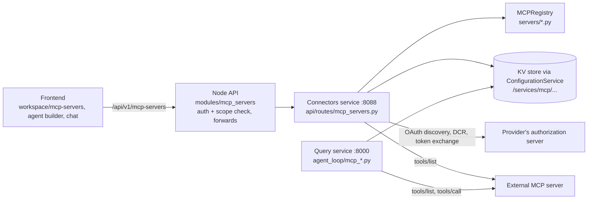
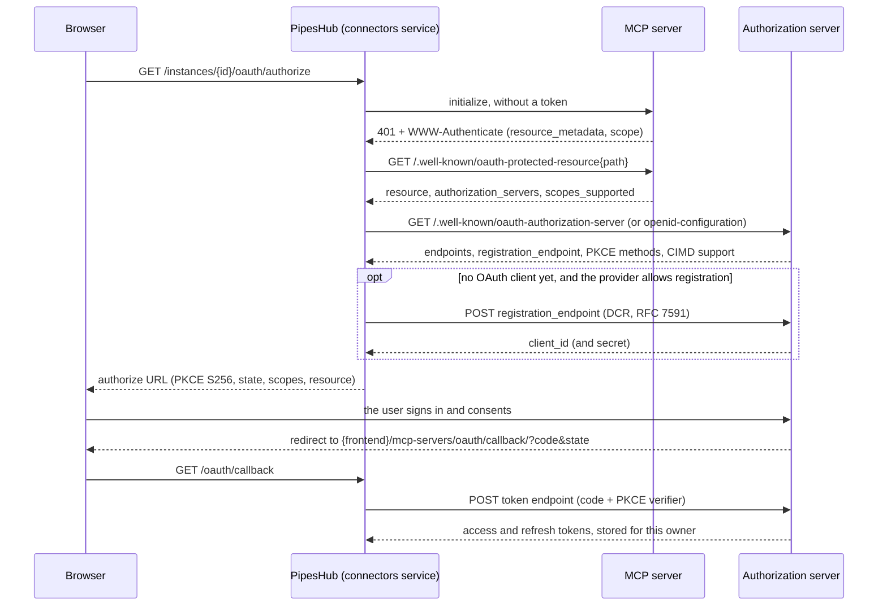

# MCP servers — how they work and how to add one to the catalog

This folder is PipesHub's MCP **client**. It lets agents and chat call tools on external Model Context Protocol servers such as Linear, Notion and GitHub. Read this before you change anything under `backend/python/app/agents/mcp/`, and before you add a server to the catalog. It is written for coding agents first; people can follow it the same way.

Repo-wide rules (layout, tests, storage, the "do not" list) are in the root [AGENTS.md](../../../../../AGENTS.md). Setup is in [CONTRIBUTING.md](../../../../../CONTRIBUTING.md).

This is not PipesHub's own MCP **server** at `/mcp` (`backend/nodejs/apps/src/modules/mcp/`), which lets outside agents search PipesHub.

## Terms

| Term | What it is |
| --- | --- |
| Catalog entry (template) | An `MCPServerTemplate` in `servers/<type_id>.py`. It holds metadata about a well-known server. It has no secrets and no list of tools. |
| Instance | A server someone added. An admin adds an **org** instance, which everyone can see. Any user can add a **personal** instance for themselves. An instance is made from a catalog entry, or is a custom server the admin describes by hand. |
| Credential | What signs one owner in to one instance: an API token, a header value, or OAuth tokens. The owner is a user, an agent (a service-account agent uses its agentKey), or `_shared` for an admin's shared token. |
| Tools | Never written down in this repo. PipesHub lists them live from the server (`tools/list`) and gives them to the model as `mcp_{type_id}_{tool}`. |

## How it fits together



- **Catalog.** At connectors-service startup, `MCPRegistry.auto_discover_templates()` (`registry.py`) imports every module in `servers/`. Each module's `@mcp_server(...)` decorator (`mcp_server_decorator.py`) registers its template. `GET /api/v1/mcp-servers/catalog` serves the list.
- **Instances.** `api/routes/mcp_servers.py` stores instances through `ConfigurationService`. A catalog instance takes its connection fields from the template (`service.template_connection_fields`). The request can't override the transport, command, args or URL. The launch fields (transport, command, args, env var names, URL) are read from the template again on every connection (`service.instance_config_from_dict`), so a template change reaches instances that already exist. The OAuth URLs and scopes are copied once, when the instance is created.
- **Node.** `backend/nodejs/apps/src/modules/mcp_servers/` only checks auth and scopes, then forwards to Python. Adding a server needs no Node change.
- **Chat and agents** (query service). The chat route loads the servers that are attached and signed in: all of the user's signed-in servers for the assistant (`service.get_authenticated_mcp_servers`), or the agent's saved servers. Then:
  - `agent_loop/mcp_tool_loader.py` registers each server's tools for the turn. A server that can't be reached registers nothing, and the model is told why.
  - `agent_loop/mcp_session.py` keeps one session per server per turn. On a 401 it refreshes the OAuth token once and retries.
  - `agent_loop/mcp_tool_adapter.py` runs a call, and `agent_loop/mcp_result.py` turns the result into tool output.
- **Frontend.** Workspace → MCP servers (`frontend/app/(main)/workspace/mcp-servers/`). `team/` holds the admin catalog and org instances; `personal/` holds a user's own servers. The agent builder and chat list servers and their tools.

## Files

| File | What it does |
| --- | --- |
| `servers/*.py` | One catalog entry per file |
| `mcp_server_decorator.py` | `@mcp_server` registers a template; a duplicate `type_id` raises |
| `registry.py` | `MCPRegistry`: imports `servers/`, looks templates up by `type_id` |
| `catalog.py` | Search and paging for `GET /catalog` |
| `models.py` | `MCPServerTemplate`, `MCPTransport`, `MCPAuthMode`, instance, token and DCR models |
| `service.py` | Loads instances; decides whose credential backs a caller (`resolve_effective_user_auth`) |
| `discovery.py` | Connects and lists tools. `build_auth_env_and_headers` turns a credential into env vars or headers |
| `client.py` | `MCPClientManager`: transports (`build_transport`), sessions, timeouts |
| `dcr.py` | OAuth metadata discovery (RFC 9728, RFC 8414), Dynamic Client Registration (RFC 7591), PKCE, the authorize URL |
| `cimd.py` | Client ID Metadata Documents: PipesHub's client ID is a URL the provider reads |
| `oauth_client.py` | Token exchange and refresh requests |
| `token_refresh.py` | Refresh orchestration with a cluster-wide lock |
| `step_up.py`, `www_authenticate.py` | Extra scopes after a 403 `insufficient_scope` |
| `stdio_policy.py` | What a STDIO server may run, and which env var names are allowed |
| `url_guard.py` | SSRF guard on every request to a server or token endpoint |
| `naming.py` | Tool names the model sees |
| `tool_kind.py` | Whether a tool reads, changes or deletes data, for its starting approval rule |
| `tool_cache.py` | Tool lists cached per sign-in |
| `failure.py`, `errors.py`, `wire.py` | Why a server couldn't be used, as one code for the listing, the model and the UI |
| `lifecycle.py` | Removes MCP data when an instance, user, agent or org is deleted |
| `../constants/mcp_server_constants.py` | KV key layout (its docstring lists every key) |
| `../../api/routes/mcp_servers.py` | The HTTP API (connectors service) |
| `../agent_loop/mcp_*.py` | MCP inside a chat turn |
| `../../connectors/core/base/token_service/mcp_token_refresh_service.py` | Background token refresh |

[docs/mcp-hardening-notes.md](../../../../../docs/mcp-hardening-notes.md) records why the module works the way it does, change by change.

## Transports

| `MCPTransport` | What PipesHub does |
| --- | --- |
| `STREAMABLE_HTTP` | Sends HTTP requests to the server's URL. The current MCP standard for hosted servers. |
| `SSE` | The older HTTP + Server-Sent Events transport, for servers that only speak it. |
| `STDIO` | Starts `command args` as a child process on the PipesHub host, in the connectors and query services, and talks to it over stdin/stdout. For servers published as an npm or PyPI package. |

- Every HTTP request goes through `url_guard.py`. Loopback, link-local and cloud-metadata addresses are refused, and so are redirects to another origin. Only admin instances may use private-network addresses (`MCP_ALLOW_PRIVATE_NETWORK_URLS`).
- A catalog STDIO entry always runs its template's `command` and `args` (`stdio_policy.resolve_stdio_launch`). The child process gets the credential's env vars plus the host's proxy and CA settings (`client.INHERITED_NETWORK_ENV`). `npx` or `uvx` has to be on the host.
- Personal instances can't use STDIO, so STDIO entries appear only in the admin catalog. Custom (non-catalog) STDIO servers stay off unless the operator sets `MCP_ALLOW_CUSTOM_STDIO=true`.

## Auth modes

| `MCPAuthMode` | What the user provides | What the server receives (`discovery.build_auth_env_and_headers`) |
| --- | --- | --- |
| `NONE` | Nothing | Nothing |
| `API_TOKEN` | A token. A STDIO server with more than one `required_env` name gets one field per name. | HTTP: `Authorization: Bearer <token>`. STDIO: the token in env var `required_env[0]`, plus any other `required_env` and `optional_env` values. |
| `HEADERS` | A header value. The admin sets the header name; the default is `Authorization`. | `<header name>: <value>` |
| `OAUTH` | Signs in in the browser | `Authorization: Bearer <access token>`, refreshed automatically |

- **Shared admin credential.** For `API_TOKEN` and `HEADERS`, an admin can turn on "use admin auth" (`useAdminAuth`) and enter one token that everyone uses. It is stored under the owner `_shared`. OAuth is always per person.
- **Storage.** Credentials live per instance and owner at `/services/mcp/credentials/{instanceId}/{ownerId}`, and `ConfigurationService` encrypts them. They never go in a template.

## OAuth: discovery, DCR and the other ways to get a client

A template's OAuth fields are only a starting point. At every sign-in PipesHub asks the server how to sign in, as the MCP authorization spec describes.



1. **Discovery** (`dcr.discover_oauth_metadata`). PipesHub probes the server without a token and reads the 401's `WWW-Authenticate` header. It then reads the server's RFC 9728 protected-resource metadata, which names the authorization server, and that server's RFC 8414 (or OpenID) metadata. Discovery is best effort: when it finds nothing, the endpoints stored on the instance are used (for a catalog instance, the template's `authorization_url` and `token_url`). For a catalog instance, discovered endpoints win over the template's. For a custom instance, the endpoints the admin typed win (`_resolve_oauth_endpoints` in the routes).
2. **Which OAuth client signs in** (`_resolve_oauth_client` in `api/routes/mcp_servers.py`). The first of these that applies:
   1. **A static OAuth app** the admin entered on the instance (client ID and secret, `PUT /instances/{id}/oauth-config`). Providers without DCR or CIMD need one; in the catalog today, that is the Google, Slack, Box and GitHub entries. The admin registers the app at the provider with the redirect URI the form shows, `{frontend public URL}/mcp-servers/oauth/callback/`.
   2. **A client registered earlier by DCR.** First, the owner's own registration from before registrations were shared (`get_mcp_dcr_client_path`), which is still used as it is. Then the instance's shared registration (`get_mcp_shared_dcr_client_path`). Every new registration goes there, and everyone who signs in uses it. The shared one is replaced when the redirect URI changes, its secret expires, or the provider rejects it.
   3. **A Client ID Metadata Document** (`cimd.py`). The client ID is a URL on PipesHub (`/mcp-servers/oauth/client-metadata.json`, served by Node), and the provider reads the client's details from it. PipesHub uses it only when the provider advertises `client_id_metadata_document_supported`, the deployment's public address is https and serves the document, and `MCP_OAUTH_CLIENT_METADATA_DOCUMENT` isn't `false`. When a provider refuses the document, PipesHub uses DCR with that provider for the next 7 days.
   4. **Dynamic Client Registration** (RFC 7591, `dcr.register_dynamic_client`) at the provider's `registration_endpoint`.
   5. If none of these applies, the sign-in fails with "Ask an administrator to configure an OAuth app with redirect URI …".

   So for a server with DCR or CIMD, nobody creates an OAuth app. Without either, the admin has to.
3. **Scopes.** PipesHub asks for the template's `default_scopes` when there are any. Otherwise it asks for the scopes the server's 401 named, and otherwise the scopes in the server's protected-resource metadata. It never asks for the authorization server's whole `scopes_supported` list, which covers every app that server signs in to. If a later call fails with 403 `insufficient_scope`, the next sign-in adds the scopes it named, and chat shows a card to sign in again (`step_up.py`, `agent_loop/mcp_sign_in.py`).
4. **PKCE with S256** on every sign-in. A provider that lists its PKCE methods without S256 is refused.
5. **`resource`** (RFC 8707) is sent only when the server publishes RFC 9728 metadata, because some identity providers reject a `resource` they don't know.
6. **Token endpoint authentication** is `client_secret_post`, unless the provider lists its methods without it; then `client_secret_basic`, or `none` for a provider with only public clients (`dcr.preferred_token_auth_method`). `oauth_client.py` reads JSON and form-encoded token responses, and errors sent with HTTP 200 (GitHub does this).
7. **Refresh.** Tokens keep the token URL and the client that issued them, so a refresh doesn't depend on the template. `mcp_token_refresh_service.py` refreshes shortly before expiry, and `agent_loop/mcp_session.py` refreshes once when a call gets a 401.
8. **Provider quirks belong in the template.** `authorization_params` adds query parameters to the authorize URL: Google needs `access_type=offline` and `prompt=consent` to return a refresh token. `client_secret_prefix` names a fixed prefix the provider's secrets start with (Google's `GOCSPX-`), so the form can warn about a secret pasted without it.

## Adding a server to the catalog

### 1. Find out how the server works

From the vendor's MCP docs, collect the server's URL (or its npm or PyPI package for STDIO), its transport, how it signs in, the scopes it needs and its docs link. Then check the sign-in details with PipesHub's own discovery, from `backend/python` with the venv active:

```bash
python -c "
import asyncio
from app.agents.mcp.dcr import discover_oauth_metadata
from app.agents.mcp.url_guard import MCPUrlPolicy
m = asyncio.run(discover_oauth_metadata('https://mcp.linear.app/mcp', policy=MCPUrlPolicy(allow_private=False)))
print(m.model_dump_json(indent=2) if m else 'no usable OAuth metadata discovered')
"
```

| In the output | What it means for the template |
| --- | --- |
| `registration_endpoint` is set | DCR works: users only sign in. Set `supports_dcr=True`. |
| `client_id_metadata_document_supported: true` | CIMD works on https deployments. |
| Neither of the above | The admin must create an OAuth app at the provider. Set `supports_dcr=False`, and say where to create it in the module docstring and `documentation_url`. |
| `code_challenge_methods_supported` without `S256` | PipesHub can't sign in to this server. |
| `authorization_endpoint`, `token_endpoint` | Use them as `authorization_url` and `token_url`. |
| `challenge_scopes`, `resource_scopes` | What the server asks for. Leave `default_scopes=[]` to use them, or list the scopes to request. |
| `no usable OAuth metadata discovered` | Either the server publishes none, or the probe failed: discovery also returns nothing on a network error, a timeout or a blocked address. A blocked or unresolvable address is logged above the result. Check the URL and run it again, then read the vendor's docs before you pick an auth mode. The server may take an API token or a header, or document its OAuth endpoints there. |

To see the tools a server offers, list them the way PipesHub will:

```bash
python -c "
import asyncio
from app.agents.mcp.discovery import discover_tools
from app.agents.mcp.models import MCPAuthMode, MCPServerConfig, MCPTransport
config = MCPServerConfig(_id='probe', org_id='local', created_by='me', name='probe',
    transport=MCPTransport.STREAMABLE_HTTP, auth_mode=MCPAuthMode.API_TOKEN,
    url='https://mcp.example.com/mcp', created_at=0, updated_at=0)
for tool in asyncio.run(discover_tools(config, {'apiToken': '<token>'})):
    print(tool.namespaced_name, tool.kind)
"
```

For a server without auth, use `MCPAuthMode.NONE` and `{}` in place of the token. An OAuth server is easier to check in the running app (step 4).

### 2. Write the template

Create `servers/<type_id>.py`, starting from the closest existing entry:

| The server is | Start from |
| --- | --- |
| Hosted, OAuth with DCR | `linear.py`, `notion.py` |
| Hosted, OAuth without DCR (the admin creates an app) | `box.py`; with extra authorize parameters and a secret prefix, `google_drive.py` |
| Hosted, OAuth or a personal access token | `github.py` |
| A package run locally, with one API key | `exa.py` |
| A package run locally, with several env vars | `slack.py` |

```python
"""Acme MCP server template — official remote server (Streamable HTTP), OAuth + DCR."""
from app.agents.mcp.mcp_server_decorator import mcp_server
from app.agents.mcp.models import MCPAuthMode, MCPServerTemplate, MCPTransport


@mcp_server(
    MCPServerTemplate(
        type_id="acme",
        display_name="Acme",
        description="Tickets, projects and comments in Acme.",
        icon="/icons/connectors/acme.svg",
        transport=MCPTransport.STREAMABLE_HTTP,
        default_auth_mode=MCPAuthMode.OAUTH,
        supported_auth_modes=[MCPAuthMode.OAUTH],
        default_url="https://mcp.acme.com/mcp",
        # Confirmed live via https://mcp.acme.com/.well-known/oauth-protected-resource/mcp
        # -> AS https://mcp.acme.com, whose metadata has a `registration_endpoint` (RFC 7591).
        authorization_url="https://mcp.acme.com/authorize",
        token_url="https://mcp.acme.com/token",
        default_scopes=[],
        supports_dcr=True,
        documentation_url="https://docs.acme.com/mcp",
        tags=["issues", "project-management"],
    )
)
class AcmeMCPServer:
    """Marker class — see `mcp_template` for the registered catalog entry."""
```

That is all the registration there is: no list to edit, and no route or Node change. The registry imports every module in `servers/` at startup, and the connectors service logs how many templates it loaded. A module that fails to import is logged ("Failed to import MCP server template module …") and left out. So is a module whose `type_id` is already taken: the decorator raises "Duplicate MCP server template type_id".

#### Template fields

| Field | What it does |
| --- | --- |
| `type_id` | The entry's id, stored on every instance made from it, and the prefix of its tool names. |
| `display_name` | The name on the catalog card. |
| `description` | One line on the card. Catalog search matches it. |
| `icon` | Path of the logo the catalog pages show, `/icons/connectors/<file>.svg`. See step 3. |
| `transport` | `STREAMABLE_HTTP`, `SSE` or `STDIO`. Instances can't change it. |
| `default_auth_mode`, `supported_auth_modes` | The modes the person adding the server may pick, and the one selected first. |
| `command`, `args` | STDIO only: the exact command to run. |
| `required_env`, `optional_env` | STDIO only: env var names the user fills in. The first required name receives the API token. |
| `default_url` | HTTP only: the server's URL. Every instance of this entry connects to it. |
| `authorization_url`, `token_url` | OAuth only: the fallback endpoints when discovery finds none. |
| `default_scopes` | Scopes to request at sign-in. `[]` lets the server's own 401 or metadata decide. |
| `authorization_params` | Extra query parameters on the authorize URL. It can't override the protocol's own (`client_id`, `redirect_uri`, `response_type`, `state`, `scope`, PKCE, `resource`). |
| `supports_dcr` | A hint for the admin form until its live probe answers. Discovery decides whether an OAuth app is really needed. |
| `client_secret_prefix` | The fixed start of the provider's client secrets, for the form's warning. |
| `documentation_url` | A link shown in the setup and sign-in dialogs. |
| `auth_hint` | `label`, `placeholder` and `help_text` for the API token field. The UI doesn't show it for OAuth sign-in. |
| `tags` | Words catalog search matches. |
| `replaced_by` | The `type_id` of the entry that replaces this one. A replaced entry makes no new instances; the ones already made keep working. |

#### Rules a template has to follow

- **`type_id`.** Lowercase snake_case, unique, and short. Tools reach the model as `mcp_{type_id}_{tool}`, and a name over 64 characters gets shortened with a hash (`naming.py`).
- **Never rename or delete a shipped entry.** Instances store its `type_id`, and agents store tool names built from it. Retire an entry with `replaced_by` and keep its module, as `slack.py` does.
- **No secrets.** `GET /catalog` sends every template to every signed-in user. Never put a key, secret or customer-specific value in one.
- **One URL for everyone.** A catalog instance always connects to the template's `default_url`, and the admin can't change it. A server whose address differs per customer (`https://<your-instance>.service-now.com/…`, self-managed GitLab, a regional host) can't be a working catalog entry today; people add it as a custom server instead.
- **Pin STDIO packages to an exact version**, such as `exa-mcp-server@3.4.1`, never `@latest`. `npx -y` and `uvx` run whatever was published last.
- **Env var names must pass `stdio_policy.is_allowed_env_name`.** That means upper case, and not a name that changes how a process loads (`PATH`, `HOME`, `LD_*`, `NODE_*`, `NPM_CONFIG_*`, `PYTHON*`, `UV_*`, …). A name that fails is dropped at launch without an error.
- **The test checks these** (`test_auto_discover_templates_are_well_formed`): `default_auth_mode` is in `supported_auth_modes`; an HTTP entry has `default_url`; a STDIO entry has `command`; an entry whose default is `API_TOKEN` lists `required_env`; an OAuth entry has `authorization_url` and `token_url`.
- **Say where each fact came from**, in a comment such as "Confirmed live via …", as the existing templates do, so a later reader can check it again.
- **No per-server code.** Routes, the client and sign-in never branch on a `type_id`. Anything specific to one server is a template field. If a server needs something no field covers, that is a change to the framework (`models.py` and everything that reads it): raise it in the issue before writing it.

### 3. Add the logo

The UI finds logos in two ways, so there are two places to update:

1. **The catalog pages** show the template's `icon` as an image. Put the SVG in `frontend/public/icons/connectors/<name>.svg` (many vendors' logos are already there) and set `icon="/icons/connectors/<name>.svg"`.
2. **The agent builder, chat and tool cards** find a server's logo from its `type_id`, through `resolveConnectorType` in `frontend/app/components/ui/ConnectorIcon.tsx` (used by `McpServerIcon`). Without an entry there they show the generic MCP icon. Add the key to `ConnectorType` and `CONNECTOR_ICONS`, with `needDarkModeInvert: true` for a dark logo. When the `type_id` with `_` turned into `-` isn't that key, add a `FUZZY_MATCH_RULES` pattern too, before any broader pattern it contains (`dropbox` comes before `box`).

### 4. Test it

- **Catalog test.** From `backend/python`, run `pytest tests/unit/agents/mcp/test_registry.py`. Add the new `type_id` to `test_auto_discover_templates_loads_builtin_servers`.
- **Logo test.** Add a case to `frontend/app/(main)/workspace/mcp-servers/__tests__/mcp-server-icon.test.tsx`. From `frontend`, run `npx vitest run "app/(main)/workspace/mcp-servers/__tests__/mcp-server-icon.test.tsx"`.
- **In the running app.** Start PipesHub ([CONTRIBUTING.md](../../../../../CONTRIBUTING.md)), sign in as an admin and open Workspace → MCP servers. Add the server from the catalog, sign in to it, and check that its tools are listed. Then attach it to an agent, or use it in chat, and make one tool call. For an OAuth server without DCR, first create the OAuth app at the provider with the redirect URI the form shows.

## Re-enabling a disabled entry

Fifteen modules in `servers/` are commented out. Each one starts with `# Disabled: temporarily removed from the MCP server catalog`: `brave_search`, `datadog`, `docusign`, `dropbox`, `gitlab`, `greenhouse`, `hubspot`, `outreach`, `pagerduty`, `posthog`, `redshift`, `sentry`, `servicenow`, `stripe` and `zoom`.

To bring one back, uncomment it and run the discovery from step 1 again. Vendors change their servers, and the "Confirmed live" comments are only as current as the day they were written. Fix whatever changed, then do steps 3 and 4. Two things to watch for:

- `servicenow.py`'s URLs are per-customer placeholders, so it can't work as a catalog entry (see "One URL for everyone").
- The comments in `datadog.py` and `gitlab.py` about overriding `default_url` can only mean adding a custom server: a catalog instance always uses the template's URL.

## Settings

| Setting | Default | What it controls |
| --- | --- | --- |
| `ENABLE_MCP` (Labs feature flag) | on | MCP for the whole deployment |
| `MCP_ALLOW_CUSTOM_STDIO` | `false` | Whether admins may add custom (non-catalog) STDIO servers |
| `MCP_STDIO_ALLOWED_COMMANDS` | `npx,uvx` | Commands a custom STDIO server may run |
| `MCP_ALLOW_PRIVATE_NETWORK_URLS` | `true` | Whether admin instances may use private-network addresses |
| `MCP_OAUTH_CLIENT_METADATA_DOCUMENT` | `true` | Whether to use CIMD where the provider supports it |
| `MCP_TOOL_CALL_MAX_SECONDS` | `1800` | The longest a tool call may run while it keeps reporting progress |
| `MCP_MAX_PERSONAL_INSTANCES` | `25` | Personal servers per user |
| `MCP_TOOL_CACHE_TTL_SECONDS`, `MCP_TOOL_CACHE_STALE_TTL_SECONDS` | `86400`, `900` | How long a server's tool list stays cached |

Each instance also has a connect timeout (15 s by default, at most 45 s) and a call timeout (60 s by default, at most 600 s).

## Other behaviour worth knowing

- **Tool approvals.** Each person decides which of their MCP tools run freely, which ask first and which never run (`/instances/{id}/my-tool-rules`). A tool's starting rule comes from `tool_kind.py`. A server's `readOnlyHint` makes a tool read-only, and `destructiveHint` marks it as deleting. A tool whose name says it deletes counts as deleting, whatever its hints say. A tool without hints counts as changing data, so it asks before it runs.
- **Tool cache** (`tool_cache.py`). A server's tool list is cached per sign-in, so a chat turn doesn't connect to every attached server just to learn its tools.
- **Errors.** `failure.py` gives each failure one code. The server listing, the model and the UI all use that code.
- **Clean-up.** `lifecycle.py` removes the MCP data that belongs to an instance, a user, an agent or an org when it is deleted.

## Keeping this file true

When you change how this module works (a template field, the order OAuth clients are tried in, a transport, an auth mode), update this file in the same PR. Cite files and symbols, not line numbers.
