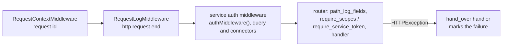

# Python API middlewares — agent guide

This folder holds what every request to the query, connectors and indexing services passes through: the request id, the one `http.request.end` line, and bearer-token authentication. Read this before you change a file here, add a router or a route that binds ids or answers its own errors, or add an auth dependency.

Repo-wide rules are in the root [AGENTS.md](../../../../../AGENTS.md); read its "Logging and errors" section first. The request line's contract (levels, fields, the client-leaves table, limits) is [docs/logging.md, "HTTP requests (Python)"](../../../../../docs/logging.md#http-requests-python); bound ids are in ["Context and fields (Python)"](../../../../../docs/logging.md#context-and-fields-python). Where the org comes from is [docs/org-context.md](../../../../../docs/org-context.md). This guide adds what you need to change the code itself.

## How it fits



- `install_request_logging(app)` adds `RequestLogMiddleware`, then `RequestContextMiddleware` outside it, the `HTTPException` hand-over handler and the uvicorn filter. `query_main` and `connectors_main` call it after adding their auth middleware, so the line sees every refusal; `indexing_main` has no auth middleware and calls it too. Those three run uvicorn with its access log off.
- The auth middleware is not in this folder. `query_main` wraps `authMiddleware` in a raw ASGI class (`AuthenticateRequests`); `connectors_main` uses `@app.middleware("http")`, a `BaseHTTPMiddleware`. Both mark a refusal with `mark_request_failure` and answer it themselves.
- `docling_main`, `embedding_main` and `parsing_main` add `RequestContextMiddleware` without `install_request_logging`, so they write no `http.request.end`.

## Files

| File | What it does |
| --- | --- |
| `request_log.py` | `install_request_logging`, `RequestLogMiddleware`, `mark_request_failure`, `bind_request_log_fields`, `add_request_log_fields`, `path_log_fields` |
| `request_context.py` | `RequestContextMiddleware`: sanitises `X-Request-ID` and binds it for the request |
| `auth.py` | `authMiddleware`, `AuthRejected`, `require_scopes`, `require_service_token`, `deny_service_tokens`, `service_token_org`, `PRE_ORG_SERVICE_ROUTES` |
| `token_policy.py` | Regular vs service tokens, `ACCEPTED_SERVICE_SCOPES` |
| `caller_role.py` | `fetch_caller_role`: asks Node whether a token is still live and what role the caller has; `CallerRoleCache` |
| `admin_gate.py` | `require_admin_caller`: a dependency that lets only org admins through |
| `body_limit.py` | `BodyLimitMiddleware`: 413 for an oversized POST, PUT or PATCH body on an exact path |
| `../../utils/route_template.py` | `route_template`: the route the line logs, shared with `MetricsMiddleware` |
| `../../utils/logging_fields.py` | `bind_log_fields`, `LOG_FIELD_NAMES`: the ids that may be bound |

## Rules

**One `http.request.end` per request, written by `RequestLogMiddleware`.** A route raises (`raise HTTPException(...) from e`) and does not log the failure too (root "Logging and errors"). An exception nobody handled is `internal`, logged with its stack once. Keep the middleware raw ASGI: it must see the request id, the org the auth middleware bound, `scope["route"]` and the end of a stream. Tested in `test_request_log.py`.

**A failure turned into a response must be marked.** Code that answers a failure itself (an auth refusal, a route that answers 2xx after a dependency failed, an OAuth callback that redirects) calls `mark_request_failure(request, exc, error_class=..., reason=..., include_error_text=...)`, or the line reads as a success. Mark the `HTTPException` you raise, not its cause, then raise it `from` the cause. `exc` may be `None` only with an `error_class`. The full behaviour is in docs/logging.md, "HTTP requests (Python)". Tested in `test_hints_win_and_the_http_exception_handler_keeps_them` and `test_a_marked_failure_answered_with_a_2xx_is_logged_as_a_failure`.

**Ids for the whole request go through `bind_request_log_fields(request, ...)`, not `bind_log_fields` alone.** The route can run in a child task (a `BaseHTTPMiddleware` such as the connectors auth middleware), whose context the line cannot see; `bind_request_log_fields` also puts the ids in the ASGI scope. Names must be in `LOG_FIELD_NAMES`, or it raises `ValueError`. `add_request_log_fields` adds a bounded event field (`oauth_error=...`) to this line only; never raw request input. Tested in `test_unknown_ids_raise_and_event_fields_go_on_the_request_line_only` and `test_ids_never_leak_into_the_next_request`.

**`path_log_fields(...)` returns an async dependency; keep it async.** FastAPI runs a sync dependency in a thread, and the route's own lines would lose the binding. `test_a_router_binds_its_path_ids_on_the_route_lines_and_the_request_line` checks the id on both the route's line and the request line.

**`path_log_fields` binds a path value only when it is shaped like an id.** `_SHOWN_ID` is the rule of Node's `isShownId`, which its `bindPathLogFields` applies too ([middlewares guide](../../../../nodejs/apps/src/libs/middlewares/AGENTS.md)); any other value is dropped, not bound. Still bind only params that hold ids. Tested in `test_a_path_value_that_is_not_an_id_is_not_bound`.

**The line logs the route template, never the raw path or query.** `route_template(scope)` gives `/api/v1/kb/{kb_id}`, or the route a request refused before routing would have reached, or `unmatched`. Do not add `scope["path"]`, the query or a header to the fields. Tested in `test_no_raw_path_query_or_email_is_logged`.

**A crash before anything was sent is answered here, and the middleware returns.** The client gets 500 `{"detail": "Internal server error"}` (`_CRASH_BODY`) and the keep-alive connection stays open. Re-raising would let uvicorn close it. A stream that already started is re-raised. Tested in `test_a_crash_is_answered_by_the_middleware_which_returns_so_the_connection_stays_open`.

**Logging never breaks a request.** `_Request.log` suppresses any exception from writing the line. Tested in `test_a_logging_failure_never_breaks_the_request`.

**Every auth refusal is an `AuthRejected` with a `reason`.** The client gets the same status, detail and headers as from an `HTTPException`; `reason` is never sent and goes on the line. A refusal is INFO; `_REASON_LEVEL` makes `org_mismatch` WARNING. A new reason goes in the list in docs/logging.md "HTTP requests (Python)" and gets a case in `test_auth_reasons.py`. The `detail` reaches the user through Node (root guide), so it is fixed wording.

**Every route declares which tokens it admits.** `require_scopes`, `require_service_token` and `deny_service_tokens` tag the dependency with `AUTH_POLICY_ATTR`. `test_route_auth_policy.py` fails on a mounted route without one, and when the routes a service token reaches differ from `_SERVICE_TOKEN_ROUTES`. A service token is accepted at all only when its `scopes` claim holds one of `ACCEPTED_SERVICE_SCOPES`, because the same secret signs Node's single-purpose tokens.

**A valid signature does not prove a session or an OAuth/PAT token is live.** `resolve_request_role` asks Node through `fetch_caller_role`: a refusal is 401, no answer is 503 `unconfirmed` with `Retry-After: 5`. Fail closed; never treat an unknown answer as valid. Session answers are reused for `SESSION_CHECK_CACHE_SECONDS` (default 30). Service tokens are not checked there. `fetch_caller_role` forwards only the `Authorization` and MCP relay headers, never cookies. Tested in `test_caller_role.py` and `test_auth_reasons.py`.

**The org comes from the verified token, never from the request.** `_bind_org_context` binds the token's `orgId`. A service token without one is 401 except on `PRE_ORG_SERVICE_ROUTES`, which must match docs/org-context.md; `test_org_context_binding.py` pins both.

## Decisions

- **One request line from a raw ASGI middleware** (#5638). uvicorn's access line was rejected: it was written when the response started, outside the request context, with the raw path and query. A 5xx was logged zero, one or two times, and most 401 and 403 answers not at all.
- **A crash is answered here, not re-raised** (#5638), so a client's keep-alive connection survives.
- **Auth refusals are INFO with a `reason`** (#5638). An expired session is routine, so alert on `reason`, not the level; the per-refusal WARNINGs were removed.
- **The line reads `receive` one message ahead** (#5681), so it sees a client that left before a plain response.
- **Ended sessions are refused in Python, not only in Node** (#3680). Signature and expiry alone let a signed-out session keep working against the Python services.
- **Service tokens need an accepted scope, and each route opts in** (#3283). Any token signed with the scoped secret used to pass as a user credential.

## Changing this code

### Adding a router or route

- [ ] Its auth dependency is `require_scopes(...)`, `require_service_token(...)` or `deny_service_tokens`; a new router is added to `_ROUTERS` in `test_route_auth_policy.py`, and a route that admits a service token to `_SERVICE_TOKEN_ROUTES`.
- [ ] Path params that are ids are bound with `dependencies=[Depends(path_log_fields(param="field_id"))]`, under a name in `LOG_FIELD_NAMES`.
- [ ] A failure it answers itself is marked with `mark_request_failure`.

### Adding a log field or refusal reason

- [ ] A new bindable id goes in `LOG_FIELD_NAMES` and in docs/logging.md "Conventions", under the name Node uses.
- [ ] A new `AuthRejected` reason goes in the reason list in docs/logging.md and in `test_auth_reasons.py`.

### Editing the request line

- [ ] It stays raw ASGI and inside `RequestContextMiddleware`.
- [ ] A change to when the line says `cancelled` updates `_end_outcome`, the table in docs/logging.md and `test_the_end_outcome_follows_the_table` together.
- [ ] Any new field is a scalar computed here, never request input.

### Removing

- [ ] Removing a route also removes it from `_SERVICE_TOKEN_ROUTES`; removing a pre-org route also removes it from docs/org-context.md.

## Tests

From `backend/python` with the venv active:

```bash
pytest tests/unit/api/middlewares/ -x
pytest tests/unit/api/test_route_auth_policy.py
pytest tests/unit/test_query_main.py tests/unit/test_connectors_main.py tests/unit/test_indexing_main.py
```

| Test file (`tests/unit/api/middlewares/` unless noted) | Pins |
| --- | --- |
| `test_request_log.py` | One line, levels, marking, ids, crash answer, client leaves |
| `test_auth_reasons.py` | Every refusal's status, detail, headers and `reason` |
| `test_auth.py`, `test_auth_real_tokens.py`, `test_token_policy.py` | Token classes and scopes |
| `test_caller_role.py` | Node lookup, fail-closed, cache, forwarded headers |
| `test_org_context_binding.py` | The org comes from the token; the pre-org allowlist |
| `test_body_limit.py` | 413 by declared length and by streamed size |
| `tests/unit/api/test_route_auth_policy.py` | Every route's token policy; which routes take a service token |

## Keeping this file true

When you change a rule, a decision, a file or symbol named here, the middleware order in a service's `*_main.py`, or a checklist step, update this file in the same PR. Cite files and symbols, not line numbers.
