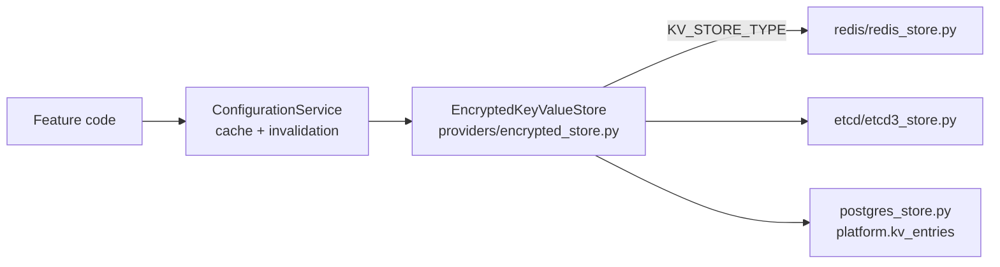

# Configuration and file types (`app/config`) — agent guide

This folder holds `ConfigurationService`, which every Python service uses to read and write the key-value config store; the key-value store providers behind it; and `file_types.py`, the one table of file types PipesHub knows. Read it before you change any of them, or before you write code that acts on a config value being absent. The rule that config goes through `ConfigurationService` is in the root [AGENTS.md](../../../../AGENTS.md) ("Conventions"). Failure logging follows [docs/logging.md](../../../../docs/logging.md), "Failures".

## How it fits



- **Store.** `EncryptedKeyValueStore` reads `KV_STORE_TYPE` and builds its backend through `KeyValueStoreFactory`. `redis` and `postgres` pick those stores, and any other value picks etcd. It encrypts each value with AES-256-GCM, using a key derived from `SECRET_KEY`. Keys in `UNENCRYPTED_KEYS` or under `UNENCRYPTED_PREFIXES` are stored as plain JSON.
- **Cache.** `ConfigurationService` keeps an in-process LRU of up to 1000 values. A write publishes the key through `store.publish_change`, and every process drops its cached copy when `subscribe_changes` delivers that key. On `KV_STORE_TYPE=postgres` the cache is a `TTLCache` that also expires entries after `CONFIG_CACHE_TTL_SECONDS` (default 60), because a NOTIFY can be lost.
- **File types.** `file_types.py` imports nothing from the app, so any service can import it. `constants/arangodb.py` re-exports lists derived from it. The Node upload table, `backend/nodejs/apps/src/modules/storage/mimetypes/file-types.generated.ts`, is generated from it.

## Files

| File | What it does |
| --- | --- |
| `configuration_service.py` | `ConfigurationService` (`get_config`, `set_config`, `create_config_if_absent`, `update_config`, `delete_config`) and `delete_config_confirmed` |
| `key_value_store.py` | `KeyValueStore`: the contract every backend implements |
| `key_value_store_factory.py` | `KeyValueStoreFactory`: builds a backend by `StoreType` |
| `providers/encrypted_store.py` | `EncryptedKeyValueStore`: picks the backend, encrypts values, lists the plaintext keys |
| `providers/redis/`, `providers/etcd/`, `providers/postgres_store.py`, `providers/in_memory_store.py` | The backends |
| `file_types.py` | `FILE_TYPES`, `REGISTRY_VERSION`, and every extension and mime list derived from them (`tier`, `kind`, `parse_format`, `labels_route`, `node_upload_table`, ...) |
| `redaction.py` | `REDACTED_PLACEHOLDER` and the `HIDE_SECRET_CONFIG` / `?reveal=true` checks for config routes |

## Rules

**`get_config` answers `default` when the store fails, unless you pass `raise_on_error=True`.**
By default, "the store could not be read" and "the key is not set" give the same answer. With `raise_on_error=True`, a failed read raises. It doesn't fall back to an env value either. A missing key still answers `default`. Any caller that acts on absence must pass it: a delete, a list rewrite, or a "not configured" answer. A missing key that has an env fallback (`_get_env_fallback`: Kafka, Arango, Redis, Qdrant, OpenSearch) answers the env-derived config instead of `default` when those variables are set, with or without the flag. Pinned by `TestGetConfig` in `tests/unit/config/test_configuration_service.py`.

**Writes report failure differently, so pick the call that tells you what you need.**
`set_config`, `update_config` and `delete_config` catch a store failure, log it once (`config.set.failed`, `config.update.failed`, `config.delete.failed`) and return `False`. `delete_config` also returns `False` for a key that wasn't there. If you need to know the key is gone, call `delete_config_confirmed`. It re-reads with `raise_on_error=True` when the delete answered `False`. `create_config_if_absent` doesn't catch failures: it raises. Pinned by `TestDeleteConfig` and `TestDeleteConfigConfirmed`.

**Claim a key with `create_config_if_absent`.**
Root AGENTS.md ("Logging and errors") says there is no compare-and-set. `create_config_if_absent` creates the key only if nobody has. `True` means this call created it, and `False` means another value is already there. With `ttl_seconds` it is a lease a crashed holder can't keep, not a fence: a holder that runs past the TTL loses the key to the next caller and can't tell, and its delete then removes that caller's claim. Keep the work well inside the TTL: `ConfigurationService` has no atomic check-and-delete, so a holder cannot safely confirm it still owns the key before acting or deleting it. Pinned by `tests/unit/config/test_key_value_store_contract.py`, which runs `create_key(..., overwrite=False)` against the stores in its `ALL_STORES`.

**Cache only what every writer invalidates.**
`use_cache=True` is safe for org-level config, because writes from Python and from the Node admin API publish an invalidation for the key. Don't cache credential paths whose tokens are refreshed out of band. Pass `keep_in_cache=False` for keys that are many, large or short-lived, so they don't push org config out of the LRU. For a cached key you act on, pass `max_age_seconds`, which bounds how stale a hit may be if the invalidation subscription has died.

**Every backend keeps the same contract.**
`delete_key` returns `True` if it deleted the key and `False` if the key was absent, and raises when the store is unavailable. `create_key(..., overwrite=False)` returns `False` for an existing key and raises on failure, so "already exists" never stands for an outage. `get_key(..., raise_on_error=True)` raises instead of answering `None`. A backend with cross-process notification overrides `subscribe_changes`, `publish_change` and `unsubscribe_changes`, so `ConfigurationService` never branches on store type. Pinned by `test_key_value_store_contract.py` and `test_etcd3_store.py` (`test_delete_key_absent_returns_false`, `test_delete_key_failure_raises`).

**Stores raise; the caller that handles the error logs it once.**
A backend and `EncryptedKeyValueStore` raise without logging. `ConfigurationService._log_store_failure` writes the one line through `log_failure`. No log line carries a stored value, because values hold credentials. Pinned by `tests/unit/config/test_kv_store_log_hygiene.py`, which runs every store at DEBUG with a secret in the value.

**A key Node reads as plaintext must be listed as unencrypted.**
`EncryptedKeyValueStore` encrypts every value except keys in `UNENCRYPTED_KEYS` and `UNENCRYPTED_PREFIXES`. A new key that Node reads without the Python encryption belongs in one of them.

**`file_types.py` is the one table of file types. Never keep a second extension or mime list.**
Derive the list from `file_types`. `tests/unit/config/file_types/test_single_source.py` fails on any new literal list of three or more known extensions or mimes outside the registry, apart from an exact allowlist.

**The Node upload table is generated, never edited by hand.**
After changing a type's `upload`, `upload_mime`, mimes or extensions, run `python -m app.config.file_types --emit node` from `backend/python`. `tests/unit/config/file_types/test_node_parity.py` fails when the generated file and the registry differ.

**Making a type indexable or routed bumps `REGISTRY_VERSION`.**
Set the type's `since` (indexable) or `route_since` (dispatch branch) to the new version. The file-type requeue migration (`app/migrations/file_type_requeue/`) runs once per version and takes back records the gate refused before. `test_the_registry_version_is_the_one_that_made_the_newest_type_indexable` (`test_registry_invariants.py`) checks that the version equals the highest `since` or `route_since`.

**Parse tier and kind follow the reader the labels select, not the extension.**
`tier` and `kind` first ask `labels_route` which in-process reader the extension and mime select. Only labels that select no reader fall back to extension, then mime, then heavy. A CSV sent as `application/vnd.ms-excel` is read by the XLS reader, so it is heavy. Pinned by `test_labels_follow_the_reader.py`. [docs/indexing-service.md](../../../../docs/indexing-service.md) explains how the tier picks a parse pool.

## Decisions

- **`raise_on_error` on `get_config`.** A delete read an unreadable store as "nothing to delete". The encrypted store had also been swallowing the error before the flag could reach it (#3477).
- **One delete contract.** etcd used to answer `True` for a key that wasn't there. It now answers `False` like the other stores (#5692).
- **Log once, where handled.** The Redis, etcd and encrypted stores used to log a failure and then raise, so one failure produced several lines. They now raise without logging (#5649, #5651).
- **One file-type registry.** Each consumer (the indexing gate, the parsing format, tiers and kinds, the sync filter, the Node upload table) used to keep its own list, and the lists drifted. `file_types.py` replaced them all (#5749). `test_pinned_decisions.py` compares every decision with a snapshot pinned on main, so a refactor can't change behaviour by accident.
- **Tier and kind by reader.** A record's labels used to get their tier from the extension even when the mime chose another reader (#6326).

## Changing this code

### Adding a config key

1. Name it in `constants/service.py` (`config_node_constants`) if more than one module reads it.
2. If Node reads it as plaintext, add it to `UNENCRYPTED_KEYS` or `UNENCRYPTED_PREFIXES`.
3. If two processes may create it at once, use `create_config_if_absent`.

### Adding a key-value backend

1. Implement every abstract method of `KeyValueStore` with the contract above, and override the three change-notification methods if the store can notify other processes.
2. Add it to `StoreType`, `KeyValueStoreFactory.create_store` and `EncryptedKeyValueStore._create_store`.
3. Add it to `ALL_STORES` in `test_key_value_store_contract.py`, and give it a case in `test_kv_store_log_hygiene.py`.

### Adding or changing a file type

1. Edit its `FileType` entry in `FILE_TYPES`. The module checks the table when it is imported (`_validate`), and an inconsistent entry fails at import.
2. If it becomes indexable or gets a route, bump `REGISTRY_VERSION` and set `since` or `route_since`.
3. Regenerate the Node table (`--emit node`).
4. A change to how an existing extension or mime is decided fails `test_pinned_decisions.py`. Each change must match a reason in `delta_rules.REASONS`. Regenerate `allowed_deltas.json` with `gen_pinned_decisions --replay` and `delta_rules` (their module docstrings give the commands).

### Removing a file type or a key

- Never re-add a hand-kept list for a removed type. Derive the list from the registry.
- `test_single_source.py`'s allowlist is exact both ways: when you remove an allowlisted list, remove its entry too.

## Tests

From `backend/python` with the venv active:

```bash
pytest tests/unit/config                      # configuration service, every store, file types
pytest tests/unit/config/file_types           # the registry, Node parity, pinned decisions
pytest tests/unit/config/test_key_value_store_contract.py tests/unit/config/test_kv_store_log_hygiene.py
```

None of these need running services.

## Keeping this file true

Update this file in the same PR when you change a rule, a decision, a file name or a checklist here. Examples: a new `get_config` flag, a change to a store's return contract, a new plaintext prefix, or a new derived file-type list. Cite files and symbols, not line numbers.
