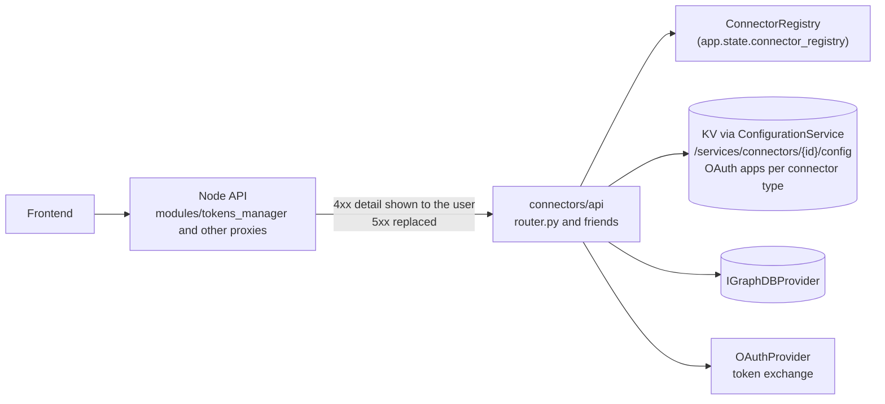

# Connectors service API — agent guide

This folder is the HTTP API of the connectors service (`:8088`): connector create, read, config, toggle and delete, the OAuth sign-in and its callback, OAuth apps, record streaming and reindex. Read this before you change a route or helper here. Repo-wide rules are in the root [AGENTS.md](../../../../../AGENTS.md), above all "Logging and errors". Building or changing a connector **source** is a different job: read [CONNECTOR.md](../../../../../CONNECTOR.md) and [docs/connectors/](../../../../../docs/connectors/).

## How it fits



Node forwards the request and passes a 4xx `detail` through word for word ([backend/nodejs/apps/src/modules/AGENTS.md](../../../../nodejs/apps/src/modules/AGENTS.md), [backend/nodejs/apps/src/libs/AGENTS.md](../../../../nodejs/apps/src/libs/AGENTS.md)).

## Files

| File | What it does |
| --- | --- |
| `router.py` | Almost every route of the service (about 11,000 lines; map below) |
| `user_access_router.py` | Per-user access: a user connects their own account to a team connector. `complete_user_sign_in` finishes that OAuth sign-in when the shared callback sees its state marker |
| `artifacts_router.py` | The artifact gallery routes |
| `permission_explain_router.py` | Why one person can or cannot read one record (admins only) |
| `connector_resolvers.py` | `resolve_config_service`, `resolve_oauth_config(s)`, OAuth app masking and inheritance. The router imports them through `app.edition_config` |
| `connector_stats_cache.py` | Shares the `GET /api/v1/stats` count per (org, connector) for a short TTL |
| `middleware.py` | `WebhookAuthVerifier` for webhook routes |
| `../core/base/token_service/oauth_service.py` | `read_oauth_config`, `OAuthStoreUnavailableError`, `OAuthStateError`, `OAuthProvider` |
| `../../utils/user_messages.py` | Client-safe `detail` text: `action_failed`, `not_found`, `provider_failure`, `DATABASE_UNREACHABLE` |

### Finding your way in `router.py`

Sections are marked with `# ====` banner comments; `grep -n '^@router\.' router.py` lists every route. In file order:

1. **Record content and streaming**: `get_record_content_internal`, `get_signed_url`, `stream_record_internal`, `download_file`, `stream_record`, `get_record_stream` (convert to PDF).
2. **Records, knowledge graph, reindex**: `get_record_by_id`, `get_record_content`, `knowledge_graph_navigate`, `knowledge_graph_lookup`, `delete_record`, `reindex_single_record`, `get_connector_stats_endpoint`, `reindex_record_group`, `cleanup_vector_store`, `reindex_vector_store`, `reindex_connector`.
3. **Shared checks and helpers**: `get_validated_connector_instance`, `require_connector_not_locked` (and its record and record-group variants), config trimming and secret masking (`_config_for_response`, `_without_masked_secrets`), `check_beta_connector_access`, `_encode_state_with_instance` / `_decode_state_with_instance`, `_get_config_path_for_instance`.
4. **Registry & Instance Endpoints**: `get_connector_registry`, `get_all_scheduled_connector_instances_internal`, `get_connector_instances` and the active, inactive and configured lists.
5. **Instance Configuration Endpoints**: OAuth app writes (`_handle_oauth_config_creation`, `_full_save_oauth_app`, `_undo_oauth_app_write`), the create rollback (`_CreateUndo`, `_create_failure_detail`), `create_connector_instance`, `get_connector_instance`, `get_connector_instance_config`, `stop_connector_sync`, `update_connector_instance_auth_config`, `update_connector_instance_filters_sync_config`, `update_connector_instance_config`, `update_connector_instance_name`.
6. **Common Helper Functions**: `_get_user_context`, `_validate_admin_only`, `_validate_connector_permissions`, `_check_oauth_name_conflict`.
7. **OAuth Endpoints**: `_build_oauth_flow_config`, `get_oauth_authorization_url`, `handle_oauth_callback`.
8. **Filter Endpoints**: `get_connector_instance_filters`, `get_filter_field_options`, `save_connector_instance_filters` (deprecated).
9. **Connector Toggle Endpoint**: `_build_and_store_connector`, `_revert_toggle`, `toggle_connector_instance`, then `delete_connector_instance`.
10. **Schema Endpoint**: `get_connector_schema`, `check_connector_connection`, `get_connector_egress_ips`, `get_active_agent_instances`.
11. **OAuth Config Management Endpoints** (`/api/v1/oauth/...`, the OAuth apps): registry reads, `create_oauth_config`, `list_oauth_configs`, `get_oauth_config_by_id`, `update_oauth_config`, `delete_oauth_config`, with `_create_or_update_oauth_config` and `_get_oauth_configs_from_etcd`.
12. **Permissions**: `get_permission_status`, `set_permission_filter`.

## Rules

- **Read a connector's config or OAuth apps so that an outage raises.** Use `read_oauth_config(config_service, path)` for a connector's config and `get_config(path, default=[], raise_on_error=True)` for an OAuth app list. A plain `get_config` answers its default when the store does not answer, and a write built on that empty answer wiped saved settings and apps. `read_oauth_config` raises `OAuthStoreUnavailableError`; a value that is there but cannot be decrypted still reads as unset, since a retry cannot fix it. Pinned by `tests/unit/connectors/api/test_router_config_read_outage.py` and `tests/unit/connectors/test_oauth_config_read_outage.py`. The general rule is the root's "An outage is not an absence".
- **The OAuth callback answers a failure in its body, so it must mark it.** `handle_oauth_callback` returns `success: False` with a `redirect_url`, not an error status. Every failure branch calls `mark_request_failure(request, ..., error_class=..., reason=...)`; the token exchange's failure goes with `include_error_text=False`, because its text quotes the token URL and the provider's answer. The fields and classes are in [docs/logging.md, "Tool calls and MCP (Python)"](../../../../../docs/logging.md#tool-calls-and-mcp-python). Pinned by `test_oauth_callback_logging.py`.
- **A refused callback or our own store failure never signs the connector out.** Only a failure after the caller passed the permission checks (`authorized_connector_id` is set) that is neither `OAuthStateError` (stale, replayed or claimed code) nor `OAuthStoreUnavailableError` sets `isAuthenticated` to false. The connector id is bound to the log line only after those checks. A state that does not decode to a string `state` and `connector_id` is `bad_request`, `reason=invalid_state`. Pinned by `test_oauth_callback_store.py` and `test_oauth_callback_logging.py`.
- **Connector create is a multi-step write that takes itself back.** After the instance write, `create_connector_instance` records each later write on its `_CreateUndo` before making it. On any failure `_CreateUndo.run` deletes the config, then the instance, and stops at the first step it cannot undo, leaving the instance for the admin to finish or delete. `_created_but_not_saved` answers a connector still there, marked `retry_safe = False` so an outage behind it stays a 500 (a 503 tells the client to send the create again, which answers "name already used"); `_create_failure_detail` names an OAuth app that was or may have been saved. OAuth apps are never put back: a new one may already be linked by another connector, and the KV store has no compare-and-set (root rule). Pinned by `test_router_create_rollback.py`; on real stores by `tests/integration/graph_db/test_connector_create_discard_real_backends.py` and `tests/integration/graph_db/postgres/test_connector_create_discard.py`.
- **A save that did not land fails the request.** When credentials were sent and `_create_or_update_oauth_config` saved no app, `_handle_oauth_config_creation` raises a 500. A `set_config` that answers false raises `OAuthStoreUnavailableError`. Never report a connector or app as saved when it was not. Pinned by `test_router_create_oauth_app_save.py`.
- **A 4xx `detail` is written for the user.** Node shows it as is (root rule). Use the helpers in `app/utils/user_messages.py`, map registry `ValueError`s through `_setup_failure_message`, and pass `str(e)` only for an exception whose text was written for the reader, on a line ending `# user-written message`. `tests/unit/utils/test_no_raw_exceptions_in_api_errors.py` holds `router.py` at zero raw exception details.
- **Every route declares who may call it.** Put `Depends(require_scopes(OAuthScopes...))` (or a service-token dependency) on the decorator, and add `Depends(require_connector_not_locked)` to a write on a connector, which answers 409 while the connector is locked. `tests/unit/api/test_route_auth_policy.py` fails for a route with no auth policy and lists every route that admits a service token.
- **Get the config service and OAuth apps through the resolvers.** Use `resolve_config_service(container, org_id)`, `resolve_oauth_config` and `resolve_oauth_configs`, imported from `app.edition_config` as the router does, not a config service or app list built by hand.
- **Logging** follows [docs/logging.md](../../../../../docs/logging.md): the request line in "HTTP requests (Python)" (including `connector.route.failed op=rollback`), token refresh in "Credential refresh", and sync runs in "Connector sync runs".

## Decisions

- **An OAuth config read that fails raises instead of answering empty** (#6278). Reading the default on a timeout made a list or config write built on it wipe saved connector settings and OAuth apps.
- **A stale or refused callback leaves the connector as it was** (#6235, #6254). The callback used to clear `isAuthenticated` on any failure, so a replayed or second callback signed out a working connector, and a store outage lost a sign-in that had succeeded.
- **The client's bad callback is `bad_request`, not our error** (#6286, #6328). A stale code or a wrong-shape state is the request's fault, so it logs at WARNING, not ERROR.
- **Create takes back what it wrote, newest first, but not OAuth apps** (#6331). Leaving a half-created instance kept its name taken, so a retry failed with "name already used". Restoring an updated app could overwrite a concurrent edit, since the store has no compare-and-set, so the failure detail names the app instead.
- **A failed app or settings save fails the create** (#6285). The create used to answer success with the settings missing.

## Changing this code

### Adding a route

- Put it in the matching section of `router.py`, or in its own router file for a separate feature (as `user_access_router.py` is), mounted in `connectors_main.py`. A new router file also goes in `_ROUTERS` in `tests/unit/api/test_route_auth_policy.py`.
- Declare its auth dependency, and `require_connector_not_locked` for a connector write.
- Read the stores so an outage raises and answers 503 (`get_*_or_503` in `app/utils/user_lookup.py` for graph reads).
- Write every 4xx `detail` for the user.
- Keep `backend/nodejs/apps/src/modules/api-docs/pipeshub-openapi.yaml` in sync, and add the Node proxy route.

### Editing a write path (create, config, auth, OAuth apps)

- Read what you merge into with `read_oauth_config` or `raise_on_error=True`.
- Deep-copy a config before changing it: the config service may hand out its cached object (see `update_connector_instance_auth_config`).
- In `create_connector_instance`, record a new write on `_CreateUndo` before making it, and extend `_create_failure_detail` when the user needs to know what was left.
- Add a case where the store fails part way, not only the happy path.

### Editing the OAuth callback

- Keep the order: decode the state, check the caller, then bind `connector_id` and set `authorized_connector_id`.
- Give a new failure branch its own `reason` and `error_class` through `mark_request_failure`, and decide whether it may sign the connector out.

### Removing a route

- Remove it from the OpenAPI file and the Node proxy in the same PR, and drop it from `_SERVICE_TOKEN_ROUTES` in `test_route_auth_policy.py` if it is listed there.

## Tests

From `backend/python`:

```bash
pytest tests/unit/connectors/api/
pytest tests/unit/connectors/test_oauth_config_read_outage.py tests/unit/connectors/test_oauth_service.py
pytest tests/unit/api/test_route_auth_policy.py tests/unit/utils/test_no_raw_exceptions_in_api_errors.py
pytest tests/permissions -m "not integration"
```

- Rules above: `test_router_config_read_outage.py`, `test_oauth_callback_store.py`, `test_oauth_callback_logging.py`, `test_router_create_rollback.py`, `test_router_create_oauth_app_save.py` (all in `tests/unit/connectors/api/`).
- The create rollback on real graph stores: `tests/integration/graph_db/test_connector_create_discard_real_backends.py` and `postgres/test_connector_create_discard.py` (need running services).
- `tests/permissions` is the `oracle` job of `.github/workflows/permission-conformance.yml`, which runs on any PR that touches `backend/python/app/**`. `test_matrix_coverage.py` pins connector source code by function and anchor text (`matrix.CONNECTORS`, `matrix.ANCHORS`), so moving or renaming code under `app/connectors/sources/` fails it until the evidence is updated.

## Keeping this file true

When you change a rule, a decision, a file or symbol named here, or the order of sections in `router.py`, update this file in the same PR. Cite files and symbols, not line numbers.
