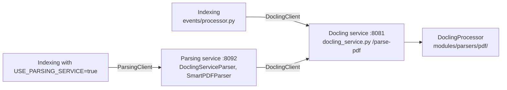

# Docling — agent guide

This folder holds the Docling service (the PDF converter on port 8081) and `DoclingClient`, which indexing and the parsing service use to call it. Read this before you change either one, `ParsingClient`'s handling of Docling answers (`services/parsing/client.py`), or any code that catches a Docling error. Repo-wide rules are in the root [AGENTS.md](../../../../../AGENTS.md). Which PDFs go to Docling, and what happens when it fails, is in [docs/indexing-service.md, 4.7 Where parsing CPU runs](../../../../../docs/indexing-service.md#47-where-parsing-cpu-runs); how a record waits for Docling is in [2.2](../../../../../docs/indexing-service.md#22-data-flow-for-one-record-happy-path). This file adds only what those sections do not state plainly.

## How it fits



`DoclingClient` is a `BaseServiceClient`: retries, the circuit breaker and 429 handling come from `services/base_client.py`. The client turns every failure into one of three exceptions, and the caller decides between a fallback parser, a retry and a wait.

## Files

| File | What it does |
| --- | --- |
| `client.py` | `DoclingClient` (`parse_pdf`, `parse_pdf_batched`), the three errors, and the routing helpers `docling_takes`, `within_docling_size_limit`, `docling_max_pages` (`PDF_DOCLING_MAX_PAGES`) |
| `docling_service.py` | The FastAPI app: `/parse-pdf`, `/health`, the heavy-parse gate, and the task that owns each conversion |
| `../parsing/client.py` | `ParsingClient`: turns the parsing service's "Docling is not serving" answer back into the same errors |
| `../../api/routes/parsing.py` | The parsing service route that answers `DoclingNotServing` as a 424 |

## Rules

- **The client raises; it never returns `None`.** `parse_pdf` returns the serialized document and `parse_pdf_batched` a `DoclingDocument`, or they raise. Callers tell an outage from a bad file by the exception type alone. Pinned by `test_docling_client_errors.py`.
- **Each error means one thing; raise the right one.**

  | Error | Means | What the caller does |
  | --- | --- | --- |
  | `DoclingNotServing` | Docling never received the file: refused or timed-out connection, open circuit, load shed before any attempt reached it (`_docling_never_saw_it`) | Fallback parser first; if that fails too, the record is handed back every `HANDBACK_DELAY_S` (60 s) without counting an attempt (`RequeueWithoutAttempt`), logged at INFO |
  | `DoclingUnavailableError` | Docling was not serving but may have seen the file: a 5xx other than 501, a 429 without `Retry-After`, a 401/403, a connection dropped mid-answer (`_docling_unavailable`) | Fallback parser; if that fails too, an ordinary counted retry (it is an `IndexingError`) |
  | `DoclingParseError` | Docling had no document for this file: its `errorCode`, bad input, or an API mismatch | Read the PDF another way; `mark_error` sets `bad_request` for the file's fault, `misconfigured` for ours |

  `DoclingNotServing` subclasses `DoclingUnavailableError`, so `except DoclingUnavailableError` catches both. Pinned by `test_docling_client_errors.py` and `test_record_handler_docling_outage.py`.
- **An outage is not a bad document.** A status the base client retried and gave up on, or a dropped connection, is `DoclingUnavailableError`, never `DoclingParseError`. Read as a failed parse, an outage once sent every PDF to the per-page OCR fallback. A file that brings Docling down still fails: a failure after the file reached Docling is counted, so it is tried at most `MAX_DELIVERY_ATTEMPTS` times (`test_docling_outage_brokers.py`).
- **The service answers a failed parse with 422 and an `errorCode`, and overload with 429 and `Retry-After`.** `_parse_failure_response` uses 422 so `BaseServiceClient` neither retries a 40-minute parse nor counts it against the breaker; `_refusal` in the client reads the `errorCode`. Change the two sides together. Pinned by `test_the_docling_services_own_answers_map_to_the_rule`.
- **Keep `service_name="DoclingService"`.** `SERVICE_POOL` in `resource_governor/policy.py` is keyed by it. In the default admission mode, on a consumer with the fair scheduler a Docling 429 then holds only the heavy index pool's records and PDF-route records (`held_downstream` in `consumer_concurrency.py`; a DOCX or CSV record in the heavy pool waits too, and with the light tier collapsed every record is in the heavy pool), a broker-order Redis or Kafka consumer still pauses all reads, and Docling feedback brakes only the heavy index pool, never the light one. Under `PARSE_ADMISSION=classes` the 429 reaches neither: the client passes no coordinator and its own limiter takes it. Under another name, in the default mode, Docling is a shared service and its outage pauses all reads and shrinks both pools. See [4.2, layer 10](../../../../../docs/indexing-service.md#42-admission-control-layers) and [4.3](../../../../../docs/indexing-service.md#43-resourcegovernor); pinned by `test_docling_429_scope.py` and `test_a_docling_outage_halves_heavy_and_leaves_light_unbraked` in `test_policy.py`.
- **The parsing service path keeps the same contract.** `api/routes/parsing.py` answers `DoclingNotServing` with 424, code `PARSE_BACKPRESSURE` and `details.reason` `DOCLING_UNAVAILABLE_REASON`. `ParsingClient._parse_once` raises `DoclingNotServing` again, or `DoclingUnavailableError` when `earlier_attempt_delivered(response)`. A 5xx would open `ParsingClient`'s breaker and fail every file type; a new code would read as `PARSE_FAILED` to an older client. Pinned by the Docling tests in `test_parsing_routes.py`.
- **The client does not log a parse failure; the caller that falls back does, once, without text.** `EventProcessor._dispatch_pdf_binary` (`app/events/events.py`) writes `index.parse_fallback` with `include_error_text=False` and the error's `log_level` (INFO for `DoclingNotServing`, whose outage the base client already reported). Contract: [docs/logging.md, Indexing](../../../../../docs/logging.md#indexing). Pinned by `test_docling_fallback_logging.py`. `health_check` still logs a connect failure at ERROR, and its other failures with their text.
- **A caller's timeout never cancels a conversion.** `/parse-pdf` runs the parse in a task (`_parse_holding_gate`) that owns the gate permit and the member permit and frees them only after conversion and serialization end. A timeout or a disconnect answers the caller and leaves the task running; `/health` reports `parse_tasks_in_flight` and `oldest_parse_age_seconds`. Pinned by `test_docling_gate_release.py`.
- **Change the timeouts together.** The client's read timeout (2450 s) is the service's `PDF_PARSING_TIMEOUT_SECONDS` (2400 s) plus a margin for `DOCLING_GATE_TIMEOUT_SECONDS` (30 s). A longer gate wait or parse budget without a longer client timeout makes the client give up on answers that are still coming.

## Decisions

- **Raise instead of returning `None`, and log the fallback once** (#6013). Every failure returned `None`, and the client, the processor and the event handler each wrote a line without the status or the reason.
- **A 500, a bare 429 or a dropped connection is an outage** (#6067). A hand-written list of 502, 503 and 504 raised the rest as parse errors, so the parsing service OCR'd text PDFs page by page while Docling was down.
- **Wait for Docling when it never received the file** (#6199). As a counted retry, an outage longer than about 90 s ended the record FAILED. A failure after delivery stays counted, so a PDF that crashes Docling cannot loop.
- **Under the fair scheduler, a Docling 429 holds only the heavy pool and PDF-route records** (#6243, #6282), not every read; a broker-order consumer still pauses all reads (default admission mode; under `PARSE_ADMISSION=classes` only the Docling client's limiter slows). One Docling 429 held Jira, Confluence, Slack and text records though only PDF-route records call it.
- **A Docling outage does not shrink the light pool** (#6201). Narrowing it took no load off Docling and only queued records that never call it.

## Changing this code

### Adding a failure case to the client

- Decide first: did Docling see the file, and is it the file's fault? Map it to one of the three errors; do not add a fourth without updating every `except` in `events.py`, `SmartPDFParser._parse_text` and `DoclingServiceParser.parse`.
- Keep the `ServiceCallError` as `__cause__` (`raise ... from exc`): `MessageErrorClassifier` reads the status from the root cause ([messaging guide](../messaging/AGENTS.md)).
- Add a case to `test_docling_client_errors.py`.

### Editing the service route

- A file-level failure stays a 422 with an `errorCode`; capacity stays a 429 with `Retry-After`. Only a status in `TRANSIENT_STATUS_CODES` (a 5xx other than 501, or a 429) or a 401/403 is read as an outage; any other non-2xx without an `errorCode`, a 501 included, is a `misconfigured` `DoclingParseError` (`_refusal`).
- Every path that takes a permit releases it once: before hand-off in the route's `finally`, after it in `_parse_holding_gate`. Extend `test_docling_gate_release.py`.

### Editing `ParsingClient` or the parsing route

- Keep the 424 `PARSE_BACKPRESSURE` + `docling_unavailable` pair on both sides, and `earlier_attempt_delivered` deciding counted vs waited.

### Removing an error type or a fallback

- `DoclingNotServing` is a `RequeueWithoutAttempt`; removing it turns every outage into counted retries. Update [docs/indexing-service.md](../../../../../docs/indexing-service.md) sections 2.2 and 4.7 in the same PR.

## Tests

From `backend/python`:

```bash
pytest tests/unit/services/docling/
pytest tests/unit/events/test_docling_fallback_logging.py tests/unit/api/routes/test_parsing_routes.py
pytest tests/unit/services/messaging/test_docling_429_scope.py tests/unit/services/messaging/test_docling_outage_brokers.py tests/unit/services/messaging/test_record_handler_docling_outage.py
pytest tests/unit/services/resource_governor/test_policy.py -k docling
```

## Keeping this file true

When you change a rule, a decision, a file or symbol named here, or a checklist step, update this file in the same PR. Cite files and symbols, not line numbers.
