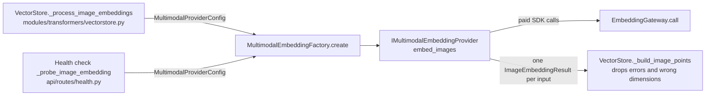

# Embeddings — agent guide

This folder holds the image (multimodal) embedding providers: one class per provider that turns image bytes into vectors for the indexing pipeline. Read this before you add or change a provider here, or touch `app/utils/threaded.py`. Repo-wide rules are in the root [AGENTS.md](../../../../../AGENTS.md). How a paid embedding call is admitted and retried is in [docs/indexing-service.md, One retry layer](../../../../../docs/indexing-service.md#one-retry-layer); how embedding models are configured is in [docs/ai-models.md](../../../../../docs/ai-models.md). This file adds only what those do not state plainly.

Text embeddings are not built here. `get_embedding_model` in `app/utils/aimodels.py` builds them, and `app/utils/custom_embeddings.py` holds the Voyage, Together and Jina classes; [docs/ai-models.md, Where to change it](../../../../../docs/ai-models.md#where-to-change-it) lists the other places a new provider touches.

## How it fits



The image path uses the embedding model configured for text, with the same `EmbeddingProvider` value. The health check runs only when that model is marked `isMultimodal`.

## Files

| File | What it does |
| --- | --- |
| `multimodal/interface.py` | `IMultimodalEmbeddingProvider` (`embed_images`, `provider_name`, `normalize`, `supports_multimodal`) and `ImageEmbeddingResult` |
| `multimodal/factory.py` | `MultimodalEmbeddingFactory.create`: `_PROVIDER_BUILDERS`, keyed by `EmbeddingProvider` value |
| `multimodal/config.py` | `MultimodalProviderConfig`: the fields a provider may need |
| `multimodal/_concurrent.py` | `gather_or_cancel`, and re-exports `to_thread_settled` |
| `multimodal/_response.py` | `map_embedding_response` (OpenAI-style `data` envelope) and `describe_request_error` |
| `multimodal/<name>_provider.py` | Bedrock, Cohere, Gemini, Jina, Ollama, OpenAI-compatible (also LM Studio), Voyage |
| `../../utils/threaded.py` | `to_thread_settled` |

## Rules

- **Return one result per input index; never raise for one image.** A failed or skipped image is `ImageEmbeddingResult(index=i, error=...)`, so `embed_images` never drops an entry and the caller can match results to chunks. For an OpenAI-style answer use `map_embedding_response`, which matches on the response's `index` field, not on position. Pinned by the provider tests in `tests/unit/services/embeddings/multimodal/` and `test_bedrock_one_images_unexpected_failure_does_not_abort_the_batch`.
- **Let a provider's wait and a spent allowance through.** `EmbeddingRateLimited` (a `Retry-After` longer than the call may wait) and an error for which `refused_by_allowance(e)` is true belong to the whole record: re-raise them before the generic `except`. The record handler hands the record back. Pinned by the `test_*_hands_the_wait_over` and `test_a_spent_send_allowance_*` tests in `test_image_providers_rate_limit.py`.
- **Fan out with `gather_or_cancel` when a task can raise.** It cancels and awaits the other tasks before the error propagates; a bare `asyncio.gather` leaves them running and sending paid requests whose results are thrown away. Jina, Ollama and OpenAI-compatible use `asyncio.gather` because their per-image or per-batch code catches every error. Pinned by `test_a_deferral_leaves_no_sibling_image_running`.
- **Send paid SDK requests through the gateway, with SDK retries off.** Wrap the request in `get_embedding_gateway().call(...)`, build the SDK client with `config.sdk_retries` (`VectorStore` passes `INDEXING_SDK_RETRIES`, 0), and install the wire hooks on a client no model factory built (`install_boto_hooks`, `wire.install_wire_hook`) so its requests are counted. Which providers do this today is in [One retry layer](../../../../../docs/indexing-service.md#one-retry-layer). Pinned by `test_native_image_clients_count_their_requests_in_the_wire_scope`.
- **Run a synchronous SDK call in `to_thread_settled`, not `asyncio.to_thread` or an executor.** On a cancel it waits for the thread to finish before the `CancelledError` goes on, so the request is counted in the attempt's wire scope and nothing is sent after the record was handed back; it starts the thread with `spawn_in_request`, which keeps the caller's context. Users: the Bedrock and Cohere providers, and `VoyageEmbeddings` and the Jina class built by `_build_jina_embeddings` in `custom_embeddings.py`. On a cancel the caller sees only `CancelledError`; a done callback retrieves the thread's own exception, so asyncio reports nothing. Pinned by `test_a_cancelled_thread_call_finishes_before_the_cancellation_goes_on`, the `test_a_cancelled_*_waits_for_its_request*` tests and `tests/unit/utils/test_threaded.py`.
- **Return vectors of the collection's dimension.** `config.embedding_size` is the dimension the collection was created with. `_build_image_points` drops any vector of another length (an ERROR line), and the health check rejects a model whose image vector differs from its text dimension. A provider that lets the caller choose an output length requests `embedding_size`; Bedrock maps it to a Titan length (256, 384 or 1024) and warns when it cannot.
- **Set a new config field in both places that build the config.** `MultimodalProviderConfig` is built by `VectorStore._multimodal_provider_config` and by `_probe_image_embedding` in `api/routes/health.py`, from different sources. The health one sets no `dense_embeddings`, `sdk_retries` or `normalize_fn`.
- **Call a configurable endpoint through `guarded_async_client`.** `MultimodalEmbeddingFactory.create` runs `require_allowed_endpoint(config.base_url)` before it builds a provider; `guarded_async_client` (`app/utils/model_egress.py`) checks what the name resolves to when the client connects. Ollama and OpenAI-compatible use it; Jina posts to its fixed URL.
- **Do not log provider error text in new code.** A provider puts its response body in the message, and the body can echo the request or the account's email; follow [docs/logging.md, Model calls outside the agent loop](../../../../../docs/logging.md#model-calls-outside-the-agent-loop-python). The existing provider warnings still interpolate the exception, `describe_request_error` appends up to 300 characters of the response body, and `_build_image_points` logs `result.error`. Do not copy that pattern.

## Decisions

- **One provider class per provider, chosen by a registry** (#2919). `VectorStore` builds a config and calls the factory; adding a provider touches the factory and its own file only.
- **A failed image is a result, not an exception** (#2919). One bad image must not lose the rest of the record's images; `_build_image_points` is the one place that decides what a failed embedding means.
- **Responses are matched by `index`** (#2919). Zipping by position attaches a vector to the wrong image when a server reorders or omits entries.
- **One retry layer: the gateway** (#5907). SDK retries inside gateway retries turned one call into up to nine requests; `to_thread_settled` and `gather_or_cancel` came with it so a cancelled or failed batch sends nothing more.

## Changing this code

### Adding a provider

- The provider must already exist for text: an `EmbeddingProvider` value and a branch in `get_embedding_model`.
- Write `multimodal/<name>_provider.py` implementing `IMultimodalEmbeddingProvider`. Use `self.normalize()` to validate the image; override `supports_multimodal` only when the capability depends on the model at run time.
- Pick its batch size and concurrency as module constants, as the other providers do (`_BATCH_SIZE`, `_CONCURRENCY_LIMIT`).
- Add one entry to `_PROVIDER_BUILDERS`. New config fields go in `MultimodalProviderConfig` and in both places that build it.
- Tests: a case in `multimodal/test_factory.py`, a `multimodal/test_<name>_provider.py`, and, if it goes through the gateway, wait, allowance and cancel cases in `test_image_providers_rate_limit.py`.

### Editing a provider

- Keep the `except EmbeddingRateLimited` and `refused_by_allowance` re-raises ahead of the generic handler.
- Keep one result per input index, including the tail of a short response.

### Removing a provider

- Without a builder, `create` returns `None`: indexing skips images for that provider with a warning, and the health check reports that it has no image support. Remove its test cases with it.

## Tests

From `backend/python`:

```bash
pytest tests/unit/services/embeddings/
pytest tests/unit/modules/transformers/test_vectorstore.py -k image
pytest tests/unit/utils/test_indexing_call_sites_sdk_retries.py tests/unit/services/llm_gateway/test_no_raw_llm_calls.py
```

## Keeping this file true

When you change a rule, a decision, a file or symbol named here, or a checklist step, update this file in the same PR. Cite files and symbols, not line numbers.
