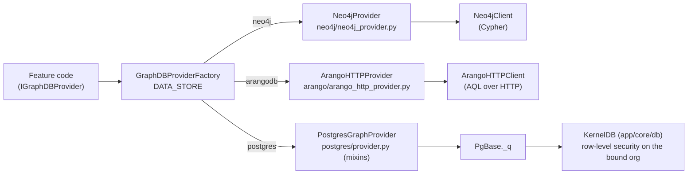

# Graph store (`services/graph_db`) — agent guide

This folder is the knowledge graph behind `IGraphDBProvider`, with one provider each for Neo4j, ArangoDB and PostgreSQL. Read it before you add or change a provider method, call the graph from a background job, boot step or scan, or handle a failed graph read. The rule that a graph change covers all three stores, and `NotImplementedInPostgres`, are in the root [AGENTS.md](../../../../../AGENTS.md) ("Storage is pluggable"). Org binding is in [docs/org-context.md](../../../../../docs/org-context.md), and provider logging in [docs/logging.md](../../../../../docs/logging.md), "Database queries (Python)".

## How it fits

`GraphDBProviderFactory.create_provider` reads `DATA_STORE` and builds one provider for the process. It wraps that provider in `instrument_store` for metrics. Callers only see `IGraphDBProvider`.



How a query reaches each store:

- **Neo4j.** A `Neo4jProvider` method builds Cypher and runs it through `Neo4jClient` (`neo4j/neo4j_client.py`). The client writes `db.query.failed` and `db.query.slow`.
- **ArangoDB.** An `ArangoHTTPProvider` method builds AQL and sends it through `ArangoHTTPClient` (`arango/arango_http_client.py`), which logs the same way.
- **PostgreSQL.** `PostgresGraphProvider` is one mixin per group of methods (`postgres/identity.py`, `records.py`, `permissions.py`, `core.py`, and so on). Nodes are rows of `graph.nodes` and edges are rows of `graph.edges`. Every statement goes through `PgBase._q` into `KernelDB.run` (`app/core/db/uow.py`), which opens a unit of work for the bound org. An interface method that no mixin defines is stubbed to raise `NotImplementedInPostgres`, and `unimplemented()` lists the stubs. `postgres/kg/` projects `graph.*` into the typed `kg` tables the listings read. The schema and the vetted SQL functions live in `backend/db/versions/graph/`.
- **Org check.** `IGraphDBProvider.__init_subclass__` wraps every `org_id` argument with `instrument_org_methods`, which runs the shadow and enforce check from [docs/org-context.md](../../../../../docs/org-context.md).

## Files

| File | What it does |
| --- | --- |
| `interface/graph_db_provider.py` | `IGraphDBProvider`: every graph operation, its contract, and shared defaults |
| `graph_db_provider_factory.py` | `GraphDBProviderFactory`: picks the provider from `DATA_STORE` |
| `neo4j/neo4j_provider.py`, `neo4j/neo4j_client.py` | The Neo4j provider and its driver client |
| `arango/arango_http_provider.py`, `arango/arango_http_client.py` | The ArangoDB provider and its HTTP client |
| `postgres/provider.py` | Composes the PostgreSQL mixins, stubs the rest (`unimplemented()`) |
| `postgres/base.py` | `PgBase`: `_q`, `_system_read`, explicit transactions (`_Txn`), `NotImplementedInPostgres` |
| `postgres/kg/registry.py` | Every PostgreSQL method that writes `graph.nodes` or `graph.edges`, and whether it changes `kg` |
| `common/` | Helpers shared by the providers (record visibility, name matching, cascade retry) |
| `conditions.py`, `push_claim.py`, `edge_effects.py` | Shared types for conditional writes, push claims and edge-write results |
| `graph_db_factory.py`, `arango/arango.py`, `interface/graph_db.py` | The old `GraphDBFactory` / `ArangoService` / `IGraphService`. Only example scripts and `sources/client/asana` use them. Don't use them in new code |
| `../../exceptions/graph_db_exceptions.py` | `GraphQueryError`, `PermissionVerificationUnavailableError` and the other graph errors |

## Rules

**On PostgreSQL, a graph call with no org bound raises; it never answers empty.**
Every `PgBase._q` call opens a unit of work for the ambient org, and `KernelDB` raises `MissingOrgContext` when none is bound. Methods that read `current_org_id()` raise first. A missing org is a bug in the caller. It is not an empty graph. Neo4j and ArangoDB don't scope their queries by the bound org, so code that works there can still fail on PostgreSQL. Pinned by `test_a_call_without_an_org_fails_instead_of_answering_empty` in `tests/integration/graph_db/postgres/test_core.py`.

**Background jobs, boot steps and scans run org by org.**
List the orgs under `org_context.system(reason)`, then do each org's work under `org_context.for_org(org_id, job=...)`. `app/core/org_jobs.for_each_org` does both and returns the orgs whose work failed. A one-time job passes `raise_on_error=True`, so a failed org list isn't taken as "no orgs". Pinned by `tests/integration/graph_db/postgres/test_boot_steps.py`, `test_connector_sweeps_per_org.py` and `test_orphan_sweep_per_org.py`.

**Under `system`, only the vetted cross-org reads answer.**
`PgBase._system_read` runs the vetted `graph.system_*` functions: `get_all_orgs`, `get_document` and `get_documents_paginated` on the `apps` collection, and the code-graph sweeps' org list. Every other method needs one org, and under `system` it raises `SystemContextNotAllowed`. A cross-org read goes through a vetted `graph.system_*` function (`backend/db/versions/graph/vetted/`), never through an org-scoped method run without an org. Pinned by `test_a_system_scope_cannot_read_org_data_through_the_swallowing_readers` (`test_core.py`). The one cross-org user lookup on the interface, `get_graph_user_keys_by_mongo_user_ids_all_orgs`, may be called only from the callers `tests/unit/services/graph_db/test_system_scope_lookups_allowlist.py` allows.

**Inside `for_org`, still filter on `orgId`.**
Neo4j and ArangoDB ignore the bound org, so a read there returns every org's rows unless the query filters on `orgId`. Use `org_jobs.of_org(docs, org_id)` on a result that isn't filtered.

**Ask for the failure: pass `raise_on_error=True` when you act on absence.**
Root AGENTS.md ("Logging and errors") says an outage is not an absence. In this folder, many interface methods take `raise_on_error`. Without it they answer `None` or `[]` when the read fails. If the caller acts on absence (answers 404 or "no access", deletes, or stops paging), pass `raise_on_error=True`. The provider then raises `GraphQueryError`, the store's own error, or `PermissionVerificationUnavailableError`. Routes use `get_document_or_503`, `get_record_or_503` and their siblings in `app/utils/user_lookup.py`. These turn a failure into a 503 with `DATABASE_UNREACHABLE`. A failed read never becomes a 404 or a 403. Pinned by `test_get_record_by_id_raise.py`, `test_record_access_check_raise.py` and `test_get_edges_to_node_raise.py` in `tests/unit/services/graph_db/`.

**An access check that can't answer raises `PermissionVerificationUnavailableError` with its default message.**
Raise it `from` the cause and never pass `str(exc)`. The driver's text (host, query, bound values) would otherwise reach every log line and tool result that prints the error. The exception's docstring says why. Pinned by `tests/unit/services/graph_db/test_permission_unavailable_text.py`.

**Provider `except` handlers follow the logging contract.**
A handler that re-raises logs nothing. A handler that answers a default writes one `graph.provider.failed`, and a step that carries on writes one `graph.provider.step_failed`. Both go through `log_failure(..., include_error_text=False)`, and any `if raise_on_error: raise` comes before the log call. Never put a driver error's `{e}` or `str(e)` in a log line. The details are in [docs/logging.md](../../../../../docs/logging.md), "Database queries (Python)". Pinned by `tests/unit/services/graph_db/test_provider_failure_logs_no_driver_text.py`.

**Every PostgreSQL method that writes the graph is listed in `postgres/kg/registry.py`.**
`WRITERS` marks each one `projected` or `no_projection` (with the reason). A writer missing from the list fails `test_the_registry_lists_every_writer_of_the_provider` (`tests/integration/graph_db/postgres/test_kg_guard.py`). If it runs unlisted under `PG_KG_GUARD=strict`, it raises.

## Decisions

- **PostgreSQL fails closed on a missing org.** Row-level security scopes every statement to the bound org, so code with no org raises instead of reading everyone's rows. Answering empty for a missing org was rejected because callers act on empty. The cost is that every cross-org caller must run org by org. These PRs fixed callers that worked on Neo4j and ArangoDB but failed on PostgreSQL: the token refresh scan (#5534), the stale sync-state reset and `for_each_org` (#5560), the queued-sync drain (#5623), query service start-up (#5625) and the `connector_active` gauge (#6241).
- **A failed read raises; it does not answer empty.** Before these changes, an empty list could mean either "matched nothing" or "the store is down". Safety gates and deletes acted on the empty list. `GraphQueryError` (see its docstring) and `PermissionVerificationUnavailableError` separate the two, and callers answer 503: an agent reading a record (#6003), the record-content routes (#6066) and the record access check (#6177).
- **Providers log once and never log driver text.** The provider used to write its own `... {str(e)}` line on top of the client's record. That duplicated the failure and printed bound values. Now the client's record and the handler that catches the error are the only lines (#6061, #6238, #6257).

## Changing this code

### Adding a provider method

1. Declare it on `IGraphDBProvider` with its contract in the docstring. Say what it raises, and whether it takes `raise_on_error`.
2. Implement it in `neo4j_provider.py`, `arango_http_provider.py` and the matching PostgreSQL mixin, as the root parity rule requires. If PostgreSQL can't serve it yet, leave the mixin without it. `provider.py` then stubs it to raise `NotImplementedInPostgres`.
3. An `org_id` parameter is checked by `instrument_org_methods`, so the caller has to bind that same org. Don't take an `org_id` from a request body.
4. For a PostgreSQL write to `graph.nodes` or `graph.edges`, add the method to `WRITERS` in `postgres/kg/registry.py`.
5. Write `except` handlers the way the logging rule above says.
6. Add real-store tests, including a PostgreSQL test that calls it without an org.

### Calling the graph from a job, boot step or scan

1. Use `for_each_org`, or `system` for the list and `for_org` for each org's work.
2. Start long-lived work with `spawn_detached` (see [docs/org-context.md](../../../../../docs/org-context.md), "Long-lived work").
3. Read any per-org setting inside the org it applies to.
4. Add a PostgreSQL test that runs the job in an empty `contextvars.Context()`, as `test_boot_steps.py` does.

### Editing a provider method

- Change the behaviour on all three stores in the same PR, or say in the PR which store lags and why.
- Don't turn a raise into a default answer. A caller may rely on telling the two apart.

### Removing a provider method

- Remove it from the interface, all three providers, `postgres/kg/registry.py` if it is listed there, and `RAISING_DEFAULTS_NOT_ON_POSTGRES` in `test_postgres_provider.py` if it is listed there.

## Tests

From `backend/python` with the venv active:

```bash
pytest tests/unit/services/graph_db                      # no services needed
pytest tests/unit/services/graph_db/test_postgres_provider.py tests/unit/services/graph_db/test_provider_failure_logs_no_driver_text.py
```

- `test_postgres_provider.py` checks that every interface method is implemented or stubbed, that a stub raises `NotImplementedInPostgres`, and that each raising interface default is overridden on PostgreSQL or listed with a reason.
- Real-store tests in `tests/integration/graph_db/` need running stores. Neo4j and ArangoDB use `NEO4J_IT_URI` and `ARANGO_IT_URL` (see `.github/workflows/backend-matrix.yml`). The tests in `postgres/` need a migrated database in `PG_CORE_URL` (`scripts/prepare_pg_test_db.sh` creates one). Without it they skip.
- In CI, a skip is a failure. `pg-runtime` fails any skipped case. `backend-matrix` does too, unless the reason begins `not applicable on <store>:`. For a test that applies to one store, use the `arango_only` or `neo4j_only` marker, which leaves it out of the other store's collection. `pg-runtime` runs the PostgreSQL folder in shards. Each shard checks its own collection, so a new test file needs no count change.

## Keeping this file true

Update this file in the same PR when you change a rule, a decision, a file name or a checklist here. Examples: a new vetted system read, a change to how `PgBase._q` binds the org, or a new error type callers must map. Cite files and symbols, not line numbers.
