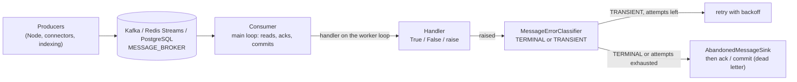

# Messaging — agent guide

This folder is PipesHub's broker layer: producers, consumers and their retry, commit and dead-letter rules on Kafka, Redis Streams and PostgreSQL. Read this before you change a consumer, a handler under `kafka/handlers/`, the error classifier, or anything a handler raises. Repo-wide rules are in the root [AGENTS.md](../../../../../AGENTS.md). How the indexing consumer loop, scheduling, retries and leases work is in [docs/indexing-service.md, 4.1 Consumer loop](../../../../../docs/indexing-service.md#41-consumer-loop); read it first. This file adds only what that document does not state plainly.

## How it fits



Feature code gets a producer or consumer from `MessagingFactory`, never from a broker client (root rule).

## Files

| File | What it does |
| --- | --- |
| `error_classifier.py` | `MessageErrorClassifier.classify_by_exception`: TERMINAL or TRANSIENT for any exception |
| `disposition.py` | `AbandonedMessageSink`: told before a message is given up on, so its record can end in a visible state (best effort) |
| `message_log.py` | One delivery's log context and its one `message.end` line |
| `backpressure.py` | `BackpressureCoordinator` (downstream 429s, one per process) and `BackpressureEpisode` (when a consumer logs that reads are held) |
| `kafka/consumer/consumer.py`, `redis_streams/consumer.py` | `KafkaMessagingConsumer`, `RedisStreamsConsumer`: entity, sync and config events |
| `kafka/consumer/indexing_consumer.py`, `redis_streams/indexing_consumer.py` | `IndexingKafkaConsumer`, `IndexingRedisStreamsConsumer`: record events |
| `postgres/consumer.py` | `PgMessagingConsumer`: both kinds on the PostgreSQL broker (no lanes, no fair scheduler, no backpressure pause) |
| `kafka/consumer/watermark_committer.py`, `scheduling/offset_tracker.py` | `WatermarkCommitter` (when to commit) and `PartitionOffsetTracker` (what is safe to commit) |
| `kafka/handlers/` | The handlers: `record.py`, `entity.py`, `ai_config.py` |
| `../../exceptions/non_retryable.py` | `NonRetryableError`: never retried, wherever it sits in the cause chain |

The full map is [docs/indexing-service.md, 6. Where things live](../../../../../docs/indexing-service.md#6-where-things-live).

## Rules

- **Raise typed errors, or keep the HTTP status on the exception.** The classifier decides retry or dead letter from the exception's type and status. It walks the whole cause chain for typed errors (`NonRetryableError`, the `CONTENT_ERRORS`, `ValidationError`, `JSONDecodeError`, ...) and then reads a status from the **root cause** with `extract_status_code`: `.status_code`, an int `.status`, an int `.code`, `.response.status_code`, aiohttp's `ClientResponseError` or botocore's `HTTPStatusCode`. 408, 409, 429 and every 5xx are retried; any other 4xx is terminal (`classify_by_http_status`). Pinned by `test_error_classifier.py` and `test_exception_classification_integration.py`.
- **Anything the classifier does not recognise is TRANSIENT.** It is the last line of `_classify_by_exception_impl`, and `classify_by_exception` itself never raises (a classifier failure is TRANSIENT too). So a bare `Exception("401 Unauthorized")` with no cause is retried up to `MAX_DELIVERY_ATTEMPTS` before it is dead-lettered. To stop retries, raise `NonRetryableError` (or chain `from` it), or let the client's exception with its status through.
- **Let handler failures reach the consumer.** A handler returns `True` when done or when the message is not for it, `False` only to ask for the message again, and raises on failure. Catching an exception and returning `False` turns every failure into a retry, because the consumer can only read `False` as "deliver again". Log the failure once and raise; the contract is in [docs/logging.md, "Messaging consumers"](../../../../../docs/logging.md#messaging-consumers). Pinned by `test_handler_failures_reach_classifier.py`.
- **A message is never abandoned silently.** Before a consumer dead-letters a message it tells its `AbandonedMessageSink` (`RecordEventHandler` for record events), so the record can be left FAILED instead of QUEUED forever. This is best effort: `notify_abandoned` logs a sink failure and settles the message anyway, so the record can stay QUEUED. A new give-up path goes through the consumer's existing abandon step (`__abandon_message` in the indexing consumers); see `test_disposition.py`.
- **Poison is only what can never parse.** The parse step (`__parse_message` in `IndexingKafkaConsumer`, `_parse_message` in `IndexingRedisStreamsConsumer`) answers `None` for bytes that are not UTF-8, text that is not JSON, a rejected envelope, or JSON that is not a `StreamMessage`; that message is dead-lettered at once. A key-store or network failure while parsing must raise instead, so the message is read again. Never log the message value; log its size. Pinned by `test_kafka_indexing_poison_offset.py`, `test_redis_read_phase_parse_failure.py`, `test_postgres_undecodable_message.py` and `test_error_classifier_poison.py`.
- **Kafka indexing offsets are settled in one place.** With fair scheduling, an offset is marked done in `PartitionOffsetTracker` and committed only through `WatermarkCommitter`; without it, `_commit_offset` commits the record's own offset. Both run on the main loop. Don't call `consumer.commit` from new code. A failed commit is not a handler failure: it is logged once as `index.commit_failed`, and once settling has started the delivery is not charged a retry or published again. Pinned by `test_kafka_watermark_committer.py`, `test_kafka_commit_coalesce.py`, `test_partition_offset_tracker.py` and `test_indexing_end.py`.
- **Log backpressure once per episode.** An indexing consumer asks its `BackpressureEpisode` (`engaged()`, `cleared(now)`) whether to log; never log on each loop turn, where the condition flips on nearly every finish. Details in [docs/indexing-service.md, 4.1](../../../../../docs/indexing-service.md#41-consumer-loop) ("Backpressure log"). `BackpressureCoordinator` is shared by service clients on the worker loop and consumers on the main loop, so it takes a thread lock on every access. Pinned by `test_kafka_backpressure_log_episodes.py`, `test_redis_backpressure_log_episodes.py` and `test_backpressure_threads.py`.
- **A consumer change covers every broker.** A fix to one broker's loop usually has a twin in the others: Kafka and Redis Streams, each with a fair and a FIFO loop, and PostgreSQL. Change each one that has the same behaviour, with a test per broker (as `test_parse_now_priority_kafka.py`, `_redis.py` and `_postgres.py` do), or say in the PR why one broker does not need it.
- **Tests wait for an event, never a fixed `sleep`.** Wait on the task's done callback, an `asyncio.Event`, or `until(...)` from `tests/support/eventually.py`; use `done_without_waiting` to prove a call never waits.

## Decisions

- **Unknown errors are retried** (the classifier's default). Dropping a message on an error nobody classified loses work for good; a retry costs at most `MAX_DELIVERY_ATTEMPTS` runs. The price is that code must keep statuses and types on its exceptions: connectors that lost them retried revoked tokens as transient (#5941, #5705, #6018).
- **Handlers raise instead of returning `False`** (#5643, #5705). The entity, sync and AI-config handlers turned every exception into `False`, so permanent failures were retried as transient.
- **A failed commit is not a handler failure** (#6149). Treating it as one settled a Kafka delivery twice: it charged the handler and published another copy.
- **A FIFO batch stops at the first message not dispatched, and a partition whose head keeps failing is paused** (#5653, #5691). Going on lost messages; re-reading at once spun at about 2,000 polls a second. Both are described in docs/indexing-service.md 4.1.
- **Undecodable messages are poison** (#5626, #5697). Retrying a message that can never parse stalled its partition or the Redis read.
- **Backpressure is logged per episode** (#6020 for Kafka, #6237 for Redis Streams), not on every flip, which wrote hundreds of lines a minute on a saturated node.
- **Consumer tests wait for the done callback** (#6015). Sleeps made them slow and flaky.

## Changing this code

### Adding an exception a handler can raise

- Decide whether a retry could succeed. If not, subclass `NonRetryableError` (or a `CONTENT_ERRORS` type for a content failure); if it wraps a client error, raise it `from` that error so the status stays on the root.
- Add a case to `test_error_classifier.py`.

### Editing the classifier

- Typed rules that scan the chain come before the HTTP status rule; keep a new one in the right place (`_classify_by_exception_impl`'s order is part of the behaviour).
- Keep `classify_by_exception` free of raises, and keep the TRANSIENT default.

### Editing a consume loop or a handler

- Find the same code in the other brokers' consumers and change it too, with a test per broker.
- Keep broker calls (ack, commit, seek) on the main loop and handler work on the worker loop (`worker_loop.py`).
- A handler logs its own failure once and raises; `message.end` is written by the consumer.

### Removing a classifier rule or a give-up path

- Without its rule, an exception falls to TRANSIENT: check that retrying it is what you want, and update the test that pinned it.
- A removed give-up path must not leave a message dropped without telling the `AbandonedMessageSink`.

## Tests

From `backend/python`:

```bash
pytest tests/unit/services/messaging/
pytest tests/unit/services/messaging/test_error_classifier.py tests/unit/services/messaging/test_handler_failures_reach_classifier.py
docker compose -f ../../deployment/docker-compose/docker-compose.integration.messaging.yml up -d
pytest tests/integration/messaging -m integration   # skips when the brokers are not reachable
```

The rules above are pinned by the tests named in each rule. Integration tests under `tests/integration/messaging/` (`test_kafka_fair_scheduling_it.py`, `test_redis_fair_scheduling_it.py`, `test_redis_pending_recovery_it.py`, ...) run the loops against real brokers.

## Keeping this file true

When you change a rule, a decision, a file or symbol named here, or a checklist step, update this file in the same PR. Cite files and symbols, not line numbers.
