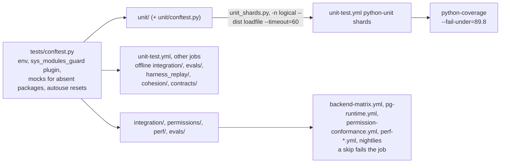

# Python test suite — agent guide

The pytest suite for the Python services: unit tests under `unit/`, and real-service tests under `integration/` and the other folders. On every pull request `unit-test.yml` runs `unit/` in shards and, in other jobs, the offline part of `integration/`, `evals/`, `harness_replay/`, `cohesion/` and `contracts/`; real-service runs have their own workflows. Read this before you add a test that touches module state, logs or `sys.modules`, add a shared fixture or helper, or change `conftest.py`, `pytest.ini` or `.coveragerc`.

Repo-wide rules are in the root [AGENTS.md](../../../AGENTS.md). Setup, shards, order independence and CI time limits are in [README.md](./README.md); this file adds what it does not say. Graph real-store tests are covered in [graph_db/AGENTS.md](../app/services/graph_db/AGENTS.md) ("Tests").

## How it fits



- `conftest.py` runs before any test module is collected. It registers `tests.support.sys_modules_guard` as a plugin, blanks settings a checkout's `.env` could leak in, installs `_MockFinder` for optional packages that are not installed, and resets process-wide state around each test with autouse fixtures (backpressure coordinator, retry budget, `log_once`, lane assignments).
- The marker on a test decides which job runs it (see "Markers").

## Files

| Path | What it holds |
| --- | --- |
| `conftest.py` | Environment, the guard plugin, mocks for absent packages, autouse resets, `mock_graph_provider`, `mock_vector_db_service`, `mock_config_service`, the `stress` skip |
| `unit/conftest.py` | Unit-only autouse fixtures (no table-model download, paid-cache writes on, config epoch) |
| `support/sys_modules_guard.py` | Fails a test or a module import that leaves `sys.modules` changed |
| `support/fresh_module.py` | `fresh_copy(module)`: a private copy of a module, in place of `importlib.reload` |
| `support/log_capture.py` | `assert_not_logged`, `assert_text_free`, `failure_line`, `assert_not_logged_mock` |
| `support/graph_read_errors.py` | Graph errors whose text carries a host, a query and content, and their `SENTINELS` |
| `support/eventually.py` | `until(predicate)` and `done_without_waiting(coro)`: wait without a fixed sleep |
| `support/` (the rest) | Shared fakes and worlds: graph, vector, Redis, Kafka, config, LLM server, storage |
| `hang_dump.py` | Keeps the `faulthandler_timeout` stack dump armed through a failed test's teardown |
| `unit/core/test_org_context_guards.py`, `org_context_baseline.json` | Per-file ratchet over all of `app/`: direct org reads and bare `create_task` |
| `unit/schema/` | Schema parity and no-new-field checks across the graph backends |
| `unit/test_sys_modules_guard.py`, `unit/test_log_capture_support.py`, `unit/test_fresh_module.py` | Tests of the helpers above |
| `integration/` | Real services; each folder's tests skip when their service is missing |
| `permissions/`, `perf/`, `evals/` | Permission conformance (`permission-conformance.yml`), benchmarks (`perf-*.yml`), answer-quality evals (`evals/README.md`) |

## Rules

**Leave `sys.modules` as you found it.** The guard fails a test, at teardown, that drops, stubs or replaces with a second copy any importable module, and fails a file whose import does so. A `patch.dict(sys.modules)` that drops modules first imported inside it fails at its own `with` line. Use `monkeypatch.setitem`/`delitem` on `sys.modules`, or patch the attribute the code reads (`patch("pkg.mod.name")`). Pinned by `unit/test_sys_modules_guard.py`.

**Test an import-time choice with `fresh_copy`, not `importlib.reload`.** A reload rebinds the shared module's globals for every later test in the worker, and no `sys.modules` check can see it. `fresh_copy` runs the file into a module object nobody else holds (not for packages).

**Only absent packages are mocked at import.** `_ensure_module` in `conftest.py` mocks a name in `_OPTIONAL_PACKAGES` only when it does not import. A name added to `_MOCK_PACKAGE_NAMES` directly (as `docling_parse` is) is a mock even when installed, which replaces its real behaviour for the whole suite; stubbing a package in a test trips the guard.

**Check logs with `tests/support/log_capture.py`, not hand-rolled string checks.** `failure_line(records, event, error_class, level, *values, handler=...)` checks a `log_failure` line is the only one, at the right class and level, with no error text or `exc_info`; with `handler` it also checks the failure was logged once. `assert_text_free` and `assert_not_logged` search the message, fields and stack, ignore case, and fail when nothing was logged. Use `assert_not_logged_mock` for a `Mock` logger, and `graph_read_errors.SENTINELS` as the values for a graph read failure. Rules: [docs/logging.md, "Failures"](../../../docs/logging.md#failures) and ["Personal data"](../../../docs/logging.md#personal-data).

**Reset process-wide state you add.** A new module-level singleton, memo or budget that one test can change needs a reset, as the autouse fixtures in `conftest.py` do for theirs, or later tests on the same worker inherit it.

**Wait on an event, never a fixed sleep.** Use `until(...)` or `done_without_waiting(...)` from `support/eventually.py`, a done callback or an `asyncio.Event`.

**Run the repo-wide checks before a pull request.** `unit/core/test_org_context_guards.py` scans every file under `app/` and fails when a per-file count rises, so a change anywhere can trip it. Record an intended change with `ORG_CONTEXT_UPDATE_BASELINE=1` and review the diff of `org_context_baseline.json`. `unit/schema/` checks that the graph schemas agree across backends and that the stored record schema gains no field.

**The Python coverage floor is 89.8% and only goes up.** It is the `python-coverage-threshold` default and the `|| 89.8` fallback in `unit-test.yml`, and the input and Slack text in `weekly-coverage.yml`; change them together. `.coveragerc` omits `app/services/graph_db/neo4j/*` and `postgres/*`, which the real-store jobs test.

### Markers

| Marker | Runs where |
| --- | --- |
| none | Unit shards on every pull request, under `--timeout=60` |
| `integration` | Needs services, skips without them; `backend-matrix.yml` runs `-m integration` on real servers and fails on a skip |
| `docker` | The `sandbox-live` job in `unit-test.yml` (`pytest -m docker`); skips elsewhere |
| `stress` | Skipped unless `-m stress` or `RUN_STRESS_TESTS=1` (`conftest.py`); `stress-nightly.yml` |
| `live_smoke` | Deselected in `python-spend-redis`; runs in `spend-nightly.yml` |
| `arango_only`, `neo4j_only` | Collected for one graph backend only |
| `redis_restart` | By hand; deselected in CI |

A test that needs longer than the shard's 60 s carries `@pytest.mark.timeout(N)`.

## Decisions

- **A `patch.dict(sys.modules)` that drops modules fails at its own line** (#5949). The lifespan tests dropped over 600 modules, and later tests re-imported them: metrics registered twice and two copies of classes and ContextVars coexisted.
- **Every test and module import is checked for `sys.modules` leaks** (#6054). Failures depended on which tests shared a worker. The guard puts the modules back before it fails, so one leak does not break the tests after it.
- **Private copies instead of reloads** (#6064). Reloading the shared parser module changed it for every later test.
- **One shared failure-line check** (#6069), in place of a per-test copy of the same assertions.

## Changing this code

### Adding a test

- [ ] Put it under `unit/` mirroring `app/`; a new directory needs no shard entry (README, "Which shard runs a test").
- [ ] Mark it if it needs services, Docker, or more than 60 s.
- [ ] Use `monkeypatch` for module state and env, `fresh_copy` for import-time choices, and the `log_capture` helpers for log lines.

### Adding a shared fixture or helper

- [ ] Look in `conftest.py` and `support/` first.
- [ ] A helper goes in `support/` with its own test; an autouse fixture in `conftest.py` affects every test, so keep it to resets of process-wide state.

### Editing `conftest.py`, the guard or `pytest.ini`

- [ ] Run `unit/test_sys_modules_guard.py` and the `unit/test_conftest_*.py` files.
- [ ] A new marker is registered in `pytest.ini` with the job that runs it.

### Removing a test, helper or marker

- [ ] Check no workflow selects it by path or `-m`, and that coverage stays above the floor.

## Tests

From `backend/python` with the venv active:

```bash
pytest tests/unit -n logical --dist loadfile --timeout=60          # the unit suite as CI runs it
pytest tests/unit/core tests/unit/schema                           # repo-wide checks
pytest tests/unit/test_sys_modules_guard.py tests/unit/test_log_capture_support.py tests/unit/test_fresh_module.py
pytest tests/unit -m stress                                       # what stress-nightly.yml runs
```

Service-backed folders and their environment variables are listed in the workflow that runs them (`backend-matrix.yml`, `pg-runtime.yml`, `permission-conformance.yml`).

## Keeping this file true

When you change `conftest.py`, a helper named here, a marker, the coverage floor, a workflow that runs these tests, or a rule, decision or checklist step here, update this file in the same PR. Cite files and symbols, not line numbers.
