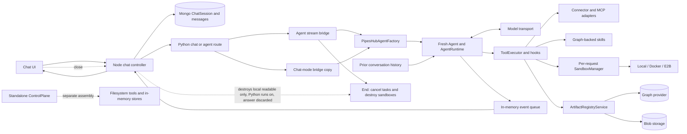
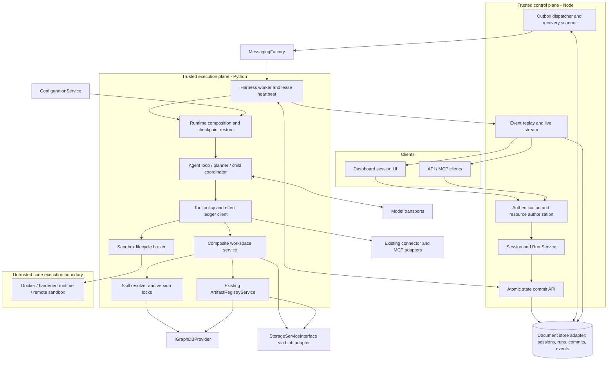
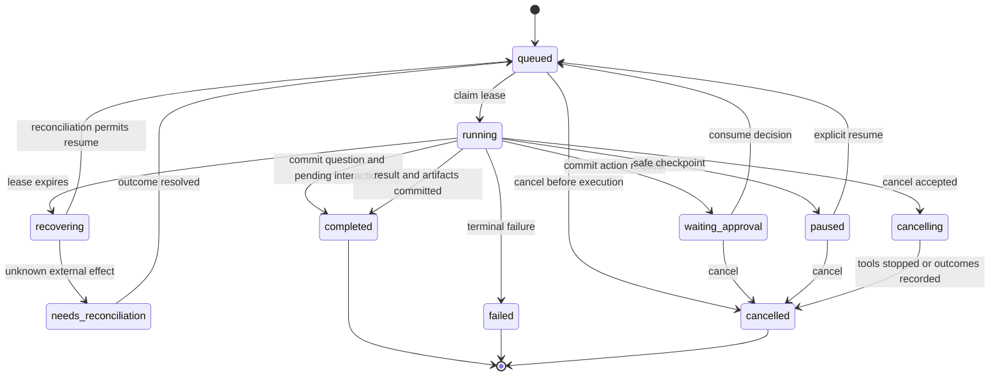
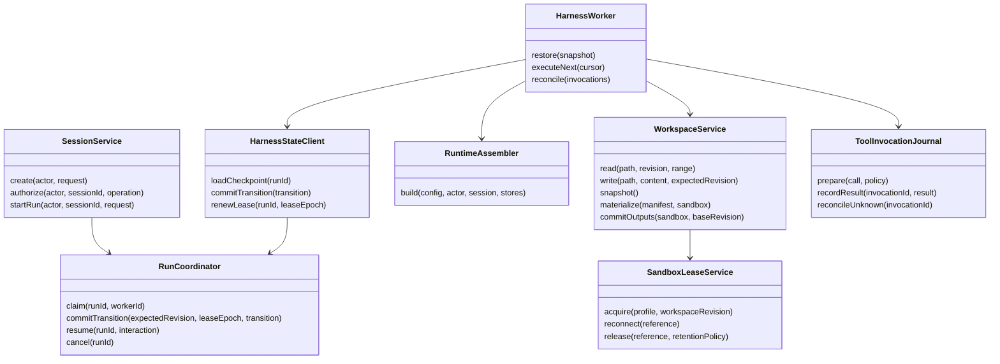
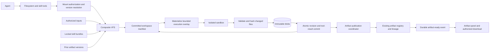
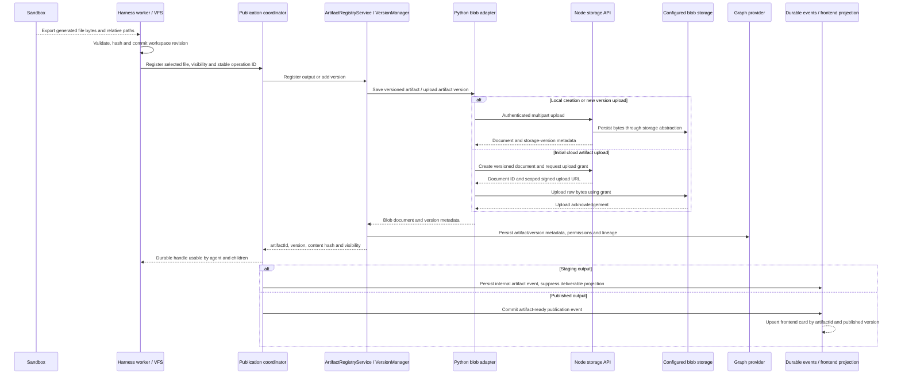
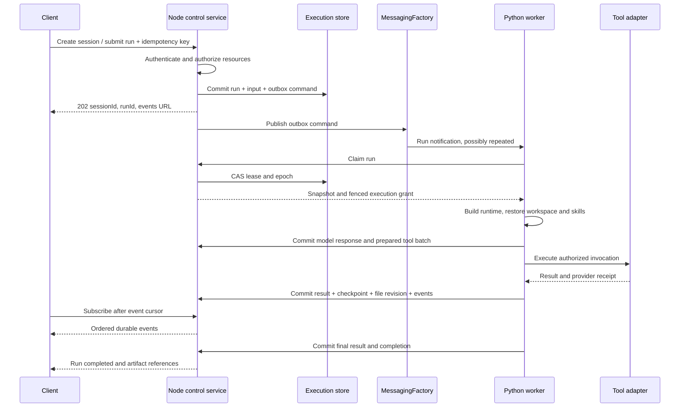
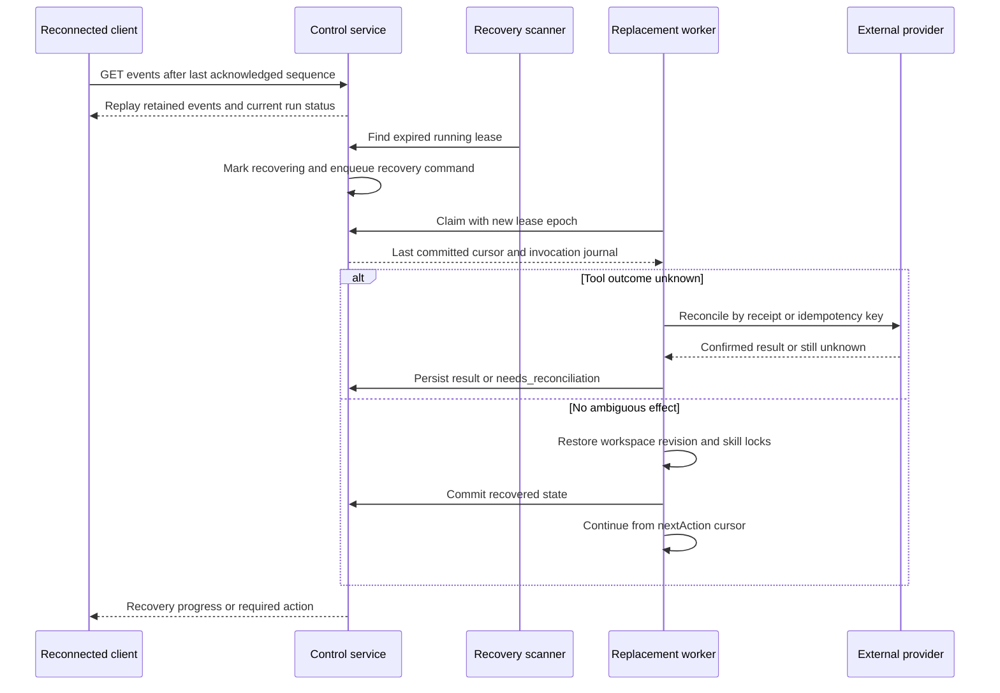
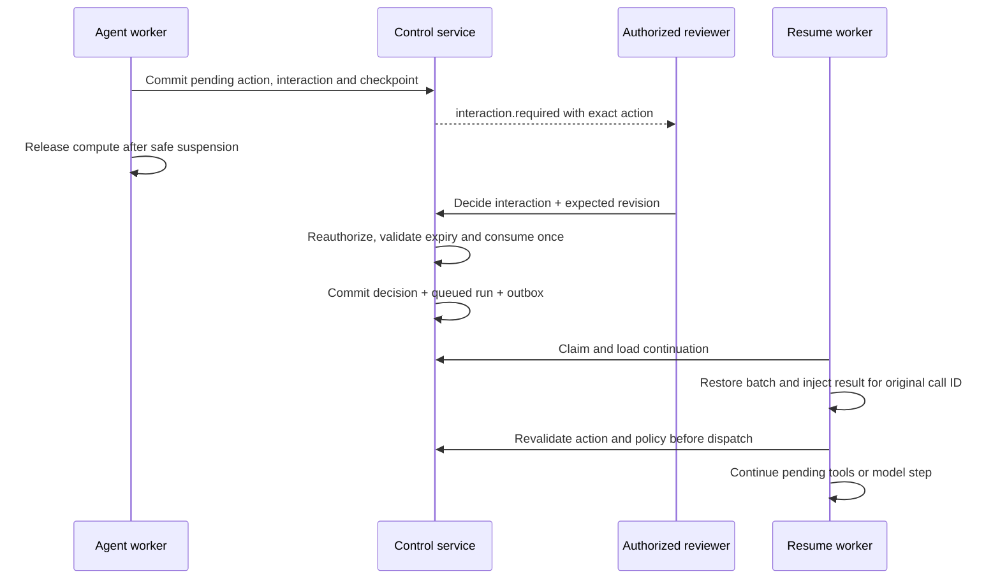

# PipesHub Agent Harness Architecture and Implementation Plan

**Navigation:** [Current implementation](#2-current-implementation) · [Research](#3-research-findings-and-applicability) · [Gaps](#4-gap-analysis-and-priorities) · [HLD](#5-hld-target-architecture) · [Lifecycle LLD](#6-lld-identity-lifecycle-and-durable-records) · [VFS](#7-lld-virtual-filesystem-and-workspace) · [Skills and artifacts](#8-lld-skills-artifacts-and-context) · [Effects and approvals](#9-lld-tool-effects-approvals-and-delegated-work) · [Data flows and APIs](#10-data-flows-and-public-apis) · [Rollout](#12-implementation-strategy-and-alternatives) · [Validation](#13-validation-and-release-criteria) · [Code evidence](#15-repository-evidence-index) · [Sources](#16-sources)

> Implementation authority: [End-to-end implementation plan](agent-harness-implementation-plan.md) revises this design on September 10, 2026. Its explicit persistence, security, lifecycle, API compatibility, and publication contracts take precedence over historical review suggestions.

## 1. Recommendation and scope

PipesHub should evolve its existing agent library into a **session-oriented, durable platform harness**. Retain the model transports, tool adapters, agent modes, skill registry, artifact registry, and sandbox factories. Add a durable execution control plane, bind the existing filesystem tools to a persistent virtual workspace, and make recovery an explicit protocol spanning execution state, files, approvals, and external tool effects.

The current checkout is more advanced than a system with no skills, artifacts, or sessions. It already has all three in meaningful forms. The central weakness is that **chat persistence and execution persistence are disconnected**: the production adapter creates a new runtime for each request, reconstructs context from conversation history, and does not supply the library's checkpoint/session stores. The standalone library has additional facilities, but its default stores are process-local. Enabling a class or passing a conversation identifier alone will not deliver reliable resume.

This proposal targets platform engineers and covers self-hosted Docker/Kubernetes and managed deployments. It includes enterprise search, document creation, analysis, connector actions, and delegated agents; coding-agent techniques are evaluated for their applicability to those workloads. Implementation and live deployment verification are outside this document's scope.

### Evidence baseline

The repository baseline is commit `68bd7aa36532219f94bcb150c2d3588d3355b316`, with the working tree as inspected on September 9, 2026, and a second verification pass on September 10, 2026 that added evidence refs C35–C52, gaps G00 and G17–G20, and sources 15–19. Pre-existing local modifications include deployment and configuration files, so observed defaults are checkout observations, not a claim about every deployed release. No production configuration or live sandbox was inspected. Code references in §15 identify exact files and relevant line positions; observations below are static code findings unless explicitly described otherwise.

External research uses primary sources, including November 2025 and March 2026 engineering reports and living documentation accessed September 9, 2026. A documentation access date is not a publication date. Older distributed-systems material is retained where its semantics remain relevant. Recommendations, proposed schemas, priorities, and numerical targets are engineering judgments, not vendor guarantees.

### Required product outcomes

1. Create a session before execution, discover it later, submit multiple runs, and resume interrupted work on a different worker.
2. Read, write, edit, list, and search a stable virtual filesystem independently of whether code execution is enabled.
3. Discover and load approved skills, including their resources, with reproducible versions across recovery.
4. Produce, inspect, download, revise, and reference durable artifacts with lineage and authorization.
5. Continue background work after a browser disconnect; explicitly pause or cancel it.
6. Recover without blindly repeating connector writes, losing pending questions, or silently losing workspace files.
7. Preserve pluggable storage, model providers, and sandbox backends.
8. Keep per-session working state (todo list, plan, notes) across runs, resumes, and forks without making files the authority for approvals or budgets.
9. Serve both plain retrieval chat and agent chat through one session and run lifecycle, so a short read-only turn is durable without paying a queue hop.
10. Enforce skill scopes, ownership, and tool-authority limits in the store before skills are exposed through shared sessions.

## 2. Current implementation

### 2.1 Request and conversation lifecycle

The Node enterprise-search controller already creates `ChatSession` records and appends separate `ChatSessionMessage` rows. The model supports plain and agent chat, tenant and user identity, sharing, archival, status, and compaction metadata. Message sequencing is separate from execution sequencing. This is a useful foundation and should remain the session identity rather than being replaced with a second unrelated conversation collection. [C01–C03]

Node forwards chat work to Python over an upstream HTTP stream. There are **two request-owning producers**, not one. The agent route calls `run_agent_loop_stream` in `stream_bridge.py`; the plain chat route calls `run_chat_stream` in `app/agents/chat_modes/bridge.py`, which is a parallel copy of the same sequence with different cleanup ordering (it awaits sandbox and MCP teardown before signalling completion, whereas the agent bridge signals completion first and leaves teardown as a detached tail). Both build the legacy-compatible chat-state dictionary, wrap it in `AgentContext`, call `PipesHubAgentFactory.create`, consume `agent.stream(goal)`, and format the result through `AnswerFinalizer`. The harness must become the single execution driver for both routes; keeping two producers in sync is not an option. [C03–C05, C35]

The bridge does **not** pass the factory's optional `session_id`. The factory constructs `AgentRuntime` with transports, tools, hooks, events, skills, and a summarizer, but without checkpoint, session, HIL, approval, timeline, state, or budget providers. Those runtime fields default to `None`; checkpoint saving returns immediately when no checkpoint store is configured. Conversation history is seeded into a new `ContextManager`, which supplies continuity of model input but not restoration of pending execution. [C05–C08]

The stream is request-owned. Python cancels the producer on abnormal stream termination; its finalizer cancels orphaned child tasks, destroys all request sandboxes, and closes MCP sessions. **Node does not abort the upstream request on browser disconnect.** `req.on('close')` destroys only Node's local `Readable`; the fetch pump has no `AbortController` and keeps draining Python until Python finishes. Python therefore never observes the disconnect and runs to completion, spending tokens and sandbox time, while Node's `'end'` handler that persists the answer never fires on a destroyed stream. The session is left in `Inprogress` with no bot message saved. This is a present-day defect (G00), not a future durability gap, and it affects plain RAG chat as much as agent runs. The Python event queue is bounded and has backpressure/coalescing behavior, but it is not a durable event log. Emitted frames carry no sequence number; `runId` appears on most frames, `threadId` only on run start/finish, and `messageId` only on text and reasoning frames. [C03, C05, C36]

Identity is thin on the Python side. The request carries `conversationId`, model settings, attachments, and prior turns; no message id, session id, thread id, or run id is accepted from the client, `agent_id` is not placed on `AgentContext`, and `run_id` is a fresh UUID per request that survives only inside the persisted `parts[]` transcript. Node's `chatSessions` already provides a `sessionType` discriminator, a per-session `nextSeq` allocator, a unique `(sessionId, seq)` message index, and compaction columns (`compactedSummary`, `compactedAtTurnIndex`, `compactedAtTimestamp`) that nothing writes or reads today. [C01–C02, C37]

The de-facto resume today is history replay. `_convert_conversation_turn` rebuilds assistant tool-call and tool-result message pairs from Node's `parts[]`, but each result is the bounded `resultSummary` (500 characters) unless an `artifactId` is present, in which case a compact artifact reference with a retrieval hint is injected instead. This gives the model continuity of narrative, not restoration of execution state, and it must remain readable by the existing UI as a projection after the harness lands. [C06, C38]

### 2.2 Agent loop and orchestration

`AgentSpec` describes an agent, `AgentRuntime` supplies collaborators, and `Agent` binds them for execution. The loop uses a context manager, lifecycle hooks, tool schemas, model transport, tool execution, termination checks, and optional checkpoint calls. Tool dispatch passes through `ToolExecutor` and the common hook kernel even for special routes such as delegation and clarification. Preserve that interception point. [C07, C09]

The mode catalog defines the following behavior. [C10]

| Mode | Current control flow | Implication for recovery |
| --- | --- | --- |
| `quick` | Flat ReAct, no intent pre-step or domain composition | Simplest first durable vertical slice |
| `react` | ReAct with composed domain agents | Child calls need durable identities and result references |
| `planExecute` / `verification` | Plan, critique, execute, verify through `PhaseDriver` | Phase, revision counters, and approval-to-dispatch state must be serialized |
| `deep` | Orchestrator plans and dispatches domain work, then verifies | Dependency graph, child status, and join state must survive recovery |

The code already handles important within-process issues, including duplicate-search detection, child-task dependency scheduling, scope-local state, and avoiding certain double-dispatch fallbacks. These mechanisms should not be confused with durable deduplication of external effects. `compute_duplicate_flags` is a same-runtime filter for explicitly tagged calls, while a durable tool ledger must survive worker loss. [C09, C11]

`AgentCheckpoint` includes messages, goal, identities, turn index, budget snapshot, todos, extensions, and a single pending tool-call identifier. `resume()` restores context and selected state, then resumes at `turn_index + 1`. Its source explicitly acknowledges that unexecuted calls after a pausing tool are not restored and that arbitrary loop-strategy phase tracking restarts. It does not dispatch according to checkpoint kind. Consequently, loading the latest `PRE_TOOL` checkpoint cannot safely be treated as an already completed turn. [C08, C12]

The standalone `ControlPlane` wires filesystem tools and creates in-memory checkpoint, approval, and HIL stores, with optional session/state/timeline stores. The platform factory builds `AgentRuntime` directly instead. Moving the platform wholesale onto `ControlPlane.start()` would introduce different composition defaults and still leave persistence in memory. The better integration seam is the runtime's existing interfaces. [C06, C13]

At the individual-turn level, `Agent.step()` runs pre-turn/context/model hooks, obtains a model response, and dispatches tools. Ordinary calls in a batch run through `asyncio.gather`; results are assembled in original call order and appended to context before the post-tool checkpoint and post-turn hooks. This makes a batch especially important to journal: a sibling may already have executed when another call pauses or fails, even if its result has not reached the checkpoint. Recovery must reconcile every invocation, not simply assume all calls after a question were never executed. `save_checkpoint()` also currently writes `system_prompt_override=None`; dynamic prompt sections and strategy state need an explicit serialization inventory. [C08–C09, C12, C31]

The session store interface provides `create` and `add_run`, but the inspected library callers only wire the collaborator; they do not automatically build a session/run lifecycle around `Agent.run()`. The new coordinator must own those writes explicitly. Merely injecting a persistent implementation would otherwise leave lifecycle bookkeeping incomplete. [C07, C13, C32]

Two further facts shape the recovery design. First, no persistent implementation of the checkpoint, HIL, approval, state, or timeline store exists anywhere in the library; only in-memory variants (plus a stdin HIL store) ship, and the standalone `serve/` module is a single-shot `POST /runs` SSE server without sessions. Second, `resume()` does not restore `visible_tools` (lazy tool disclosure state), `extra_prompt_sections` (preloaded skill bodies), `TurnScope.seen_tool_calls`, `_stale_tool_rounds`, the spawn results slot (declared `persist=False`), or `handoff`'s in-place mutation of the agent spec. The library's `StateSlot(persist=True)` and `known_persisted_slots()` mechanism already exists for extending checkpoints; the platform declares no persisted slot today. [C12, C31, C39]

Mid-run human input already exists on the platform, but as a turn boundary rather than a suspension. `ask_user_question` is tagged lifecycle-terminal: the stream ends, Node persists the question as a `tool_call` message, the frontend stores the pending questionnaire, and submitting the answer sends a **new** user message through the normal stream endpoint. `clarification.py` documents this as a deliberate no-go on the library's blocking `clarify`/HIL path for a stateless web worker. Any interaction design must decide how much of this contract to keep (§9.3). [C40]

### 2.3 Filesystem and sandbox execution

The library has a `WorkspaceBackend` abstraction and `ls`, `read_file`, `write_file`, `edit_file`, `glob`, and `grep` tools. In-memory and local implementations exist. The current interface is largely whole-file text-oriented and does not define binary streaming, immutable snapshots, conditional writes, mount authorization, or quotas. These tools are registered by the standalone control plane; no corresponding workspace construction or registration appears in the inspected platform adapter. [C13–C14]

The active coding path uses `sandbox_bridge.py`, `SandboxBackendRegistry`, `SandboxManager`, and `CodingSandboxBackend`. The bridge supplies tenant context, curated package policies, tool safety hooks, input staging, code capture, artifact registration, lineage, and output events. Backend factories include local, Docker, and E2B. `SandboxRef` and factory reconnect interfaces already exist, but refs are not persisted by the request bridge. [C15–C17]

The legacy `app/sandbox` stack still exists, with a singleton local/Docker executor. The current agent factory deliberately skips legacy coding/database sandbox actions and registers the newer tools. Legacy artifact/package utilities are still reused. Consolidation therefore needs a caller inventory; deleting `app/sandbox` as a whole would be incorrect. [C06, C18]

| Backend | Observed implementation | Limit of the current guarantee |
| --- | --- | --- |
| Local | Temporary workspace, confined subprocess machinery and execution limits; capability reports host isolation | Intended for development; capability reports network availability and no reconnect. Network-off cannot be assumed from a request flag |
| Docker | Per-execution container, copied/staged inputs and collected outputs; memory/CPU limits, temporary `/tmp`, network selection | Capability reports no reconnect. Files retained by the backend object are not a cross-worker workspace snapshot |
| E2B | Provider factory, metered guards, serializable provider reference and reconnect extension | Availability in the registry does not mean the platform preserves provider state between requests |

The settings loader defaults to local when unspecified, while both the inspected Compose file and the Helm chart select Docker (the loader's own comment claiming Helm sets nothing is stale). `backend/env.template` documents none of the `SANDBOX_*` or `E2B_*` variables. Code egress defaults to enabled in the adapter; package installation has its own network channel. The Docker execution settings include memory/CPU limits, and the shipped sandbox image declares `USER sandbox` but also makes `/src`, `/output`, and `/install` world-writable. The runtime call does not explicitly set a read-only root filesystem, dropped capabilities, no-new-privileges, or a PID ceiling. An operator can substitute the image, so runtime policy should enforce identity and isolation requirements rather than relying only on the image. A separate Docker egress bridge is not evidence of a destination allowlist or metadata-service blockade. These are configuration/design gaps, not demonstrated exploits. [C16, C19–C20]

The sandbox governor uses process-local counters. Its per-org cap is per process, not cluster-wide. Per-org configuration through `ConfigurationService` is explicitly a stub. [C19, C21]

What persists today is narrow and worth stating precisely. Within one request and one `sandbox_id`, files and installed packages persist; interpreter state never does. Across requests nothing persists: the per-request `SandboxManager` is destroyed after completion and the tool description tells the model that earlier sandbox ids are dead. Docker "persistence" within a request is a host-side temporary directory re-archived into a fresh container on every call, so cost is proportional to the working-directory size per execution with no cap. `input/`, `skills/`, and `output/` are string-prefix conventions enforced only by the bridge's export filter, not mounts. User chat attachments are **never** staged into the sandbox; their text is rendered into the goal and images into the prompt. The library's exit-time cleanup removes every registered sandbox directory, so a persistent workspace root must not be registered with it. A third on-disk root exists in the legacy executor used by `database_sandbox`. [C16, C20, C41]

### 2.4 Skills

Skills are already implemented and wired into the platform. The actual `skills_enabled()` implementation defaults to enabled, despite an older factory comment saying otherwise. The system has standard-style `SKILL.md` parsing, discovery, loading, resource loading, management, graph-backed storage/version history, usage tracking, governance, builtin packs, and a management API/UI. Domain agents receive read-only skill tools; write access remains a separate concern. [C22–C24]

Loading a skill also stages its resources and transitive dependencies for the coding sandbox; staged files are re-uploaded on every `run_code` call for the rest of the run. This is useful integration, but it is an in-process staging mechanism rather than a versioned VFS mount. Resource failures can be skipped, and the path encodes the skill name rather than an immutable content identity. Agent assignments are names in the route payload. Existing “skills pinning” tests concern keeping the skills toolset visible during lazy tool disclosure, **not pinning skill bundle versions across runs**. [C04, C24–C25]

Laziness exists only at the prompt tier. A skill is stored as **one graph node per org and name with every resource body inlined as parallel string arrays**; prior revisions are full copies in a versions collection. Every chat request loads every skill document in the org with full content and all resource bodies (no field projection) and rebuilds the semantic index in memory. Resources are UTF-8 text only with no per-file size cap; binaries are dropped at import. No content hash or digest exists for a skill or bundle. `write_resource` performs no path validation, so a stored `../x` path breaks every subsequent `run_code` in a run. Preloaded skill bodies live in `extra_prompt_sections`, which is neither checkpointed nor re-attached after compaction. [C23–C24, C42]

Scope and governance have defects that are security-relevant, not cosmetic. The runtime profile passes no visibility scope, so **every skill in the org, including other users' personal skills, is in the prompt, search, and preload of any agent without an explicit assignment**. Names are a single per-org namespace with a creator-scoped existence check, so a second user creating `foo` upserts over another user's private `foo` with no revision snapshot. Builtins are writable and deletable by any user with `skill:write`; the route docstring claiming store-enforced ownership is wrong. `skill_manage create/edit/delete` from the agent bypass the governor entirely; only learning-loop candidates are gated. `allowed-tools` is parsed and round-tripped but never intersected with any policy. `requires` under a scoped manager silently drops a required skill's resources when it is not also assigned. [C42–C43]

### 2.5 Artifacts and context management

Artifacts are available to agents. The adapter persists large tool outputs through `RegistryBackedStore`, uses an in-memory first-level cache, and supports retrieval on subsequent turns through the registry. Sandbox hooks capture code and output files, register versions synchronously, record derivation, and emit artifact events. The platform has artifact UI components and tests covering generation and re-staging. [C15, C26–C27]

`ArtifactRegistryService` provides registration, named outputs, versions, content access, download URLs, promotion, and lineage. It uses the graph abstraction and existing blob storage. Authorization verifies tenant identity and a user permission edge. Session sharing must therefore be explicitly integrated with artifact policy; sharing a chat does not automatically establish permission to its artifacts. The access implementation currently checks the existence of an edge; any future reader/writer distinction must inspect the edge's permitted operations rather than relying on comments about ownership. [C28]

There are two important reliability limits. First, failed registry writes in `RegistryBackedStore.store()` return an in-memory artifact identifier, which may become unrecoverable after compaction and process loss. Second, version updates perform a read/check, blob upload, and graph updates; `expected_version` is checked before those writes, not as an atomic compare-and-swap in that method. Duplicate-create handling exists (the loser is folded into the winner and tombstoned, but its blob remains), and a concurrent version race still needs explicit contract tests and an atomic publication boundary. [C26, C29]

Several further observations change the priorities in §8.2. `RegistryBackedStore` calls `register()` without a visibility, so **every offloaded tool result is a VISIBLE artifact** named `tool_result_<tool>.json` that appears in `list_artifacts` and in the per-turn artifact reminder. CODE artifacts are created one per `run_code` call and never versioned, so lineage's `sourceVersion` is always 1. Artifact nodes carry no message, run, or agent identity; the only card-to-message binding is the `::artifact` marker text inside the saved answer. Lineage has a single `DERIVED_FROM` edge from output to code; there is no inputs edge and no produced-by-run edge. `list_for_conversation` is unsorted, so the "20 artifacts" reminder is not the most recent twenty. Version 1's storage mapping is backfilled only at the first version bump; without a bump it can become unreachable. The reconciliation and cleanup sweep in `app/sandbox/artifact_cleanup.py` **has no production caller**, so `ARTIFACT_VERSION_PENDING_RECONCILE` rows are repaired only incidentally on read, `isTemporary`/`expiresAt` are stored but never consulted, staging and code artifacts accumulate forever, and orphan blobs are never reclaimed. The two-phase upload grant path (`get_upload_grant`/`commit_version`) has no callers and keeps its pending grants in process memory. Sharing a conversation writes only Mongo fields; no graph permission edge is created, so a shared viewer's download returns 403 and an agent acting as that viewer cannot resolve the owner's artifact by name and will create a same-name duplicate. [C28–C29, C33, C44–C45]

Context compaction, tool-result offload, attachment reconstruction, citation mapping, and reasoning/activity persistence are already present. Recovery requires a versioned snapshot of the state these adapters need, not only a rendered transcript or model-generated progress summary. [C06, C08, C27]

### 2.6 Current data flow



## 3. Research findings and applicability

There is no single universal agent-harness standard covering durable scheduling, files, tools, skills, approvals, and artifacts. There are interoperable boundaries and converging implementation patterns. PipesHub should standardize those contracts while preserving its enterprise authorization and storage architecture.

| Primary source | Supported finding | Application to PipesHub |
| --- | --- | --- |
| Anthropic, November 26, 2025 | Long-running work benefits from explicit progress records, incremental tasks, and verification between context windows | Keep durable goals, progress, and evidence alongside checkpoints; use workspace files for human-readable handoffs. These files supplement machine state. [^1] |
| Anthropic, March 24, 2026 | Generator/evaluator separation can improve quality; context reset needs changed with the model; examples have substantial cost overhead | Retain optional verification modes, benchmark them, and avoid forcing a multi-agent loop or reset policy on every request. Coding examples are not enterprise-workflow benchmarks. [^2] |
| LangChain Deep Agents backends | Filesystem tools can route path prefixes to different backends with different persistence scopes | Use a composite namespace for workspace, attachments, skills, artifacts, and memory. The filesystem contract is independent of a shell process. [^3] |
| LangGraph persistence and time travel | Thread checkpoints and cross-thread stores solve different persistence problems; invoking from an old checkpoint re-executes downstream nodes, and editing state at an old checkpoint appends a new one rather than rewriting history | Keep run recovery, session memory, and reusable knowledge separate. An in-memory saver is insufficient across worker restarts. Forks are append-only branches, never rewrites. [^4][^19] |
| Claude Agent SDK sessions | Continue/resume/fork concern conversation history; filesystem checkpointing is separate | Define distinct contracts for session continuation, run recovery, branch creation, and filesystem restoration. [^5] |
| Agent Skills specification | `SKILL.md`, metadata, resources, and progressive disclosure provide an interoperability boundary | Retain the existing format, test import/export interoperability, and add platform versioning and policy around it. [^6] |
| OpenAI Skills documentation | Skills are versioned file bundles; metadata discovers them and instructions/resources are loaded when needed | Implement immutable skill bundle identities and runtime mounts. Do not inject every resource into the model context. [^7] |
| OpenAI Shell documentation | An execution container can be referenced across requests and has its own lifecycle | Keep a provider execution handle separate from the durable session and durable files. [^8] |
| OpenAI conversation state | A durable conversation object can hold messages, tool calls, and outputs | Treat provider conversation IDs as optional transport metadata; PipesHub remains the owner of cross-provider execution state. [^9] |
| E2B persistence | Pause/resume can preserve filesystem and memory, with capability/lifecycle distinctions | Use provider snapshots as an optimization. A portable recovery baseline should work with files and state even if process memory cannot be restored. [^10] |
| Anthropic secure deployment | Isolation and externally mediated credentials reduce exposure; proxy configuration alone is not universal network enforcement | Put secrets and authenticated connector calls outside generated-code execution; enforce egress in infrastructure. [^11] |
| MCP security guidance, 2025-11-25 | Token passthrough and confused-deputy risks require explicit authorization boundaries | Authenticate MCP access per actor and resource, revalidate on resume, and avoid treating an MCP session as a harness session. [^12] |
| Temporal idempotency guidance | Durable execution does not make external activities atomic; retries require idempotency or reconciliation | Journal every effect before dispatch, retain provider receipts, and classify unknown outcomes. [^13] |
| OpenTelemetry GenAI conventions | Shared telemetry vocabulary is evolving in a dedicated repository | Map existing Opik traces to stable internal identifiers, isolate external schema mappings, and pin the adopted convention version. [^14] |
| Anthropic Managed Agents (beta, 2026) | A session is a long-lived server-side object with states `idle`, `running`, `rescheduling`, `terminated`; finishing work returns it to `idle`, not `terminated`; events are persisted server-side and streamed; secrets are placeholders substituted at egress so the agent never sees values; sessions carry budgets | Model session lifecycle as idle-between-runs rather than terminal-after-answer; persist events before streaming; broker connector credentials outside the sandbox. [^15] |
| Google ADK sessions, state, artifacts, memory | Four separate services: `Session{state, events}`, state written only via event deltas with scope prefixes (`user:`, `app:`, `temp:`), artifacts with integer versions and `load_artifact(name, version)`, and a separate searchable memory service | Adopt the same four-way split and the scoped-state prefixes for per-session agent state (§7.1); integer versions per artifact name match the existing registry. [^16] |
| LangChain Deep Agents overview and "Anatomy of an Agent Harness" | A `CompositeBackend` routes by longest path prefix to state-, store-, or sandbox-backed filesystems; todos are middleware state; sub-agents return one report; memory is `AGENTS.md`-style files | Use prefix routing for the composite VFS; keep typed todos with a read-only file projection; treat the harness component list as a completeness checklist. [^3][^17] |
| Claude Code skills and memory | Only skill descriptions load at startup under a byte cap; full `SKILL.md` on invoke; the most recent invocation of each skill is re-attached after compaction under per-skill and total token caps; auto-memory loads a bounded head of an index file and reads topic files on demand | Budget the skill catalog by bytes, re-attach active skills after compaction, and load session documents by bounded head (§7.1, §8.1). [^5] |
| Manus context engineering | The filesystem is the unlimited external context; compression must be recoverable (keep path, drop content); a `todo.md` rewritten each step keeps goals in recent attention; mask tools rather than remove them to preserve cache | Recoverable compression maps to artifact/tool-result references; todo recitation maps to prompt re-injection of `TODO.md`; tool masking maps to the existing lazy tool disclosure. [^18] |

### Important distinctions

**Files are durable working material, not the scheduler.** Plans and summaries help the model navigate long work, but cannot authoritatively encode an approval decision, lease owner, tool attempt, or budget debit. Those require typed server-owned state.

**A VFS is not a security sandbox.** Path routing improves usability and portability; the execution backend must separately enforce filesystem and network isolation. A local directory called a workspace does not establish a tenant boundary.

**Checkpoint recovery is not deterministic model replay.** Reusing stored model/tool outputs avoids unnecessary regeneration. If a model response was never durably recorded, a retry may produce a different response. The contract should guarantee consistency of committed execution, not identical future tokens.

**Resume is not rollback of the outside world.** Forking from an old checkpoint can restore local files and context. It cannot unsend a message, revoke a completed purchase, or remove an external ticket unless an explicit compensating action is supported and authorized.

## 4. Gap analysis and priorities

P0 means a prerequisite before advertising durable execution or enabling the corresponding new capability broadly. P1 means required for the complete harness. P2 means a later optimization. These are implementation priorities, not vulnerability severity ratings.

| ID | Priority | Evidence and weakness | Proposed fix | Acceptance condition |
| --- | --- | --- | --- | --- |
| G00 | P0 | Browser disconnect does not abort Python; the finished answer is discarded and the session stays `Inprogress`; two producers duplicate the bridge [C36, C35] | Run record written before proxying and finalized from Python's commit, not from the HTTP `'end'`; single execution driver for both routes | Close the browser mid-run on plain chat and on agent chat; the answer is persisted and the session reaches a terminal status |
| G01 | P0 | Session metadata exists, but runtime stores and session identity are not wired [C01, C05–C08] | Bind existing chat-session identity; add runs and persistence adapters | A worker restart restores a run belonging to the same authorized session |
| G02 | P0 | `resume()` advances all checkpoints to next turn and does not restore full tool/phase state [C12] | Versioned continuation cursor and tool-batch/phase snapshots | Crashes at each supported boundary resume without skipped or duplicated committed work |
| G03 | P0 | Execution and event delivery are tied to HTTP lifetime [C03, C05] | Durable dispatch, worker ownership, event log and replay | Close browser, reconnect elsewhere, recover ordered events and active run |
| G04 | P0 | Deduplication is not a durable side-effect journal [C09] | Tool invocation ledger, idempotency keys and unknown-outcome reconciliation | Lost acknowledgement after a connector write does not cause blind re-execution |
| G05 | P0 | Platform has no unified persistent workspace binding [C13–C15] | Composite VFS and atomic workspace revisions | File written before restart remains readable from another worker |
| G06 | P0 | Local/network defaults and Docker runtime controls do not express a production tenant policy [C16, C19–C20] | Enforced execution profiles, brokered sandbox provisioning and egress | Production startup rejects incompatible backends; escape/egress tests pass |
| G07 | P0 | Artifact write fallback can return ephemeral references [C26] | Explicit durable/ephemeral result contract; fail closed before destructive compaction | No committed checkpoint references an ephemeral-only payload |
| G08 | P1 | Skills load by name and resources stage best-effort; bodies and resources are inlined in the graph node and loaded eagerly on every request [C24–C25, C42] | Session/run skill lockfile, immutable resource mount, verified staging; metadata in graph and bodies in blob by digest; persisted search index | Resume uses the recorded bundle digest, or stops for a declared incompatibility; a request does not load skill bodies it did not activate |
| G09 | P1 | HIL/approval stores absent in platform runtime [C06–C08] | Durable interaction records, exact action binding and resume commands | Another authorized client can answer a pending interaction after restart |
| G10 | P1 | Resource governance is per process; org settings loader is a stub [C19, C21] | Cluster admission and per-org policy via ConfigurationService | Multiple workers jointly respect tenant limits |
| G11 | P1 | Child scheduling and coordination depend on live tasks [C11] | Durable child-run graph, mailbox/result pointers and joins | Parent recovers already completed child outputs without rescheduling them |
| G12 | P1 | Artifact publication spans blob and graph; version check is not atomic in method [C29] | Idempotent publication coordinator and conditional metadata commit | Concurrent updates yield distinct versions or a conflict; partial writes reconcile |
| G13 | P1 | Chat sharing and artifact permissions are separate [C01, C28] | Explicit view/control/share/export policy for each resource | Sharing never accidentally expands tool authority or leaks private outputs |
| G14 | P1 | Two assembly paths and two sandbox stacks invite drift [C06, C13, C18] | Shared runtime composition services and staged legacy retirement | Platform and standalone profiles have explicit capability contract tests |
| G15 | P1 | Existing tests cover pieces, not proof of cross-worker recovery [C30] | Process-kill, storage-failure, concurrency and event-replay suites | Release gate exercises recovery with real persistence adapters |
| G16 | P2 | No unified product view of files, skill pins, run recovery and budgets | Session inspector built on durable events and resources | Users can inspect progress, files, artifacts and pending actions without logs |
| G17 | P0 | Skill scope and governance defects: runtime catalog exposes other users' personal skills; cross-user name overwrite; builtins writable; `skill_manage` bypasses the governor; `allowed-tools` unenforced; unvalidated resource paths [C42–C43] | Explicit personal/shared/org/builtin scopes enforced in the store, per-scope name uniqueness, ownership checks on every write, governor on interactive creates, `allowed-tools` intersection, path validation | A user cannot see, overwrite, or delete another user's or a builtin skill; an agent-created skill is a candidate until approved; a skill cannot widen tool authority |
| G18 | P1 | Artifact reconciliation and cleanup have no caller; tool results are registered VISIBLE; artifacts carry no run/message identity; sharing does not propagate [C44–C45] | Scheduled reference-aware GC, explicit artifact classes, provenance on version records, share policy that reaches artifacts | Staging and tool-result artifacts are collected after their retention window; no card is shown for internal classes; a shared viewer can download what the policy allows without creating duplicates |
| G19 | P1 | Process-local state that breaks with multiple workers: conversation task registry, governor counters, Docker client, pending upload grants, per-request skill index, emitter buffers [C21, C46] | Move each to the durable state service, KV, or per-run records | Two workers serving alternate turns of one session observe the same state |
| G20 | P1 | Per-session agent state (todos, plan, notes) is absent or in-memory; compaction summaries are recomputed each turn; `chatSessions` compaction columns are unused [C37, C47] | Typed tasks plus model-editable notes/plans in the workspace with bounded untrusted-context injection; persisted compaction summary with source range (§7.1, §8.3) | A todo list survives to the next run of the session and a fork; a compaction summary is not regenerated on resume |

## 5. HLD: target architecture

### 5.1 Ownership and deployment

Use Node as the authenticated **session and run control service**, backed by vendor-neutral execution repositories and an atomic unit of work. Add a Python harness worker deployment that uses the existing agent library and adapters. It may initially share the query-service image but should run as a separate process role so HTTP restarts and retrieval load do not own long-running jobs.

Python accesses execution persistence through an injected `HarnessStateClient` implementing the library store interfaces against internal Node APIs. This keeps execution-state ownership in the control service; MongoDB and PostgreSQL are interchangeable adapters, not domain dependencies. Commit operations must be coarse-grained and atomic; do not make one HTTP request per token or expose raw database operations. If measured latency eventually warrants a dedicated persistence service, preserve these contracts while changing transport.

`MessagingFactory` handles dispatch notifications with Kafka or Redis Streams. The selected execution document store remains authoritative; the broker is a wake-up mechanism, not the only record that a run exists. Blob bytes continue through the existing storage service. Graph metadata, skills, and artifact lineage continue through `IGraphDBProvider`; semantic search continues through the existing retrieval/vector interfaces. Configuration comes through `ConfigurationService`.



The sandbox broker owns privileged provider credentials and lifecycle operations. In Docker deployments, move Docker socket access away from the general query/API workload into that restricted broker. The sandbox never receives a Docker socket, graph credentials, Mongo credentials, or a broad platform token. A compromised worker remains a distinct risk; separate its credentials and network permissions from the sandbox broker.

### 5.2 State ownership

| State | Authority | Notes |
| --- | --- | --- |
| Session identity and sharing | Existing `chatSessions` | Preserve IDs and public conversation compatibility |
| Rendered conversation messages | Existing `chatSessionMessages` | Projection of committed runs; not the execution journal |
| Run lifecycle, checkpoints, invocations, interactions | Execution repository ports through Node | Tenant-scoped, revisioned, independently retained |
| Workspace namespace and revision pointers | Workspace metadata repository | Immutable revisions reference blob content |
| Workspace bytes and checkpoint payloads | Existing blob service | No large binary bodies embedded in run documents |
| Artifact identity, versions, permissions, lineage | Existing artifact registry | Add publication reconciliation and workspace references |
| Skill catalog and published history | Existing graph skill store | Add immutable bundle/resource digests |
| Dispatch | Existing broker abstraction | At-least-once notification with durable dedupe |
| Budget/quota authority | Atomic document-store reservations | KV acceleration only if equivalent atomic semantics exist |
| Sandbox execution state | Backend/provider | Replaceable cache unless a validated snapshot contract says otherwise |

## 6. LLD: identity, lifecycle and durable records

### 6.1 Identity model

| Identifier | Meaning | Stability |
| --- | --- | --- |
| `sessionId` | Existing chat-session ID; product conversation and shared workspace | Across user messages and runs |
| `runId` | One accepted objective/input with pinned execution configuration | Across pause/resume and worker replacement |
| `attemptId` | One worker ownership period | New on each acquisition/recovery |
| `parentRunId` / `taskId` | Child relationship and logical delegation key | Stable across child retries |
| `checkpointId` / `commitSeq` | Immutable executable snapshot and ordered state transition | Immutable |
| `workspaceId` / `workspaceRevision` | Namespace identity and immutable file-tree revision | Revision changes on committed writes |
| `invocationId` | One logical tool call | Stable across retries; not regenerated on resume |
| `interactionId` | A question or approval tied to a specific continuation | Consumed once |
| `sandboxId` | Provider execution resource | May change without changing run identity |

Map the library's current use of `thread_id = run_id` explicitly to run recovery. Never overload it with `sessionId`. A follow-up message after a completed run starts a new run in the same session. Recovery continues the same run. A user-requested alternative branch creates a new session/workspace branch with ancestry references.

Bind `runId` to the transcript it produces: every run record stores `(sessionId, userMessageSeq, botMessageId)` using the existing `chatSessionMessages` sequence and the `bot_response` row id, and the `parts[]` transcript on that row is written as a **projection** of committed run events, not assembled from the live stream. This lets a run, its transcript row, its events, and its artifacts be joined by keys instead of by marker text, and keeps the existing UI and Slack consumers working during migration. Add `agent_id` (the agent definition key) to `AgentContext`; today only `conversation_id` reaches Python. [C37–C38]

Session lifecycle follows the Managed Agents model: a session is `idle` between runs, `running` while a run holds a lease, and `terminated` only by archival or deletion. Completing a run returns the session to `idle`; the existing `status` enum (`None`, `Inprogress`, `Complete`, `Failed`) becomes a derived compatibility field. [^15]

### 6.2 Lifecycle

Session lifecycle is `open → archived → deleting → deleted`, with archival reversible. A session's lifecycle is distinct from whether its latest run succeeded. Maintain the existing UI status as a derived compatibility field.



All nonterminal states allow cancellation, including `recovering` and `needs_reconciliation`; the diagram omits those arrows for readability. Cancellation does not claim reversal of completed external effects. If an in-flight action's outcome remains unknown, record that uncertainty even when the run stops. Resume of a terminal run is rejected; “try again” creates a new run with ancestry and explicit effect policy.

### 6.3 Logical records and storage constraints

Every record includes `orgId`, `schemaVersion`, creation/update timestamps, and resource authorization context. Use opaque IDs but never treat their opacity as authorization.

| Logical record | Main fields | Required constraints; physical indexes are adapter-owned |
| --- | --- | --- |
| `chatSessions` additions | `harnessVersion`, `workspaceId`, `activeRunId`, `revision`, `lifecycle` | Conditional update on current revision/active run |
| `agentRuns` | `sessionId`, `userMessageSeq`, `botMessageId`, `agentKey`, `profile` (`inline` or `dispatched`), `parentRunId`, `taskId`, `status`, `attemptId`, `leaseEpoch`, `leaseExpiresAt`, `checkpointId`, `commitSeq`, `configRef`, `skillLockRef`, `budget`, `failure` | Unique `(orgId, runId)`; unique `(orgId, sessionId, userMessageSeq)` for root runs; `(status, leaseExpiresAt)`; `(orgId, sessionId, createdAt)`; partial unique `(orgId, parentRunId, taskId)` for children |
| `agentCheckpoints` | `runId`, `commitSeq`, `kind`, `payloadRef`, `payloadHash`, `workspaceRevision`, `compatibilityVersion` | Unique `(orgId, runId, commitSeq)`; checkpoint ID lookup |
| `agentInvocations` | `runId`, `invocationId`, `batchId`, `ordinal`, `tool`, `argsRef`, `argsHash`, `effectClass`, `status`, `attempts`, `providerReceipt`, `resultRef` | Unique `(orgId, runId, invocationId)`; outstanding status index |
| `agentInteractions` | `runId`, `invocationId`, `kind`, `requestedActionHash`, `status`, `answer`, `decidedBy`, `expiresAt`, `policyVersion` | Unique interaction ID; pending by session; CAS from pending to decided |
| `agentEvents` | `sessionId`, `runId`, `eventSeq`, `commitSeq`, `type`, `payloadRef` or bounded payload | Unique `(orgId, sessionId, eventSeq)`; retention timestamp index |
| `agentWorkspaces` | `workspaceId`, `sessionId`, `headRevision`, `quota`, `lifecycle` | Unique tenant/workspace identity; conditional head update |
| `agentWorkspaceRevisions` | `workspaceId`, `revision`, `parentRevision`, `manifestRef`, `manifestHash` | Unique `(orgId, workspaceId, revision)` |
| `agentDispatchOutbox` | `commandId`, `runId`, `kind`, `generation`, `publishedAt`, `retryAt` | Unique command ID; unpublished/retry scan |
| `agentPublications` | `publicationId`, `runId`, `invocationId`, `workspaceRevision`, `path`, `hash`, `artifactId`, `artifactVersion`, `status` | Unique logical publication key; reconciliation scan |

Do not embed an unbounded event history, file tree, or invocation list in `agentRuns`. Keep checkpoints in immutable blob payloads with metadata rows. A first VFS implementation can use an immutable manifest per revision with strict size limits; adopt structural sharing or sharded manifests when measured scale warrants it.

### 6.4 Checkpoint payload

The new checkpoint extends the existing `AgentCheckpoint` rather than discarding its model. The serializer must be explicitly versioned and reject unsupported state, not silently drop correctness-critical fields.

```json
{
  "schemaVersion": 2,
  "runId": "run_123",
  "sessionId": "existing-chat-session-id",
  "commitSeq": 42,
  "cursor": {
    "phase": "execute",
    "turnIndex": 7,
    "nextAction": "dispatch_pending_tools",
    "toolBatchId": "batch_7",
    "pendingInvocationIds": ["inv_b"],
    "completedInvocationIds": ["inv_a"]
  },
  "contextRef": "blob-ref",
  "workspaceRevision": 12,
  "skillLockRef": "skill-lock-ref",
  "executionConfigRef": "config-ref",
  "plannerStateRef": "planner-ref",
  "childGraphRef": "child-graph-ref",
  "budgetSnapshotRef": "budget-ref",
  "adapterStateRef": "adapter-state-ref",
  "sandboxRefs": [],
  "lastCommittedEventSeq": 108
}
```

`executionConfigRef` records agent definition version, resolved mode, model/provider settings, prompt version, tool schema digests, skill digests, and policy snapshot. Secrets are stored only as revocable credential references. `adapterStateRef` holds required citation mappings, attachment identities, artifact handles, disclosed tools, and serializable persistent hook state. Live clients, coroutines, locks, tokens, signed URLs, and Python object pickles are excluded.

`nextAction` must distinguish model invocation, pending-tool dispatch, waiting interaction, result assembly, phase transition, and terminal state. Recovery must use this cursor rather than unconditionally adding one to the turn counter. Capture the complete model tool-call batch and its original provider IDs before dispatch. Keep one result slot per call, including denied or cancelled calls, so reconstructed provider messages remain valid.

#### Serialization inventory

The following live state is not in `AgentCheckpoint` today and must be covered by `adapterStateRef`, `plannerStateRef`, or `childGraphRef`, or explicitly declared non-recoverable. Use the library's `StateSlot(persist=True)` registration so `snapshot_extensions()`/`restore_extensions()` carry them without a parallel mechanism. [C31, C39]

| State | Where it lives now | Target ref | Notes |
| --- | --- | --- | --- |
| `visible_tools` | `RunScope` | adapter | Lazy tool disclosure; without it a resumed run sees a different toolset |
| `extra_prompt_sections` | `RunScope` | adapter | Preloaded skill bodies; rebuild from the skill lock rather than storing text |
| `todos` | `RunScope`, checkpointed | session documents (§7.1) | Keep typed, revisioned task state; render `TODO.md` as a read-only projection; model edits use `write_todos` |
| `seen_tool_calls`, `_stale_tool_rounds` | `TurnScope` / `Agent` | adapter | Loop-control state; may be reset on resume if documented |
| `STRUCTURED_PLAN_SLOT`, `PLAN_DISPATCH_APPROVED_SLOT` | `RunScope` slots | planner | Plan steps, dependencies, approval flag |
| Orchestrator loop locals (`plan_validated`, `dispatched`, `programmatic_dispatch_ran`, `dispatch_retries`, `PhaseDriver` rounds/passed) | Python locals | planner | Must become explicit phase state |
| `SPAWN_RESULTS_SLOT`, `_pending_spawn_tasks`, `_detached_tasks` | `RunScope` (`persist=False`) and live tasks | child graph | Replace with durable child-run records and result pointers |
| Synthetic tool-call messages injected by programmatic dispatch | `ContextManager` | context | Already in `messages`; preserve pairing |
| Compaction summary and covered range | Recomputed every turn | adapter | Persist in `chatSessions.compactedSummary*` with algorithm version |
| Citation maps, attachment identities, delivered artifact versions, disclosed tools | `tool_state` dict and hook objects | adapter | Required by `AnswerFinalizer` |
| `handoff` spec mutation | In-place on `AgentSpec` | execution config | Record as a config transition |
| `AGUIEventEmitter` open messages and text buffers | Emitter memory | events | Replay reconstructs from committed chunks |
| Sandbox refs, staged input file set | Per-request manager and `ContextVar` | workspace | Rebuild from workspace revision and skill lock |

### 6.5 Atomic commit and dispatch

Production durability requires an adapter passing the atomic execution-store contract: conditional ownership checks, unique logical keys, consistent reads, and an atomic state/events/outbox commit. MongoDB can implement this using replica-set transactions; PostgreSQL can implement it using transactions and constraints. These are adapter deployment requirements, not a platform-wide Mongo requirement. A backend that cannot satisfy the contract must fail readiness for durable mode; do not silently weaken guarantees. Existing Mongoose transaction lifecycle defects should be repaired behind the legacy adapter, including asynchronous callbacks using sessions already ended by controller finalizers. [C36, C48]

The state service exposes `commitTransition(expectedRevision, leaseEpoch, checkpointRef, invocationUpdates, workspaceHead, events, outboxCommands)`. Inside one selected document-store transaction it verifies current ownership/revision, installs checkpoint metadata, advances run and workspace pointers, allocates durable event sequence values, and adds dispatch notifications. Blob uploads happen before this transaction and are immutable. An unreferenced upload is an orphan to collect, not a visible committed file.

The dispatcher publishes outbox commands through the broker abstraction and marks delivery separately. In Node that abstraction is `libs/services/message-broker.factory.ts` with the `IMessageProducer` contract; the default broker is **Redis Streams**, not Kafka. No outbox, dead-letter queue, or retry queue exists anywhere in Node today and most producers swallow publish errors, so the outbox collection, a new `BrokerTopic` value for agent dispatch, and the scanner are greenfield work. A crash between publish and mark produces duplicate delivery; command ID and conditional run claim make that harmless. A scanner retries unpublished outbox entries and requeues eligible runs whose leases expired. The scanner must honor pending interactions, cancellation, unknown external effects, and terminal states. [C49]

Not every run needs the queue hop. Choose an **execution profile per run** at submission: `inline` runs execute inside the request that submitted them (quick mode, retrieval-only toolsets, no sandbox, bounded duration) but still write the same run, checkpoint, and event records and are finalized from Python's commit rather than from the HTTP stream end; `dispatched` runs go through the outbox and a leased worker. The profile is a run property, not an API family (§10.4), so plain RAG chat and agent chat share one lifecycle and the latency target for short read-only tasks in §13 stays reachable.

One root run at a time may mutate a session workspace in the first release. Concurrent user submissions return `409 RUN_ACTIVE` or enter an explicit ordered queue; choose one documented API behavior, with rejection as the initial implementation. Child runs write to isolated overlays and publish explicit outputs through parent-controlled merges.

### 6.6 LLD component relationships



## 7. LLD: virtual filesystem and workspace

### 7.1 Namespace and mounts

Expose one agent-visible absolute POSIX namespace. Adapt the current workspace-relative interface behind a compatibility layer; normalize once at the boundary and never expose storage object keys or host absolute paths.

| Mount | Authority and lifetime | Agent access |
| --- | --- | --- |
| `/workspace/` | Durable session working files | Read/write with revision checks |
| `/inputs/` | Authorized attachment snapshots, immutable within a run | Read-only |
| `/skills/<name>/<digest>/` | Resolved immutable skill bundle | Read-only |
| `/artifacts/<id>/<version>/` | Existing artifact registry | Read-only; revise via a working copy and publication |
| `/tool-results/<invocationId>/` | Durable full tool output, with schema/preview | Read-only |
| `/session/` | Typed task projection `TODO.md` plus model-editable `PLAN.md`, `NOTES.md`, `PROGRESS.md`, and working assumptions; durable across every run of the session; copied on fork | TODO is read-only; other files are read/write. Bounded content is added as explicitly untrusted context, never system-policy instructions |
| `/memory/` | Explicitly approved user/org memory, separate retention | Read-only by default; mutations through governed memory tools |
| `/scratch/` | Per-attempt temporary data | Read/write, explicitly not recovered |
| `/system/` | Generated capability manifest, run cursor, pending interactions, budget, skill lock, artifact publications as a read-only projection | Read-only |

Deliverables belong in `/workspace/output/`. These paths are conventions, not authoritative lifecycle state. Explain persistence classes in the system prompt and file metadata so the model knows which files survive a restart. User attachments materialize under `/inputs/` for both file tools and the sandbox; today they never reach the sandbox at all, so this is new behavior rather than a formalization. The library's exit-time sandbox cleanup must not manage the persistent workspace root. [C41]

#### Per-session agent state

Todo lists, plans, notes, and later memories are distinct kinds of state with different owners. Adopt two ownership classes and the scoped-state split used by ADK, and keep files as the model-facing surface where the model is the owner. [^16][^5][^18]

| Class | Examples | Authority | Storage | Agent access |
| --- | --- | --- | --- | --- |
| Harness-owned typed state | Run cursor, interactions, approvals, budget reservations, skill lock, artifact publications | Server; written only through `commitTransition` | Execution repositories | Read-only projection at `/system/` |
| Model-owned session documents | `PLAN.md`, `NOTES.md`, `PROGRESS.md` | The agent, within the run's workspace revision | `/session/` in the workspace, versioned with it | Filesystem tools; bounded head re-injected each turn (start with 200 lines or 25 KB per file, tune after measurement) |
| Session memory | Compaction summary plus source range and algorithm version | Harness | `chatSessions.compactedSummary`, `compactedAtTurnIndex`, `compactedAtTimestamp` (already present, unused) | Injected as context; never a substitute for the checkpoint |
| User and org memory (later phase) | Durable preferences, learned facts | Governed write tool with approval; separate retention | `/memory/user/`, `/memory/org/` backed by the graph provider, searchable through `IVectorDBService` | `memory_search`; writes only through the governed tool |
| Run-temporary | Intermediate files | Attempt | `/scratch/` | Read/write, not recovered |

Rules: files never encode approvals, budgets, or lease ownership. Session documents carry over to the next run of the same session by default and are copied on fork; completing a run does not clear them. Register `write_todos` against a typed task-state service. That service owns validation and revisioning and renders `/session/TODO.md`; arbitrary file writes cannot modify task authority. Notes and plans remain untrusted workspace data. The library's episodic `MemoryProvider` (unscoped tools, `user_id` never set) is not wired as-is. The unused `memory` field on agent templates is the natural place to declare which memory scopes an agent may read. [C47, C39]

Start with an **API-backed VFS plus explicit sandbox materialization**, not a FUSE requirement. This works across local blob storage, S3, Azure, Docker, and remote sandboxes. File tools operate directly on authorized metadata and blob content. At execution start, selected paths are materialized into the sandbox at the same logical locations. On successful execution, changed writable files are validated and committed as a new revision. Read-only mounts and execution isolation remain backend responsibilities.

### 7.2 Filesystem operations

Extend `WorkspaceBackend` with typed metadata and a richer service interface. Preserve existing text tools as adapters while adding bounded reads and binary-safe transport.

```text
stat(path, revision?) -> FileMetadata
list(path, cursor?, limit) -> Page<FileMetadata>
read(path, revision?, byteRange?) -> ByteStream + contentHash
readText(path, revision?, lineOffset, lineLimit) -> bounded text
write(path, contentRef, expectedHeadRevision, expectedFileHash?) -> newRevision
patch(path, exactPatch, expectedFileHash) -> newRevision
delete(path, expectedHeadRevision) -> newRevision
move(source, destination, expectedHeadRevision) -> newRevision
glob(pattern, cursor?, limit) -> Page<Path>
grep(pattern, scope, maxFiles, maxBytes, deadline) -> bounded matches
snapshot(revision) -> immutable ManifestRef
fork(revision, targetWorkspaceId) -> new workspace
```

`FileMetadata` includes path, content hash, size, MIME type, revision, source identity, access mode, retention class, and provenance. Binary tools exchange handles; the LLM sees metadata and previews rather than base64 payloads. Text edits use expected hashes, and ambiguous replacements fail with a conflict instead of guessing.

Normalize percent encoding at HTTP boundaries exactly once. Reject traversal, NUL bytes, conflicting encodings, unsupported path forms, and attempts to cross mounts. For the initial portable implementation, reject symlinks, hardlinks, device nodes, and archive entries that resolve outside the destination. Do not follow sandbox-produced links while exporting files. On host-backed implementations, enforce beneath-root resolution at file-open time, not only a prior string check.

Bound file count, individual size, total workspace bytes, search bytes, regex execution, archive expansion, and result tokens. Use streaming copy and hashing. A future indexed `grep` must respect revision visibility and authorization; do not search a shared index then filter sensitive results only after retrieval.

### 7.3 Workspace and sandbox consistency

Each code invocation starts from a known `workspaceRevision`. While that invocation executes, its overlay is the only mutable view for that child/run. Other tools either read the committed base or wait for the commit barrier; they must not see a mixture of half-exported files. The initial implementation serializes VFS mutations with execution within a branch.

Materialization must be incremental. The current Docker backend re-archives the entire host working directory into a fresh container on every call, reading every staged file fully into memory, and the staging `ContextVar` re-uploads skill and input files on every `run_code`. A session workspace that grows across runs would make each execution cost proportional to total workspace bytes. The sandbox lease keeps a manifest of `(path, contentHash)` already present; only missing or changed entries are transferred, and a per-workspace byte cap plus per-file cap are enforced at commit. Backends that cannot retain state between executions receive the full manifest once per lease, not once per call. [C41]

On exit, compute a bounded changed-file manifest, upload immutable blobs, then atomically publish the new revision with the tool result and checkpoint. A tool result cannot claim files are durable before this commit succeeds. If execution fails, keep stdout/stderr and optionally a bounded diagnostic overlay; apply changes only under a declared failure-output policy.

If the sandbox dies before export, `/scratch` and uncommitted overlay changes are lost. Recovery reports the last committed revision and the interrupted invocation. Re-execute only if its effect classification permits it. Default generated-code execution should have no authenticated external write access; otherwise it needs the same unknown-effect policy as a connector.

For remote memory snapshots, persist the provider reference and snapshot state only after the provider acknowledges completion. On resume, validate owner, policy, expiry, and base revision. If reconnect fails, recreate from the durable manifest. Do not promise to restore Python variables or background processes across every backend.

### 7.4 Data flow: files, skills and artifacts



## 8. LLD: skills, artifacts and context

### 8.1 Skill resolution and governance

Reuse `GraphSkillStore`, `SkillManager`, builtin seeding, management APIs, and `ScopedSkillManager`. Add a lockfile containing skill ID/name, declared version, exact bundle digest, resource digests, dependency digests, publisher/source, and approval/policy version. Resolve it at run creation or first activation, then commit it before the skill can affect execution. A session may offer a preferred skill set; each run records its exact resolution.

An explicit skill name selects only a candidate within the actor's authorized catalog. Runtime visibility and management visibility currently differ; define and test personal, shared, organization-approved, and builtin scopes rather than letting catalog indexing implicitly grant access. Revalidate revoked access on resume. Revocation overrides historical availability; pause with an actionable policy-change reason rather than silently switching to a new bundle.

Keep progressive disclosure: bounded catalog metadata, then selected `SKILL.md`, then resources as needed. Mount the entire verified bundle for scripts without copying all content into model messages. Preserve `scripts/`, `references/`, and `assets/` relationships. Supporting binary assets must remain bytes end-to-end rather than passing through text-only resource staging.

#### Store split and catalog tiers

Progressive disclosure today stops at the prompt; the store tier is eager. Split storage so the graph node holds only metadata (name, description, version, bundle digest, category, tags, scope, status, usage counters) and `SKILL.md` plus every resource are immutable blobs addressed by digest through the existing blob abstraction. Listing must use field projection and never return bodies. Persist the semantic index (through `IVectorDBService`, keyed by catalog digest so it is invalidated only on catalog change) instead of rebuilding it in memory per request. [C42]

Expose skills to the model in three tiers with explicit byte budgets, following the description-only-at-startup rule that both Claude Code and the Agent Skills specification use. [^5][^6]

| Tier | Contents | Budget | Rendering |
| --- | --- | --- | --- |
| Pinned | Skills assigned to the agent, plus skills already active in this run | Name and one-line description each; total capped (start at 1.5 KB) | Always in the system prompt |
| Discoverable | The actor's authorized org catalog | Not rendered; only a count and category hints | Reached through `skill_search`, which is bounded and paginated |
| Hidden | Deprecated, revoked, or out-of-scope | None | Not searchable |

Loading a skill mounts its bundle rather than copying it: `load_skill` returns the body, records the bundle digest in the run's skill lock, and makes `/skills/<name>/<digest>/` readable through the ordinary filesystem tools. Retire `load_skill_resource` (one call per file) in favor of `ls`/`read_file` on the mount. The bundle is materialized into the sandbox lazily on the first code execution of the run and reused across the lease (§7.3). Active skill bodies are re-attached after compaction under a per-skill and a total token cap (Claude Code uses 5k and 25k tokens; measure before choosing), and are rebuilt from the skill lock on resume rather than stored as prompt text. Resolve `requires` to a transitive closure at lock time and fail loudly on a missing or unauthorized dependency instead of silently dropping its resources. Treat a builtin pack as a bundle of bundles with its own version so upgrades are atomic. Enforce path validation on every resource write.

#### Scope and governance defects to fix before exposure (G17)

These are prerequisites for offering skills through a durable, shareable harness, not follow-ups. The store must enforce them; the manager profile is not a security boundary. [C42–C43]

1. Runtime visibility: an agent without an explicit assignment must see only builtin, organization-shared, and the acting user's personal skills. Today it sees every skill in the org.
2. Name uniqueness per scope: personal skills are keyed by owner, so two users may own `foo`; a personal name may not shadow a builtin. Today one org-wide key allows a silent cross-user overwrite.
3. Ownership on write: edit, deprecate, delete, and resource writes require ownership or an explicit shared-write grant; builtins are read-only to users.
4. Governance on interactive creation: `skill_manage create/edit` from an agent produces a candidate that follows the same governor as learned skills.
5. `allowed-tools`: intersect with the agent grant and platform policy at activation; a skill can only narrow, never widen.
6. Path validation on `write_resource` and import, with the same beneath-root rule as the workspace.

Treat `allowed-tools` as declarative metadata whose requested capability is intersected with platform policy, the agent grant, and delegated parent grants. A skill cannot grant new authority. Learned skills enter candidate status with provenance to source runs; promotion and any execution of bundled scripts pass the relevant policy checks. Do not automatically activate a candidate generated from untrusted retrieved instructions.

Move builtin synchronization toward startup/migration or an idempotent background reconciliation step; avoid repeated catalog provisioning on a latency-sensitive request once measurements justify the change. On import, validate schema, archive limits, paths, dependency cycles, and bundle checksums. Interoperability tests should import and export real standard-format fixtures while preserving supported unknown metadata. [^6][^7]

#### Skill bundles can contain arbitrary nested resource directories

A skill is a directory tree, not just its `SKILL.md`. For example:

```text
/skills/quarterly-report/<bundle-digest>/
  SKILL.md
  scripts/
    build_report.py
    helpers/
      charts.py
  references/
    finance/
      metric-definitions.md
  assets/
    templates/
      report.docx
    branding/
      logo.png
```

The bundle manifest recursively enumerates every file by normalized relative path, byte size, MIME type and content hash. The bundle digest covers the canonical manifest and `SKILL.md`; changing any nested resource creates a new immutable bundle version. Preserve directory structure and relative imports when materializing the bundle. Empty directories, if required by a supported pack, need explicit directory entries. A nested `SKILL.md` is not automatically a separately activated skill: separately discoverable skills require separately registered bundle roots.

Discovery reads only the root manifest metadata. Loading instructions reads the root `SKILL.md`; the agent can then browse/read nested resources through the VFS, and code execution receives the same tree. Store binary resources such as DOCX templates and images through the blob abstraction without UTF-8 conversion. Enforce recursive file-count, depth, path-length, byte and extraction limits. Add acceptance fixtures with nested Python helpers, nested reference documents and a binary template, and verify identical content hashes after recovery on another worker.

### 8.2 Artifact publication and recovery

Keep artifact storage and lineage in `ArtifactRegistryService`. Introduce a publication coordinator rather than creating a second artifact system. A publication request identifies an immutable workspace revision/path/hash and an `invocationId`; its stable publication key binds that output to the logical tool call.

Publication states are `pending → registering → ready`, with `retryable_failure` and `needs_reconciliation`. The coordinator calls the existing registry, records the resulting artifact ID/version, and emits `artifact.ready` only after the registry resolves the durable content. Retries must return the same logical publication result. Add an operation identity or reservation to the registry so a crash after graph/blob creation but before recording the result does not create another version blindly.

Strengthen version commit semantics at the metadata authority. A read followed by an unconditional write is insufficient. Add a conditional version/reservation operation through the graph provider abstraction, implemented for both graph backends, or serialize all version publication through an authoritative reservation service with fencing. Preserve existing content-hash dedupe and reconciliation. Old and new artifact mutation routes must share the same version authority before relying on it.

Durable scratch/tool-result blobs are internal harness resources, while user-visible artifacts are deliberate published outputs. Do not create a visible artifact for every temporary write. Track code digest, input artifact versions, skill lock digest, source records, producing run/invocation, and output workspace revision as lineage metadata.

#### Artifact classes and provenance

Give every artifact an explicit class, because visibility alone cannot express what the registry holds today. [C44]

| Class | Produced by | Frontend | Agent listing | Retention |
| --- | --- | --- | --- | --- |
| `tool_result` | Context offload of large tool outputs | Never shown | Only through `retrieve_artifact_content` and `/tool-results/` | Checkpoint window |
| `code` | Captured `run_code` source | "View source" from an output only | Lineage only | With its outputs |
| `staging` | Agent intermediate files, drafts of deliverables | Optional inspector | Listed with class label | Reference-aware GC after the session's retention window |
| `published` | Promoted deliverables | Artifact panel, cards, download | Listed | Artifact retention policy |

Register offloaded tool results with the `tool_result` class; today they are VISIBLE artifacts named `tool_result_<tool>.json` and leak into `list_artifacts` and the per-turn reminder. Every version record carries `producedBy` (`runId` and `invocationId`, or `userId` for a user-uploaded revision), `inputs` as a list of exact `(artifactId, version)` pairs, the producing `code` artifact and version, the `workspaceRevision`, and the `contentHash`. This replaces the `::artifact` marker text as the binding between an artifact and the message that produced it, and lets the frontend show "newer version available" from data instead of scanning markers across the thread. Content-hash deduplication compares against all versions of the artifact, not only the current one, so reverting bytes reuses the earlier version. Listings are sorted by creation time and paginated; the per-turn reminder takes the most recent entries.

Retention needs a real job. The existing reconciliation and temp-directory sweep is never scheduled by any service entry point. Schedule reference-aware garbage collection as a background task using the repository's existing Celery mechanism: a version referenced by a retained checkpoint, a child run, a fork, or a published pointer is never collected; `tool_result` and `staging` artifacts are collected after their windows; orphan blobs from create races and failed graph writes are reclaimed. Decide the sharing rule once: either mint graph permission edges for a session's artifacts when the session is shared, or evaluate artifact access through session membership at read time. Either way, a second participant must resolve the owner's artifact by name rather than creating a duplicate. [C44–C45]

Large-output compaction must be conditional on confirmed durable storage. Replace the current silent in-memory fallback with an explicit result such as `durability=ephemeral`; in durable mode, retain the uncompacted data or stop/retry persistence. Never commit a checkpoint whose only representation of an essential tool result is an ephemeral ID.

For previews, serve untrusted HTML/SVG/document content from an isolated origin or a restricted renderer; attachment disposition and content security policy are part of the product design. Download authorization is evaluated at access time. Chat sharing should not automatically authorize artifact edits or external tool execution.

#### Durable staging versus frontend-visible artifacts

Retain the existing `ArtifactVisibility.STAGING` and `ArtifactVisibility.VISIBLE` concepts. The existing artifact tools already support saving staging content, updating it, and promoting it; staging bytes are saved to blob storage. The registry can list both visibility classes for agent context. The proposed harness extends this behavior rather than making staging synonymous with temporary sandbox files. [C28, C33]

| Resource class | Durable? | Agent availability | Frontend behavior |
| --- | --- | --- | --- |
| `/scratch/` file | No recovery guarantee | Current execution attempt | No deliverable card |
| Committed `/workspace/` file | Yes, within workspace retention | Same session and authorized child inputs | File browser when permitted; not automatically a final artifact |
| `STAGING` artifact | Yes: blob bytes plus registry identity/version | List, read, mount, revise, and pass to children by exact version | Excluded from normal deliverable cards and final-artifact listing |
| `VISIBLE` artifact | Yes: same storage/registry path | Same operations subject to permissions | Artifact panel, final response attachment and authorized download |

An optional intermediate-files inspector may expose staging artifacts to authorized users, but that must be a deliberate product permission and presentation choice. Visibility controls presentation; it is not a replacement for access control. Browser-facing event projections omit staging content, signed URLs and deliverable markers by default. Agent-facing events/results retain authorized staging handles.

Support explicit operations equivalent to `save_artifact(..., visibility=STAGING)`, `update_artifact(artifact_id, expected_version, ...)`, `get_artifact(artifact_id, version)`, and `promote_artifact(artifact_id, version)`. Reuse existing tools where their contracts fit; version-specific promotion is a proposed extension. A pipeline may consume many staging artifacts and produce several final artifacts. The run's completion contract therefore contains a list of exact `(artifactId, version)` deliverables, not one implicit output filename.

For example, a report run registers `normalized-data.parquet@1` and `chart.png@1` as staging, uses them to create `report.pdf@1` and `presentation.pptx@1`, and publishes only the latter two. Record derivation edges to the exact input versions. The intermediate artifacts remain usable after worker loss until their retention/reference policy permits deletion. Neither their intermediate role nor their absence from the frontend makes them disposable while a retained checkpoint depends on them.

#### Version identity and publication rules

Artifact versions and workspace revisions are different. An artifact keeps its `artifactId` across content revisions; each immutable version records content hash, blob document/storage-version mapping, size, MIME type, producing invocation, and lineage. Updating a workspace file does not automatically publish a new artifact version. The coordinator explicitly registers the selected file revision.

Preserve current content-hash deduplication: registering unchanged bytes can reuse the existing version. Retries of the same publication operation must return the same version. Concurrent updates use the conditional version authority described above. Prefer explicit artifact IDs for revisions; keep conversation-scoped logical-name matching for compatibility, but do not treat identical basenames from different child branches as the same artifact implicitly.

The current registry's visibility is artifact-level and promotion is monotonic. That does **not** fully model an already-visible artifact with a newer private draft. Add `publishedVersion` (or equivalent version-specific publication records) so `report.pdf@1` stays visible while `report.pdf@2` is staging. Promotion changes the published pointer to version 2 after validation; it does not mutate version 1 or re-upload its bytes. Public latest/download resolution uses `publishedVersion`; an agent's working/latest resolution can include staged versions. Explicit version downloads still enforce authorization and the caller's publication visibility policy.

Until version-specific publication is implemented, create a separate staging artifact for a draft of a visible deliverable and relate it through lineage; do not silently overwrite the visible artifact's latest content with a private intermediate. Existing artifacts migrate with their current visible version as the published pointer. Existing staging artifacts start without one. Staging revisions and published revisions use the same durable bytes/version registry, with different publication metadata.

#### Exact return path into PipesHub and blob storage

The VFS is a logical view; it does not replace PipesHub's blob storage. The worker exports generated bytes from the sandbox before teardown, commits the workspace revision, and submits selected files to the publication coordinator. The coordinator calls the existing `ArtifactRegistryService`, which delegates to `VersionManager` and the existing Python blob adapter. Creation currently uses `save_versioned_artifact_to_storage`; a new content version uses `upload_artifact_version`. Local creation and all version uploads send bytes through the Node storage API. Cloud creation obtains a document placeholder and scoped signed upload URL from Node, then uploads bytes directly to the selected blob backend. Preserve both supported paths and their storage-version bookkeeping. [C29, C34]



Blob writes and graph writes are not one transaction. The coordinator must reconcile partial success before marking the artifact ready; the diagram shows logical ordering, not cross-store atomicity. Initial implementation may copy bytes from workspace blob storage into the existing artifact upload API to preserve its behavior. Avoiding that copy is an optimization requiring an authorized immutable-blob adoption API, verified hashes and reference-aware garbage collection; never point artifact metadata at arbitrary model-supplied storage keys.

Frontend events carry artifact ID, exact published version, display name, MIME type and size. The frontend obtains a fresh authorized preview/download URL through the existing artifact/storage access path. Do not persist an expiring signed URL as the durable artifact identity. A retry or event replay updates the existing card without duplication. A staging-to-visible promotion emits the publication event even though the content was uploaded earlier.

Add release tests for: nested skill bundles with binary assets; staging artifacts surviving restart; many staging inputs producing several final outputs; draft version 2 not replacing visible version 1; promotion without a new content version; frontend event replay without duplicate cards; and blob-success/graph-failure reconciliation before deliverable display.

### 8.3 Context assembly

Assemble each model call from a bounded, versioned context recipe: platform instructions, agent configuration, current user objective, current policy/capabilities, selected skill metadata/body, recent valid message blocks, progress summary, and references to older tool results or artifacts. Preserve tool-call/result pairing and provider-required opaque state when compacting.

Persist the summary together with the source event/checkpoint range and compaction algorithm version. A summary is a lossy view; full authorized source outputs remain fetchable. Carry citation mappings and attachment references required by the answer finalizer. On resume, restore this state before asking the model to act. Today compaction is a per-call shaping pass over a copy of the full history and nothing is persisted, so every turn re-summarizes; the `chatSessions` compaction columns are the intended home. [C47]

Re-inject session documents and active skills into every model call as bounded sections: the head of `/session/TODO.md` and `/session/NOTES.md`, and the bodies of skills recorded in the run's skill lock, each under its cap. These sections are regenerated from durable state, never carried as prompt text in the checkpoint.

Do not make raw model reasoning a prerequisite for durable recovery. Store application-visible decisions, plans, tool arguments/results, and supported provider continuation data. Apply explicit retention/redaction policy to the reasoning/activity fields that already exist. Provider-specific opaque continuation tokens must be encrypted and isolated from public transcripts.

## 9. LLD: tool effects, approvals and delegated work

### 9.1 Effect classes

Add required effect metadata to tool descriptors and normalized MCP adapters. Unknown tools default to a conservative class until an adapter supplies a reviewed classification.

| Effect class | Example | Recovery rule |
| --- | --- | --- |
| Read-only | Search or document fetch | Prefer committed cached result; retry within policy when absent |
| Workspace mutation | Write a file | Retry against expected revision/hash; reuse committed result |
| Provider-idempotent write | API mutation accepting an idempotency key | Retry with the same key and original arguments |
| Reconciliable write | Create operation with a queryable correlation identity | Query provider state before deciding to retry |
| Non-reconciliable write | External action without safe dedupe or lookup | Mark unknown after ambiguous failure and require explicit resolution |

An invocation journal follows `prepared → authorized → executing → succeeded/failed/unknown`. Store the model call and argument digest before any effect. Stable keys include tenant, run, and invocation identity. Do not derive identity solely from tool name and argument equality: a user may intentionally repeat an action.

The critical crash window is **provider success before result persistence**. A lease or checkpoint does not close this window. Reuse a provider idempotency key, verify a receipt, or record `unknown`. Never have the LLM guess whether the external effect happened. Temporal's documented activity semantics reinforce this distinction; adopting a workflow engine would not remove it. [^13]

### 9.2 Lease fencing and budgets

Use database time for lease expiry and atomic acquisition with an increasing `leaseEpoch`. Heartbeats require the authenticated worker bound to the matching attempt/epoch and cannot exceed the absolute run deadline or resource reservation. No lease credential is issued to the sandbox; identifiers and epochs alone grant no authority. Every state, workspace, publication, and interaction commit checks the fence. Stale workers must be rejected even if they finish a slow request after lease loss.

A fence prevents stale internal commits; it cannot cancel an external request already accepted by a provider. Route authenticated writes through the trusted tool gateway/journal and retain reconciliation rules. On loss of ownership, stop initiating new effects and request cancellation of active sandbox work.

Reserve token/cost and sandbox capacity before dispatch; settle actual usage once per invocation/model-call identity. Child runs receive bounded reservations from the root budget. An acknowledgement lost after a paid model call creates uncertain usage: preserve a conservative reservation until reconciled, rather than resetting the budget to zero. Track wall-clock limits separately from billable execution so waiting for a user can be excluded by explicit policy.

### 9.3 Questions and approvals

Distinguish missing information from permission. A question stores an expected answer schema and continuation. An approval stores the exact tool identity, canonical argument digest, resource scope, actor, expiry, and policy version. Both survive process restarts, but answering a question does not approve unrelated effects.

Approval consumption is a conditional transition from pending. Before execution, reauthorize the actor and recompute the requested action hash. Editing the action invalidates the old approval. A denial produces a typed tool result and may allow the model to choose another permitted approach; it does not silently execute the action or invent a positive response.

Reusable approvals are scoped to tenant/user, session, tool/resource/action constraints, and expiry. `ASK_ONCE` must not become an unrestricted persistent grant. A reconnecting user can inspect the concrete pending operation. CLI/MCP clients receive the same interaction ID and typed response contract as the dashboard.

#### Decision: questions end the turn; approvals resume in place

The platform's existing contract treats a question as a turn boundary: `ask_user_question` ends the run, Node persists the question as a `tool_call` message, and the answer arrives as a new user message. Keep that contract for **questions**, because it matches the transcript model, the frontend, and Slack, and because a question usually changes what the next run should do. Make it durable rather than replacing it: the run commits a pending interaction record and reaches `completed` with outcome `needs_input` and releases the active-run slot; the response endpoint consumes the interaction once, writes the transcript row, and starts the **next run** of the session with the answer bound to the interaction id and the prior run's checkpoint as ancestry. **Approvals** resume in place: the run stays at its cursor with the pending tool batch journaled, the decision is consumed once, and the worker revalidates authority and executes the approved, journaled invocation, then commits its actual result against the original call id; denial produces a typed denial result without execution. Both kinds survive process restarts and can be answered from another authorized client. The library's blocking `clarify` path stays unused on the platform. [C40]

### 9.4 Child runs

Persist parent/child relationships and dependency edges before launching work. A child record includes a stable task ID, objective, configuration digest, granted tools, skill locks, input workspace revision, overlay ID, budget reservation, and output contract. Completion publishes immutable result/artifact references; the parent joins by those records rather than live `asyncio.Task` handles.

Child grants are subsets of the parent's permitted capabilities. Do not merge sibling mutable contexts. Read shared input snapshots; write separate overlays. The parent merges explicit outputs using expected revisions and resolves conflicts visibly. Resume rebuilds the dependency scheduler from records, skips completed tasks, and reconciles in-flight tasks before rescheduling. Detached tasks require an explicit ownership, budget, cancellation, and retention contract.

## 10. Data flows and public APIs

### 10.1 Create and execute



### 10.2 Crash recovery and reconnect



### 10.3 Approval and resume



### 10.4 Proposed API contracts

**Do not introduce a second session resource.** `chatSessions` already is the session for both `chat` and `agent` types; the frontend keys its slots by conversation id, and Slack and MCP consume the same ids. Plain RAG chat runs through the same agent factory and suffers the same disconnect loss (G00), so an "existing API for RAG, new API for agents" split would leave two lifecycles over one collection. Keep `/api/v1/conversations/{conversationId}` and `/api/v1/agents/{agentKey}/conversations/{conversationId}` as the session resource and add sub-resources beneath both prefixes (written once as `{base}` below). Existing session endpoints (create, list, get, share, archive, title, feedback, delete) stay; their responses gain `activeRunId`, `harnessVersion`, `workspaceId`, and the derived lifecycle. Paths marked new are **design proposals**, not endpoints claimed to exist. Implement every public and internal route with auth, typed validation, tenant/resource checks, and matching entries in `backend/nodejs/apps/src/modules/api-docs/pipeshub-openapi.yaml`; MCP tools are generated from that file, so internal management routes must be explicitly excluded from MCP generation; documented public routes require an explicit MCP exposure allowlist. [C50]

| Method and path | Status | Contract |
| --- | --- | --- |
| `POST {base}/messages/stream` | Existing, adapted | Submits and subscribes to a run; transport does not determine execution profile; Node writes the run record before proxying and finalizes from Python's commit. Response frames gain `id` = event sequence |
| `POST {base}/messages` | Existing, adapted | Preserves the existing synchronous response by default. An explicitly negotiated background request returns `202 {runId, eventsUrl}`; idempotency key supported, changed body with same key gives `409`; `409 RUN_ACTIVE` while another root run holds the session |
| `GET {base}/runs/{runId}` | New | Durable status, phase, budgets, deliverables, outstanding interactions |
| `GET {base}/events?after={seq}` | New | Durable SSE replay and live continuation; `410 CURSOR_EXPIRED` beyond retention |
| `POST {base}/runs/{runId}/pause` · `/resume` · `/cancel` | New | As in §6.2; `cancel` is idempotent and distinguishes accepted from stopped |
| `POST {base}/interactions/{id}/responses` | New | Consume a typed answer or decision once; stale or expired gives `409` or `410`; a question response also creates the transcript row and next run (§9.3) |
| `GET {base}/files` · `GET {base}/files/content` · `PUT {base}/files/content` | New | Bounded listing, authorized ranged read, upload/commit with expected revision |
| `GET {base}/artifacts` | New | Artifacts of the session by class, sorted, paginated, with published version pointers |
| `GET /api/v1/artifacts/{artifactId}` · `GET /api/v1/artifacts/{artifactId}/versions` | New | Metadata, provenance, and version list; today no artifact REST surface exists and the UI derives "latest" by scanning markers |
| `POST /api/v1/artifacts/{artifactId}/promote` | New | Promote an exact version to published; artifact-level authorization |
| `GET /api/v1/stream/record/{recordId}?version=` | Existing | Remains the byte path for download and preview |
| `POST {base}/fork` | New | Branch from a checkpoint and workspace revision; returns a new session |
| `DELETE {base}` | Existing, extended | Tombstone, revoke execution grants, cancel work, schedule governed cleanup |

The public request never sets trusted `orgId`, `userId`, `leaseEpoch`, or a raw sandbox provider ID. Derive actor identity from auth. Internal worker APIs (claim, commit, heartbeat, event append) use service authentication plus scoped execution grants, and validate tenant, run, worker lease, and allowed operation. `TokenScopes` has ten entries today and none for agent or run work; introduce operation-specific, audience-bound worker scopes (claim, commit, heartbeat) plus server-side worker/run/attempt binding; never deliver them to sandboxes or reuse `storage:token` or `conversation:create`. Initial actor snapshots do not bypass current resource revocation checks. [C51]

### 10.5 Durable event contract

Use an internal envelope with `schemaVersion`, `sessionId`, `runId`, `attemptId`, `eventSeq`, `commitSeq`, `type`, timestamp, and bounded data or a payload reference. Adapt to existing legacy/AG-UI formatters at the edge; UI protocol names should not determine internal persistence semantics.

Persist state transitions, accepted inputs, tool start/result, interactions, artifact readiness, and final output. Stream text in bounded committed chunks if exact partial-text replay is required. Alternatively, label deltas as transient and replay only completed message snapshots; the UI must understand that distinction. The recommended first release persists bounded chunks and final snapshots, with dedupe by message ID and chunk offset.

Live notifications are hints. The stream service queries durable events after its cursor before and after subscribing so events committed during reconnect cannot fall into a gap. Slow consumers catch up from the log; they do not block agent execution. A cursor older than retention returns `410 CURSOR_EXPIRED` with a current snapshot and minimum available sequence. Do not pass browser access tokens in event URLs.

## 11. Sandbox deployment, security and operations

### Execution profiles

| Profile | Intended deployment | Required behavior |
| --- | --- | --- |
| Development | Explicit local mode | Visible development-only classification; no production isolation claim |
| Self-hosted production | Dedicated Docker broker or Kubernetes worker pools | Non-root runtime identity, resource ceilings, dropped capabilities, no-new-privileges, constrained mounts, network enforcement and immutable image digest |
| Managed multi-tenant | Hardened container runtime or VM-isolated provider | Provider security review, tenant isolation tests, region/retention controls, quota enforcement and audited lifecycle |

Choose backend by validated capability, not a provider-name branch in feature code. Required capability fields include isolation class, supported mounts, reconnect/snapshot behavior, streaming, process persistence, egress enforcement, resource ceilings, and maximum lifetime. Reject incompatible policies at session/run creation. Keep local development convenient without silently falling back to it when a production backend is unavailable (the legacy `app/sandbox` manager still falls back to local on an unknown mode; the new loader raises, which is the behavior to keep).

Concrete hardening backlog from the inspected tree: pass `read_only`, `cap_drop=ALL`, `security_opt=no-new-privileges`, `pids_limit`, and an explicit `user` on container creation; remove the `chmod 777` on `/src`, `/output`, and `/install` from the sandbox image in favor of ownership by the sandbox user; document `SANDBOX_MODE`, `SANDBOX_ALLOW_NETWORK`, `SANDBOX_MAX_TOTAL`, `SANDBOX_MAX_PER_ORG`, `SANDBOX_DOCKER_IMAGE`, `SANDBOX_EGRESS_NETWORK`, and the E2B variables in `backend/env.template` (today none appear); and fix the stale loader comment now that Helm sets `SANDBOX_MODE`. Prefer constants in code over new environment variables for values that are not deployment-specific (per-file caps, materialization thresholds, prompt re-injection sizes). [C41, C52]

Separate code egress, dependency installation, and authenticated connector access. An explicit no-egress profile denies direct IP traffic, DNS bypass, metadata endpoints, private ranges, IPv6 bypass, redirects to forbidden destinations, and alternate protocols as applicable. A public-data profile uses an enforced proxy/firewall policy. Package installs use vetted registries, dependency/image locks, size/time limits, and a controlled cache. Package-name allowlisting alone does not pin transitive dependencies or eliminate installation scripts.

Persist sandbox ownership labels, run/attempt identity, expiry, and cleanup status. A reconciler discovers orphaned provider resources after worker crashes; Python `finally` blocks are insufficient. Keep a warm pool only after measuring cold-start costs and proving data erasure between tenants. Session workspace blobs outlive sandbox compute according to retention policy.

Reuse existing Opik instrumentation and add durable event-to-trace correlation. Track queue latency, lease losses, recovery time, pending interactions, unknown effects, artifact publication failures, workspace bytes, compaction retrieval misses, sandbox startup/cleanup, and root/child spend. Adopt a pinned OpenTelemetry GenAI schema through a mapping adapter; the former conventions page has moved, so implementation should use the maintained source. [^14]

Use scoped, time-limited user authority for connector actions. Resuming a shared session under another viewer must not silently reuse the original user's connector permissions. Decide whether the new actor may continue as themselves or whether only the original actor can authorize execution. Persist that decision in the run actor model.

### Retention and deletion

Define separate policies for conversation messages, execution events, checkpoints, temporary tool results, workspaces, promoted artifacts, and security audit records. Checkpoint retention must keep every referenced workspace/skill/artifact version available for its supported recovery window. Reference-aware garbage collection must account for forks and child runs.

Deletion first tombstones the session and revokes new execution/download access, then cancels runs, destroys compute, and schedules blob/metadata cleanup. Use retryable reconciliation across document, graph, blob, and sandbox providers. A shared artifact or fork may have independent retention; remove references and delete content only when no authorized retained owner needs it. Prevent restored backups or stale workers from resurrecting deleted sessions through lifecycle/version checks.

## 12. Implementation strategy and alternatives

### Architecture choices

| Option | Strengths | Costs and limits | Recommendation |
| --- | --- | --- | --- |
| Extend current library with durable platform services | Reuses extensive existing enterprise integrations and modes; preserves provider choice | PipesHub must own persistence semantics, recovery tests and schema evolution | Preferred first implementation |
| Replace loop with Deep Agents/LangGraph | Existing filesystem and checkpoint abstractions align with the problem | Authorization, artifacts, modes, streaming, adapters and migration still need work; adopting a framework is not proof of safe effects | Evaluate in a bounded comparative prototype only if current-loop durability becomes disproportionately complex |
| Use Temporal for orchestration around the existing loop | Established durable workflow scheduling and activity model | Adds infrastructure and operational surface; still requires idempotent/reconciliable tools and workspace protocol | Reconsider for multi-day jobs, timers and high orchestration complexity |
| Delegate sessions and execution to one model vendor | Managed conversation/execution primitives reduce some implementation work | Provider coupling, data-location constraints and gaps in cross-provider semantics | Optional backend, not platform source of truth |

The initial repository-backed coordinator is not “just a queue.” It owns a limited state machine with explicit commits. If its scope grows into general workflow programming, durable timers, rich signals, and complex compensation, evaluate Temporal before expanding a bespoke workflow engine. A prototype should compare recovery behavior and operating burden, not only lines of code.

### Proposed module boundaries

| Location | Work |
| --- | --- |
| `backend/nodejs/apps/src/modules/agent_harness/` (new) | Session/run services, repositories, atomic commit API, interactions, events, outbox, recovery scanner |
| Existing enterprise-search schemas/controllers | Bind current session IDs, add harness lifecycle fields, project results, bridge legacy endpoints |
| `backend/python/app/agents/harness/` (new) | Worker, state client adapters, runtime assembler, recovery coordinator, config snapshotting |
| `backend/python/app/agent_loop_lib/modules/stores/` | Implement adapters against internal state service; preserve generic contracts |
| `backend/python/app/agent_loop_lib/agent/resume.py` and loop strategies | Cursor-aware resume and serializable phase/batch state |
| `backend/python/app/agents/agent_loop/factory.py` | Inject session, stores, workspace and resolved configuration; retain tool/domain assembly |
| `backend/python/app/agents/agent_loop/stream_bridge.py` and `backend/python/app/agents/chat_modes/bridge.py` | Collapse both producers into one execution driver separated from HTTP event subscription; keep both routes as start-and-subscribe adapters |
| `backend/nodejs/apps/src/libs/commands/ai_service/ai.service.command.ts` and enterprise-search streaming handlers | Abort upstream on client close, finalize from the run commit, stop reusing an ended `ClientSession`, shared optional-transaction helper |
| `backend/nodejs/apps/src/libs/services/message-broker.factory.ts` and `messaging.types.ts` | New `BrokerTopic` for agent dispatch; outbox collection and scanner (none exist today) |
| `backend/python/app/utils/conversation_tasks.py`, sandbox governor, upload grant broker | Replace process-local registries with durable or KV-backed state |
| `backend/python/app/agents/agent_loop/skills/graph_store.py` and `app/services/skills/` | Scope enforcement, per-scope uniqueness, ownership on write, governor on interactive creates, path validation, metadata/blob split, persisted index |
| `backend/python/app/services/artifact_registry/` and `app/sandbox/artifact_cleanup.py` | Artifact classes, provenance on versions, scheduled reference-aware GC, sharing rule |
| Workspace provider modules and new platform workspace service | Composite mounts, binary transport, revisions, quotas and materialization |
| Existing skills adapter/manager modules | Version locks, resource integrity, governed scopes and VFS mount integration |
| Existing artifact registry and graph provider interfaces | Idempotent publications, conditional version commits and reconciliation |
| Existing sandbox registry/manager plus broker service | Persistent leases, capability policy, reconnect and orphan cleanup |
| Frontend chat/session components | Run status, reconnect, files, artifacts, pending interactions and explicit pause/cancel |
| Compose/Helm and configuration | Worker/broker roles, document-store capability readiness, policy and retention settings |

Read `docs/indexing-service.md` before changing shared messaging/resource-governor/event code, as required by repository instructions. Agent dispatch should use existing broker interfaces without taking over indexing-specific queues, leases, or resource accounting.

### Phased delivery

| Phase | Deliverables and dependencies | Exit gate |
| --- | --- | --- |
| 0. Baseline and contracts | Capture capability matrix from real deployments; fixture runs for all modes; document IDs, lifecycle, effect classes, session sharing and retention | Agreement on observable behavior; baseline latency/cost/reliability measurements |
| 1. Durable read-only vertical slice | Fix G00 (finalize from durable commit; browser disconnect only detaches the subscription in durable mode; abort abandoned upstream calls only in the legacy request-owned path) and collapse the two producers into one driver; existing session binding, run records bound to message seq and bot message id, portable state API, `inline` and `dispatched` profiles, cursor-aware quick loop, outbox/worker, durable events with sequence ids and reconnect; G17 skill scope fixes land here because they gate any shared session | Kill the browser and the worker after model/tool boundaries on both plain chat and agent chat; the answer is persisted and another worker resumes without lost committed results |
| 2. Workspace and sandbox contract | Composite VFS with `/session/` documents and `/inputs/` attachments, immutable revisions, incremental materialization by hash, staged execution overlay, runtime isolation profiles, artifact classes and provenance, scheduled GC, artifact REST surface, and the artifact durability gate | Create file, restart on another worker, read/edit/publish it; a todo list survives to the next run; an attachment is readable in the sandbox; no ephemeral checkpoint references |
| 3. Governed effects and interactions | Tool ledger, provider idempotency/reconciliation, approvals/questions, fences, root budgets and cancellation | Lost provider acknowledgement, approval replay, stale worker and cancellation tests pass |
| 4. Skills and all agent modes | Immutable skill locks/resources, planner phase snapshots, durable child DAG and merges | `react`, `planExecute`, and `deep` pass recovery tests with locked skills and completed child reuse |
| 5. Product rollout and operations | Session inspector, sharing policy, retention/GC, backend matrix, telemetry, migration tooling | Canary targets met; operator recovery and rollback exercises complete |

Build phases 1–3 as complete slices before enabling autonomous connector writes under recovery. Existing legacy chat may remain available during migration; it must not be labeled durable. Skills/artifacts can be reused earlier than their full VFS integration. No calendar estimate is asserted before phase 0 establishes team capacity and operational constraints.

### Migration and rollback

Add new fields and collections without changing existing conversation IDs. Mark sessions with a harness version only when they start a new durable run. Import prior chat history as context with `historyOnly=true`; do not fabricate historical checkpoints or claim old in-flight requests are resumable.

Route new runs by a per-org feature flag and session harness version. Persist the chosen execution version on each run. Keep compatible workers available until old runs complete or migrate through an explicit checkpoint upgrade. Do not switch an interrupted durable run onto legacy execution merely because a rollout flag changes.

Expose old stream endpoints as start-and-subscribe adapters once their session is migrated. Preserve existing artifact IDs, graph permissions, and messages. Do not dual-run external writes for validation; shadow only pure serialization/context assembly or use recorded fixtures.

Rollback stops admission to the new harness and leaves durable workers draining/recovering accepted runs. If a schema migration cannot be reversed safely, retain read-only inspection and explicit recovery tooling. Remove legacy sandbox execution only after route/tool/caller inventory and telemetry show it is unused; keep shared package/artifact utilities or move them deliberately.

## 13. Validation and release criteria

Existing unit and integration tests demonstrate that many pieces have deliberate coverage, including skill gating, tool visibility, sandbox policy/staging, artifact pipelines and stream contracts. They were inspected as source evidence; they were not run for this documentation-only change. They do not establish production durability by themselves. [C30]

| Test | Fault or scenario | Required assertion |
| --- | --- | --- |
| Checkpoint boundaries | Kill before model call, after recorded model response, during each tool, after result commit | Resume follows recorded cursor; valid tool-message pairing; no skip of pending calls |
| Mixed tool batch | One tool succeeds, second asks a question, third is pending | Restore completed result and original IDs; execute third only when policy allows |
| Planner recovery | Kill in plan, critique, dispatch, verification and replan | Restore phase/counters and do not redispatch completed steps |
| Child recovery | Parent dies while children finish or wait | Rebuild DAG; reuse durable child outputs; no duplicate budget reservation |
| External effect | Provider commits, response is lost | Same idempotency key or reconciliation; unknown does not auto-retry |
| Lease conflict | Two workers claim; old worker completes late | One owner; stale internal commits fail; external uncertainty remains explicit |
| Outbox failure | Publish succeeds, marking fails; broker unavailable | Duplicate notifications harmless; committed queued run eventually dispatches |
| Event replay | Disconnect during output; reconnect to another Node instance | Ordered deduplicated replay and correct final message/artifact state |
| Workspace recovery | Worker/sandbox lost after file commit and before export | Committed files survive; uncommitted overlay loss is explicit |
| File isolation | Traversal, symlink swap, archive escape, cross-tenant path | Denial with no out-of-scope read/write |
| Concurrent publication | Two writers revise same artifact | Conditional conflict or ordered versions; no lost metadata |
| Storage outage | Blob succeeds but metadata fails, or artifact registration fails | Orphans reconciled; no false durable-ready event or destructive compaction |
| Skill integrity | Bundle changes, dependency missing, access revoked | Digest-pinned content or explicit stop; no silent substitution |
| Approval replay | Same decision repeated, changed action, different actor | At-most-once consumption and current authorization |
| Sandbox enforcement | Fork/resource bomb, private-network probes, expired lease | Resource and network policy enforced by infrastructure |
| Session sharing | Reader resumes, downloads private artifact, invokes original owner's connector | Separate view/control/execute/export authorization enforced |
| Retention | Fork references old revision; deletion races worker commit | Referenced data retained; tombstoned session cannot be resurrected |
| Backend portability | Neo4j/Arango, supported blob backends, Kafka/Redis Streams | Same harness behavior through factories and adapters |
| Disconnect on inline run | Browser closes mid-stream on plain chat and on agent chat; Node process dies mid-stream | Answer persisted or run marked failed; session never stays `Inprogress`; upstream Python request is aborted when the run is cancelled |
| Shared session, second participant | Reader opens the session, answers a question, tries to approve a connector write, downloads a staging and a published artifact, asks the agent to revise the owner's artifact by name | View allowed; approval denied unless policy grants; staging hidden; no duplicate-name artifact created |
| Skill edited mid-session | Run N locks digest A; the skill is edited; run N+1 starts; run N is resumed | Run N+1 records digest B; resumed run N still uses A |
| Draft over published | `report.pdf@1` published, `@2` staging, `@3` promoted | Default download resolves `@3`; explicit `@1` still authorized; `@2` never shown as a card |
| Todo carry-over | Session with an unfinished `TODO.md`; next message; fork; run completes | Next run and fork see the list; completion does not clear it |
| Many artifacts | 30 staging files and 3 published in one run; GC runs after the window | One card per published version; listing shows classes; staging collected only after the checkpoint window |
| Attachment in sandbox | User uploads a CSV; agent reads it under `/inputs/` and in `run_code` | Bytes reach the sandbox without entering the prompt |
| Workspace growth | 200 MB across 40 runs | Materialization transfers only changed files; caps enforced at commit |
| MCP client drives a run | Create, poll, answer interaction, download artifact through yaml-documented endpoints | Every step available as a generated MCP tool |

Run protocol tests with deterministic fake model responses and controlled side-effect fixtures; use real persistence for crash tests. Add subprocess/container termination tests, not only mocked exceptions. For sandbox/network enforcement, exercise an actual isolated environment with controlled destinations. Include provider-model compatibility fixtures for full tool batches, denied results and opaque continuation state.

Candidate canary targets, to validate against phase-0 measurements: zero silent loss of committed workspace/checkpoint data; zero blind retries of unknown non-idempotent effects; 100% denial of stale internal fenced writes; recovery to runnable state within 60 seconds of lease expiry for bounded fixtures; event reconnect within 3 seconds at the measured target load; and less than 15% additional non-model latency for short read-only tasks. These are proposed acceptance targets, not measured performance or SLAs. Track percentiles and workload sizes, not only averages.

For quality evaluations, compare current quick/react/deep modes with the durable equivalents using task completion, artifact validity, citation correctness, tool authority, token cost, latency, and recovery success. Independent evaluators can supplement deterministic checks, but never replace schema, permission, effect, and file-integrity assertions. [^2]

## 14. Open decisions and limitations

1. **Deployment policy:** support for both self-hosted and managed installations is confirmed. Require adapter conformance and document topology-specific deployment checks for both MongoDB and PostgreSQL; no database-specific domain dependency is permitted.
2. **Session sharing:** choose who can view files, answer questions, approve actions, fork, and execute tools. Existing chat sharing alone does not settle these permissions.
3. **Background lifetime:** define maximum unattended runtime, idle suspension, spending limits, and when a session requires renewed user authority.
4. **Sandbox threat model:** choose supported isolation profiles and regional/provider constraints. This review did not test runtime escapes or the deployed network topology.
5. **Retention:** choose supported resume windows and artifact retention separately. Content referenced by retained checkpoints cannot be garbage-collected arbitrarily.
6. **Concurrency:** initial design serializes root workspace mutation and isolates children. Collaborative simultaneous editing would require a stronger merge/conflict model.
7. **Workflow engine threshold:** reassess Temporal if durable scheduling expands substantially beyond the proposed run state machine; benchmark before committing to a replacement.
8. **Backend details:** graph conditional-write capabilities and storage upload semantics require implementation spikes against both graph providers and all supported blob backends.
9. **Inline profile boundary:** which modes and toolsets qualify for `inline` execution, and the duration after which an inline run is promoted to `dispatched` rather than failed.
10. **Session document budgets:** the head size re-injected per turn for `TODO.md` and `NOTES.md`, and the per-skill and total caps for re-attached skill bodies; the values in §7.1 and §8.1 are starting points to measure against.

The decisive first milestone is a read-only task that starts from a real session, records tool/model state and a file, loses its worker, resumes on a different worker, and delivers the same committed results through a reconnected UI. That exercise exposes the foundational integration work before higher-risk connector automation or elaborate multi-agent behavior is enabled.

## 15. Repository evidence index

Line numbers refer to the inspected working tree and may shift after later edits. Links are repository-relative to keep this report portable. Evidence ranges identify implementation areas rather than asserting every comment in those areas is current.

| Ref | Source and relevant positions | Evidence |
| --- | --- | --- |
| C01 | [chat.session.schema.ts](../backend/nodejs/apps/src/modules/enterprise_search/schema/chat.session.schema.ts), lines 5–113 | Existing unified session identity, fields and indexes |
| C02 | [chat.session.message.schema.ts](../backend/nodejs/apps/src/modules/enterprise_search/schema/chat.session.message.schema.ts), lines 142–249; [utils.ts](../backend/nodejs/apps/src/modules/enterprise_search/utils/utils.ts) | Separate messages, sequencing and session helpers |
| C03 | [es_controller.ts](../backend/nodejs/apps/src/modules/enterprise_search/controller/es_controller.ts), lines 788–955 | Session creation and upstream stream ownership |
| C04 | [agent.py](../backend/python/app/api/routes/agent.py), lines 3708–3775; [chatbot.py](../backend/python/app/api/routes/chatbot.py), lines 951–997 | Platform dispatch, conversation ID and named skill assignment |
| C05 | [stream_bridge.py](../backend/python/app/agents/agent_loop/stream_bridge.py), lines 250–449 | Fresh runtime call, queue, event frames, disconnect and cleanup |
| C06 | [factory.py](../backend/python/app/agents/agent_loop/factory.py), lines 376–489, 619–637, 825–835, 1002–1082 | Active sandbox/skills/artifact wiring, runtime construction, history seeding |
| C07 | [runtime.py](../backend/python/app/agent_loop_lib/runtime/runtime.py), lines 41–83 | Optional runtime stores and budget defaults |
| C08 | [observability.py](../backend/python/app/agent_loop_lib/agent/observability.py), lines 111–154 | Checkpoint no-op without a store and snapshot construction |
| C09 | [tool_loop.py](../backend/python/app/agent_loop_lib/agent/tool_loop.py), lines 45–92, 300–340; [executor.py](../backend/python/app/agent_loop_lib/tools/executor.py) | Uniform hook dispatch and in-process deduplication |
| C10 | [modes.py](../backend/python/app/agents/agent_loop/modes.py), lines 1–117 | Mode catalog and composition behavior |
| C11 | [spawn_scheduler.py](../backend/python/app/agent_loop_lib/agent/spawn_scheduler.py); [orchestrator.py](../backend/python/app/agents/agent_loop/loops/orchestrator.py), lines 512–595 | Live task scheduler and orchestration phases |
| C12 | [resume.py](../backend/python/app/agent_loop_lib/agent/resume.py), lines 20–100; [checkpoint/base.py](../backend/python/app/agent_loop_lib/modules/stores/checkpoint/base.py) | Resume algorithm, limitations, checkpoint schema |
| C13 | [control_plane.py](../backend/python/app/agent_loop_lib/control_plane/control_plane.py), lines 264–336, 665–682 | Standalone filesystem assembly and in-memory stores |
| C14 | [workspace/base.py](../backend/python/app/agent_loop_lib/modules/providers/workspace/base.py); [filesystem.py](../backend/python/app/agent_loop_lib/tools/builtin/filesystem/filesystem.py), lines 1–100 | Existing VFS abstraction and whole-file text tool contract |
| C15 | [sandbox_bridge.py](../backend/python/app/agents/agent_loop/sandbox_bridge.py), lines 1–37, 174–285 and registration/staging hooks | Tenant-aware sandbox composition, code/output capture and lineage |
| C16 | [coding/base.py](../backend/python/app/agent_loop_lib/sandbox/coding/base.py), lines 189–240; [coding/registry.py](../backend/python/app/agent_loop_lib/sandbox/coding/registry.py) | Capabilities, references and backend factories |
| C17 | [sandbox/manager.py](../backend/python/app/agent_loop_lib/sandbox/manager.py), lines 127–414 | Per-manager lifecycle, refs and teardown |
| C18 | [app/sandbox/manager.py](../backend/python/app/sandbox/manager.py), lines 1–65 | Legacy singleton executor selection |
| C19 | [coding/settings.py](../backend/python/app/agent_loop_lib/sandbox/coding/settings.py), lines 1–16, 96–111, 169–225 | Environment defaults and ConfigurationService stub |
| C20 | [coding/docker.py](../backend/python/app/agent_loop_lib/sandbox/coding/docker.py), lines 196–207, 526–571; [coding/local.py](../backend/python/app/agent_loop_lib/sandbox/coding/local.py), lines 33–42, 112–129; [sandbox Dockerfile](../deployment/sandbox/Dockerfile), line 59; [Compose](../deployment/docker-compose/docker-compose.yml), lines 296, 338 | Backend capability limits, container settings and deployment socket/default |
| C21 | [sandbox/governor.py](../backend/python/app/agent_loop_lib/sandbox/governor.py), lines 1–16, 61–116 | Process-local quota implementation |
| C22 | [skills_wiring.py](../backend/python/app/agents/agent_loop/skills_wiring.py), lines 1–38, 131–178 | Default-on gate, platform skill tools and scoping |
| C23 | [skills/manager_factory.py](../backend/python/app/agents/agent_loop/skills/manager_factory.py); [skills/graph_store.py](../backend/python/app/agents/agent_loop/skills/graph_store.py); [skills API](../backend/python/app/api/routes/skills.py) | Existing catalog/storage/governance composition and management |
| C24 | [skills/base.py](../backend/python/app/agent_loop_lib/modules/providers/skills/base.py), lines 8–23, 55–139; [data/skills.py](../backend/python/app/agent_loop_lib/tools/builtin/data/skills.py), lines 220–279 | Standard-format metadata, load and resource staging |
| C25 | [test_factory_skills_pinning.py](../backend/python/tests/unit/agents/adapter/test_factory_skills_pinning.py), introductory contract; [scoped_manager.py](../backend/python/app/agents/agent_loop/skills/scoped_manager.py) | Visibility pinning versus version locks |
| C26 | [artifact_store.py](../backend/python/app/agents/agent_loop/artifact_store.py), lines 30–145 | Registry persistence, cache and in-memory fallback |
| C27 | [factory.py](../backend/python/app/agents/agent_loop/factory.py), lines 880–996; [artifacts-panel.tsx](../frontend/app/(main)/chat/components/message-area/artifacts-panel.tsx) | Compaction/offload wiring and user-facing artifact UI |
| C28 | [artifact_registry/access.py](../backend/python/app/services/artifact_registry/access.py), lines 38–113; [registry.py](../backend/python/app/services/artifact_registry/registry.py), lines 68–140, 423–561 | Artifact permissions, operations and lineage |
| C29 | [versioning.py](../backend/python/app/services/artifact_registry/versioning.py), lines 354–450; [registry.py](../backend/python/app/services/artifact_registry/registry.py), lines 109–140, 168–260 | Read/check/write version behavior and existing reconciliation |
| C30 | [stream integration tests](../backend/python/tests/integration/test_chat_stream_agent_loop_e2e.py); [artifact pipeline tests](../backend/python/tests/unit/agents/adapter/test_artifact_pipeline_e2e.py); [sandbox bridge tests](../backend/python/tests/unit/agents/adapter/test_sandbox_bridge.py); [skill wiring tests](../backend/python/tests/unit/agents/adapter/test_skills_wiring_gate.py) | Existing coverage boundaries; no claim these suites were executed |
| C31 | [agent/__init__.py](../backend/python/app/agent_loop_lib/agent/__init__.py), lines 598–605, 930–1008 | Turn primitive, parallel ordinary tool batches and checkpoint ordering |
| C32 | [session/base.py](../backend/python/app/agent_loop_lib/modules/stores/session/base.py); [session/in_memory.py](../backend/python/app/agent_loop_lib/modules/stores/session/in_memory.py) | Session-store contract; repository-wide `session_store` / `add_run` caller inspection found wiring but no automatic lifecycle writes |
| C33 | [artifact actions](../backend/python/app/agents/actions/artifacts/artifacts.py), lines 107–208, 581–701; [registry.py](../backend/python/app/services/artifact_registry/registry.py), lines 474–550 | Existing durable STAGING/VISIBLE tools, agent listing and promotion |
| C34 | [blob_storage.py](../backend/python/app/modules/transformers/blob_storage.py), methods `save_versioned_artifact_to_storage` (line 2059) and `upload_artifact_version` (line 2222); [versioning.py](../backend/python/app/services/artifact_registry/versioning.py), lines 200–282, 354–450 | Existing artifact bytes-to-storage path and graph metadata registration |
| C35 | `chat_modes/bridge.py` (since removed), lines 381–411, 441–445, 554–597; [chatbot.py](../backend/python/app/api/routes/chatbot.py), lines 951, 1074–1085 | Second request-owning producer for plain chat |
| C36 | [ai.service.command.ts](../backend/nodejs/apps/src/libs/commands/ai_service/ai.service.command.ts), lines 157–231; [es_controller.ts](../backend/nodejs/apps/src/modules/enterprise_search/controller/es_controller.ts), lines 951–954, 1195–1206, 1363–1367 | No upstream abort on client close; answer save never fires; `ClientSession` ended before reuse |
| C37 | [chat.session.schema.ts](../backend/nodejs/apps/src/modules/enterprise_search/schema/chat.session.schema.ts), lines 19–28, 52–55, 92–94; [conversation.interfaces.ts](../backend/nodejs/apps/src/modules/enterprise_search/types/conversation.interfaces.ts), lines 128–145 | `sessionType`, `nextSeq`, unused compaction columns; `runId` only inside `parts[]` |
| C38 | [factory.py](../backend/python/app/agents/agent_loop/factory.py), lines 1001–1082, 1135–1230; [transcript_collector.py](../backend/python/app/agents/agent_loop/protocol/transcript_collector.py), line 63 | History replay with bounded tool results as the de-facto resume |
| C39 | [core/scope.py](../backend/python/app/agent_loop_lib/core/scope.py), lines 53–113, 135–146, 172–193; [spawn_scheduler.py](../backend/python/app/agent_loop_lib/agent/spawn_scheduler.py), lines 98–114; [handoff.py](../backend/python/app/agent_loop_lib/tools/builtin/coordination/handoff.py), lines 90–95 | Unrestored run-scope state; `StateSlot(persist=True)` mechanism |
| C40 | [clarification.py](../backend/python/app/agents/agent_loop/clarification.py), lines 17–35; [es_controller.ts](../backend/nodejs/apps/src/modules/enterprise_search/controller/es_controller.ts), lines 1115–1147; [chat-response.tsx](../frontend/app/(main)/chat/components/message-area/chat-response.tsx), lines 665–673 | Question as terminal turn; answer as new message |
| C41 | [coding/docker.py](../backend/python/app/agent_loop_lib/sandbox/coding/docker.py), lines 69–80, 272, 553–610, 771–780; [cleanup.py](../backend/python/app/agent_loop_lib/sandbox/coding/cleanup.py), lines 47–55; [sandbox_bridge.py](../backend/python/app/agents/agent_loop/sandbox_bridge.py), lines 860–909; [input_staging.py](../backend/python/app/agent_loop_lib/tools/builtin/sandbox/input_staging.py), lines 31–51; [factory.py](../backend/python/app/agents/agent_loop/factory.py), lines 538–550; [app/sandbox/artifact_cleanup.py](../backend/python/app/sandbox/artifact_cleanup.py), lines 137–207 | Per-call re-archive, exit cleanup, prefix conventions, attachments not staged, third on-disk root |
| C42 | [skills/graph_store.py](../backend/python/app/agents/agent_loop/skills/graph_store.py), lines 132–142, 193–200, 259–286, 302–313, 355–363, 412–421; [manager_factory.py](../backend/python/app/agents/agent_loop/skills/manager_factory.py), lines 178–221; [skills/manager.py](../backend/python/app/agent_loop_lib/modules/providers/skills/manager.py), lines 117–128, 185–191; [package_importer.py](../backend/python/app/services/skills/package_importer.py), lines 168–180 | Inline resource bodies, eager full load, per-request index rebuild, scope leak, overwrite, no path validation, governor bypass |
| C43 | [data/skills.py](../backend/python/app/agent_loop_lib/tools/builtin/data/skills.py), lines 118–133, 248–279; [scoped_manager.py](../backend/python/app/agents/agent_loop/skills/scoped_manager.py), lines 82–87; [skills.py routes](../backend/python/app/api/routes/skills.py), lines 11–14, 338–369, 424–476 | Unbounded listing, silent dependency drop, builtin writability, `allowed-tools` unenforced |
| C44 | [artifact_store.py](../backend/python/app/agents/agent_loop/artifact_store.py), lines 63–100; [registry.py](../backend/python/app/services/artifact_registry/registry.py), lines 94, 164–166, 371–384, 474–513, 541–544; [lineage.py](../backend/python/app/services/artifact_registry/lineage.py), lines 40–90; [versioning.py](../backend/python/app/services/artifact_registry/versioning.py), lines 481–504 | Tool results VISIBLE, unsorted listing, artifact-level visibility, single lineage edge, lazy v1 mapping |
| C45 | [app/sandbox/artifact_cleanup.py](../backend/python/app/sandbox/artifact_cleanup.py), lines 33–136 (no production caller); [signed_urls.py](../backend/python/app/services/artifact_registry/signed_urls.py), lines 17–43; [es_controller.ts](../backend/nodejs/apps/src/modules/enterprise_search/controller/es_controller.ts), lines 3255–3336; [access.py](../backend/python/app/services/artifact_registry/access.py), lines 65–99 | Dead GC, unused grant path, share without artifact permission |
| C46 | [conversation_tasks.py](../backend/python/app/utils/conversation_tasks.py), lines 26–53; [docker_client.py](../backend/python/app/agent_loop_lib/sandbox/coding/docker_client.py), lines 171–191; [agui_emitter.py](../backend/python/app/agents/agent_loop/protocol/agui_emitter.py), lines 61–67 | Process-local registries and buffers |
| C47 | [planning/todos.py](../backend/python/app/agent_loop_lib/tools/builtin/planning/todos.py), lines 66–77; [agent/prompt.py](../backend/python/app/agent_loop_lib/agent/prompt.py), lines 113–123; [memory/base.py](../backend/python/app/agent_loop_lib/modules/providers/memory/base.py), lines 9–82; [agent.py](../backend/python/app/api/routes/agent.py), line 1493; [hooks/middleware/context.py](../backend/python/app/agent_loop_lib/hooks/middleware/context.py), lines 228–251 | Todos unregistered on platform, memory unwired, template `memory` field unread, compaction not persisted |
| C48 | [cm.service.ts](../backend/nodejs/apps/src/modules/tokens_manager/services/cm.service.ts), lines 772–783; [utils.ts](../backend/nodejs/apps/src/modules/enterprise_search/utils/utils.ts), lines 191–242, 1109–1191 | Static replica-set flag; sequence allocation and completion save |
| C49 | [message-broker.factory.ts](../backend/nodejs/apps/src/libs/services/message-broker.factory.ts), lines 32–42, 246–253; [messaging.types.ts](../backend/nodejs/apps/src/libs/types/messaging.types.ts), lines 9–17, 89–96; [messaging.constants.ts](../backend/nodejs/apps/src/libs/constants/messaging.constants.ts), line 11 | Broker factory, producer contract, Redis Streams default, no outbox |
| C50 | [es.routes.ts](../backend/nodejs/apps/src/modules/enterprise_search/routes/es.routes.ts), lines 116–450, 559–800; [mcp.controller.ts](../backend/nodejs/apps/src/modules/mcp/controller/mcp.controller.ts), lines 19–60; [pipeshub-openapi.yaml](../backend/nodejs/apps/src/modules/api-docs/pipeshub-openapi.yaml) | Existing conversation and agent routes; MCP tools generated from the yaml; undocumented routes |
| C51 | [token-scopes.enum.ts](../backend/nodejs/apps/src/libs/enums/token-scopes.enum.ts), lines 2–11 | No agent or run scopes |
| C52 | [sandbox Dockerfile](../deployment/sandbox/Dockerfile), line 55; [values.yaml](../deployment/helm/pipeshub-ai/values.yaml), line 305; [deployment.yaml](../deployment/helm/pipeshub-ai/templates/deployment.yaml), lines 100–103; [coding/settings.py](../backend/python/app/agent_loop_lib/sandbox/coding/settings.py), lines 230–232; [env.template](../backend/env.template) | World-writable image dirs, Helm sets sandbox mode, stale comment, undocumented variables |

## 16. Sources

The numbered references below serve as source notes for §3 and related recommendations. All living documentation was accessed September 9, 2026. Dates are publication dates only when supplied by the publisher. No pricing, throughput, provider uptime, or model-quality guarantee is inferred from these sources.

1. Anthropic. “[Effective harnesses for long-running agents](https://www.anthropic.com/engineering/effective-harnesses-for-long-running-agents).” November 26, 2025. Incremental work, progress records and continuity across context windows.
2. Prithvi Rajasekaran / Anthropic. “[Harness design for long-running application development](https://www.anthropic.com/engineering/harness-design-long-running-apps).” March 24, 2026. Evaluator separation, changing model behavior, and quality/cost tradeoffs in coding experiments.
3. LangChain. “[Backends](https://docs.langchain.com/oss/python/deepagents/backends).” Living Deep Agents documentation; publication date not stated. Filesystem backend routing and persistence scopes.
4. LangChain. “[Persistence](https://docs.langchain.com/oss/python/langgraph/persistence).” Living LangGraph documentation; publication date not stated. Checkpointers versus cross-thread stores; in-memory persistence limitations. The former durable-execution URL redirected here when accessed.
5. Anthropic. “[Work with sessions](https://code.claude.com/docs/en/agent-sdk/sessions).” Living Claude Agent SDK documentation; publication date not stated. Continue, resume, fork, and distinction from filesystem checkpointing.
6. Agent Skills. “[Specification](https://agentskills.io/specification).” Living specification; publication date not stated. Manifest format, metadata, resource directories and progressive disclosure.
7. OpenAI. “[Skills](https://developers.openai.com/api/docs/guides/tools-skills).” Living API documentation; publication date not stated. Versioned skill bundles and on-demand discovery/loading.
8. OpenAI. “[Shell](https://developers.openai.com/api/docs/guides/tools-shell).” Living API documentation; publication date not stated. Reusable execution containers and independent lifecycle.
9. OpenAI. “[Conversation state](https://developers.openai.com/api/docs/guides/conversation-state).” Living API documentation; publication date not stated. Durable conversation identity and stored messages/tool items.
10. E2B. “[Sandbox persistence](https://docs.e2b.dev/sandbox/persistence).” Living documentation; publication date not stated. Pause/resume, filesystem and memory persistence. Provider availability/rollout details must be checked when implementing a backend.
11. Anthropic. “[Securely deploying AI agents](https://code.claude.com/docs/en/agent-sdk/secure-deployment).” Living documentation; publication date not stated. Isolation, credential proxying, custom tools and enforced egress boundaries.
12. Model Context Protocol. “[Security Best Practices](https://modelcontextprotocol.io/docs/2025-11-25/tutorials/security/security_best_practices).” Versioned documentation path 2025-11-25; that version is cited rather than claimed to be the newest protocol. Authorization boundaries, token passthrough and confused-deputy risks.
13. Keith Tenzer and Joshua Smith / Temporal. “[What is idempotency? And why it matters for durable systems](https://temporal.io/blog/idempotency-and-durable-execution).” Published February 27, 2024; page includes subsequently updated wording. Activity retries and external-effect idempotency; retained as foundational distributed-systems guidance.
14. OpenTelemetry. “[OpenTelemetry GenAI Semantic Conventions](https://github.com/open-telemetry/semantic-conventions-genai).” Living maintained repository; publication date not stated. The [former agent-spans page](https://opentelemetry.io/docs/specs/semconv/gen-ai/gen-ai-agent-spans/) explicitly points to this repository. Pin the implementation schema rather than assuming permanent attribute names. All conventions were still at Development stability when accessed.
15. Anthropic. “[Managed Agents overview](https://platform.claude.com/docs/en/managed-agents/overview)” and the sessions, session-operations, and vaults pages. Beta documentation, accessed September 10, 2026. Session states, server-persisted events, session budgets, and egress-substituted credentials.
16. Google. “[ADK Sessions](https://adk.dev/sessions/session/)”, “[State](https://adk.dev/sessions/state/)”, and “[Artifacts](https://adk.dev/artifacts/)”. Living documentation, accessed September 10, 2026. Session/state/artifact/memory service split, scoped state prefixes, integer artifact versions.
17. LangChain. “[The Anatomy of an Agent Harness](https://www.langchain.com/blog/the-anatomy-of-an-agent-harness).” March 10, 2026. Component taxonomy for filesystem, execution, memory, context management, planning, and sub-agents.
18. Manus. “[Context Engineering for AI Agents: Lessons from Building Manus](https://manus.im/blog/Context-Engineering-for-AI-Agents-Lessons-from-Manus).” Accessed September 10, 2026. Filesystem as external context, recoverable compression, todo recitation, tool masking.
19. LangChain. “[Use time travel](https://docs.langchain.com/oss/python/langgraph/use-time-travel).” Living LangGraph documentation, accessed September 10, 2026. Re-execution after an old checkpoint and append-only forks; cited in support of item 4.

[^1]: [Anthropic, Effective harnesses (2025)](https://www.anthropic.com/engineering/effective-harnesses-for-long-running-agents). Full publication/access details in Sources, item 1.
[^2]: [Anthropic, Harness design (2026)](https://www.anthropic.com/engineering/harness-design-long-running-apps). Full publication/access details in Sources, item 2.
[^3]: [LangChain, Backends](https://docs.langchain.com/oss/python/deepagents/backends). Full publication/access details in Sources, item 3.
[^4]: [LangGraph, Persistence](https://docs.langchain.com/oss/python/langgraph/persistence). Full publication/access details in Sources, item 4.
[^5]: [Claude Agent SDK, Sessions](https://code.claude.com/docs/en/agent-sdk/sessions). Full publication/access details in Sources, item 5.
[^6]: [Agent Skills, Specification](https://agentskills.io/specification). Full publication/access details in Sources, item 6.
[^7]: [OpenAI, Skills](https://developers.openai.com/api/docs/guides/tools-skills). Full publication/access details in Sources, item 7.
[^8]: [OpenAI, Shell](https://developers.openai.com/api/docs/guides/tools-shell). Full publication/access details in Sources, item 8.
[^9]: [OpenAI, Conversation state](https://developers.openai.com/api/docs/guides/conversation-state). Full publication/access details in Sources, item 9.
[^10]: [E2B, Sandbox persistence](https://docs.e2b.dev/sandbox/persistence). Full publication/access details in Sources, item 10.
[^11]: [Anthropic, Secure deployment](https://code.claude.com/docs/en/agent-sdk/secure-deployment). Full publication/access details in Sources, item 11.
[^12]: [MCP, Security best practices](https://modelcontextprotocol.io/docs/2025-11-25/tutorials/security/security_best_practices). Full publication/access details in Sources, item 12.
[^13]: [Temporal, Idempotency and durable execution](https://temporal.io/blog/idempotency-and-durable-execution). Full publication/access details in Sources, item 13.
[^14]: [OpenTelemetry, GenAI semantic conventions](https://github.com/open-telemetry/semantic-conventions-genai). Full publication/access details in Sources, item 14.
[^15]: [Anthropic, Managed Agents](https://platform.claude.com/docs/en/managed-agents/overview). Full publication/access details in Sources, item 15.
[^16]: [Google, ADK sessions, state and artifacts](https://adk.dev/sessions/session/). Full publication/access details in Sources, item 16.
[^17]: [LangChain, The Anatomy of an Agent Harness](https://www.langchain.com/blog/the-anatomy-of-an-agent-harness). Full publication/access details in Sources, item 17.
[^18]: [Manus, Context Engineering for AI Agents](https://manus.im/blog/Context-Engineering-for-AI-Agents-Lessons-from-Manus). Full publication/access details in Sources, item 18.
[^19]: [LangGraph, Use time travel](https://docs.langchain.com/oss/python/langgraph/use-time-travel). Full publication/access details in Sources, item 19.
