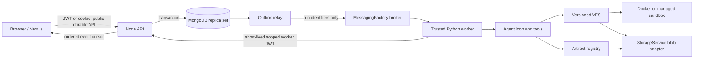
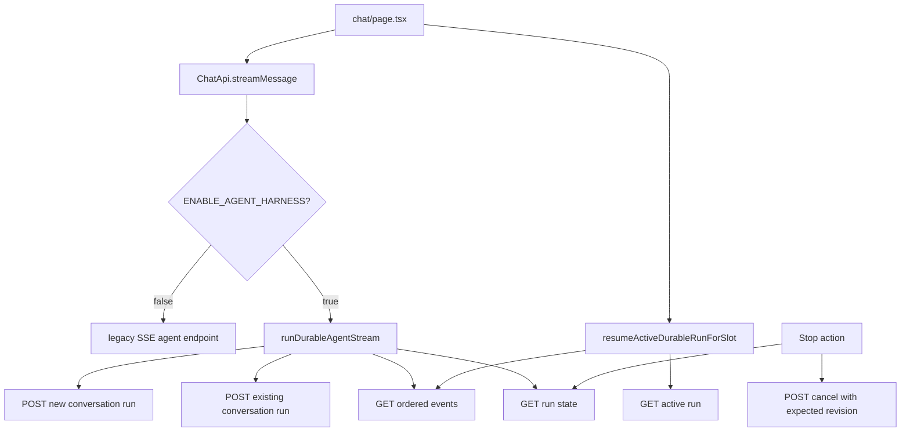
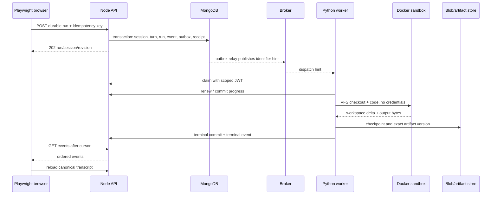

# PipesHub agent harness: end-to-end verification plan

Status: executable verification plan, September 11, 2026  
Targets: Docker Compose self-hosted and Helm managed deployments  
Design: [agent-harness-design.md](agent-harness-design.md)  
Implementation: [agent-harness-implementation-plan.md](agent-harness-implementation-plan.md)

## 1. Purpose and release decision

This plan verifies the durable agent harness as one system rather than as three independently passing applications. It covers the browser, public Node API, transactional run state, outbox and broker, trusted Python worker, existing agent loop, virtual filesystem, skills, Docker sandbox, artifact registry, blob storage, reconnect, cancellation, and recovery.

The release gate has two levels:

1. **Labs flag disabled:** the existing chat path and Docker sandbox must build and run without regression. This is the default state today.
2. **Labs flag enabled:** durable admission may be exposed only when MongoDB transactions, the relay, broker, trusted worker, state API, blob storage, and sandbox are all ready. Every P0 scenario in this document must pass before a general rollout.

No test may weaken the production invariant that durable admission is atomic. A standalone MongoDB deployment is expected to reject new durable admissions; the test topology must use a replica set or transaction-capable managed MongoDB.

## 2. System under test



The critical trust boundaries are:

- The browser can create, read, resume, and cancel only runs it is authorized to access.
- The broker transports identifiers, not prompts or credentials.
- The worker obtains separate purpose-scoped claim, renew, and commit tokens.
- Generated code receives files and non-secret identifiers only. It never receives a user token, worker token, lease credential, provider credential, blob URL, Docker socket, or host path.
- Only `/workspace` is writable durable state. Skills, artifacts, session input, and system input are read-only VFS projections.
- User-visible artifacts are immutable versions registered in PipesHub; arbitrary workspace files remain private.

## 3. Frontend API audit

The chat frontend uses the new durable API when both conditions hold:

- `ENABLE_AGENT_HARNESS` from the server feature flags is `true`.
- the conversation is either built-in chat or custom-agent chat. Custom-agent requests carry an `agentId`; built-in requests deliberately do not synthesize one.

The current call graph is:



| User action | Built-in chat API | Custom-agent API |
| --- | --- | --- |
| First message | `POST /api/v1/conversations/runs` | `POST /api/v1/agents/{agentId}/runs` |
| Later message | `POST /api/v1/conversations/{sessionId}/runs` | `POST /api/v1/agents/{agentId}/conversations/{sessionId}/runs` |
| Reconnect discovery | `GET /api/v1/conversations/{sessionId}/runs/active` | `GET /api/v1/agents/{agentId}/conversations/{sessionId}/runs/active` |
| Ordered replay/follow | `GET /api/v1/conversations/{sessionId}/events` | `GET /api/v1/agents/{agentId}/conversations/{sessionId}/events` |
| Current run/revision | `GET /api/v1/conversations/{sessionId}/runs/{runId}` | `GET /api/v1/agents/{agentId}/conversations/{sessionId}/runs/{runId}` |
| Explicit user stop | `POST .../runs/{runId}/cancel` | `POST .../runs/{runId}/cancel` |
| Resume a paused run | `POST .../runs/{runId}/resume` | `POST .../runs/{runId}/resume` |

`frontend/app/(main)/chat/page.tsx` invokes active-run recovery after canonical history loads. Browser abort, navigation, and component unmount detach the local event follower and do not send cancellation. The Stop action first reads the current run revision, sends an explicit cancel, and retries a revision conflict with fresh state.

The legacy SSE path remains deliberately present while the flag is false. `ChatApi` owns the common lifecycle transport and chooses the built-in or custom-agent base path from the optional agent identity. Universal Agent mode remains a built-in conversation: the worker invokes Python's `agentIdPlaceholder` pipeline so its authenticated toolsets remain available, while ordinary built-in modes invoke the chatbot pipeline.

### Frontend acceptance tests

Add or retain tests for each row below. Mocked unit tests verify request shape; Playwright tests verify rendered behavior and real browser lifecycle.

| Scenario | Expected result |
| --- | --- |
| Flag false | Only the legacy SSE endpoint is called. |
| Flag true, new chat | One durable admission with a stable idempotency key; no legacy call. |
| Flag true, existing chat | Existing-session admission is used; canonical session ID is retained. |
| Duplicate submit or lost admission response | Same key and payload returns the same run; the user turn appears once. |
| Refresh while queued/running | Active run is discovered and events replay from the stored cursor; no new user turn. |
| Network interruption during polling | Polling retries with bounded backoff and resumes after the last sequence. |
| Event page boundary | No gap or duplicate visible message across pages. |
| Browser navigation/unmount | Worker continues and the answer appears after returning. |
| Stop | Exactly one cancel command; terminal cancelled state is rendered. |
| Cancel revision conflict | Client refetches run state and retries only when still cancellable. |
| Completion | Canonical transcript reload replaces transient deltas. |
| Artifact event and completion | Live card appears, then canonical exact-version card survives reload. |
| Unauthorized or cross-tenant IDs | UI receives a generic authorization/not-found response and exposes no run data. |

## 4. Test topologies

### 4.1 Default Compose compatibility topology

Use the unmodified `deployment/docker-compose/docker-compose.yml` defaults:

- the `ENABLE_AGENT_HARNESS` Labs flag defaults to `false`
- `AGENT_HARNESS_RELAY_ENABLED=false`
- `AGENT_HARNESS_WORKER_ENABLED=false`
- `REPLICA_SET_AVAILABLE=false`
- standalone MongoDB
- `SANDBOX_MODE=docker`
- `SANDBOX_DOCKER_IMAGE=pipeshubai/pipeshub-sandbox:local`
- Docker socket exposed only to the trusted combined application container
- `sandbox-image` built before the application starts

This topology verifies build compatibility, legacy chat, feature-flag behavior, sandbox execution, artifacts, health checks, and that a mistakenly attempted durable admission fails closed. It cannot prove the durable transaction path.

### 4.2 Transaction-enabled Compose topology

The base `deployment/docker-compose/docker-compose.yml` runs MongoDB as an authenticated, self-initiating single-node replica set and sets `REPLICA_SET_AVAILABLE=true` with a `replicaSet=rs0` URI. Operators can instead supply an external transaction-capable MongoDB URI. The `docker-compose.agent-harness.yml` overlay only starts the relay and worker. The resulting settings:

```text
AGENT_HARNESS_RELAY_ENABLED=true
AGENT_HARNESS_WORKER_ENABLED=true
REPLICA_SET_AVAILABLE=true
MONGO_URI=<URI containing the replica-set/managed transaction configuration>
SANDBOX_MODE=docker
SANDBOX_DOCKER_IMAGE=pipeshubai/pipeshub-sandbox:local
```

After infrastructure is ready, an administrator enables **Enable Durable Agent Harness** in Labs. The effective feature flag and admission gate both combine that stored value with transaction, relay, and worker readiness. Labs controls user rollout; the relay/worker settings control process placement and are not product feature flags.

MongoDB health remains false until `hello` reports a writable replica-set primary, and the one-shot initializer must complete before the application starts. The CI fixture also executes a real authenticated transaction and real atomic admission, then restarts MongoDB and repeats the transaction. An environment variable alone is not treated as proof by the fixture. The remaining full-stack matrix must run this topology once with Redis Streams and once with Kafka through `MessagingFactory`.

### 4.3 Managed Helm topology

Run the same behavioral suite against:

- a managed transaction-capable MongoDB deployment;
- both supported broker adapters;
- the configured local/S3/Azure blob adapter as applicable;
- Docker-in-Docker only in an isolated test namespace, and the managed sandbox adapter once available;
- at least two Node replicas and two worker replicas for fencing and duplicate-delivery scenarios.

Helm rendering must reject `SANDBOX_MODE=docker` when neither a Docker socket nor the chart's Docker-in-Docker sidecar is configured. Sandbox service-account token mounting and cluster-network access must be disabled.

## 5. Layered verification gates

Run the gates in order. Later gates depend on evidence from earlier ones.

### Gate 0: source, schema, and configuration

1. Parse the OpenAPI document and assert every public and internal route is present.
2. Compare registered Express routes with OpenAPI paths in the API-doc test.
3. Typecheck Node and frontend code; run Ruff and ESLint.
4. Render `docker compose config` with the flag both false and true.
5. Render Helm for local and cloud values, with Docker socket, Docker-in-Docker, and remote sandbox variants.
6. Scan built images and dependencies. Resolve high or critical exploitable findings or record an approved exception with owner and expiry.
7. Assert the public effective flag and admission gate both require the Labs value plus transaction, relay, and worker readiness.

Commands:

```bash
cd backend/nodejs/apps && npm ci && npm run typecheck && npm run lint && npm test
cd backend/python && source venv/bin/activate && ruff check app/harness app/harness_main.py && pytest
cd frontend && npm ci && npx tsc --noEmit && npm run test:unit && npm run build
docker compose -f deployment/docker-compose/docker-compose.yml config --quiet
helm lint deployment/helm/pipeshub-ai
helm template pipeshub deployment/helm/pipeshub-ai -f deployment/helm/pipeshub-ai/values-local.yaml >/tmp/pipeshub-local.yaml
helm template pipeshub deployment/helm/pipeshub-ai -f deployment/helm/pipeshub-ai/values-cloud.yaml >/tmp/pipeshub-cloud.yaml
```

### Gate 1: deterministic component contracts

**Node control plane**

- Atomic new-session and existing-session admission.
- Idempotency replay and same-key/different-payload conflict.
- One active root run per session.
- Tenant, actor, agent, and session authorization on every lifecycle route.
- DTO redaction and generic cross-tenant errors.
- Claim, renew, commit, cancel, resume, expired lease recovery, revision OCC, and attempt fencing.
- Terminal event and transcript projection in the same transaction.
- Outbox lease, retry, duplicate publish, dead-letter, and relay restart.
- Worker JWT type, audience, scope, expiry, tenant/run binding, and scope separation.
- Disabled admission returns 503 while reads/cancel remain available for in-flight rollback.

**Python trusted worker and agent runtime**

- Broker payload validation and identifier-only dispatch.
- Claim/renew/commit client schemas and classified/redacted errors.
- Renewal outside sandbox execution and cancellation observation.
- Bounded event batches, ordered sequence, progress checkpoints, and terminal commits.
- Same-run resume from valid checkpoint; corrupt, oversized, or wrong-hash checkpoint rejection.
- Invocation replay for known results and `needs_reconciliation` for uncertain non-idempotent effects.
- Approval-required tool denies when no HIL adapter is present.
- VFS path normalization, CAS conflict, quotas, binary bytes, deletion, and immutable mounts.
- Nested skill bundle paths, binary members, version pinning, traversal/collision/archive-bomb defenses.
- Staging and visible artifact states, exact-version input fetch, lineage, and tenant scope.

**Frontend**

- API selection and request shapes listed in section 3.
- AG-UI event reduction, cursor update, reconnect, stop, canonical reload, and artifacts.

### Gate 2: real Docker sandbox contract

Build exactly the image selected by Compose, then run the Docker-marked suite:

```bash
docker compose -f deployment/docker-compose/docker-compose.yml build sandbox-image
cd backend/python
source venv/bin/activate
pytest -q \
  tests/unit/agent_loop_lib/sandbox/test_docker_live.py \
  tests/unit/agent_loop_lib/sandbox/contract/test_backend_contract.py \
  -m docker --timeout=600 --timeout-method=thread
```

The suite must prove:

- Python and TypeScript execute in the Compose-selected image.
- Output files leave the ephemeral container before it is removed.
- VFS text/binary state and a nested skill resource enter a real container; changes under `/workspace` return as a new CAS manifest; read-only trees do not.
- Run containers have no network by default, no bind mounts, a read-only root, dropped capabilities, no-new-privileges, PID/CPU/memory limits, and bounded tmpfs.
- The package-install container alone uses the dedicated egress network.
- Cross-manager process capacity and per-backend concurrency limits hold.
- Provision timeouts, cancellation, and teardown leave no containers.
- File traversal, symlink, archive, case-fold, file-count, file-size, and total-size limits fail closed.

Inspect at least one live run using Docker daemon metadata; do not rely only on mocked create arguments. After the suite, assert there are no containers labeled/tagged for the sandbox image.

### Gate 3: Node + transaction-capable MongoDB integration

Run Node against the same MongoDB major version as Compose and a real replica set. Do not mock Mongoose sessions. For every admission, query collections directly from the test harness and verify the run, first event, transcript user turn, outbox command, session harness version, and idempotency receipt either all exist or all do not exist.

Inject failures after each transaction write and before commit. Restart Node between admission response loss and retry. Verify indexes enforce uniqueness and active-run constraints under 50 concurrent identical and distinct requests.

### Gate 4: broker and worker integration

Use real Redis Streams and Kafka in separate CI jobs. Admit work through Node and consume it through `python -m app.harness_main`.

Verify:

1. Broker messages contain only allowlisted identifier fields.
2. Duplicate messages do not create duplicate claims or answers.
3. A worker with the wrong type, audience, scope, org, run, or expired token cannot call a control-plane operation.
4. Claim and commit tokens cannot renew; renewal tokens cannot claim or commit.
5. A stale worker cannot commit after lease recovery and fence rotation.
6. A broker acknowledgement occurs only after durable disposition.
7. Relay and worker shutdown stop new leases and drain or abandon work predictably.

### Gate 5: full API and browser journey

Start the transaction-enabled topology and seed an organization, user, agent, and deterministic fake LLM/tool provider. A deterministic provider is required for CI; run a smaller opt-in smoke test against one real provider separately.



The happy-path test must generate an artifact and update workspace state. Refresh after the first progress checkpoint, reconnect, and assert one user message, one assistant answer, one exact artifact version, one terminal event, and a newer workspace revision.

### Gate 6: crash, outage, and race matrix

| Injection point | Required observation |
| --- | --- |
| Node dies before Mongo commit | Nothing is admitted; retry succeeds once. |
| Node dies after commit before HTTP response | Same idempotency key returns the original run. |
| Relay dies after publish before outbox completion | Redelivery occurs; one claim and one final answer. |
| Broker unavailable | Outbox remains durable, retries are bounded, recovery drains it. |
| Worker dies before first checkpoint | Lease expires, a new fenced attempt resumes safely. |
| Worker dies after progress checkpoint | New attempt restores checkpoint/VFS and does not repeat known effects. |
| Old worker returns after recovery | Commit is rejected as stale; no event/transcript mutation. |
| Blob write fails | Progress/terminal state is not advanced past an unavailable checkpoint/artifact. |
| Artifact blob succeeds, metadata fails | Reconciler finds or safely expires the orphan/reservation. |
| Browser drops during execution | Execution continues; replay reconstructs the view. |
| Cancel races with completion | Exactly one valid terminal outcome and terminal event. |
| Cancel during sandbox call | Process/container is terminated within the deadline and leaves no leak. |
| Two tabs submit simultaneously | One active root run; loser receives deterministic conflict or idempotent result. |
| Event retention removes old pages | Client receives an explicit cursor-gap/snapshot response, then reloads canonical state. |

Repeat process failures at least 100 times in a soak lane to catch timing-sensitive lease and outbox defects.

### Gate 7: security and abuse tests

1. Use two organizations and two users per organization. Mutate every path ID, body ID, cursor, artifact ID/version, skill version, and idempotency key across tenants.
2. Confirm no user/org supplied by the client overrides authenticated scope.
3. Decode every broker message and checkpoint fixture and scan for user tokens, worker tokens, cookies, authorization headers, provider keys, storage URLs, prompts where not required, and known secret canaries.
4. From generated code, try environment enumeration, `/proc` inspection, file descriptor reads, DNS/HTTP, loopback, RFC1918, Compose service names, cloud metadata endpoints, Docker socket access, host paths, privilege escalation, fork bombs, and resource exhaustion.
5. Attempt to reuse claim/renew/commit JWTs across operation, run, org, worker, and expiry boundaries. Verify renewals are bounded by the server and cannot extend a stolen lease indefinitely.
6. Upload malicious skill archives: traversal, absolute paths, links, devices, duplicate normalized names, Unicode/case collisions, encrypted members, expansion bombs, redirect chains, credential-bearing URLs, and private destinations.
7. Upload active-content artifacts and filenames with control characters/path traversal. Verify safe content disposition and normalized metadata.
8. Verify logs, traces, metrics, error events, and public DTOs use identifiers and classifications without secrets or raw provider error bodies.

Security failures block rollout. They are not quarantined as flaky tests.

### Gate 8: storage and provider portability

The harness must not depend on graph or vector implementation details. Run core journeys with the supported graph and vector choices where the journey touches retrieval, but assert harness state does not open those clients directly.

Run blob contracts for local, S3, and Azure implementations:

- binary round trip and content hash;
- exact artifact version read after newer publication;
- scoped authorization and shared-conversation access;
- multipart/large object limits;
- timeout and retry behavior;
- checkpoint corruption and missing object;
- staging visibility and promotion;
- retention, deletion, tombstone, and orphan reconciliation once implemented.

Run skill tests with a directory containing root `SKILL.md`, nested subdirectories, executable text, empty files, Unicode names, and binary assets. The complete pinned version must survive worker restart and resume byte-for-byte.

### Gate 9: performance, capacity, and soak

Measure p50/p95/p99 for admission, first event, claim, checkpoint, event page, reconnect, cancellation, and artifact publication. Track queue age, relay lag, active leases, stale-fence rejections, recovery count, checkpoint size, sandbox creation/cleanup, and blob throughput.

Load profiles:

- one tenant with many sessions;
- many tenants with one session each;
- large event history and a long-disconnected client;
- maximum checkpoint, workspace, skill bundle, and artifact sizes;
- slow model/tool and repeated lease renewals;
- worker autoscaling and scale-to-zero recovery;
- broker/blob latency and partial outage.

Verify fair distributed quotas and bounded memory, file descriptors, Docker API threads, containers, broker lag, and Mongo connections. A 24-hour soak must finish with no orphan containers, active leases without owners, stuck outbox records, or steadily growing process memory.

## 6. CI and test ownership

| Lane | Trigger | Contents | Target time |
| --- | --- | --- | --- |
| Fast | Every PR | typecheck, lint, focused Node/Python/frontend unit and contract tests | under 10 min |
| Sandbox | Every PR with sandbox/harness changes | Compose sandbox build and Docker-marked contract/VFS tests | under 15 min warm cache |
| Integration | Every PR with harness changes | Mongo replica set + one broker + fake LLM + local blob | under 20 min |
| Browser | Every PR with frontend/control-plane changes | Playwright happy path, refresh, stop, exact artifact | under 15 min |
| Matrix | Nightly | Kafka/Redis; local/S3/Azure; supported graph/vector combinations | bounded parallel jobs |
| Fault/security | Nightly and release candidate | kill/restart, stale fences, tenant attacks, sandbox escape/resource tests | no flaky retry masking |
| Soak/load | Release candidate | concurrency, 24-hour run, metrics and leak assertions | scheduled |

Each test must emit the run ID, session ID, attempt/fence identifier where trusted, last event sequence, checkpoint version, workspace revision, artifact ID/version, and involved container ID into a restricted CI artifact. Never emit credentials, prompts, tool arguments containing user data, or file bytes.

## 7. Current verification evidence

The following checks were run locally on September 11, 2026:

| Check | Result |
| --- | --- |
| `docker info` | Docker Engine 28.0.4 available |
| `docker compose ... build sandbox-image` | Passed; built `pipeshubai/pipeshub-sandbox:local` |
| `docker compose ... build pipeshub-ai` | Passed with the Labs-gated sources; the clean Node 22 rebuild is recorded after its final smoke check |
| Default and relay/worker-enabled Compose config rendering | Passed |
| Labs rollout and infrastructure-readiness gate | 362 focused Node tests passed; Node typecheck passed |
| Transaction-enabled Compose overlay | Fresh authenticated bootstrap, primary readiness, idempotent re-init, restart, and post-restart transaction passed |
| Real MongoDB admission store | Atomic session/message/run/event/outbox/receipt admission, exact replay, changed-payload conflict, active-root conflict, and rollback assertions passed |
| Live Docker sandbox and backend contract suite, including VFS | 12 tests passed |
| Real Docker VFS + nested skill + binary workspace round trip | Included in the 12-test live suite; passed |
| Focused Python harness/runtime suite from the implementation pass | 212 tests passed |
| Node harness suite | 58 tests passed; strict source ESLint and Prettier passed |
| Complete Node Mocha suite | 9,707 tests passed; 5 intentionally pending |
| Frontend durable API/reconnect suite from the implementation pass | 14 tests passed |
| Node and frontend TypeScript from the implementation pass | Passed |
| Frontend production build | Passed; 65 static pages generated |
| Helm lint and local/cloud rendering with required test values | Passed |
| Final combined-image smoke checks | Compiled Node harness module present; Python harness worker imports from `/app/python` |

All Docker and CI Node stages now use Node 22. Compatible vulnerable packages were upgraded, including `sharp`, Tiptap, the PDF highlighter, XML/query parsers, and the maintained SheetJS distribution in place of the unmaintained npm `xlsx` release. The sandbox dependency graph is pinned; ExcelJS resolves fixed `uuid@11.1.1`, and a fail-closed build step verifies that PptxGenJS 4.0.1 does not import its declared `image-size` dependency before removing that vulnerable parser. Real XLSX and PPTX generation passes afterward. The dependency policy used by the static frontend image reports zero production advisories. The Node production graph reports no high or critical advisories; two low and three moderate transitive findings remain in AWS SDK v2/`uuid`, `gaxios`/`uuid`, and `jwk-to-pem`/`elliptic` paths without compatible upstream fixes. Track their dependency migrations and add a final-image SBOM scanner to the release lane.

The full `pipeshub-ai` Compose application image built successfully from the final Labs-gated source tree. Its cold dependency layers are large, especially the Python browser runtime, so CI should preserve BuildKit caches and still schedule periodic clean-cache builds.

## 8. Remaining gap in the complete local durable journey

The base Compose topology intentionally sets `REPLICA_SET_AVAILABLE=false`, leaves the relay and worker off, and starts standalone MongoDB. Even if an administrator turns on the Labs setting, the effective frontend flag remains false and direct durable admission returns service unavailable. This remains the compatibility and fail-closed topology.

The transaction-enabled overlay described in section 4.2 is now implemented, documented, and covered by a real MongoDB/admission CI fixture. Gates 4 through 7 still need one deterministic fake provider and a fully started Node relay, broker, Python worker, blob adapter, sandbox, and browser. Keep the Labs flag off by default and use controlled development or canary tenants until those cross-process and browser fault gates pass.

## 9. Release checklist

- [ ] All source, OpenAPI, Compose, Helm, type, lint, and dependency gates pass.
- [x] Compose-selected sandbox image builds.
- [x] Real Docker execution, isolation, cleanup, artifact extraction, and VFS round trip pass.
- [x] Full combined `pipeshub-ai` Compose image builds from the current source tree.
- [x] Transaction-enabled Compose overlay is shipped, primary-readiness checked, transaction-tested, and covered in CI.
- [ ] Browser-to-worker-to-sandbox-to-artifact happy path passes on the overlay.
- [ ] Refresh/detach, explicit cancel, idempotency, and exact-version artifact journeys pass.
- [ ] Mongo, relay, broker, worker, blob, and sandbox fault matrix passes.
- [ ] Tenant isolation, scoped-token misuse, secret-canary, and sandbox abuse matrix passes.
- [ ] Redis Streams and Kafka broker contracts pass.
- [ ] Local, S3, and Azure blob contracts pass where supported.
- [ ] Managed Helm multi-replica, sandbox isolation, upgrade, rollback, and drain tests pass.
- [ ] Performance budgets and 24-hour soak pass without leaked resources.
- [ ] No P0 product gap is open.
