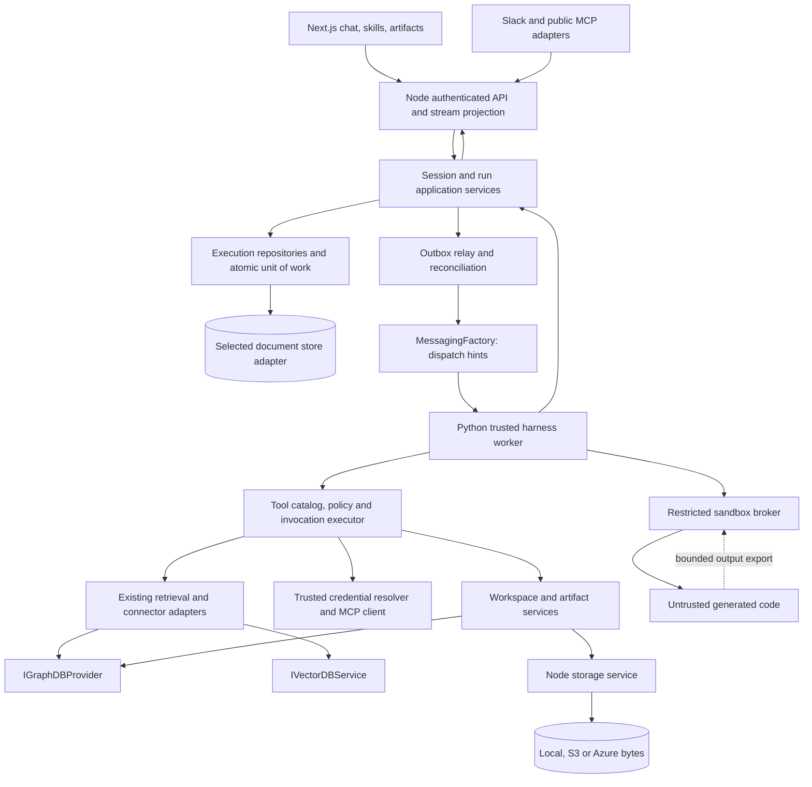
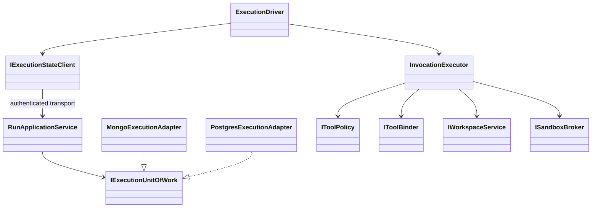
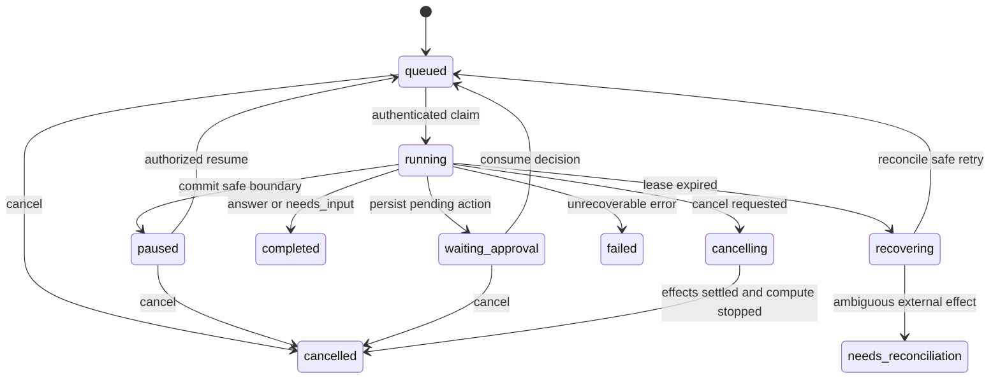
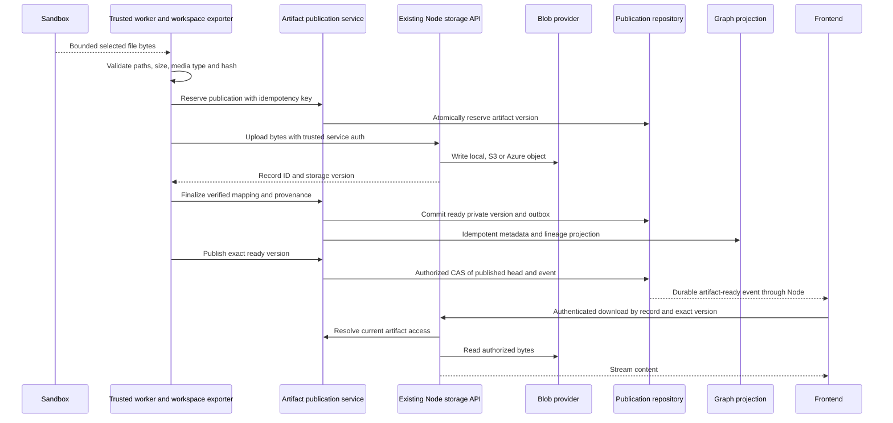
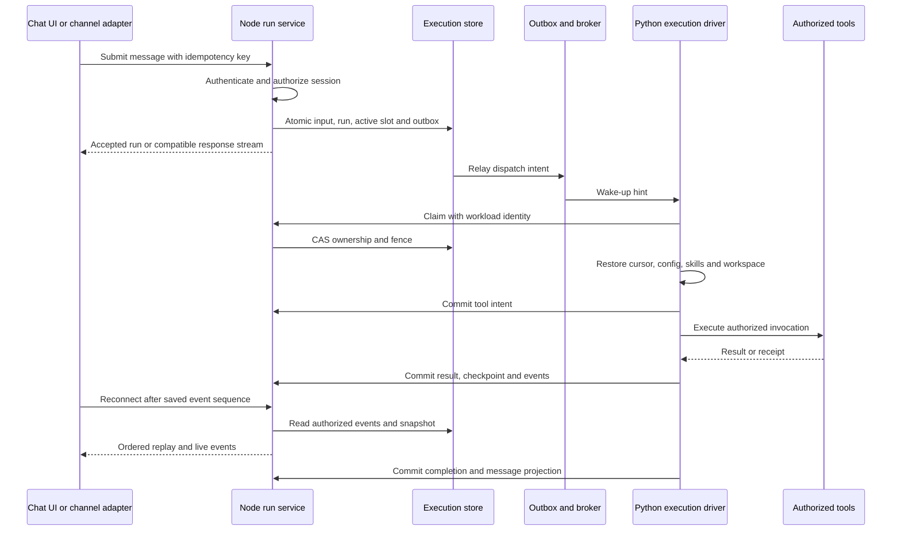
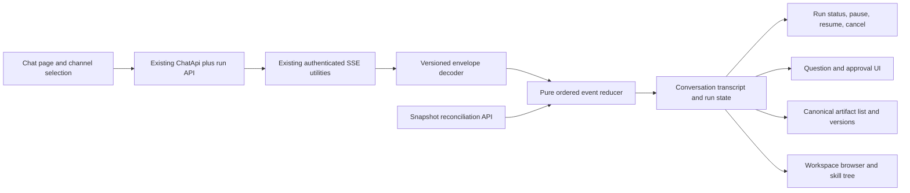

# PipesHub agent harness: implementation and security plan

Status: active phased implementation, reviewed September 10, 2026. Supports self-hosted and managed deployments. This document refines and, where inconsistent, supersedes the [architecture design](agent-harness-design.md).

Implemented foundations in the current working tree include the durable run/event/outbox/receipt domain, Mongo and in-memory execution-store adapters, session harness-version pinning, operation-scoped audience-bound worker authentication, internal claim/renew/commit routes, authenticated admission/read/event/cancel/resume routes for built-in and custom-agent chat, a matching frontend lifecycle client, a Python worker state client, binary-safe CAS workspace manifests and composite VFS mounts, immutable skill bundle contracts, sandbox workspace checkout/export, staging versus visible artifact enforcement, explicit MCP exposure allowlisting, stream cancellation/backpressure, and Docker sandbox hardening. Binary object operations require an organization scope and use PipesHub's provider-neutral local/S3/Azure storage gateway with restore-time hash and size verification. Remote skill metadata and archives are streamed under hard byte limits, and every redirect target is revalidated. These foundations are covered by focused contract and integration tests.

Public durable-run admission, the broker relay, durable worker orchestration, frontend reconnect/cancel handling, and the self-hosted replica-set overlay are implemented behind the Labs gate.

## 1. Scope, evidence, and decisions

The goal is a durable, portable harness around the existing agent library: create a session, execute multiple runs, reconnect or resume safely, use a persistent virtual filesystem and directory-based skills, produce staged and published versioned artifacts, and recover without leaking credentials or repeating untracked effects. Preserve current chat, agent, Slack, MCP, retrieval, and blob-storage integration. Do not introduce a replacement agent framework simply to obtain a session abstraction.

The current checkout is `443f799cd6afd4eedd27fd18780694026fe8024a`; the original design recorded `68bd7aa36532219f94bcb150c2d3588d3355b316`. Findings are from static inspection of the working tree, not a deployed-system penetration test or measured performance benchmark. The design's §15 contains the detailed original code evidence index. File inventories below identify existing integration seams and proposed additions separately. Line numbers in the older audit can drift; symbols and paths are the stable navigation points.

Decisions now fixed by the requirements:

- A conversation is the existing public session identity. A run is an execution within that session; an attempt is one worker ownership interval. A sandbox is replaceable compute, never the session.
- Durable execution and an HTTP streaming connection have independent lifetimes. Closing a tab does not cancel accepted background work. Cancel is an authenticated command with observable completion.
- Domain contracts must not expose Mongoose, BSON, SQL, graph query syntax, vector dimensions, broker offsets, or vendor storage URLs. Existing Mongoose usage is a migration seam, not proof that PostgreSQL already works end to end.
- The sandbox receives no user token, provider key, refresh token, workload credential, execution grant, or lease-renewal credential. A numeric fencing epoch is not an authorization token.
- Skills are immutable, versioned directory bundles, not single strings. Workspace intermediates are durable and private by default; explicit publication makes exact artifact versions frontend-visible through existing PipesHub storage APIs.
- Server-owned records control tasks, approvals, budgets, lifecycle, ownership, and publication. Model-editable Markdown can inform future reasoning but cannot modify these authorities.

## 2. What exists and where the flow breaks

### 2.1 Frontend and API gateway

The Next.js chat feature already has a substantial streaming stack: `chat/api.ts` selects conversation or agent endpoints, `chat/streaming.ts` coordinates streaming state, `chat/agui-event-handler.ts` translates AG-UI events, and `chat/store.ts` holds conversation slots and abort controllers. `frontend/lib/api/streaming.ts` already provides authenticated `streamSSEGet` and POST streaming, including Electron transport support. Reuse these facilities; do not add browser `EventSource` with credentials in URLs or a second SSE parser.

Today the slot's streaming state is connection state, not durable execution state. Slot eviction aborts a local controller. Root and child AG-UI finish events have different semantics. Artifact cards originate from marker parsing and stream events; `message-list.tsx` scans message artifacts to infer the latest version. `artifacts-panel.tsx` downloads through `KnowledgeBaseApi.streamDownloadRecord` and has URL fallbacks. These are display conveniences, not authoritative artifact metadata or authorization.

Node's `enterprise_search` routes/controllers persist conversation and message documents and proxy Python. `AIServiceCommand.executeStream` creates a fetch and pumps it into a Node Readable; the inspected implementation does not propagate local stream destruction to an upstream AbortController and does not honor Readable backpressure. Its error logging includes request options: replace that with allowlisted diagnostics because headers and bodies can contain credentials and private prompts. Completion currently depends on stream callbacks. The durable design must save completion from an execution commit, independently of the browser. Repair the legacy path's upstream cancellation and transaction-session lifetime while it remains supported.

### 2.2 Python execution and tool composition

`agents/agent_loop/stream_bridge.py` and `agents/chat_modes/bridge.py` independently construct and clean up execution. `PipesHubAgentFactory` composes the generic library, tools, skills, MCP sessions, model configuration, and sandbox facilities. Production construction does not wire a complete durable session/checkpoint lifecycle. Library facilities alone therefore do not establish production resume.

The library runs tool batches and checkpoints at loop boundaries. A crash between an external effect and a saved batch result is ambiguous. Resume must understand a phase cursor, pending invocations, and per-invocation results, not merely increment a turn number. Selected tools, strategy state, child task mappings, prompt section references, configuration versions, and skill locks must also survive recovery. Do not serialize runtime objects, credentials, clients, coroutines, or arbitrary Python objects.

Lazy schema disclosure already exists in `lazy_tools_wiring.py`: `list_toolsets`, `search_tools`, and `fetch_tools`; enabled by default above a configurable threshold of 20 tools, normally at the top level. Attached essential groups remain available. Deep mode has a separate four-tool coordination surface and domain-scoped children. This is useful existing behavior; it is not proof that credentials, connector instances, and remote MCP sessions are also lazily instantiated. Separate schema discovery from expensive or privileged binding.

### 2.3 Storage, skills, and sandboxes

Graph and vector access already have interfaces. Blob operations use the Node storage service with local, S3, and Azure providers; Python's `modules/transformers/blob_storage.py` integrates uploads. Existing artifact registry/versioning/access/lineage services must be extended, not bypassed with an unrelated downloads service. Blob bytes and graph metadata cannot be committed in one ordinary database transaction.

The existing skill stack includes graph stores, scoped managers, governance, importers, built-in packs, and resource files. Some built-ins already contain scripts in nested folders. The gap is a reliable binary-safe, bounded, permission-aware bundle contract across import, UI editing, storage, mounting, and resume. Inline text resources and eager body loading do not satisfy that contract. The audit's private-scope/name-uniqueness and governance issues must be resolved before exposing new shared-session behavior.

There are both platform `app/sandbox/` wrappers and generic `agent_loop_lib/sandbox/` components. Preserve provider implementations where appropriate, but establish one platform lifecycle owner and one policy enforcement path. A sanitized subprocess environment and code prechecks do not establish a complete isolation boundary. Docker socket access, host execution, network reachability, file descriptors, mounted secrets, and resource renewal require separate controls.

### 2.4 Corrected gaps and ownership

| Gap or wrong abstraction | Consequence | Required correction |
| --- | --- | --- |
| Request callback owns completion | Disconnect loses persisted result or leaves misleading status | Execution transaction owns final message; stream is a projection |
| Library checkpoint treated as durable execution | Lost cursors, duplicated side effects, incomplete children | Versioned execution snapshot plus invocation journal and fencing |
| Mongo collections define domain design | Blocks document-store portability | Typed repositories and atomic unit of work, adapter conformance |
| Separate filesystem TODO authority | Conflicting task state; prompt injection gains authority | Typed tasks with read-only Markdown projection |
| Question both ends and resumes same run | Duplicate or contradictory lifecycle | Terminal `needs_input` outcome plus next run; approval resumes original run |
| Hidden schema equated to denied tool | Unauthorized invocation through direct names | Authorization at discovery, binding, and every execution |
| Sandbox receives renewable lease bearer | Compromised code extends life or obtains authority | No sandbox lease credential; outside-boundary broker enforces limits |
| Every offloaded result treated as visible artifact | Private scratch data and traces exposed | Internal class by default; explicit publication and authorization |
| Latest artifact inferred from messages | Draft becomes visible; old cards resolve incorrectly | Canonical published-version pointer and immutable version mapping |
| Blob provider interface treated as full DB portability | Mongoose storage metadata remains mandatory | Isolate document metadata and session/message repositories too |
| New OpenAPI route automatically becomes MCP tool | Internal control plane exposed to model callers | Explicit public MCP exposure allowlist and negative tests |

## 3. Recent research and what to adopt

Primary sources were checked September 10, 2026. Living documentation dates are access dates. The choices below are recommendations for PipesHub, not claims of an industry-wide harness standard or guaranteed benchmark gains. The original design's research remains useful; these sources strengthen or correct its implementation boundaries.

| Primary source | Evidence and application |
| --- | --- |
| [Anthropic: Scaling Managed Agents, April 8, 2026](https://www.anthropic.com/engineering/managed-agents) | Separates session log, harness, and sandbox, with replaceable execution and credentials outside generated code. Adopt the separation; do not adopt a hosted dependency or a broad session bearer inside the sandbox. |
| [Anthropic: Advanced tool use, November 24, 2025](https://www.anthropic.com/engineering/advanced-tool-use) | Demonstrates deferred tool discovery and optional programmatic tool calling. Reuse PipesHub's discovery surface, then add lazy binding and authorization. Treat vendor benchmark improvements as workload-specific. |
| [LangChain Deep Agents: Sandboxes](https://docs.langchain.com/oss/python/deepagents/sandboxes) | Describes a sandbox-as-tool pattern keeping API keys and agent state outside the sandbox. Keep provider implementation behind an interface; do not couple durable sessions to its runtime object. |
| [OWASP: AI Agent Security](https://cheatsheetseries.owasp.org/cheatsheets/AI_Agent_Security_Cheat_Sheet.html) | Agent inputs, tool use, memory, permissions, and external actions require layered defenses. Apply resource authorization, least privilege, constrained execution, and auditable decisions rather than relying on prompt instructions. |
| [Kubernetes: Service Accounts](https://kubernetes.io/docs/concepts/security/service-accounts/) | Workload identities and automatically mounted credentials need deliberate control. Sandbox pods use `automountServiceAccountToken: false`, with no privileged control-plane identity. |
| [MCP: July 28, 2026 specification announcement](https://blog.modelcontextprotocol.io/posts/2026-07-28/) | A newer specification exists than the original report's 2025-11-25 reference. Pin supported protocol versions and run compatibility/security tests; do not silently claim an old reference is current or equate MCP sessions with agent sessions. |
| [SPIFFE concepts](https://spiffe.io/docs/latest/spiffe-about/spiffe-concepts/) | Workload identity can identify a worker separately from its run authorization. SPIFFE is optional; self-hosted deployments may use private-CA mTLS with equivalent identity verification. Identity does not replace per-run authorization. |

The architecture follows these principles without requiring a particular model API, managed sandbox, graph engine, document engine, vector engine, or workflow vendor. Evaluate a general workflow engine only if requirements expand into a general workflow language; the initial bounded run state machine should remain a replaceable application component.

## 4. HLD and trust boundaries



Node owns public auth and execution-state transitions. Python owns model orchestration and application tool behavior; the generic loop depends on injected ports. The broker alone owns sandbox provisioning credentials and provider lifecycle. Blob storage owns bytes; repositories own authoritative execution and publication metadata; graph adapters provide graph relationships and projections; vector services provide retrieval. None is a substitute for another.

Do not place a credential-bearing broker in an isolation arrangement that makes its environment, Unix socket, process namespace, or privileged loopback endpoint reachable by generated code. A sidecar label is not a security boundary. Managed and self-hosted deployments implement the same contract with different infrastructure adapters.

### Deployment profiles

| Concern | Self-hosted | Managed |
| --- | --- | --- |
| API/worker | Existing API plus separate worker process, optionally same image | Independently scaled API and tenant-aware worker pools |
| Durable document store | Selected conforming MongoDB or PostgreSQL adapter; topology checks at startup | Same interfaces and adapter tests; managed operations/backup configuration |
| Sandbox broker | Restricted service; Docker socket only here if Docker backend selected | Restricted provider integration with stronger tenant isolation policy |
| Identity | Private-CA mTLS/service identity and rotation; no mandatory external identity vendor | Workload identity/mTLS, optionally SPIFFE, with rotation and audience checks |
| Dispatch | Existing Kafka or Redis Streams via factory, plus outbox reconciliation | Same contract; capacity and tenant fairness controls |
| Blob | Local storage with durable volume, S3, or Azure | Supported remote provider with tenant authorization and retention |
| Network | Explicit deny rules for control/data plane; offline profile available | Enforced tenant network policy and restricted egress proxy |
| Recovery | Backup/restore runbook and operator-triggered reconciliation | Automated restore drills and continuous orphan/lease reconciliation |

Readiness checks validate adapter atomicity capability, required secrets only in trusted services, worker/broker connectivity, sandbox isolation profile, blob reachability, and migrations. Degraded dispatch can queue durable submissions within quotas; unavailable execution-state authority cannot accept a run as durably committed.

## 5. Interfaces, invariants, and atomicity

### 5.1 Dependency rules

Dependencies point from transports and adapters into application services and domain contracts. Application services consume narrow ports; they do not import provider drivers. Factories choose adapters at composition roots. Domain validation is shared by HTTP, worker, and MCP adapters. HTTP controllers must not implement a second copy of transition logic. Generated TypeScript/Python wire types come from versioned schemas; language-native domain objects remain separate from transport DTOs.

| Proposed port | Responsibility | Must not expose |
| --- | --- | --- |
| `ISessionRepository` / `IMessageRepository` | Conversation identity, access-relevant metadata, idempotent message projection | Mongoose documents or controller response objects |
| `IExecutionUnitOfWork` | Atomic typed transition across runs, invocations, checkpoints, events, outbox, reservations | Arbitrary SQL, BSON queries, graph transactions, HTTP responses |
| `IRunRepository` / `IInvocationRepository` | Conditional ownership/state changes and invocation journal | Sandbox tokens or model-supplied tenant selectors |
| `IEventRepository` / `IOutboxRepository` | Ordered replay and reliable dispatch publication | Kafka offsets as public cursors |
| `IWorkspaceRepository` / `IWorkspaceService` | Revision manifests, bounded VFS operations, content references | Host paths, cloud URLs, direct filesystem roots |
| `IBlobObjectStore` / `IDocumentMetadataRepository` | Stream immutable bytes through current storage; map record/version metadata | Provider client instances in feature code |
| `IArtifactPublicationService` | Reserve versions, reconcile bytes, publish exact version, authorize reads | Independent graph and document publication heads |
| `ISkillCatalog` / `ISkillBundleStore` | Permission-filtered metadata and immutable nested bundles | Eager resource bodies during search |
| `IToolCatalog` / `IToolBinder` | Discover descriptors and bind authorized implementations lazily | Credentials in descriptors or checkpoints |
| `IToolPolicy` / `IInvocationExecutor` | Schema validation, effect classification, approvals and journaled execution | Model-controlled policy flags |
| `ICredentialResolver` | Resolve credential references in trusted execution boundary | Return secrets to model or sandbox-facing APIs |
| `ISandboxBroker` / `ISandboxBackend` | Bounded provisioning, staging, execute, export, destroy | Worker identity, user bearer, arbitrary host mounts |
| `IExecutionStateClient` | Python adapter to typed Node transition APIs | One remote write per token or raw database operations |
| `IExecutionDriver` | One lifecycle for chat and agent modes | HTTP disconnect ownership of execution |



### 5.2 Representative contracts

Illustrative signatures below are design specifications, not compiled code. All externally supplied values undergo schema and authorization validation. `AuthorizedActor` and `WorkerIdentity` can only be created by trusted authentication adapters; a structural type alone does not establish trust.

```typescript
interface ExecutionUnitOfWork {
  commit(command: CommitTransition, caller: WorkerIdentity): Promise<CommitReceipt>;
  claim(command: ClaimRun, caller: WorkerIdentity): Promise<OwnedAttempt>;
  renew(command: RenewAttempt, caller: WorkerIdentity): Promise<LeaseDeadline>;
}
type CommitTransition = {
  commandId: string; runId: string; attemptId: string;
  expectedRevision: number; fence: number;
  checkpoint: ImmutableObjectRef;
  transition: AllowedTransition;
  invocationChanges: InvocationChange[];
  workspaceChange?: ExpectedWorkspaceHeadChange;
  events: DomainEvent[]; outbox: DispatchCommand[];
};
interface ArtifactPublicationService {
  reserve(input: PublicationIntent, actor: AuthorizedActor): Promise<Reservation>;
  finalize(input: VerifiedUpload, actor: AuthorizedActor): Promise<ArtifactVersion>;
  publish(input: PublishExactVersion, actor: AuthorizedActor): Promise<PublishedArtifact>;
}
interface ToolCatalog {
  search(input: BoundedSearch, scope: AuthorizedToolScope): Promise<ToolDescriptorPage>;
  describe(refs: VersionedToolRef[], scope: AuthorizedToolScope): Promise<ToolDescriptor[]>;
}
```

```python
class WorkspaceService(Protocol):
    async def list(self, scope: WorkspaceScope, path: VirtualPath, cursor: str | None) -> FilePage: ...
    async def read(self, scope: WorkspaceScope, file: VersionedFileRef, limits: ReadLimits) -> FileContent: ...
    async def apply(self, scope: WorkspaceScope, expected_revision: str, changes: list[FileChange]) -> WorkspaceRevision: ...

class SandboxBroker(Protocol):
    async def provision(self, caller: WorkerIdentity, request: AuthorizedSandboxSpec) -> SandboxHandle: ...
    async def execute(self, caller: WorkerIdentity, handle: SandboxHandle, request: BoundedExecution) -> ExecutionResult: ...
    async def export(self, caller: WorkerIdentity, handle: SandboxHandle, selection: ExportSelection) -> VerifiedExport: ...
    async def destroy(self, caller: WorkerIdentity, handle: SandboxHandle) -> None: ...
```

`SandboxHandle` is an opaque reference meaningful only to an authenticated worker, not a transferable credential. Scope includes tenant/session/run identity derived or verified by the service, not trusted from model arguments. No `renew()` appears in the sandbox-visible tool API.

### 5.3 Portable consistency contract

The selected document adapter must atomically validate run revision, live worker ownership, attempt fence, active-session slot, lifecycle, and budget reservations; then persist checkpoint metadata, invocation transitions, workspace pointer updates, ordered events, and outbox commands. Use unique logical keys for submit idempotency, invocation IDs, publication IDs, and per-session event sequence. Duplicate command with identical canonical payload returns its original receipt; changed payload returns conflict.

MongoDB uses its transaction-capable topology; PostgreSQL uses transactional tables/constraints/locking. Both implement the same conformance tests. The domain does not mandate either. Lack of required semantics fails durable-mode readiness; do not silently fall back to memory or best-effort multi-write commits. Physical indexes, migrations, lock implementations, and retryable driver errors belong to adapters.

This atomic scope is one chosen document backend. Blob uploads are immutable and happen before referencing commits. Graph projection, message projection when not colocated, and broker delivery use idempotent outbox/saga steps. Do not claim an atomic transaction across document, graph, blob, and an external SaaS API. If legacy transcript persistence is temporarily outside the transaction, the run/event log is authoritative and a reconciler writes the missing message with unique `runId`/message identity.

Document portability must include the harness's reads/writes of session, message, and storage-document metadata. Merely adding a PostgreSQL `agentRuns` table while calling Mongoose for everything else does not satisfy a PostgreSQL deployment. Provide repository adapters for this feature's complete path. Broader migration of unrelated identity and product modules is a separate platform dependency, explicitly reported in deployment readiness rather than silently declared complete.

### 5.4 Run state, cursor, and effects



Terminal runs release the session's active-root slot. A question commits an interaction and `completed(outcome=needs_input)`; an authorized answer consumes it once and creates the next run. Approval holds the original invocation pending and resumes that run. Approval is bound to action hash, tool version, resource, actor, policy version, and expiry; changed arguments require a new decision. Approval does not count as the tool's successful result.

Persist a cursor such as `before_model`, `model_output_committed`, `tools_pending`, `tools_settled`, `finalizing`, with the exact pending batch and per-invocation status. Journal intent before effects; record each finished result independently; reconstruct model messages in original call order. Read-only calls may retry under current authorization. Idempotent writes reuse provider idempotency keys. Non-idempotent writes with an unknown outcome enter reconciliation, not blind retry. Cancellation cannot undo an effect already accepted by a remote system.

Snapshots include schema/serializer version, immutable configuration reference, tool descriptor versions, skill lock, strategy state, typed tasks, child-run mapping, prompt-data references, cursor, and workspace revision. They exclude credentials and executable serialization such as pickle. Resume rejects incompatible snapshots or runs a tested explicit migration. Fork copies a selected revision and ancestry; it never resets an existing run's history or replays historical external actions automatically.

## 6. Tools and progressive loading

### 6.1 Capability inventory

“Pinned” means a small schema is available for an authorized mode; it never means universal access. The agent builder defines a maximum capability set. Organization policy, current actor grants, run constraints, and tool effects narrow it further. A skill's `allowed_tools` declaration can narrow this intersection, never widen it.

| Capability | Loading | Behavior and constraints |
| --- | --- | --- |
| `list_toolsets`, `search_tools`, `fetch_tools` | Pinned where tools are supported | Search permitted metadata; no secret names/resources from other users; bounded pages and descriptors |
| `list_files`, `read_file`, `write_file`, `edit_file`, `glob_files`, `grep_files` | Small core set for workspace-capable modes | Virtual paths only, byte/range/result limits, revision checks; no host filesystem fallback |
| `write_todos`, `read_run_status` | Pinned for execution-capable modes | Typed task changes and read-only status; no mutation of budgets/leases |
| `search_skills`, `load_skill` | Pinned when skill use is permitted | Metadata first, immutable version lock, mount resource tree on demand |
| `ask_user_question`, structured final response | Pinned where interactive | Durable interaction; final response references published artifact IDs/versions |
| `list_artifacts`, `read_artifact`, `save_artifact`, `publish_artifact` | Core for artifact-enabled modes; narrower modes discover them | Distinguish durable draft from publication; current ACL and exact-version policy |
| Retrieval and Knowledge Hub | Essential relevant search surface; detailed tools lazy | Existing actor-scoped retrieval; offload large results into internal workspace objects |
| `run_code`, shell execution, package installation | Lazy and policy-gated | Provision sandbox only on first need; bounded resources; package installation separately governed |
| Connector tools and remote MCP tools | Lazy schema and lazy binding | Revalidate credentials and access on invocation; canonical schema validation outside model adapter |
| SQL, browser automation, external web fetch | Lazy and separately authorized | Read-only profiles first; SSRF/network controls; database tools through configured connectors |
| Delegation, planning, verification | Mode-specific | Persistent child runs; bounded root budget and nesting; children cannot widen grants |
| Memory search/write | Optional, explicit scope | Separate user/session/org policy; provenance, expiry, deletion, no unscoped global memory |
| Lease renewal, approval decisions, tenant switching, secret retrieval, raw storage grants | Never model tools | Authenticated control-plane operations only |

Avoid pinning every alias of filesystem tools or every artifact operation into modes that cannot use them. Keep one canonical tool identity with adapters for model naming restrictions. Agent configuration should show the capabilities users are granting and any consequential effects, not internal transport scopes.

### 6.2 Lazy-loading algorithm and resume

1. Build an authorized metadata catalog from agent configuration and current resource permissions, with no connector credential resolution or remote client creation.
2. Assemble a stable bounded core schema set. For small permitted catalogs, retain existing eager schema behavior; measure schema tokens, not tool count alone, when tuning the threshold.
3. Search returns versioned references and short descriptions. Fetch validates current access and loads canonical schema and usage examples under a size budget.
4. Persist selected tool references and descriptor hashes. Resume rehydrates schemas but revalidates current permission and availability; it never restores expired clients or bearer tokens.
5. Before execution, validate full arguments against canonical schema, determine effect class from trusted registry policy, check approval/budget, and bind the adapter. Model-facing schema simplification must not weaken server validation.
6. Bind remote sessions and credentials only when needed. Cache within a bounded trusted scope; evict on revocation or version change. Catalog cache keys include actor/grant revision and agent configuration, not only organization.

Discovery text, tool output, retrieved pages, skill instructions, and MCP annotations are untrusted. A tool's declaration that it is read-only is not authoritative without platform policy. Retry unavailable discovery with bounded backoff and show a capability-unavailable result; never fall back to unrestricted global tools.

Deep mode needs an explicit reachability test: its coordinator must be able to delegate filesystem, skill, artifact, and research tasks to eligible children with the necessary narrow tools. Test quick, react, plan/execute, deep, and plain chat independently. Retain four coordination tools only where their domain-child mechanism actually reaches the requested capabilities.

## 7. VFS, nested skills, and artifact return path

### 7.1 Namespace and filesystem semantics

| Mount | Ownership and durability |
| --- | --- |
| `/inputs/` | Read-only authorized attachment/import snapshots; immutable hashes and source permission references |
| `/workspace/` | Durable private working files with immutable revisions; default destination for intermediate outputs |
| `/skills/{skillId}/{version}/` | Read-only bundle tree, preserving relative nested paths and binary assets |
| `/artifacts/` | Read-only mounted artifact versions; published and authorized private versions resolved explicitly |
| `/session/` | Editable notes/plan/progress; read-only TODO projection from typed task records |
| `/system/` | Read-only bounded run/policy/task projections; no credentials or authoritative write path |
| `/tmp/` | Ephemeral sandbox scratch, excluded from resume unless explicitly exported |

A manifest entry contains normalized path, content hash, size, media type, executable intent where allowed, and immutable object reference. Directories are explicit or derived consistently. Quotas include total bytes, file count, depth, path length, per-file size, and export size. Handle Unicode/case collisions consistently across providers; reject absolute paths, traversal, device files, sockets, hard links, and unsafe symlinks. Validate again when exporting, including races between validation and opening. Use descriptor-relative safe access where supported; do not rely only on string prefix checks.

Worker checkout creates a concrete sandbox filesystem from the selected revision; exports create a new manifest and immutable blobs. Commit its pointer with the execution transition. Crashed exports leave collectable orphans. Concurrent edits require expected-head checks and explicit conflict resolution, not last-write-wins. Child workspaces branch; parent merges selected outputs by hash and path with conflict checks. Resume provisions fresh compute from committed content, not a remembered provider sandbox ID.

### 7.2 Skill bundles

A skill version consists of metadata, `SKILL.md`, and a binary-safe manifest of all allowed resources, including `scripts/`, `references/`, `assets/`, and arbitrarily nested bounded subdirectories. File bytes live in blob storage; catalog metadata and authorization use existing skill services through ports. Preserve original bytes; do not UTF-8-decode every ZIP member or base64 entire bundles into graph properties.

Import uses bounded temporary staging, archive expansion limits, duplicate-path checks, safe path normalization, media/size validation, and a deterministic content hash. Validate URL imports against SSRF, redirects, DNS/IP changes, and archive bombs. No install hooks or imported scripts run during preview. Built-in bundles are immutable to ordinary users; personal and organization scopes have distinct ownership/uniqueness rules. Creation, import, edit, publication, and resource modification all pass the same governor and permission service.

The frontend editor shows a tree, text editing for supported files, binary upload/download and metadata, version history, and a preview before committing a new bundle version. Assignments use immutable skill ID/version or an explicitly resolved version policy; name is display metadata. A run resolves and locks versions once. Updating a skill cannot silently change a running session's mounted code; revocation can stop future access even when a version is pinned.

### 7.3 Artifact identity and visibility

Use orthogonal fields: `class` (`deliverable`, `intermediate`, `tool_result`, `execution_trace`), lifecycle (`reserved`, `stored`, `ready`, `failed`, `deleted`), and publication (`private`, `published`). Classification alone does not authorize a read. Public session artifact lists include only authorized published versions; an explicit workspace/owner view may expose private drafts. Tool results, code traces, and staging files default private and do not create final-answer cards.

An artifact has stable identity, immutable versions, a latest stored version, and a separately controlled published-version pointer. Publishing version 2 must not expose private version 3. Existing cards referencing version 1 remain version 1; “latest published” is an explicit selector. A draft update to an already published artifact does not inherit publication. Version allocation is atomic with unique `(tenant, artifactId, version)` and idempotent publication key; do not use read-then-increment. Gaps after failed reservations are acceptable; version numbers must never be reassigned to different bytes.

Record provenance: session, run, attempt, invocation, producer agent, input artifact/file versions, code/source version where applicable, skill versions, workspace revision, content hash, creator, and timestamps. Store sensitive execution traces under stricter ACL/retention, not as visible deliverables. Final messages persist structured artifact references alongside legacy markers during migration.

### 7.4 Blob storage and publication saga



The diagram's direct document-to-UI arrow represents Node's event projection, not browser database access. Storage versions and artifact versions are separate fields with an explicit immutable mapping. Keep existing record download compatibility; add an artifact-aware resolver so a shared conversation viewer can access permitted published bytes without gaining blanket access to the owner's drafts. Every download rechecks current authority. Do not fall back to a marker URL after an authoritative 403.

There must be one publication authority. Introduce the publication repository as authority for reservations, immutable mappings, and published head; graph metadata becomes an idempotent projection for these fields. Route existing registry writes through that service during migration, and forbid old direct version writers once migrated. An alternative graph-authoritative implementation is acceptable only if all graph adapters implement the same conditional version contract; do not run both authorities simultaneously.

Failures are explicit: upload fails → retry reservation or expire; upload succeeds but finalize fails → reconcile by reservation/hash; finalize succeeds but graph projection fails → retry projection without re-upload; publish event delivery fails → replay committed outbox/event. If required access projection is unavailable, fail closed until access can be verified. Garbage collection uses reference reachability, retention, and a grace period; it cannot delete blobs still referenced by a committed draft, artifact version, fork, or legal retention rule.

Publishing a chat deliverable does not automatically index it into a Knowledge Base. Explicit “save to collection” uses existing authorized upload/record-event workflows through `MessagingFactory`; parsing/indexing/embedding/extraction use their existing interfaces. Indexing completion is a separate status from artifact readiness. Reuse `docs/indexing-service.md` lifecycle and resource-governor boundaries; do not insert a new direct vector write from the harness.

## 8. Security model: no token exposure and no lease abuse

### 8.1 Credentials and authorities

| Item | Allowed location | Forbidden use |
| --- | --- | --- |
| User JWT/PAT | Browser's existing auth mechanism and trusted API validation boundary | Sandbox env/files/arguments, model context, checkpoint, event URL, logs |
| Connector OAuth/provider credentials | Existing trusted credential manager and connector/MCP execution adapter | Skill bundle, tool descriptor, generated code, exported result |
| Worker workload identity | Trusted worker process and authenticated transport | Sandbox mount, inherited descriptor, subprocess environment |
| Run ownership fence | Server records and authenticated worker requests | Standalone bearer authority or authorization based only on matching number |
| Sandbox provider key | Restricted broker/provider adapter | Query-wide credentials or generated code |
| Blob upload/download grant | Trusted transfer service when needed; narrowly scoped browser download when explicitly designed | General sandbox callback token or broad bucket permission |

Prefer a credential resolver that performs the external call or supplies secrets only to a narrowly trusted connector adapter. Do not serialize `AgentContext`, resolved MCP server objects, or request headers into generic snapshot/logging facilities. Redaction is defense in depth; prevention by construction is primary. Use allowlisted error fields and verify outputs with synthetic canary secrets in tests.

### 8.2 Worker ownership and bounded renewal

A claim authenticates the worker's workload identity, validates its tenant/queue eligibility, increments an epoch atomically, and returns an attempt bound to worker, run, and deadline. Each heartbeat, commit, tool-start authorization, and export acceptance checks that binding against current server state. Signing a JWT once is insufficient to revoke stale ownership. A stolen epoch or sandbox ID grants nothing.

Only a trusted worker can request renewal. The state service uses server time and enforces absolute run deadline, maximum attempt age, compute reservation, cancellation/tombstone state, and worker liveness. Renewal cannot extend the absolute policy budget. The sandbox broker enforces its own shorter execution TTL and hard resource ceiling; a sandbox busy loop, stdout heartbeat, or forged status message cannot renew either lease. Reconciliation destroys expired/orphan compute independently of worker cooperation. Quotas include root plus children; reservation accounting prevents parallel child runs from overspending a shared budget.

A stale worker cannot commit or start a new authorized effect after fencing. For an effect already accepted by an external provider, fencing cannot undo it; record its receipt and reconcile uncertain outcomes. Pass provider idempotency keys where supported and do not promise universal exactly-once external execution.

### 8.3 Sandbox boundary and optional tool callbacks

Default generated code receives only selected authorized input bytes and public runtime configuration. It returns bounded outputs through the broker's execution/export channel. It has no control-service callback token. Block direct access to Node internal routes, graph/document/vector stores, broker endpoints, credential services, cloud metadata, cluster API, Docker socket, and private host networks. DNS and redirect handling must enforce destination policy at connection time. No host mode for untrusted production runs; local developer mode must be explicit and must not advertise production isolation.

Use unprivileged containers or stronger isolation according to deployment threat model, read-only root filesystem, dropped capabilities, no privileged mounts, CPU/memory/PID/disk/output limits, syscall restrictions, and network policy. Managed multi-tenant deployments should choose a tested stronger kernel/isolation boundary appropriate to their threat model; ordinary container packaging alone is not a guarantee against host compromise. Self-hosted installations receive the same policy contract and readiness checks rather than a silent unsafe fallback.

Programmatic tool calling is optional and disabled initially. If later needed, the mediator stays outside the sandbox and authorizes every call. Bind a request channel to one sandbox/run/attempt and validate tool, canonical argument hash or narrow argument constraints, resource scope, invocation count, byte limits, expiry, and current actor permissions. It cannot select arbitrary URLs, tenant IDs, credential IDs, scopes, or new runs. One-shot operations use single-use nonces and a journal. The sandbox cannot create grants, renew grants, approve actions, or call the broader tool catalog through this channel. Do not hand it the worker's general execution grant under a different name.

Public network access can still exfiltrate data intentionally made readable to generated code. Separate offline transformation and restricted-network profiles, minimize mounted inputs, and govern destinations and consequential transfers. No prompt-injection detector can guarantee that readable data never leaves through permitted outputs.

### 8.4 Threat-driven checks

| Attack/edge case | Enforced boundary and expected result |
| --- | --- |
| Skill instructs model to print user token | Token absent from model and sandbox; secret endpoint not a tool |
| Sandbox steals run ID/fence and sends renew/commit | Missing workload identity and ownership authorization → denied |
| Worker A resumes after worker B claims | Fence/attempt mismatch → reject commit and new effect authorization |
| Sandbox spams outputs to remain alive | Independent server deadline and broker TTL terminate compute |
| Cross-tenant artifact, skill, file, cursor, or interaction ID | Resource authorization on each route/tool → denied without existence leak |
| Approval response replays or arguments change | CAS consumption and action-hash binding → conflict/new approval |
| ZIP traversal, symlink swap, archive bomb | Safe importer/exporter and quotas reject before durable visibility |
| Remote MCP metadata says destructive tool is read-only | Trusted policy classification overrides untrusted annotation |
| SSRF to metadata/private service through URL import or browser | Egress resolver/proxy policy blocks each hop |
| HTML/SVG artifact steals auth | Safe preview types; active content on isolated origin without platform credentials |
| Conversation access revoked during run or shared view | Current access checks stop further operations and downloads; bounded revocation lag tested |
| Provider accepts write before worker crashes | Journal marks ambiguity; reconcile or human intervention; no blind repeat |
| Session deleted while export finishes | Tombstone checked at finalize/publish; no resurrection |

## 9. Frontend, API, and full-stack data flows

### 9.1 APIs and compatibility

Use both existing conversation prefixes through one route-service implementation. Existing synchronous `/messages` callers retain their response contract; explicitly negotiated background submissions or a new `POST {base}/runs` return `202`. `/messages/stream` submits and subscribes but does not define execution ownership. Document and test both behaviors, including Slack and MCP callers. Do not turn all existing requests into `202` silently.

New run operations include status, pause/resume/cancel, durable event replay, typed interaction response, workspace listing/content, artifact metadata/version listing/publication, and fork. The design's §10.4 lists proposed paths. Public DTOs never accept trusted worker identity, lease grants, effective permissions, or provider sandbox identifiers. Internal claim/commit/heartbeat routes require operation-specific audience-bound service authentication plus current ownership checks. OpenAPI documents internal APIs as internal; MCP generation exposes only explicitly approved public operation IDs.

Error contracts: `409` for active-run/revision/idempotency conflicts, `410` for expired interaction or retained-event cursor, bounded retryable `429` for quota/queue pressure, and explicit capability-unavailable errors. Use the repository's established auth error policy for inaccessible resources. Do not reveal cross-tenant existence through metadata details.

### 9.2 Submit, execute, disconnect, and resume



Notifications are hints; a worker periodically scans eligible runs and the UI catches up from durable events. Duplicate broker messages cannot start duplicate attempts. Persist output in bounded chunks with message ID/offset and event sequence; do not write a document for each token. Final message projection is idempotent. A model stream interrupted before committed output may need regeneration; the UI replaces only explicitly provisional chunks rather than displaying duplicate text as a second final answer.

### 9.3 Frontend LLD



Split durable `runStatus` from `connectionStatus`; keep conversation slot behavior but make eviction unsubscribe only. Stop button issues cancel and displays cancelling until confirmed. Reconnect uses authenticated `streamSSEGet`, last applied sequence, exponential backoff with jitter, and token-refresh behavior. Validate envelopes and ignore duplicate sequences; gaps trigger replay. A cursor-expired response loads a snapshot and resumes from its sequence. Separate root/child identifiers so child finish never marks the whole session complete.

Store typed pending interactions independently of stream components. Question responses reference interaction ID and create the next run exactly once. Approval UI shows the concrete action/resource/expiry, handles changed policy or stale decisions, and never uses a generic user chat message as approval evidence. Read-only shared viewers get permitted published artifacts and transcript, not controls they cannot invoke.

Artifact cards use server-provided stable IDs, exact versions, publication state, content type, and download capability. Retain marker parsing for old messages as a compatibility adapter. Do not derive publication from marker presence or “largest version seen.” Provide accessible loading, failure, retry, empty, expired, and permission-changed states. Reuse Radix, existing stores/API conventions, i18n and Electron transport; no new styling framework.

## 10. Directory structure and file-level implementation map

Directories below are proposed unless listed as existing in the following table. Avoid a large general-purpose repository interface or a second copy of the existing tool registry.

```text
backend/nodejs/apps/src/modules/agent-harness/       NEW
  domain/{run,invocation,interaction,workspace,publication,errors}.ts
  ports/{execution-unit-of-work,repositories,authorization,dispatch}.ts
  application/{submit-run,commit-transition,claim-run,respond-interaction}.ts
  application/{workspace-service,publication-service,reconciliation}.ts
  transport/{routes,controller,schemas,event-stream,internal-routes}.ts
  adapters/document/{mongo,postgres}/              typed repository implementations
  adapters/{legacy-session,storage,graph-projection,messaging}/
  composition.ts
  tests/{unit,contract,integration}/
backend/nodejs/apps/src/modules/storage/            EXISTING, extend through ports
  ports/{document-metadata-repository,blob-object-store}.ts   NEW
backend/python/app/harness/                        NEW platform orchestration
  contracts/{state,events,workspace,tools,sandbox}.py
  execution/{driver,worker,recovery,context_builder}.py
  adapters/{state_client,library_stores,workspace,artifact,skill}.py
  tools/{catalog,binder,policy,invocation_executor,core_tools}.py
  sandbox/{broker,policy,transfer,reconciler}.py
  composition.py
backend/python/app/harness_main.py                 NEW worker entry point
backend/python/app/agent_loop_lib/                  EXISTING generic library
frontend/app/(main)/chat/harness/                   NEW feature-local integration
  {api,types,event-reducer,run-store,reconnect}.ts
  components/{run-status,interaction-panel,workspace-browser}.tsx
  __tests__/
frontend/app/(main)/workspace/skills/personal/       EXISTING bundle editor integration
contracts/agent-harness/                            NEW versioned wire schemas
  {events,commands,errors,checkpoints}/
docs/agent-harness/                                 NEW operational runbooks when implemented
  {deployment,recovery,migration,security-testing}.md
```

Paths with braces specify planned file families, not files claimed to exist. Keep platform-specific tenancy, blob mapping, and broker policy under `app/harness`; the generic library should receive ports and lifecycle hooks only. Use the existing project DI/container composition conventions when wiring Node services.

| Existing path (repository-relative) | Planned change |
| --- | --- |
| `frontend/app/(main)/chat/api.ts` | Compatible submission, status/interaction/control methods |
| `frontend/app/(main)/chat/streaming.ts` | Shared event-reducer adapter, detach semantics, resume subscriptions |
| `frontend/app/(main)/chat/agui-event-handler.ts` | Versioned envelope adaptation; root/child semantics |
| `frontend/app/(main)/chat/store.ts`, `types.ts` | Separate transport/run state and typed artifact references |
| `frontend/lib/api/streaming.ts` | Reuse SSE GET/POST; expose parsed event ID and typed cursor errors where needed |
| `frontend/lib/electron/streaming-fetch.ts` | Verify abort/reconnect compatibility; change only if contract tests expose a gap |
| `frontend/app/(main)/chat/components/message-area/artifacts-panel.tsx` | Canonical versions, safe authorized download/preview, staging distinction |
| `frontend/app/(main)/chat/components/message-area/message-list.tsx` | Replace transcript-derived latest version with canonical metadata |
| `frontend/app/(main)/chat/components/message-area/chat-response.tsx` | Durable question references and structured deliverables |
| `frontend/app/(main)/chat/utils/build-chat-artifact.ts` | Explicit legacy-to-canonical adapter |
| `frontend/app/(main)/workspace/skills/personal/{api,store,types}.ts` and `components/skill-editor-panel.tsx` | Nested/binary resource editor, versioned commit, scope-aware errors |
| `frontend/app/(main)/agents/agent-builder/extract-agent-config.ts` and associated builder state/UI | Versioned skill assignment and bounded capability policy |
| `backend/nodejs/apps/src/modules/enterprise_search/routes/es.routes.ts` | Bind both prefixes to shared run application service |
| `backend/nodejs/apps/src/modules/enterprise_search/controller/es_controller.ts` | Remove execution ownership from stream callbacks; legacy repair and adapter |
| `backend/nodejs/apps/src/modules/enterprise_search/utils/utils.ts` and session/message schemas | Idempotent transcript projection, repository isolation and migration |
| `backend/nodejs/apps/src/libs/commands/ai_service/ai.service.command.ts` | Legacy upstream abort/backpressure, safe logs; durable path uses worker/state client |
| `backend/nodejs/apps/src/modules/skills/routes/skills.routes.ts`, `controller/skills.controller.ts` | Binary bundle/version APIs and consistent identity/governance |
| `backend/nodejs/apps/src/modules/storage/services/storage.service.ts` | Extend stream/object port without bypassing providers |
| `backend/nodejs/apps/src/modules/storage/schema/document.schema.ts` and storage controllers/adapters | Isolate metadata persistence; exact artifact/storage version and access resolution |
| `backend/nodejs/apps/src/libs/enums/token-scopes.enum.ts` | Fine-grained internal operation scopes and audience policy |
| `backend/nodejs/apps/src/modules/mcp/controller/mcp.controller.ts` | Explicit operation allowlist; exclude internal harness control plane |
| `backend/nodejs/apps/src/modules/api-docs/pipeshub-openapi.yaml` | Every new/changed public/internal contract, compatibility and errors |
| `backend/nodejs/apps/src/app.ts` and existing composition/config entry points | Wire repositories, worker-facing auth, readiness and feature flags |
| `backend/python/app/agents/agent_loop/stream_bridge.py`, `agents/chat_modes/bridge.py` | Thin transport adapters over one execution driver |
| `backend/python/app/agents/agent_loop/factory.py`, `context.py` | Inject state/workspace/policy ports; safe serializable references |
| `backend/python/app/agents/agent_loop/lazy_tools_wiring.py`, `tool_loader.py`, `tool_adapter.py` | Authorized metadata discovery, lazy binding, canonical schema validation |
| `backend/python/app/agents/agent_loop/mcp_tool_adapter.py`, `mcp_access.py`, `mcp_session.py` | Keep secrets trusted, invocation-time auth, bounded remote sessions |
| `backend/python/app/agents/agent_loop/skills_wiring.py` and `skills/` | Bundle locks, mounts, private-scope fixes, governor on every mutation |
| `backend/python/app/services/skills/package_importer.py` | Binary-safe nested archive importer and SSRF/expansion limits |
| `backend/python/app/agents/agent_loop/artifact_store.py`, `hooks/artifact_context.py` | Private tool offloads, authorized bounded context references |
| `backend/python/app/services/artifact_registry/` | Single publication authority adapter, version allocation, lineage and reconciliation |
| `backend/python/app/modules/transformers/blob_storage.py` | Trusted streaming transfer and immutable storage-version mapping |
| `backend/python/app/agent_loop_lib/agent/{resume,tool_loop,phase_driver,spawn_scheduler}.py` | Explicit resume cursor, journal hooks and durable child mapping |
| `backend/python/app/agent_loop_lib/runtime/{runtime,factory}.py` | Required durable-port injection by profile; no silent memory fallback |
| `backend/python/app/agent_loop_lib/sandbox/` and `backend/python/app/sandbox/` | One platform lifecycle owner; provider capability contracts and secure transfer |
| `backend/python/app/sandbox/artifact_cleanup.py` | Scheduled durable reconciler wiring and governed retention |
| `deployment/`, `backend/env.template` | Worker/broker roles, document-adapter readiness, no sandbox credentials, policy/retention configuration |

Exact new adapter filenames may follow local naming conventions, but responsibilities and dependency direction are fixed. Existing graph/vector/config/messaging factories remain integration points; add capabilities through their interfaces only when required. Do not edit indexing feature code just to publish a chat artifact.

## 11. Implementation phases and acceptance gates

Each phase should produce reviewable PRs with contracts, migrations, observability, and tests. No phase enables unrestricted writes before the security path exists. Feature flags select the execution path per session and record its version; do not switch an active run between legacy and durable implementations.

| Phase | Implementation steps and main modules | Required exit evidence |
| --- | --- | --- |
| 0. Contract and urgent fixes | Freeze wire/lifecycle contracts; classify tools; repair sensitive logs, legacy disconnect/backpressure and transaction-session misuse; fix skill scope/governance and private offload defaults. Add MCP explicit allowlist. | Security regressions pass; old chat/agent/Slack/MCP response contracts preserved; no new sandbox privilege |
| 1. Portable execution foundation | Implement domain state machine, narrow repositories/UoW, Mongo and PostgreSQL adapter conformance, session/message/storage-metadata seams, outbox and lease fencing. Add operation-specific internal auth. | Same atomicity/recovery suite on both document adapters; fail-closed readiness; duplicate submit/claim/commit tests |
| 2. Durable read-only full-stack slice | Single Python driver for plain chat and agents; checkpoint cursor; worker/reconciler; ordered events; idempotent final message; frontend reconnect/status/cancel. Begin with read-only tools and no generated-code network. | Browser and worker crash tests recover committed work; another authorized client reconnects; no lost final answer or repeated committed read result |
| 3. VFS and secure sandbox | Implement manifests, attachment staging, safe file tools, broker isolation, bounded resource renewal, fresh-sandbox restore and export. Add deployment policy/readiness checks. | Real sandbox cannot reach tokens/control plane or renew life; traversal/resource tests pass; restored files match hashes |
| 4. Artifact lifecycle and frontend | Single publication authority, blob saga, exact versions, private staging, lineage, authorized share/download, artifact panel and workspace view; cleanup scheduler. | Local/S3/Azure contract tests; draft never becomes public; concurrent versions and crash recovery preserve mapping |
| 5. Skill bundles and lazy capabilities | Binary nested import/editor; locks/mounts; metadata-only catalog; lazy tool binding; builder grants; all-mode reachability. | Nested binary bundle survives import/export/resume; unauthorized catalogs leak nothing; tool schema token/latency measurements |
| 6. Consequential effects and approvals | Durable invocation journal, action-bound approvals, provider idempotency adapters, uncertain-outcome reconciliation; hardened optional network profiles. | Approval replay and stale-worker tests; crash after provider accept never blindly repeats non-idempotent write |
| 7. Delegation and operational rollout | Durable children/joins/merges; root budgets; quotas/fairness, retention/deletion/fork, phased traffic rollout and operator runbooks. | Child and worker chaos tests; pairwise deployment matrix; rollback/reconciliation drill; UX/security sign-off |

Dependencies: 2 requires 1; 3 requires 1 and authenticated worker ownership; 4 requires 3; 5 uses 3/4 bundle storage; 6 requires journal contracts from 1/2 and sandbox policy from 3; 7 requires the applicable earlier capabilities. UI scaffolding can proceed against contracts, but simulated state does not qualify a backend gate. Optional programmatic callbacks are a separate post-hardening milestone, not a shortcut around phase 6.

Migration steps: introduce additive schemas and repository adapters; backfill session identity and explicit legacy artifact mappings; shadow-read canonical metadata against legacy views; enable new sessions for a bounded cohort; drain legacy active requests; route all artifact mutations through publication authority; then retire duplicate drivers and marker-derived authority. Mark history-only conversations as history-only: reconstructing transcript is not exact historical execution resume. Old active runs finish in their original version or are explicitly stopped; do not invent checkpoints.

Rollback disables new submissions to the new path while preserving workers/reconcilers needed to finish or cancel accepted runs. Keep read/replay support for already-written schemas. Never roll back by deleting execution records, dropping new versions, or replaying external effects from a legacy transcript.

## 12. Unit, contract, integration, E2E, and security tests

### 12.1 Required unit and property tests

| Area | Cases and invariant |
| --- | --- |
| Domain transitions | Invalid transition rejected; active-root uniqueness; question/new-run versus approval/same-run; cancellation and tombstone checks |
| Idempotency and ownership | Same command same receipt; changed body conflict; old fence/attempt rejected; heartbeat cannot extend absolute deadline |
| Resume serialization | Every supported strategy cursor round-trips; missing/incompatible versions fail explicitly; no secrets/runtime clients serialized |
| Invocation journal | Parallel tools retain original result order; individual results survive crash; uncertain effects never automatically retried |
| VFS | Path normalization/property fuzzing; range/size limits; revision conflicts; child merges; no protected mount mutation |
| Skill importer and scope | Deep binary tree round-trip; archive bombs/duplicates/traversal rejected; private-name collision cannot overwrite another owner; all mutations governed |
| Tool catalog and binder | Discovery/load/call all authorize; revocation invalidates cache; schemas validated canonically; child capability reachability |
| Artifact service | Unique versions under concurrency; draft does not advance published pointer; retry maps same bytes; exact storage version retained |
| Frontend pure reducer | Duplicate/out-of-order/root/child events; cursor gaps; final snapshot; no duplicate text/cards; expired interaction and permission changes |
| Preview/download policy | Marker URLs cannot override auth; 403 does not trigger bypass fallback; unsafe active content isolated |

Use existing frontend unit test conventions and Python/Node suites. Tests should assert domain invariants and observable behavior, not mirror private implementation functions. Add property-based/fuzz tests where path/state-space size justifies them; do not require a new test framework without assessing existing tooling.

### 12.2 Adapter and integration conformance

Run execution-store contract tests against real transaction-capable MongoDB and PostgreSQL, including concurrent claim/version reservations, unique constraints, transaction rollback, timeout, and crash-after-commit-before-response. Test graph metadata/projection/access against Neo4j and Arango through `IGraphDBProvider`. Test blob contract with local, S3-compatible test service, and Azure emulator where faithful; run provider-specific smoke tests where emulator behavior differs. Do not claim an emulator proves every production consistency or signed-URL behavior.

Run broker duplicate/reorder/restart tests for Kafka and Redis Streams. Vector services are not execution authorities; test existing retrieval contract against supported adapters without baking any engine into harness code. Use pairwise deployment coverage plus mandatory security/atomicity cases across every adapter; avoid a prohibitively large full Cartesian matrix. Provider support is advertised only after its conformance gate passes.

### 12.3 E2E journeys

Implement Playwright journeys under the existing frontend E2E suite and service-level channel tests for non-browser clients:

1. Create plain chat and configured agent sessions; submit; refresh/close browser mid-run; reconnect from another client; receive exactly one committed final answer.
2. Kill worker after model output, after one tool in a batch, after blob upload, after publication commit, and before broker acknowledgement; recover with correct cursor and versions.
3. Import a skill containing nested scripts, references, image/font/binary assets; inspect tree, create a new version, execute allowed script, resume on fresh sandbox with the original lock.
4. Upload an input CSV, create private intermediate data and a final report, publish two versions while keeping a newer draft, preview/download exact versions, and verify shared-viewer permissions.
5. Ask a question, answer from another client, and verify next-run ancestry; request approval, deny/approve/replay/expire it, and verify original invocation behavior.
6. Pause, resume, cancel, delete, and fork; verify compute cleanup, no resurrection, no automatic replay of historical writes, and correct workspace retention.
7. Exercise token refresh, offline reconnect, slow consumer, expired cursor, slot eviction, Electron stream transport, mobile layout, keyboard navigation, and translated statuses.
8. Exercise quick/react/plan-execute/deep/plain chat plus synchronous API, Slack, and MCP compatibility; verify internal endpoints never appear in MCP tool listings.

### 12.4 Adversarial and release gates

Use synthetic credentials planted only in trusted services; generate malicious code that inspects environment/files/processes/mounts, requests metadata/internal addresses, forges claim/commit/heartbeat, replays captured nonsecret identifiers, and floods output. The sandbox must not obtain the canaries or extend compute beyond server policy. Test actual deployment network/isolation configuration, not only mocked permission functions.

Fault-inject network partitions and lost replies at every saga boundary. Verify budgets bound parallel child work; tenant fairness prevents one organization monopolizing the queue; stalled publishers/reconcilers alert. Security-sensitive changes require review of boundary configuration and negative tests. Release gates include no secret leaks, cross-tenant denial, stale-worker rejection, exact artifact visibility, recoverable committed output, and successful restore/deletion drills.

Repository-wide suites should run using documented Python/Node environments. This planning review did not run runtime tests; the implementation must supply the above test evidence before claiming those guarantees.

## 13. Performance, operations, and critical review

| Perspective | Failure mode | Design mitigation and evidence required |
| --- | --- | --- |
| Correctness | Duplicate effects or inconsistent transcript | Journal, canonical run log, idempotent projections, crash-boundary tests |
| Security | Credential leakage, confused deputy, renewable sandbox authority | Outside-boundary credentials, authenticated worker binding, per-action policy, adversarial deployed tests |
| Performance | One write per token; eager remote sessions; large manifests | Bounded event batches, lazy binding, manifest size limits/structural sharing when measured |
| Availability | Broker outage or graph projection failure loses work | Document authority, outbox scan, retryable projection, fail-closed access when unverifiable |
| Scalability | Hot session sequence allocation or global locks | Per-session ordering and bounded single-root execution; separate child concurrency; measure contention |
| Cost | Retry storm or children multiply budgets | Atomic root reservations, bounded retry/backoff, absolute deadlines and broker limits |
| Maintainability | Two drivers, two artifact heads, duplicate authorization | Single application services and projections, adapter contracts, generated wire schemas |
| User experience | Disconnected shown as failed; hidden draft appears final | Separate connection/run state; canonical publication; explicit cancellation and recoverable errors |
| Portability | New tables work but old metadata calls still require Mongo | Complete feature-path repository inventory and two-backend deployment acceptance |
| Privacy | Indefinite traces and private skill/resource leakage | Class-specific retention, scoped views, deletion reachability and current ACL checks |
| Edge cases | Deleted session returns from stale worker or backup | Tombstone/generation validation, restore reconciliation, no blind resurrection |
| Evolution | Framework/model change invalidates snapshot | Versioned serializers, migration tests, pinned configuration and explicit incompatibility |

Measure queue delay, time to first committed text, event persistence latency, commit conflict rate, lease loss, tool binding latency, schema token overhead, sandbox startup/restore/export time, upload failures, projection lag, orphan count, budget denial, reconnect success, and cancellation-to-compute-stop latency. Use trace IDs with tenant-safe opaque references; do not put prompts, tokens, full arguments, or file contents into metric labels. Restrict trace payload access and retention.

Set numerical SLOs after benchmarking representative chat, retrieval, spreadsheet/report generation, long-running research, and delegated tasks on both deployment profiles. Thresholds must have configured bounds before launch even where initial values are conservative. No cited vendor latency number is a PipesHub SLO.

Remaining implementation decisions are adapter library selection, isolation backend selection for each supported deployment profile, measured resource/retention defaults, and the broader platform's document-store migration readiness. These do not change the required domain boundaries or justify unsafe fallback. The main architecture is sufficiently specified for phase 0 and phase 1 implementation review.
