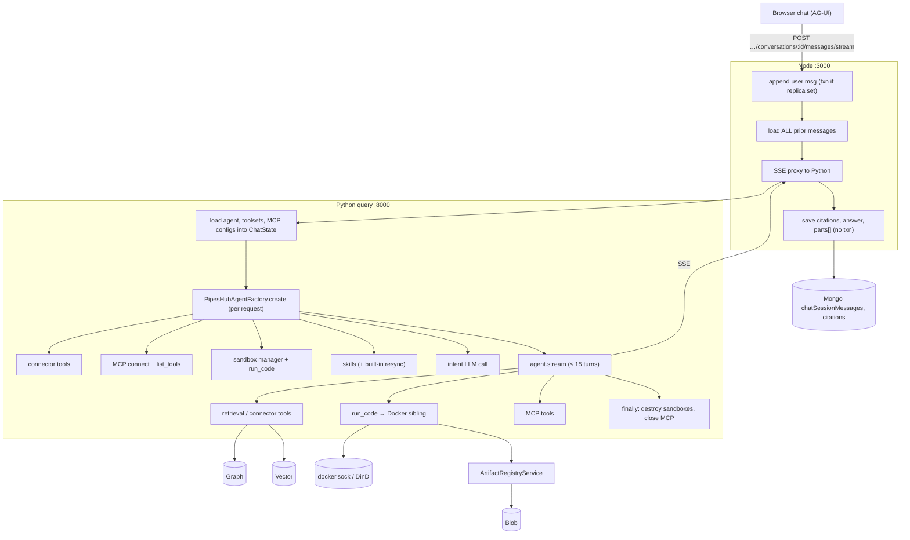
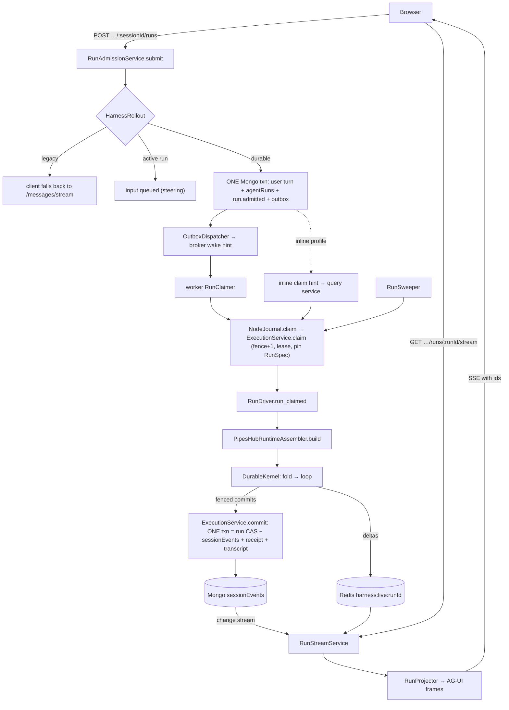
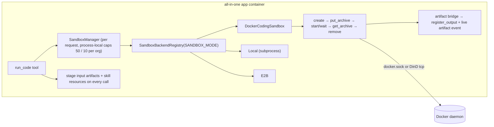
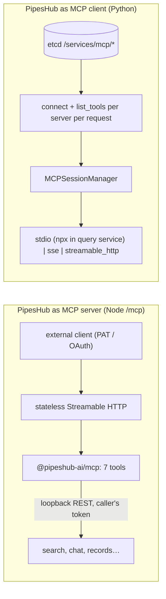
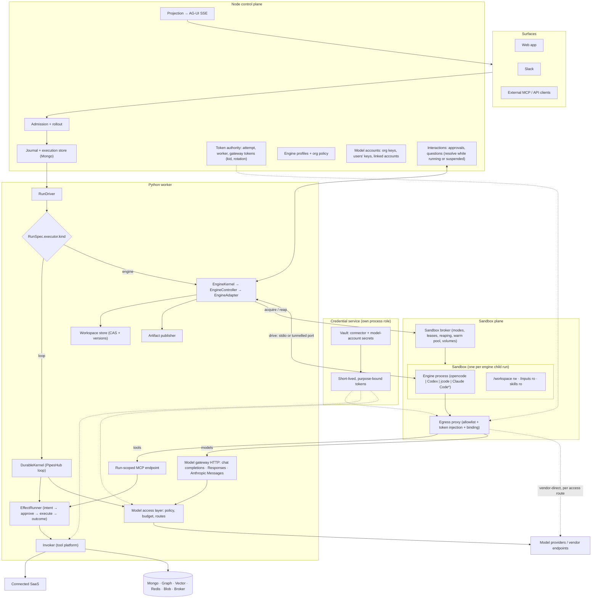
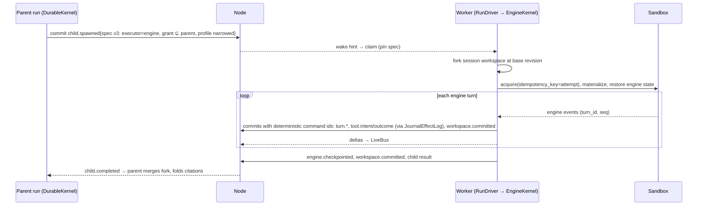
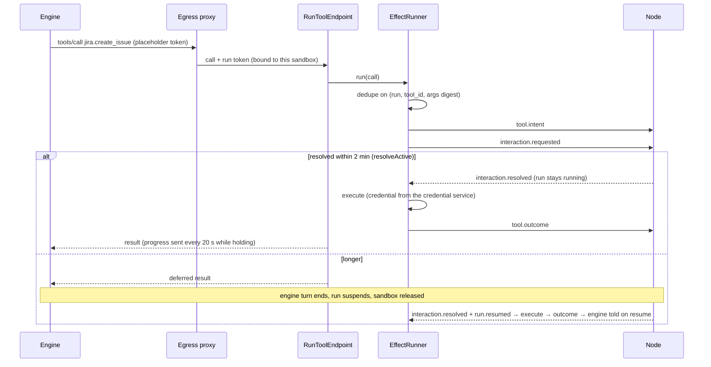
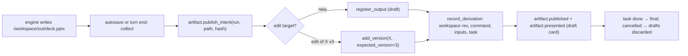
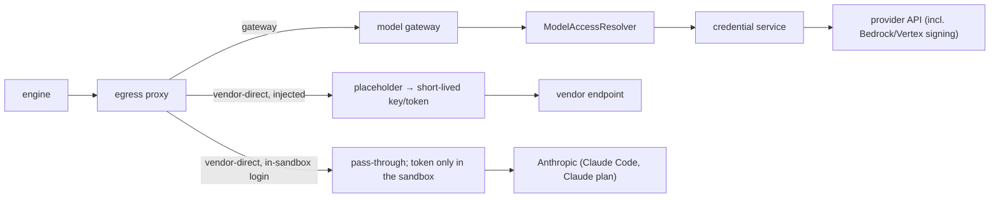
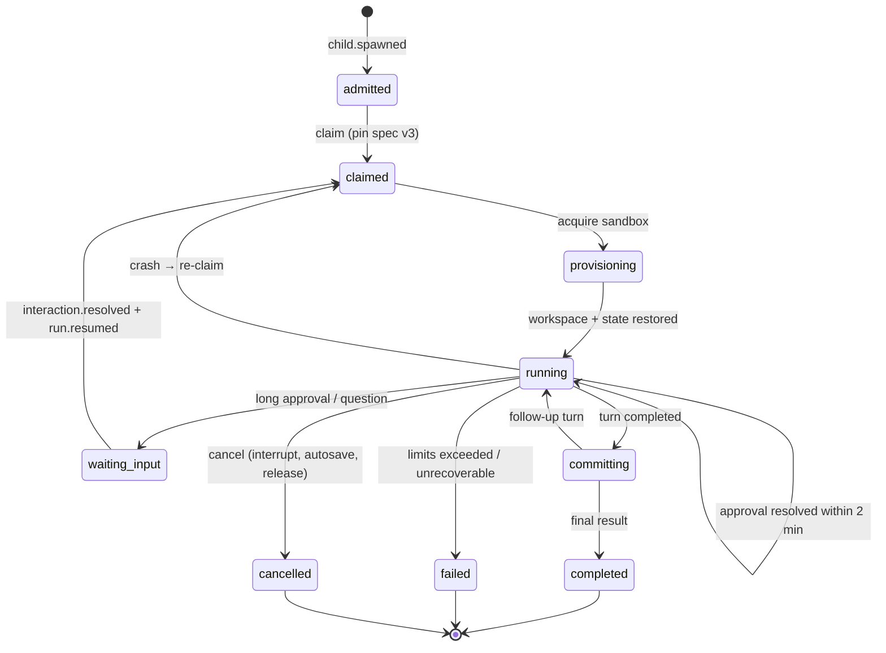

# PipesHub Agent Harness — Architecture (current and target)

**Revision:** 3 · **Date:** 2026-10-02 · **Status:** proposal for review.
**Why engines:** [ENGINES-PLAN.md](ENGINES-PLAN.md).

**Beta.** The agent harness is in beta and off by default for people: the server setting
`AGENT_HARNESS_WORKER_ENABLED` is on by default and idle until an org admin turns on **Agent harness** in Labs, which
is off by default ([ADR-OPS-06](adr/ADR-OPS-06-one-harness-switch-off-by-default.md), amended 2026-11-20). Everything a
person or an org sees follows one org predicate, the switch and the org's Labs flag
([ADR-OPS-08](adr/ADR-OPS-08-one-org-harness-predicate.md)).

This is the single place for the harness's HLD, LLD and data flows. It replaces REPORT.md §2 (current
state), §5.3 (target HLD), §5.5 (module map) and §7 (target data flows). Those sections are kept as
history; where they disagree with this file, this file wins. REPORT.md §6 (LLD of journal, runs,
fencing, policy) stays authoritative for the parts listed in §6.0 below.

Every current-state claim was checked against code on 2026-10-02. File and line citations are in
research/engines/raw/F9-current-architecture-verified.md.
Two checkouts are described:

- **M** = `main`: what customers run today.
- **H** = `feat/agent-harness-rebased`: the durable harness branch. It is not merged and not pushed yet.

---

## 1. What the system is for

Users of PipesHub ask questions and get work done over their company's knowledge and tools:

- Ask a question and get a cited answer from company knowledge.
- Ask an agent to act in connected tools (Jira, Slack, Drive, GitHub, …), with the user's permissions.
- **New:** hand an agent hands-on work (analyse files, build documents, decks and sheets, change code) and
  get finished, versioned results.

Those jobs give the harness five non-negotiable properties. Every design choice below traces to one.

| # | Property | What it means in the design |
|---|---|---|
| G1 | **Correct and cited** | Knowledge is reached only through permission-checked tools that produce citation references |
| G2 | **Governed** | Every tool call and every model call passes a PipesHub enforcement point that applies the user's permissions, the agent's grant, approvals, budgets and audit |
| G3 | **Durable** | Work survives crashes and restarts. The journal is the source of truth; sandboxes and engines hold nothing we cannot rebuild |
| G4 | **Swappable** | Models, engines, sandboxes and stores sit behind PipesHub-owned interfaces; changing one is configuration plus an adapter |
| G5 | **Runs where the customer runs** | Laptop, single server, Kubernetes, managed. Behaviour is derived from probed capabilities, never assumed |

---

## 2. Current state

### 2.1 Summary

| Area | M (customers today) | H (durable branch) |
|---|---|---|
| Run lifetime | One HTTP request = one agent run. Python rebuilds the agent per request; Node saves the answer after the stream ends | Durable runs: admission transaction, outbox, claim, fenced journal commits, Redis LiveBus, Node projection. Steering, Slack and MCP surfaces run durably |
| Gating | — | Org Labs flag, kill switch, durability probe, env switches (off by default in compose) |
| Chat modes on the durable path | — | `auto`, `quick`, `react`, assistant `internal_search`/`web_search`. **`deep` and `planExecute` are legacy only** |
| Sandboxes | Per-request `SandboxManager`; Docker sibling containers via the mounted Docker socket (Helm: privileged DinD); files copied as tar; deleted at end of request | Same code, hardened. **Durable runs get no sandbox** (`sandboxProfile: 'none'` pinned) |
| Session files | None: nothing survives between turns except artifacts | Workspace/CAS/VFS classes exist but are unwired; `agentWorkspaceHeads` has no writer |
| Approvals | `ask_user_question` only; 138 write tools run unapproved | Suspend path built and tested, but **production assembler leaves `approval = allow_all`** |
| Child runs | In-process sub-agents (asyncio tasks, depth ≤ 3) | Event shapes only; `maxChildren: 0` |
| Credentials | Connector and MCP credentials in a shared `tool_state` dict | Out of the run context; no credential service yet |
| MCP | PipesHub as client (per request connect + list); PipesHub `/mcp` server with 7 curated tools and user-level tokens | Same; MCP manifest digests pinned; **MCP sessions never closed on the durable path (live leak)** |
| Citations | `CitationRefMapper` per run → `refN` | Plus `x.pipeshub.citations.recorded` per call; shared-viewer re-check |
| Encryption and erasure | No app-level encryption; deleting a conversation only hides it | Journal sealed per org; still no erasure |

### 2.2 M — one agent chat turn



### 2.3 H — durable agent run



### 2.4 Sandbox code execution today (M and H)



### 2.5 MCP today



### 2.6 Defects and gaps the target must fix

| # | Defect | Where | Severity |
|---|---|---|---|
| X-1 | MCP client sessions never closed on the durable path; `npx` processes leak per attempt | H `assembler.py:356-360` | **Live** for agents with MCP servers |
| X-2 | `close()` calls `sandbox_manager.aclose`, which does not exist (`destroy_all` does) | H `assembler.py:356-360` | Dormant until durable runs get sandboxes |
| X-3 | With `SANDBOX_MODE` unset, H falls back to running code on the host | H sandbox registry | High once enabled |
| X-4 | Docker socket in the app container (Compose); privileged DinD (Helm) | deployment | High; PR #3782 interim |
| X-5 | Deleting a conversation only hides its row; citation soft-delete likely a no-op | Node `chatSessions` | High (privacy) |
| X-6 | Approvals never fire in production on H | assembler `approval` | High before write tools |
| X-7 | Sixteen catalogued event types have no production writer (13 core, e.g. `workspace.committed`, `child.*`, `usage.recorded`, `model.fallback`; 3 extension, e.g. `artifact.publish_intent`, `artifact.published`) | contracts | Planning gap; reuse them before adding new types |
| X-8 | Skill pin `bundleDigest = digest(name, version)` is not a content digest | Node `run-spec.ts:352-357` | Medium |
| X-9 | Safe preview of HTML artifacts (P0.11) is only in open PR #3596 | frontend | High before engines emit HTML |
| X-10 | The H branch exists only on one laptop | git | **Operational risk** |

---


## 3. Target architecture

### 3.1 Principles (first principles, long term)

1. **Own the infrastructure harness; rent the hands.** PipesHub owns sessions, journal, policy,
   tenancy, tools, knowledge, credentials and accounts: that is the product and the compliance surface.
   Hands-on computer work is done by external engines in sandboxes, behind an interface, so the best
   engine can be used at any time.
2. **One enforcement point per resource.** Tools → the Invoker (in-process for our loop, over MCP for
   engines). Models → the model access layer. Files → the workspace store. Nothing reaches a connector,
   a model provider or a file except through these.
3. **Credentials never enter a sandbox.** The egress proxy adds short-lived, run-bound tokens on the way
   out. A compromised sandbox can do only what its run's grant allows, for the run's lifetime.
   **One narrow, opt-in exception (§4.6.4):** Claude Code on a user's own Claude plan, where Anthropic
   requires the user to sign in inside the sandbox and forbids PipesHub from storing or injecting the
   token. That case gets extra controls: read-only tool grant by default, token-pattern refusal at the
   gateways, owner-only binding, and no persisted configuration other than the credentials file (and
   that only if Anthropic confirms it is permitted).
4. **The journal is the truth; everything else is a projection or a cache.** Engine state is the one
   exception: an opaque, sealed checkpoint *referenced* from the journal. Losing it degrades to "resume
   from the last workspace version", never to a repeated external action.
5. **Pinned, then narrowed.** A run's spec (executor, engine, version, profile, grants, access routes) is
   pinned at claim. Each layer (release data → org → agent → task) can only narrow the one above.
6. **Refuse, never silently downgrade.** If a run needs a capability (isolation tier, engine, account)
   the host or org does not provide, the run is refused with a reason code.
7. **Ports with contract suites.** Every boundary is a small protocol with an in-memory adapter and a
   contract suite; every adapter passes it. Substitutability is tested, not assumed.
8. **Idempotent by construction.** Every journal write from an engine has a deterministic command id;
   every external action has an idempotency key; every resource acquisition is keyed by attempt.

9. **Embeddable beyond PipesHub (Loom).** The control layer (`harness_core.{effects,engines,sandbox,
   workspace,access,gateway}` and `harness_engines.*`) must run inside Loom, the in-house
   durable-execution SDK, as well as inside PipesHub. That means:
   - Generic packages use opaque tenant/scope ids and never import `app.*` or call Node.
   - Orchestrators depend only on ports (event sink, effect log, object store, key provider, sandbox
     broker, clock, id generator). `EngineKernel`/`RunDriver` are the PipesHub binding; Loom supplies its
     own.
   - Time, ids and randomness are injected for deterministic replay.
   - Every port ships an in-memory adapter and a reusable contract suite.
   - The packages install and import in isolation.

### 3.2 Target HLD



`*` Claude Code is optional. It runs only on credentials end users bring (their own API key, cloud
account or Claude plan) or on an org API key used by the org's own staff; PipesHub never pays for or
resells Claude usage (§4.6).

> **Retired 2026-10-09 (S1R):** stage-1 `code_task` was removed; `run_code` serves in-loop code work and durable engine runs serve coding-agent work. The text below is kept as history.

**Stage 1 note.** Before durable child runs exist, the same `EngineController` and `RunToolEndpoint` are
hosted in the legacy query-service request (§4.4.2, §5.1). Only the bindings differ.

### 3.3 Module map and dependency rules

```text
backend/python/
  harness_core/                     generic; never imports app.* (import-linter)
    journal/ driver/ kernel/ tools/ models/ contracts/ testing/          (exist on H)
    effects/        NEW  EffectRunner + EffectLog port (journal and in-memory implementations)
    engines/        NEW  types, events, ports, EngineController, EngineKernel, EngineRegistry, profile narrowing
    sandbox/        NEW  SandboxBroker / SandboxHandle / ProcessHandle ports, RuntimeMode, SandboxSpec
    workspace/      NEW  promoted from app/harness/contracts/workspace.py, plus WorkspaceStore, WorkspaceSync
    access/         NEW  AccessRoute, ModelApi, VendorRule, ModelAccessResolver, CredentialBroker ports
    gateway/        NEW  transport-agnostic RunToolEndpoint core (grant listing, dedupe, token-pattern refusal)
    testing/        +    FakeEngine, conformance suites (engines, sandbox, workspace, access)
  harness_engines/                  NEW  one sub-package per engine; depends on harness_core only
    opencode/ codex/ jcode/ claude_code/   (launch renderer, session driver, event mapper, state codec)
  app/harness/                      PipesHub adapters (exist on H)
    gateway/        NEW  MCP HTTP transport, model gateway HTTP surfaces, gateway token verification
    sandbox/        NEW  broker adapters: Docker, gVisor, Kata, agent-sandbox, E2B-compatible
    workspace/      MODIFY  PipeshubBinaryObjectStore, manifest store (Mongo), sync, artifact publisher
    engines/        NEW  stage 1 binding (code_task tool for the legacy loop), EngineRunPresenter, profile loading
    skills/         MODIFY  SkillBundleBuilder, materializer
    access/         NEW  resolver over Node model-accounts + credential service
  app/agents/, app/agent_loop_lib/  legacy; may import app.harness (strangler), never the reverse

backend/nodejs/apps/src/modules/
  agent-harness/    MODIFY  child admission, RunSpec v3 (executor), gateway token authority, resolveActive, engine frames
  model-accounts/   NEW  org keys, users' keys, linked accounts, consent records, policy view of vendor rules
deployment/
  sandbox-broker/  egress-proxy/  credential-service/   NEW  process roles (compose services, Helm charts)
  sandbox-images/   NEW  engine images pinned by digest, per arch, SBOM, licence notices
```

Dependency rules (CI-enforced): `harness_core` → stdlib, pydantic, provider SDKs inside
`models/transports` only; `harness_engines.*` → `harness_core` only, never each other; `app.harness` →
`harness_core`, `harness_engines`, `app.services.*`, `app.config`; legacy may call `app.harness`, never
the reverse; Node `agent-harness` never imports `enterprise_search`.

---

## 4. LLD — interfaces

### 4.0 What we build on (exists on H, verified in F9 §3)

| Existing interface | Location | Used for |
|---|---|---|
| `JournalPort` (claim, commit, read, last_seq, renew, release) | `harness_core/journal/ports.py:26` | Engine child runs commit like any run |
| `RunDriver`, `RuntimeAssembler`, `AssembledRuntime` | `harness_core/driver/run_driver.py:103-157` | Gains a kernel choice from `executor.kind` |
| `DurableKernel`; ports `DurableToolPort`, `ToolContext`, `ToolExecution`, `ApprovalPolicy`; `ToolEffect`, `tool_id_for` | `harness_core/kernel/durable/` | `EffectRunner` is extracted from `_run_effect`, `_intent`, `_outcome` |
| `ToolRegistry`, `ToolExecutor`, `RegistryToolPort`, `ToolSource`, `SourcedTool` | `harness_core/tools/`, `app/harness/assembly/tool_sources.py:39-59` | The Invoker behind the MCP endpoint |
| `CodingSandboxBackend`, `SandboxBackendFactory`, `SandboxBackendRegistry`, `SandboxManager` | `app/agent_loop_lib/sandbox/` | Wrapped by the broker's Docker adapter, then retired |
| `ArtifactRegistryService.register_output`, `VersionManager.add_version(expected_version)`, `record_derivation` | `app/services/artifact_registry/` | Artifact publisher |
| `CitationRefMapper`, `CitationJournal` | `utils/chat_helpers.py`, `app/harness/citations.py:38` | Knowledge tools over MCP |
| `ObjectScope`, `ObjectRef`, `WorkspaceFile`, `WorkspaceManifest`, `BinaryObjectStore`, `WorkspaceManifestStore`, `WorkspaceRevisionConflict` | `app/harness/contracts/workspace.py` | Promoted to `harness_core/workspace` |
| `SkillBundleService.publish` | `app/harness/skills/bundles.py:28` | Skill bundles |
| `ModelRoute{provider, model, transport, on}` in RunSpec | `contracts/harness/core/run-spec.schema.json` | Unchanged; the new access type is named `AccessRoute` to avoid a collision |
| Node `ExecutionService`, `JournalStore`, `PayloadStore`, `RunProjector`, `ConversationWriter`, `RunSweeper` | `modules/agent-harness/` | Child runs, `resolveActive`, engine frames, reaping |

### 4.1 Engines — `harness_core/engines/`

Responsibilities: the **adapter** speaks one engine's protocol; the **controller** runs the lifecycle;
the **kernel** binds a run to the journal; the **registry** picks an adapter. A new engine = a new
adapter registered in the registry (open/closed); every adapter passes one conformance suite
(substitutable); session and adapter are separate protocols (segregated); the controller depends only
on ports (inverted).

```python
# types.py
EngineKind = Literal["opencode", "codex", "jcode", "claude_code"]   # internal ids; never shown as product names

@dataclass(frozen=True, slots=True)
class EngineVersion:
    kind: EngineKind
    version: str
    binary_digest: str                # must be on the release allowlist for this kind

class EngineMode(StrEnum):
    PLAN = "plan"; BUILD = "build"; REVIEW = "review"

@dataclass(frozen=True, slots=True)
class SubAgentPolicy:
    enabled: bool = False
    max_depth: int = 1
    max_concurrent: int = 1

@dataclass(frozen=True, slots=True)
class EngineProfile:                  # PipesHub terms only; adapters translate
    engine: EngineVersion
    mode: EngineMode
    access: AccessRouteRef            # §4.6
    reasoning_effort: Literal["low", "medium", "high"] | None
    sub_agents: SubAgentPolicy
    limits: RunLimits                 # steps, wall time, tokens, USD (USD only on routes PipesHub pays)
    isolation_min: RuntimeMode
    result_schema: Mapping[str, Any] | None
    def narrow(self, c: ProfileConstraint) -> "EngineProfile": ...   # raises ProfileWidening

@dataclass(frozen=True, slots=True)
class EngineCapabilities:
    can_steer: bool
    native_skills: bool
    sub_agents: bool
    model_apis: frozenset[ModelApi]
    max_tools: int | None             # e.g. Codex degrades above ~100 tools
    drive: Literal["stdio", "port"]   # opencode = port (HTTP), Codex/jcode/Claude Code = stdio

@dataclass(frozen=True, slots=True)
class GatewayEndpoints:               # as the sandbox sees them; secrets are placeholders
    model_base_url: str
    model_api: ModelApi
    tools_mcp_url: str
    token_placeholder: str
    tool_timeout_s: int = 150         # ≥ approval hold; adapters write it into engine config

# events.py — the only engine vocabulary the rest of PipesHub sees
@dataclass(frozen=True, slots=True)
class EngineEventMeta:
    turn_id: str                      # attempt-independent: derived from (run, turn index)
    seq: int                          # monotonic within the turn; (turn_id, seq) → deterministic command id
EngineEvent = (TextDelta | ReasoningDelta | MessageCompleted | CommandStarted | CommandOutput
               | CommandFinished | FileChanged | ToolCallSeen | ApprovalRequested | SubAgentStarted
               | SubAgentFinished | UsageReported | TurnCompleted | EngineError)   # each carries meta

@dataclass(frozen=True, slots=True)
class EngineStateBlob:
    engine: EngineVersion
    schema_version: int               # adapter-defined; restore refuses an unknown version
    content: ObjectRef                # sealed, in the workspace store's object store
```

```python
# ports.py
class EngineAdapter(Protocol):
    kind: ClassVar[EngineKind]
    def capabilities(self) -> EngineCapabilities: ...
    def render_launch(self, profile: EngineProfile, endpoints: GatewayEndpoints,
                      skills_dir: str) -> EngineLaunch: ...             # pure: argv, env, files
    async def open(self, sandbox: SandboxHandle, launch: EngineLaunch,
                   restore: EngineStateBlob | None) -> "EngineSession": ...   # refuses a state from another version
                                                                              # unless the adapter declares a migration

class EngineSession(Protocol):
    def run_turn(self, task: EngineTask | FollowUp) -> AsyncIterator[EngineEvent]: ...   # bounded buffer; backpressure
    async def steer(self, text: str) -> None: ...
    async def interrupt(self) -> None: ...
    async def answer(self, request_id: str, decision: InteractionDecision) -> None: ...
    async def capture_state(self) -> bytes: ...
    async def health(self) -> SessionHealth: ...
    async def close(self) -> None: ...

class EngineRegistry(Protocol):
    def adapter_for(self, version: EngineVersion) -> EngineAdapter: ...   # refuses versions not on the allowlist
```

```python
# controller.py — lifecycle only; no engine-specific code
@dataclass
class EngineController:
    registry: EngineRegistry
    sandboxes: SandboxBroker
    workspace: WorkspaceStore
    sync: WorkspaceSync
    skills: SkillMaterializer
    artifacts: ArtifactPublisher
    access: ModelAccessResolver
    tokens: GatewayTokenIssuer        # Node-signed, short-lived, refreshed by the proxy
    checkpoints: EngineCheckpointStore
    sink: EngineEventSink             # journal (via EffectLog / commits) + LiveBus deltas
    interactions: InteractionBridge
    clock: Clock

    async def run_turn(self, run: EngineRunContext, task: EngineTask | FollowUp) -> EngineTurnOutcome: ...
        # acquire(idempotency_key=attempt) → materialize → skills → restore → drive → autosave → publish → checkpoint
    async def cancel(self, run: EngineRunContext, *, reason: str) -> None: ...
        # interrupt → final autosave → release; watches run.cancel_requested
```

```python
# kernel.py — sibling of DurableKernel
@dataclass
class EngineKernel:
    controller: EngineController
    journal: JournalPort
    async def run_claimed(self, claim: Claim, *, claim_sent_at: float | None = None) -> Disposition: ...
```

`RunDriver` chooses the kernel from **`RunSpec.executor.kind`** (`loop` → `DurableKernel`, `engine` →
`EngineKernel`). `runKind` (interactive, child, scheduled, workflow_code, authoring) is unchanged: it
says why a run exists, `executor` says how it runs.

### 4.2 Sandbox — `harness_core/sandbox/`

```python
class RuntimeMode(StrEnum):
    DOCKER_HARDENED = "docker"; GVISOR = "gvisor"; MICROVM = "microvm"; K8S = "k8s"; MANAGED = "managed"

@dataclass(frozen=True, slots=True)
class SandboxSpec:
    image_digest: str
    mode: RuntimeMode
    resources: Resources
    egress: EgressPolicy              # destinations + placeholder→token routes + forbidden-pattern rules
    mounts: Sequence[MountSpec]       # workspace rw, inputs ro, skills ro; volume subpath where supported
    labels: Mapping[str, str]         # org, session, run, attempt — for proxy binding, audit and reaping

class SandboxBroker(Protocol):
    def modes(self) -> frozenset[RuntimeMode]: ...
    async def acquire(self, spec: SandboxSpec, *, lease: LeaseRef, idempotency_key: str) -> "SandboxHandle": ...
    async def release(self, handle: "SandboxHandle", *, keep_warm_s: int = 0) -> None: ...
    async def reap(self, *, labels: Mapping[str, str], older_than_s: int) -> int: ...   # called by RunSweeper
    async def health(self) -> BrokerHealth: ...

class SandboxHandle(Protocol):
    id: str
    mode: RuntimeMode
    async def exec(self, argv: Sequence[str], *, env: Mapping[str, str], stdin: bool = False) -> "ProcessHandle": ...
    async def connect(self, port: int) -> ByteStream: ...       # tunnelled through the broker; never a shared bridge
    async def put_tar(self, dest: str, stream: AsyncIterator[bytes]) -> None: ...
    async def get_tar(self, src: str) -> AsyncIterator[bytes]: ...

class ProcessHandle(Protocol):
    stdout: AsyncIterator[bytes]; stderr: AsyncIterator[bytes]
    async def write(self, data: bytes) -> None: ...
    async def signal(self, sig: int) -> None: ...
    async def wait(self, *, timeout_s: float | None = None) -> int: ...
```

The broker is its own process role; app containers never hold the Docker socket. opencode's HTTP
server listens on loopback inside the sandbox and is reached only through `connect`.

### 4.3 Workspace — `harness_core/workspace/`

```python
class WorkspaceStore(Protocol):
    async def head(self, scope: ObjectScope, workspace_id: str) -> WorkspaceManifest: ...
    async def commit(self, scope: ObjectScope, workspace_id: str, *, base_revision: int,
                     changes: ChangeSet, reason: CommitReason) -> WorkspaceManifest: ...   # CAS on head
    async def fork(self, scope: ObjectScope, workspace_id: str, *, at_revision: int, fork_id: str) -> WorkspaceManifest: ...
    async def merge(self, scope: ObjectScope, *, fork_id: str, into: str) -> MergeResult: ...
    async def diff(self, scope: ObjectScope, a: WorkspaceManifest, b: WorkspaceManifest) -> Diff: ...
    async def rollback(self, scope: ObjectScope, workspace_id: str, *, to_revision: int) -> WorkspaceManifest: ...

class WorkspaceSync(Protocol):
    async def materialize(self, sandbox: SandboxHandle, manifest: WorkspaceManifest, *, root: str) -> SyncState: ...
    async def collect(self, sandbox: SandboxHandle, state: SyncState) -> ChangeSet: ...   # hash-diff only
```

Rules:
- One workspace per session (`ws:{sessionId}`); each engine child forks it and is the single writer of
  its fork; the parent merges path-disjoint changes and returns conflicts to the orchestrator.
- **Git:** `.git` is stored as content, but forks that both touch a repository are not merged
  path-by-path: the parent replays child commits (rebase) or refuses parallel repository children.
  Wave 3 runs one repository writer per session.
- Autosave every 20 changes or 2 minutes, and before any external action.
- Engine plug-in folders (`.opencode/`, `.claude/` hooks and settings, `.codex/`) are stripped on
  materialize; engines get configuration only from `render_launch`.
- **Encryption:** one data key per session workspace, wrapped by Node, cached by the worker for the
  lease. Deduplication is per session. Erasure = destroy the session key (crypto-shred).

### 4.4 Tool access for engines

#### 4.4.1 `EffectRunner` and `EffectLog` — `harness_core/effects/`

```python
class EffectLog(Protocol):            # where intents and outcomes are recorded
    async def intent(self, call: EffectCall) -> None: ...
    async def outcome(self, call: EffectCall, result: ToolExecution) -> None: ...
    async def find(self, key: EffectKey) -> RecordedEffect | None: ...    # dedupe: (run, tool_id, args digest)

class JournalEffectLog(EffectLog): ...    # durable runs: tool.intent / tool.outcome / tool.unknown commits
class RequestEffectLog(EffectLog): ...    # stage 1: in-memory for the request, mirrored to logs

@dataclass
class EffectRunner:
    log: EffectLog
    approvals: ApprovalPolicy
    interactions: InteractionBridge
    async def run(self, call: EffectCall, ctx: ToolContext, execute: ToolFn) -> ToolExecution: ...
        # classify → dedupe → intent → approve (hold or defer) → execute → outcome
```

`EffectRunner` is extracted from `DurableKernel` with no behaviour change; `DurableKernel` then uses it.
The dedupe rule is what keeps "zero duplicate external actions" true when an engine re-calls a tool after
a deferred approval.

#### 4.4.2 `RunToolEndpoint` — core in `harness_core/gateway/`, MCP transport in `app/harness/gateway/`

```python
class RunToolEndpoint:                # an MCP server bound to exactly one engine run
    def __init__(self, *, binding: RunBinding, catalog: ToolCatalog, effects: EffectRunner,
                 citations: CitationSink, limits: GrantLimits): ...
    async def list_tools(self) -> list[McpTool]: ...
        # == the grant; above EngineCapabilities.max_tools, tools are grouped behind meta-tools or the grant is refused (GrantTooLarge)
    async def call_tool(self, name: str, args: Mapping[str, Any]) -> McpResult: ...
        # verify token → refuse forbidden patterns in args (e.g. vendor tokens) → EffectRunner.run
        # knowledge tools return refN + structured citations; long approvals return a deferred result
        # while holding, emit MCP progress every 20 s
```

Two bindings, one class:

| | Stage 1 (legacy request) | Stage 2 (durable child run) |
|---|---|---|
| Host process | Query service, for the life of the request | Worker hosting the child run |
| `EffectLog` | `RequestEffectLog` | `JournalEffectLog` |
| Token claims | `{org, session, requestId, exp}` | `{org, session, run, parentRun, attempt, fence, toolIdsDigest, routesDigest, exp}` |
| Citations | the request's `CitationRefMapper` | `CitationJournal` (+ parent fold) |
| Grant | read-only | child grant ⊆ parent, approvals live |

### 4.5 Interactions

```python
class InteractionBridge(Protocol):
    async def request(self, binding: RunBinding, req: InteractionRequest) -> InteractionTicket: ...
    async def wait(self, ticket: InteractionTicket, *, within_s: float) -> InteractionDecision | None: ...
```

Node gains **`resolveActive(interactionId)`**: it writes `interaction.resolved` without `run.resumed`
when the run is still running, and wakes the holder over LiveBus (today Node resolves only suspended
runs, `domain/execution.ts:735-757`). Holds last up to 2 minutes; adapters set the engine's MCP tool
timeout to at least 150 s and the gateway sends progress every 20 s. Longer waits return a deferred
result, end the engine turn and suspend the run; on resolution the controller resumes the engine with
the outcome, and a re-call of the same tool is answered from the effect log, never executed twice.

### 4.6 Model access and accounts — `harness_core/access/`, Node `model-accounts`

#### 4.6.1 Types

```python
class ModelApi(StrEnum):
    CHAT_COMPLETIONS = "chat_completions"; RESPONSES = "responses"; ANTHROPIC_MESSAGES = "anthropic_messages"

class AccountKind(StrEnum):
    ORG_API_KEY = "org_api_key"
    ORG_CLOUD = "org_cloud"                  # Bedrock, Vertex, Azure OpenAI
    USER_API_KEY = "user_api_key"
    USER_PLAN_INJECTED = "user_plan_injected"     # e.g. Sign in with ChatGPT (only where the vendor allows)
    USER_PLAN_SANDBOX_LOGIN = "user_plan_sandbox_login"   # Claude plan in Claude Code only

class RouteKind(StrEnum):
    GATEWAY = "gateway"                      # sandbox → our gateway → provider (signing done by us)
    VENDOR_INJECTED = "vendor_injected"      # sandbox → proxy injects a short-lived token → vendor
    VENDOR_SANDBOX_LOGIN = "vendor_sandbox_login"   # user signs in inside the sandbox; we never hold it

@dataclass(frozen=True, slots=True)
class AccessRoute:
    kind: RouteKind
    api: ModelApi
    provider: str
    model: str
    account: AccountRef | None               # None only for VENDOR_SANDBOX_LOGIN
    pays: Literal["org", "user", "vendor_plan"]   # budgets in USD only when org or user pays through us

@dataclass(frozen=True, slots=True)
class VendorRule:
    provider: str
    account_kind: AccountKind
    engines: frozenset[EngineKind] | None
    route: RouteKind
    offering: frozenset[Offering]   # matched against the install's AGENT_HARNESS_OFFERING, set by the operator
    status: Literal["allowed", "prohibited", "pending_vendor"]
    source_url: str

class ModelAccessResolver(Protocol):
    async def resolve(self, principal: PrincipalRef, need: ModelNeed, policy: OrgModelPolicy) -> AccessRoute: ...
class CredentialBroker(Protocol):
    async def lease(self, route: AccessRoute, *, binding: RunBinding, ttl_s: int) -> CredentialLease: ...
```

The vendor-rule table ships as **signed release data**. At runtime an org can only narrow it (switch an
allowed row off), never widen it.

#### 4.6.2 Routes

| Route | How | Budget |
|---|---|---|
| Gateway | Engine → our gateway (chat completions, Responses or Anthropic Messages) → provider. Bedrock and Vertex are only reachable this way, because their request signing cannot be swapped by a proxy | Enforced in USD |
| Vendor-direct, injected | Proxy allows the vendor endpoint for this run and swaps the placeholder for a short-lived key or token from the credential service | USD enforced when an org or user API key is used; step/time limits for plan-billed tokens |
| Vendor-direct, in-sandbox login | The user completes the vendor's own login inside the sandbox; PipesHub never sees the token | Step/time limits only; the vendor plan pays |

#### 4.6.3 Vendor rules (verified 2026-10-02, F10)

| Account | Status | Route |
|---|---|---|
| OpenAI API key (org or user) | Allowed | Gateway |
| ChatGPT Plus/Pro via "Sign in with ChatGPT" | Allowed for open-source and self-hosted apps; managed and paid offerings must apply; **web-hosted login needs a redirect OpenAI has not yet confirmed (loopback only today)** | Vendor-direct, injected — pending OpenAI |
| ChatGPT Business/Enterprise Codex access tokens | Allowed for trusted runners; whether a platform may store them is **pending OpenAI** | Vendor-direct, injected — pending |
| Codex app-server `chatgptAuthTokens` mode | Do not use (internal-only) | — |
| Anthropic API key (org for its own staff, or user's own) | Allowed | Gateway (Anthropic Messages) or vendor-direct injected |
| Bedrock / Vertex / Foundry for Claude | Allowed | Gateway only |
| Claude plan in unmodified Claude Code, user signs in inside the sandbox | Allowed; **persisting the login between sessions pending Anthropic** | Vendor-direct, in-sandbox login |
| Claude plan held, injected or used by any other harness or by our loop | Prohibited | — |
| PipesHub paying for or reselling Claude usage (managed offering) | Prohibited without an agreement | — |
| Gemini API key, Vertex | Allowed | Gateway |
| Gemini personal login outside Gemini CLI | Prohibited | — |
| Gemini personal or Code Assist login in hosted Gemini CLI | Pending Google; not supported | — |

Consumer-plan routes are **off by default for enterprise tenants** (consumer data terms apply) and need a
consent screen naming the vendor terms.

#### 4.6.4 Claude Code in-sandbox login: controls

- Only for runs whose acting principal owns the login; refused for shared conversations, Slack or MCP
  surfaces acting for another user, and scheduled or triggered runs.
- Read-only tool grant by default; write tools only if the org opts in.
- Both gateways refuse arguments matching vendor token patterns (for example `sk-ant-`).
- Until Anthropic confirms that a persisted login is permitted, the login lasts one session. If
  confirmed, only the credentials file (mode 0600) persists in a per-user encrypted volume; every other
  file under the config directory is regenerated read-only from the profile at each launch (no persisted
  hooks, plug-ins or MCP configuration).
- The binary must match an Anthropic checksum on PipesHub's tested-versions allowlist; it is not
  modified and its login methods are not restricted by PipesHub (admins may restrict them).
- "Claude Code" is not used as a PipesHub feature name.

### 4.7 Artifacts and skills

```python
class ArtifactPublisher(Protocol):
    async def publish_changes(self, binding: RunBinding, version: WorkspaceManifest,
                              outputs: Sequence[OutputFile], *, draft: bool) -> list[PublishedArtifact]: ...
        # writes the existing x.pipeshub.artifact.publish_intent / artifact.published / artifact.presented events
        # new: register_output; edit: add_version(expected_version); provenance via record_derivation:
        # workspace revision, command, inputs, task

class SkillBundleBuilder(Protocol):
    async def build(self, org: str, skill: SkillRef) -> SkillBundleRef: ...      # content digest
class SkillMaterializer(Protocol):
    async def materialize(self, sandbox: SandboxHandle, bundles: Sequence[SkillBundleRef], *, skills_dir: str) -> None: ...
```

### 4.9 Shared sessions (multiplayer)

Design from first principles and from how Anthropic, Notion and Slack handle shared AI sessions
(F11). Rule: **nobody's credentials or permissions run
another person's turn.**

| Concern | Rule |
|---|---|
| Roles | owner, collaborator (may send turns), commenter, viewer. Today's `read` → viewer, `write` → collaborator (today `write` grants nothing beyond `read`) |
| Whose permissions | Each root run acts as **its sender** ∩ the agent's grant. Earlier turns by other people enter the model's context only if their labels pass for this sender; otherwise as a stub ("an earlier answer you cannot see") |
| What viewers see | Citations re-checked per viewer (C-6, exists); **artifacts checked per viewer too** (today they are shown without a check — gap) |
| Concurrency | One active run per session. Only the run's actor steers it; another collaborator's message is queued as `next_run` and becomes their own run (journal records `by` on `input.queued`) |
| Approvals | Only the run's actor approves (an extension may name other approvers); owner and admins may deny or cancel, never approve for someone else |
| Who pays (engines) | Org accounts: anyone. A user's own API key or plan: only that user's turns. Claude plan in-sandbox login: refused for another person's turn and in any session with more than one participant; sharing a session that has one ends the sandbox and wipes the login |
| Workspace | v1: engine work in a shared session only by the owner. v2: files materialized per actor through label filtering |
| Memory | Personal memory off by default in shared sessions; writes go to a session scope |
| Fork | "Continue privately" copies the transcript as the forker may see it, with a new workspace and key |
| Audit | Participant changes, per-turn actor, approvals and forks are journal events |

### 4.8 Contract changes

| Contract | Change |
|---|---|
| `RunSpec` core | New optional `executor{kind: loop\|engine, engine{kind, version, binaryDigest, profileDigest}}`; `schemaVersion` 2 → 3; claims are schema-gated so workers that do not understand v3 never claim a v3 run; fold version bump; `budgets.maxChildren` > 0 for agents allowed to delegate |
| `RunSpec` `x.pipeshub` | `mounts[]` gains `workspace`, `inputs`, `skills`; skills pinned by content digest, while runs pinned with the old `digest(name, version)` keep resolving; `access[]` (pinned access routes) |
| Events | **One new type:** `engine.checkpointed{blob, digest, engine, schemaVersion}`. Reused with first writers: `turn.started/completed` (with `executor: engine`), `workspace.committed`, `child.spawned/completed`, `usage.recorded`, `x.pipeshub.artifact.publish_intent/published` |
| Command ids | `hash(run, turn_id, seq)` for engine events, so a re-driven turn cannot commit twice; deltas go to LiveBus only |
| Gateway token | Node-signed JWT with `kid` and rotation; TTL 10 minutes; the proxy refreshes its copy from Node while the lease is held; claims per §4.4.2 |
| Node APIs | child admission (internal), `resolveActive`, engine profiles (admin), model accounts (user and admin), workspace versions (list, diff, download, roll back) |

---

## 5. Data flows

### 5.1 Stage 1 — `code_task` on today's loop (behind a flag)

```mermaid
sequenceDiagram
  participant U as User
  participant L as PipesHub loop (legacy request, query service)
  participant T as code_task tool
  participant C as EngineController (in the request)
  participant B as Sandbox broker
  participant S as Sandbox (engine)
  participant G as RunToolEndpoint (in the request) + model gateway
  U->>L: "Turn these exports into a churn analysis deck"
  L->>T: code_task(goal, inputs)
  T->>T: take the session workspace lease (one code_task at a time per session)
  T->>C: run_turn(task, profile, read-only grant)
  C->>B: acquire(spec, idempotency_key=request)
  C->>S: materialize workspace + inputs + skills, start engine
  loop engine works
    S->>G: model calls, tool calls (proxy adds request token)
    G-->>S: results; knowledge results carry refN from the request's mapper
    S-->>C: events → progress frames (sub-agent group)
  end
  C->>C: collect, save workspace version, publish /workspace/out as artifacts
  C-->>T: {output, success, artifacts, citations}
  T-->>L: result like any sub-agent
  L-->>U: answer + artifact cards
```

Stage 1: read-only connector grant; no crash recovery; one `code_task` at a time per session; removable
once every org with engines enabled runs on the durable path.

### 5.2 Stage 2 — durable engine child run



### 5.3 Tool call from an engine, with approval



### 5.4 Crash and resume

| Crash point | Recovery |
|---|---|
| Engine or sandbox dies mid-turn | Lease expires → re-claim → `acquire(idempotency_key=new attempt)` → last `workspace.committed` + last `engine.checkpointed` → engine told the turn was interrupted; re-driven events dedupe by command id |
| Between `tool.intent` and `tool.outcome` | Idempotent tool → retried with the same key; otherwise `tool.unknown`, shown, never retried |
| Worker dies | Fenced; the sweeper requeues and calls `broker.reap` for the orphaned sandbox |
| Engine state missing, corrupt or from an unsupported version | Resume from the workspace version + a task summary; flagged |

### 5.5 Artifacts



### 5.6 Model call by route



### 5.7 Session erasure

Deleting a conversation, or reaching the org's retention period, enqueues an erasure job:

1. Destroy the session's workspace data key (crypto-shred): workspace objects and engine state become
   unreadable at once.
2. Delete messages, citations, artifacts and their blobs, and LiveBus streams.
3. Journal envelopes stay as tombstones (ids, types, sizes) so the fold and the audit chain stay valid;
   their sealed payloads are deleted.
4. The audit chain records the erasure with ids and counts only.

---

## 6. Run lifecycle of an engine child



### 6.1 Still authoritative in REPORT.md §6

Journal envelope and commit rules (§6.1.2–6.1.4), leases and fencing (§6.1.5), fold (§6.1.6), schema
evolution (§6.1.7), journal authority (§6.1.8), labels and flow policy (§6.5.1), credentials (§6.5.4),
principals (§6.13), data protection and audit (§6.16, amended by §4.3 and §5.7 here), degraded modes
(§6.17). Superseded there: §6.6 (code mode), §6.7 (VFS), §6.8 (broker).

---

## 7. Deployment and operations

| Profile | Default minimum isolation for engines | Engine concurrency | Notes |
|---|---|---|---|
| Laptop (Docker Desktop) | Hardened Docker, labelled as such in the UI | 1 active engine task | No gVisor or KVM on macOS Docker Desktop |
| Linux server, no KVM | gVisor (installed by `install.sh`) | from probed memory | Volume subpath mounts |
| Linux server with KVM | gVisor (Kata available; orgs may require it) | from probed memory | |
| Kubernetes | agent-sandbox + gVisor RuntimeClass (Kata where nodes allow) | per-org caps | PVC per session or copy-in |
| Managed | gVisor or microVM | per-org caps | Firecracker modes use copy-in only |

An org may raise its minimum; a host that cannot meet an org's minimum refuses engine runs with
`IsolationUnavailable`.

New process roles, each a compose service and a Helm chart: sandbox broker, egress proxy, credential
service. The app container loses the Docker socket. Engine images are per arch, pinned by digest, built
into air-gapped bundles, and pulled only on hosts with engines enabled.

**Observability.** Every log line on an engine path carries the correlation chain `orgId → sessionId →
runId → attemptId → sandboxId → proxyRequestId → invocationId → seq`. Lifecycle transitions are logged at
`info`, degraded paths and refusals at `warning`, never content or secrets. Dashboards: tasks started and
finished, failures by reason, cost by route, sandbox start time, gateway latency.
