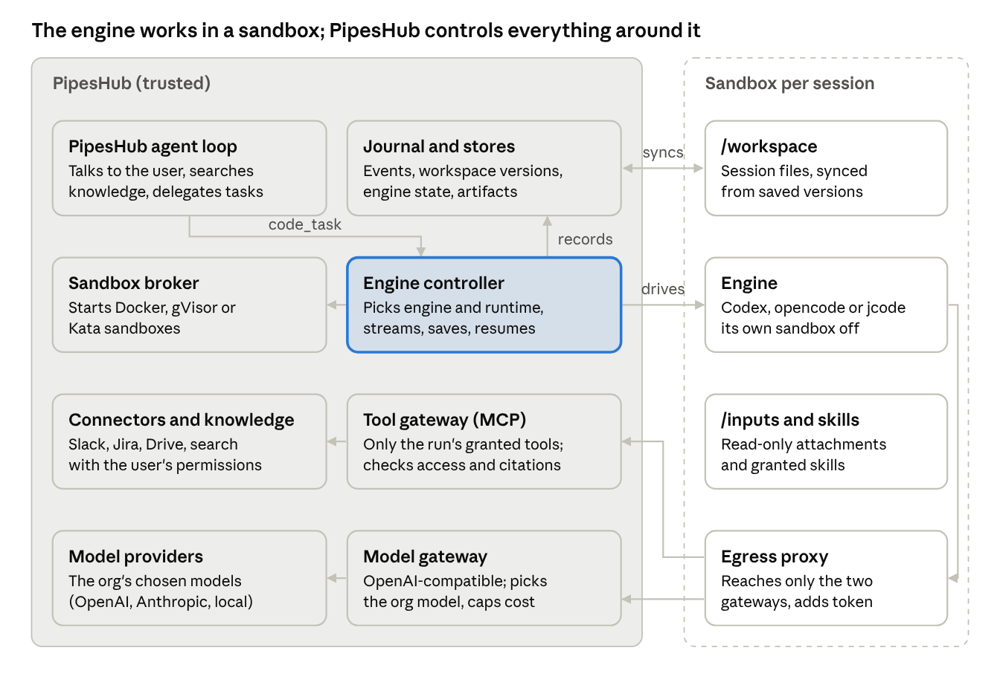
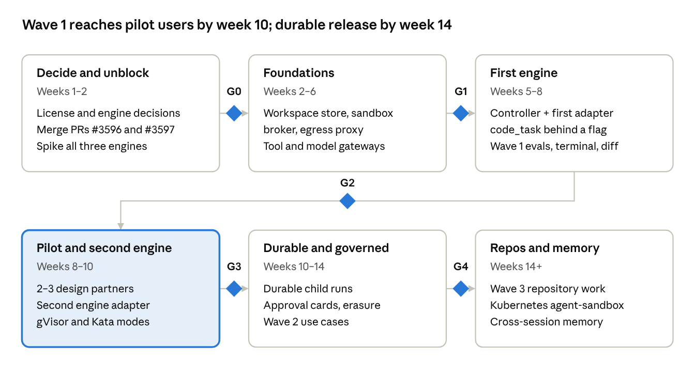

# PipesHub Agent Harness Engines Plan

2026-10-02 · shared doc: https://claude.ai/code/artifact/bf0982f7-3528-4e30-9217-3c0799151611 (the doc is the living version; this file is a snapshot)

> **Revised 2026-10-02:** the delivery timeline, Claude Code and users' own AI accounts, the isolation defaults, the checkpoint event name (`engine.checkpointed`) and stage 1 details have been superseded by the implementation plan (rev 3) and [ARCHITECTURE.md](ARCHITECTURE.md). Pilot is now expected early February 2027 and the durable release late March 2027.

**We propose that PipesHub runs open-source agent harness engines (opencode first, Codex second) inside its own sandboxes, under PipesHub's control, so agents can do real hands-on work: build documents and analyses, edit files over many turns, and work on code.** PipesHub's own agent loop stays in charge and hands bounded tasks to the engine through one new tool, `code_task`.

## The short version

- **What clients get:** finished, versioned work (decks, spreadsheets, reports, analyses, code changes) built from their own knowledge and connectors, with citations, approvals and audit like the rest of PipesHub.
- **Why engines:** they are better at hands-on computer work than anything we would build, and they improve every week. Building our own would recreate the maintenance problem we started with.
- **What PipesHub keeps:** tenancy, permissions, tools, knowledge, skills, approvals, session saving and audit. The engine sees only a folder, one model address and one tool address.
- **What is missing today:** 13 pieces. Nine are needed by PipesHub's own harness anyway (sandbox with saved files, durable sessions, approvals, a tool gateway). Four exist because of engines.
- **Feasibility:** all three engines were run unmodified against recording fake servers. Our tools, skills and instructions reach them; they resume in a fresh sandbox from saved state; locked down, they send nothing outside our gateways.
- **Delivery:** wave 1 (data analysis, office documents, reports) reaches pilot users in about 10 weeks; a durable, governed release in about 14.
- **Biggest open decision:** each engine contains weak-copyleft code (MPL-2.0 or LGPL). Legal sign-off is needed before phase 0 ends.

## Why use an agent harness engine

An agent harness engine is a program that runs an AI agent in a computer workspace: it reads and edits files, runs commands, checks results and fixes its own mistakes. Codex, opencode and jcode are open-source examples. We want PipesHub to run one of them inside a sandbox for jobs that need real hands-on work.

**Why use one instead of building our own.**

- **They are very good at hands-on work, and get better every week.** Codex (127k GitHub stars) and opencode (211k stars) ship releases almost daily, backed by large teams and communities.
- **The hard parts are already solved.** Reliable file editing, patch formats, shell handling, error recovery, context compaction and model-specific prompts took those teams years of tuning.
- **Some models are trained for their engine.** Codex models are trained with the Codex harness, so they work best inside it.
- **Building our own would recreate the problem we started with.** Our harness is already hard to maintain, and a coding agent would need re-tuning after every model release.

**Why not only reuse PipesHub's existing loop.** Our loop is built for enterprise search and answers with citations. It has no lasting workspace, no real coding toolset and no sandbox that survives between turns. We keep it for what it does best.

**Why not replace our loop with an engine.** Engines are single-user coding tools. They know nothing about tenants, permissions, citations or connectors. Our research found no open-source engine with a permissive license that can run many tenants with saved, resumable sessions.

**So we split the work.**

| Layer | Who owns it | What it does |
| --- | --- | --- |
| Control layer | PipesHub | Who can do what, which data, approvals, saving sessions, audit, cost |
| Main agent | PipesHub's loop | Talks to the user, searches knowledge, writes answers with citations, decides when to delegate |
| Hands-on work | The engine, inside a sandbox | Edits files, runs code, builds documents and analyses |

Because PipesHub talks to every engine through one interface, we can switch between Codex, opencode, jcode or a newer engine without changing the rest of the product.

## What PipesHub and our clients get

PipesHub agents gain a real workspace: they can work on files over many turns, run and check their own work, and hand back finished documents, analyses and code, using the company's own knowledge and connectors under the company's permissions.

**Use cases, in the order we would ship them.**

| Wave | Use case | What the user asks | What they get |
| --- | --- | --- | --- |
| 1 | Data analysis on uploaded files | "Compare Q2 and Q3 churn from these exports" | A checked analysis with charts and the code behind it, re-runnable next turn |
| 1 | Office documents | "Turn this Confluence page and the Jira epic into a 10-slide deck" | A real `.pptx` / `.docx` / `.xlsx` artifact, versioned, editable in follow-up turns |
| 1 | Reports from knowledge | "Write the incident report from the Slack thread and the runbook" | A document with citations back to the sources |
| 2 | Code over connector data | "Pull last month's tickets and find the top 5 recurring causes" | Analysis built from live connector data through PipesHub tools |
| 2 | Editing existing artifacts | "Add a risks slide and fix the totals on sheet 2" | A new version of the same artifact, with the previous one kept |
| 3 | Repository work | "Fix the bug in JIRA-123 and open a pull request" | A tested change and a PR, with approval before anything is pushed |
| 3 | Workflow and skill authoring | "Every Monday, summarise new support tickets to #support-leads" | A reviewed, versioned workflow or skill |

Wave 1 needs no code repositories and no write approvals outside the sandbox, so it ships first. Wave 3 needs durable approvals.

**Benefits for clients.**

- **Finished work, not just answers.** Documents, spreadsheets, decks and analyses that open in the tools people already use.
- **Correctness they can check.** The engine runs its own code and tests; users see the commands, the files changed and the sources cited.
- **Work that continues.** A session's files are saved, so tomorrow's follow-up edits yesterday's deck instead of starting over.
- **Same governance as the rest of PipesHub.** Every tool call goes through the user's permissions, approvals and audit log; no credentials enter the sandbox.
- **Choice of engine and model.** Admins pick the engine and model per agent, and can switch when a better one appears.
- **Runs where they run PipesHub.** Laptop, single server, or Kubernetes, with the strongest isolation that host supports.

**Benefits for PipesHub.** We stop building a coding agent ourselves and inherit improvements from engines with far larger teams. Our effort goes into what clients pay us for: knowledge, connectors, permissions and governance.

## At a glance

The main agent hands a task to the engine controller, which starts a sandbox through the broker, syncs the session's files in and drives the engine. The engine's only ways out are the tool gateway and the model gateway, through the egress proxy; everything it does is recorded in the journal.

## What is missing in PipesHub today

Thirteen pieces are missing. Nine of them are needed by PipesHub's own harness anyway, whatever we decide about engines. Only four exist because of engines.

| # | Missing piece | What exists today | Needed by own harness too? |
| --- | --- | --- | --- |
| 1 | **Session workspace store** — saved versions of a session's files | Nothing: sandboxes are created and deleted per code run, files copied as tar | Yes |
| 2 | **Sandbox broker with runtime modes** (Docker, gVisor, Kata, Kubernetes) | Docker socket mounted into the app container; no gVisor or Kata; durable runs have no sandbox | Yes |
| 3 | **Egress proxy with short-lived run tokens** | Sandbox network on by default on `main` | Yes |
| 4 | **Tool gateway over MCP**, limited to the run's grant, recording every call | `/mcp` exposes 7 curated tools with user-level tokens | Yes |
| 5 | **Durable approvals** with an approval card in the UI | Approval events exist on the harness branch; 138 write tools run with no approval on `main` | Yes |
| 6 | **Credentials kept out of tool state** | Connector and MCP credentials sit in a shared dictionary every tool can read | Yes |
| 7 | **Skills exported as `SKILL.md` folders** | Skills stored in the graph; resources kept as text, binaries dropped | Yes |
| 8 | **Durable child runs** | Event shapes only; nothing creates child runs | Yes |
| 9 | **OpenAI-compatible model gateway** (Responses format for Codex) | PipesHub exposes no model endpoint | Partly |
| 10 | **Engine controller + one adapter per engine** | Nothing | No |
| 11 | **Engine conformance suite** (workspace fixtures, scripted fakes) | No coding fixtures | No |
| 12 | **UI for engine work**: terminal output, file diff, cost per task | Sub-agent group, tool cards, artifacts panel | No |
| 13 | Session erasure, retention and encryption of session files | Deleting a conversation only hides its row; messages, artifacts, blobs and journal stay forever; only the journal is encrypted | Yes |

**What this means.** Items 1–8 and 13 close the gaps already listed for PipesHub's own harness (sandbox with files, durable sessions, approvals). Engines add items 9–12 on top.

## The engine controller

The engine controller is the new PipesHub component that runs an engine on our behalf. It lives in the Python worker, next to the durable run driver, and talks to each engine through a small adapter. The engine never talks to the rest of PipesHub on its own.

**What happens in one task.**

1. **Accept the task.** The main agent calls the `code_task` tool. PipesHub creates a child run with its own budget, its own tool grant (never more than the parent's) and its own journal stream.
2. **Choose engine and runtime.** From the agent's settings, the organisation's policy, the model family and what the host supports (for example Codex on Kata, or opencode on gVisor). The choice is pinned on the run.
3. **Prepare the sandbox.** Ask the sandbox broker for a sandbox, take the session lease, bring the workspace up to date, copy in granted skills and inputs, and restore the engine's saved state if this session ran before.
4. **Configure the engine.** Write its settings file: our model address, our MCP tool address, every extra feature off, its own sandbox off, a short-lived token placeholder.
5. **Start and send the task.** Start the engine process inside the sandbox and send the goal plus PipesHub's instructions.
6. **Stream and record.** Every engine event (messages, commands, file edits, tool calls) is turned into a PipesHub event, written to the journal and streamed to the user's screen.
7. **Handle questions and approvals.** Approval requests go to PipesHub's approval inbox. Long waits end the turn; the run resumes when the user answers.
8. **Enforce limits.** Time, tokens, cost and number of steps. Cancel stops the engine at once.
9. **Finish.** Collect a summary, the list of changed files and any artifacts; save the workspace as a new version; save the engine's state; return the result to the main agent.
10. **Recover.** If the sandbox or worker dies, another worker picks up the run, starts a fresh sandbox from the last saved version and resumes the engine.

**The adapter: one per engine.** Each adapter does the same eight things, so the controller does not care which engine runs.

| Adapter action | Codex | opencode | jcode |
| --- | --- | --- | --- |
| Write settings | `config.toml` + thread settings | `opencode.json` | `config.toml`, `JCODE_*` environment, `configure_tools` |
| Start | `codex app-server` over stdio | `opencode serve` (HTTP) | `jcode api-bridge --stdio` |
| Send task / steer / interrupt | `turn/start`, `turn/steer`, `turn/interrupt` | session prompt / abort | harness API messages |
| Read events | `item/*` notifications | `/event` stream | harness API event stream |
| Answer approvals | approval responses | permission replies | none for built-in tools; only PipesHub's own tools can be gated |
| Save state | copy the session file out | copy its SQLite store out, or export the session | copy `sessions/<id>.json` out |
| Restore state | copy in + `thread/resume` | copy the store in, or import the session | copy in + reattach |
| Stop | close the process | close the process | close the process |

A conformance test suite checks each adapter against the same scenarios before any engine version is allowed into production.

## How it works with PipesHub's existing loop

PipesHub's loop stays in charge. To it, an engine is just one more tool, `code_task`, that returns a result like any sub-agent does. The engine controller is written once and plugged into the loop in two stages.

> **Retired 2026-10-09 (S1R):** stage-1 `code_task` was removed; `run_code` serves in-loop code work and durable engine runs serve coding-agent work. The text below is kept as history.

**Stage 1 — a tool on today's loop (fast value).** On `main`, sub-agents already run as tasks inside the request and return `{output, success, artifacts, confidence, record_ids, needs_input}` (`spawn_agent.py:24-55`). `code_task` returns the same shape, so the parent agent and the UI need no new concepts. Pieces we reuse:

- **Artifacts:** the sandbox artifact bridge (`sandbox_bridge.py:1051`) already registers a file, streams it live and adds the artifact card to the answer.
- **UI:** the sub-agent group, tool-call cards, artifacts panel and file previews already exist.
- **Registration:** a new toolset entry in `toolset_registry.py`, behind a feature flag.

Stage 1 is not crash-safe. A task lives as long as the request.

**Stage 2 — a durable child run (the target).** On the harness v2 branch, each `code_task` becomes a child run with its own journal stream, lease, budget and tool grant. If a worker dies, another one resumes it. What has to be built first:

| Missing on the durable path | Where today |
| --- | --- |
| Nothing creates child runs yet; Node pins `maxChildren: 0` | `run-spec.ts:30` |
| Durable runs have no sandbox (`sandboxProfile: 'none'`, `egress: 'none'`) | `run-spec.ts:380-385` |
| The run driver always builds PipesHub's own kernel; no way to pick an engine | `run_driver.py:193` |
| The run spec has no `engine` field and allows no extra fields | `RunSpec` schema |
| The UI stream never shows sub-agents (`parent_run_id` always empty) | Node projector |
| Deep and plan-execute modes still run only on the old path | `rollout.ts:42-49` |

**How events line up.** Engine events map onto events the journal already has: model replies become `model.response`, tool calls are recorded by the tool gateway as `tool.intent` / `tool.outcome`, saved files become `workspace.committed`, and approvals use `interaction.requested` / `interaction.resolved`. One new event, `engine.checkpoint`, stores the engine's saved state.

**Same controller, two bindings.** The controller and adapters sit in their own package (`harness_engines`), with no imports from the old loop. Stage 1 calls them from a tool; stage 2 calls them from the run driver. Moving from stage 1 to stage 2 changes how the controller is called, not what it does.

**UI still missing:** a terminal view for command output, a diff viewer for changed files, an approval card for tool calls (today only `ask_user_question` exists) and cost per task.

## How our tools, skills, knowledge and models reach the engine

The engine never connects to our databases, connectors or model providers directly. It sees three things: a folder, one model address and one tool address. PipesHub decides what is behind each.

| PipesHub piece | What the engine sees | Who checks access |
| --- | --- | --- |
| Connector and action tools (Slack, Jira, Drive…) | Tools on one PipesHub MCP server, limited to what this run was granted | PipesHub tool gateway, on every call |
| MCP servers attached to an agent | Same MCP server, tools renamed by server | PipesHub tool gateway |
| Knowledge (search, documents) | Search and read tools on the same MCP server | PipesHub search permissions, so citations stay correct |
| Skills | Read-only `SKILL.md` folders in the engine's skills folder | Only skills granted to the agent are copied in |
| Attachments the user uploaded | Read-only `/inputs` folder | Checked per user before copying |
| Session files | The working folder `/workspace` | Lease + workspace store |
| Models | One OpenAI-compatible address (our model gateway) | Gateway picks the org's model, enforces budget, removes tracking headers |
| Instructions | The engine's system or developer instructions for this task | Set by PipesHub per task |
| Questions and approvals | Approval requests sent to PipesHub | PipesHub approval inbox, saved in the journal |

**Measured with Codex.** Using a fake model server and a fake MCP server that recorded every request, we confirmed:

- Codex used our MCP server and sent our token.
- With its extras switched off, the model saw only our tools and our instructions.
- Codex resumed a session from a saved state file copied into a new sandbox.
- **Codex sends a web search tool by default, even to our own model address,** so it must be switched off explicitly.

**The model address must speak the engine's format.** Codex accepts only OpenAI's Responses API. Our gateway will offer that format and translate it to any model the organisation uses. opencode and jcode need only plain chat completions, which the same gateway serves.

## Knowledge and citations

The engine searches company knowledge through the same tools PipesHub's own agent uses, so permissions and citations work exactly as they do in chat today.

**How citations work today.** Each search result block gets a reference (`ref1`, `ref2`…) from a run-wide mapper. The model writes `[text](refN)`. At the end PipesHub turns those into real citations and drops any reference the model made up. On the harness branch, every tool call's citations are also written to the journal (`x.pipeshub.citations.recorded`), with a fail-closed re-check for people who view a shared conversation.

**Why today's `/mcp` server is not enough.** Its search results carry a record id and link but no block reference, and its "get content" tool returns plain text. An engine using it could not produce valid citations. It also uses the user's own long-lived token.

**The design.**

1. **A run-scoped MCP endpoint in the Python worker.** Tools only run inside Python today (no HTTP route executes a tool), so the endpoint lives there, on top of the child run's tool registry. `tools/list` returns exactly the child run's grant. Node's `/mcp` stays the surface for external clients such as Claude Desktop.
2. **Signed, short-lived token.** Node signs a token carrying organisation, session, child run, attempt, fence, a digest of the granted tool ids and an expiry. The egress proxy adds it; the engine never sees it.
3. **Knowledge tools keep PipesHub's citation format.** Search and read results come back with `refN` references plus a structured citations list, using a mapper shared with the parent run.
4. **The gateway records citations per call** in the journal, as the harness branch already does.
5. **The child returns cited text.** The parent merges the child's citations into its own and runs the normal clean-up, so a reference the engine invented is dropped, never shown.

Other MCP servers attached to an agent are re-exported through this same endpoint. The sandbox never connects to them directly.

## Artifacts: creating and editing

PipesHub already versions artifacts, and already lets code edit them. The engine plugs into the same machinery instead of inventing its own.

**What exists today.**

- Artifacts belong to one conversation and are versioned by name. Saving writes the file to blob storage first, then the record; a stale `expected_version` is refused; identical content is not saved twice. Maximum size 25 MiB.
- **Editing already works:** `run_code` with an input artifact places it at `input/artifacts/<name>`; writing `output/<same name>` saves a new version of the same artifact.
- **Gap:** lineage only records "this code produced this file". Using artifact A to make a differently named artifact B leaves no link.
- **Gap:** the safe preview fix for HTML artifacts (sandboxed iframe on a separate origin) is in the open security PR #3596, not yet merged. Engine-made HTML must wait for it.

**How the engine creates an artifact.**

1. The engine writes files to `/workspace/out/` (for example `report.docx`, `churn.xlsx`, `deck.pptx`, `chart.png`).
2. At the next save point PipesHub records an intent to publish each new or changed file (keyed by run, path and content hash, so a retry never publishes twice).
3. The file goes through the existing artifact registry, then appears as a live artifact card in the chat.

**How the engine edits an artifact.**

1. The user asks for a change to an existing artifact, or the main agent decides one is needed.
2. PipesHub copies the current version into `/workspace/out/` and remembers which artifact and version it came from.
3. The engine edits the file, or reruns the script that made it.
4. On save, PipesHub adds a new version with the expected-version check, so two edits at once cannot overwrite each other.

**While the engine works.** Saved files appear as cards immediately, marked as drafts; they become final when the task finishes, and drafts from a cancelled task are discarded.

**Lineage we add.** Each artifact version records the workspace version, the script or command, the input files and artifacts it read, and the task. This closes today's lineage gap for every engine at once.

## Session data: what is saved where

Everything about an engine task is saved in stores PipesHub already runs. Nothing new to install.

| Data | Store | Today | Added for engines |
| --- | --- | --- | --- |
| Conversation and messages (text, citations, parts, attachments) | Mongo `chatSessions`, `chatSessionMessages`, `citations` | Yes | Child-run results appear as sub-agent parts |
| Run journal (every event) | Mongo `sessionEvents`, `agentJournalPayloads`, `agentRuns` (harness branch) | Yes, on the harness branch | Engine events and `engine.checkpointed` |
| Workspace versions | Content-addressed blobs + a version list; latest version in Mongo `agentWorkspaceHeads` | Collection exists, nothing writes it | One workspace per session (`ws:{sessionId}`); a child run writes on top and the parent takes its result |
| Engine state (Codex session log, opencode or jcode session files) | Blob storage, sealed with the organisation key, referenced from the journal | No | Saved after every engine turn |
| Artifacts | Blob storage + artifact records | Yes | Provenance links to workspace versions |
| Skills given to the engine | Content-addressed skill bundles | Service exists, unused | Pinned by content digest on the run |

**Encryption.** Today only the harness journal is encrypted with the organisation's key. We will encrypt workspace files and engine state the same way, so deleting an organisation's key makes them unreadable.

**Deletion: a gap to fix first.** Deleting a conversation today only hides its row. Messages, artifacts, blobs and the journal stay forever, and there is no expiry anywhere. Citations are probably not even hidden (to confirm with a test). Before engines store more per session, we add a session erasure job: deleting a conversation removes its messages, citations, artifacts, journal, workspace versions and engine state, and an organisation-level retention period expires old sessions automatically.

## Versioning, checkpoints, durability and memory

The rule: **PipesHub saves everything that matters; the sandbox and the engine hold nothing we cannot rebuild.** If a sandbox disappears, we lose at most the work since the last save point.

**Versioning code and files.** Every session has a version history of its workspace, like a simple git history kept by PipesHub.

- **What a version is:** a list of every file in `/workspace` with its content hash, plus a pointer to the previous version. Each file's bytes are stored once, so a new version only stores what changed.
- **When a version is saved:** at the end of every turn, before any action that leaves the sandbox (a push, a write to a connector), and automatically during long turns (every 20 file changes or 2 minutes, whichever comes first).
- **What users can do:** see the file changes (diff) between any two versions, download any version, and roll back. A roll-back makes a new version equal to the old one, so history is never lost.
- **Code repositories:** for repository tasks the engine also uses real git inside the workspace. The `.git` folder is part of the saved workspace, so the engine's commits survive too. Pushing to GitHub or GitLab goes through a PipesHub tool with approval.

**Versioning artifacts made by code.** A file the engine writes to `/workspace/out/` becomes an artifact when the version is saved.

- **Provenance:** each artifact version records the workspace version it came from, the script or command that produced it, the inputs it read and the task that asked for it. "How was this chart made?" always has an answer.
- **Editing:** to edit an artifact, PipesHub copies its latest version into the workspace; the engine edits it (or reruns the script with changes); the saved result becomes the next version of the same artifact, linked to the previous one.
- **While the engine works:** artifacts appear in the artifacts panel as soon as they are saved, marked as drafts until the task finishes.

**Checkpoints: four levels.**

| Level | What is saved | When | Where |
| --- | --- | --- | --- |
| Journal | Every event: messages, tool calls, approvals, file versions | Continuously, append-only | Mongo, written by Node |
| Workspace version | All files in `/workspace` | Turn end, before external actions, every 20 changes or 2 min | Content-addressed file store + version list |
| Engine state | The engine's own session file (Codex session log, opencode storage folder) | Turn end, with the workspace version | Blob store, referenced from the journal |
| Sandbox snapshot (optional) | The whole running sandbox | On idle, where the runtime supports it | Runtime only; a cache for fast restart, never the source of truth |

**Durability: what happens when things break.**

| Failure | Result |
| --- | --- |
| Sandbox or engine crashes mid-turn | Another sandbox starts from the last workspace version and engine state; the engine is told the turn was interrupted and continues. At most about 2 minutes of in-sandbox work is redone |
| Worker dies | Its lease expires; another worker takes the run over (fenced, so the old worker cannot write) |
| Crash after an external action was sent but before its result was saved | The action is marked "unknown" and shown to the user; never retried automatically |
| Approval pending for hours | Saved in PipesHub's journal; the sandbox can be shut down and the run resumes when the user answers |
| Engine version upgraded mid-session | A running task keeps its pinned version; new tasks use the new one |

**Memory.** Engines have their own memory features (Codex has "memories"); we switch them off, so memory stays governed and works the same for every engine.

- **Within a session:** the conversation, the workspace versions and the engine state, all above.
- **Across sessions (later phase):** PipesHub's own memory, scoped to user, team, agent or organisation. Relevant memory is copied into the sandbox as read-only notes; the engine proposes new memories through a PipesHub tool, which applies review rules before anything is kept. This keeps one memory system across PipesHub's loop and every engine, and blocks a malicious file from planting a permanent memory.

## Modes, configuration and sub-agents

PipesHub never passes raw engine settings through. Admins and agent builders choose an **engine profile** in PipesHub's own terms; the adapter translates it into each engine's settings file. This stops anyone switching on a risky engine feature (web search, plugins, remote connectors) by editing a config file.

**What an engine profile contains.**

| Setting | Choices | Codex mapping (verified) | opencode / jcode |
| --- | --- | --- | --- |
| Engine and version | Codex, opencode, jcode; exact pinned version | release `rust-v0.160.0` | opencode v1.18.34; jcode v0.90.0 (pinned by binary hash) |
| Mode | Plan (read and propose only), Build (edit the workspace), Review (read and report) | `sandboxPolicy` read-only or workspace-write, plus collaboration mode | opencode `plan` and `build` agents; jcode has no modes |
| Model and effort | Model per role, reasoning effort low / medium / high | `model`, `effort` per turn | opencode: model and variant per agent; jcode: model and effort per session |
| Sub-agents | Off, or on with limits | `features.multi_agent` (on by default), `agent_max_depth` | opencode `task` tool, depth 1 by default, allowed sub-agents set by permission rules; jcode `swarm` tool, up to 32 at once, `features.swarm=false` turns it off |
| Tools | The child run's grant (never more than the parent's) | MCP server allowlist | MCP allowlist |
| Approvals | Per tool effect: read runs, write asks, destructive denied | `approval_policy` + PipesHub gateway rules | permission rules + gateway rules |
| Limits | Steps, wall time, tokens, cost | enforced by PipesHub, not the engine | same |
| Network | None, or PipesHub gateways only | runtime egress proxy | same |
| Isolation | Minimum runtime (container, gVisor, microVM) | chosen per run | same |
| Result format | Free text, or a JSON shape PipesHub expects back | `outputSchema` per turn | not native; PipesHub checks the final message against the expected shape |

**Who can set what.** Each level can only narrow the one above it.

1. **PipesHub defaults:** safe values for every setting, shipped with the product.
2. **Organisation policy (admin):** ceilings, such as allowed engines, minimum isolation, sub-agents allowed or not, maximum cost per task.
3. **Agent definition (builder):** picks an engine profile for that agent within the ceilings.
4. **The task itself:** the main agent's `code_task` call can narrow further (for example Plan instead of Build), never widen.
5. **Pinned on the run:** the final settings are saved on the run, so a resume after a crash uses exactly the same settings.

**Sub-agents inside the engine.** Codex and opencode can split work across their own sub-agents. PipesHub allows this only when the profile says so, and keeps control in three ways:

- **Same sandbox, same limits.** Engine sub-agents run inside the same sandbox, on the same workspace, with the same tool grant.
- **Budgets are enforced at our gateways.** Every model call and tool call from any sub-agent passes through PipesHub's model and tool gateways with the run's token, so cost, step and tool limits cover the whole tree, whatever the engine does.
- **Visible in the journal.** Sub-agent activity is recorded as nested items under the task, so users and auditors see who did what.

PipesHub's own sub-agents (child runs) stay the main way to split large jobs: the main agent can start several `code_task` runs, each with its own sandbox, budget and journal, and combine their results. Default profile: engine sub-agents off, depth 1 when on.

## Sandboxes and session files

PipesHub supports two isolation modes and picks one for each run, based on what the host can do, the organisation's policy and what the task needs. A run that needs a stronger mode than the host offers is refused, never quietly downgraded.

| Deployment | Default runtime | Isolation | How session files get in |
| --- | --- | --- | --- |
| Laptop (Docker Desktop) | Docker, hardened | Container | Per-session folder of a Docker volume |
| Linux server without KVM | Docker + gVisor | Container with a user-space kernel | Per-session folder of a Docker volume |
| Linux server with KVM | Docker + Kata | MicroVM | Same folder, shared into the VM |
| Kubernetes | agent-sandbox + gVisor or Kata | Container or microVM | A volume per session, or copy-in |
| Managed, high density | Firecracker (E2B) | MicroVM | Copy-in and copy-out only |

**There is no saved session folder today.** Every code run creates a fresh container and deletes it; files are copied in and out as tar archives. Nothing survives between turns except artifacts.

**The new design.** PipesHub's workspace store is the single source of truth for a session's files. It keeps each file once (by content hash) and a list of files for every saved version. A sandbox's folder is only a working copy.

1. **Start of a turn:** take a lease so only one sandbox works on the session; bring the folder up to the latest version (live mount where possible, otherwise copy in only what changed); restore the engine's saved state.
2. **During the turn:** the engine works in the folder.
3. **End of a turn:** copy changed files back as a new version, record it in the journal, save the engine's state, then keep the sandbox warm for a while or delete it.

The same session can move between a Docker sandbox and a microVM, one at a time, because both start from the same saved version. Every saved version is also a checkpoint the user can return to.

## Engines compared: Codex, opencode, jcode

**Start with opencode, add Codex second for OpenAI models, keep jcode on the watch list.** Each engine was run, unmodified, against a fake model server and a fake MCP server that recorded every request; opencode was also run in a hardened container with all outbound traffic blocked.

|  | **opencode** | **Codex** | **jcode** |
| --- | --- | --- | --- |
| Project | anomalyco/opencode, TypeScript on Bun, 211k★ | openai/codex, Rust, 127k★ | 1jehuang/jcode, Rust, 20k★ |
| Releases | 8 in 30 days | About 1 a day | About 30 in 50 days, one main maintainer |
| How PipesHub drives it | HTTP API (188 operations) + event stream | JSON-RPC over stdio (app-server) | JSON over stdio (harness API v1.8) |
| Model format it needs | Plain chat completions: **works with any model** through our gateway | OpenAI Responses API only | Plain chat completions |
| Our tools only, extras off (measured) | Yes; denied tools disappear from the model's list | Yes, but web search is on by default | Yes, via custom tools |
| Reaches our MCP gateway | Yes, with our token; token can be rotated live | Yes, with our token | **No**: MCP over stdio only |
| Skills (`SKILL.md`) | Native, from a read-only folder | Native, from the skills folder | Not native |
| Configured without files | Yes, all through environment and API | Mostly, through thread settings | Partly; provider and MCP need files |
| Resume in a new sandbox (measured) | Yes: copy its SQLite store, or export and import | Yes: copy its session file | Yes: copy its session file |
| Approvals survive a restart | No (PipesHub owns them) | No (PipesHub owns them) | No approvals for built-in tools |
| Sub-agents | `task` tool; children visible with parent id and cost; depth 1 by default | Built in, on by default; depth limit setting | `swarm` tool; up to 32 at once by default |
| Outbound traffic when locked down (measured) | Zero, after lock-down settings | Zero to our gateways after switching extras off | Zero, after lock-down settings |
| Memory and start-up | About 330 MB idle; 4–7 s to start in a container | About 44 MB idle | About 21–34 MB |
| License | MIT; **the Bun runtime inside statically links JavaScriptCore (LGPL-2)** | Apache-2.0; **12 MPL-2.0 crates compiled in** | MIT; 1 MPL-2.0 crate, 1 WTFPL crate |

**Why opencode first.** It works with every model PipesHub supports without a translation layer, has the richest control surface, shows sub-agents with their cost, and takes all settings without writing files. Its caveats have known fixes:

- **Workspace code can run inside the engine.** Files under `.opencode/` are loaded as plugins; we switch that off and strip `.opencode/` when syncing files in.
- **One engine process per run.** A shared process is not a tenant boundary.
- **Memory.** About 330 MB per active task; limits per organisation and an idle timeout keep this in check.
- **Start-up time.** A warm pool of sandboxes hides most of it.

**Why Codex second.** It is likely the strongest engine on OpenAI models, which are trained with it. It needs our gateway to speak the Responses format, so it comes after the chat-completions path is proven.

**Why jcode waits.** No MCP over HTTP, no approvals for its built-in shell, telemetry on by default and a single main maintainer. We will revisit it if those change.

## Security and licensing

The sandbox is the security boundary. The engine is treated as untrusted code that may be steered by a malicious file or web page.

**Security rules.**

1. **No real credentials inside the sandbox.** An egress proxy swaps a placeholder for a short-lived token tied to one run. The sandbox can reach only two PipesHub addresses: the model gateway and the tool gateway.
2. **Every tool call is checked by PipesHub.** The engine reaches tools only through our MCP tool gateway, which applies the user's permissions, the agent's grant, approvals and audit. An engine's own approval hooks are never the only gate.
3. **Write actions that leave the sandbox need PipesHub approval rules.** Commands and file edits inside the sandbox run freely, because nothing escapes it.
4. **The engine's own sandbox is switched off.** Codex's built-in sandbox fails in hardened containers and gVisor. PipesHub's runtime is the boundary.
5. **Fix before shipping any sandbox work:** move the Docker socket out of the app container into a separate sandbox broker; stop the harness branch silently running code on the host when no sandbox is configured; fix the sandbox cleanup bug that would leak sandboxes on durable runs.

**Licensing.** We need every shipped component under a permissive license. What we verified for Codex `rust-v0.160.0`:

| Item | Result |
| --- | --- |
| What we ship | Only the standalone `codex-app-server` Linux binary, not OpenAI's "package" download |
| Bubblewrap (LGPL) | Not inside the standalone binary. It is a separate program in the package download only, and we never install it |
| GPL, LGPL, AGPL code | None among the 940 compiled crates or the bundled C libraries |
| MPL-2.0 code | 12 crates compiled in (file search, audio decoding, a directory helper). Cannot be removed without forking |
| PipesHub today | Already ships LGPL-3.0 code in production (`sharp` image library) |

MPL-2.0 is "weak copyleft": for unmodified use we keep its notices and point to its source. It does not apply to our code. **Decision needed:** accept MPL-2.0 as an allowed dependency (legal to sign off), or Codex is out (and opencode and jcode face the same question). opencode is MIT with no GPL, AGPL, SSPL or BUSL among its 837 bundled packages, but its Bun runtime statically links JavaScriptCore (LGPL-2). Shipping it means offering the object form so users can relink; Bun publishes the steps. jcode is MIT with one MPL-2.0 and one WTFPL crate. The same decision therefore covers all three engines: accept weak-copyleft components (MPL-2.0, LGPL) with their notice and source obligations, as PipesHub already does with the LGPL-3.0 \`sharp\` image library.

Every engine version upgrade repeats the license scan, a signature check of the download and a scan of the binary for copyleft code. Any new finding blocks the upgrade.

## How we test it

An engine ships only with zero security failures and its conformance suite green. We test in four layers, from cheap and deterministic to real users.

**1. Conformance (every engine version, in CI).** A scripted fake model and a fake tool gateway replay the same scenarios against each adapter:

- the model sees exactly our tools and instructions (no web search, no plugins);
- tool calls carry the run's token through the proxy;
- an approval request reaches PipesHub and the answer reaches the engine;
- steer and cancel work mid-task;
- the engine resumes in a fresh sandbox from saved state;
- sub-agent limits hold;
- no credentials appear in saved state;
- the license and binary scans pass.

Gate: 100% pass. A failure blocks the version upgrade.

**2. Crash and recovery (CI, nightly).** Kill the sandbox, the engine or the worker at fixed points (reusing the harness branch's kill-9 suite). Expect the task to resume from the last saved version, no external action done twice, and any action with an unknown result flagged, never retried.

**3. Security (CI, nightly).** Extend the existing 12 prompt-injection cases with engine cases: a planted file telling the engine to send data out, attempts to reach the internet, calls to tools the run was not granted. Gate: zero data leaks and zero ungranted calls reaching a connector.

**4. Pilot (real users).** Behind a per-organisation flag with two or three design partners. We track: tasks started and finished, follow-up turns per session, artifacts downloaded or edited later, thumbs up or down, cost per organisation and support tickets. A weekly review decides whether to widen the pilot.

**What we reuse and what we build.**

- **Reuse:** the replay kit, the fake model and the existing prompt-injection cases.
- **Build:** workspace and repo fixtures, a fake engine for conformance tests, and engine cases in the test lanes.

## Delivery plan

Wave 1 can reach pilot users in about 10 weeks and a durable, governed release in about 14, if the decisions below are made in the first two weeks.

The first engine ships on today's loop (stage 1) while the durable path is finished, so users get value before every foundation is complete.

**Gates.** A phase ends only when its gate passes.

- **G0 (week 2):** license decision made; PRs #3596 and #3597 merged; the chosen engine passes the conformance spike.
- **G1 (week 6):** a session survives a forced kill and resumes from its last saved version; the sandbox reaches only PipesHub's gateways; no credentials in the sandbox or in saved state.
- **G2 (week 8):** wave 1 meets its offline quality, cost and security gates.
- **G3 (week 10):** pilot review: tasks succeed, cost per task within budget, zero security incidents.
- **G4 (week 14):** at least 99% of tasks resume after a crash; zero external actions done twice; approvals survive restarts.

**Assumptions behind the dates.**

- Start the week of 5 October 2026, with 2–3 engineers working with AI coding agents as on the harness branch (its durable chat phase took about 24 hours of build time over 130 commits).
- Coding is not the bottleneck. Review, merging and live testing are: two ready PRs have waited 6 days. Each phase includes about a week for review and live validation.
- The harness branch (durable sessions) lands during phase 1; its remaining slices have not started.

## Risks and fallbacks

| Risk | Likelihood | What we do about it |
| --- | --- | --- |
| Engines change fast (Codex ships about one release a day; parts we use are marked experimental) | High | Pin exact versions; the conformance suite gates every upgrade; prefer stable interfaces |
| Engines work worse with non-OpenAI models through a translating gateway | High for Codex | Evaluate per model family; route each model family to the engine that works best with it; PipesHub's own loop stays available for every model |
| An engine switches on a new feature by default (as Codex does with web search) | Medium | Engine profiles switch everything off explicitly; a test checks the exact tool list per version |
| Approvals held inside an engine are lost if it restarts | Certain for Codex | Anything that leaves the sandbox goes through PipesHub tools, whose approvals are saved in our journal |
| The shared pieces (items 1–8) take longer than planned; none of the harness phases they belong to has started | Medium | Ship stage 1 (a tool on today's loop) for wave 1 while stage 2 is built |
| Review and live testing are slower than coding (two security and performance PRs have waited 6 days) | High | Plan review and live validation time into every phase; small PRs |
| No KVM on many customer machines, so no microVM | High | gVisor or hardened Docker by policy; microVM where available |
| License: MPL-2.0 code inside Codex | Certain | Legal decision; if refused, use opencode or jcode if they pass |
| An engine project slows down or changes direction | Low to medium | One adapter per engine; switching engines is a configuration change |
| Engine sandboxes use a lot of memory on small installs | Medium | One engine process per active task, idle timeout, capacity limits per organisation |

## Decisions needed

These decisions gate phase 0. The recommendation is in bold.

| # | Decision | Recommendation | Owner |
| --- | --- | --- | --- |
| 1 | Accept weak-copyleft components inside engines (MPL-2.0 in Codex and jcode, LGPL-2 JavaScriptCore in opencode's runtime) with their notice and source obligations | **Yes, subject to legal sign-off** | Legal + leadership |
| 2 | Treat the shared foundations (workspace store, sandbox broker, egress proxy, tool gateway, approvals, credential isolation, skill bundles, child runs, session erasure) as harness work in their own right | **Yes** | Engineering |
| 3 | Engine order | **opencode first, Codex second, jcode on watch** | Engineering |
| 4 | Ship stage 1 as a tool on today's loop behind a flag, before durable child runs exist | **Yes, for wave 1 only**; it is removed when stage 2 lands | Engineering + product |
| 5 | Minimum isolation for engines | **gVisor or microVM where available; hardened Docker allowed only by explicit org policy** | Security |
| 6 | Default engine profile | **Build mode, engine sub-agents off, write tools ask, save every 20 changes or 2 minutes** | Product |
| 7 | Model gateway formats | **Chat completions first (opencode, jcode); Responses format when Codex starts** | Engineering |
| 8 | Session retention default | **Erase with the conversation; organisation retention period configurable**; default **no expiry** | Product + legal |
| 10 | Pilot partners | **2–3 organisations with document and analysis workloads** | Product + sales |

## Sources

External, checked 1–2 October 2026:

- [openai/codex](https://github.com/openai/codex) (release `rust-v0.160.0`)
- [anomalyco/opencode](https://github.com/anomalyco/opencode) (v1.18.34)
- [1jehuang/jcode](https://github.com/1jehuang/jcode) (v0.90.0)
- [Bun license: JavaScriptCore static linking](https://bun.com/docs/project/license)
- [kubernetes-sigs/agent-sandbox](https://github.com/kubernetes-sigs/agent-sandbox)
- [Agent Client Protocol](https://agentclientprotocol.com)
