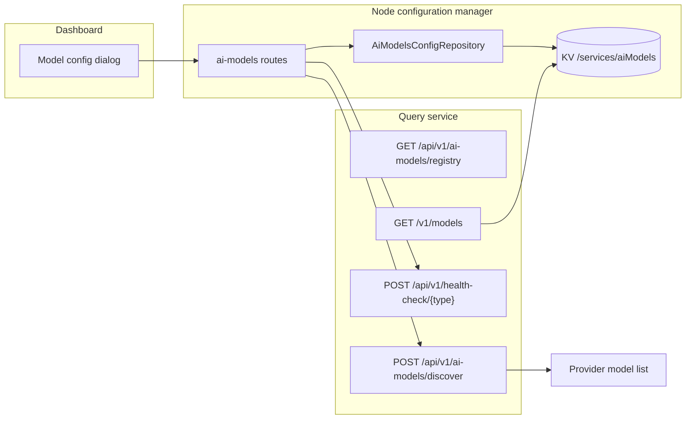
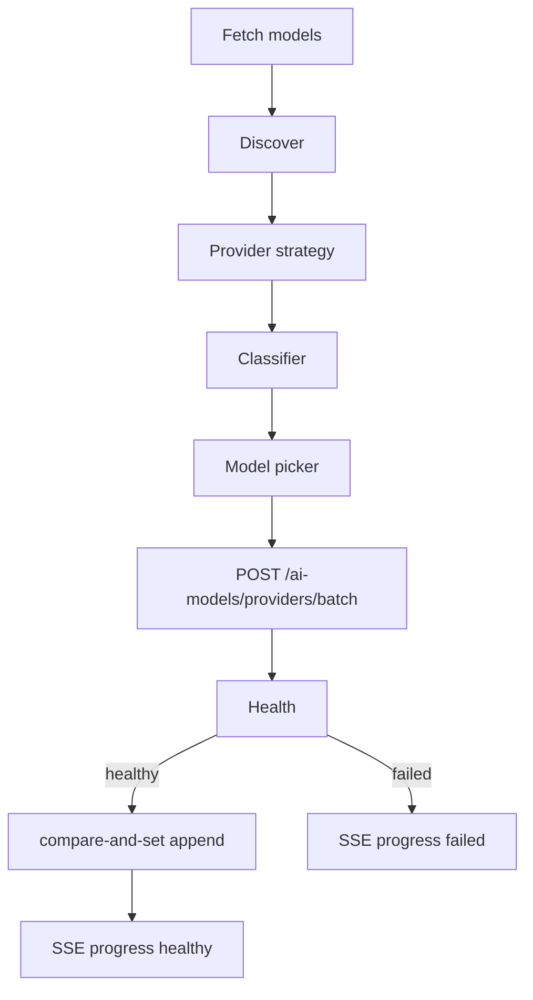
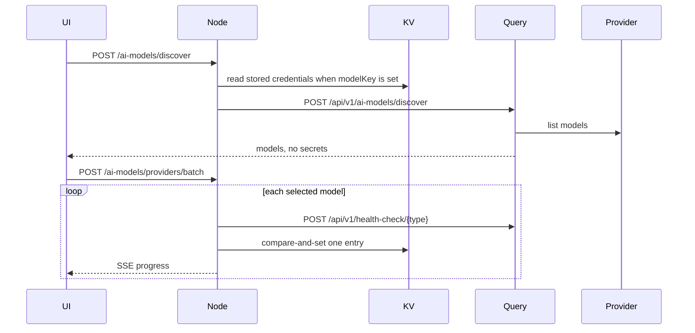

# AI models

How an organization configures chat, embedding, image, speech-to-text, and text-to-speech models, and how those models are discovered and listed.

## High level



The dashboard never stores provider credentials. Node keeps one encrypted document. Each saved model is its own entry. Models added together share a `connectionId` and a copy of the credentials, so rotating the key updates every model in that connection in one compare-and-set write.

## Low level



Discovery strategies call the provider's list endpoint (OpenAI-compatible servers use `GET {base}/v1/models`). The classifier keeps provider metadata, then the catalog, then id rules. Unknown models stay `other` and the picker hides them until "Show other types" is on.

Providers without a list endpoint (`discovery.mode: manual`) skip the Fetch button. The admin types a model in the form; typing a second id in "Custom model id" moves both into the selected list.

Once at least one model is selected, each row owns its friendly name, context length, Reasoning, and Multimodal. The form hides those fields so there is one place to set them. A row starts from what the provider reported, and falls back to the form values when the provider said nothing. With one model and no selected list, the form saves through the single-model path as before.

A batch save health-checks up to three models at a time. Healthy models are written one compare-and-set at a time. A failed model is not saved and stays selected. Saved models leave the list. Retry sends only the failed model with the `connectionId` from the first run, so it joins the same connection. The server rejects a `connectionId` that does not belong to a saved entry of the same provider. A shared `configuration.modelFriendlyName` is dropped; friendly names are per model. If the type had no models, the first one saved becomes default even when the chosen default failed. One configured event is published after the batch if anything was saved.

Legacy comma-separated `configuration.model` values stay readable. New saves write one model name per entry.

## Data flow



`GET /v1/models` and `GET /api/v1/models` on the query service, and the same paths on the Node app, list configured models in the OpenAI model-list shape. The payload has ids and a `task`. It does not include API keys or endpoints.

## Decision models

A decision model answers typed questions about an input with calibrated probabilities instead of generated text: yes/no (`predicate`), one option out of a set (`choice`), or a position on an ordered scale (`score`). They are stored in the `decision` bucket of `/services/aiModels`, like any other model type. Admins add one under **For Decisions** in Workspace → AI Models. Auto mode uses the default decision model as its classifier when one is saved. To add one through the configuration API instead (`$NODE_URL` is the Node app's address, for example `http://localhost:3000`):

```bash
curl -X POST "$NODE_URL/api/v1/configurationManager/ai-models/providers" \
  -H "Authorization: Bearer $TOKEN" -H "Content-Type: application/json" \
  -d '{"modelType": "decision", "provider": "openAI", "isDefault": true,
       "configuration": {"model": "gpt-6-luna", "apiKey": "sk-..."}}'
```

| Provider | Models | Endpoint |
| --- | --- | --- |
| OpenAI | `gpt-6-luna` | `POST {base}/decisions` (default base `https://api.openai.com/v1`) |
| Azure OpenAI (Microsoft Foundry) | a `Microsoft-Decision-1` deployment, addressed by deployment name | `POST {endpoint}/providers/microsoft/v1/systemone` (System One format), `api-key` header |
| TypeSafe | `jev-latest`, `jev-preview`, `jev-1.14.0`, `jev-1.13.0` | `POST {base}/v1/systemone` (default base `https://api.typesafe.ai`) |

Saving a model runs one yes/no question against it. Model discovery (`POST .../ai-models/discover` with `capability: "decision"`) lists TypeSafe's Jev models, `gpt-6-luna` on OpenAI, and `Microsoft-Decision-1` on Azure OpenAI, which is then no longer offered as a chat model. Code uses the default decision model through `get_decision_model_instance` (`app/utils/llm.py`), which returns `None` when none is configured:

```python
from app.services.ai_models.decision import ChoiceQuestion, DecisionOption
from app.utils.llm import get_decision_model_instance

built = await get_decision_model_instance(config_service)
if built:
    model, _config = built
    result = await model.decide("I was charged twice.", [
        ChoiceQuestion(name="team", instructions="Which team should handle this?", options=[
            DecisionOption(value="payments", description="Payments and refunds"),
            DecisionOption(value="technical", description="Problems using the product"),
        ]),
    ])
    answer = result.answers["team"]  # .choice, .probabilities, .confidence, .refused
```

All questions in one `decide` call share the input; a question that depends on an earlier answer needs a second call. An answer the provider declines comes back with `refused=True`; one the response does not contain comes back with `missing=True` (usually a wrong endpoint or format). Failures raise `DecisionModelError`. Rate limits and overload (429, 500, 502, 503, 504, 529) are retried up to twice, unless the provider asks to wait more than 5 seconds.

## Auto model mode

Chat's model menu offers **Auto** when a decision model is configured and two or more chat models are configured. It is not the starting model unless an admin turns on **Use Auto as the default for new chats** on the AI Models page. A person can still pick a model, and a choice they already made stays. A project chat keeps the concrete default model unless someone picked one. A request with `modelKey: "auto"` is resolved in the query service before the model is built (`backend/python/app/services/ai_models/auto/`):

1. The candidates are the configured chat models (an agent's own model list on agent routes). With one candidate the router is skipped.
2. Hard filters drop models that cannot take the turn: no vision for an image, no tool calling on agent routes, a known context window that is too small, or a hosted router such as `openrouter/auto`.
3. With no decision model saved, the turn uses the default model. Otherwise greetings and bare continuations ("ok", "go on") are decided without a model call. Anything else goes to one short classification call on the decision model. It answers `light`, `standard` or `heavy`, optionally with reasoning. The request reaches it inside `<request>` tags as data, and a chat classifier is asked for the least reasoning its model accepts. A decision model rates six options and the tier is the probability-weighted average; if it fails, the smallest configured chat model that does not always think (or the `autoRouter` model role, if set) takes over within the same time budget.
4. The need maps to a size (light to small, standard to medium, heavy to large). The smallest model at or above it wins; within a size, the default model first, then models that don't always think. A conversation never moves to a smaller model than its last Auto pick.
5. Effort is set only for models flagged Reasoning: low, medium or high, never max, at least medium on agent routes.

A classifier timeout, error or unusable answer falls back to the default model (the agent's first model on agent routes). The final answer carries `modelInfo` with `autoRouted: true` and `autoReason`; Node saves it on the message and keeps `modelKey: auto` on the conversation.

Each model's **size** (small, medium, large) and **thinking** (none, optional, always) resolve per field, first hit wins. Size: the value saved in its `configuration`, then the parameter count (from Ollama or the model id, so `deepseek-r1:7b` is small), the family rules in `discovery/data/model_traits.json`, the catalog price, and name keywords. Thinking: the saved value, then the family rules, provider facts and the catalog. An unknown size counts as medium. The admin can override both in the model form; "Auto-detect" leaves them to detection.

## Where to change it

| Concern | Location |
| --- | --- |
| Provider form fields | `backend/python/app/config/ai_models/providers/` |
| List-model strategies | `backend/python/app/services/ai_models/discovery/` |
| Runtime model construction | `backend/python/app/utils/aimodels.py` |
| Stored document and batch save | `backend/nodejs/apps/src/modules/configuration_manager/` |
| Picker and onboarding | `frontend/app/(main)/workspace/ai-models/` |
| Decision model clients | `backend/python/app/services/ai_models/decision/` |
| Auto model mode and model traits | `backend/python/app/services/ai_models/auto/`, `backend/python/app/services/ai_models/traits.py` |
