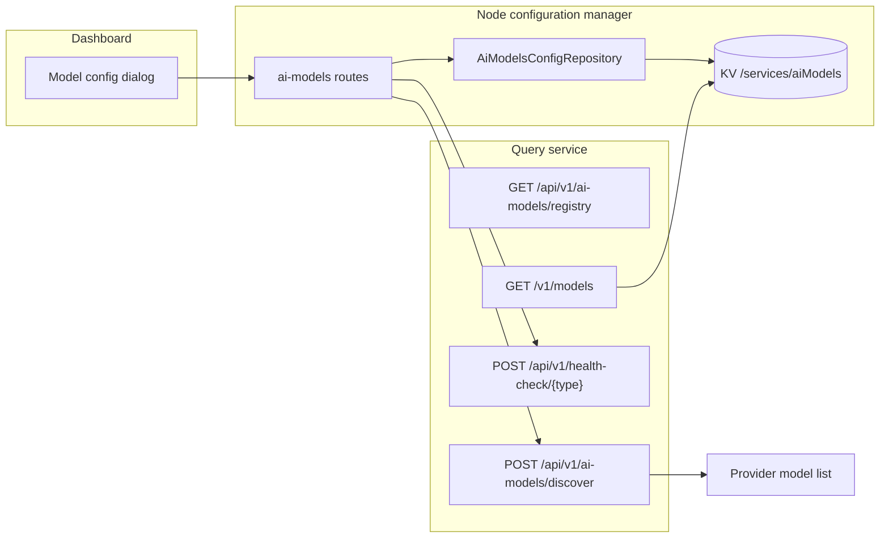
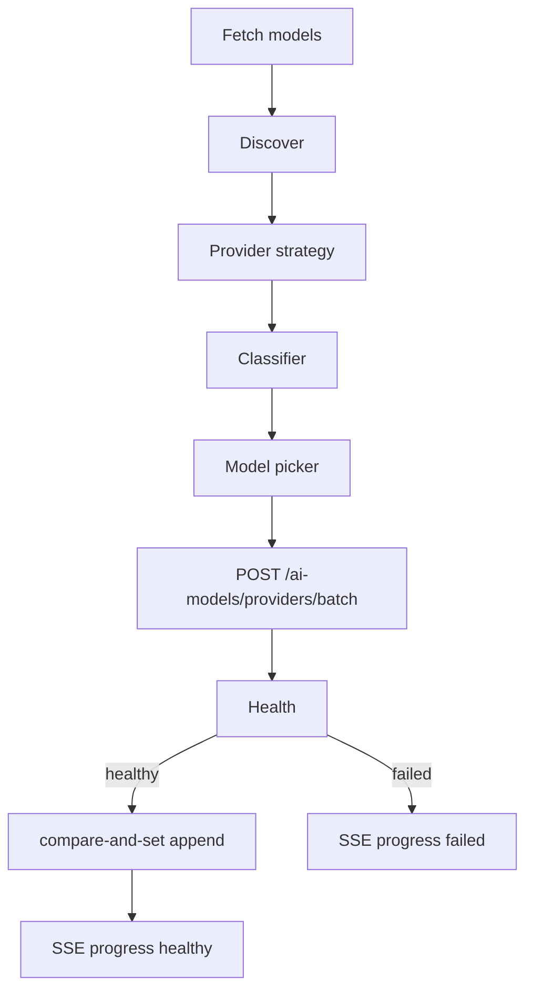
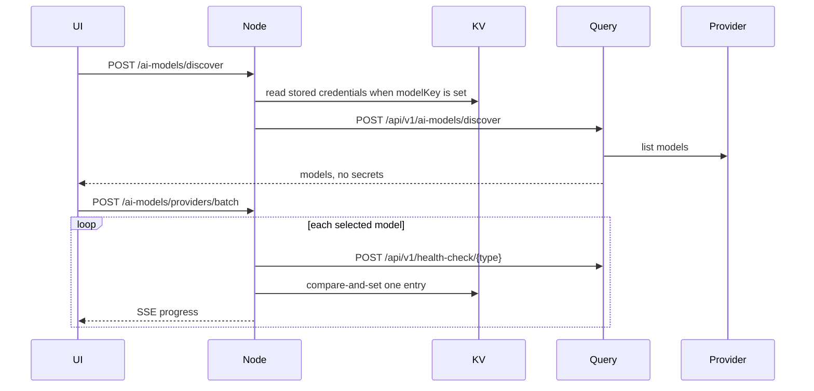

# AI models

How an organization configures chat, embedding, image, speech-to-text, and text-to-speech models, and how those models are discovered and listed.

## High level



The dashboard never stores provider credentials. Node keeps one encrypted document. Each saved model is its own entry. Models added together share a `connectionId` and a copy of the credentials, so rotating the key updates every model in that connection in one compare-and-set write.

## Low level



Discovery strategies call the provider's list endpoint (OpenAI-compatible servers use `GET {base}/v1/models`). The classifier keeps provider metadata, then the catalog, then id rules. Unknown models stay `other` and the picker hides them until "Show other types" is on.

Providers without a list endpoint (`discovery.mode: manual`) skip the Fetch button. The admin types a model in the form; typing a second id in "Custom model id" moves both into the selected list.

Once at least one model is selected, each row owns its friendly name, context length, Reasoning, and Multimodal. The form hides those fields so there is one place to set them. A row starts from what the provider reported, and falls back to the form values when the provider said nothing. With one model and no selected list, the form saves through the single-model path as before.

A batch save health-checks up to three models at a time. Healthy models are written one compare-and-set at a time. A failed model is not saved and stays selected. Saved models leave the list. Retry sends only the failed model with the `connectionId` from the first run, so it joins the same connection. The server rejects a `connectionId` that does not belong to a saved entry of the same provider. A shared `configuration.modelFriendlyName` is dropped; friendly names are per model. If the type had no models, the first one saved becomes default even when the chosen default failed. One configured event is published after the batch if anything was saved.

Legacy comma-separated `configuration.model` values stay readable. New saves write one model name per entry.

## Data flow



`GET /v1/models` and `GET /api/v1/models` on the query service, and the same paths on the Node app, list configured models in the OpenAI model-list shape. The payload has ids and a `task`. It does not include API keys or endpoints.

## Decision models

A decision model answers typed questions about an input with calibrated probabilities instead of generated text: yes/no (`predicate`), one option out of a set (`choice`), or a position on an ordered scale (`score`). They are stored in the `decision` bucket of `/services/aiModels`, like any other model type.

The **For Decisions** tab in Workspace → AI Models is hidden until a feature uses decision models (`'decision'` is commented out of `CAPABILITY_SECTION_ORDER` in `frontend/app/(main)/workspace/ai-models/types.ts`). Until then, add one through the configuration API (`$NODE_URL` is the Node app's address, for example `http://localhost:3000`):

```bash
curl -X POST "$NODE_URL/api/v1/configurationManager/ai-models/providers" \
  -H "Authorization: Bearer $TOKEN" -H "Content-Type: application/json" \
  -d '{"modelType": "decision", "provider": "openAI", "isDefault": true,
       "configuration": {"model": "gpt-6-luna", "apiKey": "sk-..."}}'
```

| Provider | Models | Endpoint |
| --- | --- | --- |
| OpenAI | `gpt-6-luna` | `POST {base}/decisions` (default base `https://api.openai.com/v1`) |
| Azure OpenAI (Microsoft Foundry) | a `Microsoft-Decision-1` deployment, addressed by deployment name | `POST {endpoint}/providers/microsoft/v1/systemone` (System One format), `api-key` header |
| TypeSafe | `jev-latest`, `jev-preview`, `jev-1.14.0`, `jev-1.13.0` | `POST {base}/v1/systemone` (default base `https://api.typesafe.ai`) |

Saving a model runs one yes/no question against it. Model discovery (`POST .../ai-models/discover` with `capability: "decision"`) lists TypeSafe's Jev models, `gpt-6-luna` on OpenAI, and `Microsoft-Decision-1` on Azure OpenAI, which is then no longer offered as a chat model. Code uses the default decision model through `get_decision_model_instance` (`app/utils/llm.py`), which returns `None` when none is configured:

```python
from app.services.ai_models.decision import ChoiceQuestion, DecisionOption
from app.utils.llm import get_decision_model_instance

built = await get_decision_model_instance(config_service)
if built:
    model, _config = built
    result = await model.decide("I was charged twice.", [
        ChoiceQuestion(name="team", instructions="Which team should handle this?", options=[
            DecisionOption(value="payments", description="Payments and refunds"),
            DecisionOption(value="technical", description="Problems using the product"),
        ]),
    ])
    answer = result.answers["team"]  # .choice, .probabilities, .confidence, .refused
```

All questions in one `decide` call share the input; a question that depends on an earlier answer needs a second call. An answer the provider declines comes back with `refused=True`; one the response does not contain comes back with `missing=True` (usually a wrong endpoint or format). Failures raise `DecisionModelError`. Rate limits and overload (429, 500, 502, 503, 504, 529) are retried up to twice, unless the provider asks to wait more than 5 seconds.

## Local embedding model memory

The bundled embedding server (`app/embedding_main.py`) holds a local model in memory only while something uses it.

- **Startup.** It reads the saved embedding settings and warms the default local model only when the default entry (else the first) uses a local provider (`default`, `huggingFace`, `sentenceTransformers`), or when no embedding model is saved. With a hosted provider, or when the settings cannot be read, it skips the warm-up and loads the model on the first request that needs it (the first request pays the load, a few seconds for the default model).
- **Idle unload.** A model unused for `EMBEDDING_SERVER_MODEL_IDLE_SECONDS` (default 900; `0` keeps it loaded) is dropped, then `gc` and `malloc_trim` hand the memory back. A request in flight keeps its model; the next request reloads it. `/health` reports `healthy` whenever the server is up; `loaded_models` lists what is resident.
- **One copy per model.** The cache is keyed by model name alone, so `trust_remote_code` never loads the same weights twice. Requests that set it are still refused with 403 unless `EMBEDDING_SERVER_ALLOW_REMOTE_CODE=true`.

## Query instruction (BGE, experimental, off by default)

Set `EMBEDDING_QUERY_INSTRUCTION=true` to enable; unset, queries are sent unchanged. Ranking evidence is mixed (dense gains, hybrid neutral, one slice regressed), so it stays opt-in. When on, BGE v1/v1.5 English embedding models (`bge-small|base|large[-en][-v1.5]`, local or hosted, by the configured model id) expect `Represent this sentence for searching relevant passages: ` in front of search *queries*. `app/utils/query_instruction.py` (`instruct_query`) adds it on the dense query embedding in chunk search (`retrieval_service.py`), entity search and the skill index. Passages and chunks are embedded as-is at index time, so stored vectors are unchanged, and the sparse (BM25) query is never prefixed. bge-m3 and the zh models are left alone, as is every non-BGE model. New query-embedding paths should call `instruct_query`.

## Where to change it

| Concern | Location |
| --- | --- |
| Provider form fields | `backend/python/app/config/ai_models/providers/` |
| List-model strategies | `backend/python/app/services/ai_models/discovery/` |
| Runtime model construction | `backend/python/app/utils/aimodels.py` |
| Stored document and batch save | `backend/nodejs/apps/src/modules/configuration_manager/` |
| Picker and onboarding | `frontend/app/(main)/workspace/ai-models/` |
| Decision model clients | `backend/python/app/services/ai_models/decision/` |
| Identity forwarded to an LLM gateway (user, groups, service identity) | `backend/python/app/services/model_identity/`; see [llm-gateway-identity.md](./llm-gateway-identity.md) |
