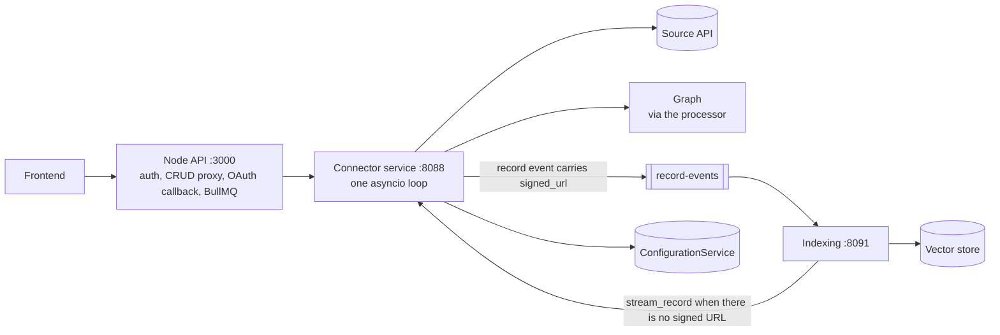
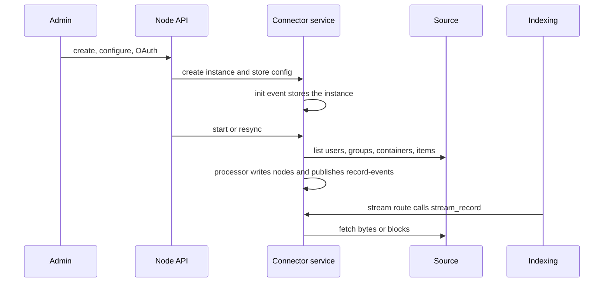
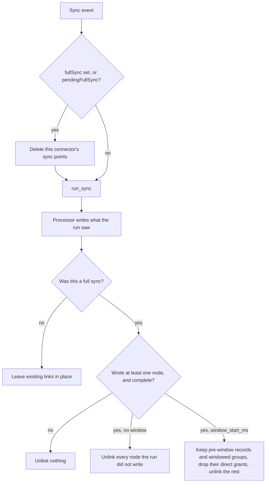
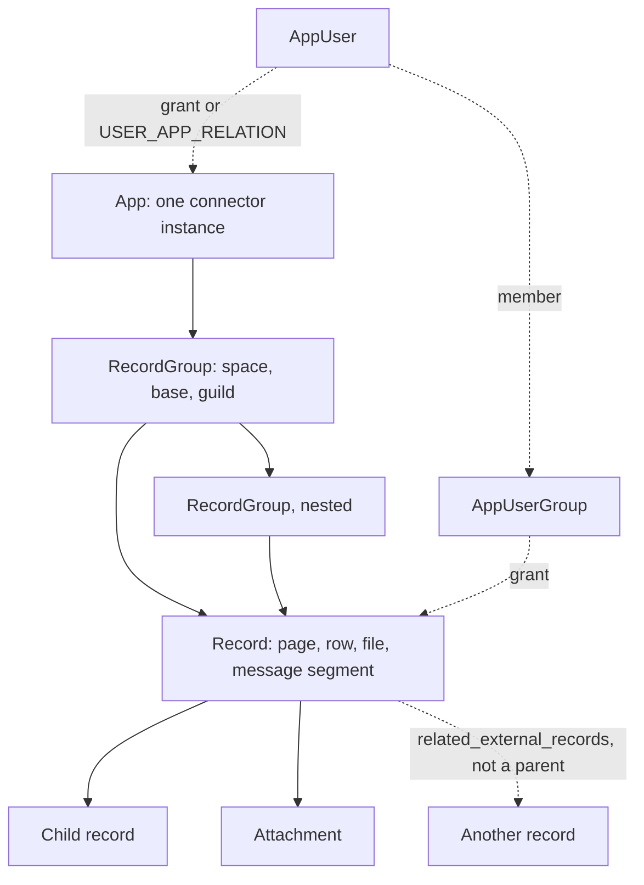
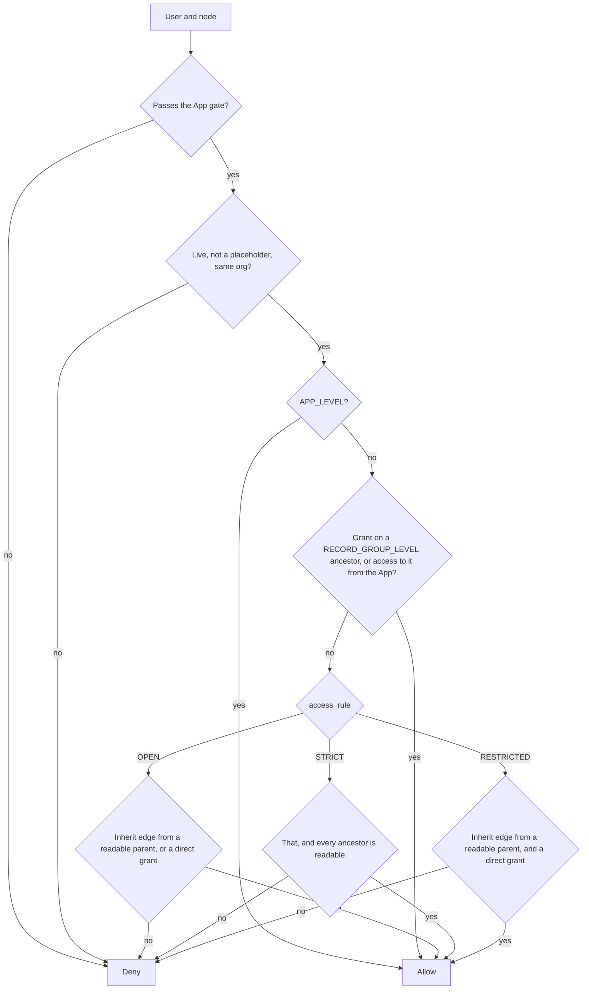

# Connectors: high-level design

A connector copies one external source (Jira, Google Drive, Slack, a database, a web site) into PipesHub so its content can be searched, cited in chat and used by agents, by exactly the people who can see it in the source.

A connector does three jobs:

1. **Mirror the structure.** Users, groups, containers (spaces, drives, projects, channels) and items (pages, files, issues, messages) become nodes in the graph, linked the way they nest in the source.
2. **Mirror access.** Who can read each node, as the source decides it. Search and chat answer only from nodes the asking user can read.
3. **Serve content.** When indexing needs an item's text, or a user opens a citation, the connector fetches the bytes or blocks from the source.

It does not parse, chunk, embed or answer questions. Those belong to the indexing and query services.

## Where a connector runs

The connector service's one loop also serves its HTTP API (registry, config, OAuth, filter options, stream), the sync-events and entity-events consumers, and token refresh. Indexing parses, chunks and embeds. The connector does not.

Facts that shape every design choice:

- **One process, one event loop.** The connector service runs its HTTP API, its broker consumers, token refresh and every connector's sync on a single asyncio loop. A blocking call (a synchronous SDK, `requests`, `time.sleep`, CPU-heavy parsing) inside an `async def` stalls all of them. Use async clients, or run the blocking call in the shared thread pool (`BaseConnector._thread_lease`).
- **Storage is pluggable.** The graph is Neo4j or ArangoDB, the vector store is Qdrant, OpenSearch or Redis, the broker is Kafka or Redis Streams, the config store is Redis or etcd. A connector never talks to any of them directly. It writes through `DataSourceEntitiesProcessor`, reads config through `ConfigurationService`, and keeps checkpoints in `SyncPoint`. The contract test fails a connector that imports a store client.
- **Many instances, many orgs.** A deployment can hold several instances of the same connector type, in several orgs. Every key, checkpoint and lookup is scoped by `connector_id` (and the org), never by connector type alone.

## Lifecycle of a connector instance

| Step | Trigger | What runs |
| --- | --- | --- |
| Register type | service start | `ConnectorFactory` registry (a fixed dict) and the `@ConnectorBuilder` metadata on each class. The UI reads this to list connector types and render their settings form. |
| Create | admin or user adds it in the UI | Node proxies to the connector service, which creates the App node and the config entry (`create_connector_instance` in `app/connectors/api/router.py`). Scope is team (org-wide, set up by an admin) or personal (one user's own account). |
| Configure and authenticate | settings form, OAuth | Config lands at `/services/connectors/{connector_id}/config`. OAuth runs through the connector service's authorize and callback routes; tokens are stored in the same config and refreshed by `TokenRefreshService`. |
| Initialise | `<connector>.init` event, or lazily on first use | `create_connector()` builds the instance and `init()` builds the API client from config. The init event stores that instance and does not call `test_connection_and_access()` (`event_service.py`). That call runs after `init()` only inside `_build_and_store_connector` (`router.py`), which toggle-enable, filter options, and a stream with no live instance use. The setup-form route `POST /api/v1/connectors/registry/{connector_type}/test-connection` calls `check_connection`. |
| Sync | `<connector>.start` / `.resync` event: enable, the Sync button, or the scheduler | `SyncTaskManager` starts `run_sync()` as a task. One sync per connector at a time; a new request while one runs is declined or deferred. |
| Index | `newRecord` / `updateRecord` on `record-events`, published by the processor | The indexing service fetches content (signed URL first, else the connector's internal stream route, which calls `stream_record()`), parses, chunks and embeds. |
| Open a citation | user clicks a result | The stream route checks the user's access, then calls `stream_record(record)`. |
| Reindex | `<connector>.reindex` | `reindex_records()` re-sends chosen records for indexing. |
| Disable or delete | UI | Sync stops; delete cascades the connector's nodes, vectors and config. |

### Full and incremental sync

The platform calls only `run_sync()`. Whether a run is full or incremental is the connector's decision, made from its checkpoints:

- A **full sync** (a sync event with `fullSync` set, or a full sync still owed after an earlier one failed) deletes the connector's sync points before calling `run_sync()`. With no checkpoint, the connector lists everything.
- Any other run is a normal run. The **first** run is normally one of these: it simply finds no checkpoint and lists everything, but the full-sync cleanup below does not run after it.
- An **incremental sync** finds its checkpoints and lists only what changed since.

During a full sync, the processor notes every node the connector writes. When the run finishes, and only if the run wrote at least one node and `full_sync_coverage()` reports it complete, the platform removes the links of every node the run did not write. That is how deletions and revoked access are cleaned up for sources that cannot report them. It has these consequences:

- In a full sync, write every node you can see, changed or not. A node you skip because it looks unchanged loses its links. To keep a stored node without re-writing it, note it with the processor's `note_kept_records` (Jira Cloud does this).
- If you skip part of the source after an error, return `FullSyncCoverage(complete=False)`. Nothing is unlinked after that run, so the skipped part is not treated as deleted, and deletions elsewhere wait for the next complete full sync.
- If the sync reads only a date window by design (a "sync from" filter), return `FullSyncCoverage(window_start_ms=...)` and leave `complete` true, adding `windowed_group_types` for group types read only inside the window (a Slack thread). Only these unseen nodes are kept: records created before the window, groups of a type in `windowed_group_types` created before it, and every record in such a group (even one created inside the window). A node with no usable creation time counts as inside the window. Kept nodes keep their hierarchy and inheritance but lose their direct grants, since the run could not check who may see them: an `OPEN` or `STRICT` node that inherits stays readable through its parent, while a `RESTRICTED` node, or one that lived only on its own grants, is hidden until a sync re-reads it. Every other unseen node is fully unlinked: records and windowed groups created inside the window, record groups of any other type (whatever their creation time), user groups and roles. Do not use `complete=False` for a window: deletions would then never be cleaned up.

`run_incremental_sync()` and `handle_webhook_notification()` are abstract methods you must implement, but nothing in the platform calls them today. Do not rely on webhooks for freshness; scheduled sync is the supported path.

A scheduled run is not a full sync. BullMQ publishes a resync with no `fullSync` field (`constructSyncConnectorEvent` in `backend/nodejs/apps/src/modules/crawling_manager/utils/utils.ts`), so `run_sync` starts with the checkpoints still in place and the cleanup below does not run. The connector service treats a missing flag as false (`event_service.py`) and deletes checkpoints only when the event sets `fullSync` or the connector still has `pendingFullSync` (a filter change, an enable that asked for one, or a full sync that was cut short). A deletion the source never reports stays until one of those happens. A source with no delete feed may instead id-diff after a complete listing (`03-decisions.md`). A 404 deletes the one item that was requested, not whatever a failed listing failed to return.

`complete=false` is an error skip. Never use it for a date window: deletions would then never be cleaned up.

## The data model, in one picture

A `related_external_records` link is not hierarchy and does not grant access. `06-permissions.md` is the access check. In short: the user must pass the App gate and the node must be live. `OPEN` is an inherit edge from a readable parent, or a direct grant. `STRICT` is that, and every ancestor is readable. `RESTRICTED` is an inherit edge from a readable parent and a direct grant. A parent being readable does not open a child that does not inherit, and a `RESTRICTED` node with `inherit_permissions=False` is never readable. `APP_LEVEL` opens every record under the App to anyone who passes the gate. A `RECORD_GROUP_LEVEL` group opens the groups and records under it only for someone with a direct grant on that group, or access to it from the App.

- Records are matched across syncs by `(connector_id, external_record_id)`. The external id must be stable for the life of the item in the source.
- The processor keeps each write inside its own org and connector. A record is always stored under the processor's org, whatever `org_id` the connector set. A new record whose `id` is already another connector's or another org's record is skipped and logged, a `virtual_record_id` set on a brand-new record is dropped (its vectors are its own), and `on_record_deleted` refuses a record of another org.
- A record changes when its `external_revision_id` changes; only then is it re-sent for indexing.
- Records and record groups link to their parent by external id (`parent_external_record_id`, `external_record_group_id`, `parent_external_group_id`). The processor turns those into graph edges, creating a restricted placeholder for a parent it has not seen yet.
- Access is decided by one check over this hierarchy: a direct grant, or an inherit edge from a readable parent, subject to the node's access rule. A readable parent does not open a child that does not inherit. `06-permissions.md` is the full model.

`02-low-level-design.md` has the class-level reference for every piece named here.
