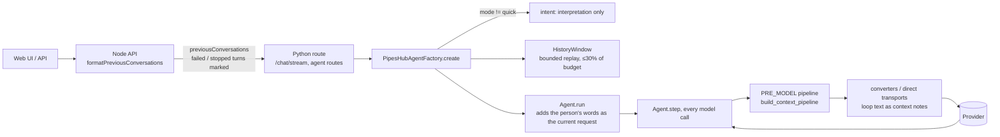

# Context engineering: what the agent loop sends the model

This is the working reference for how a chat turn becomes the message list each model call receives. It covers history replay, the current request, the per-call shaping pipeline, protection and the final guard.

Read it before changing anything in:
- `app/agent_loop_lib/context/`
- `app/agent_loop_lib/hooks/middleware/builtin/` (the context layers)
- `app/agents/agent_loop/history_window.py`
- `_seed_conversation_history` in `app/agents/agent_loop/factory.py`
- `app/agents/agent_loop/converters.py` and the transports in `app/agent_loop_lib/transport/`
- `app/agents/agent_loop/intent.py` and `prompt_builder.py`

Section 3 is the contract every change must keep; the tests in §7 enforce it.

---

## 1. High-level design

Stored run history (`ContextManager`) is never changed by shaping. Each model call shapes a copy from scratch. The run's compaction memo makes that copy identical to the one before wherever nothing new had to be compacted.

## 2. The per-call pipeline

`app/agent_loop_lib/context/pipeline.py::build_context_pipeline(profile)` is the only place the layers are ordered. The chat factory (`_chat_context_profile`) and `ControlPlane` (`context_profile_from_config`) both call it, so the tests run exactly what production runs.

| Layer | Fires when | Does |
|---|---|---|
| image injectors | current-turn attachments | put images on a **copy of the current request** |
| L1 `budget_reduction` | always | cap each tool result (`fetch_record` has its own cap) |
| L2 `artifact_compaction` | above trigger(.5) | old artifacts become references |
| L3 `tool_result_clearing` | above trigger(.5) | tool results older than 3 turns become references |
| L4 `loop_compaction` | above trigger(.6) | each run of unprotected messages becomes one deterministic summary |
| L6 `deterministic_compact` | above trigger(.85) | extractive shortening of unprotected messages |
| L7 `auto_compact` (chat: two tail ratios) | above trigger(.85) | LLM summary per run of unprotected messages |
| L5 `sliding_window` | above budget | evict unprotected groups oldest-first down to the low-water mark; protected tool groups last (WARNING) |
| L8 `synthesis_guard` | above budget | last-resort clearing; past the window raises `ContextBudgetExceeded` |
| L9 `context_invariants` | always | pairing repair, current-request check, window check |

How the budget and triggers are computed:
- `B = window − system prompt − tool schemas − reply reserve`.
- `trigger(r) = max(B·r, B − (1−r)·120K)`: the ratio up to the tuned 120K budget, then the same headroom (`ContextBudget.trigger_tokens`).
- `hard_limit_tokens = B + reply reserve`. Between `B` and the hard limit the request is sent with a warning; past it the call stops.

Three things keep the context stable from call to call:
- **The run's memo** (`context/compaction_memo.py`). It lives in `RunScope`, is never written to history and is not inherited by sub-agents. Each layer replays its earlier compactions from it on every call, over its trigger or not, so a prefix that was sent is sent the same way again. The sliding window records its evictions there too, so an evicted group stays evicted. A layer never rewrites a message another layer already compacted in that exact form, or that layer's replay would stop matching. The LLM summariser runs at most once per new run of messages.
- **Batches with a low-water mark** (`context/watermark.py`). Each layer has a low-water mark `LOW_WATER_FRACTION = 0.3` of the budget below its trigger. Over the trigger, a layer compacts only when that frees at least the band between the two; a smaller pass waits until enough has aged past its floor (keep-last-N, the tail, protected messages). A pass that runs compacts everything its floor allows, which reaches the mark whenever the floor permits. The sliding window evicts down to `B − 0.3·B` in one pass. Without this, at 8K–32K windows the turns a layer keeps already sat over its trigger, so every call compacted the one result that had just aged out and rewrote the request near its end.
- **Compaction markers.** Layers mark what they wrote with `compacted_by`, not with text sentinels.

Effect on 30 consecutive calls of one run on the production chain (`tests/unit/agents/agent_loop/test_context_pipeline_scenarios.py::test_compaction_comes_in_batches_so_most_calls_only_append`):

| Scenario | Prefix breaks before → after | Mean cached-prefix share before → after |
|---|---|---|
| 8K, 2K-char search results | 28 → 9 of 29 | 0.33 → 0.65 |
| 8K, 4K-char search results (a result is a quarter of the budget) | 29 → 15 | 0.31 → 0.38 |
| 32K, 8K-char search results | 27 → 9 | 0.27 → 0.59 |
| 200K, 60K-char `fetch_record` (protected; the window evicts) | 21 → 5 | 0.22 → 0.71 |
| 200K, 40K-char search results | 3 → 3 | 0.75 → 0.75 |

At 8K with 4K-char results the summariser ran 26 times before and 16 after.

## 3. The contract

| | Rule |
|---|---|
| I1 | The **current request**, meaning the person's own words for this turn, reaches every model call verbatim as the last human message. It is also anchored in the system prompt's per-turn band ("Current request (verbatim)"). |
| I2 | Earlier turns are history. Text the loop adds (summaries, nudges, plans, relocated images) is `UserMessage(injected=True)`. Every transport sends it wrapped as `<context_note source="agent">…</context_note>`, and the system prompt says those notes come from the runtime. |
| I3 | Every tool result follows the call that asked for it. |
| I4 | Shapers and injectors never modify stored messages (copy-on-write). |
| I5 | Shaping is deterministic, and a sent prefix stays stable unless budget pressure forces a change; that change comes in batches (§2). |
| I6 | A request fits the window, or the call stops with `ContextBudgetExceeded`. `Agent.step` ends the run without a model call, and the user sees `request_too_large` ("This conversation is too long…"). |
| I7 | Protected content is never summarised or shortened. That covers the current request, `pinned` messages, system messages, and tool groups of the profile's `protected_tools` (`fetch_record`, web search/fetch, plans). Citations resolve only to content shown in the current request. |
| I8 | Replayed history is bounded and faithful: failed and stopped turns are marked, and attachments are budgeted. |
| I9 | Every layer that acts logs one INFO line: layer, action, tokens before→after, low-water mark, run_id, turn, budget. Repairs log at ERROR (`context_invariant_repaired`). Logs never carry content. |

**Protection** (`context/protection.py`) goes by role, not position.
- The current request is the last user message the loop did not inject.
- History is seeded oldest-first ahead of it. Protecting "the first message" therefore protected the conversation's *first* question, and let the current one be summarised away (the 2026-10 multi-turn drift incident, §8).
- `compactable_runs` splits the list around protected messages, and layers compact each run in place.

## 4. One turn, end to end

1. **Node** (`formatPreviousConversations`) sends the saved rows. A failed turn becomes `{role: bot_response, content: "", status: failed}`, and a stopped answer carries `status: stopped`.
2. **Factory.**
   - In non-`quick` modes the intent step produces an **interpretation**. It goes into the system prompt as "How the request was interpreted" and never replaces the person's words.
   - The goal carries `user_message` (verbatim), `interpretation` and `attachment_text`.
3. **HistoryWindow** (`agents/agent_loop/history_window.py`).
   - Replays at most `HISTORY_SHARE = 0.30` of the message budget.
   - The newest exchanges stay whole; older ones are reduced to the question, the opening of the answer and the tools used. The rest are dropped behind one note.
   - Placeholders close failed, stopped or unanswered turns, so two human turns are never adjacent.
   - Earlier attachments render within half the history share; cut records name `knowledgegraph__fetch_record`.
4. **Current-turn attachments** render within `CURRENT_ATTACHMENT_SHARE = 0.40` of the budget, minus the person's words. Their images go through the request's `ImageAdmission` and are tagged `user_attached`, so the transport image cap keeps them before fetched figures.
5. **`Agent.run`** adds `goal.request_text()` as the current `UserMessage`.
6. **Every call:** shape (§2), then the transports render injected messages as context notes. Providers that reject images in tool results get them relocated into one injected user message (`transport/tool_images.py`).
7. **Sub-agents** receive the parent's verbatim current request ahead of their task. They get their own memo and no parent image injection.

## 5. Citations across turns

`refN` ids are numbered per request. Anything replayed has its `refN`/`refN.xyz` rewritten to the URL it stood for, or to `earlier-turn source` when unknown (`utils/citations.py::rewrite_request_refs`). That covers tool-result previews, transcript parts and durable artifacts. A copied ref therefore never resolves to a different record in a later turn.

`retrieve_artifact_content(offset, limit)` pages large artifacts. A page is sized so L1 never cuts it, and the footer says which characters are shown.

## 6. Observability

| Log | Level | Meaning |
|---|---|---|
| `<layer>: …, a→b tokens (low_water=, run=, turn=, budget=)` | INFO | a layer acted (or replayed earlier compactions) |
| `history_seeded …` | INFO | turns whole/reduced/omitted, placeholders, attachment chars |
| `attachment_truncated …` | WARNING | an attachment was cut to its budget |
| protected group evicted | WARNING | protected content alone exceeded the window |
| `context_invariant_repaired` | ERROR | a layer lost the current request (a bug; the guard restored it) |
| `context_budget_exceeded` | ERROR | the request cannot fit the window; the run ends |

## 7. Tests that guard this

| Level | Where |
|---|---|
| Per-layer contract | `tests/unit/agent_loop_lib/hooks/middleware/builtin/test_protected_messages.py`, `test_context_invariants.py` |
| Policy | `tests/unit/agent_loop_lib/context/test_protection.py`, `test_compaction_memo.py` |
| Production chain scenarios and properties | `tests/unit/agents/agent_loop/test_context_pipeline_scenarios.py` (customer case across fetch sizes, small windows, pinned plans, images, prefix stability, summariser cost) |
| History | `test_history_window.py`, `test_bounded_history.py`, `test_attachment_images.py`, `test_history_seeding.py` |
| Wire format | `tests/unit/agents/agent_loop/transports/test_provider_payloads.py` (every provider) |
| Route end-to-end (scripted model) | `tests/integration/test_multi_turn_context_e2e.py` |
| Live | `integration-tests/ai_agents/integration_test_multi_turn_context_live.py` (24K window, long manuals, Agent Builder and universal assistant) |

A change to a layer must keep `test_protected_messages.py` and the scenario properties green. A new layer must be added in `build_context_pipeline` and in `OPTIONAL_LAYERS`, not wired by hand.

## 8. History

2026-10: a customer on 0.11.0 saw long multi-turn tool loops switch to the chat's first question.

- **Root cause:** every compaction layer kept `messages[0]`, which in a chat is the first question.
- **Present since** the agent loop's introduction.
- **The fix:**
  - protection by role, with the guard (P0);
  - honest wire roles and the verbatim request (P1);
  - one stable pipeline (P2);
  - citation and artifact correctness (P3a);
  - bounded history and attachments (P3b).

### Finding ids

Tests and comments cite these ids. Case labels next to them (`E2E-03`, `TP-05`, `HG-04`, …) name the test cases in the files that carry them.

| Id | Finding | Fixed in |
|---|---|---|
| CE-01 | Compaction protected `messages[0]`, the chat's first question, instead of the current request | P0 |
| CE-02 | The sliding window evicted before extractive compaction could make the request fit | P0 |
| CE-03 | An over-budget request was sent instead of failing | P0 |
| CE-04 | Current-turn images were attached to the first user message, and shaping changed stored history | P0 |
| CE-05 | Text the loop adds reached providers as plain user turns | P1 |
| CE-06 | Failed turns were dropped from history and stopped turns carried no marker | P1 |
| CE-07 | Outside `quick` mode the intent briefing replaced the person's words | P1 |
| CE-08 | The current request had no second anchor in the system prompt | P1 |
| CE-09 | Attachments and history were replayed with no size budget | P3b |
| CE-10 | Attachments skipped image admission, and the transport cap dropped the user's own image first | P3b |
| CE-11 | Direct transports crashed on a tool result with an image | P1 |
| CE-12 | Compaction changed the sent prefix from call to call and re-ran the summariser | P2 |
| CE-13 | Pinned messages and protected tools were honoured by only some layers | P2 |
| CE-14 | The follow-up heuristic matched substrings and pulled short questions back to old topics | P1 |
| CE-15 | Per-request `refN` ids survived in replayed text and resolved to other records | P3a |
| CE-16 | Sub-agents got a paraphrase of the request and shared the root's image stash | P2 |
| CE-17 | Retrieved images were delivered twice on non-multipart providers | P2 |
| CE-18 | `retrieve_artifact_content` could not page and was cut in the middle | P3a |
| CE-19 | Client-supplied `previousConversations` was accepted on create | #4560 |
| CE-20 | Direct transports split parallel tool results | #4561 |
| CE-21 | Reasoning is not replayed between steps of a run | open (measured on FRAMES first) |
| CE-22 | The token estimator ignored step footers and thinking | P2 |
| CE-23 | The factory and `ControlPlane` wired the layers differently | P2 |
| CE-24 | Smaller items: an unused `pin_first_n`, live and replayed tool-call ids colliding, dependency results read from the first user message | P2, P3a |
