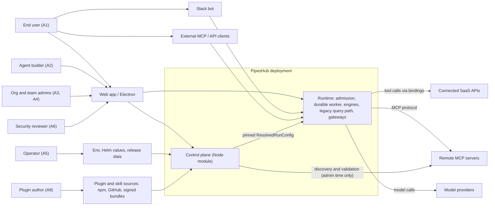
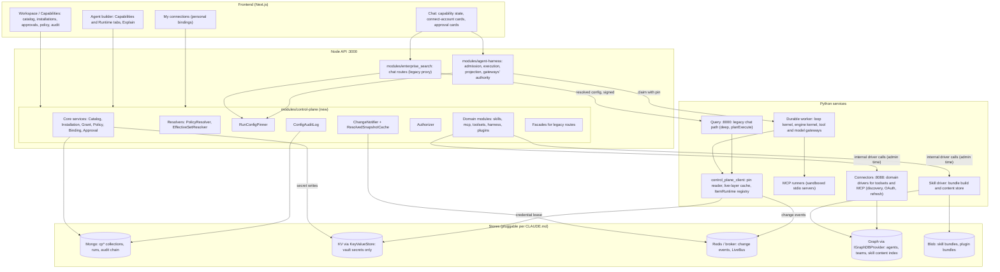
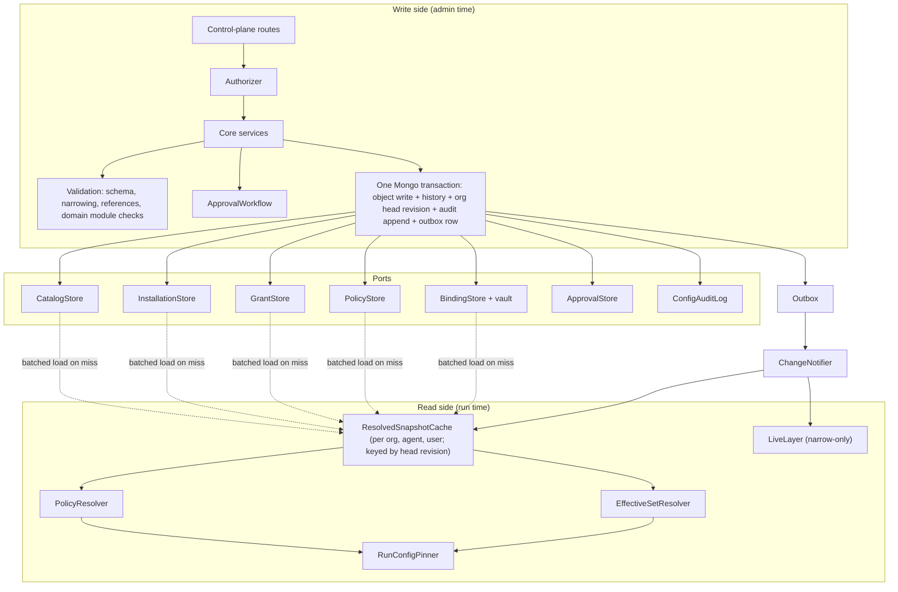
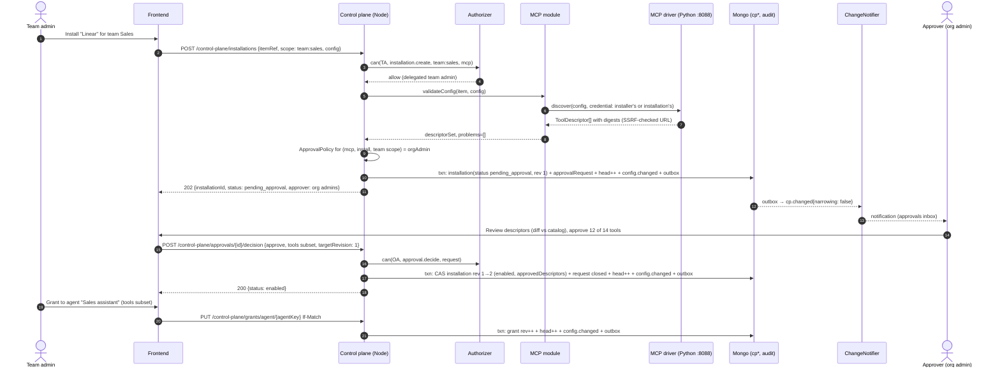
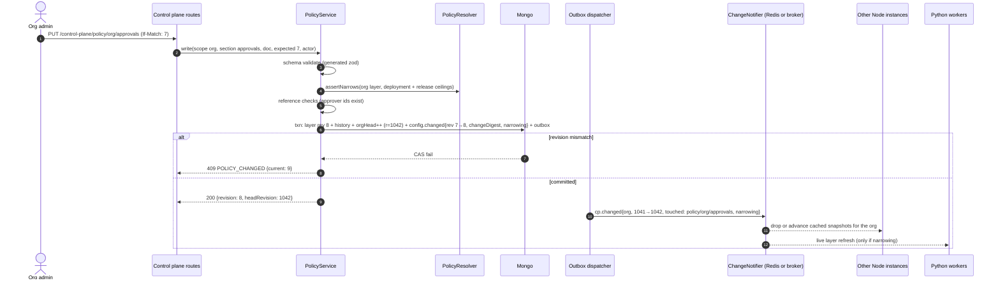
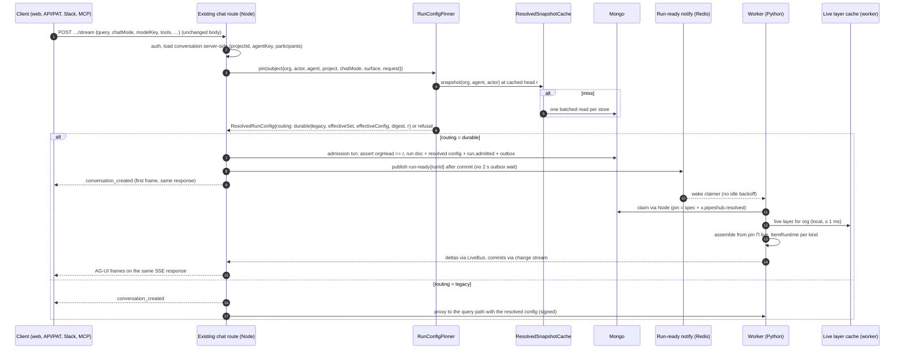
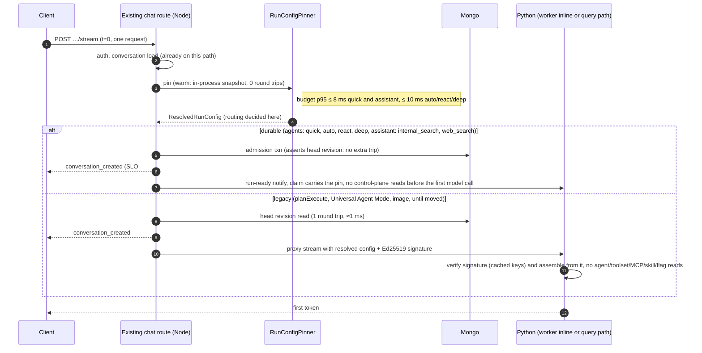
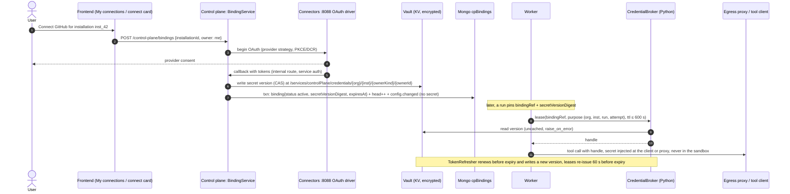
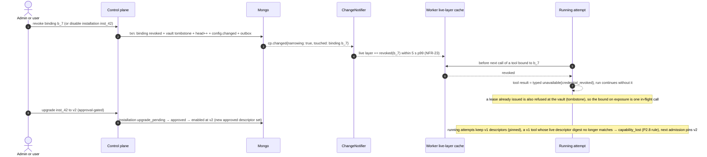
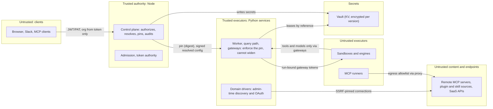

# Control plane: high-level design

**Status:** design proposal. **Date:** 2026-10-09. Requirements: [00-requirements.md](00-requirements.md).
Prefixes (`H/`, `N/`, `PY/`, `FE/`, `C/`, `CP/`) as defined there.

---

## 1. Summary of the design

One control plane, owned by a new Node module `N/modules/control-plane/`, governs five domains
(skills, MCP servers, toolsets, harness options and engines, plugins). It has a **domain-neutral core**
and **domain modules** that plug into it through one extension point.

The core holds ten concepts, each with one store or service:

| # | Concept | What it is | Replaces (R2 §1.3) |
|---|---|---|---|
| 1 | **Catalog item** | An immutable, digest-addressed description of something that can be installed: kind, publisher, name, version, descriptors (tools, files, options), configuration schema, credential requirements, risk class, provenance | `ToolsetRegistry`, `MCPRegistry` templates, `GraphSkillStore` skill records as catalog, engine `allowlist.json`, unused `PluginRegistry` |
| 2 | **Installation** | A catalog item enabled in one org at an owner scope (org, team, user), with validated configuration, a pinned item version, an approved descriptor set, a status and a revision | Toolset instances in one KV list, MCP instance keys, skills copied per org, the per-org engine ceiling entry |
| 3 | **Grant** | Subject (org, team, agent, user) → installation, optionally narrowed to a subset of its tools | Agent graph edges `agentHas{Toolset,McpServer,Skill}` and three parsers in `PY/app/api/routes/agent.py` |
| 4 | **Visibility** | Who can see and pick an installation (owner, team, org); separate from grant | Five skill visibility checks; none for MCP; org-wide for toolsets |
| 5 | **Policy layer** | A partial document of harness and catalog dimensions at one scope; each dimension is a ceiling (narrow-only) or a choice | Five `Config*Settings` classes, Labs harness flags, env-only worker features (R2 §2) |
| 6 | **Credential binding** | Installation × owner (org, agent, user) → secret handle in the vault, with status, expiry and refresh strategy | `/services/toolsets/{id}/{owner}`, `/services/mcp/credentials/{id}/{owner}`, model-account vault paths, three refresh services |
| 7 | **Approval** | A configuration-time request (install, upgrade, descriptor change, scope widening, plugin install, skill publish) decided by an approver resolved from an approval policy, with history | MCP manifest approval, skill candidate approval, engine-agent admin gate. Per-call runtime approvals stay in the harness (P2.6c) but share the approver model |
| 8 | **Resolution** | `PolicyResolver` (dimensions) + `EffectiveSetResolver` (items) → `ResolvedRunConfig` with provenance and digest | About eight resolvers (R2 §1.4) |
| 9 | **Pin** | `RunConfigPinner` stores the resolved config on the run at admission; claim copies it into the pinned spec; the runtime reads only the pin plus a narrow-only live layer | Pins that do not bind approved descriptors (R2 F4); live reads (F2) |
| 10 | **Audit and change notification** | `ConfigAuditLog` appends `config.changed` to the per-org chain in the write's transaction; `ChangeNotifier` publishes the org's new head revision so caches and running work update | Log lines only (F1); per-process MCP caches; no cross-service invalidation |

The rest of this document shows how those parts fit: context (§2), containers (§3), where it lives
(§4), the core (§5), domain modules (§6), data flows (§7) and trust boundaries (§8).

---

## 2. System context

---

## 3. Containers

Notes:

- `control_plane_client` is a small Python package (`PY/app/control_plane/`) with no store access other
  than the vault read through `ConfigurationService` for credential leases and a subscription to change
  events. It never writes control-plane state.
- Domain drivers are the Python code that already knows the domain (toolset classes, MCP clients,
  skill bundle builder). The control plane calls them only at admin time (install, upgrade, discovery,
  validation) and for the explain view, never on the chat hot path.

---

## 4. Where it lives: Node owns the control plane, Python consumes it

### 4.1 First principles

A control plane decides *who may do what*, records *who changed what*, and hands the runtime a
*decision it can trust*. Placing it follows from where the inputs to those decisions already live and
where the decision is consumed:

| Need | Where it is today | Consequence |
|---|---|---|
| Identity, org, roles, scopes, PATs, OAuth | Node (`N/modules/auth`, `user_management`, `requireScopes`, `userAdminCheck`) | Authorizing a write in Python means trusting a forwarded JWT and re-implementing role checks (R2: four admin checks) |
| Transactional writes with a tamper-evident audit | Node (`AuditChainStore`, Mongo transactions on a replica set, `H/domain/audit.ts`) | Audit in the same transaction as the write is only cheap where the chain lives |
| Admission and pinning | Node (`RunAdmissionService`, `ExecutionService.claim`) | Resolution must be in-process with admission to meet NFR-1 |
| The admin HTTP surface | Node is the gateway for every route; the domain routes are proxies to Python (`N/modules/{skills,mcp_servers,toolsets}`) | A Node-owned plane removes one hop from admin calls instead of adding one |
| Domain mechanics: tool code, MCP clients and runners, skill content, graph | Python | These stay in Python as drivers and runtime adapters |
| The runtime that enforces | Python worker, gateways, query path; Node for admission | The runtime consumes a pin; it does not need the plane's stores |

### 4.2 Decision

**Node owns control-plane state, authorization, resolution, pinning, audit and change notification.
Python owns domain mechanics (drivers, called at admin time) and enforcement (runtime adapters that read
the pin).** Python never writes control-plane state and never reads control-plane stores on the hot
path.

### 4.3 Alternatives considered

| Alternative | Why not |
|---|---|
| **Python owns the control plane** (the domain routes already live there) | Admission is in Node, so every admission would add a Node → Python round trip (today's `run-definition` call already costs one; NFR-1 wants it gone). The audit chain and roles live in Node; Python would need a second chain or a cross-service transaction. |
| **A new control-plane service** (own process) | New process role, Helm chart and footprint (SLO #15 already over budget for the worker). No capability a Node module lacks. Can be split out later behind the same ports if load demands. |
| **Keep per-domain planes and add a facade** | Leaves the duplication (R2 §1.3) and the security gaps (F3, F4) structurally possible; plugins would be a sixth copy. |
| **Python resolves, Node pins** | Splits one decision across two processes and two caches; drift between them is exactly R2 F9. |

### 4.4 Consequences

- The agent definition stays in the graph (prompt, models, knowledge) and Python keeps its CRUD. The
  agent's **capability grants** (toolsets, MCP servers, skills) and **runtime policy layer** move to the
  control plane, keyed by `agentKey`. During migration the graph edges are dual-written and read through
  an adapter (see [05-migration-plan.md](05-migration-plan.md) CPD-7).
- Teams live in the graph (Node `teams.controller.ts` proxies to `connectorBackend /api/v1/entity/team`).
  The resolver reads team membership through a `MembershipPort` with a cached adapter (LLD §8.5).
- The legacy query path receives the resolved config inline from Node, signed, instead of re-reading
  agent, toolset, MCP and skill configuration per request (NFR-3).

---

## 5. The shared core

### 5.1 Catalog

- One `CatalogStore` for all kinds. Items with provenance `builtin` and `release` are shared across orgs
  (org id `null`), generated at build time from code and release data:
  - toolsets: a build step dumps `ToolsetRegistry` descriptors (`PY/app/agents/registry/toolset_registry.py`)
    to `CP/catalog/toolsets.json`;
  - MCP templates: the 28 `@mcp_server` templates (`PY/app/agents/mcp/registry.py`) to `CP/catalog/mcp.json`;
  - built-in skill packs (`PY/app/agents/agent_loop/skills/builtin_seeder.py`) to `CP/catalog/skills.json`
    with their bundle digests;
  - engines from `harness_engines/allowlist.json`.
- Items with provenance `imported`, `org` and `user` are org-scoped rows created by import (npm, GitHub,
  openagentskill.com, URL), by authoring (skill editor) or by plugin expansion.
- Versions are immutable. An item version's `descriptorSetDigest` is the RFC 8785 + SHA-256 digest over
  its canonical descriptors (one scheme for every kind, replacing the three MCP digests and two skill
  digests, R2 §1.3).

### 5.2 Installation and instances

- An installation pins an item version and holds validated configuration, an owner scope, an
  **approved descriptor set** (the descriptors an approver accepted, with digests) and a status:
  `draft → pending_approval → enabled ⇄ disabled → removed`, plus `upgrade_pending` when a newer
  version waits for approval while the old one keeps serving.
- MCP servers and toolsets may have several installations of the same item (P2.2 instance tool ids:
  `{toolset}@{instanceId}/{tool}`, `mcp@{instanceId}/{tool}`). The tool id format is unchanged.

### 5.3 Grant and visibility

- **Visibility** answers "can this person see and pick it": `owner` (user-scope installs), `team:<id>`,
  `org`. It is a property of the installation.
- **Grant** answers "may a run of this subject use it": subject (`org`, `team`, `agent`, `user`) →
  installation → tool subset (null = all approved tools). Grants are a ceiling dimension
  (`tools.grant`, order `subset`) so they compose with the policy engine rather than beside it.
- A run's usable set is `grant(agent) ∩ visible(actor) ∩ ceilings`, never the union (ARCHITECTURE §4.9:
  "each root run acts as its sender ∩ the agent's grant").

### 5.4 Policy: ceilings and choices

The R2 Part 2 model, unchanged in substance and generalised to catalog dimensions:

- release → deployment → org → team → agent → user → trigger | parent → request → live;
- ceilings narrow monotonically (meet in a per-dimension order); choices are nearest-wins inside the
  applicable ceiling; operator-only dimensions are never exposed below the deployment layer;
- dimension rows are data (`C/core/policy/policy-dimensions.json` for harness-generic rows,
  `CP/policy/dimensions.json` for catalog rows contributed by domain modules); one generic engine per
  language.

### 5.5 Credential binding

- A binding is `(installation, owner)` → secret handle, where owner is `org`, `agent` (service
  account) or `user`. Secrets stay in the vault (KV through `EncryptedConfigDocumentStore` on Node and
  `ConfigurationService` on Python, one path layout, LLD §4.3); binding metadata (status, scopes,
  expiry, last refresh, secret version digest) is a Mongo row so it can be listed, joined and audited.
- The run pins a **binding reference** and the secret version digest, never the secret. The runtime
  leases the secret through `CredentialBroker` (P2.4a `CredentialService.issue/resolve`) bound to
  `(org, installation, run, attempt)`.
- One `TokenRefresher` with per-provider OAuth strategies replaces the toolset and MCP refresh services
  (connector refresh is out of scope and keeps its own).

### 5.6 Approval workflow

- `ApprovalPolicy` (a policy dimension, `approvals.config`) says which change kinds need approval and
  who approves: `orgAdmin`, `teamAdmin` or `owner`.
- `ApprovalWorkflow` creates an `ApprovalRequest{target, change, changeDigest, targetRevision}`; a
  decision applies the change by compare-and-set on `targetRevision`. A stale request (target changed)
  is closed as `superseded`.
- Runtime per-call approvals (P2.6c interactions) stay where they are; they read their rules from the
  same policy document, so there is one approval model.

### 5.7 Resolution, pinning and the live layer

- `RunConfigPinner.pin(subject)` is the only admission-time entry point: it loads (from cache) the
  layers and items for `(org, teams(actor), agent, actor, trigger|parent, request)`, runs
  `PolicyResolver` and `EffectiveSetResolver`, and returns `ResolvedRunConfig{effectiveSet,
  effectiveConfig, provenance, digest, headRevision}` or a typed refusal.
- Admission stores it on the run; claim copies it into the pinned spec as `x.pipeshub.resolved`
  (digest in `run.spec_pinned`). The worker, engines and gateways consume only that.
- The **live layer** is a per-org narrow-only overlay (kill switch, disabled installations, revoked
  bindings, tightened approvals, model-access rows switched off). Runtime checks `pin ⊓ live`; a live
  value can never widen.

### 5.8 Audit, events and cache invalidation

- Every write commits `object + history + orgHead.revision++ + config.changed (audit chain) + outbox`
  in one Mongo transaction. The outbox (reusing `MongoDispatchOutbox`) publishes
  `cp.changed{orgId, revision, previous, touched[{kind, id}], narrowing: bool}` through the
  `ChangeNotifier` on a new broker topic `control-plane-events` (Node `message-broker.factory.ts`,
  Python `MessagingFactory`; Kafka or Redis Streams per `MESSAGE_BROKER`), keyed by `orgId` so events for
  one org arrive in order. The existing key-level Redis channel `pipeshub:cache:invalidate` is not reused:
  it carries KV keys, not revisions, and does not exist on etcd deployments (which use a native watch).
- The audit chain today accepts only journal-bound entries (`AuditEntry` requires `sessionId`, `runId`,
  `journalSeq`, `H/domain/audit.ts:36-45`). Config changes get their own per-org stream
  (`streamId = cp:{orgId}`, `writer = control-plane`) in the same chain, so `verifyAuditChain` covers
  them unchanged (LLD §7).
- The same notify-after-commit pattern carries **run hand-off** (LAT1): admission publishes `run-ready{runId}`
  on Redis after its transaction commits, so the worker claims without waiting for the 2 s outbox poll or
  the idle claimer backoff (R1 §2.3 items 4–5). The outbox stays the durable backstop for both streams.
- Caches are keyed by `(orgId, headRevision)`. Admission validates the head revision inside its own
  transaction (no extra round trip, LLD §6.3). Running work learns of narrowings through the notifier
  and, as a backstop, by polling the live layer every 30 s.

---

## 6. Domain modules

A domain module is a bundle of small extension-point implementations registered with the core at
composition time ([03-interfaces.md](03-interfaces.md) §3). The core never branches on a kind.

| Contribution | Skills | MCP servers | Toolsets | Harness (options, engines) | Plugins (future) |
|---|---|---|---|---|---|
| **Catalog source** | Built-in packs (release data); imported and authored skills (org rows) | 28 templates (release data); custom remote servers (org/user rows) | `ToolsetRegistry` dump (release data) | Engines from `allowlist.json`; no other items | Signed plugin manifests (org rows) |
| **Configuration schema** | none (content is the item) | transport, URL, headers names, runner spec (P5.10) | per-toolset config schema (OAuth app, base URL) | engine `options.schema.json` (R2 CP10) | plugin settings |
| **Descriptor provider** (Python driver, admin time) | bundle digest and file list (`skill-bundle/1`, P7.1) | `tools/list` → `ToolDescriptor` digests (P2.8) | registry descriptors with schema (fixes R2 F4) | engine version, binary digest | union of contributed items |
| **Approval triggers** | publish to org or team; candidate promotion | install; descriptor added or changed; URL or runner change | install; scope widening | enabling an engine kind; raising isolation is free (it narrows) | install; upgrade |
| **Credential requirements** | none | none, OAuth (incl. DCR), API key, header | OAuth app per type, API key | model accounts (existing vault kinds) | per contributed item |
| **Policy dimensions** | `skills.allowed`, `skills.userInstall` | `mcp.allowUserInstall`, `mcp.transports`, `mcp.stdio` (operator) | `toolsets.allowed` | the R2 §2.3 table (executor, approvals, models, budgets, egress, context, memory, schedules, retention, rollout) | `plugins.allowed`, `plugins.trustRoots` (operator) |
| **Runtime adapter** (Python) | `SkillsItemRuntime`: prompt index + bundle mounts by digest | `McpItemRuntime`: hub session per binding, drift check against the approved digest | `ToolsetItemRuntime`: one client per installation, schema digest check | consumes `effectiveConfig` only | none of its own: its children use their kinds' runtimes |

**Plugins plug in without editing the core** (FR-33, OCP): the plugin module's `InstallExpander`
returns child installations for each contributed item; the core installs them in the same transaction,
links them (`installedVia`), and cascades disable or removal. Runtime support needs no new adapter because
a plugin contributes only kinds that already have one. A plugin cannot ship code that runs in Node or
the worker process (FR-34); contributed MCP servers run remote or in MCP runners.

---

## 7. Data flows

### 7.1 Install, approve and enable (example: an MCP server for one team)

### 7.2 Admin configuration change, audit and propagation

### 7.3 Run admission → resolve → pin → execute

The hot path is **one request on the existing chat routes** (R1 §2.3 item 6; user requirement "use the
existing chat APIs, low latency, every mode"): `POST /api/v1/conversations/stream`,
`/conversations/:id/messages/stream`, `/agents/:agentKey/conversations/stream`, their `:id/messages/stream`
twins and `…/message/:mid/regenerate`. The same Node handler admits, decides the path, and streams on
the same response. `POST …/runs` + `GET …/runs/:id/stream` stay for reconnect and for clients that
already use them; they call the same handler core.

Server-side decisions that the client makes today (R1 §0, F6, F8):

| Decision | Today | Target |
|---|---|---|
| Durable or legacy | The browser decides (`agentHarness.useHarness`, `FE/chat/api.ts:635,679`), POSTs `/runs`, and falls back after `{admission: null}` | `ResolvedRunConfig.routing`, computed from the `rollout` dimensions (`rollout.durable.modes`, kill switch, model families) on the existing route; no wasted request for planExecute, Universal Agent Mode or image |
| Project scope | The client skips admission when it knows the chat is `projectScoped` (`api.ts:670`) | The route reads `projectId` from the conversation record and passes it in `PinSubject.project`; routing and knowledge scope use it |
| Agent scope | From the URL path; authorization by the Node → Python run-definition call | `PinSubject.agent` from the path, authorised through the cached `AgentDirectory` (§7.4) |
| Regenerate | Always legacy (R1 F2), bypassing the flow guard | Admitted like a send, with `regenerateOf`; same pin, same guard |
| API/PAT clients | Always the legacy loop | Same routing as the web UI |

### 7.4 The chat hot path with caching, and its latency budget

Measured baseline (R1 §2, real Mongo replica set, instant model): durable adds ≈ +80–90 ms to first
token for plain chat and ≈ +175–215 ms for a read turn; admission 27 ms p50 with access stubbed, claim
14–20 ms, each journal commit 18–23 ms. The seconds users feel come from polling: outbox 2 s, idle
claimer backoff to 5 s, `T_CLAIM_MS` 5 s, approval resume 1–5 s. The control plane's share must stay in
single milliseconds and must remove the reads that R1 stubbed out (agent access 10–20 ms, rollout KV
1–3 ms).

Budget allocation inside SLO #2 (+75 ms TTFT over legacy) and SLO #4 (admission p95 < 150 ms):

| Step | Today | Target | How |
|---|---|---|---|
| Browser round trips before the first frame | 2 (`POST /runs`, then `GET …/stream`); +1 wasted POST for legacy-only modes | 1 | One request on the existing routes (§7.3) |
| Agent authorization and definition | Node → Python `GET /agent/{key}/run-definition` per admission (graph reads), uncached; E 10–20 ms | p95 ≤ 2 ms warm | Agent grants and runtime layer come from the control-plane snapshot; the remaining "may this user run this agent" check uses a cached answer keyed by `(org, agent, actor, definitionVersion)`, invalidated by `agentChanged` events (LLD §8.5) |
| Rollout and Labs flags | Uncached KV read and AES decrypt per admission (`H/adapters/configuration/platform-rollout-settings.ts:19-42`); Python re-reads `is_actions_enabled`, `is_mcp_enabled`, `is_skills_enabled`, `is_user_context_enabled` uncached | 0 extra reads | Labs harness flags become `rollout` dimensions in the org snapshot; Python reads them from the pin |
| Org policies (engine ceiling, model access, memory, approvals) | Separate KV documents, one per policy, each holding every org | 0 extra reads | One snapshot per org |
| Resolution | About eight resolvers, 8–10 serial awaits (R1 §0) | p95 ≤ 3 ms CPU for ≤ 200 items | One pass over the snapshot; per-agent prefix fold cached; the remaining independent awaits (roles, labelled turns, memory) run concurrently |
| Revision check | none | 0 (durable: inside admission txn); 1 indexed read (legacy) | LLD §6.3 |
| Hand-off to the worker | Outbox poll 2 s, idle claimer 1 → 5 s, inline hint fire-and-forget | Notify after commit | Run-ready publish (LAT1 slice, [05-migration-plan.md](05-migration-plan.md)); the same notifier family as config changes |
| Worker assembly | Live reads: approvals KV (uncached), agent re-read and permission check from the graph, org info, one KV read per toolset credential, MCP instance and auth per server, web-search config, `build_skill_manager` (graph `list_skills` + index rebuild per run) (`PY/app/harness/assembly/tool_environment.py:182-371`, `tool_sources.py:250-255`); tool sources loaded serially (`assembler.py:331-335`) | 0 authority reads; local live layer; leases by reference, issued in parallel at first use; item runtimes load concurrently | Pin carries the effective set, LLM config snapshot, approval rules and skill digests; skill index cached per `(org, skill-set digest)`; MCP schema cache unchanged (P2.8) |

### 7.5 Credential binding and token injection

### 7.6 Revoke or upgrade mid-flight

---

## 8. Trust boundaries

Rules at each boundary:

| Boundary | Rule |
|---|---|
| T0 → T1 | `orgId` and actor come from the token; bodies cannot name another org or user (NFR-12). Every write passes the `Authorizer`. |
| T1 → T2 | The pin is digest-bound and stored in the run; the legacy-path resolved config is signed with Node's existing Ed25519 keyring. Python treats both as the only authority. |
| T2 → T3 | Sandboxes see a run-scoped tool endpoint equal to the pinned grant and short-lived gateway tokens (SEC1); never secrets or the pin. |
| T2 → T5 | Leases are bound to (org, installation, run, attempt) and expire; revocation tombstones are checked at lease time. |
| T1/T2 → T4 | Descriptors from remote servers are untrusted until approved; approval is on digests, and a changed descriptor is refused (`mcp_tool_changed`, P2.8). Plugin and skill content is data (prompts, files), never code loaded into a trusted process. |

---

## 9. Key decisions (summary)

| # | Decision | Alternatives | Reason |
|---|---|---|---|
| HD-1 | Node owns the plane; Python drivers and runtime adapters | Python-owned, separate service | §4 |
| HD-2 | One core, domain modules via extension points | Per-domain planes | OCP; FR-36 |
| HD-3 | Grants are a ceiling dimension (`tools.grant`) in the policy engine | A separate grant evaluator | One narrowing algebra; child ⊆ parent already uses it |
| HD-4 | Resolve at admission, store on the run, copy to the pin at claim; live layer only narrows | Resolve at claim (today) | Authority decided at the user's moment; claim cost unchanged |
| HD-5 | Mongo for control-plane state, KV for secrets only | KV documents (today) | Per-org rows, transactions with the audit chain, indexes, history (R2 §2.6) |
| HD-6 | Head-revision cache with revision-chained invalidation; validated inside the admission transaction | TTL caches | Read-your-writes and immediate revocation at admission without a hot-path round trip |
| HD-7 | Legacy path gets a signed resolved config from Node | Python re-resolves | NFR-3 (net latency down); one resolver |
| HD-8 | A missing per-user credential makes an item unavailable, not the run | Refuse the run | UX (FR-2); refusal only for `required` items |
| HD-9 | Plugins contribute existing kinds only | Arbitrary plugin code | FR-34; no new trusted-code surface |
| HD-10 | One request on the existing chat routes admits and streams; `/runs` stays for reconnect | Keep the browser-driven `POST /runs` + `GET stream` (today) | −1 round trip per turn, no wasted POST for legacy modes, durability for API/PAT clients (R1 F8); FR-40 |
| HD-11 | The server decides routing, project scope and agent scope from the conversation record and the pin | Client-side flags and `projectScoped` | Correctness (R1 F6) and one source of truth: routing is a resolved `rollout` dimension |
| HD-12 | Notify after commit for config invalidation and run hand-off; polling only as a backstop | TTL caches and pollers (today) | The waits users feel are polling (R1 §2.2); revocation needs bounded staleness (NFR-23) |

---

## 10. UX model (designed first, then backed by the core)

The surfaces were designed before the stores: each screen needs one call, shows state rather than raw
configuration, and every "no" carries who can turn it into a "yes".

| Actor | Surface | One call behind it | What the user sees |
|---|---|---|---|
| End user | Chat (existing UI and routes) | the existing stream route (§7.3) | Answers as today; an unavailable capability appears as a card with one action ("Connect Jira", "Ask an admin to approve Linear"); approval cards as today (P2.6c, UX1) |
| End user | My connections | `GET /control-plane/bindings?owner=me` | Every account the user has connected, which agents use it, expiry, Reconnect / Revoke |
| End user | Message "Explain" | `GET …/runs/{id}/resolved` | What this answer could use and why: tools, skills, model, budget, with the layer that set each |
| Agent builder | Capabilities tab | `GET /agents/{key}/grantable` | Items with state badges: ready, needs your connection, needs users' connections, pending approval, upgrade available, blocked by org policy (with the policy name) |
| Agent builder | Runtime tab | `GET/PUT /policy/agent/{key}/{section}` | Forms generated from the schema showing the inherited ceiling next to each field; a widening is impossible to enter (the control is bounded) and refused server-side anyway |
| Agent builder | Preview as user | `POST /explain {agentKey, userId}` | What a given user would get, and what they would be missing and why |
| Org / team admin | Capabilities: Catalog and Installed | `GET /catalog`, `GET /installations` | One list across skills, MCP servers, toolsets, engines (later plugins), filterable by kind; "used by N agents" on each installation |
| Org / team admin | Approvals inbox | `GET /approvals?state=open` | A diff of what changes (descriptors added or changed, with risk class), approve all or a subset |
| Org admin | Policy | `GET/PUT /policy/org/current/{section}` | One page per section, history and rollback, impact preview ("this change narrows 3 agents") |
| Security reviewer | Audit | `GET /audit` | The config stream of the audit chain, filterable by object and actor, linked to approvals |

UX rules the design enforces:

1. **Never fail silently.** Unavailable items are listed with a typed reason and remediation (FR-3,
   LLD §10); routing never silently downgrades (ARCHITECTURE §3.1 principle 6).
2. **Narrowing is immediate; widening is explicit.** Save dialogs say when a change only affects new
   runs (NFR-24).
3. **One place per job.** The per-domain pages (`FE/workspace/actions`, `mcp-servers`, `skills`,
   `approval-policy`, `ai-access`, `memory-policy`) become views of the Capabilities area and Policy
   pages, then are retired (CPD-11).
4. **Latency is a UX property.** One request per chat turn, no client-side routing, notifications
   instead of polling (§7.3–7.4, NFR-48).
