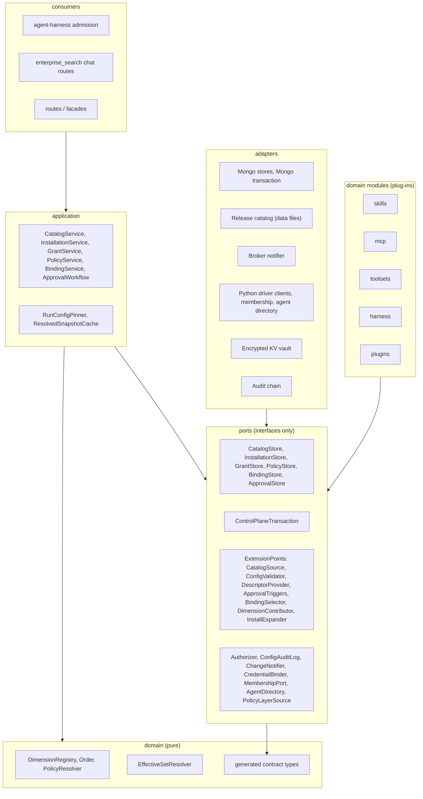

# Control plane: interfaces and abstractions

**Status:** design proposal. **Date:** 2026-10-09. Data model: [02-lld.md](02-lld.md) §2.
Prefixes as in [00-requirements.md](00-requirements.md).

Every port below is given in TypeScript (Node, `N/modules/control-plane/ports/`) and Python
(`PY/app/control_plane/ports.py`, or `PY/harness_core/policy/` for the generic policy engine). Types such
as `Installation`, `Grant`, `PolicyLayer`, `ResolvedRunConfig`, `Problem` are **generated** from
`contracts/` (02-lld §1); neither language hand-writes them.

For each port: responsibility (one reason to change), signatures, adapters (production and test), and
the contract-suite cases every adapter must pass. "Where it runs" says which language has a production
adapter; the other language's Protocol exists for the shared contract vectors and for Loom embedding,
not for a second production implementation.

---

## 1. Dependency direction



Rules (enforced by dependency-cruiser on Node and import-linter on Python, NFR-46):

- `domain/` imports only generated contracts. `ports/` imports `domain/` types only.
- `application/` imports `domain/` and `ports/`; never an adapter or a module.
- `adapters/` and `modules/*` import `ports/` and `domain/`; modules never import each other or the core
  services (they are called, they do not call).
- `agent-harness` imports `control-plane` only through its public barrel (`RunConfigPinner`,
  `ResolvedRunConfig`, `Problem`); the control plane never imports `agent-harness` (it reads the run's
  trigger and parent layers from the `PinSubject` it is given).
- Python: `harness_core.policy` imports nothing from `app`; `app.control_plane` imports
  `harness_core.policy` and generated contracts; runtime adapters (`ItemRuntime`) live in
  `app.harness.assembly.items` and depend on `app.control_plane` types only.

---

## 2. Stores

### 2.1 `ControlPlaneTransaction`

**Responsibility:** make one control-plane write atomic with its history, head revision, audit entry and
outbox row. Stores take its `tx`; no store opens its own transaction.

```ts
export interface WriteContext { readonly orgId: string; readonly actor: ActorRef; readonly approvalRef?: string; }
export interface CommittedWrite { readonly headRevision: number; }
export interface ControlPlaneTransaction {
  run<T>(ctx: WriteContext, work: (tx: CpTx) => Promise<{ result: T; change: ConfigChange }>):
    Promise<{ result: T } & CommittedWrite>;
}
```

```python
class ControlPlaneTransaction(Protocol):
    async def run(self, ctx: WriteContext,
                  work: Callable[[CpTx], Awaitable[tuple[T, ConfigChange]]]) -> Committed[T]: ...
```

- **Adapters:** `MongoControlPlaneTransaction` (replica set: `inDurableTransaction`), `OrderedStepsTransaction`
  (standalone Mongo, 02-lld §6.4), `InMemoryControlPlaneTransaction` (tests).
- **Contract cases:** head increments exactly once per committed write; an exception in `work` leaves no
  history, head, audit or outbox row; a `ConfigAuditLog` failure aborts the write (NFR-36); two
  concurrent writes in one org produce consecutive head revisions; writes in two orgs do not serialise.
- **Runs in:** Node.

### 2.2 `CatalogStore`

**Responsibility:** persist and query immutable catalog item versions.

```ts
export interface CatalogStore {
  get(orgId: string, ref: ItemRef): Promise<CatalogItem | null>;
  list(orgId: string, q: CatalogQuery): Promise<Page<CatalogItemSummary>>;   // shared + org rows
  versions(orgId: string, kind: string, publisher: string, name: string): Promise<ItemVersion[]>;
  insert(tx: CpTx, item: CatalogItem): Promise<void>;                          // throws ItemExists, DigestMismatch
  deprecate(tx: CpTx, orgId: string, ref: ItemRef): Promise<void>;
}
```

```python
class CatalogStore(Protocol):
    async def get(self, org_id: str, ref: ItemRef) -> CatalogItem | None: ...
    async def list(self, org_id: str, q: CatalogQuery) -> Page[CatalogItemSummary]: ...
    async def versions(self, org_id: str, kind: str, publisher: str, name: str) -> list[ItemVersion]: ...
    async def insert(self, tx: CpTx, item: CatalogItem) -> None: ...
    async def deprecate(self, tx: CpTx, org_id: str, ref: ItemRef) -> None: ...
```

- **Adapters:** `CompositeCatalogStore` = `ReleaseCatalogStore` (read-only, `CP/catalog/*.json`) +
  `MongoCatalogStore` (org rows); in-memory.
- **Contract cases:** insert is immutable (second insert of a ref → `ItemExists`); stored
  `descriptorSetDigest` must match the recomputed digest (`DigestMismatch`); org A never lists org B's
  rows; shared rows are visible to every org and cannot be inserted with an `orgId`; `list` pagination is
  stable under concurrent inserts.
- **ISP note:** no update method: versions are immutable, so the port cannot express a mutation it must
  not allow.

### 2.3 `InstallationStore`

**Responsibility:** persist installations, their revisions and history.

```ts
export interface InstallationStore {
  get(orgId: string, id: InstallationRef): Promise<Installation | null>;
  listForOrg(orgId: string, filter: InstallationFilter): Promise<Installation[]>;   // snapshot loader: one query
  create(tx: CpTx, inst: Installation): Promise<void>;
  replace(tx: CpTx, inst: Installation, expectedRevision: number): Promise<number>; // throws RevisionConflict
  history(orgId: string, id: InstallationRef, limit: number): Promise<InstallationRevision[]>;
  children(orgId: string, parent: InstallationRef): Promise<Installation[]>;       // plugin cascade
}
```

```python
class InstallationStore(Protocol):
    async def get(self, org_id: str, id: InstallationRef) -> Installation | None: ...
    async def list_for_org(self, org_id: str, f: InstallationFilter) -> list[Installation]: ...
    async def create(self, tx: CpTx, inst: Installation) -> None: ...
    async def replace(self, tx: CpTx, inst: Installation, expected_revision: int) -> int: ...
    async def history(self, org_id: str, id: InstallationRef, limit: int) -> list[InstallationRevision]: ...
    async def children(self, org_id: str, parent: InstallationRef) -> list[Installation]: ...
```

- **Adapters:** `MongoInstallationStore`, in-memory; `LegacyInstallationReadThrough` (migration window:
  reads the toolsets KV list and MCP instance keys when no row exists).
- **Contract cases:** CAS (stale revision → conflict, current revision unchanged); history has one row
  per revision, in order; cross-org isolation; `children` returns only `installedVia == parent`; required
  indexes exist (Mongo adapter).

### 2.4 `GrantStore`

**Responsibility:** persist one grant document per subject.

```ts
export interface GrantStore {
  get(orgId: string, subject: SubjectRef): Promise<Grant | null>;
  getMany(orgId: string, subjects: readonly SubjectRef[]): Promise<Map<string, Grant>>;  // one query
  put(tx: CpTx, grant: Grant, expectedRevision: number): Promise<number>;
  usersOf(orgId: string, installation: InstallationRef): Promise<SubjectRef[]>;          // impact preview
}
```

```python
class GrantStore(Protocol):
    async def get(self, org_id: str, subject: SubjectRef) -> Grant | None: ...
    async def get_many(self, org_id: str, subjects: Sequence[SubjectRef]) -> dict[str, Grant]: ...
    async def put(self, tx: CpTx, grant: Grant, expected_revision: int) -> int: ...
    async def users_of(self, org_id: str, installation: InstallationRef) -> list[SubjectRef]: ...
```

- **Adapters:** `MongoGrantStore`; `GraphEdgeGrantReadThrough` (migration: reads `agentHas*` edges via the
  Python agent route when no row exists); in-memory.
- **Contract cases:** CAS; `getMany` is one round trip (adapter counts queries); `usersOf` is consistent
  with `put` in the same transaction; > 500 entries rejected; isolation.

### 2.5 `PolicyStore`

**Responsibility:** persist policy layers per scope with history (R2 §3.1, unchanged signature plus `tx`).

```ts
export interface PolicyStore {
  read(ref: ScopeRef): Promise<{ layer: PolicyLayer | null; revision: number }>;
  readMany(orgId: string, refs: readonly ScopeRef[]): Promise<Map<string, VersionedLayer>>;
  write(tx: CpTx, ref: ScopeRef, layer: PolicyLayer | null, expectedRevision: number): Promise<number>;
  history(ref: ScopeRef, limit: number): Promise<PolicyRevision[]>;
}
```

```python
class PolicyStore(Protocol):
    async def read(self, ref: ScopeRef) -> VersionedLayer: ...
    async def read_many(self, org_id: str, refs: Sequence[ScopeRef]) -> dict[str, VersionedLayer]: ...
    async def write(self, tx: CpTx, ref: ScopeRef, layer: PolicyLayer | None, expected_revision: int) -> int: ...
    async def history(self, ref: ScopeRef, limit: int) -> list[PolicyRevision]: ...
```

- **Adapters:** `MongoPolicyStore`; `KvDocumentPolicyReadThrough` (wraps today's five `Config*`
  documents during migration); in-memory.
- **Contract cases:** revision OCC; `null` deletes the layer and records a history row; schema-invalid
  stored data is reported as `CP_UNAVAILABLE` for that scope only (one org's corrupt layer never affects
  another, NFR-13); history returns newest first and survives a rollback write.
- **SRP note:** validation (schema, narrowing, references) is **not** in the store; it is in
  `PolicyService` using `PolicyResolver.assertNarrows` and `ReferenceChecker`. The store only persists.

### 2.6 `BindingStore`

**Responsibility:** persist binding metadata (never secrets).

```ts
export interface BindingStore {
  get(orgId: string, id: BindingRef): Promise<Binding | null>;
  find(orgId: string, installation: InstallationRef, owner: OwnerRef): Promise<Binding | null>;
  listForOwner(orgId: string, owner: OwnerRef): Promise<Binding[]>;
  upsert(tx: CpTx, binding: Binding, expectedRevision: number | null): Promise<number>;
  dueForRefresh(before: number, limit: number): Promise<Binding[]>;               // cross-org, refresher only
}
```

```python
class BindingStore(Protocol):
    async def get(self, org_id: str, id: BindingRef) -> Binding | None: ...
    async def find(self, org_id: str, installation: InstallationRef, owner: OwnerRef) -> Binding | None: ...
    async def list_for_owner(self, org_id: str, owner: OwnerRef) -> list[Binding]: ...
    async def upsert(self, tx: CpTx, binding: Binding, expected_revision: int | None) -> int: ...
    async def due_for_refresh(self, before: int, limit: int) -> list[Binding]: ...
```

- **Contract cases:** unique `(org, installation, owner)`; a binding document never contains a field
  matching the token-pattern vector (`C/vectors/token-patterns.json`); `dueForRefresh` returns only
  `active|expiring` rows ordered by `expiresAt`.

### 2.7 `ApprovalStore`

**Responsibility:** persist approval requests and decisions.

```ts
export interface ApprovalStore {
  get(orgId: string, id: ApprovalRef): Promise<ApprovalRequest | null>;
  open(orgId: string, q: ApprovalQuery): Promise<Page<ApprovalRequest>>;
  openFor(orgId: string, target: TargetRef): Promise<ApprovalRequest | null>;
  create(tx: CpTx, req: ApprovalRequest): Promise<void>;
  transition(tx: CpTx, id: ApprovalRef, from: ApprovalState, to: ApprovalState, decision?: Decision): Promise<void>;
}
```

```python
class ApprovalStore(Protocol):
    async def get(self, org_id: str, id: ApprovalRef) -> ApprovalRequest | None: ...
    async def open(self, org_id: str, q: ApprovalQuery) -> Page[ApprovalRequest]: ...
    async def open_for(self, org_id: str, target: TargetRef) -> ApprovalRequest | None: ...
    async def create(self, tx: CpTx, req: ApprovalRequest) -> None: ...
    async def transition(self, tx: CpTx, id: ApprovalRef, frm: ApprovalState, to: ApprovalState,
                         decision: Decision | None = None) -> None: ...
```

- **Contract cases:** at most one `open` request per target (a new one supersedes the old); `transition`
  from a state other than `from` fails; decisions are append-only.

---

## 3. Extension points and `DomainModule`

### 3.1 The extension points (ISP: each is one capability)

```ts
export interface CatalogSource {                 // where items of a kind come from
  readonly kind: string;
  releaseItems(): readonly CatalogItem[];        // build-time data
  importItem?(orgId: string, source: ImportSource): Promise<CatalogItem>;   // npm, GitHub, URL, upload
}
export interface ConfigValidator {               // validates installation config for a kind
  readonly kind: string;
  validate(item: CatalogItem, config: unknown, ctx: ValidationContext): Promise<Problem[]>;
}
export interface DescriptorProvider {            // what an installation exposes, with digests (admin time)
  readonly kind: string;
  describe(inst: Installation, credential: BindingRef | null): Promise<DescriptorSet>;
}
export interface ApprovalTriggers {              // which changes need configuration-time approval
  readonly kind: string;
  changesOf(before: Installation | null, after: Installation): ChangeKind[];   // install, descriptor_change, url_change, …
}
export interface BindingSelector {               // which binding a run uses for an installation
  readonly kind: string;
  select(inst: Installation, subject: PinSubject, bindings: BindingIndex): BindingChoice;  // ref or unavailable reason
}
export interface DimensionContributor {          // policy rows the domain adds
  readonly kind: string;
  dimensions(): readonly DimensionRow[];         // data, validated against policy-dimensions.schema.json
}
export interface InstallExpander {               // plugins: an install that creates child installs
  readonly kind: string;
  expand(inst: Installation, item: CatalogItem): Promise<Installation[]>;
}
```

```python
class CatalogSource(Protocol):
    kind: str
    def release_items(self) -> Sequence[CatalogItem]: ...
    async def import_item(self, org_id: str, source: ImportSource) -> CatalogItem: ...   # optional
class ConfigValidator(Protocol):
    kind: str
    async def validate(self, item: CatalogItem, config: object, ctx: ValidationContext) -> list[Problem]: ...
class DescriptorProvider(Protocol):
    kind: str
    async def describe(self, inst: Installation, credential: BindingRef | None) -> DescriptorSet: ...
class ApprovalTriggers(Protocol):
    kind: str
    def changes_of(self, before: Installation | None, after: Installation) -> list[ChangeKind]: ...
class BindingSelector(Protocol):
    kind: str
    def select(self, inst: Installation, subject: PinSubject, bindings: BindingIndex) -> BindingChoice: ...
class DimensionContributor(Protocol):
    kind: str
    def dimensions(self) -> Sequence[DimensionRow]: ...
class InstallExpander(Protocol):
    kind: str
    async def expand(self, inst: Installation, item: CatalogItem) -> list[Installation]: ...
```

`DomainModule` is only a registration bundle, so composition registers one object per domain while the
core depends on the individual points:

```ts
export interface DomainModule {
  readonly kind: string;
  readonly catalog: CatalogSource;
  readonly validator: ConfigValidator;
  readonly descriptors?: DescriptorProvider;     // harness has none
  readonly approvals: ApprovalTriggers;
  readonly bindings?: BindingSelector;           // skills have none
  readonly dimensions?: DimensionContributor;
  readonly expander?: InstallExpander;           // plugins only
}
export interface ExtensionRegistry {
  register(module: DomainModule): void;          // throws on duplicate kind or invalid dimension rows
  catalogSource(kind: string): CatalogSource;    // … one getter per point; throws UnknownKind
  kinds(): readonly string[];
}
```

```python
@dataclass(frozen=True)
class DomainModule:
    kind: str
    catalog: CatalogSource
    validator: ConfigValidator
    approvals: ApprovalTriggers
    descriptors: DescriptorProvider | None = None
    bindings: BindingSelector | None = None
    dimensions: DimensionContributor | None = None
    expander: InstallExpander | None = None
```

- **Adapters:** `skills`, `mcp`, `toolsets`, `harness`, `plugins` modules in `N/modules/control-plane/modules/`.
  `DescriptorProvider` and `CatalogSource.importItem` for skills, MCP and toolsets are HTTP clients to the
  Python drivers (`/api/v1/control-plane/drivers/{kind}/…`), built on the shared Node HTTP client with
  retry; the drivers reuse existing Python code (`mcp_hub` discovery with SSRF pinning, `ToolsetRegistry`
  metadata, `SkillBundleBuilder`, `package_importer.py`).
- **Module conformance suite** (one suite, run per registered module): `releaseItems` validate against
  the item schema and their digests recompute; `validate` rejects the module's `*.invalid.json` config
  fixtures; `describe` is deterministic for a fixed server fixture; `changesOf(null, x)` includes
  `install`; `select` never returns another user's binding for a user-owned credential mode;
  `dimensions()` rows have exposure lists that exclude layers below `deployment` for operator-only rows.

### 3.2 Python runtime side: `ItemRuntime`

**Responsibility:** turn pinned effective-set items of one kind into tool sources, mounts or prompt
material. Replaces the fixed `default_sources()` list (`PY/app/harness/assembly/tool_sources.py:386-396`)
for the catalog kinds.

```python
class ItemRuntime(Protocol):
    kind: str
    async def load(self, items: Sequence[EffectiveItem], ctx: RunContext,
                   credentials: CredentialBroker) -> ItemLoad: ...          # tools, mounts, prompt parts, closers
    def verify(self, item: EffectiveItem, live: LiveDescriptor) -> Problem | None: ...   # drift check per call
class ItemRuntimeRegistry(Protocol):
    def register(self, runtime: ItemRuntime) -> None: ...
    def for_kind(self, kind: str) -> ItemRuntime: ...                      # unknown kind → capability_lost
```

```ts
// Node has no ItemRuntime: Node never executes items. The TS type exists for the explain view only.
export interface ItemRuntimeInfo { readonly kind: string; readonly supportsDriftCheck: boolean; }
```

- **Adapters:** `ToolsetItemRuntime` (wraps `PipesHubToolLoader`), `McpItemRuntime` (wraps
  `MCPToolProvider` and the hub), `SkillsItemRuntime` (wraps `SkillsSource`, loads by bundle digest,
  scoped to pinned skills only).
- **Contract cases:** loads exactly the pinned tool ids (no more, no fewer); `unavailable` items are never
  loaded; `verify` returns `CP_DESCRIPTOR_CHANGED` when the live digest differs; `load` closes what it
  opens (R2 X-1 MCP session leak).

### 3.3 How plugins plug in without editing the core (OCP)

1. Add `contracts/control-plane/descriptors/plugin.schema.json` and the plugin item rows' schema.
2. Add `N/modules/control-plane/modules/plugins/` implementing `CatalogSource.importItem` (verify the
   publisher signature against `catalog.trustRoots`), `ConfigValidator`, `ApprovalTriggers`,
   `DimensionContributor` (`plugins.allowed`, `catalog.trustRoots`) and `InstallExpander` (returns child
   installations for each contributed skill, MCP server or declarative toolset).
3. Register it in the composition module list.

No core file changes: `InstallationService.create` already calls `expander?.expand` for any kind and
writes children in the same transaction; resolution and runtime see only the children's kinds, which
already have `ItemRuntime`s. The same steps add any future kind; a kind that needs execution adds one
`ItemRuntime` in Python.

---

## 4. Resolution

### 4.1 `DimensionRegistry`, `Order`, `PolicyResolver` (generic; Loom-embeddable)

```ts
export type OrderKind = 'subset' | 'min' | 'max' | 'rank' | 'rank-raise' | 'bool-and' | 'approval-rules';
export interface Order<T> { leq(a: T, b: T): boolean; meet(a: T, b: T): T; }
export interface Dimension<T> {
  readonly path: string; readonly kind: 'ceiling' | 'choice' | 'operator';
  readonly order?: Order<T>; readonly within?: string; readonly exposure: readonly ScopeKind[];
}
export interface DimensionRegistry { all(): readonly Dimension<unknown>[]; get(path: string): Dimension<unknown>; }
export interface PolicyResolver {
  resolve(layers: readonly PolicyLayer[]): Resolved;                 // { config } | { refusal }
  foldPrefix(layers: readonly PolicyLayer[]): FoldedPrefix;          // cached per (org, agent, head)
  resolveFrom(prefix: FoldedPrefix, rest: readonly PolicyLayer[]): Resolved;
  assertNarrows(layer: PolicyLayer, above: readonly PolicyLayer[]): PolicyRefusal | null;
}
```

```python
class Order(Protocol[T]):
    def leq(self, a: T, b: T) -> bool: ...
    def meet(self, a: T, b: T) -> T: ...
class PolicyResolver(Protocol):
    def resolve(self, layers: Sequence[PolicyLayer]) -> Resolved: ...
    def fold_prefix(self, layers: Sequence[PolicyLayer]) -> FoldedPrefix: ...
    def resolve_from(self, prefix: FoldedPrefix, rest: Sequence[PolicyLayer]) -> Resolved: ...
    def assert_narrows(self, layer: PolicyLayer, above: Sequence[PolicyLayer]) -> PolicyRefusal | None: ...
```

- **Where:** `H/domain/policy/` and `PY/harness_core/policy/`; both driven by `policy-dimensions.json` +
  `CP/dimensions.json` (merged at registry build).
- **Why Python too:** the worker applies the `live` layer with `meet` (pin ⊓ live) and engines narrow
  child profiles; both need the same order semantics. E4a's `PROFILE_DIMENSIONS` in both languages
  collapses into this.
- **Contract suite:** shared vectors `C/vectors/policy-resolve.json` (both languages: EV-1..39 from E4a
  kept, approvals vectors from P2.11e kept, new precedence cases); property tests for the invariants in
  02-lld §3.4; `resolveFrom(foldPrefix(a), b) == resolve(a ++ b)`.

### 4.2 `PolicyLayerSource`

**Responsibility:** produce one layer kind for a subject. OCP for layer kinds (adding `team` is one
adapter and one position in the list).

```ts
export interface PolicyLayerSource {
  readonly kind: ScopeKind;
  layer(subject: PinSubject, snapshot: Snapshot): PolicyLayer | null;     // synchronous: reads the snapshot only
}
```

```python
class PolicyLayerSource(Protocol):
    kind: ScopeKind
    def layer(self, subject: PinSubject, snapshot: Snapshot) -> PolicyLayer | None: ...
```

Synchronous on purpose: all I/O happens once in the snapshot loader, so a layer source cannot add a
round trip to the hot path.

### 4.3 `EffectiveSetResolver`

```ts
export interface EffectiveSetResolver {
  resolve(subject: PinSubject, config: EffectiveRunConfig, snapshot: Snapshot): EffectiveSet | Problem;
}
```

```python
class EffectiveSetResolver(Protocol):
    def resolve(self, subject: PinSubject, config: EffectiveRunConfig, snapshot: Snapshot) -> EffectiveSet | Problem: ...
```

- **Where:** Node `domain/` (pure). Python has the type for reading the pin and for vectors only.
- **Contract suite:** vectors `CP/vectors/effective-set.json`; property: result ⊆ grant ∩ visible ∩
  enabled ∩ approved; determinism (same snapshot → same digest); unavailable reasons are the first failing
  check in the documented order; `required` items refuse.

### 4.4 `RunConfigPinner`

**Responsibility:** the one admission-time entry point (FR-29).

```ts
export interface PinSubject {
  readonly orgId: string; readonly actorId: string; readonly agentKey: string | null;
  readonly projectId: string | null;            // from the conversation record, never from the client
  readonly chatMode: string; readonly regenerateOf?: string;
  readonly surface: 'web' | 'slack' | 'mcp' | 'schedule' | 'child' | 'next_run';
  readonly trigger?: PolicyLayer; readonly parent?: ResolvedRunConfig; readonly request: PolicyLayer;
}
export interface RunConfigPinner {
  pin(subject: PinSubject): Promise<ResolvedRunConfig | Problem>;
}
```

```python
class RunConfigPinner(Protocol):   # used only by Loom embeddings and tests; PipesHub pins in Node
    async def pin(self, subject: PinSubject) -> ResolvedRunConfig | Problem: ...
```

- **Callers:** `AdmissionPipeline.PolicyPinning` step (submit), `ChildRunService.spawn`,
  `NextRunService.drain` (R2 F6), `ScheduleFirer`, the legacy chat route in `enterprise_search`.
- **Contract cases:** same subject + same snapshot → same digest; a parent-derived child is ⊑ the
  parent on every ceiling; a next-run drain after a narrowing is refused or narrowed; latency test: 200
  items, warm cache, p95 ≤ 8 ms on the CI runner (NFR-1, a benchmark assertion with headroom).

### 4.5 `ResolvedSnapshotCache`

```ts
export interface SnapshotSource {
  snapshot(orgId: string, agentKey: string | null, actorId: string): Promise<Snapshot>;   // ≤ 1 batched read per store on miss
  onChange(event: ChangeEvent): void;
}
```

Python counterpart: `LiveLayerCache` (`current(org_id) -> LiveLayer`, `on_change(event)`), which holds
only the narrow-only live layer.

- **Contract cases:** a gap in revisions drops the org's entries; untouched entries advance; a touched
  entry reloads; read-your-writes for the writing instance (it applies its own event before returning
  the write response); memory bound respected.

---

## 5. Services the core depends on

### 5.1 `Authorizer`

**Responsibility:** decide whether an actor may perform an action on a resource. One port for the four
admin checks (R2 §1.3).

```ts
export type CpAction =
  | 'catalog.read' | 'catalog.import' | 'installation.read' | 'installation.create' | 'installation.update'
  | 'installation.delete' | 'grant.read' | 'grant.write' | `policy.read` | `policy.write:${string}`
  | 'binding.read' | 'binding.create' | 'binding.update' | 'approval.read' | 'approval.decide'
  | 'explain' | 'audit.read';
export interface Authorizer {
  check(actor: ActorRef, action: CpAction, resource: ResourceRef): Promise<AuthzDecision>;   // {allow} | {deny, reason}
}
```

```python
class Authorizer(Protocol):
    async def check(self, actor: ActorRef, action: CpAction, resource: ResourceRef) -> AuthzDecision: ...
```

- **Adapter:** `RoleAuthorizer` composed of small rules: org admin (`User.role === 'admin'`,
  `user-admin.service.ts:63-75`), delegated team admin (`catalog.delegation` ∩ graph team OWNER/WRITER
  role through `MembershipPort`), agent editor (`can_edit` via `AgentDirectory`), owner (binding and
  user-scope installation owner), and any approver principals a bound approver directory names. Python's
  `check_user_is_admin`, `_check_user_is_admin` and inline `fetch_caller_role` are deleted when their
  routes become facades.
- **Contract cases:** a matrix of (role × action × resource scope) vectors (`CP/vectors/authz.json`); an
  org id in the body never changes the decision; a demoted admin is denied on the next request (reads
  the live role, closing P2.11e's "JWT role claims are read at login" gap for control-plane writes).

### 5.2 `CredentialBinder` (Node) and `CredentialBroker` (Python)

**Responsibility (Node):** create, rotate, revoke bindings and write secrets; never read a secret back to
a client.

```ts
export interface CredentialBinder {
  begin(ctx: WriteContext, inst: Installation, owner: OwnerRef, mode: BindingMode): Promise<BindingStart>;   // {binding} | {authorizeUrl}
  complete(ctx: WriteContext, state: string, material: SecretMaterial): Promise<Binding>;                  // OAuth callback
  setSecret(ctx: WriteContext, binding: BindingRef, material: SecretMaterial, expectedRevision: number): Promise<Binding>;
  revoke(ctx: WriteContext, binding: BindingRef, expectedRevision: number): Promise<Binding>;
}
```

**Responsibility (Python):** lease a secret for a pinned binding reference, bound to purpose and TTL.
Generalises P2.4a's `CredentialService` with a binding source:

```python
class CredentialBroker(Protocol):
    async def lease(self, binding: PinnedBinding, purpose: LeasePurpose, ttl_s: int) -> CredentialHandle: ...
    async def resolve(self, handle: CredentialHandle, purpose: LeasePurpose) -> SecretValue: ...
    async def release(self, handle: CredentialHandle) -> None: ...
```

```ts
// Node does not lease secrets for runs; this type exists for the explain view (binding state only).
export interface BindingStateView { state(binding: BindingRef): Promise<BindingSummary>; }
```

- **Adapters:** Node `VaultCredentialBinder` over `EncryptedConfigDocumentStore` (CAS, versioned
  envelope, P2.4b); Python `BindingSecretSource` registered in `HandleCredentialService` (kind `binding`),
  replacing `ToolsetSecretSource` and `McpSecretSource` after migration.
- **Contract cases:** a revoked binding's lease fails even if the binding row is cached as active
  (tombstone wins); a lease's `versionDigest` must equal the pinned digest or the newer refreshed
  version of the same binding (refresh does not break a pin); purpose mismatch refused; secrets never
  appear in `Binding`, logs or audit payloads (token-pattern scan).

### 5.3 `ConfigAuditLog`

```ts
export interface ConfigAuditLog { record(tx: CpTx, change: ConfigChange): Promise<void>; }
```
```python
class ConfigAuditLog(Protocol):
    async def record(self, tx: CpTx, change: ConfigChange) -> None: ...
```

- **Adapter:** `ChainConfigAuditLog` over `AuditChainStore` (stream `cp:{orgId}`); in-memory.
- **Contract cases:** appended in the caller's transaction (rollback removes it); `verifyAuditChain`
  passes over mixed run and config entries; no secret material (token-pattern scan); `changeDigest`
  reproducible from the history row.

### 5.4 `ChangeNotifier`

```ts
export interface ChangeNotifier {
  publish(event: ChangeEvent): Promise<void>;                                     // called by the outbox dispatcher only
  subscribe(handler: (event: ChangeEvent) => void): Unsubscribe;                  // per process
}
```
```python
class ChangeNotifier(Protocol):
    async def publish(self, event: ChangeEvent) -> None: ...
    def subscribe(self, handler: Callable[[ChangeEvent], None]) -> Unsubscribe: ...
```

- **Adapters:** `BrokerChangeNotifier` (topic `control-plane-events`, key `orgId`, a unique consumer
  group per process so every process sees every event; Node `message-broker.factory.ts`, Python
  `MessagingFactory`); in-memory.
- **Contract cases:** per-org order preserved; at-least-once delivery tolerated (handlers are idempotent
  by revision); a subscriber started after an event recovers by the gap rule, not by replay.

### 5.5 `MembershipPort` and `AgentDirectory`

```ts
export interface MembershipPort { teamsOf(orgId: string, userId: string): Promise<readonly TeamMembership[]>; }
export interface AgentDirectory {
  authorizeRun(orgId: string, agentKey: string, actor: ActorRef): Promise<AgentRunAccess | null>;   // null = denied
  canEdit(orgId: string, agentKey: string, actor: ActorRef): Promise<boolean>;
  ownerTeam(orgId: string, agentKey: string): Promise<string | null>;
}
```
```python
class MembershipPort(Protocol):
    async def teams_of(self, org_id: str, user_id: str) -> Sequence[TeamMembership]: ...
class AgentDirectory(Protocol):
    async def authorize_run(self, org_id: str, agent_key: str, actor: ActorRef) -> AgentRunAccess | None: ...
    async def can_edit(self, org_id: str, agent_key: str, actor: ActorRef) -> bool: ...
    async def owner_team(self, org_id: str, agent_key: str) -> str | None: ...
```

- **Adapters:** Node HTTP clients to Python (`/api/v1/entity/user/teams`; a slimmed
  `/api/v1/agent/{key}/run-definition` that returns identity, permission and definition version, no
  longer toolsets, MCP or skills), each wrapped by a caching decorator (02-lld §8.5). Python
  implementations are the existing graph code.
- **Contract cases:** denial is `null`, unavailability throws (admission fails closed, the existing
  `AgentAccessPolicy` rule, `H/ports/agent-access.ts`); the caching decorator never caches a throw.

### 5.6 `ReferenceChecker`

```ts
export interface ReferenceChecker { check(orgId: string, layer: PolicyLayer): Promise<Problem[]>; }
```
```python
class ReferenceChecker(Protocol):
    async def check(self, org_id: str, layer: PolicyLayer) -> list[Problem]: ...
```

Checks that references in a layer exist (users and groups, installations in `tools.grant`,
configured models, engine kinds). Adapters compose per-section checkers registered by domain modules.

---

## 6. Why each interface is no bigger than it needs to be (ISP)

| Interface | Smallest client | What it deliberately leaves out |
|---|---|---|
| `CatalogStore` | snapshot loader, catalog routes | update (immutability) |
| `InstallationStore` | `InstallationService`, snapshot loader | validation, approval, expansion (services and extension points) |
| `GrantStore` | `GrantService`, snapshot loader | visibility (an installation property) |
| `PolicyStore` | `PolicyService`, snapshot loader | narrowing and reference checks (`PolicyResolver`, `ReferenceChecker`) |
| `BindingStore` | `BindingService`, `TokenRefresher` | secret I/O (`CredentialBinder` via the vault) |
| Extension points | the one core service that needs that capability | each other: a module may implement only some (harness has no `DescriptorProvider`, skills no `BindingSelector`) |
| `PolicyLayerSource` | `RunConfigPinner` | I/O (synchronous over the snapshot) |
| `RunConfigPinner` | admission paths | stores, caches, notifier (all behind `SnapshotSource`) |
| `ItemRuntime` | Python assembler | catalog, policy, approval: the runtime gets a pinned item, nothing to decide |
| `CredentialBroker` | Python tool clients, egress proxy | binding lifecycle (Node) |
| `ChangeNotifier` | outbox dispatcher, caches | delivery guarantees beyond per-org order |

---

## 7. Single responsibility of the core services

| Service | Its one reason to change | Uses |
|---|---|---|
| `CatalogService` | how items enter the catalog (import, authoring, release load) | `CatalogStore`, `CatalogSource`, `ControlPlaneTransaction` |
| `InstallationService` | installation lifecycle states | `InstallationStore`, `ConfigValidator`, `DescriptorProvider`, `InstallExpander`, `ApprovalWorkflow` |
| `GrantService` | grant editing rules | `GrantStore`, `Authorizer`, `AgentDirectory` |
| `PolicyService` | layer writes and rollback | `PolicyStore`, `PolicyResolver.assertNarrows`, `ReferenceChecker` |
| `BindingService` | binding lifecycle | `BindingStore`, `CredentialBinder`, `BindingSelector` |
| `ApprovalWorkflow` | approval state machine | `ApprovalStore`, `ApprovalTriggers`, approval policy dimension |
| `TokenRefresher` | refresh scheduling | `BindingStore.dueForRefresh`, per-provider strategies (Python driver) |
| `RunConfigPinner` | how a run's config is assembled | `SnapshotSource`, `PolicyLayerSource[]`, `PolicyResolver`, `EffectiveSetResolver` |
| `ExplainService` | presentation of provenance | `RunConfigPinner` (dry run), generated `Problem` remediation |

Cross-cutting concerns (logging, metrics, audit) are decorators or the transaction port, not code inside
each service.
