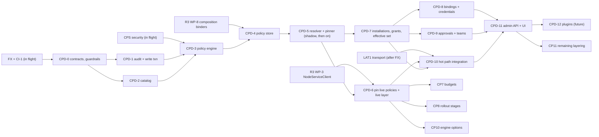

# Control plane: migration plan

**Status:** design proposal. **Date:** 2026-10-09. Prefixes as in [00-requirements.md](00-requirements.md).

Incremental work packages (WPs) that take today's five domains to the design in
[01-hld.md](01-hld.md)–[03-interfaces.md](03-interfaces.md). R2's CP0–CP11 and R3's refactors are folded
in where they belong so that nothing is done twice; the security fixes already in flight on the CPS
branch are referenced, not redone; LAT1's transport slice is named so the two plans fit.

## 1. Rules for every WP

1. **Every lane green:** Python wide, Node, frontend, Docker, itests, codegen drift (both halves),
   Spectral, replay-compat, cohesion (once CI-1 lands).
2. **No user-visible behaviour change** unless the WP's "Behaviour" column says so; the release notes
   repeat that column.
3. **Each WP deletes something** or states why it cannot yet.
4. **New ports ship with** an in-memory adapter under test support (R3 M14), a contract suite, and the
   production adapter passing it.
5. **Reads switch before writes are removed:** read-through adapter → migration → dual-write for one
   release → flip → delete. Every migration is a registered D2 migration (dry run, `--apply`, `--revert`,
   ledger key, idempotent).
6. **Shadow before switch** for anything on the run path: the new resolver runs alongside the old one,
   and a mismatch is logged and counted (`pipeshub_cp_shadow_mismatch_total{dimension}`), never acted on,
   until the switch WP. Env flag `CONTROL_PLANE_PIN` (`off | shadow | on`, deployment, registered in
   `C/flags.json` by CPD-5).

## 2. Work already in flight (referenced, not redone)

| Branch / WP | Fixes (R2 ids) | How this plan depends on it |
|---|---|---|
| **CPS** (`harness/cps-security`) | Skills scoping: runtime visibility, empty grant means none, candidate approval by owner/admin (F3, CP2a); engine skills wiring `skill_bundles_for` (F7, CP2e); pin integrity: MCP approved-manifest digest and toolset schema digest, `ToolsetSource.observe` (F4, CP2b); narrow-only gaps: reasoning effort, deadline vs `maxWallS`, budgets vs profile limits, loop-parent engine children, loop models vs configured models, `minimal` enum (F5, CP2c); next-run re-admission (F6, CP2d); Node toolsets router `requireScopes` (F16) | CPD-3 builds the digest scheme on CPS's pin digests; CPD-5 routes CPS's drain re-admission through `RunConfigPinner`; CPD-7 replaces CPS's in-place skills fix with pinned digests. None of these WPs re-implements a CPS fix |
| **FX** (`harness/fx-r3`) | R3 blockers and correctness: FX-1..FX-5 (claimer, Docker wait, engine ticker, duplicate commit, `Agent.step` cancel), CI-1 (cohesion and contracts in CI) | CPD-0 assumes CI-1; the cohesion checks proposed below need it |
| **LAT1** (after FX merges) | R1 transport: one request on the existing chat routes, run-ready notify, server-side project scope, regenerate durable, interaction notify hold, Stop wake | Shares the hot path with CPD-10 (§5) |
| **P4.17** (`harness/p4.17-output-bound`) | Output bound per call | Becomes the `models.output` dimension in CP7 |

## 3. The work packages

Order is by dependency (§4). Risk: L low, M medium, H high.

| WP | What | Deletes | Behaviour | Risk | Tests | Folds in |
|---|---|---|---|---|---|---|
| **CPD-0** Contracts and guardrails | `contracts/control-plane/` skeleton (`common`, `problem`, `errors.json`); codegen roots and the **frontend target** (zod + types); C-5 drift over all roots and targets; flags missing from `flags.json` (`MCP_ALLOW_CUSTOM_STDIO`, `PIPESHUB_AGENT_TRANSPORT`, `PIPESHUB_ENABLE_SKILLS`, `PIPESHUB_ENABLE_CODE_EXECUTION`, `PIPESHUB_SKILLS_*`); `AGENT_HARNESS_OFFERING` validated at boot; dependency-cruiser config for `N/modules/control-plane` | Hand-written frontend types for the approvals and AI-access pages (`FE/workspace/approvals/types.ts` and siblings), replaced by generated ones | Startup fails early on a bad offering value (stated) | L | C-1 examples and invalid fixtures; C-5 drift both halves (requires node in the Python unit job); C-16 extended; frontend `tsc` | R2 **CP0**; R3 **WP-11** (frontend target and error codes part); R3 **CI-1** prerequisite (FX) |
| **CPD-1** Audit and the write transaction | `ControlPlaneTransaction` (Mongo + ordered-steps + in-memory) and `ConfigAuditLog` over `AuditChainStore` with the `cp:{orgId}` stream; `config.changed` emitted by every existing admin route (engine profile, approvals, model access, memory, retention, model accounts, schedules, MCP manifest via Node proxy), the Labs save; `interaction.granted` chained; Labs save under CAS with `If-Match` | `updateConfigDocument`'s silent last-writer-wins on Labs; the log-only "audit" lines in the five admin routes | Concurrent Labs saves get 409 (stated) | L | `ControlPlaneTransaction` and `ConfigAuditLog` contract suites (rollback removes the audit entry; chain verify over mixed entries); concurrent Labs save race test | R2 **CP1**; R3 **WP-2** (new in-memory adapters live in test support from the start) |
| **CPD-2** Catalog | `CatalogStore` (release data + Mongo org rows); build steps that dump `ToolsetRegistry`, `MCPRegistry`, built-in skill packs and `allowlist.json` into `CP/catalog/*.json`; one digest scheme with vectors (`CP/vectors/digests.json`); read-only `GET /api/v1/control-plane/catalog` | `PluginRegistry` (`PY/harness_core/kernel/core/registry.py`, unused); `FilesystemSkillStore` (unused in prod); Node `AGENT_CREATE_TOOLSET_NAMES` hard-coded list (validated against the catalog instead) | None | L | Catalog contract suite; digest vectors in both languages; a cohesion check that the generated catalog matches the registries (fails when a `@Toolset` is added without regenerating) | R3 **WP-13** (one canonical-JSON digest helper per language, D10) |
| **CPS** | (in flight, §2) | | | | | R2 **CP2a–e** |
| **CPD-3** Policy engine | `C/core/policy/*` schemas, `policy-dimensions.json`, `release.json`; generic `PolicyResolver` in TS (`H/domain/policy/`) and Python (`PY/harness_core/policy/`); E4a dimensions ported with EV-1..39 unchanged; approvals as the `approval-rules` order | `PROFILE_DIMENSIONS` in both languages; `narrowProfile` copies; `_StrictestOf` (`PY/app/harness/engines/durable.py:190-198`); default copies listed in R2 F10 (`DEEP_MAX_CHILDREN` ×3, `MAX_MEMORY_CHARS` ×3, release profile ×3, offering default ×2, 1 h deadline ×2) | None | M | Shared vectors; property tests (meet idempotent, commutative, associative; result ⊑ each ceiling; choice ∈ ceiling; refusal names the first widening; `resolveFrom(foldPrefix(a), b) == resolve(a ++ b)`) | R2 **CP3** |
| **CPD-4** Policy store | `PolicyStore` (Mongo `cpPolicyLayers`, `cpPolicyHistory`; read-through over the five KV documents); D2 migration copying each org section (`orgAgents` → agent layer with `lockedBy: org`); old `Config*` classes become adapters over `PolicyStore`, dual-writing KV for one release; then flip and delete | After the flip release: `ConfigApprovalSettings`, `ConfigEngineProfileSettings`, `ConfigModelAccessPolicies`, `ConfigMemorySettings`, `ConfigSessionRetentionSettings`, `updateConfigDocument` for policy, the five KV documents and their `flags.json` rows | None | M | `PolicyStore` contract (OCC, history, per-org isolation, corrupt row isolated to one org); migration idempotence and revert; fault test with KV down during migration | R2 **CP4**; R3 **WP-8** composition per-feature binders land first so the store binds once |
| **CPD-5** One resolver and pinner | `RunConfigPinner` + `ResolvedSnapshotCache` (head revision, revision-chained invalidation) + admission pipeline steps; used by submit, child spawn, next-run drain (on CPS's re-admission), schedule firing, Slack and MCP surfaces; `ResolvedRunConfig` written to the run and copied to `x.pipeshub.resolved` at claim (legacy pinned fields derived from it); head check inside the admission transaction; `effectivePolicy` becomes a view; `GET …/runs/{id}/resolved`; budgets and engine limits reconciled as one dimension. Ships `CONTROL_PLANE_PIN=shadow` first, then `on` | `engineAuthority` in `H/composition.ts:557-571`; executor-kind derivation in both stores (`mongo-run-admission-store.ts:360-367`, `in-memory-execution-store.ts:375-382`); `childGrants` subset code; the inline merges in `resolveRunSpec`; `effectiveApprovals` test-only path; `HarnessRollout` per-admission KV read | Additive API fields; otherwise none (shadow proves equality before `on`) | H | Admission pipeline tests; pin-replay determinism (same snapshot → same digest); C-24 wire parity unchanged; shadow mismatch = 0 on the replay corpus and the E2E lanes before `on`; NFR-1 benchmark assertion (200 items, warm, p95 ≤ 8 ms on CI) | R2 **CP5**; R2 **CP11**'s admission-pipeline split and R3's `RunAdmissionService` split land at the start of this WP; R3 **WP-10** (`rootRunDocument`, `executorOf` in domain) |
| **CPD-6** Pin the live policies; live layer | Worker feature `resolved_config`; claim gating by the F2 rule; the worker reads approvals, flow rule, LLM config snapshot, chat-mode policy and rollout stages from the pin; `control-plane-events` topic + `ChangeNotifier` (Node publisher via outbox; Python and Node subscribers); Python `LiveLayerCache` + internal live route backstop; gateways and Invoker apply `pin ⊓ live` | Python `ConfiguredApprovals` per-attempt KV read (`PY/app/harness/approvals.py:111-129`), flow-settings env read at attempt time, `resolve_model` re-read (`PY/app/harness/assembly/model.py:136-152`), chat-mode live policy (`context.py:72-82`), `is_*_enabled` reads on the durable path, `ConfiguredEngineCeilings` in the worker | **Yes:** loosening approvals mid-run no longer widens runs in flight; a `modelKey` re-point no longer changes a resumed run (stated) | H | Kill-switch-mid-flight test reused; property test that the live layer never widens; resume across a config change; notifier contract (per-org order, gap rule); NFR-23 test (narrowing visible in ≤ 5 s with the notifier, ≤ 30 s without) | R2 **CP6**; R3 **WP-3** (`NodeServiceClient` on `BaseServiceClient`) lands first: the live-layer client is built on it, not as a seventh inline client |
| **CPD-7** Installations, grants, effective set | `InstallationStore`, `GrantStore`, `EffectiveSetResolver`; D2 migrations: toolset instances list → `cpInstallations` (ids kept), MCP instances (both path layouts read) and manifests → installations with `approved`; agent `agentHas{Toolset,McpServer,Skill}` edges → `cpGrants` (edges dual-written one release); Python `ItemRuntimeRegistry` with `ToolsetItemRuntime`, `McpItemRuntime`, `SkillsItemRuntime` (pinned digests only); `assembler.build` split into sub-builders | `/services/toolset-instances` list (and its RMW race, R2 F21) after the window; `default_sources()` fixed list for catalog kinds; `build_skill_manager` per run on the durable path; `builtin_seeder.py` per-org copies; the three agent-route parsers `_parse_toolsets/_parse_mcp_servers/_parse_skills` after the window; Python run-definition fields for toolsets/MCP/skills (route slimmed) | None for granted, visible, approved items. **Yes:** items not visible to the acting user are now unavailable for that user's runs (extends CPS's skills rule to MCP and toolsets; stated) | H | `InstallationStore`/`GrantStore` contracts; effective-set vectors and the ⊆ property; `ItemRuntime` contract (loads exactly the pinned tool ids; closes what it opens, R2 X-1); legacy/durable parity test per kind; migration revert test | R2 §3.6 `ToolSourceRegistry`; R3 **WP-12** (assembler split, private helpers made public); R2 **F21** |
| **CPD-8** Bindings and credentials | `BindingStore`, `CredentialBinder` (Node, versioned envelope), `BindingSecretSource` in `HandleCredentialService` (Python); vault layout `/services/controlPlane/credentials/…`; D2 migration of toolset and MCP credentials (copy, verify digest, old path read-only for one release); one `TokenRefresher` with per-provider strategies; "My connections" API | `ToolsetTokenRefreshService`, `mcp_token_refresh_service.py`, `app/agents/mcp/token_refresh.py`; `ToolsetSecretSource`/`McpSecretSource` old-path reads after the window; `agent.py` credential resolvers (`:3470`, `:3566`) | None (stated: revocation is now audited and takes effect at the next call through tombstones) | M | Binding contract (unique per owner; no secret fields; refresh due order); broker contract (tombstone wins over a cached active row; refreshed version accepted for the same binding); OAuth flows end to end against the existing provider fakes; migration digest verification | P2.4a/P2.4b open items (refresh tokens into the service) |
| **CPD-9** Approvals and teams | Generic `ApprovalWorkflow` + `ApprovalStore`; MCP manifest approval and skill candidates migrate to it (existing approvals carried over, no re-approval); `catalog.approval` and `catalog.delegation` dimensions; `MembershipPort` and `AgentDirectory` caches with `teamMembershipChanged` and `agentChanged` on `entity-events`; team scope (layer source, team grants, team visibility); agent `ownerTeam` field | MCP manifest approval logic in `PY/app/api/routes/mcp_hub.py` (route becomes a facade); skill candidate approve/reject logic in `skills.py:765-786`; Python admin checks `check_user_is_admin`, `_check_user_is_admin`, inline `fetch_caller_role` | **Yes:** team admins can install and grant within their team when delegated (new capability, stated) | M | Approval CAS (`superseded`), authz vectors, membership cache invalidation, team precedence vectors (agent owner team, not actor teams) | R2 §3.7 shared concepts; P2.11e approval rules reused |
| **CPD-10** Hot path integration (with LAT1) | `ResolvedRunConfig.routing` and `scope` computed from `rollout.durable.modes`, kill switch, model families and the conversation's `projectId`; `ChatTurnService.start` consumes them (LAT1 builds the handler); legacy path receives `X-PipesHub-Resolved` (compact JWS, existing Ed25519 keyring) and the Python query path assembles from it; `GET /api/v1/control-plane/me/capabilities` with `routing` for the bootstrap | Python per-request reads on the legacy path: `_get_org_info`/`get_agent` permission re-check, `is_actions_enabled`, `is_mcp_enabled`, `is_user_context_enabled`, `_resolve_toolset_configs`, `_resolve_mcp_server_configs`, `build_skill_manager` (`PY/app/api/routes/agent.py:3729-4118`); the client-side `agentHarness.useHarness` routing and `projectScoped` skip (after LAT1) | **Yes:** routing decided by the server; API/PAT clients get durable runs for durable modes (stated in LAT1's notes) | M | Routing vectors per chat mode × project × kill switch; signature verification (unknown `kid`, expired, tampered → refused); legacy-path latency A/B (net reduction expected); C-24 wire parity | R1 F6, F8 (with LAT1) |
| **CP7** Budgets and outputs as dimensions | as R2: org/agent budgets, per-call output bounds (P4.17), pinned fallback routes, one schedule cost bound | the schedule schema's 1000 vs domain 5 split | New admin knobs (stated) | M | as R2 | R2 **CP7** |
| **CP8** Staged rollout | as R2: `rollout` stages pinned per run, stable-hash canary; compiler, model policy, provider state behind stages | per-process env reads of those three features on the worker (env stays the operator ceiling) | None at defaults | M | as R2 | R2 **CP8** |
| **CP10** Engine options | as R2: `options.schema.json` + `OptionsCodec` per engine; open `EngineKind`; engines appear as catalog items (CPD-2) | the hard-coded adapter tuple (`harness_engines/release.py:121,130`) | New agent-builder options (stated) | M | as R2 | R2 **CP10** |
| **CPD-11** Admin API and UI | `/api/v1/control-plane/*` routes via one `cpRoute` factory; facades for the legacy admin and domain routes; frontend "Capabilities" area (catalog, installations, approvals inbox, policy sections generated from schemas, history and rollback, audit), builder "Capabilities" and "Runtime" tabs on `/agents/{key}/grantable` and the agent layer, "My connections", `capability_unavailable` chat card, Explain panel | The four copies of guard + validate + log in `H/transport/admin-routes.ts`; Node toolsets dead proxy routes (`toolsets_routes.ts:311-415`); per-domain frontend list pages once their facade routes have no callers | New pages (stated) | M | C-26 router guard inventory extended to `/control-plane`; Playwright: install → approve → grant → chat; edit with 409 conflict; rollback; explain; connect-account card; Spectral | R2 **CP9**; R3 **WP-14** (shared frontend hooks and `Problem` rendering) |
| **CPD-12** Plugins (future) | Plugins module (`CatalogSource.importItem` with signature check, `InstallExpander`), `plugins.allowed` and `catalog.trustRoots` | — | New capability, off by default (stated) | M | module conformance suite; cascade tests; no-core-edit check (the WP's diff touches no file under `N/modules/control-plane/{domain,application,ports}`) | — |
| **CP11** Remaining SRP and layering | what R2 CP11 lists that is not already landed inside CPD-4/5/7: `ExecutionService` split, ports moved out of `domain/`, business logic out of adapters, projection ↔ application cycle, dependency-cruiser across `agent-harness` | as R2 | None | M (wide) | all contract suites unchanged; new import rules | R2 **CP11**; R3 **WP-9** |

R3 refactors not listed above (WP-1 comment IDs, WP-4 gateway wire helpers, WP-5 transports, WP-6
durable lease/fold, WP-7 `_ClaimedRun` split, WP-15 test hygiene, FX-1..FX-5, CI-2 Docker lane) do not
touch the control plane and run in parallel; none of them is repeated here.

---

## 4. Order

Critical path: CPD-0 → CPD-1 → CPD-3 → CPD-4 → CPD-5 → CPD-7 → CPD-10 → CPD-11. CPD-2 runs beside
CPD-1. CP7, CP8 and CP10 can start once CPD-6 lands, in any order.

---

## 5. How LAT1 and the control plane fit on the hot path

LAT1 owns **transport**; the control plane owns **the decision and the data**. The seam is one call and
one type.

| Concern | LAT1 | Control plane |
|---|---|---|
| One request on the existing chat routes that admits and streams (`ChatTurnService.start` in `N/modules/enterprise_search`) | builds it; makes `POST …/runs` + `GET …/runs/:id/stream` call the same core | — |
| Durable vs legacy, project scope, agent scope | consumes `ResolvedRunConfig.routing` and `scope`; until CPD-10 lands, uses a server-side shim with today's `rollout.ts` logic plus the conversation's `projectId` | CPD-10 computes them in `RunConfigPinner` |
| Regenerate on the durable path (`regenerateOf`) | builds it | `PinSubject.regenerateOf` resolves like a send |
| Run hand-off: `run-ready` publish after commit; claimer resets backoff; interaction-resolved hold; Stop wake | builds it; adds `AfterCommitPublisher` (`H/application/after-commit.ts`) | CPD-6's `ChangeNotifier` publisher uses the same helper (no second outbox-or-publish implementation) |
| Concurrent admission awaits (roles, labelled turns, memory) | runs them concurrently | CPD-5 removes the rollout KV read and the agent-access call from the critical path (cache) |
| Legacy proxy | streams | supplies `X-PipesHub-Resolved` (CPD-10) |

Order between them: LAT1 may land before CPD-5; it must call a `RoutingDecider` interface (one method,
`decide(subject) → {routing, scope}`) whose first adapter wraps today's rollout logic and whose second
adapter (CPD-10) reads `ResolvedRunConfig`. Neither WP edits the other's files beyond that adapter.

---

## 6. Test strategy across the WPs

### 6.1 Contract suites per port

| Port | Suite location (Node) | Python twin | Key cases (full list in [03-interfaces.md](03-interfaces.md)) |
|---|---|---|---|
| `ControlPlaneTransaction` | `tests/modules/control-plane/support/transaction-contract.ts` | — | atomicity, one head bump, audit failure aborts |
| `CatalogStore` | `…/catalog-store-contract.ts` | — | immutability, digest check, isolation |
| `InstallationStore`, `GrantStore`, `PolicyStore`, `BindingStore`, `ApprovalStore` | `…/{installation,grant,policy,binding,approval}-store-contract.ts` | — | CAS, history, isolation, batched reads (query counter), indexes present |
| `ConfigAuditLog` | `…/config-audit-contract.ts` | — | in-transaction, chain verify, no secrets |
| `ChangeNotifier` | `…/notifier-contract.ts` | `tests/unit/control_plane/test_notifier_contract.py` | per-org order, gap rule, idempotent handlers |
| `PolicyResolver` | vectors `C/vectors/policy-resolve.json` | same vectors | precedence, refusal naming |
| `EffectiveSetResolver` | vectors `CP/vectors/effective-set.json` | read-only vectors | ⊆ property, reasons order |
| `DomainModule` (each) | `…/module-conformance.ts` | driver tests in `tests/unit/control_plane/drivers/` | release items valid, invalid configs rejected, deterministic describe |
| `ItemRuntime` (each) | — | `tests/unit/harness/assembly/items/test_item_runtime_contract.py` | exact tool ids, closes resources, drift detection |
| `CredentialBroker` (binding source) | — | `tests/unit/harness/credentials/test_binding_source_contract.py` | tombstone wins, refreshed version, purpose mismatch |
| `Authorizer` | vectors `CP/vectors/authz.json` | — | role × action × scope matrix |

Every in-memory adapter and every production adapter run the same suite (C-2 extended to require both,
closing R3's "C-2 requires only the in-memory adapter").

### 6.2 Property tests for precedence (both languages, `fast-check` and `hypothesis`)

- meet is idempotent, commutative, associative per order kind;
- `resolve(layers)[d] ⊑ layer[d]` for every ceiling dimension a layer sets;
- inserting any layer never widens any dimension (monotonicity);
- a choice always lies within the ceiling that governs it;
- the first refusal names the top-most widening layer;
- `resolveFrom(foldPrefix(a), b) == resolve(a ++ b)`;
- `pin ⊓ live ⊑ pin` for any live layer;
- the effective set is a subset of `grant ∩ visible ∩ enabled ∩ approved` for random snapshots;
- digests are invariant under key order and stable across languages.

### 6.3 Cohesion checks (proposed ids; claimed by the WP that adds each)

| Check | What it enforces | WP |
|---|---|---|
| CP layering | dependency-cruiser rules of [03-interfaces.md](03-interfaces.md) §1 for `N/modules/control-plane`; import-linter contract for `app.control_plane` and `harness_core.policy` | CPD-0 |
| No policy reads in Python | after CPD-6, no Python module under `app/harness` reads `/services/agentHarness/{approvals,engineProfiles,modelAccess,memory}` or calls `is_*_enabled` on the durable path (AST scan, allow-list empty) | CPD-6 |
| Every control-plane write audited | route inventory: every non-GET route under `/api/v1/control-plane` and every facade reaches `ControlPlaneTransaction` (behavioural test per route with the in-memory audit log, not a source regex, per R3's guidance) | CPD-1, CPD-11 |
| Catalog matches registries | generated `CP/catalog/*.json` equals a fresh dump of `ToolsetRegistry`, `MCPRegistry`, built-in packs, `allowlist.json` | CPD-2 |
| One digest scheme | no new `sha256(` over JSON outside the canonical helper in `app/`, `harness_core/` and `H/` (AST scan with an allow-list that shrinks per WP) | CPD-3 |
| Flags and dimensions | every `rollout` dimension and operator-only row has a `C/flags.json` entry and vice versa (C-16 extended) | CPD-3, CP8 |

### 6.4 Performance gates

- NFR-1/NFR-2 benchmark assertions on `RunConfigPinner` (CPD-5).
- `bench_harness.py --profile short-turn` and a journal benchmark
  promoted into the repo with real (not fake) assembly, so control-plane reads are measured; SLO #2 and
  #4 gates must hold after CPD-5, CPD-6 and CPD-10, with CPD-10 expected to reduce legacy TTFT.
- `bench_harness.py --profile mcp-5-servers` (SLO #12, not built yet) added in CPD-7.

---

## 7. Risks

| Risk | Where | Mitigation |
|---|---|---|
| Resolver switch changes a run's authority in a way nobody notices | CPD-5, CPD-6, CPD-7 | Shadow mode with mismatch metrics and a zero-mismatch gate on the replay corpus, E2E lanes and a canary org before `on`; the switch is per deployment and revertible |
| Pinning live policies surprises admins who expect "change now applies everywhere" | CPD-6 | Narrowings still apply live (live layer); only widenings wait for the next run; the admin UI says so on every save that widens |
| Head-revision contention for orgs with many admin writes | CPD-1 | Writes are admin-rate; measure `withTransaction` retries; if needed, shard the head per object class with a vector clock (not needed at today's rates) |
| Cache memory in Node for large orgs | CPD-5 | Tier bounds and per-tier LRU; snapshot size metric; installations and grants are small rows; descriptors stay out of the org tier (only digests) |
| Migration of credentials loses or exposes a secret | CPD-8 | Copy-verify-digest, old path kept read-only for one release, no secret in logs or audit (token-pattern scan in the migration's tests), revert restores reads from the old path |
| Teams in the graph are slow or unavailable | CPD-9 | Membership cache with events; unavailability can only hide team-visible items (fail closed); team ceilings come from the agent's owner team stored in the control plane |
| Notifier outage leaves running work with stale live layers | CPD-6 | 30 s poll backstop; NFR-23 test with the broker down; admission unaffected (head check) |
| LAT1 and CPD-10 conflict on the chat handler | CPD-10 | The `RoutingDecider` seam (§5); LAT1 owns the handler file |
| Standalone Mongo writes without transactions | CPD-1 | Ordered steps + `ControlPlaneRepair`; marked degraded in health; documented in D1 deployment |
| Scope creep into a plugin marketplace | CPD-12 | Out of scope (requirements §5); the plugin module contributes existing kinds only |

---

## 8. Open questions (with recommended answers)

| # | Question | Recommendation |
|---|---|---|
| Q1 | Can CPD-7's "not visible → unavailable" extension to MCP and toolsets ship in the same release as CPS's skills rule? | No. Ship CPS first; measure how many runs would lose an item (shadow metric `pipeshub_cp_shadow_mismatch_total{dimension="visibility"}`) for one release, then switch. |
| Q2 | Should CPD-4 dual-write KV for more than one release? | One release. The old documents are deployment-wide and every extra release of dual writes keeps the cross-org blast radius alive. |
| Q3 | Who builds the frontend Capabilities area: one WP or per-domain? | One WP (CPD-11) with schema-driven forms; per-domain pages become links into it, then are deleted when their facades have no callers. |
| Q4 | Does LAT1 need to wait for CPD-5? | No: the `RoutingDecider` seam lets LAT1 land first with a shim adapter. |
| Q5 | Is the `control-plane-events` topic needed when `MESSAGE_BROKER=redis`? | Yes, as a Redis Stream through the same factory; no separate code path. |
