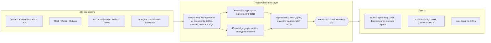

<div align="center">

**Translations:** [English](../../../README.md) · [Français](../fr/README.md) · [Deutsch](../de/README.md) · [简体中文](../zh-CN/README.md) · [日本語](../ja/README.md) · [Русский](../ru/README.md) · [עברית](../he/README.md) · [한국어](../ko/README.md) · [Español](../es/README.md) · [Português](../pt/README.md) · [Türkçe](../tr/README.md) · [Tiếng Việt](../vi/README.md) · [Italiano](../it/README.md) · **Čeština**

</div>

<div align="center">

<a href="https://www.pipeshub.com"></a>

<h3>Open-source kontextová vrstva pro AI agenty</h3>

<p>
  <a href="https://www.pipeshub.com/">Web</a> ·
  <a href="https://docs.pipeshub.com/">Dokumentace</a> ·
  <a href="https://discord.com/invite/K5RskzJBm2">Discord</a> ·
  <a href="https://plum-myrtle-9f7.notion.site/Pipeshub-s-Product-Roadmap-33841c164f54803a9989fd0fdbfdb1ee">Plán vývoje</a>
</p>

<a href="https://trendshift.io/repositories/14618"></a>

<p>
  <a href="https://opensource.org/licenses/Apache-2.0"></a>
  <a href="https://github.com/pipeshub-ai/pipeshub-ai/releases"></a>
  <a href="https://hub.docker.com/r/pipeshubai/pipeshub-ai"></a>
  <a href="https://discord.com/invite/K5RskzJBm2"></a>
  
  
  <a href="https://github.com/pipeshub-ai/pipeshub-ai/issues">
    
  </a>
  <a href="https://github.com/pipeshub-ai/pipeshub-ai/pulls">
    
  </a>
  <br/>
  <a href="https://x.com/PipesHub"></a>
  <a href="https://www.linkedin.com/company/pipeshub"></a>
  <br/>
  
  <br/>
  <a href="https://www.npmjs.com/package/@pipeshub-ai/sdk"></a>
  <a href="https://pypi.org/project/pipeshub-sdk/"></a>
  <a href="https://github.com/pipeshub-ai/pipeshub-sdk-go"></a>
  <a href="https://www.npmjs.com/package/@pipeshub-ai/mcp"></a>
</p>

</div>

<h2 id="about-pipeshub">Dejte svým AI agentům skutečné porozumění vaší firmě</h2>

<strong>[PipesHub](https://www.pipeshub.com/)</strong> promění vše, co vaše firma ví, v pracovní prostor respektující oprávnění, který AI agenti prozkoumávají tak, jako programovací agenti prozkoumávají repozitář. Agenti v něm vyhledávají, používají na něj `grep`, procházejí jeho složky a znalostní graf, čtou jen to, co potřebují, a citují přesný blok, ze kterého každá odpověď pochází.

Připojte Slack, Google Drive, GitHub, Microsoft 365, Jira, Notion, Postgres a více než 25 dalších systémů. Používejte vestavěný chat, hloubkový výzkum a agenty, nebo předejte stejný kontext přes MCP a SDK do Claude Code, Cursoru, Codexu a vlastních agentů. Vlastní hosting, Apache 2.0, model podle vaší volby.

> [!TIP]
> Nasaďte jediným příkazem:
> ```bash
> curl -fsSL https://get.pipeshub.com/install | bash
> ```

<p align="center">
  <a href="https://youtu.be/VgyND38QZ7w"></a>
  <br/>
  <strong><a href="https://youtu.be/VgyND38QZ7w">▶ Podívejte se na 2½minutové demo</a></strong>: Claude Code odpovídá ze systémů Jira, Slack, GitHub a Drive s respektováním oprávnění každého uživatele
</p>

## Proč kontextová vrstva?

Agenti obvykle selhávají na firemních znalostech kvůli kontextu, ne kvůli modelu. Vyhledávání top-k úryvků předá agentovi hrstku fragmentů a zahodí, kde každý z nich leží, na co odkazuje, kdo ho smí vidět a odkud pochází.

Programovací agenti se zlepšili ve chvíli, kdy mohli v repozitáři používat `ls`, `grep` a číst ho, místo aby dostávali vložené úryvky. PipesHub dává agentům totéž nad daty vaší firmy.

| | RAG s top-k úryvky | PipesHub |
| --- | --- | --- |
| **Co agent vidí nejdřív** | Několik textových úryvků | Název, umístění, metadata a shrnutí každého záznamu a k tomu bloky, které odpovídají dotazu |
| **Jak se dostane hlouběji** | Nedostane: jedno vyhledání na otázku | Hybridní vyhledávání, `grep`/`find` nad záznamy, procházení složek a dotazy do znalostního grafu, ve smyčce |
| **Struktura** | Ztracena při dělení na úryvky | Každý zdroj se stane Bloky: sekce, tabulky s řádky a buňkami, vlákna, kód, SQL tabulky s jejich schématem |
| **Oprávnění** | Často jen přibližně při indexaci | Kontrolována vůči oprávněním zdrojového systému pro uživatele, který se ptá, při každém volání nástroje |
| **Citace** | Na úryvek, pokud vůbec | Na blok: stránka, buňka tabulky, řádek, snímek nebo řádek kódu; vymyšlené citace se odstraní |

## Jak to funguje



Každý zdroj se stane **Bloky**: jednou reprezentací, která zachová tabulky, vlákna a kód a pamatuje si přesnou stránku, buňku nebo řádek, odkud každý blok pochází. Každý indexovaný dokument se ukládá jako prostý text, takže při lokálním úložišti blobů mohou agenti použít `grep` na PDF, soubor Word nebo prezentaci stejně jako na textový soubor (záznamy nad 20 MB se přeskakují; viz [současná omezení](../../context-layer.md#current-limitations)). Bloky jsou uspořádány dvojím způsobem: podle **struktury složek** každého zdrojového systému a ve **znalostním grafu** lidí, projektů a zákazníků. Agenti obojí prozkoumávají pomocí **nástrojů, které odhalují detaily postupně**: vyhledávání nejprve ukáže název, shrnutí a odpovídající pasáže každého záznamu a agent jde hlouběji (grep, procházení složek, sledování entit, čtení celého záznamu) jen tehdy, když to potřebuje. **Každé volání nástroje se kontroluje vůči oprávněním zdrojového systému** pro osobu, za kterou agent jedná.

**[Přečtěte si, jak kontextová vrstva funguje →](../../context-layer.md)** Popisuje formát Bloků, hierarchii a graf, všechny nástroje agenta a kód, ve kterém jsou, vynucování oprávnění, smyčku agenta a současná omezení.

## Co můžete s PipesHub vytvořit

Jedna kontextová vrstva, mnoho produktů nad ní. Používejte vestavěné aplikace tak, jak jsou, nebo si postavte vlastní přes MCP a SDK.

| Co vytvořit | Co vám dá PipesHub | Kde začít |
| --- | --- | --- |
| **Agentní RAG pipeline** | Nástroje pro vyhledávání, které agent volá ve smyčce (hybridní vyhledávání, `grep`, navigace, dotazy na entity, čtení celých záznamů), s hotovou kontrolou oprávnění a citacemi na úrovni bloků | [SDK starter](https://github.com/pipeshub-ai/examples/tree/main/sdk-starter) · [MCP](#použití-z-claude-code-cursor-nebo-codex) |
| **Podnikové vyhledávání** | Jedno vyhledávací pole napříč 40+ konektory, které každému ukáže jen to, co smí vidět, s odpověďmi s citacemi | Vestavěno · [příklad](https://github.com/pipeshub-ai/examples/tree/main/private-enterprise-search) |
| **AI asistent pro práci** | Chat a hloubkový výzkum nad firemními znalostmi, k tomu vyhledávání na webu a hlasový vstup | Vestavěno |
| **Kontext pro programovací agenty** | Claude Code, Cursor a Codex odpovídají z návrhových dokumentů, tiketů, incidentů a vláken v chatu, nejen z kódu | [příklad](https://github.com/pipeshub-ai/examples/tree/main/company-knowledge-mcp) |
| **Agenti bez kódu a nástroje pro workflow** | Vizuální drag-and-drop editor, který propojí firemní znalosti s akcemi ve Slacku, Gmailu, Jira, Confluence, GitHubu, Linearu, Notionu, Salesforce, Zendesku, Freshdesku a 20 dalších nástrojích. Nebo si na stejném API postavte vlastní produkt pro workflow, aby každý krok dostal kontext respektující oprávnění. | Vestavěno · [Headless použití](#mohu-pipeshub-používat-headless-bez-jeho-uživatelského-rozhraní) |
| **Kopiloti zákaznické podpory** | Odpovědi z dřívějších tiketů, runbooků a dokumentace (ServiceNow, Zammad, Jira, Confluence) s akcemi zpět v tiketovacím nástroji | Vestavěno · SDK |
| **Obchodní přehled o zákaznících** | Účty, kontakty a obchody ze Salesforce ve znalostním grafu, prohledávatelné spolu s e-maily, dokumenty a chaty o stejných zákaznících | Vestavěno |
| **Dotazy nad vašimi databázemi** | Tabulky z Postgres, MariaDB a Snowflake indexované se schématy a cizími klíči, k tomu sandboxy, které spouštějí SQL a Python pro analýzy | Vestavěno |
| **Reporty, grafy a dashboardy** | Agenti napíší a spustí kód v sandboxu a výsledek vrátí jako sdílitelný artefakt | Vestavěno |
| **Vyhledávání v inženýrských znalostech** | Kód, pull requesty a commity z GitHubu a GitLabu, propojené s tikety a dokumenty kolem nich | Vestavěno |
| **Vlastní aplikace nad firemními znalostmi** | SDK pro Python, TypeScript a Go, „Sign in with PipesHub“, aby každý uživatel vyhledával sám za sebe, a API pro nahrávání dokumentů, které žádný konektor nepokrývá | [příklady](https://github.com/pipeshub-ai/examples) |
| **Právní aplikace a správa smluv (CLM)** | Ptejte se napříč smlouvami v Drive, SharePointu, Boxu nebo v nahraných souborech. Odpovědi citují přesnou klauzuli nebo stránku a každý vidí jen smlouvy, ke kterým má přístup. | [Headless použití](#mohu-pipeshub-používat-headless-bez-jeho-uživatelského-rozhraní) |
| **Soukromá AI on-prem** | Vše výše uvedené na vlastní infrastruktuře, s libovolným poskytovatelem LLM nebo lokálními modely přes Ollama, s daty ve vaší infrastruktuře | [Nasazení](#-průvodce-nasazením) |

## Použití z Claude Code, Cursor nebo Codex

**[Dejte svému programovacímu asistentovi bezpečný přístup ke znalostem vaší firmy →](https://github.com/pipeshub-ai/examples/tree/main/company-knowledge-mcp)**

Asi deset minut, jakmile PipesHub běží a má zaindexovaná data. Vytvořte si osobní přístupový token (Personal Access Token, není potřeba admin), připojte asistenta (jeden příkaz pro Claude Code, jeden konfigurační soubor pro Cursor nebo Codex) a zeptejte se *„proč se změnila logika opakování v billing workeru?“* Odpoví z postmortemu incidentu, pull requestu, vlákna v chatu a návrhového dokumentu, každý zdroj ocituje, a to jen pokud je smíte vidět.

Přes MCP mají asistenti už dnes k dispozici vyhledávání, chat, čtení záznamů a procházení složek z PipesHub. `grep` a dotazy na entity do MCP přibudou jako další.

Chcete stejné vyhledávání ve vlastním kódu nebo za vyhledávacím polem pro svůj tým? [SDK starter a příklad vyhledávání](https://github.com/pipeshub-ai/examples) pokrývají obojí. Postavili jste něco? [Ukažte nám to](https://github.com/pipeshub-ai/examples/issues/new?template=showcase.yml).

## PipesHub v akci

### Citace


### Konektory


<details>
<summary><b>Další ukázky: všechny záznamy, vyhledávání ve znalostech</b></summary>

### Všechny záznamy


### Vyhledávání ve znalostech


</details>

## Funkce

**Kontext pro agenty**

- 🗂️ **Prozkoumatelné, nejen prohledávatelné:** Hybridní vyhledávání, `grep` nad každým indexovaným dokumentem včetně PDF a souborů Office (jen s lokálním úložištěm blobů, záznamy do 20 MB; [omezení](../../context-layer.md#current-limitations)), procházení složek a dotazy do znalostního grafu, vše jako nástroje agenta.
- 🔒 **Oprávnění v každém kroku:** Každé volání nástroje se kontroluje vůči oprávněním zdrojového systému pro osobu, za kterou agent jedná.
- 📝 **Citace na úrovni bloků:** Odpovědi citují stránku, buňku tabulky, řádek, snímek nebo řádek, odkud pocházejí.
- 🧱 **Strukturovaná, polostrukturovaná i nestrukturovaná data v jedné vrstvě:** Dokumenty, tabulky, tikety, vlákna v chatu, kód i SQL tabulky se stanou Bloky.

**Propojeno s vašimi systémy**

- 🔌 **40+ konektorů:** Google Workspace, Microsoft 365, Slack, Jira, Confluence, Notion, GitHub, GitLab, Salesforce, ServiceNow, Postgres, Snowflake a další, se synchronizací v reálném čase i podle plánu.
- 🕸️ **Znalostní graf:** Entity a vztahy vytěžené při indexaci a použité při odpovídání.
- 🎙️ **Multimodální:** Obrázky, diagramy a naskenované soubory, k tomu hlasový vstup.
- 🧠 **Vlastní model, plně na vlastní infrastruktuře:** Libovolný poskytovatel LLM nebo lokální model, nasazené ve vaší infrastruktuře.

## PipesHub Cloud

Dáváte přednost plně spravovanému PipesHub bez provozování vlastní infrastruktury? Zaregistrujte se v **[PipesHub Cloud](https://app.pipeshub.com)**: stejné konektory, vyhledávání respektující oprávnění a API, aniž byste cokoli instalovali.

Kódovací agenti se připojují k `https://app.pipeshub.com/mcp` pomocí osobního přístupového tokenu. Viz [Pro kódovací agenty](https://docs.pipeshub.com/for-agents).

## Konektory

<p align="center">
<a href="https://pipeshub.com/connectors"></a>
</p>

## 🚀 Průvodce nasazením

PipesHub můžete spustit lokálně nebo nasadit na libovolný server pomocí Docker Compose. Interaktivní instalátor se postará o veškerou konfiguraci, včetně tajných klíčů, grafové databáze, message brokeru a volby tagu image, a vygeneruje za vás soubor `.env`.

> **HTTPS na cloudových serverech:** Pokud PipesHub nasazujete na cloudový server, použijte HTTPS endpoint. Prohlížeče blokují některé požadavky přes prosté HTTP. K ukončení TLS použijte Cloudflare, Nginx nebo Traefik. Bílá obrazovka po nasazení jen přes HTTP je obvykle způsobena tímto omezením.

---

### ⚡ Rychlý start (doporučeno)

Vyžaduje [Docker](https://docs.docker.com/get-docker/) s Compose v2. Jeden příkaz:

```bash
curl -fsSL https://get.pipeshub.com/install | bash
```

Tento příkaz stáhne soubory pro nasazení nejnovější verze do `./pipeshub` a
spustí interaktivní instalátor. Po dokončení otevřete **http://localhost:3000**.

> **Chcete si skript nejdřív přečíst?** Stáhněte si ho a prohlédněte:
>
> ```bash
> curl -fsSL https://get.pipeshub.com/install -o pipeshub-install.sh
> less pipeshub-install.sh        # review it
> bash pipeshub-install.sh
> ```

Instalátor:
- zkontroluje Docker, RAM a místo na disku,
- zeptá se, zda chcete nasazení **slim** nebo **full**,
- volitelně vám umožní upravit grafovou databázi, message broker a úložiště klíč-hodnota,
- vygeneruje náhodné tajné klíče a zapíše soubor `.env`,
- stáhne image a spustí stack,
- počká, až bude PipesHub zdravý, ověří jeho dostupnost a vypíše URL.

### 🛠️ Z naklonovaného repozitáře (pro vývojáře)

Pro sestavení ze zdrojového kódu, přispívání nebo připnutí instalátoru k vaší pracovní kopii:

```bash
git clone https://github.com/pipeshub-ai/pipeshub-ai.git
cd pipeshub-ai

# Same installer, run from the repo root
./install.sh
```

V naklonovaném repozitáři se `./install.sh` zeptá, zda stáhnout předem sestavené image, nebo je sestavit ze zdrojového kódu;
`./install.sh --build` sestaví ze zdrojového kódu bez ptaní. Jednopříkazový instalátor výše vždy používá předem sestavené image.

> **Pokročilé možnosti:** přepínače instalátoru (`--yes`, `--version`, `--reconfigure`, `--print-env-only`), proměnné prostředí pro CI, typy nasazení slim a full, ruční použití profilů Compose a lokální sestavení ze zdrojového kódu popisují [Pokročilé možnosti nasazení](../../../deployment/docker-compose/ADVANCED_DEPLOYMENT.md).

## Stavějte na PipesHub: MCP a SDK

Vestavěné vyhledávání je jen jedním ze způsobů, jak PipesHub používat. Stejný propojený
kontext filtrovaný podle oprávnění mají k dispozici i vaši vlastní agenti a aplikace:
přes MCP pro libovolného kompatibilního klienta, nebo přes SDK, když ho voláte
z vlastního kódu.

Agent se připojuje jako konkrétní osoba, ne jako aplikace, takže
získá přesně to, co tato osoba smí vidět. Přístup se vyhodnocuje při
spuštění dotazu vůči vlastním oprávněním zdrojového systému, místo aby se
jen přibližně určil při sestavení.

Návody krok za krokem pro nejčastější případy (MCP pro vašeho programovacího
asistenta, soukromé podnikové vyhledávání a SDK startery) najdete v
[**pipeshub-ai/examples**](https://github.com/pipeshub-ai/examples). Referenční
materiály ke každému stavebnímu bloku jsou níže.

### MCP server

Používejte PipesHub s libovolným klientem kompatibilním s MCP a přineste firemní kontext do svých AI workflow. Nastavení a použití popisuje README.

**Repozitář:** [pipeshub-ai/mcp-server](https://github.com/pipeshub-ai/mcp-server/)

Používáte [Omnigent](https://omnigent.ai)? V [`integrations/omnigent/`](../../../integrations/omnigent/) najdete tři způsoby připojení, od připojení přes webové rozhraní po skriptovanou sadu pro připojení.

### SDK

PipesHub nabízí vývojářská SDK pro Python, TypeScript a Go, abyste mohli rychle začít s integrací. Nastavení a použití popisuje README příslušného repozitáře SDK.

| Název | Popis | Odkaz |
|------|-------------|------|
| **Python SDK** | Python SDK pro PipesHub | [pipeshub-ai/pipeshub-sdk-python](https://github.com/pipeshub-ai/pipeshub-sdk-python) |
| **TypeScript SDK** | TypeScript SDK pro PipesHub | [pipeshub-ai/pipeshub-sdk-typescript](https://github.com/pipeshub-ai/pipeshub-sdk-typescript) |
| **Go SDK** | Go SDK pro PipesHub | [pipeshub-ai/pipeshub-sdk-go](https://github.com/pipeshub-ai/pipeshub-sdk-go) |

> Potřebujete SDK v jiném jazyce? Napište nám na developer@pipeshub.com

## Plán vývoje

<p>Vyvíjíme otevřeně. Tady je, co je hotovo a co přijde dál:</p>

<ul>
<li>✅ 🤖 <strong>AI agenti pro práci</strong>: plnohodnotný editor agentů bez kódu</li>
<li>✅ 🔗 Podpora <strong>MCP (Model Context Protocol)</strong>, jako server i klient</li>
<li>✅ 🧰 <strong>SDK pro vývojáře</strong></li>
<li>✅ 🔍 <strong>Vyhledávání v kódu</strong> napříč GitHubem a GitLabem</li>
<li>⬜ 👤 <strong>Personalizované vyhledávání</strong> podle týmu, role a historie</li>
<li>✅ ☸️ Produkční nasazení na <strong>Kubernetes</strong> s výchozím nastavením pro vysokou dostupnost</li>
<li>⬜ 📈 <strong>Relevance rozšířená o PageRank</strong> napříč znalostním grafem</li>
</ul>
<p>👉 <strong><a href="https://plum-myrtle-9f7.notion.site/Pipeshub-s-Product-Roadmap-33841c164f54803a9989fd0fdbfdb1ee">Celý plán vývoje produktu na Notionu</a></strong></p>

<hr>

## 👥 Přispívání

Chcete se připojit k naší komunitě vývojářů? Podívejte se na našeho [průvodce přispíváním](https://github.com/pipeshub-ai/pipeshub-ai/blob/main/CONTRIBUTING.md), kde najdete podrobnosti o nastavení vývojového prostředí, našich standardech kódu a postupu při přispívání.
<h3>Kam se obrátit</h3>

<table>

<tr><td>Položit dotaz nebo získat pomoc</td><td><a href="https://discord.com/invite/K5RskzJBm2">Discord</a></td></tr>
<tr><td>Nahlásit chybu nebo navrhnout funkci</td><td><a href="https://github.com/pipeshub-ai/pipeshub-ai/issues">GitHub Issues</a></td></tr>
<tr><td>Nahlásit bezpečnostní problém</td><td><a href="https://github.com/pipeshub-ai/pipeshub-ai/blob/main/SECURITY.md">Nahlásit bezpečnostní problém</a></td></tr>
<tr><td>Přečíst si dokumentaci</td><td><a href="https://docs.pipeshub.com/">Dokumentace PipesHub</a></td></tr>
<tr><td>Zjistit, co se změnilo v jednotlivých verzích</td><td><a href="https://github.com/pipeshub-ai/pipeshub-ai/blob/main/CHANGELOG.md">Changelog</a></td></tr>
</table>

## Často kladené otázky

### Co je PipesHub?

PipesHub je open-source kontextová vrstva pro AI agenty. Promění znalosti uložené napříč firemními systémy v pracovní prostor respektující oprávnění, ve kterém mohou agenti vyhledávat, používat `grep`, procházet ho a citovat.

Připojí systémy jako Slack, Google Drive, GitHub, Microsoft 365 a Notion a jejich obsah zpřístupní dvěma způsoby: vyhledáváním s citacemi, které respektuje oprávnění, pro váš tým, a důvěryhodným kontextem pro vaše AI agenty přes API, SDK a MCP. Agenti dostanou stejný řízený pohled na firemní znalosti jako člověk, se stejnými přístupovými právy, takže mohou odpovídat ze skutečných firemních dat, místo aby hádali napříč nástroji. Můžete používat vestavěné vyhledávání, nebo nad ním stavět vlastní agenty, workflow a aplikace.

### Mohu PipesHub používat headless, bez jeho uživatelského rozhraní?

Ano. Webová aplikace PipesHub používá stejné API, které můžete volat sami, takže vše, co uděláte v rozhraní, můžete udělat i v kódu: připojit zdroje, nahrát soubory, spravovat uživatele a oprávnění, vyhledávat, chatovat a vytvářet a spouštět agenty.

- **REST API:** [specifikace OpenAPI](../../../backend/nodejs/apps/src/modules/api-docs/pipeshub-openapi.yaml) s přibližně 470 endpointy. Procházet ji můžete na adrese `/api/v1/docs` vaší instance.
- **SDK:** [Python](https://github.com/pipeshub-ai/pipeshub-sdk-python), [TypeScript](https://github.com/pipeshub-ai/pipeshub-sdk-typescript) a [Go](https://github.com/pipeshub-ai/pipeshub-sdk-go).
- **MCP:** pro Claude Code, Cursor, Codex a další MCP klienty. Pokrývá jen část: vyhledávání, chat (i s existujícím agentem), čtení, stahování a procházení záznamů, dotazy na lidi a zdroje a nástroje grafu kódu. Připojení zdrojů, správa uživatelů a vytváření agentů vyžadují REST API nebo SDK.

Zvolte, jak se váš kód přihlásí:
- **Osobní přístupový token nebo OAuth:** jedná jako jedna osoba a vidí jen to, co tato osoba smí vidět.
- **Servisní účet:** pro úlohy na pozadí, s vlastními oprávněními.
- **OAuth aplikace:** umožní každému uživateli vaší aplikace přihlásit se sám za sebe („Sign in with PipesHub“).

Týmy takto nad PipesHub stavějí vlastní produkty, například nástroje pro workflow, nástroje pro právníky a správu smluv (CLM), konzole podpory a interní agenty, aniž by ukazovaly rozhraní PipesHub.

### Čím se PipesHub liší od ostatních AI nástrojů pro firemní prostředí?

Většina nástrojů předá AI modelu několik vyhledaných textových úryvků. PipesHub dává agentům nástroje, kterými firemní znalosti prozkoumávají tak, jako programovací agent prozkoumává repozitář: hybridní vyhledávání, `grep` nad záznamy, procházení složek a dotazy do znalostního grafu, vše kontrolované vůči oprávněním uživatele ve zdrojovém systému. Každý zdroj se stane Bloky, takže odpovědi citují přesnou stránku, buňku tabulky, řádek nebo snímek. Je plně open source (Apache 2.0) a lze ho provozovat na vlastní infrastruktuře. S lokálním modelem (například přes Ollama) vaše data nikdy neopustí vaši infrastrukturu; s hostovaným poskytovatelem LLM se tomuto poskytovateli posílají pasáže, ze kterých se odpověď skládá. Viz [Proč kontextová vrstva?](#proč-kontextová-vrstva)

### Jaké konektory PipesHub podporuje?

PipesHub má 40+ konektorů pro více než 30 systémů, s indexací v reálném čase i podle plánu. Viz [přehled konektorů](https://docs.pipeshub.com/connectors/overview).

### Jaké poskytovatele LLM PipesHub podporuje?

PipesHub funguje na principu „Bring Your Own Model“: můžete použít libovolného poskytovatele LLM. Nasaďte ho ve svém VPC s modely, které preferujete.

**Další otázky:** formáty souborů, technologický stack, znalostní graf, multimodální podpora a řešení problémů jsou zodpovězeny v [úplných FAQ](../../FAQ.md).

<hr>
<div align="center">
<h3>⭐ Dejte nám hvězdičku na GitHub!</h3>

<p>Pomáhá to projektu dostat se k týmům, které ho potřebují.</p>

<p>
<a href="https://github.com/pipeshub-ai/pipeshub-ai">

</a>
</p>

<p>
<a href="https://www.star-history.com/?repos=pipeshub-ai%2Fpipeshub-ai">
 <picture>
   <source media="(prefers-color-scheme: dark)" srcset="https://api.star-history.com/chart?repos=pipeshub-ai/pipeshub-ai&amp;type=date&amp;theme=dark&amp;legend=top-left&amp;sealed_token=msbcJ843ZmXCld8-zgduwH9hV6yn69hyfrnwfkcWiRqe7htnO6pSbQJrkxdoarzriLW6aGAETT-iQ3m7yWN3BacAyPyHfNIiPGabl6r6CbXFjcvJ7n1NZw" />
   <source media="(prefers-color-scheme: light)" srcset="https://api.star-history.com/chart?repos=pipeshub-ai/pipeshub-ai&amp;type=date&amp;legend=top-left&amp;sealed_token=msbcJ843ZmXCld8-zgduwH9hV6yn69hyfrnwfkcWiRqe7htnO6pSbQJrkxdoarzriLW6aGAETT-iQ3m7yWN3BacAyPyHfNIiPGabl6r6CbXFjcvJ7n1NZw" />
   
 </picture>
</a>
</p>

<p><sub>Vytvořeno s ❤️ <a href="https://www.pipeshub.com/">týmem PipesHub</a> a přispěvateli z celého světa.</sub></p>

</div>
