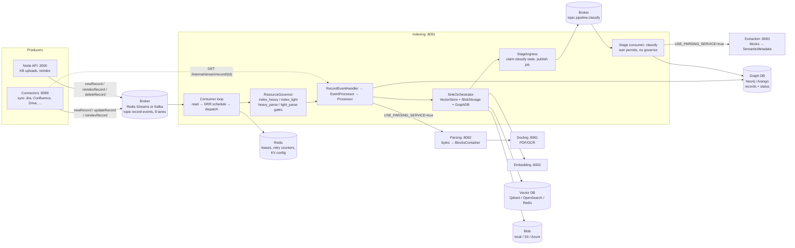
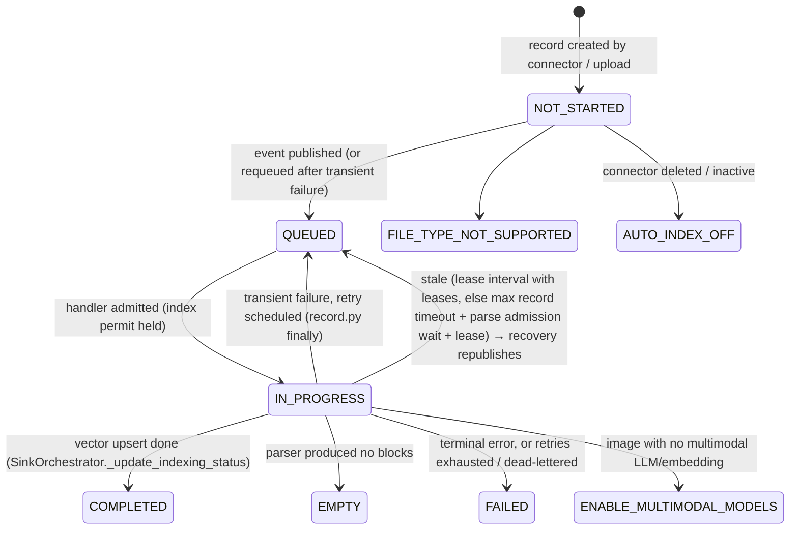
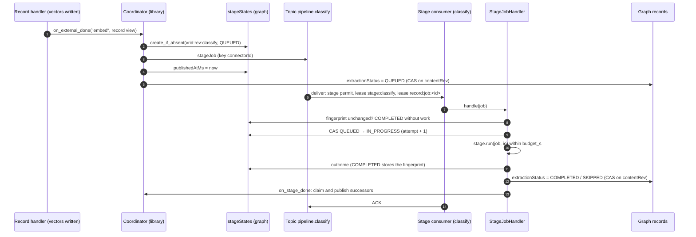
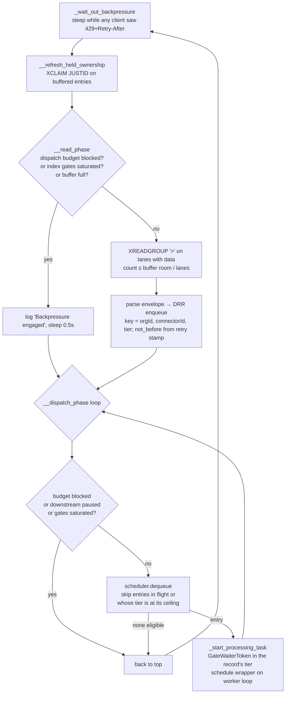

# Indexing Service — Architecture, Data Flow, and Admission Control

This is the working reference for `backend/python/app/indexing_main.py` and everything a record passes through between a `record-events` message and `indexingStatus=COMPLETED`, plus the pipeline stages that run after it (§2.3). Read it before changing anything under `app/services/messaging/`, `app/services/resource_governor/`, `app/events/`, `app/modules/transformers/`, or `app/modules/pipeline/`.

Section 5 is the root-cause analysis of the "indexing starts fast, then drops to 2–3 records" throughput collapse. If that is why you are here, skip to it, but the mechanism only makes sense with sections 3 and 4.2 in mind.

---

## 1. High-level design

Indexing is one Python process (`app.indexing_main`, port 8091) that consumes record events from the broker, downloads each record's bytes, parses them into a `BlocksContainer`, embeds the blocks into the vector store and stores the blocks in blob storage. The record is then searchable, and the handler hands it to the pipeline stage runtime (§2.3): classification (summary, categories, topics, departments, all LLM-extracted) runs afterwards as the `classify` stage, on its own topic with its own permits, status, retries and dead-lettering. It does not talk to a source system directly: the Connectors service owns source access and streams bytes on request.

Indexing needs a language model configured before records can finish, not only for the enrichment step at the end. The model assigned to the `indexing` role (or the default LLM) is read while records are processed: images check whether it is multimodal, and spreadsheets, CSVs and tables in documents are summarised with it while they are parsed. With no LLM configured, such a record fails with "No AI model is set up for this workspace yet…" (`app/utils/llm.py::LLM_MISSING_FOR_FILE`), stored as the failure reason as-is. Classification runs later, as the `classify` stage, and cannot fail the record: with no LLM configured it ends `SKIPPED` with the reason, and the record stays searchable (§2.1).



**Two parsing modes exist.** With `USE_PARSING_SERVICE=false` (the shipped default) the handler parses in-process via `app/events/processor.py` (`Processor.process_*`), which itself calls the Docling service for PDF layout. With `USE_PARSING_SERVICE=true` it POSTs the bytes to the Parsing service. Both paths yield the same three pipeline events to the consumer (`START_PARSING`, `PARSING_COMPLETE`, `INDEXING_COMPLETE`), which is what the admission control below keys on.

**One worker loop.** Handlers run on a second event loop on a dedicated thread (`services/messaging/worker_loop.WorkerLoop`), shared by every indexing consumer in the process: the record consumer and each pipeline-stage consumer. `WorkerLoop` owns that loop and its lag monitor (section 4.10), so one monitor covers every consumer's handlers. Broker I/O (XREADGROUP/XACK, Kafka poll/commit, producer sends) stays on the main loop; every handler, the governor gates, the graph and vector clients, the lease renewers and the recovery loops run on the worker loop. Anything that must cross loops goes through `consumer_concurrency.bridge_to_main_loop` or `run_on_loop`. The producers do that for themselves: `RedisStreamsProducer` and `KafkaMessagingProducer` remember the loop they were started on and hand a send from any other loop back to it (`app/utils/loop_bridge.run_on_loop`), so a handler on the worker loop can call them directly. Service clients bind to the loop that first uses them (an aiohttp session, an LLM or embedding HTTP pool, a Redis connection, an `asyncio.Lock` once contended), so a second worker loop would put the same clients on two loops; a client that must also serve the main loop keeps one resource per loop. Redis clients do it through `app/services/redis/loop_clients.LoopBoundClients`: `RedisClientRegistry` for leases and retry counts, and the accessible-records cache, which the worker loop invalidates when a knowledge-base record finishes indexing. Other clients use `utils/loop_local.LoopLocal`, as the ArangoDB, Neo4j and Qdrant clients and the accessible-records cache's single-flight locks do.

**Parse workers.** Parsing a large text, code or CSV file is seconds of CPU, and on the worker loop that is seconds in which no other record's graph, vector or embedding call can make progress. Those parses run in separate worker processes owned by `app/modules/parsers/parse_pool.py`; section 4.7 says which step runs where and why a thread is not enough. The parsing service uses the same pool for the same parsers.

Related services and ports are listed in `AGENTS.md`.

---

## 2. Record lifecycle and data flow

### 2.1 Status state machine

Status lives on the record node in the graph (`records` collection) as three fields: `indexingStatus`, `parsingStatus`, `extractionStatus`, plus `processingStartedAt` and `reason`. A primary whose queued md5-duplicates were just promoted also carries `duplicateReconcilePending` until their taxonomy edges and entity membership have been copied (see `docs/entity-resolution.md`). `contentRev`, the revision of the record's content (the first 16 hex digits of its bytes' sha256), is written with `IN_PROGRESS`; pipeline stage writes are conditional on it.



`extractionStatus` belongs to the `classify` stage (§2.3) and never blocks searchability: a record is searchable as soon as `indexingStatus=COMPLETED`. It moves to `QUEUED` when the stage job is claimed and published, then to `COMPLETED`, `SKIPPED` (classification off, nothing to classify, or no LLM configured; `reason` says which) or `FAILED`. A retrying or paused job leaves it `QUEUED`.

A record also stays searchable while `hasIndexedCopy` is true. Indexing sets it with every `COMPLETED` write and clears it when a record turns out `EMPTY`; nothing else touches it, and connector upserts merge rather than replace, so it survives a re-queue. An edited record queued again (`NOT_STARTED`, `QUEUED`, `IN_PROGRESS`), or one whose re-index failed, therefore keeps serving its previous copy until the new one is indexed. The search gate is `aql_searchable_record` / `cypher_searchable_record` in `app/services/graph_db/common/record_visibility.py`. Records indexed before the field existed are marked by `backfill_indexed_copy_flags`, which the indexing service runs at startup once the schema is ensured. A type that is not reconciled block by block still loses its vectors while it is processed, because the handler deletes them first.

### 2.2 Data flow for one record (happy path)

```mermaid
sequenceDiagram
    autonumber
    participant Br as Broker (lane stream)
    participant Main as Consumer main loop
    participant W as Worker loop task
    participant Gov as ResourceGovernor gates
    participant Red as Redis (leases)
    participant Hnd as RecordEventHandler / EventProcessor
    participant Conn as Connectors :8088
    participant Prs as Parser (in-proc or :8092)
    participant Sink as SinkOrchestrator
    participant G as Graph DB
    participant V as Vector DB + Blob

    Br->>Main: XREADGROUP (batch ≤ buffer room)
    Main->>Main: parse envelope, DRR enqueue by (orgId, connectorId)
    Main->>Main: dispatch phase: dequeue while waiters < pending ceiling
    Main->>W: run_coroutine_threadsafe(_process_message_wrapper) + GateWaiterToken
    W->>W: retry backoff? PEL ownership check, per-process record claim
    W->>Gov: acquire INDEX_HEAVY or INDEX_LIGHT permit (tier from payload ext/mime)
    Gov-->>W: admitted → token.admit() (waiter count −1)
    W->>Red: lease "indexing" (cluster cap) + lease "record:<id>" (exclusivity)
    W->>Hnd: process_event(message)
    Hnd->>G: get record, connector active?, supported type?
    Hnd->>Conn: stream bytes (signed URL or /internal/stream/record)
    Hnd->>G: md5 dedup lookup; parsingStatus/indexingStatus = IN_PROGRESS
    Hnd-->>W: yield START_PARSING(tier, size_bytes)
    W->>Gov: acquire HEAVY_PARSE or LIGHT_PARSE permit (bounded wait, clock paused)
    W->>Red: lease "parsing" / "parsing:light"
    Hnd->>Prs: parse → BlocksContainer
    Hnd-->>W: yield PARSING_COMPLETE → release parse permit + lease
    Hnd->>Sink: index(ctx): describe images, blob write, embed + upsert
    Sink->>V: upsert points / store blocks
    Sink->>G: indexingStatus = COMPLETED, extractionStatus = QUEUED
    Hnd->>G: StageIngress: record embed, claim classify and entities (unique inserts, QUEUED)
    Hnd->>Br: publish stageJobs on pipeline.classify and pipeline.entities (retry producer)
    Hnd-->>W: yield INDEXING_COMPLETE → release index permit + lease
    W->>Main: XACK (bridged), clear retry counters
```

Failure paths from the same wrapper (`redis_streams/indexing_consumer.py::_process_message_wrapper`, mirrored in the Kafka consumer):

| Outcome | What happens |
| --- | --- |
| Terminal exception (`MessageErrorClassifier` → TERMINAL) | Record marked FAILED via the disposition sink, message ACKed. |
| Transient exception, attempts < `MAX_DELIVERY_ATTEMPTS` (3) | Record reverted `IN_PROGRESS → QUEUED`, message re-published to the same lane with `_retry_not_before` (15s, 60s, 240s backoff) and `_retry_tracking_id`, original ACKed. |
| Transient, attempts exhausted | Dead-lettered: record FAILED, message ACKed, next MD5 duplicate triggered. |
| Final attempt fails after the record is indexed, on a record the old inline enrichment left `extractionStatus=IN_PROGRESS` | Only the enrichment ends: `extractionStatus=FAILED` with "Try Reindex", the record stays searchable and its queued copies are released. New records never reach this row: the indexed write sets `QUEUED` and the stages own what follows. |
| Redelivery of a record that is indexed and still `extractionStatus=QUEUED` | If the runtime recorded `embed` for the record's revision, the stages are its (or the stage sweep's) to finish and the message is ACKed. If it did not, the attempt stopped between the indexed write and the hand-off, and the record path runs again so the hand-off happens; reconciliation keeps that cheap. |
| `ParseAdmissionTimeout` (no parse slot within `RECORD_PROCESSING_TIMEOUT`) | Re-queued **without** counting an attempt; delivery counter bounds it (`REDIS_MAX_DELIVERIES`). Every `RequeueWithoutAttempt` takes this path, including a paused stage job (§2.3). |
| Content fetch answered 429 with a `Retry-After` (the source, or the connector's quota reserve, will not serve it yet) | Not a failure. The handler writes the record `QUEUED` with `retryNotBefore` and a reason naming the source and the time, and ends normally, so the message is ACKed, no attempt is counted and no worker slot is held while it waits. The stranded-record sweep sends it again once that time has passed (section 4.6). A wait that would end more than `INDEXING_RATE_LIMIT_MAX_DEFER_SECONDS` (24h) after the first one began ends the record FAILED with a reason saying so. A 429 without `Retry-After` takes the transient row above. |
| `RECORD_PROCESSING_TIMEOUT` (1800s; `PDF_RECORD_PROCESSING_TIMEOUT`, 5400s, for PDFs) elapsed inside the handler | Task cancelled, handler leaves the record IN_PROGRESS, counted as a transient failure. |
| Lease lost (renewer could not prove ownership) | Handler cancelled, message left un-ACKed for redelivery. |
| Process crash | Entry stays in the PEL; `XAUTOCLAIM` after `claim_min_idle_ms`, and the stale-record scan republishes IN_PROGRESS records whose `processingStartedAt` is older than the cutoff `is_stale` applies: with a concurrency manager that is one lease interval (`INDEXING_CONCURRENCY_LEASE_SECONDS`, 120s), since a live holder keeps proving ownership; without one it is `max(RECORD_PROCESSING_TIMEOUT, PDF_RECORD_PROCESSING_TIMEOUT) + parse admission wait + lease` (~122 min), the longest a record can legitimately sit IN_PROGRESS — the admission wait pauses the processing budget but not the clock `processingStartedAt` starts. Every republish of one record version carries the tracking id `stale-recovery:<record>:<version>`, so its failures add up in one budget, and the scan counts each hand-back once its event is published. Whether to give up is read without counting, so a pass that cannot publish spends nothing. Past `MAX_DELIVERY_ATTEMPTS` failures or `REDIS_MAX_DELIVERIES` hand-backs the record handler ends the record instead: FAILED, or only its enrichment when it is already searchable, and the copies queued behind it are released or the next one triggered. A success clears the counters. |
| Worker event loop exits without a stop request | `WorkerLoop` records the cause on `failure`, logs it at CRITICAL with the traceback, and calls every consumer's exit listener, which clears `running`: the consumers stop reading, dispatching and claiming (each `XAUTOCLAIM` would spend a delivery attempt toward `REDIS_MAX_DELIVERIES`). `GET /health` returns 503 with `worker_loop_failure` (the exception type), and `WorkerLoop.start()` refuses to start a second loop. Un-acknowledged entries stay pending; restart the process to resume. |
| Stage hand-off fails after the vectors are written | A graph error while claiming the stage state fails the attempt like any transient error; the retry overwrites the same deterministic vector points and hands off again. A broker that refuses the stage job does not fail it: the claim stays `QUEUED` and the stage sweep publishes it (§2.3). |

### 2.3 Pipeline stages (after indexing)

Work that needs a record to be searchable first, but must not hold its index permit, runs as a **pipeline stage** (`app/modules/pipeline/`). `classify` reads the stored blocks, calls the classifier (the Extraction service with `USE_PARSING_SERVICE=true`, in-process `DocumentExtraction` otherwise), resolves the categories, topics and departments to the org's taxonomy nodes, and writes the summary into the stored record, the summary vector and the taxonomy edges; it owns `extractionStatus`. Named-entity extraction runs beside it as the `entities` stage (topic `pipeline.entities`), which needs only `embed`, not `classify`, so it never holds up classification. Their prerequisite, `embed`, is still produced by the record handler above; the registry knows it as an *external* stage. Stage consumers, topics and `/health` entries are built from the registry (`modules/pipeline/runtime.py`).



| Guarantee | Mechanism |
| --- | --- |
| A stage is dispatched once per revision, however many upstream completions race | The dispatcher claims the stage's state before publishing: a unique insert of `vrid:rev:stage`, or one compare-and-set from a terminal status back to `QUEUED`. Only the claimer publishes. |
| A duplicated or redelivered job runs once | `work_key` (`job:<jobId>`) serialises deliveries in-process and cluster-wide, the claim to `IN_PROGRESS` is a compare-and-set, and a job whose fingerprint matches the stored one completes without work. |
| A run settles only its own claim | Each claim increments the state's `attempt`, and every later write of that run (its outcome, the unchanged-output completion, a dead-letter's FAILED) is a compare-and-set on the status and that `attempt`. A run the sweeper took for dead and another worker then claimed writes nothing, sets no record status and dispatches no successors; if nobody claimed it since, it still records its result. |
| Unchanged content costs no LLM call | Fingerprint = `stage@version` + an input digest + a config digest; for `classify`, the text digest, the resolved indexing model, the prompt version, the org's departments, the record's name and type (both are in the prompt) and the entity-resolution mode; for `entities`, see below. `forceReindex` forces the job. A stage whose output lives outside its state keeps it with the state: classification's is in the stored record, which a re-index of unchanged content rewrites without it, and an unchanged job puts it back without a model call. |
| A stale job cannot overwrite newer content | Every headline write is a compare-and-set on the record's `contentRev`; a job none of whose records is still on its revision ends `SKIPPED` ("superseded"). Every output a stage writes for a record (its section of the stored record, the summary point, taxonomy edges, entity points, named entities) is written under that record's exclusivity lease (`record:<recordId>`, the one its re-index holds), with `contentRev` re-checked once the lease is held, so it never lands over a newer revision's content; a bound copy that has moved on gets nothing. The lease is renewed while held, so long enrichment writes cannot outlive it. A stage that loses the record lease while writing (renewal refused, or failing until one interval before the term ends) stops before its next write and is retried; one that ran on regardless is retried too, since its last writes may have landed after the lease lapsed. |
| A lost publish or a dead worker is recovered | The stage sweep, below. |
| An LLM outage never stalls indexing | The index permit is released before the stage job exists; stage consumers have their own permits and lease pool. A paused job waits out the outage on its own schedule, so one organization's provider outage does not hold up another's classification. |

Outcomes (`StageJobHandler`, `app/modules/pipeline/worker.py`):

| Outcome | Stage state | `extractionStatus` | Consumer |
| --- | --- | --- | --- |
| COMPLETED | COMPLETED + fingerprint | COMPLETED, reason cleared | successors dispatched, ACK |
| SKIPPED (classification off, nothing to classify, no LLM configured) | SKIPPED + reason | SKIPPED + reason | successors dispatched, ACK |
| STALE (no bound record is on this revision any more) | SKIPPED "superseded" | untouched | ACK |
| RETRY (the model call failed or produced nothing usable, an Extraction-service 5xx or 429, `budget_s` elapsed) | QUEUED + reason | stays QUEUED | transient: backoff, re-publish, dead-letter after `MAX_DELIVERY_ATTEMPTS` |
| PAUSED (the model provider is unavailable, or the Extraction service is down, breaker-open or backpressured) | PAUSED + reason | stays QUEUED | `StagePaused`: re-queued without counting an attempt or a delivery, after a delay that grows with the stage attempt (15 s, 1 min, 4 min, then every 5 min) and is never shorter than the provider's remaining cooldown, so an outage of any length is waited out |
| FAILED (the Extraction service rejected the document: a 4xx) | FAILED + reason | FAILED + reason | terminal, ACK |
| Dead-lettered | FAILED | FAILED | the handler is also the consumer's `AbandonedMessageSink` |

**Named entities.** `entities` (`stages/entities.py`) runs the named-entity extraction and its graph and entity-vector writes (`SinkOrchestrator.extract_named_entities` and `persist_named_entities`), then copies the mentions to the record's already-promoted duplicates. It is a sibling of `classify`, not its successor: named-entity extraction reads only the blocks and the record's name, type and dates, never the classification, so both are dispatched the moment `embed` is recorded and each waits only for its own work. It has no headline field: its outcomes land in its stage state (the record page reads it from `stageStates`), and `extractionStatus` is `classify`'s alone. When named-entity extraction is turned off the job still runs and ends `SKIPPED` "turned off", because turning it off must clear the entities a record already had. A failed extraction is `RETRY` and keeps the record's last good entities. Its fingerprint is the text digest, the extractor and prompt versions, the resolved model, whether extraction is on, the entity kinds, time zone and budgets, the record's name, type and source time, and whether the Extraction service or the in-process extractor runs it. Its limit is the same `MAX_CONCURRENT_INDEXING_LLM_CALLS` as `classify`'s; both draw on the gateway's process-wide cap (§2.4), so together they never exceed it. Its extraction is kept as its stage state's `output` for the revision, not in the stored record: a persist retry, a vector-only re-embed and the re-extraction command read it back with `named_entities.kept.read_kept_extraction`, which falls back to the stored record's legacy `named_entities` section only for a revision the stage has no state for (a record indexed before it existed). A state with no output (skipped, turned off) means no extraction, never the legacy section. The re-extraction sweep for records whose extraction stopped short (`named_entity_completion`) replaces the kept output after it writes the completed entities (`keep_extraction`, a compare-and-set on a `COMPLETED` state), so a later reprojection does not bring back the shorter extraction.

**One stored record, one stage writer.** Classification is the only stage that writes the stored record (`semantic_metadata`), re-reading it inside the record lease; it keeps the named-entity section a record from before the entities stage may carry, so a rollback still finds it (`stages/record_io.py`). The entities stage writes only the graph and the entity points, under each record's lease, so the two stages never read-modify-write the same document.

**Reading the stored record.** Query-side code (chat, attachments, agents, the code graph) reads a record's processed content only through `record_artifact_reader(blob_store)` (`app/modules/artifacts/reader.py`): `read_record` for one record, `lookup_many` to resolve a batch first, so the layout behind a virtual record id can change in one place. Which store serves a read is decided on every `read_record` from two advanced platform flags, both off by default and read through the config cache (`artifact_read_mode`), so a save in Labs applies to the next read: with both off the stored record is read, as before. `ENABLE_ARTIFACT_READ_SHADOW` still serves the stored record, but also reads the record's artifact set (below) beside it and compares the two; `ENABLE_ARTIFACT_READ` serves the artifact set and reads the stored record only for a record whose set cannot be served. With both on, `ENABLE_ARTIFACT_READ` wins. `lookup_many` always resolves the mapping nodes; their entries also carry `currentRev`, `manifestDocId` and `storedRev` when set.

The artifact backend (`app/modules/artifacts/record_backend.py`) reads the set the mapping's `currentRev` and `manifestDocId` point at and puts back the dict the stored record would read as: `record.json` with its blocks, groups and the container's other fields, empty values dropped as the stored record drops them, images inlined again as the data URIs they were. The classification is the classify stage's sidecar `enrich/classification@<stage version>.json` with `metadata.json`'s named entities kept (what the stage writes into the stored record), else `metadata.json`, else none; a missing sidecar (404, or 403 from S3) is normal. One read-urls call signs the manifest with the files every set has or may have, and they are downloaded together (at most 4 at a time); a second call is made only for images or a second blocks part. A set is not served, and the stored record is read instead, when the mapping has no pointer (`no_pointer`), the pointer's `currentRev` is not the mapping's `storedRev` (`stale`), the set or a listed file is gone (`missing`), a file's size or sha256 is not the manifest's (`integrity`), the manifest names another revision or writer version (`invalid`), the files exceed `PIPESHUB_RECORD_MAX_DECODED_BYTES` (`too_large`, so the stored-record reader refuses it the same way), or storage fails (`failed`): `pipeshub_record_artifact_reads_total{outcome}`, with `served` for the rest. A record the stored-record path rewrites after indexing (a classification whose sidecar was not written) can differ from its set; the shadow mode exists to find these.

`storedRev` is the `contentRev` of the stored record, written by every index in the same mapping write that names the stored document (`SinkOrchestrator.index` reads the record's `contentRev` before the write and passes it in `TransformContext.settings`). The pointer moves only after a revision's set is written, so when the set of a new revision is not written (a failed write, `ENABLE_ARTIFACT_WRITE` turned off) the pointer still names the older set while the stored record and the vectors hold the new revision; serving that set would answer with old content. Such a set is `stale`, never served: artifact-first reads the stored record, and the shadow mode counts `unavailable`, not a mismatch. Because the stored record is written before the set and the pointer, a run that succeeds ends with the two equal, and a read between the two writes falls back. An index without a `contentRev` clears `storedRev`; a classification rewrite of the stored record and a vector-only re-embed (`skip_blob`) leave it as it is, since the revision does not change. A mapping written before `storedRev` existed has none, so its set is `stale` until the record is indexed again.

A shadow read starts the artifact read with the stored-record read and, once the stored record is in, waits for it at most 0.5 s, then cancels it, so a served read is never more than that slower and never fails because of the artifact read. At most 64 shadow reads run at once per process; past that, reads are served unshadowed. `pipeshub_record_artifact_shadow_reads_total{outcome}` counts `match`, `mismatch`, `unavailable`, `timeout`, `skipped` and `legacy_failed`; `pipeshub_record_artifact_shadow_mismatches_total{reason}` names the first difference (`record_field`, `semantic_metadata`, `container_field`, `block_count`, `block`, `group_count`, `group`, `legacy_missing`), and at most one warning per 10 s gives the vrid and the key or block index that differed, never content.

`tests/unit/modules/artifacts/test_reader_seam.py` fails on a new direct `get_record_from_storage` call outside the indexing paths that read, modify and rewrite the stored record, and `test_legacy_parity.py` requires every reader to give a golden corpus the same flattened results, message content and citations: the stored-record reader, and the artifact backend and `ENABLE_ARTIFACT_READ` reader over sets the real `ArtifactWriter` stored.

**Artifact sets (off by default).** With the `ENABLE_ARTIFACT_WRITE` platform flag on, `SinkOrchestrator.index` also stores the record's content revision (`contentRev`) as a directory of files, right after the stored record (`app/modules/artifacts/writer.py`, layout version 2): `record.json` (the stored copy's fields without its blocks, groups and classification, so content shared with a record that stored it first keeps that owner's name and ids as the stored copy does: `BlobStorage.apply` leaves them in `STORED_RECORD_FIELDS` for the writer; the container's other fields, such as a code parse's fact version, under `block_containers`), `blocks/part-NNNN.jsonl` and `text/part-NNNN.jsonl` (parts of at most 8 MiB, the SQL row limit applied as for the stored record), `groups.json`, `images/<sha256>.<ext>` (decoded data URIs; the blocks hold `{"asset": "images/..."}` instead, plus `asset_media_type` when the URI spelled its type otherwise, e.g. `image/jpg`; a URI whose base64 would not re-encode the same stays inline), `metadata.json`, `reconciliation.json`, and `manifest.json` last, once every other file is stored. All are written with sorted keys and no whitespace, so equal content gives equal bytes. The storage service files one document per revision under `{org}/PipesHub/record-revisions/{vrid}/{rev}/` and signs every upload in one call (`/internal/artifacts/presign`, at most 1000 files a call). After the `COMPLETED` write, the vrid's mapping node gets `currentRev`, `previousRev` and `manifestDocId` by compare-and-set on `currentRev`; a writer that lost the race leaves it. Query-side reads use them only with the read flags above. A failed write is a warning and `pipeshub_record_artifact_writes_total{outcome="failed"}`, never a failed record; a storage service without the routes (404) turns writes off for the process with one warning. A run without `contentRev` writes none. Deleting an abandoned vrid purges its revisions with its other documents (`purge_virtual_record_documents`). With the flag on, the stages also file their outputs beside the revision as **sidecars** (`app/modules/artifacts/sidecars.py`), `enrich/{stage}@{stageVersion}.json`, one presign and one upload each, not listed in the manifest: `classify` writes `enrich/classification@N.json` (the classification without its named-entity section) right after its section of the stored record and under the same record lease, both in a run and when an unchanged job puts a kept classification back (that job is on the record's current `contentRev`, which is the same revision as before, since `contentRev` is a hash of the source bytes); `entities` writes `enrich/entities@N.json` (the extraction) under the owner's lease only when the graph write's outcome is `written`, since a kept, failed or turned-off run leaves the revision's entities as they were. A superseded job, a missing stored record or a failed stored-record write files nothing. A sidecar never fails its stage: a failure is a warning and `pipeshub_record_artifact_writes_total{outcome="sidecar_failed"}` (`sidecar_written`, `sidecar_unavailable` otherwise). Superseded revisions are retired by the retention sweep below.

**Revision retention.** A record that changes keeps adding revisions: each re-index of new bytes files another artifact set and another set of stage states (`{vrid}:{rev}:{stage}`), and until the vrid is released nothing removed the old ones. `RevisionRetentionSweep` (`app/modules/artifacts/retention.py`) retires them. It runs in `recover_in_progress_records`, under the cluster-wide `recovery` lease, after the stage sweep: at most 4 pages of 200 `virtualRecordToDocIdMapping` rows per pass, walked by key (`IGraphDBProvider.get_revision_pointers`, a seek on the primary key on ArangoDB and on the unique `id` index on Neo4j), with the cursor kept in memory and the walk starting over at the top once it reaches the end (and after a restart). Each page reads its trash once (`get_virtual_record_ids_in_use(..., DELETED)`). For each vrid:

- **Trash.** While any record holding the vrid is in the trash, nothing of it is touched: a restore must find its content where it left it. The purge releases the vrid later as a whole.
- **Artifact sets.** Only when the mapping has a `currentRev` (no pointer, nothing deleted). Its revisions are listed (`GET /internal/artifacts`), and one is deleted (`DELETE /internal/artifacts/:documentId`, tree then document) when its rev is neither `currentRev` nor `previousRev` and its document was last written before the grace. `previousRev` is kept because the next index of the record inherits image descriptions from it. A revision with no usable time is kept. Before deleting, the sweep reads the mapping and the vrid's holders (`get_virtual_record_holders`, which carries each holder's `contentRev`) again and keeps any revision a holder is on: a record whose source went back to earlier bytes is on an old rev, and its writer re-uses that revision's document. A trashed holder seen at that point keeps everything too.
- **Stage states.** The states of a revision no record holding the vrid is on (`contentRev`, records in the trash included), once the newest of them was updated before the grace (`stage_states_unheld_revisions`, one read per page); the delete re-checks both in one statement per vrid (`stage_states_delete_unheld_revisions`). On Neo4j it takes the states' write locks before reading their age, as `stage_state_compare_and_set` does, so a stage claimed again while it waited keeps them; on ArangoDB that claim and the delete conflict on the state document. This does not depend on artifact writes.
- **Record leases.** Both deletes of a vrid run while the sweep holds the record lease (`record:<recordId>`) of every record holding it, the lease a re-index holds from its `contentRev` write to the pointer flip (and a stage while it writes the record). The re-checks alone cannot close this: a record moving back onto an old revision writes the record, not the stage states or the artifact document its writer re-uses, so neither backend sees a conflict, and a move committed while a delete runs would lose that revision's states or have its pointer flipped onto a purged set. Under the leases, a move either committed before the sweep's reads, which then keep the revision, or starts after the deletes, and its writer files a new document. A lease held elsewhere, or a record that joined the vrid after the leases were taken, leaves the vrid for the next pass (`skipped_busy`); the leases are renewed before each artifact delete, and a renewal that fails keeps the rest. Without distributed concurrency there are no leases, on either side.

The sweep runs whether `ENABLE_ARTIFACT_WRITE` is on or not: sets written while it was on still have to be retired after it is turned off, and stage states exist either way. The grace is `REVISION_RETENTION_GRACE_SECONDS` (24 h; `0` turns the sweep off); it covers a revision being written while the sweep reads, since the pointer moves only after `COMPLETED`. A storage service without the artifact routes stops the artifact step for the process (the same latch as writes, one warning) and leaves the stage states to go on. A vrid that fails (storage or graph) is logged and counted and the page goes on; one whose page cannot be read ends the pass with a warning and the cursor where it was. When the recovery lease is lost, the sweep stops before its next delete and the next pass reads the same page again; deletes are idempotent. A pass that removed or failed anything logs `Revision retention: N revision(s) and N stage state(s) removed, ...`; `pipeshub_record_retention_total{kind, outcome}` counts `revision` `deleted`/`kept`/`failed`, `virtual_record` `skipped_trashed`/`skipped_busy` and `stage_state` `deleted`.
**Artifact sets (off by default).** With the `ENABLE_ARTIFACT_WRITE` platform flag on, `SinkOrchestrator.index` also stores the record's content revision (`contentRev`) as a directory of files, right after the stored record (`app/modules/artifacts/writer.py`, layout version 2): `record.json` (the stored copy's fields without its blocks, groups and classification, so content shared with a record that stored it first keeps that owner's name and ids as the stored copy does: `BlobStorage.apply` leaves them in `STORED_RECORD_FIELDS` for the writer; the container's other fields, such as a code parse's fact version, under `block_containers`), `blocks/part-NNNN.jsonl` and `text/part-NNNN.jsonl` (parts of at most 8 MiB, the SQL row limit applied as for the stored record), `groups.json`, `images/<sha256>.<ext>` (decoded data URIs; the blocks hold `{"asset": "images/..."}` instead, plus `asset_media_type` when the URI spelled its type otherwise, e.g. `image/jpg`; a URI whose base64 would not re-encode the same stays inline), `metadata.json`, `reconciliation.json`, `properties.json` (the record's typed properties, below; only when it has any), and `manifest.json` last, once every other file is stored. All are written with sorted keys and no whitespace, so equal content gives equal bytes. The storage service files one document per revision under `{org}/PipesHub/record-revisions/{vrid}/{rev}/` and signs every upload in one call (`/internal/artifacts/presign`, at most 1000 files a call). After the `COMPLETED` write, the vrid's mapping node gets `currentRev`, `previousRev` and `manifestDocId` by compare-and-set on `currentRev`; a writer that lost the race leaves it. Query-side reads use them only with the read flags above. A failed write is a warning and `pipeshub_record_artifact_writes_total{outcome="failed"}`, never a failed record; a storage service without the routes (404) turns writes off for the process with one warning. A run without `contentRev` writes none. Deleting an abandoned vrid purges its revisions with its other documents (`purge_virtual_record_documents`). With the flag on, the stages also file their outputs beside the revision as **sidecars** (`app/modules/artifacts/sidecars.py`), `enrich/{stage}@{stageVersion}.json`, one presign and one upload each, not listed in the manifest: `classify` writes `enrich/classification@N.json` (the classification without its named-entity section) right after its section of the stored record and under the same record lease, both in a run and when an unchanged job puts a kept classification back (that job is on the record's current `contentRev`, which is the same revision as before, since `contentRev` is a hash of the source bytes); `entities` writes `enrich/entities@N.json` (the extraction) under the owner's lease only when the graph write's outcome is `written`, since a kept, failed or turned-off run leaves the revision's entities as they were. A superseded job, a missing stored record or a failed stored-record write files nothing. A sidecar never fails its stage: a failure is a warning and `pipeshub_record_artifact_writes_total{outcome="sidecar_failed"}` (`sidecar_written`, `sidecar_unavailable` otherwise).

**Record properties.** A record's typed properties (`app/models/record_metadata.py`) are values checked against its connector instance's `MetadataSchema`: a tuple of `PropertyDefinition`s, each with a name (`^[a-z][a-zA-Z0-9_]{0,63}$`), a type (`STRING`, `STRING_LIST`, `INT`, `FLOAT`, `BOOL`, `DATETIME`, `ENUM`), a display label, the flags `filterable`, `facetable` (which implies `filterable`), `searchable` (string types only) and `retrievable`, enum values, and an optional semantic label (`title`, `author`, `created_at`, `modified_at`, `url`, `status`, `owner`, at most one property each). `validate_values` refuses, naming the property (`MetadataValidationError.property`), a value of the wrong type, an enum value not in the list, a list of more than 64 items, a string of more than 1 KiB of UTF-8 or with a lone surrogate, a number past the float range, and an unknown or reserved name; the reserved names are the pipeline's own fields (`orgId`, `virtualRecordId`, `blockId`, `rev`, `connectorIds`, `recordGroupIds`, …), every payload field in `app/services/vector_db/const/const.py` and every field of the point models in `app/services/vector_db/models.py` (`VectorChunkMetadata`, `VectorChunkPayload`), read from those modules, and a schema cannot define one either. `DATETIME` is stored as epoch milliseconds; an ISO-8601 string with a UTC offset is converted, one without is refused. Each value carries its `provenance` (`PROVIDED` by the source system, `EXTRACTED` by a stage), its `source` (`connector:jira`, `classify@4`) and an optional confidence; `RecordMetadata.merged_with(other, source=...)` lets a source replace only its own values and never lets an extracted value overwrite a provided one. A connector instance's schema versions are stored through `ConfigurationService`, one key per version, `/services/connectors/{connectorId}/metadataSchemas/{n}`, created once with `create_config_if_absent` and never rewritten, with the org in the value; `MetadataSchemaRegistry.register` (`app/modules/record_metadata/schemas.py`) returns the version that already holds the same properties, found through `.../metadataSchemas/byHash/{sha256}` or by comparing every version, and otherwise adds the next one, so its id, `{orgId}:{connectorId}:{n}`, always names the same properties and alternating property sets (old and new workers in a rolling deploy) never add versions. `.../metadataSchemas/latest` names the version registered last, so `get` of the latest is two reads (without it, it counts up the versions). "Latest" is the most recent registration, not the highest number: after A, B, A it is version 1, and during a rolling deploy it follows whichever worker registered last. A record keeps the id its writer used, so ids never change meaning; only a reader that wants "the current schema" would see the flip, and none exists yet. Racing registrations may leave the pointer on either of the versions they registered (last write wins), both stored. A `byHash` entry that names a version with other properties is ignored and costs one scan on each call. Connector types that sync tickets (Jira, Linear, Zendesk, Zammad, Salesforce, GitHub Teams, GitLab) ship a built-in ticket schema (`app/modules/record_metadata/builtin.py`, id `builtin:ticket:1`) mapped from `TicketRecord`: status, source status, priority, type, delivery status, assignee, reporter and creator names and emails (left out when the connector hides emails), labels, resolved and due dates; enum values match without case (a Salesforce picklist's `High` is `HIGH`), and a value that does not fit (a status the connector did not map, `UNKNOWN`, one over-long label) is left out. Indexing builds a plain `Record`, so `SinkOrchestrator` reads the tickets document (one read, only for a record whose type is stored there and only with artifact writes on) and the writer files these provided values as `properties.json`, `{"schemaId", "values"}`, for a ticket that sets any, unless record.json is another record's (shared content). A storage service that predates the file refuses any presign naming it with a 400 whose reason is one line, `Not a file an artifact set can hold` (one line per unknown path, no name); only that answer, with `properties.json` in the set, makes the writer retry once without it, and only if the retry is accepted does it leave the file out of the manifest and stop sending it for the process, with one warning. Any other 400 (a bad revision id, a duplicate path, two unknown paths) is raised as before and never turns the file off; a record whose own path is the unknown one costs one extra presign. Only that file exists so far: no reader uses it, and the values are not yet projected into the vector payload, filters, facets or the searchable text (`searchable_lines` builds the `<label>: <value>` lines for that, unused).

**Duplicates.** A record whose MD5 matches an indexed twin that is still being classified (`extractionStatus` `QUEUED`, `IN_PROGRESS` or `PAUSED`) stays `QUEUED`; when `classify` writes the twin's final status, the stage releases those copies with the twin's outcome (`modules/pipeline/duplicates.py`).

**Admission.** A stage consumer is an ordinary indexing consumer built by `MessagingFactory.create_consumer(..., stage_admission=StageAdmission(stage, limit))`, without a ResourceGovernor: stage work is bounded by its downstream (an LLM provider's rate), not by this node's CPU or memory. It has its own `limit` permits, its own cluster lease pool `stage:<name>` and the per-job exclusivity lease. Every worker process takes the `stage:<name>` lease, so it is sized for all of them, the stage limit × `INDEXING_UVICORN_WORKERS`, as the record leases are (section 4.3); sized for one process, N workers would share one worker's worth of leases; the dispatch budget, 429 backpressure, PEL/offset watermark, retry counters and dead-lettering are the record consumer's, unchanged. `classify`'s limit is `MAX_CONCURRENT_INDEXING_LLM_CALLS`. On Kafka a stage consumer always dispatches in parallel within a partition (the fair scheduler's parallel mode, which `record-events` leaves off because a record holds its partition for its whole lifetime): stage jobs are independent and serialised per job by `work_key`, so the admission limit, not the partition count, bounds concurrency.

**Topics.** One per stage, `pipeline.<stage>`, consumer group `pipeline_<stage>_group`, not laned. On Kafka the indexing service creates them at startup (`KafkaAdmin`, `KAFKA_TOPIC_PARTITIONS` partitions, replication factor 1 like the topics Node creates); create them beforehand where the indexing service's Kafka principal may not create topics, or where the cluster needs more replicas. If they cannot be created, indexing still starts and records are still indexed and searchable: the stage publisher stays unbound, so each hand-off leaves its claim `QUEUED`, and a background task retries (30 s, doubling to 5 min), then binds the publisher and starts the stage consumers (if stage consumers fail to start after the topics exist, the start is retried with the same backoff); the sweeper then publishes the waiting claims. Until then `/health` reports `stages.publisher_bound: false`. Redis Streams needs no setup.

**Schema.** Before any consumer starts, the indexing service ensures the graph schema the pipeline writes against (`IGraphDBProvider.ensure_pipeline_schema`), without relying on the connector service's bootstrap having run: on ArangoDB the `stageStates` collection with its schema and indexes, and the current `records` schema; on Neo4j the unique constraint on `StageState.id` and its indexes. Stage-state nodes written while that constraint was missing can share an id and block it; they are removed first, keeping the most recently updated. Startup retries (2 s, doubling to 60 s) until the graph accepts the schema, for example while the connector service is still creating `records` on a first start.

**Loops.** A stage consumer runs its handlers on the process's one worker loop (§1), with its own permits and lease pool. The coordinator publishes through the retry producer, which lives on the main loop, via `DeferredPublisher` (`run_on_loop`); it is bound when the consumers start, and a hand-off before that raises instead of dropping the job.

**Status and retry.** Record detail (`GET /api/v1/records/{id}`, and the knowledge-base record API that proxies it) returns `stageStates` for the record's current revision, and connector and collection stats count `extractionStatus` beside `indexingStatus`, and `entitiesStatus`, each record's `entities` stage state on its current revision (looked up by state key). `POST /api/v1/connectors/{id}/reindex` with `stages: ["classify"]` re-runs only classification, for records whose `extractionStatus` matches `statusFilters` (default `FAILED`): the connectors service publishes `reindexRecord` with `stages`, and the indexing service re-dispatches the stage from its stored state (no re-parse, no re-embed, no record status written) or, when it holds no state for the record's revision, falls back to a full reindex. `stages: ["entities"]` re-runs named-entity extraction the same way; `entities` has no record status, so its records are selected by their `entities` stage state on the record's current revision (`IGraphDBProvider.get_stage_states_with_records`: one pass per status, paged by state key off the `(connectorId, stage, status, key)` index, so a page reads at most a page of states; records the indexer is working on, `IN_PROGRESS`, are left out as in every other reindex mode). Each event carries the revision its record was selected on (`stageRev`); a record that has moved to a newer revision by the time the indexing service reads it is left to that revision's own stages rather than reindexed in full. Stages selected differently cannot be combined in one request. With `stages`, `statusFilters` defaults to `FAILED` for every connector, knowledge bases included. `GET /health` on the indexing service reports `stages`: each stage's topic, limit and how its deliveries ended since start.

**Stage sweep.** `recover_in_progress_records`, under the cluster-wide `recovery` lease, also runs `Coordinator.sweep`: a `QUEUED` claim older than 2 min that never reached the broker is published; one that did is published again only after 6 h (a backstop for a lost message, since a long backlog is not a loss); an `IN_PROGRESS` job older than 30 min whose job lease is free goes back to `QUEUED` and is published (without distributed concurrency, `DISTRIBUTED_INDEXING_CONCURRENCY=false`, a running stage job untouched for 30 minutes, and past its stage's budget, is re-queued on age alone); a `PAUSED` state untouched for 6 h has lost its message (a paused job rewrites its state every time it comes back) and is published again. At most 200 states per pass. A re-published duplicate is harmless: see the second guarantee above.

### 2.4 Model calls: the LLM gateway

Every indexing-time model call (classification, named-entity extraction and entity resolution, image description, VLM OCR, table and row summaries) goes through one `LLMGateway` per process (`app/services/llm_gateway/`), in the indexing, parsing and Extraction services alike. A unit test fails if a parser, transformer, the extraction module or the named-entity and entity-resolution modules call `.ainvoke(` on a model directly; query-time entity linking is not indexing and is not covered.

| Concern | Behaviour |
| --- | --- |
| Concurrency | One process-wide cap, `MAX_CONCURRENT_INDEXING_LLM_CALLS`, held across event loops by a thread-safe FIFO semaphore (an `asyncio.Semaphore` binds to one loop, so a per-loop cap multiplies with the loops). `indexing_llm_slot()` hands out the same permits. A call gets at most 3 attempts on a 429 (2 retries, after about 1 s and 2 s plus up to 1 s of jitter), sleeping outside the permit; a 429 on the last one counts as a provider failure. |
| Hangs | A call is cut off after 600 s and counts as a provider failure. It is a ceiling on hangs, not a latency target: self-hosted models legitimately take minutes on long inputs. A caller's own shorter budget (`timeout=`, e.g. a structured call's `call_timeout`) raises `TimeoutError` and does not count against the provider. |
| Errors that must not be retried | `NonRetryableError` (the request can never succeed as sent) passes through unchanged: no 429 retry, no breaker failure, and the parsers re-raise it before any fallback. |
| Outages | A circuit breaker per model and endpoint (model class, model and base URL; never the credentials): an overloaded model or one deployment's rate limit must not stop the other models on the endpoint. Five consecutive provider failures (unreachable, timeout, 5xx, a 429 that outlasts its retries) open it for 30 s, and the first real call after the cooldown is the probe, since a health endpoint cannot tell whether the provider serves completions. While it is open, calls fail fast with `ProviderUnavailableError`, an `LLMUnavailableError` carrying the remaining cooldown as `retry_after`. An error that is the request's fault (a 4xx, output that does not parse) is raised unchanged and does not count against the provider. |
| Degradation | Image description leaves the image undescribed. A VLM OCR page whose call fails becomes an empty page; a provider outage stops the document, so it is retried. An Excel or CSV table summary falls back to a plain one naming the row count and columns. Classification pauses (§2.3); across the Extraction service an outage is a `424` with `error_code: LLM_UNAVAILABLE` and, while the provider's circuit is open, `Retry-After`, which the classify stage waits at least. |
| Observability | `pipeshub_indexing_llm_calls_total{call_site,outcome}`, `pipeshub_indexing_llm_tokens_total{call_site,direction}` and `pipeshub_indexing_llm_breaker_open{provider}`. `GET /health` on the indexing, parsing and Extraction services reports `llm_gateway`: the cap, permits in use, waiters, and each provider's circuit state and remaining cooldown. The indexing service's `indexing_llm` block reads the same permits: `slots` (the process-wide cap; it replaces `slots_per_loop` and `loops`), slots in use, callers waiting, slots granted, rate-limit retries, and total and mean wait and hold time. Long waits with steady hold times mean the cap binds; rising hold times or rate-limit retries mean the provider does. |

---

### 2.5 Upgrading and rolling back

**Order.** The indexing service applies the graph schema it writes against before it consumes (§2.3), so it can start before or after the connector service. On Kafka it needs two new topics, `pipeline.classify` and `pipeline.entities` (consumer groups `pipeline_classify_group` and `pipeline_entities_group`); it creates them itself where its principal may (§2.3, Topics). In a split deployment, upgrade the Extraction service with or before the indexing service: an older Extraction service's answer to a model outage is recorded as `SKIPPED`.

**Records from the old inline classification.** Before the classify stage, classification ran inside the record's indexing attempt. A record it left with `extractionStatus` `IN_PROGRESS` (its pod stopped mid-classification) or `NOT_STARTED` (`DEFER_EXTRACTION=true`) has no stage state, so no sweep revisits it. `POST /api/v1/connectors/{id}/reindex` with `stages: ["classify"]` and `statusFilters: ["IN_PROGRESS", "NOT_STARTED"]` classifies them again; with no stage state for the record's revision, that is a full reindex.

**Rolling back to 0.10.0 on ArangoDB.** 0.10.0's connector service re-applies its strict `records` schema, which does not declare `contentRev`, and does not accept `SKIPPED` in any status field, `PAUSED` or `ENABLE_MULTIMODAL_MODELS` in `parsingStatus`, or `QUEUED` or `ENABLE_MULTIMODAL_MODELS` in `extractionStatus`. ArangoDB then rejects every later update to a record carrying one of them, so status writes to those records fail. Stop the new services and run this first; it is accepted under either schema, and `stageStates` can stay (0.10.0 does not read it):

```aql
LET parsing = ["ENABLE_MULTIMODAL_MODELS", "PAUSED", "SKIPPED"]
LET extraction = ["ENABLE_MULTIMODAL_MODELS", "QUEUED", "SKIPPED"]
FOR r IN records
  FILTER HAS(r, "contentRev")
    OR r.parsingStatus IN parsing OR r.indexingStatus == "SKIPPED" OR r.extractionStatus IN extraction
  UPDATE r WITH {
    contentRev: null,
    parsingStatus: r.parsingStatus == "SKIPPED" ? "FAILED" : (r.parsingStatus IN parsing ? "NOT_STARTED" : r.parsingStatus),
    indexingStatus: r.indexingStatus == "SKIPPED" ? "FAILED" : r.indexingStatus,
    extractionStatus: r.extractionStatus == "SKIPPED" ? "FAILED" : (r.extractionStatus IN extraction ? "NOT_STARTED" : r.extractionStatus)
  } IN records OPTIONS { keepNull: false }
```

Neo4j has no schema for these fields and needs no cleanup.

## 3. Light and heavy documents

Every record is classified once, from the event payload's `extension` and `mimeType`, by `app/services/resource_governor/tiers.py::classify`:

| Tier | Formats | Why it is separate |
| --- | --- | --- |
| **HEAVY** | pdf, doc/docx, ppt/pptx, xls/xlsx, png/jpg/jpeg/webp/svg, and **anything unrecognised** | Docling layout analysis, OCR, LibreOffice, VLM image description: CPU-bound for minutes, ~1.5 GiB RSS per parse. |
| **LIGHT** | txt, md, html, csv/tsv, json/yaml, source code, `application/blocks` (Jira/Confluence/Slack-shaped payloads), `text/gmail_content` | Milliseconds of CPU on a few KB; wall time is I/O (embedding, graph, vector writes). The exception is a large text, code or CSV file, which is seconds of CPU: from 256 KiB up those parse steps run in a parse worker process when the process has a pool (section 4.7); JSON, YAML and HTML stay on threads at any size. |

Jira issues and Confluence pages are published as `application/blocks` (Jira) or blocks/HTML (Confluence), so they are LIGHT. Their **attachments** are published with the attachment's real media type: PDFs, screenshots, Office files. Those are HEAVY. A Jira/Confluence sync is therefore a mixed stream: mostly light records with a heavy minority interleaved. That mix is the precondition for the bug in section 5.

The tier decides four things, all in `consumer_concurrency.py` and `resource_governor/`:

1. **Which index pool** the record holds for its whole lifetime: `Pool.INDEX_HEAVY` or `Pool.INDEX_LIGHT` (`acquire_index_slot`). This permit is taken before the handler runs and released on `INDEXING_COMPLETE`, so it covers download, the wait for a parse slot, parsing and embedding. Classification is outside it, on the `classify` stage's own permits (§2.3).
2. **Which parse pool** the record waits on at `START_PARSING`: `HEAVY_PARSE` or `LIGHT_PARSE`, cost 2 permits for a heavy file over 25 MiB.
3. **Which cluster-wide Redis lease** it takes: `parsing` vs `parsing:light` always; `indexing` vs `indexing:light` only once `INDEXING_SPLIT_LEASE_POOLS=true`.
4. **The ceilings and floors** the governor sizes each pool with (section 4.3).

The tier also decides two things at the dispatch layer (added by the fix in section 5.8):

5. **Which read-ahead bucket** a spawned task counts in: `GateWaiters` keeps one count per tier, and `DispatchBudget` gives heavy its own ceiling (2× the current `INDEX_HEAVY` limit, at least 8) under the shared total.
6. **Which leaf of the fairness tree** the message is buffered in: the fairness key is `(orgId, connectorId, tier)`, so a connector's heavy and light records are sibling queues and DRR can pass over a blocked heavy head.

The tier does not influence the lane a message lands in (a lane belongs to a connector, section 4.9) or the read-phase read-ahead, which is bounded by buffer room.

---

## 4. Low-level design

### 4.1 Consumer loop

`IndexingRedisStreamsConsumer._consume_loop` (Kafka: `IndexingKafkaConsumer`) with fair scheduling on (the default):



Key structures:

- **`DRRScheduler`** (`scheduling/drr_scheduler.py`): hierarchical deficit round robin over `(orgId, connectorId, tier)`; the tier level is appended by `TieredKeyExtractor` and enabled by `FairSchedulerConfig.tier_level` (on by default). Each leaf is a FIFO. `try_pop` only inspects the *head* of each leaf; a head that is not eligible is skipped without spending deficit, which is what lets a connector's light leaf proceed while its heavy leaf is blocked. Buffer bounded by `FAIR_SCHEDULING_MAX_BUFFER` (2000) and `FAIR_SCHEDULING_MAX_PER_ENTITY` (500 per connector across both tiers; `entity_key()` gives the prefix the cap applies to).
- **Slot share** (`scheduling/slot_share.py`): DRR counts records, but records hold their index slot for very different times (a chat message for seconds, a large pull request for minutes), so equal counts can hand one connector nearly every slot. While another connector has records waiting for the same index pool, a connector may have at most `ceil(pool limit × its share)` records in flight (dispatched and not yet finished, so including those queued at the gate), never less than one. Shares split between orgs first, then between an org's connectors, weighted by the scheduler's `WeightProvider`. The pool is the key's tier pool (`INDEX_HEAVY`/`INDEX_LIGHT`, at its current adaptive limit), or the single legacy pool without a governor. Only a connector whose next buffered record could be dispatched now counts as waiting: one whose head is waiting out a retry backoff cannot take a slot, so it does not shrink anyone's share. A connector with no one else waiting is never capped, and nothing is taken back from a connector already over its share; it just gets no more until it is under. The dispatch phase rebuilds the caps for every record (`SlotShare.plan`) and passes them to `DRRScheduler.dequeue(key_allowed=...)`, which skips a capped connector without charging it.
- **Lanes**: on Redis Streams, the `record-events.0..7` streams (`FAIR_SCHEDULING_LANE_COUNT`); on Kafka, the partitions of `record-events` (32 on a topic created by a new install, `KAFKA_TOPIC_PARTITIONS` to change it; an existing topic keeps its count). On Redis each connector is given one lane, the least busy, and the choice is recorded in Redis (section 4.9). On Kafka the partition is a hash of `connectorId`, so two connectors can share one. On Redis, a lane whose entries are parked for lack of buffer room is skipped while another lane is producing. On Kafka, the consumer reads past a connector at its cap and remembers only positions (below).
- **Held entries / PEL**: buffered entries stay un-ACKed; ownership is refreshed with `XCLAIM JUSTID` (every third of `claim_min_idle_ms`, at least every second) so they are neither stolen nor counted as failed deliveries. A held entry is released back to the pending list only when its stream's ownership has not been confirmed for two refreshes and two thirds of the claim window (refresh failing); age alone never releases it, so `FAIR_SCHEDULING_MAX_DWELL_SECONDS` applies to Kafka only. A single consumer whose refresh works never releases anything.
- **Recovery**: pending entries this consumer does not hold come back in two ways. The startup and idle drain (`_drain_pending`, idle = 3 consecutive empty polls) takes the lanes in turn, a share of the room each per round; its `XAUTOCLAIM` of crashed or replaced consumers' entries and its own-pending phase work as before. And while this consumer is the only one in its group (`XINFO CONSUMERS`), each read pass, at most once a second, `__recover_while_reading` re-offers up to 10 entries pending under its own name that it is not holding (after an at-risk release, or a read with no room). It never claims another consumer's entries. With room in the buffer the lanes are served in turn; with the buffer full only lanes it holds nothing from are served, each entry first displacing the newest parked (else buffered) entry of the lane it holds most from. Own-pending scans page past one full buffer plus the stream's in-flight entries. With any other consumer in the group it does not run: doing this safely next to another consumer needs an atomic ownership check, which is a separate design.
- **Retry counters** (`RetryManager`, Redis): `messaging:retry:<stable id>` counts processing failures; `messaging:deliveries:<stable id>` counts deliveries a consumer starts; `messaging:handbacks:<stable id>` counts the times stale recovery republished the record. All are separate from Redis's own `times_delivered`, which is only a poison-message backstop (`REDIS_MAX_DELIVERIES`, 10). The consumers get `RetryManager` wrapped in `FailSafeRetryTracker`, which keeps the increments Redis did not take, answers with them added to the last count Redis gave while Redis does not answer, and hands them to Redis once a write gets through; while Redis answers its count stands, so a clear by any replica wins. Before, a failure the consumer could not store left the entry pending, and the consumer's own-pending recovery re-ran it, model calls included, about once a second for as long as Redis stayed unreachable.
- **Connector-off filter** (`ConnectorOffFilter`, `messaging/connector_off.py`; implemented by `app/modules/indexing/connector_off_events.py::GraphConnectorOffFilter`): every batch the read phase reads goes through it before anything is buffered. See "Events of turned-off and removed connectors" below.

#### Reading past a connector at its cap (Kafka)

Two connectors can share a partition. When one of them has a large backlog at the head of it, its first `FAIR_SCHEDULING_MAX_PER_ENTITY` (500) messages fill its share of the buffer. Before, its further messages were then parked in memory with their whole payload, counted against `FAIR_SCHEDULING_MAX_BUFFER` (2000), and once that was full the partition was seeked back and paused. The other connector's messages further down the same partition were not read until the backlog drained, and the scheduler, fair as it is, never saw them. With the default of one partition (below), that was every connector on the install.

Now a message whose connector is at its cap, or whose connector already has remembered messages (so each connector's own order stays oldest-first), is remembered by position only: partition and offset (`kafka/consumer/remembered.py::RememberedOffsets`). Reading carries on, so later messages of other connectors reach the buffer and DRR interleaves them. While positions are remembered the consumer reads up to 1,000 messages a pass (they cost a position, not buffer room) and polls with the short timeout.

- **Fetch-back.** When a connector's buffered count has dropped by half its cap (or by all it has remembered), its oldest remembered messages are read back, up to 500 a pass, by a second consumer of its own (`OffsetFetcher`): assigned partitions by hand, `group_id` None, so it never joins the group, never commits, and never moves the main consumer's position. The fetch runs in the background; its results are buffered on a later pass, through the connector-off filter like any read.
- **Watermark.** A remembered offset stays tracked in `PartitionOffsetTracker` as buffered (no dwell clock), so the commit never passes it and the dwell sweep never force-commits past it. The stranded-record sweep therefore reads it as not finished (the partition's committed offset is at or below it), and does not re-send its record.
- **Budget.** `FAIR_SCHEDULING_MAX_REMEMBERED_POSITIONS` (200,000) across every connector, about 145 bytes each with its watermark entry (measured: 28.7 MB at 200,000). Past it a lane whose next message belongs to a connector with remembered messages, or at its cap, is seeked back and paused as before, and is not resumed until a fetch-back has freed a position. `0` restores parking.
- **Rebalance.** Positions on a revoked partition are forgotten in the revocation callback, before the new owner starts; it reads them from the committed offset, which is at or below the oldest of them. Fetched-back positions stay remembered through every await (the parse, the connector-off filter), so a revocation during one forgets them like any other; they are taken off the queue only in a synchronous step afterwards, from the head, and only while the partition has not been revoked since the last poll. A message that fails to parse on fetch-back stays remembered and is retried; a commit that fails while resolving deleted or settled offsets is carried by the next one. Any delivery resolved on a partition revoked since the last poll is not marked or committed, since its watermark was just cleared (this also closes a gap the poison-message path had on main).
- **Retention.** An offset below the partition's first retained offset, or one a fetch steps over, has been deleted. It is resolved in the watermark and logged (`N remembered message(s) were deleted by Kafka retention …`); its record is still waiting, and the stranded-record sweep re-sends it once the partition has been committed past its queue time. Nothing stalls.
- **Restart.** Positions are not persisted. A restart re-reads from the committed offset, which is at or below the oldest remembered offset, so everything after it is read again, including messages of other connectors that were already indexed. Those take the handler's "already indexed" path: a dispatch slot, the record lease and one graph read each, but no download, parse or embedding. With the reported shape (200,000 remembered messages of one connector and, say, 20,000 indexed meanwhile from others) that is the 200,000 remembered again, at read speed and no payload held, plus 20,000 cheap skips.

The partition count is what limits how many connectors can be kept apart at all. The Node admin service creates `record-events` with 32 partitions on a new install (`KAFKA_TOPIC_PARTITIONS`, a positive whole number, overrides it). An existing topic is never grown by that default; it is grown only when `KAFKA_TOPIC_PARTITIONS` is set to a valid value, because growing moves connectors between partitions once. The `KAFKA_CREATE_TOPICS` lines in the Compose files are not read by the `confluentinc/cp-kafka` image (it starts with no topics); they now say 32 too, to match. Redis Streams keeps the earlier behaviour (parking within the buffer): there, a remembered entry would stay in the consumer's pending list, and keeping 200,000 of them from being claimed as idle costs a full ownership refresh every 10 seconds.

#### Events of turned-off and removed connectors

The handler skips a `newRecord`, `updateRecord` or `reindexRecord` whose record's connector is turned off (it writes `indexingStatus=AUTO_INDEX_OFF`, `reason=CONNECTOR_OFF`) or removed (it writes nothing). Before, each of those events still took a buffer slot, a dispatch slot and an index permit on its way to being skipped, so a turned-off connector's backlog was worked through one record at a time, and anything behind it on the same lane waited for it.

The read phase now settles them as it reads them, on both brokers. For each batch the filter:

1. Picks the record events whose connector is not known to be on. "On" is remembered for `INDEXING_CONNECTOR_STATE_REFRESH_SECONDS` (15s), so a batch of live connectors' events costs no graph call. "Off" and "removed" are never remembered: they are read afresh (one query for the batch's connectors) before anything is settled, so a connector turned back on takes effect on the next batch and the sync it starts is indexed.
2. Reads those events' records in one query and decides each one with `read_time_outcome`, which replays the handler's own steps in the handler's order (the handler calls the same functions, so the two cannot drift; `tests/unit/modules/indexing/test_connector_off_events.py` runs the real handler on the same records to prove it). An event is settled only when the skip is all the handler would do with it.
3. Marks the turned-off ones `AUTO_INDEX_OFF` / `CONNECTOR_OFF` with the handler's fields (`extractionStatus` kept, `parsingStatus` mirrored if it was `IN_PROGRESS`, `processingStartedAt` cleared, the reason), in one conditional statement for the batch (`IGraphDBProvider.update_nodes_fields_if_match`): each record is written only while it still holds the `indexingStatus` the read saw, because the filter does not hold the record's lease. A record another delivery has moved on since keeps its message and is left to that delivery. The connectors are then read once more: if one was turned back on in the meantime, its records get their fields back (conditionally on still holding what was written) and their events take the normal path, because a record marked after the turn-on's re-queue (below) has already run would otherwise wait for the next turn-on. The consumer acknowledges what was settled: one `XACK` per stream on Redis; on Kafka the offsets are tracked and marked done in the commit watermark, with one commit per partition. Settled messages behind a Kafka seek-back are not resolved; they are read again and settle again with the same write.

Never settled, always left to the handler: the vector-store rebuild (`vectorDbOnly`, which deliberately re-embeds turned-off connectors from blob), a record whose enrichment was cut short (the handler ends it and releases its copies), an `updateRecord`/`reindexRecord` of a type that is not reconciled block by block (the handler deletes its embeddings first), a record that is `COMPLETED`, `EMPTY` or `ENABLE_MULTIMODAL_MODELS` (its copies are released on that status, by this event or by another event of the same record still buffered), every event of a record when any event of it in the same batch goes to the handler (the handler runs them in order, and settling one first would change what the other finds), a record `IN_PROGRESS` or in flight in this process (another delivery may hold its lease), a missing record of a connector that is only turned off, uploads, and every other event type (deletes, bulk deletes, membership syncs). A trashed record, or a missing record of a removed connector, is acknowledged with no write, as the handler does.

If a connector or record read fails or takes longer than 3s, or the status write fails, nothing in that batch that needed it is settled and the filter stands aside for 30s (or the refresh period, if longer), so an unreachable graph costs the read loop one timeout per pause rather than one per batch. Each read pass that settled anything logs one line, `Acknowledged N queued event(s) of turned-off or removed connectors without indexing them: <connector>=<count> …`, and counts them in `pipeshub_indexing_connector_off_settled_total{broker}`. Read-time settling applies with fair scheduling on (the default); `INDEXING_CONNECTOR_STATE_REFRESH_SECONDS=0` turns it off.

Turning a connector off marks its `QUEUED` backlog the same way (`AUTO_INDEX_OFF` / `CONNECTOR_OFF`, in `EntityEventService._handle_app_disabled`), and only that backlog: `FAILED`, `EMPTY` and the other outcomes keep their status, and records in the trash are left as they are (the re-queue below skips the trash, so one restored later would otherwise stay parked). Turning it back on re-queues every record of the connector that holds exactly `AUTO_INDEX_OFF` with reason `CONNECTOR_OFF`: `appEnabled` starts a background task (`reindex:<connectorId>:parked-while-off`, so turning the connector off again stops it) that publishes each one's event and then moves it to `QUEUED`, conditionally on it still being parked. It pages with a key cursor (`get_documents_paginated(after_key=…)`), so records deleted by the sync running beside it, or left parked by a write that did not take, neither make it skip a record nor send one twice. It is one pass with no retry; the stranded-record sweep (`_republish_stranded_records`) is the net under it. Besides `QUEUED` and `NOT_STARTED`, the sweep walks `AUTO_INDEX_OFF` / `CONNECTOR_OFF` records that are not in the trash and whose connector is on, under the same minimum age and doubling back-off, so a refused send, a pass that died, or a record parked just after the pass ran is sent within the sweep's period. For these records the minimum age also counts from the connector's `enabledAtTimestamp`, which the toggle writes when it turns sync on. A connector left off for longer than the minimum age has parked records old enough for the sweep from the moment it is on again, and without that clock a sweep tick during the turn-on re-queue would send them a second time. A send the re-queue could not make is therefore picked up once the minimum age has passed since the turn-on. A connector turned on before the field existed has none, and is aged on its records' clocks alone. It reads them one connector that is on at a time, through an index on (`connectorId`, `indexingStatus`, `reason`, key) on both graph databases, so neither a paused connector's parked backlog nor a manual-indexing connector's `AUTO_INDEX_OFF` records (which have no reason) are read on each pass. The key is in the index so the same seek serves the cursor and the order; Neo4j reads that order from the index only because the query orders by the filtered fields first. The incremental sync the toggle also starts would not do it, since it does not send unchanged records again. A record the connector's indexing filters keep out of auto-indexing is `AUTO_INDEX_OFF` with no such reason, and is left alone. Records parked before this existed carry no reason when the old disable sweep parked them, so they cannot be told apart from filtered ones; **Manual index** on the connector (a reindex of `AUTO_INDEX_OFF` records) still indexes those, together with the filtered ones.

### 4.2 Admission control layers

A record passes through these, in order. Each is a separate limiter with its own counter; only the ones marked "per tier" know about heavy vs light.

| # | Layer | Where | Scope | Per tier? | What it bounds |
| --- | --- | --- | --- | --- | --- |
| 1 | Scheduler buffer | consumer | process | no | messages read ahead of dispatch (2000 total, 500 per connector) |
| 2 | **Dispatch budget** (`dispatch_budget` / `pending_task_ceiling`) | `consumer_concurrency.py` | process | yes | tasks spawned but not yet admitted through an index gate. Total `max(64, min(256, 2 × (index_heavy limit + index_light limit)))` (or `MAX_PENDING_INDEXING_TASKS`); heavy additionally capped at `max(8, 2 × index_heavy limit)`; light bounded by the total only. Without a scheduler (fair scheduling off) every tier gets the total |
| 3 | `index_gates_saturated` | `consumer_concurrency.py` | process | both-tiers-AND | stops reads/dispatch only when **both** index gates are full |
| 4 | Index gate (`INDEX_HEAVY` / `INDEX_LIGHT`) | `resource_governor/gate.py` | process | yes | records in flight per tier (permit held download → vector upsert) |
| 5 | Distributed `indexing` lease | Redis | cluster | only with `INDEXING_SPLIT_LEASE_POOLS` | fleet-wide in-flight cap at the resolved ceiling for all worker processes together |
| 6 | Per-record `record:<id>` lease + in-process claim | Redis / consumer | cluster | n/a | one delivery of a record at a time |
| 7 | Parse gate (`HEAVY_PARSE` / `LIGHT_PARSE`) | `gate.py` | process | yes | concurrent parses; heavy also throttled by a `StartRateLimiter` (≥0.5 admits/s) and, with several worker processes, held to free memory by slots the container's workers share (`shared_slots.py`, section 4.3) |
| 8 | Distributed `parsing` / `parsing:light` lease | Redis | cluster | yes | fleet-wide parse cap, sized like layer 5 |
| 9 | Parse admission wait | `parse_admission_wait` | record | n/a | how long a record may queue for a parse slot (`RECORD_PROCESSING_TIMEOUT`) with its own clock paused |
| 10 | `BackpressureCoordinator` | `messaging/backpressure.py` | process | no | pauses all reads/dispatch while any downstream client saw `429 + Retry-After` |
| 11 | `CircuitBreaker` per HTTP client | `services/base_client.py` | process | no | fails fast for 30s after 5 consecutive failures to parsing/extraction/docling |
| 12 | Record processing timeout | wrapper | record | n/a | 1800s of active processing (queue time excluded) |

A pipeline-stage consumer (§2.3) has the same layers except the governor's: its `StageAdmission` permits and `stage:<name>` lease replace layers 3–5, and it has no parse layers (7–9). The `stage:<name>` lease is sized like layer 5, for every worker process: the stage limit × the number of worker processes.

`GateWaiterToken` is the counter behind layer 2, one bucket per tier (`GateWaiters`). It is incremented synchronously in `_start_processing_task`, in the tier `dispatch_tier` resolves from the envelope, and decremented either when `acquire_index_slot` returns (`admit()`) or when the task ends without ever being admitted (`release()`). Between those two points the task is parked in the index gate's FIFO. The dispatch phase asks `DispatchBudget.allows(tier)` per buffered entry and DRR skips a leaf whose tier is at its ceiling without charging it; reads pause only when `DispatchBudget.blocked` (no tier may spawn), the buffer is full, or both index gates are saturated. Counts are reset when the worker loop stops, so a restart never inherits phantom waiters.

### 4.3 ResourceGovernor

One instance per process (`indexing_main.py` lifespan). It resolves **ceilings** once at startup (`policy.resolve_ceilings`) and adapts **limits** between a floor and that ceiling every 15s (`policy.next_limits`). Gates admit against the current limit; leases are sized from the ceiling.

**Worker processes.** With `INDEXING_UVICORN_WORKERS=N` there are N processes in one container, each with its own governor and consumer. The governor keeps two sets of ceilings: `fleet_ceilings`, the budget below for all N together, and `ceilings`, one worker's share of it (`policy.split_ceilings`: each figure divided by N, floored at 1, a collapsed light tier kept at 0). Each worker's gates and limits use its share. The Redis leases (layers 5 and 8 in section 4.2) are taken by every worker, so they are sized from `fleet_ceilings`; sized from one worker's share, N workers would queue on one worker's worth of leases. When the share floors push the workers' sum over the budget (more workers than heavy-parse slots), the lease is what holds them to it. Every worker samples the same cgroup, so the memory caps below and the index pressure floor are counted once for the cgroup and then split: each worker gets `max(1, count // N)`, and the workers together are held to what one process would be, apart from one record per worker, the least a worker's gate admits. That minimum matters for heavy parses (a Docling working set each), so with N > 1 a heavy parse also takes a slot shared by the container's workers (`resource_governor/shared_slots.py`) after its local permit: an exclusive `flock` on one of a set of files in a per-container temp directory, which the kernel releases when its holder exits, however it exits. Each worker opens the files once and locks through those descriptors, so a lock follows the file rather than its name, and it holds a shared lock on the directory, which `systemd-tmpfiles` does not clean; if the directory is removed anyway, the workers already running keep counting each other, and only a worker started afterwards opens new files that do not see slots held on the old ones. The container may hold at most `min(heavy budget, free memory / 1.5 GiB)` of them, from the worker's last sample (`policy.cgroup_heavy_parse_limit`, the same target one process's heavy gate walks toward); a parse that finds none waits on its parse admission clock, holding its local permit. These slots are per container on purpose: the Redis `parsing` lease is shared by every replica of a release, and one pod's free memory says nothing about another's. Without the slots (not POSIX, a directory that is not writable, or a governor given none), the heavy `parsing` lease falls back to one worker's share, as it was sized before the leases covered every worker. `GET /health` shows both under `resource_governor` (`fleet_ceilings`, `ceilings`).

Ceiling derivation with defaults (`MAX_CONCURRENT_*` unset), `cpus` = cgroup quota, embedding reservation on when a local CPU embedding model is configured:

```
heavy_cpus         = cpus − min(2, 0.25 × cpus)          # embedding reservation
heavy_parse        = floor(heavy_cpus × 1.0)
light_parse        = min(floor(cpus × 10), 256)
index_heavy        = clamp(2 × heavy_parse, ≥ min(8, heavy_parse), ≤ 512)
index_light        = clamp(2 × light_parse, ≥ 8, ≤ 512)
total              = clamp(6 × cpus, 24, 96)             # or MAX_CONCURRENT_INDEXING
if index_heavy + index_light > total:
    index_heavy    = min(index_heavy, total − min(8, index_light, total/2), 2/3 × total)
    index_light    = min(index_light, total − index_heavy)
heavy_parse        = min(heavy_parse, index_heavy);  light_parse = min(light_parse, index_light)
```

Worked examples (what most self-hosted installs run):

| Host | heavy_parse | light_parse | index_heavy | index_light | warm-start limits (h_parse / l_parse / idx_h / idx_l) | gate-waiter ceiling |
| --- | --- | --- | --- | --- | --- | --- |
| 4 CPU, local embeddings | 3 | 18 | 6 | 18 | 2 / 9 / 3 / 9 | **64** |
| 4 CPU, `MAX_CONCURRENT_INDEXING=24`, no reservation (unit-test governor) | 4 | 16 | 8 | 16 | 2 / 8 / 4 / 8 | **64** |
| 8 CPU, local embeddings | 6 | 36 | 12 | 36 | 2 / 18 / 6 / 18 | **64** |
| 16 CPU, local embeddings | 14 | 68 | 28 | 68 | 2 / 34 / 14 / 34 | 96 |

Note the heavy parse pool always **starts at 2** regardless of host size, and only grows one step per 15s sample while memory pressure is under `GOVERNOR_MEM_SOFT` (70% raw) and the pool shows demand. `heavy_memory_cap = free_GiB / 1.5` (split between workers) can hold it at 1 on a crowded all-in-one container.

Control law per pool (`policy._next_pool_limit`), every sample:

1. Shrink if raw memory ≥ 80% (halve), ≥ 70% or CPU brake (−1, CPU brake applies to heavy parse only), downstream incident on index pools (halve), ≥ 2 downstream timeouts (×0.75), or the live memory target is below the current limit (index pools halve the gap).
2. Otherwise grow one slow-start step (doubling while the previous grow's resource delta was small) if memory < 70%, not cooling down (30s after a shrink, 60s after an incident), the pool showed demand (≥ 70% utilisation for heavy, ≥ 30% for light/index, or any blocked acquire), and, for index pools, no downstream hold-off and typical hold time < 2× its low-water baseline. Index permits report their hold time on release (`acquire_index_slot`), and each sample's holds are judged against the baseline: when any is fast, the median of the fast ones feeds the EWMA, so a few very large records among many small ones do not read as a slow downstream; when every hold is slow in two samples running, the EWMA goes straight to their median, so the hold engages before slow start doubles the pool; a single all-slow sample (a batch of large records finishing together) changes nothing; the mean (`permit_seconds / completions`) is used only when no hold times were reported.

Floors: heavy parse 2; light parse and both index pools half their ceiling as the *warm-start* width, but the index pools may be braked down to a memory-derived `pressure_floor` (heavy 2 records, light `int(2 × 0.15 / 0.02) = 15` records, or half the ceiling if smaller). A light pool therefore never drops below roughly 8–15 on any host. Governor state is exposed on `GET /health` under `resource_governor` (limits, in_use, ceilings, demand, downstream feedback).

Downstream feedback (`resource_governor/feedback.py`) is fed by `BaseServiceClient` (timeouts, 429s, exhausted retries), the Neo4j client (pool exhaustion), and the lease Redis client. It only ever shrinks or holds the index pools.

**One memory brake per memory domain.** In the all-in-one image the indexing, parsing and Docling processes share one container, and each runs a governor on the same memory reading; a heavy parse was braked three times in series, each governor at its own floor. A process that admits a parse under its memory brake now stamps the request with its memory domain (`x-pipeshub-admitted-in`: a hash of the memory cgroup's inode and the host's boot id, carried by `inject_request_headers`). A service in the same domain admits that request against its pool's fixed ceiling instead of braking it again (`memory_domain.parse_admission_cap`); a service in another domain (its own pod) brakes it and restamps. Where the domain cannot be read, every process keeps its own brake.

### 4.4 Handler chain

`RecordEventHandler.process_event` (`kafka/handlers/record.py`) → `EventProcessor.on_event` (`events/events.py`) → `Processor.process_<format>` (`events/processor.py`) or `_orchestrate_via_services` → `IndexingPipeline.apply` (`modules/transformers/pipeline.py`) → `SinkOrchestrator.index`, then `StageIngress.on_indexed` (`modules/pipeline/ingress.py`) hands the record to the stage runtime.

Responsibilities by layer:

- **RecordEventHandler**: routes non-record events (bulk delete, membership sync, collection rebuild), checks connector active, resolves extension/mime, rejects unsupported types, downloads bytes (signed URL, else `GET {connectors}/api/v1/internal/stream/record/{id}` with a scoped JWT), and owns the terminal status write in its `finally` (FAILED vs revert to QUEUED). Implements the `AbandonedMessageSink` the consumer calls before any dead-letter ACK.
- **EventProcessor**: MD5 dedup against `records` (same content → reuse the duplicate's `virtualRecordId`, skip work), writes IN_PROGRESS with the record's `contentRev`, mints or preserves the `virtualRecordId` (reconciliation-enabled types keep it for diff-based updates), yields `START_PARSING` with tier and size, then dispatches by format. PDFs go through OCR-need detection, then Docling (via the Docling service), OCR, or pdfplumber.
- **IndexingPipeline / SinkOrchestrator**: validate blocks, optional image description, blob write, reconciliation diff, embed + upsert (`VectorStore`), `indexingStatus=COMPLETED`, cache invalidation, then the hand-off to the stage runtime. The parsing-service path (`_orchestrate_via_services`) ends the same way. A pipeline built without the runtime refuses the record rather than silently skip classification.

### 4.5 Background loops in the indexing process

| Loop | Interval | Purpose |
| --- | --- | --- |
| `ResourceGovernor.run` | 15s ± 1s | sample cgroup/CPU/memory, adjust pool limits |
| `LeaseRenewer` (worker loop) | 30s | renew every held Redis lease in one pipeline; marks holders lost after ~90s of failures |
| `run_stale_recovery_loop` | 60s, after a startup grace of `SHUTDOWN_TASK_TIMEOUT + 90s` | republish records IN_PROGRESS past the cutoff `is_stale` applies — one lease interval (120s) when a concurrency manager is present, because ownership is proven by the lease rather than by age, and `max(RECORD_PROCESSING_TIMEOUT, PDF_RECORD_PROCESSING_TIMEOUT) + parse admission wait + lease` (~122 min) when it is not; park records of gone/inactive connectors as AUTO_INDEX_OFF; republish QUEUED/NOT_STARTED records whose event the broker no longer holds (section 4.6); keep the Redis lane map in step (section 4.9); retry duplicate reconciles still pending 10 min after their promotion (`duplicateReconcileDueAt`), backing off 20/40/80/160 min and giving up after 5 attempts. It takes no `record:` lease, since the consumer drops an event whose lease it cannot take within `record_lease_wait_seconds`; the flag clear is fenced on the due time instead (`app/modules/indexing/duplicate_reconcile.py`); the pipeline stage sweep and revision retention (§2.3) |
| `run_vector_membership_backfill_loop` | 30s | repair `connectorIds`/`recordGroupIds` on vector points |
| `run_record_label_repair_loop` | 1s while working, 10 min idle, after a 90s startup grace | restore stored labels from the spellings on a record's taxonomy edges, one page of one connector per tick under its own Redis leader key (`app/modules/indexing/record_label_repair.py`). Each write takes the record's `record:` lease (only tried, bounded like a named-entity persist retry), re-reads the record and its stored copy under it, and writes only while the record is still settled and on the `contentRev` it planned against; a busy record counts as a failure, so its connector is swept again. With artifact writes on it also rewrites that revision's classification sidecar under the lease |
| `run_entity_index_rebuild_loop` | 2s while working, 60s idle, after a 60s startup grace | project the graph into the `entities` collection, one page per tick under its own Redis leader key; see `docs/entity-resolution.md` (Entity index rebuild) |

### 4.6 Stranded-record sweep

A record on a live connector whose event was lost (dropped by the broker, discarded by a consumer, or never published because the send failed after the graph write committed) sits in QUEUED or NOT_STARTED for ever: the stale scan only looks at IN_PROGRESS, and the inactive-connector sweep only at connectors that are gone. `indexing_main._republish_stranded_records` re-sends its event. It runs inside `run_stale_recovery_loop`, so once a minute under the cluster-wide `recovery` lock.

The record's status cannot say whether its event is still on the broker, because QUEUED is written before the publish as well as by it. Age cannot say either: a record waiting behind a long backlog is exactly as old as one whose event was lost, and re-sending it makes that backlog longer. (Aged alone, a consumer more than an hour behind had every healthy record still in line sent another copy each hour: about 185,000 duplicate events for about 43,000 records in a day on one install.) So the sweep asks the broker. For each record, in order:

1. **Minimum age.** The newest of `queuedAtTimestamp`, `updatedAtTimestamp` and `lastRepublishedAt` must be older than `STRANDED_RECORD_REPUBLISH_AFTER_SECONDS` (1h; `0` disables the sweep). `queuedAtTimestamp` is the platform's own "put in line" time; `updatedAtTimestamp` cannot carry this alone because connectors may fill it with source-system time. This is the youngest a record can be before it is looked at, not a promise to re-send at that age, so it does not need to be sized to the backlog.
2. **The existing guards.** Connector-origin records only (plus a restored upload still NOT_STARTED); the connector must be readable and active; a duplicate parked behind an in-flight md5 twin is left to its twin.
3. **Back-off.** Each re-send is counted on the record (`republishCount`), and the wait before the next one doubles: 1h, 2h, 4h, 8h, 16h, then 24h (`STRANDED_REPUBLISH_BACKOFF_CAP_SECONDS`, or the minimum age if that is longer). A fresh `queuedAtTimestamp` starts the count over. No record is ever re-sent every period.
4. **Is its event still waiting?** `IMessagingConsumer.lane_backlog(topic)` returns, per lane, the publish time of the oldest event the consumer group has not finished with (`lanes/backlog.py::LaneBacklog`). If a lane this record's event could be on still holds work at least as old as the record's own queue time, the consumer has not reached that event yet and the record is left alone. If those lanes have moved past it, or are empty, and the record is still waiting, its event is not coming and it is re-sent.

The claim (`lastRepublishedAt`, `republishCount`) is written before the send and put back if the send fails, so a record can never be sent without a persisted claim.

**What "not finished with" means.** An event that was read and is buffered in the scheduler, parked because its key is at its cap, remembered by position on Kafka (section 4.1), waiting behind a lane the consumer has paused, sleeping out a retry back-off, or being processed right now is still waiting from the record's point of view. Both brokers report it that way, which is why the sweep reads the broker and not the consumer's memory (the answer is also the same from any replica):

| Broker | Lane | Oldest unfinished event | Cost per pass |
| --- | --- | --- | --- |
| Redis Streams (`redis_streams/backlog.py`) | each subscribed stream of the topic | the older of the head of the group's pending list (`XPENDING`) and the first entry after `last-delivered-id` (`XINFO GROUPS`, `XRANGE … COUNT 1`); the entry id's millisecond half is the publish time on Redis's clock | 3 commands per stream |
| Kafka (`kafka/consumer/backlog.py`) | each partition | the timestamp of the record at the group's committed offset, where that is below the end offset. Read by a short-lived consumer assigned by hand, which looks up the group's committed offsets without joining the group (no rebalance) and never commits | one offset lookup per partition, one fetch per partition that is behind |

The broker is read once per pass, and only if some record got as far as step 4, so an idle system never asks. The Redis group `lag` field is not used: it is absent before Redis 7.0, null after deletions, and has been wrong in several releases.

**Which lanes a record's event could be on.** On Redis: its assigned lane and, while a move settles, the lane it moved off (both from one read of the lane map per pass, section 4.9); its hash lane (`stable_lane(connectorId)`, where events published before the lane map, by a producer with assignment switched off, or during a lookup fallback go); the base stream (anything published before lanes were enabled or by a producer that is not laned, which the consumer still drains); the shared default lane (events published without `connectorId`, such as bulk deletes), assigned or hashed; and any lane outside the configured range that the consumer adopted after a lane-count reduction. If the lane map cannot be read, every lane counts, which can only make the sweep wait longer. Another connector's backlog on another lane does not hold a record back. On Kafka the broker's partitioner places each message and nothing in this codebase recomputes it (see `lanes/interface.py`), so every partition counts: a record is re-sent once the whole topic has been consumed past its queue time.

**Clocks.** Queue times come from the application host and event timestamps from the broker (Redis) or the producing host (Kafka), and a record is stamped before its event is sent. An event up to 5 minutes newer than the record's queue time (`STRANDED_QUEUE_CLOCK_ALLOWANCE_MS`) is therefore still treated as possibly the record's own. Skew beyond that costs at most one early re-send per record, after which the back-off applies.

**When the broker cannot be read** (unreachable, timed out, a stream or group missing) the pass logs one warning and decides on steps 1–3 alone.

**Records waiting on a source's rate limit.** When the connector's stream answers a content fetch with 429 and a `Retry-After`, the handler acknowledges the event and leaves the record `QUEUED` with `retryNotBefore` (when it may be sent again) and `rateLimitedSince` (when this run of waits began); `app/modules/indexing/rate_limit_deferral.py`. Nothing on the broker holds such a record, so the sweep treats it apart from the rules above: it is sent as soon as `retryNotBefore` has passed, without the minimum age, the back-off, the duplicate rule or the broker check, and its claim is `lastRepublishedAt` alone. The wait counts only while nothing has acted on the record since: a `queuedAtTimestamp` or `lastRepublishedAt` at or after `retryNotBefore` means it was queued again or already re-sent, and the ordinary rules apply. A fetch the source serves clears both fields, as does any status the handler writes. Only the QUEUED and NOT_STARTED walks apply this rule: a record parked as `CONNECTOR_OFF` since its wait began is on the parked walk, with its turn-on clock and back-off, whatever fields it still carries. The total wait is capped by `INDEXING_RATE_LIMIT_MAX_DEFER_SECONDS` (24h; the limits indexing meets reset well inside a day), after which the record is FAILED with a reason that names the source. Deferral needs this sweep, so with `STRANDED_RECORD_REPUBLISH_AFTER_SECONDS=0` (or the cap at `0`) such a 429 is retried and failed as before. The sweep logs `Stranded-record sweep: N record(s) waiting out their source's rate limit, N re-sent now that it has passed` on a pass that saw any.

**Known limits.** With assignment switched off (`FAIR_SCHEDULING_LANE_ASSIGNMENT=hash`), raising the Redis lane count moves a connector to a different hash lane while its older events are still on the previous one, which is inside the configured range and so indistinguishable from any other lane; such a record can be re-sent once before the back-off takes over. With assignment on, raising the count moves no one. The re-sent event is idempotent either way: the handler skips a record that is already COMPLETED and the per-record lease stops two deliveries running at once.

**Log line.** One per pass, at INFO when any record was considered: `Stranded-record sweep: N considered, N left alone because their queue still holds older work, N re-published, N waiting out a back-off`, with `(queue not readable; decided on age alone)` appended on a fallback pass. A steadily high "left alone" count is a backlog, not a fault.

### 4.7 Where parsing CPU runs

Every record's handler shares one event loop with every other in-flight record and with the lease renewer. A parse that holds that loop does not look slow, it looks like an outage somewhere else: the Neo4j, Redis, vector-store and embedding calls waiting on the same loop time out. `asyncio.to_thread` only helps while the work releases the GIL (the lock that lets one Python thread run at a time). markdown-it, the tree-sitter walk and CSV table detection are Python and hold it; `csv.reader`, `json.loads` and a regex pass over a whole document are single C calls that hold it from start to finish. So a parse step runs in one of three places:

| Where | Steps | Why there |
| --- | --- | --- |
| **Parse worker process** | For payloads of 256 KiB and up: markdown-it conversion and image-reference extraction (`.md`, `.txt`, and the text fallback for repository files), the tree-sitter parse and walk, CSV/TSV row reading and table detection. For every PDF: the inspection that opens it and decides OCR, pdfium's rewrite of a damaged one, and the PdfPlumber+OpenCV layout parse | Seconds of GIL-holding CPU, bytes in, and a result that pickles (a `BlocksContainer`, or rows) |
| **Thread** | The same steps below 256 KiB, or when the process has no pool. CSV row conversion and plain row-block building for tables of 1,000 rows and more. JSON, YAML, HTML, Excel, EPUB and image parsing | Short, or not worth a process: a JSON result costs as much to rebuild in this process as it did to parse, CSV rows are plain lists whose pickling itself holds the GIL, and the Excel and EPUB parsers keep state that does not pickle |
| **Event loop** | LLM calls, graph/vector/blob I/O, decoding and stripping the text | I/O, or a few milliseconds |

How the pool behaves (`parse_pool.py`, worker entry point `parse_worker.py`):

- **Lanes, not a shared pool.** A lane is one thread and the one worker process it talks to, running one job at a time; a free lane takes the next job from a shared queue. Because a worker never holds two jobs, a worker that dies (OOM-killed, segfault) is the fault of exactly the job it was running. That record fails with "PipesHub ran out of memory while reading this file…" as its reason, the lane starts a fresh worker, and the jobs queued behind it run normally. A worker found dead while idle costs no record.
- **A worker never outlives its record.** If the record is cancelled (lease lost, shutdown) or the parse runs past the record's processing timeout, the lane kills the worker instead of letting it hold the lane.
- **Small and short-lived.** Workers are started on first use with `python -m app.modules.parsers.parse_worker` and import only the parser they are asked to run: about 60 MB to start with, rising to about 450 MB while one parses a 20 MB text file or a 5 MB source file. They are deliberately not `multiprocessing` workers: those re-import the service's main module, which was measured at 1.3 GB and fifteen to twenty seconds per worker. A worker idle for 60 seconds exits and gives its memory back. `tests/unit/modules/parsers/test_parse_pool.py::test_what_a_worker_imports_stays_light` fails if a worker-side module starts importing the LLM or Docling stack.
- **Sized from the governor.** Only a process that owns a `ResourceGovernor` (indexing, parsing) has a pool; the query service and anything else keeps using threads. The default width is half the governor's heavy-parse ceiling, at most 4, so a 4-CPU host gets one worker: the same single core light parsing could already burn, moved off the loop. `PARSE_POOL_WORKERS` overrides it, never above the heavy-parse ceiling; `0` turns the pool off. Jobs are submitted from inside a record's parse step, between `START_PARSING` and `PARSING_COMPLETE`, while the record holds a parse permit: the governor's parse limits bound what can be queued, and the pool's width bounds how many cores it uses. A dead worker is reported through `report_memory_incident`, like a dead Docling or rasterizer worker.
- **As closed as the service.** A worker inherits the service's environment, secrets included. `exec` resets the non-dumpable mark the service sets on itself (`app/utils/process_hardening.py`), so each worker sets it again before it reads its first job; otherwise a same-uid process could read `/proc/<pid>/environ`.
- **POSIX only.** Workers are handed their pipes with `pass_fds`; elsewhere the pool stays off and parsing uses threads.

**PDFs.** pdfminer does not give up on a damaged file: sent to the wrong offsets by a broken cross-reference table it tokenises binary content a byte at a time, and with no `startxref` near the end it scans back through the whole file, in time that grows with the square of its size. One 200 MB file held the GIL for over an hour; the loops sharing the process stalled until their Redis calls timed out, their leases lapsed and every record in flight was cancelled. Even a loop that looks idle is affected: each I/O call releases the GIL and waits for the busy thread to hand it back, so a burst of Redis calls slows from milliseconds to seconds. So `untrusted_pdf.inspect_untrusted_pdf` reads each PDF in a worker under `PDF_INSPECTION_TIMEOUT_SECONDS` (default 120):

1. Open it and list its pages. A file that overruns, fails to open, takes over 2 s to open, or shows no pages is rewritten by pdfium (C: seconds where pdfminer took hours) and opened again. A file neither can open fails as unreadable (password-protected files keep their own reason). Every parser after this reads the bytes that passed.
2. Decide OCR from at most `PDF_OCR_DETECTION_SAMPLE_PAGES` pages (default 30) spread across the document, and only for a copy that opens cleanly: VLM OCR opens the file again on the event loop. Any other copy, and pages too costly to analyse in time, go to the layout parser.

Then the PDF goes to exactly one paid path at most:

| The PDF | Read by |
| --- | --- |
| Needs OCR | VLM OCR, one model call per page; a scan over `VLM_OCR_MAX_PAGES` (default 500) fails as too large |
| Has a text layer, within Docling's 100 MB | Docling; if Docling cannot read it, the PdfPlumber+OpenCV layout parser |
| Has a text layer, over 100 MB, or `ENABLE_PDFPLUMBER_PROCESSOR=true` | The PdfPlumber+OpenCV layout parser |
| Docling unreachable, refusing this service, shedding load, or answering 502/503/504 | Nothing: `DoclingUnavailableError` retries the record later |

A text PDF is never sent to OCR: that fallback once turned every failed Docling parse into a model call per page.

What still pauses the loop, measured with a 50 ms heartbeat on a 20 MB CSV and a 4.9 MB source file: one full garbage collection of about 0.3 s when tens of thousands of parsed blocks are rebuilt in the indexing process (the cost of holding that many objects, there before this change too), up to 0.6 s of the same while a 290,000-row CSV becomes row blocks, and 0.1–0.3 s while that CSV's rows are unpickled. Before, the source file held the loop for 3–7 s, reading the CSV for 2 s, and building its row blocks for 9.7 s.

### 4.8 Files from code repositories

GitLab and GitHub sync every file of a repository as a `CODE_FILE` record, and a repository holds more than source code. `app/modules/parsers/code_parser/routing.py::plan_code_file` decides how each one is read. `Processor.process_code_document` applies it in-process; with `USE_PARSING_SERVICE=true`, `EventProcessor` applies it before the bytes are sent, because the parsing service chooses a parser from mime type and extension alone.

| File | Read by | Limit |
| --- | --- | --- |
| Source with a tree-sitter grammar | Code parser | `CODE_FILE_MAX_SIZE_MB` (5) |
| `.csv`, `.tsv` | CSV parser | What an uploaded CSV gets: rows past `MAX_TABLE_ROWS_FOR_LLM` are indexed in plain "column: value" form. No size limit |
| `.json`, `.yaml`, `.yml` | JSON / YAML parser | What an upload gets. No size limit |
| Lock files, `*.min.js`, `*.min.css`, `*.map`, `*.snap` (the name list in `file_role.py`) | Skipped: `FILE_TYPE_NOT_SUPPORTED` with the reason "This is a generated file…" | |
| `.ndjson`, `.jsonl` | Skipped: `FILE_TYPE_NOT_SUPPORTED`, no parser for them | |
| Anything else (`.sh`, `.sql`, `.css`, `.proto`, …) | Text (Markdown) parser | `CODE_FILE_MAX_SIZE_MB`. Over it: `FILE_TYPE_NOT_SUPPORTED` with the file's size and the limit as the reason, and a log line naming the file and its size. Nothing is truncated |
| Binary content under a text name (a NUL byte in the first 8,000 bytes and no UTF-16/32 byte-order mark, the test git uses) | Skipped: `FILE_TYPE_NOT_SUPPORTED` | |

Before this, a file with no grammar was parsed whole as Markdown whatever it was. The skips and the text limit apply to `CODE_FILE` records only (`repository_file=True`). A source file someone uploaded goes through the same planner and keeps what it had: the code parser's size limit when it has a grammar, an unlimited text fallback when it does not, and no filtering by name or content, so an uploaded `app.min.js` is still parsed as JavaScript.

A skipped file's status write also takes `parsingStatus` off `IN_PROGRESS` (`Processor._mark_record`). The parsing-service path sets it before dispatch, and a record left there with `processingStartedAt` cleared reads as a crashed parse that stale recovery republishes on every pass.

The reason on an oversized repository file ends "…ask your admin to raise the limit (CODE_FILE_MAX_SIZE_MB) and then choose Index all on the repository", because a **File Type Not Supported** record has no Reindex action of its own and a sync skips a repository whose head has not moved. **Index all** is the action on the repository's *Code repository* row: record groups carry no indexing status, so the row offers "Index all" rather than "Re-index all", and it is the unfiltered action ("Re-index failed" only retries `FAILED` records). The GitLab connector already leaves generated files out when it lists a repository, and the GitHub connector already switches content indexing off for files over its own fixed 5 MB when it knows the size; this is the same decision made again at parse time, where every connector and the size-unknown incremental path pass through.


### 4.9 Assigned lanes (Redis Streams)

Hashing a connector id onto eight lanes ignores which lanes are already in use, so connectors share a lane far more often than intuition suggests: about one install in three with three connectors, four in five with five, almost every install with eight. Because the consumer reads each lane oldest first and can only reorder what is in its 2,000-message buffer, a connector behind another's backlog on the same lane waits for all of it. A community user's Slack connector waited behind about 200,000 GitLab events this way while seven lanes sat empty.

So on Redis each connector is given one lane, once, and the choice is recorded next to the lanes:

| Key | Field | Value |
| --- | --- | --- |
| `{record-events}:lane-map` | connector id, or `__default__` for events without one | `v1\|lane\|class\|state\|prevLane\|movedAtMs\|fenceMs`. Class is `team` (large), `personal`, `kb` or `system` (small); state is `live` or `deleted` |
| `{record-events}:lane-meta` | `laneCount`, `version`, `large:N`, `small:N`, `busy:N`, `busyAt` | the lane count the indexing consumer reads (written at its startup), a version bumped by every write a placement depends on, per-lane counts, a per-lane busy reading |

Both keys carry the `{record-events}` hash tag, so on Redis Cluster one script can update both. An operator can read the map with `redis-cli HGETALL "{record-events}:lane-map"`.

**Choosing a lane.** `choose_connector_lane(request, snapshot)` in `lanes/assignment_policy.py`, exposed through `app/edition_services.py` so an edition can replace it, picks the lane with the fewest large connectors, then one that is not busy (oldest unfinished event over five minutes old, by a reading under five minutes old), then the fewest small connectors, then the lowest number; if the connector's hash lane ties for best on the first three, it keeps it, so connectors that never collided never move. The rule runs in Python on a snapshot of the meta hash; the commit is a Lua script that refuses to write if the version moved since the snapshot and hands back a fresh one, so two placements at once cannot take the same free lane. `admin_lane_move_allowed` (always false here) gates administrator moves.

**Producers.** `LaneAwareProducer` asks `AssignedRedisLaneRouter.place`, which looks the connector up through a per-process cache shared by every producer (`FAIR_SCHEDULING_LANE_CACHE_SECONDS`, 60). A hit is a dictionary read; a miss is one script call; only the first sight of a connector runs the rule. A first publish places an unknown connector as large unless its event is an upload (`kb`). Connectors and knowledge bases are placed at creation as well (`lanes/lifecycle.py`, from `ConnectorRegistry._create_connector_instance` and `kb_service.create_knowledge_base`), where their class is known. If Redis cannot answer, a cached lane is used even if old; with nothing cached the event goes to the hash lane, with one warning per connector per minute and `pipeshub_lane_assignment_fallbacks_total{reason}`. Retries go back to `record-events` so the router places them.

**When a connector moves.** Only when a connector from before the map is first placed off its hash lane, and when the lane count is lowered (an entry outside the new count is given a new lane on its next lookup). A moved entry keeps its old lane as `prevLane`. Producers may keep using a cached lane for one cache lifetime, so upkeep writes `fenceMs` from Redis's clock 30 seconds after that, and clears `prevLane` once the old lane's oldest unfinished event is newer than the fence, or it has none. Until then the stranded sweep counts both lanes (section 4.6). A turned-off connector keeps its lane. A deleted one is marked `deleted` and stops counting at once, after its delete events are sent (`event_service._handle_delete`, `kb_service.delete_knowledge_base`); late events still go to its lane. The entry stays in the map for good, so a cleanup retried or re-sent by a sweep long after the delete still finds it, instead of being placed afresh as a live connector.

**Upkeep** (`modules/indexing/lane_upkeep.py`) runs in every stale-recovery pass, under the recovery lock, from the same backlog read the sweep uses. One atomic script writes fences, clears settled moves (and a deleted entry's old lane once it has drained), rebuilds the counts from the map and writes the busy flags. Then, from the graph: classes guessed on a first publish are corrected, and entries whose connector no longer exists are released.

**Existing installs.** There is no one-time step when the feature is switched on, and an install that filled its lanes by hashing is not re-arranged. Each connector is placed by the rule the first time it publishes after the upgrade, and a connector that has not published since is left alone until it does. On an empty map every lane scores the same, so the first of two colliding connectors to publish keeps their shared hash lane and the second moves to an empty lane. Records already queued finish where they are: events on a lane are worked off there, in order, and nothing is moved or copied. So if one of the two had a large backlog queued at the moment of the upgrade and the other one published first, the other's new events wait behind that backlog once, until it drains, which is what the version before this did anyway; once it has drained, the two are on separate lanes for good. No upgrade-time logic was added for that moment, because no install is in that state and the new placement stops the collision from forming again. The stranded-record sweep keeps counting a moved connector's old lane until the move settles (section 4.6), so none of those records is re-sent early.

**Visibility.** `GET /health` on the replica that ran the last upkeep has a `lanes` section: per lane its stream, the connectors on it (id, name, class, state; at most 50 listed), connectors moving onto or off it, the age of its oldest unfinished event and its pending-list size. Metrics, by lane and never by connector: `pipeshub_indexing_lane_connectors{lane,size}`, `pipeshub_indexing_lane_oldest_waiting_seconds{lane}`.

**Switching it off.** `FAIR_SCHEDULING_LANE_ASSIGNMENT=hash` on every service puts producers back on hash lanes at once. The sweep keeps reading the map and counts assigned lanes until they drain, so a rollback never causes early re-sends. The two keys can be deleted afterwards. Kafka places by key whatever the setting says.

**Node.** The Node service publishes no record events. It uses `FAIR_SCHEDULING_LANE_COUNT` (default 8, like Python) only to pre-create the lane streams.

### 4.10 Where a record's time goes

Every record that was admitted to an index slot logs one INFO line when its delivery ends (`app/utils/indexing_timing.py`):

```
⏱ Indexing timings for record <id> (reindexRecord, light, ok): total=412.3s wait_slot=0.0s held=412.3s pre_parse=1.2s parse_wait=0.0s parse=0.4s post_parse=410.7s | embed.dense=1630.2s/180(max 28.1s) graph.read=310.4s/181(max 9.8s) vector.upsert=40.2s/180(max 1.1s) extract=31.0s ...
```

The label ends with how the delivery finished: `ok`, `failed`, `stopped` (the consumer shut down), `contended` (a duplicate delivery owns the record) or `requeued` (it waited too long for a parse slot and went back on the queue without using an attempt). The first group is wall time on the record's own path, from the consumer wrapper: waiting for the index slot, holding it (up to the moment its leases and permits are handed back), and within the hold the time before parsing (record reads, download, dedup), waiting for a parse slot, parsing, and everything after parsing (embedding, storage, enrichment). The second group is busy time per step, largest first, as `total/count(max)`. Steps run concurrently (a record's embedding batches run five at a time), so a step's total can exceed the record's wall time; the count and the maximum say whether it was many ordinary calls or a few slow ones. Steps: `download`, `reconcile`, `chunk`, `embed.setup`, `embed.dense`, `embed.sparse`, `embed.image`, `graph.read`, `graph.status`, `graph.enrich`, `vector.delete`, `vector.upsert`, `vector.cleanup`, `blob.write`, `blob.metadata`, `artifacts.write`, `images.describe`, `extract` (classification), `entities.extract` (named-entity extraction), `entities.persist`, `entities.resolve`, `entities.identity`, `entities.upsert`, `lease.index`, `lease.record`. The record summary's embedding is not a step of its own: its time lands in `embed.*`, `vector.*` and `graph.read`, so no second counts the same work twice.

A stage job logs the same line for its own work, labelled `stage:<name>` (`stage:classify`, `stage:entities`) and ending `ok`, `failed`, `paused` or `retry`; classification's steps (`extract`, `entities.resolve`, `graph.enrich`, `entities.upsert`) and named entities' (`entities.extract`, `entities.persist`) appear there, not on the record's line.

A single step slower than `INDEXING_SLOW_STEP_SECONDS` (30) also logs a WARNING as it ends (`⏱ Slow indexing step embed.dense took 41.0s ... for record <id>: batch of 50 texts / 9120 chars`), at most three per step per record; the summary counts all of them.

**Slow I/O or a blocked loop?** Every in-flight record shares the worker event loop, so one step that holds the loop makes every other record's graph, vector and embedding calls look slow. The worker loop therefore runs a lag monitor (`app/utils/loop_lag_monitor.py`): a task that wakes every 0.5s and measures how late it woke. Lateness over `INDEXING_LOOP_LAG_WARN_SECONDS` (1.0) logs `⏱ Event loop indexing-worker lagged ...` at most every 10s, and `GET /health` reports it under `worker_loop_lag`. If the loop has not run for `INDEXING_LOOP_STALL_STACK_SECONDS` (5), a watchdog thread logs the loop thread's current stack once per stall, which names the code holding it. Slow steps with no lag warnings are slow downstream calls; slow steps together with lag warnings are the loop.

---

## 5. Root cause: throughput collapses to a few records after the first few hundred

**Status: fixed** by the per-tier dispatch budget and the tier fairness level described in 5.8. Sections 5.2–5.7 describe the code as it was, kept because the mechanism is the reason the dispatch layer is shaped the way it now is. Regression test: `backend/python/tests/unit/services/messaging/test_tier_dispatch_regression.py` (both brokers), with the unit-level guards in `test_fair_scheduling_limits.py::TestDispatchIsBoundedPerTier` and `test_consumer_concurrency.py::TestDispatchBudget`.

### 5.1 Symptom

A Jira or Confluence sync indexes hundreds of records quickly, then after roughly 15–20 minutes (or 500–1000 records) drops to two or three records at a time. CPU and memory are idle. Restarting the service restores speed for a while, then it collapses again.

### 5.2 Mechanism

The gate-waiter ceiling (layer 2 in section 4.2) is one counter shared by both tiers, while the pools it protects are per tier. A heavy record that has been dispatched but cannot get an `INDEX_HEAVY` permit sits in the gate's FIFO and counts as a waiter for as long as it waits, which for attachments behind two Docling slots is minutes to tens of minutes. Nothing stops the dispatcher from adding more of them until the shared ceiling is reached, and once it is, dispatch and reads stop for **every** record, including light ones for which `INDEX_LIGHT` is sitting empty.

Step by step, on a 4-CPU host (ceiling 64, `index_heavy` warm start 3–4, `heavy_parse` 2):

1. The sync publishes a mixed stream. Pages/issues (light) flow through in seconds; the pipeline is fast.
2. Each attachment (heavy) is dispatched in DRR order, takes a `GateWaiterToken`, and blocks in `acquire_index_slot` on `INDEX_HEAVY`. The first 3–4 are admitted and then queue on `HEAVY_PARSE` (2 slots, Docling takes minutes each; `parse_admission_wait` lets them wait up to 1800s).
3. Every further heavy record is a permanent gate waiter. Heavy arrivals exceed heavy completions by a wide margin, so the waiter count climbs by roughly one per attachment dispatched.
4. When `_gate_waiters` reaches `pending_task_ceiling` (64), `__dispatch_phase` breaks and `__read_phase` logs `Backpressure engaged: 64 tasks waiting for indexing admission (index gates saturated: False, scheduler buffer full: False)` and sleeps. `index_gates_saturated` is False because `INDEX_LIGHT` is empty, which is exactly the point: the light pool is idle and nothing can reach it.
5. From then on the only thing that frees a waiter slot is a heavy record finishing. Each completion admits one queued heavy record (waiters 64 → 63), the dispatcher dispatches **one** more entry in DRR order and breaks again. Observed throughput becomes the heavy completion rate: two or three records per Docling cycle. The light records already admitted drain, `INDEX_LIGHT` goes to `0/N`, and stays there.
6. Restarting clears the in-memory waiter set; the buffered/PEL entries are re-read in stream order, so the burst repeats and the same collapse follows.

Fair scheduling across connectors delays but does not prevent this. DRR interleaves a Jira sync with a Confluence sync only until the Confluence attachments fill the shared ceiling; then Jira stops too. Within one connector the leaf queue is FIFO, so DRR cannot skip a heavy head to reach the light records behind it either.

### 5.3 Why "enough CPU and RAM" does not help

The stall is a counter, not a resource. The governor may even have grown `INDEX_LIGHT` and `LIGHT_PARSE` toward their ceilings before the collapse; afterwards their demand accumulators read zero (no blocked acquires, no permit-seconds), so the governor sees an idle pool and does nothing. `/health` during the stall shows the fingerprint:

```
resource_governor.in_use.index_light   = 0
resource_governor.in_use.index_heavy   = <its limit>
resource_governor.in_use.heavy_parse   = <its limit>
resource_governor.demand.index_light.utilisation ≈ 0
```

together with the consumer log line above repeating every 0.5s while `_backpressure_active` is set, and heavy records logging `<id> waited Ns for a parse slot` with N in the hundreds.

### 5.4 When it trips

Collapse happens once `index_heavy limit + 64` heavy records have been dispatched but not completed. For a stream that is 10% attachments that is roughly the 700th record; at 30% it is around the 250th. Heavy completions during that window are few (2 parses at a time, warm-start, memory-capped), which is why it reads as "500–1000 records" or "15–20 minutes" rather than an instant failure. A single connector with many image attachments (screenshots in Jira, diagrams in Confluence) trips it fastest, because images are HEAVY and, without a multimodal model, each still spends its time in the queue before being marked `ENABLE_MULTIMODAL_MODELS`.

### 5.5 Reproduction

The following test drives the real `__dispatch_phase`, `GateWaiterToken`, `acquire_index_slot` and governor gates (only the worker-loop hop and the handler are stubbed). Before the fix it demonstrated the bug with the numbers below; it now lives as `test_tier_dispatch_regression.py` with the assertions inverted. Governor from `tests/unit/services/messaging/governor_test_helpers.py` (4 CPU: `index_heavy=8`, `index_light=16`, warm start 4 / 8).

```python
async def fake_start_processing_task(stream, message_id, fields, parsed=None):
    token = concurrency.GateWaiterToken(consumer)                     # what _start_processing_task does
    tier = concurrency.effective_index_tier(
        consumer, classify(parsed.payload.get("extension"), parsed.payload.get("mimeType")))
    async def run():
        admission = await concurrency.acquire_index_slot(consumer, tier)  # blocks on the tier's gate
        token.admit()
        if tier is ParseTier.LIGHT:
            await asyncio.sleep(0.001); concurrency.release_admission(admission); finished["light"] += 1
        else:
            await asyncio.sleep(3600)                                  # attachment stuck behind heavy parse
    asyncio.create_task(run())

consumer._start_processing_task = fake_start_processing_task
for i in range(150): await enqueue(pdf_fields(i, connector="confluence"))       # attachments burst
for i in range(100): await enqueue(blocks_fields(i, connector="confluence"))    # pages behind them
for _ in range(20): await dispatch_phase(); await asyncio.sleep(0.01)
```

Result before the fix:

```
pending_ceiling=64  gate_waiters=64  index_heavy=4/4  index_light=0/8
started={'heavy': 68, 'light': 0}  finished={'light': 0}  still_buffered=182  saturated=False
```

Same run with the pages coming from a second connector (Jira): 67 light records got through while DRR interleaved, then the ceiling filled and the remaining 33 sat buffered with `index_light=0/8`.

Result after the fix (same inputs):

```
budget='heavy 8/8, light 0/64, total 8/64'  index_heavy=4/4  index_light=0/8
started={'heavy': 12, 'light': 100}  finished={'light': 100}  buffered=138
```

Heavy is capped at its own ceiling, every page indexed, and the remaining attachments wait in the buffer for a heavy permit instead of holding the read-ahead budget.

### 5.6 Amplifiers (not causes)

- `HEAVY_PARSE` warm-starts at 2 on every host and `heavy_memory_cap` can pin it at 1 when the cgroup has under 3 GiB free, which is common on the all-in-one container once Docling and embedding models are resident. Fewer heavy completions means the ceiling fills sooner and drains slower.
- `parse_admission_wait` lets an admitted heavy record wait 1800s for a parse slot, so `INDEX_HEAVY` permits turn over slowly by design.
- `ParseAdmissionTimeout` re-queues a heavy record at the tail of its lane without counting an attempt; it comes back heavy and re-joins the same queue.
- After a restart, buffered/PEL entries are re-read in stream order, so the attachment burst is replayed.

### 5.7 Ruled out

| Hypothesis | Why not |
| --- | --- |
| Governor shrinking the light pools | `pressure_floor` keeps `INDEX_LIGHT` ≥ 8–15 and `LIGHT_PARSE` ≥ half its ceiling; would log `ResourceGovernor limits changed: index_light:N->M`. Observed pool is idle, not small. |
| Downstream 429 backpressure | Would log `Downstream backpressure from ParsingService: pausing new stream reads`; only fires on `429 + Retry-After`, and pauses at most 30s per signal. |
| Redis lease failures | Would log `Distributed concurrency acquire:… failed; indexing remains paused` every 30s; capacity leases fail open after 5 errors anyway. |
| Retry backoff holding pending slots | With fair scheduling the `_retry_not_before` stamp is honoured inside the DRR buffer; a sleeping retry is never dispatched. |
| Stale-record recovery flooding | Only touches records past `is_stale`'s cutoff (one lease interval with a concurrency manager, else ~122 min); runs under a single cluster lock; republishes at most 100 per pass. |
| Heavy `StartRateLimiter` | 0.5 admits/s sustained; orders of magnitude above the heavy completion rate. |
| Circuit breaker open | Would fail records fast with `circuit breaker open`, not stall them. |
| Kafka vs Redis Streams | Both consumers share `consumer_concurrency.py` and have the identical dispatch-phase check (`kafka/consumer/indexing_consumer.py::__dispatch_phase`). |

### 5.8 Fix (implemented)

The invariant the tier split was introduced for is "a queue of heavy records must never sit in front of light records". Layers 4, 7 and 8 honoured it; layer 2 broke it. Dispatch admission is now per tier, in `consumer_concurrency.py` and both consumers' dispatch phases:

1. **Gate waiters are counted per tier.** `GateWaiters` (one lock, one count per `ParseTier`) replaces the bare integer; `GateWaiterToken(host, tier)` takes the tier that `dispatch_tier(host, message)` resolves from the envelope, the same function the wrapper uses for `acquire_index_slot`, so the token, the dispatcher and the gate can never disagree. Counts are reset when the worker loop stops.
2. **`DispatchBudget`** (`dispatch_budget(host)`) is computed once per loop turn: the total is unchanged (`pending_task_ceiling`, still pinned by `MAX_PENDING_INDEXING_TASKS`); heavy gets `max(8, 2 × current INDEX_HEAVY limit)` under it, because its waiters park for the length of the heavy-parse queue; light is bounded by the total only, because its waiters are admitted in milliseconds. `allows(tier)`, `blocked`, `remaining` and `describe()` are the only things the consumers read. A collapsed light budget (`index_light == 0`) leaves one tier with the whole total; without a governor, or without a scheduler (fair scheduling off), every tier gets the total, which is exactly the previous behaviour.
3. **Dispatch by tier.** `can_dispatch(item)` in both `__dispatch_phase`s rejects an entry whose tier is at its ceiling; `DRRScheduler.try_pop` skips that leaf without charging it. The loop breaks only when the budget is `blocked`, downstream is paused, or both index gates are saturated.
4. **Tier is the innermost fairness level.** `FairSchedulerConfig.tier_level` (default on) adds a third key level; `TieredKeyExtractor` appends `dispatch_tier(...)` to the entity key, so every connector has a heavy leaf and a light leaf. The scheduler stays tier-agnostic (it only learns `key_depth` / `entity_depth`); the per-connector cap applies at `entity_key()`, and lane pause/resume and deferred parking compare at that depth.
5. **Read-phase and partition backpressure** use `blocked`, so a heavy tier at its ceiling no longer pauses Redis reads or Kafka partitions while light can still be served. Recovery paths (PEL claim budget, FIFO read sizing) use `remaining`.
6. **Observability.** `pipeshub_indexing_gate_waiters{broker,tier}`; `GET /health` → `dispatch.record` with the budget (`tiers.heavy/light.waiters|ceiling|allows`, `blocked`); the backpressure log line reads `heavy 8/8, light 0/64, total 8/64`.

What is deliberately unchanged: the broker-order path (fair scheduling disabled) still uses one shared total, because without a buffer it cannot pass over a record; lanes stay keyed by `connectorId`; the cluster-wide `indexing:light` lease remains behind `INDEXING_SPLIT_LEASE_POOLS`.

If a deployment still stalls with `blocked` true and both gates full, the node is genuinely at capacity: more CPUs or `MAX_CONCURRENT_PARSING` raise the heavy completion rate; excluding attachments in the Jira/Confluence connector filters keeps the stream light-only.

---

## 6. Where things live

| Concern | Path |
| --- | --- |
| Process lifespan, governor wiring, recovery loops, `/health` | `backend/python/app/indexing_main.py` |
| Redis Streams consumer (read/dispatch/PEL/retry) | `backend/python/app/services/messaging/redis_streams/indexing_consumer.py` |
| Kafka consumer (same shape, offset watermark) | `backend/python/app/services/messaging/kafka/consumer/indexing_consumer.py` |
| Shared admission, gate-waiter ceiling, leases, parse wait | `backend/python/app/services/messaging/consumer_concurrency.py` |
| Env knobs, retry backoff, event models | `backend/python/app/services/messaging/config.py` |
| DRR scheduler, lanes, Kafka offset tracker | `backend/python/app/services/messaging/scheduling/`, `lanes/` |
| Lane backlog (what the stranded sweep asks the broker) | `lanes/backlog.py`, `redis_streams/backlog.py`, `kafka/consumer/backlog.py` |
| Lane map: scripts, cache, router; the lane rule (edition hook); creation and delete | `lanes/assignment.py`, `lanes/assignment_policy.py`, `lanes/lifecycle.py` |
| Lane upkeep, `/health` lane view | `backend/python/app/modules/indexing/lane_upkeep.py` |
| Redis Streams retention (trim behind consumers, length alert) | `redis_streams/retention.py` |
| Distributed leases, renewer, retry counters | `distributed_concurrency.py`, `lease.py`, `retry_manager.py`, `fail_safe_retry_tracker.py` |
| Stale-record recovery budget | `backend/python/app/modules/indexing/recovery_budget.py` |
| PDF inspection, pdfium rewrite, layout parse in a worker | `backend/python/app/modules/parsers/pdf/untrusted_pdf.py`, `pdf_inspection.py`, `layout_pages.py` |
| 429 backpressure, HTTP retry/circuit breaker | `messaging/backpressure.py`, `services/base_client.py` |
| Tiers, gates, control law, probe, feedback | `backend/python/app/services/resource_governor/` |
| Record handler, status writes, disposition sink | `backend/python/app/services/messaging/kafka/handlers/record.py` |
| Settling turned-off and removed connectors' events at read time | `messaging/connector_off.py` (consumer side), `backend/python/app/modules/indexing/connector_off_events.py` (the shared rule and the graph-backed filter) |
| Dedup, IN_PROGRESS, START_PARSING, format dispatch | `backend/python/app/events/events.py` |
| Per-format parsers (in-process path) | `backend/python/app/events/processor.py` |
| Parse worker pool and worker entry point | `backend/python/app/modules/parsers/parse_pool.py`, `parse_worker.py` |
| How a repository file is read or skipped | `backend/python/app/modules/parsers/code_parser/routing.py` |
| Parsing / extraction / docling HTTP clients | `backend/python/app/services/parsing/client.py`, `extraction/client.py`, `docling/client.py` |
| Parsing service route with its own gate + 429 | `backend/python/app/api/routes/parsing.py` |
| Identity sent to the LLM gateway for indexing model calls (always the service identity, never a person) | `backend/python/app/services/model_identity/`, [llm-gateway-identity.md](./llm-gateway-identity.md) |
| Record indexing pipeline and sinks | `backend/python/app/modules/transformers/{pipeline,sink_orchestrator,vectorstore,blob_storage,graphdb}.py` |
| Stage runtime: contracts, registry, coordinator, state store, worker, ingress, assembly | `backend/python/app/modules/pipeline/` |
| Stages and their IO adapters | `backend/python/app/modules/pipeline/stages/` |
| Artifact sets: writer, store client, sidecars, revision retention | `backend/python/app/modules/artifacts/` |
| Stage admission, work key, cross-loop calls | `consumer_concurrency.py` (`StageAdmission`, `work_key`, `run_on_loop`) |
| Kafka topic creation for stage topics | `backend/python/app/services/messaging/kafka/admin.py` |
| Governor / consumer unit tests | `backend/python/tests/unit/services/messaging/`, `tests/unit/services/resource_governor/` |

## 7. Tunables that matter for throughput

| Variable | Default | Effect |
| --- | --- | --- |
| `MAX_CONCURRENT_PARSING` | derived | caps both parse ceilings |
| `MAX_CONCURRENT_INDEXING` | derived (`6 × cpus`, 24–96) | total in-flight budget across both index tiers |
| `MAX_PENDING_INDEXING_TASKS` | derived (`2 × index limits`, 64–256) | total dispatch budget; the heavy tier's ceiling is derived under it (see 4.2 layer 2) |
| `RECORD_PROCESSING_TIMEOUT` | 1800s | active-processing budget and parse-slot wait bound |
| `PDF_RECORD_PROCESSING_TIMEOUT` | 5400s | active-processing budget for PDFs (extension `pdf` or `application/pdf`); Docling parses them in page batches, so large filings need longer |
| `REDIS_STREAMS_RETENTION_MODE` / `REDIS_STREAMS_MAXLEN` | `after_ack` / 500000 | Redis only. `after_ack`: producers never cap a stream; one replica (leader lease `redis_streams:retention:leader`) runs `XTRIM MINID ~` every 60s below the lowest point any consumer group still needs (oldest pending entry, else last-delivered id), caps a stream that has no consumer group with `XTRIM MAXLEN ~ REDIS_STREAMS_MAXLEN`, and warns when a stream passes 500k entries. `maxlen`: the old producer-side `XADD MAXLEN ~ REDIS_STREAMS_MAXLEN`, which drops unconsumed events past the cap (logged at startup). In `after_ack`, `REDIS_STREAMS_MAXLEN` applies only to streams without a consumer group |
| `FAIR_SCHEDULING_ENABLED` / `_MAX_BUFFER` / `_MAX_PER_ENTITY` / `_LANE_COUNT` | true / 2000 / 500 / 8 | consumer buffering and lane routing; the Node service uses the same lane count to pre-create the lane streams |
| `FAIR_SCHEDULING_LANE_ASSIGNMENT` | `assigned` | Redis only. `hash` puts every producer back on hashed lanes; set it on every service (section 4.9) |
| `FAIR_SCHEDULING_LANE_CACHE_SECONDS` | 60 | how long a producer trusts a looked-up lane; a move is fenced this long plus 30s after it is made |
| `FAIR_SCHEDULING_MAX_REMEMBERED_POSITIONS` | 200000 | Kafka: messages the consumer may read past connectors at their cap, keeping only partition and offset (~145 bytes each); `0` parks within the buffer as before (section 4.1) |
| `KAFKA_TOPIC_PARTITIONS` | 32 for a new topic | partitions `record-events` is created with by the Node admin service, and the `pipeline.*` stage topics by the indexing service (§2.3); an existing `record-events` topic is grown to it only when it is set explicitly |
| `GOVERNOR_MEM_SOFT` / `GOVERNOR_MEM_HARD` | 0.70 / 0.80 | memory brakes on raw cgroup occupancy |
| `GOVERNOR_HEAVY_PARSE_WORKING_SET_GB` | 1.5 | sizes `heavy_memory_cap` |
| `GOVERNOR_EMBEDDING_CPU_RESERVATION` | 2 (≤ 25% of quota) | CPUs withheld from heavy parse when embeddings are local |
| `INDEXING_SPLIT_LEASE_POOLS` | false | separate cluster-wide light indexing lease |
| `MAX_DELIVERY_ATTEMPTS` / `REDIS_MAX_DELIVERIES` | 3 / 10 | failure retries / delivery backstop |
| `PARSE_POOL_WORKERS` | derived (half the heavy-parse ceiling, 1–4) | worker processes for large text, code and CSV parses; capped at the heavy-parse ceiling; `0` parses in threads instead (section 4.7) |
| `CODE_FILE_MAX_SIZE_MB` | 5 | largest repository file read as code or as plain text; larger ones are marked `FILE_TYPE_NOT_SUPPORTED` with the reason (section 4.8). Read at startup |
| `INDEXING_CONNECTOR_STATE_REFRESH_SECONDS` | 15 | how long a connector is trusted to be on before its state is read again, for settling turned-off and removed connectors' events as they are read; off and removed are always read afresh; `0` turns read-time settling off (section 4.1) |
| `STRANDED_RECORD_REPUBLISH_AFTER_SECONDS` | 3600 | youngest a waiting record can be before the stranded sweep looks at it; `0` disables the sweep. Not a backlog-sized threshold (section 4.6) |
| `INDEXING_RATE_LIMIT_MAX_DEFER_SECONDS` | 86400 | longest a record may wait in total on its source's rate limit before it is FAILED; `0` turns waiting off (section 4.6) |
| `REVISION_RETENTION_GRACE_SECONDS` | 86400 | how old a superseded artifact-set revision, or the newest stage state of a revision no record is on, must be before the retention sweep removes it; `0` turns the sweep off (§2.3) |
| `INDEXING_TIMING_LOGS` | true | per-record timing summary and slow-step warnings (section 4.10); `false` turns both off |
| `INDEXING_SLOW_STEP_SECONDS` | 30 | a single step at least this long logs a WARNING (section 4.10) |
| `INDEXING_LOOP_LAG_WARN_SECONDS` | 1.0 | worker-loop lateness that logs a warning; `0` turns the lag monitor off (section 4.10) |
| `INDEXING_LOOP_STALL_STACK_SECONDS` | 5 | how long the worker loop may not run before its stack is logged; `0` turns the watchdog off (section 4.10) |
| `MAX_CONCURRENT_INDEXING_LLM_CALLS` | 24 | the LLM gateway's process-wide cap on indexing-time model calls, across event loops (§2.4); also the `classify` stage consumer's job limit |
