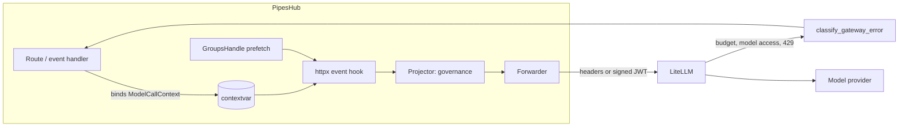
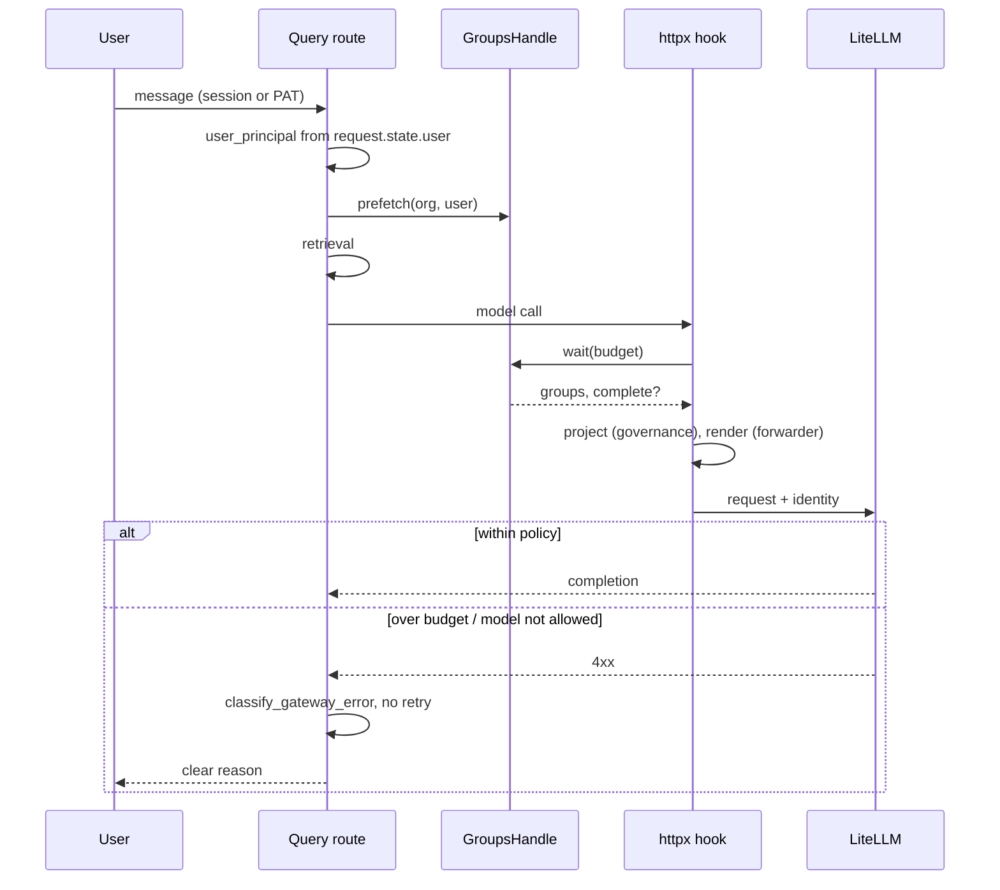
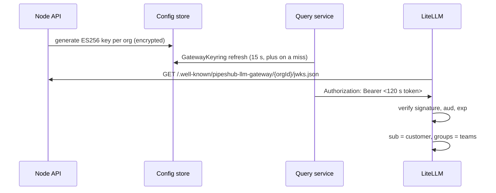

# Identity forwarding to an LLM gateway

When model calls go through a gateway such as LiteLLM, the gateway can enforce per-user and per-group model access, budgets and rate limits, but only if it knows who is asking. PipesHub forwards the signed-in user's id, and their group membership where an edition provides it, on interactive model requests. Background work (indexing, extraction, parsing, health checks) is attributed to a service identity, never to a person.

Code lives in `backend/python/app/services/model_identity/`. Forwarding is off until an admin enables it on a model connection.

## Editions

| | OSS | EE |
| --- | --- | --- |
| Forward user id | yes | yes |
| Forward groups | only what a resolver returns; OSS ships a no-op resolver | Entra groups, captured at sign-in |
| `headers` mode (LiteLLM trusted headers) | yes | yes |
| `template` mode (custom header templates for Portkey, Helicone, Cloudflare, APIM) | yes | yes |
| `signedJwt` mode (ES256 token verified by the gateway from a JWKS) | no | yes |
| Group source | none | token claim, then Graph overage lookup, then connector-synced graph groups |

EE plugs in through two edition hooks in `app/edition_services.py`: `get_group_membership_resolver(container)` and `register_identity_forwarders(registry)`. OSS code never imports EE.

## High-level design



- The **boundary** (chat, agent, search and speech routes, the indexing event processor, extraction and parsing routes) binds a `ModelCallContext`: principal, workload, request and conversation ids, and a `GroupsHandle`.
- The **httpx hook** is installed on each connection's HTTP clients when forwarding is enabled. It reads the context at request time, so LangChain models and direct SDK transports behave the same.
- The **projector** is the only place governance is applied. Forwarders are pure: they turn a projected identity into a `HeaderSet`.
- The **group lookup** starts next to retrieval and the hook waits at most a small budget (0.3 s). A slow or failing resolver gives an empty, `complete=False` membership; a request is never failed by a group lookup.

## Data flow for one chat message



## Workloads and service identity

`Workload` is either interactive (chat, agent, search, query embedding, speech), background (indexing, extraction, parsing, VLM/OCR, image description, entity resolution, system) or admin (health check, discovery). Only interactive calls carry a person. Everything else is sent as `{serviceIdentityPrefix}:{name}` (default `svc:pipeshub:indexing`), so a gateway can give indexing its own budget and model list. A connection can also hold a separate virtual key for background traffic (`serviceAuth: apiKey`).

An agent that runs as a service account is attributed to the agent (`svc:pipeshub:agent:<id>`). A person who calls a service-account agent is attributed as themselves.

## Governance

An org-level policy decides what may leave PipesHub. It applies to every connection and is read and written by org admins at `GET`/`PUT /api/v1/configurationManager/ai-models/identity-policy` and stored at `/services/aiGateway/identityPolicy`.

| Field | Default | Meaning |
| --- | --- | --- |
| `subjectSource` | `userId` | `userId`, `email` or `idpObjectId` |
| `includeEmail`, `includeDisplayName` | false | Only signed-JWT mode can carry these |
| `groups.enabled`, `groups.allowList`, `groups.maxForwarded` | true, all, 50 | Which groups leave, and how many |
| `pseudonymize` | false | Replace the subject with a keyed hash |
| `onMissingIdentity` | `service` | `block` refuses an interactive call that has no user instead of sending it as the service |
| `queryEmbeddingIdentity` | `user` | `service` charges query embeddings to the service |
| `serviceIdentityPrefix` | `svc:pipeshub` | |

`POST /api/v1/configurationManager/ai-models/identity/preview` renders what a connection would send for a chosen user and workload, so an admin can check it before enabling forwarding. Per-connection settings are written with `PUT .../ai-models/connections/{connectionId}/identity-forwarding`.

## Per-connection settings (`identityForwarding`)

| Field | Values |
| --- | --- |
| `enabled` | boolean |
| `mode` | `headers`, `template`, `signedJwt` (EE) |
| `preset` | `litellm`, `portkey`, `helicone`, `cloudflare`, `apim`, `custom` |
| `headerTemplates` | up to 16 `name: value` pairs; placeholders `{{SUBJECT}}`, `{{EMAIL}}`, `{{GROUP_IDS}}`, `{{ORG_ID}}`, `{{WORKLOAD}}`, `{{REQUEST_ID}}`, `{{CONVERSATION_ID}}`, `{{AGENT_ID}}` |
| `jwtAudience` | required for `signedJwt` |
| `serviceAuth`, `serviceApiKey` | `apiKey` sends background traffic under its own virtual key |

## Headers mode with LiteLLM

PipesHub sends:

| Header | Purpose |
| --- | --- |
| `x-litellm-end-user-id` | LiteLLM "customer": per-user budget, rate limit and spend |
| `x-litellm-tags` | `group:<id>` per group, plus `workload:<w>` and `org:<id>`: per-tag budgets |
| `x-pipeshub-workload`, `-purpose`, `-request-id`, `-conversation-id` | correlation |
| `x-pipeshub-user-groups`, `x-pipeshub-groups-incomplete` | for logging and callbacks |

No LiteLLM configuration is needed beyond a database (budgets and spend are stored there). Create a budget for a person or a group:

```bash
# per-user budget: the customer is created on first sight, or create it up front
curl -X POST $LITELLM/customer/new -H "Authorization: Bearer $MASTER" \
  -d '{"user_id":"<pipeshub user id>","budget_id":"<budget>"}'

# per-group budget: the tag is the group object id
curl -X POST $LITELLM/tag/new -H "Authorization: Bearer $MASTER" \
  -d '{"name":"group:<entra group object id>","max_budget":50}'
```

The trust boundary in this mode is the virtual key: anyone holding it can claim any identity. Restrict the key's routes and network reach, or use `signedJwt`.

Verified against LiteLLM `v1.106.0` by `backend/python/tests/integration/litellm_identity/`: spend lands on the customer, a customer over budget and a tag over budget are refused with a 4xx that `classify_gateway_error` reads as a budget refusal (not retried), and background work is charged to `svc:pipeshub:<name>`. Tag budgets need a LiteLLM release with BerriAI/litellm#27573.

## Signed-JWT mode (EE)



Claims: `iss` = `pipeshub:{orgId}`, `aud` = the connection's `jwtAudience`, `sub`, `kind`, `org_id`, `workload`, `groups` (when governance allows), `groups_incomplete`, and `email`/`name` only when the policy includes them. Tokens live 120 s and are reused until 30 s before expiry, so a conversation does not mint a token per call.

Keys are generated and rotated by the Node API, newest first, at most three. A new key is published in the JWKS at once but only signs after 15 minutes, so a gateway that caches the JWKS never sees a signature it cannot yet verify. "Revoke old" drops every older key.

LiteLLM configuration (the JWKS URL needs the public base URL of PipesHub, passed as the `baseUrl` query parameter when reading the key status):

```yaml
general_settings:
  enable_jwt_auth: true
  litellm_jwtauth:
    user_id_jwt_field: sub
    end_user_id_jwt_field: sub
    team_ids_jwt_field: groups
    user_id_upsert: true
# env: JWT_PUBLIC_KEY_URL=<jwks url>  JWT_AUDIENCE=<jwtAudience>
```

Create one LiteLLM team per Entra group, with the group's object id as `team_id` and the models that group may use.

**JWT authentication is a LiteLLM Enterprise feature.** Without `LITELLM_LICENSE` the proxy answers every signed request with 403. The tests in `backend/python/ee/tests/integration/litellm_identity/test_jwt_mode.py` therefore skip unless `LITELLM_LICENSE` is set, and the signed-JWT path has not been run against a live proxy by the authors of this change; it is covered by unit tests of the signing, keyring and claims. If you cannot license Enterprise, use headers mode.

## Entra groups (EE)

Register an app in Entra with the application permission `GroupMember.Read.All` (admin consent), then store its tenant, client id and secret as the org's directory configuration. PipesHub then:

1. At sign-in, reads `oid`, `tid` and `groups` from the verified ID token. An overage marker (`_claim_names.groups` or `hasgroups`) means the list was truncated.
2. On overage, calls Graph `POST /users/{oid}/getMemberGroups` with the app credentials, retrying 429 and 5xx.
3. Stores the membership in `idpGroupMemberships` (Mongo).
4. At call time the Python service resolves groups through a composite resolver: stored membership, then directory-graph groups synced by connectors. It is cached (10k entries, 5 min; an incomplete result for 15 s) and single-flight per user. Reads refresh a stale membership for at most 2 s.

Python reaches the stored membership through `/api/v1/identity-groups/internal/:userId`, guarded by the scoped token `identity:groups:read`, which must belong to the same user as the path. The routes and schemas are in the EE OpenAPI spec under the tags "Identity Groups" and "LLM Gateway".

## Errors

A gateway refuses with the same status codes a failing provider does, so `classify_gateway_error` reads the body. A budget refusal, a model-access refusal and a rate limit are classified, are not retried (a retry cannot help), and show the user the reason. LiteLLM answers a budget refusal with `422 {"error": {"type": "budget_exceeded", ...}}`.

## Providers

Header forwarding needs an httpx-based client. OpenAI-compatible, Anthropic, Azure, Mistral, Groq and similar providers work. Bedrock (boto), Cohere, Gemini and Vertex cannot carry the headers; enabling forwarding on them logs a warning and sends nothing. Point those through the gateway's OpenAI-compatible endpoint instead.

## Troubleshooting

| Symptom | Check |
| --- | --- |
| Gateway sees no customer | Forwarding is off on that connection, or the provider has no httpx client (see the warning in the query log) |
| Groups missing | `x-pipeshub-groups-incomplete: true` means the lookup timed out or was truncated; check the Entra directory config and the `identity_missing_total` metric |
| Everyone shares one budget | `x-litellm-end-user-id` is not reaching LiteLLM: a proxy in between strips `x-litellm-*` headers |
| 403 on every signed request | LiteLLM is not licensed for JWT auth |
| Signed request refused after rotation | The gateway cached the old JWKS; new keys wait 15 minutes before signing for this reason |
| Interactive call fails with "no identity" | `onMissingIdentity` is `block` and the call had no user; this is the policy working |

Metrics: `llm_identity_forwarded_total`, `identity_missing_total`, group-resolution latency, and refusal counts by workload class.

## Known limits

- The admin dialog offers `headers` and `template` modes; `signedJwt` and `jwtAudience` are set through the API.
- There is one Entra directory configuration per org, with no inheritance from an admin org.
- Group changes reach the Python cache by TTL, not by an event.
- `SERVICE_ACCOUNT` principals are not blocked by `onMissingIdentity: block`.
- User-facing refusal messages are English only.
- Pausing the indexing lane when the service identity is out of budget is a governor throttle report and an admin alert log, not a hard stop.
- A service principal with no org cannot get a signed token, so no identity is sent for it.

## Tests

```bash
cd backend/python
pytest tests/unit/services/model_identity                     # no Docker
pytest tests/integration/litellm_identity -m docker           # real LiteLLM, ~5 min per run
LITELLM_TEST_VERSIONS=v1.106.0,<other> pytest ... -m docker   # version matrix
```

The first run pulls `ghcr.io/berriai/litellm-database` and warms a local image (`pipeshub-litellm-test:<version>`); a cold LiteLLM spends minutes compiling and applying migrations before it answers.
