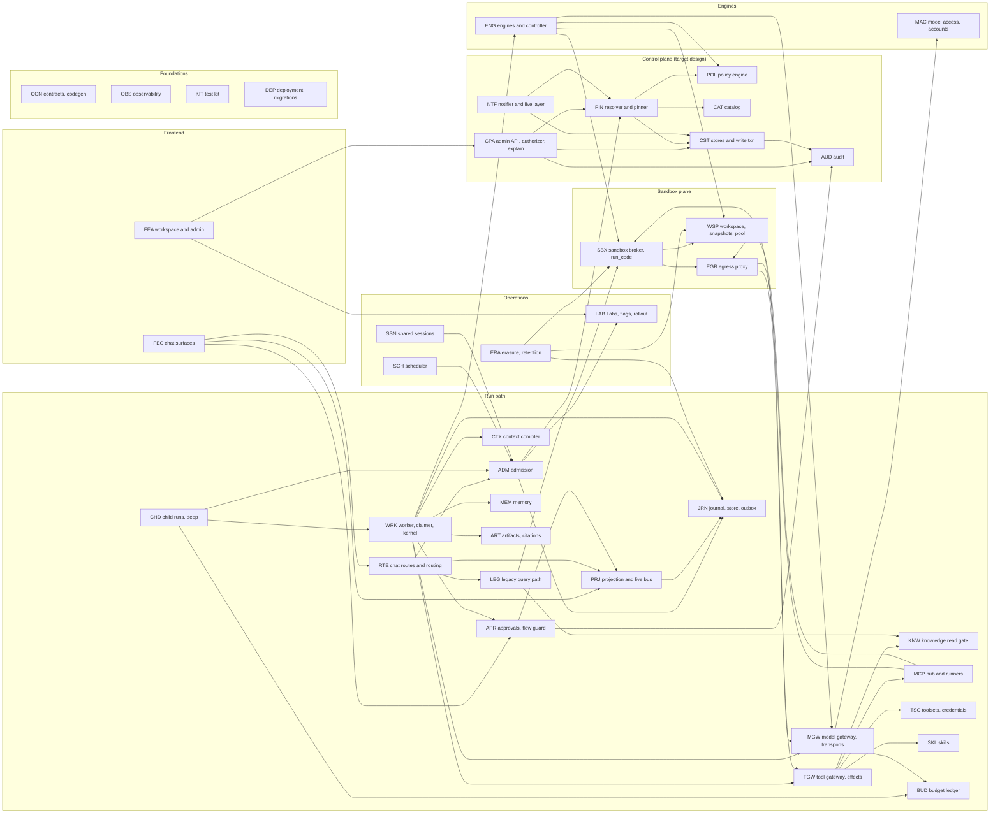
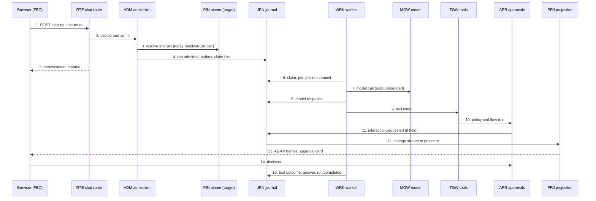

# Master test plan: component map

**Status:** plan, 2026-10-09. The map is data: [`data/components.json`](data/components.json). §3 below is
rendered from it; edit the JSON first. `scripts/harness_test_inventory.py` uses the same file to list the tests
of each component ([`generated/inventory.md`](generated/inventory.md)).

## 1. How the system is cut

A component here is the smallest unit with **one owner, one set of ports, and one failure story**: it can be
tested alone behind its ports, and an integration test of it is a test of a named edge (§4). The cuts follow
the code's own seams, not the directory tree:

- **Node owns the authority and the record**: admission, the journal and execution store, projection, the
  control plane (target), schedules, erasure, Labs. Python never authorises a control-plane write (NFR-20).
- **The Python worker owns execution**: claim, fold, loop, tools, context, models. It reads authority from the
  pin, and (target) narrows it with the live layer only.
- **The sandbox plane is the only place with the Docker socket and the only way out**: broker and egress
  proxy, with gateways back into PipesHub.
- **Engines are adapters behind one controller**: opencode, Codex, Claude Code differ only inside
  `harness_engines/*` and their release data.
- **The legacy query path stays a component** because it is the kill-switch target, the reference for parity
  (C-24) and still serves `planExecute`, Universal Agent Mode, image and project chats.
- **Control-plane components are listed as designed** in [`docs/control-plane/`](../control-plane/01-hld.md).
  Where today's code already does part of the job (engine-profile narrowing, `resolveRunSpec`, the five
  `Config*` settings classes, the journal audit chain, the per-domain admin routes), the component lists those
  files too, so their tests are traced now and the CPD WPs inherit them.

40 components in 7 groups:

| Group | Components |
|---|---|
| Control plane (7) | CAT catalog · POL policy engine · CST stores and write transaction · PIN resolver and pinner · AUD audit · NTF notifier and live layer · CPA admin API, authorizer, explain |
| Run path (18) | RTE chat routes and routing · ADM admission · JRN journal, execution store, outbox, sweepers · PRJ projection and live bus · WRK worker, claimer, loop kernel · CHD child runs and deep mode · CTX context compiler · MGW model gateway and transports · TGW tool gateway, effects, invoker · KNW knowledge read gate · MCP hub and runners · TSC toolsets and credentials · SKL skills · MEM memory · APR approvals, flow guard, unknown effects · BUD budget ledger · ART artifacts and citations · LEG legacy query path |
| Sandbox plane (3) | SBX sandbox broker and run_code · EGR egress proxy · WSP workspace store, snapshots, warm pool |
| Engines (2) | ENG engines and controller · MAC model access routes and accounts |
| Operations (4) | SCH scheduler · ERA erasure and retention (E7, E7B) · LAB Labs, flags, rollout · SSN shared sessions |
| Frontend (2) | FEC chat surfaces · FEA workspace and admin surfaces |
| Foundations (4) | CON contracts and codegen · OBS observability · KIT deterministic test kit · DEP deployment, migrations, upgrade |

Owner roles (the implementation plan): **HL** harness lead, **PF** platform/infra, **FE** front end, **SEC** security,
**QA** QA lead. Names are assigned at phase kickoff.

## 2. Diagrams

### 2.1 Planes and the main edges

Every arrow is a `depends` entry in the data (A → B: A calls or reads B). Foundations (CON, OBS, KIT, DEP)
are used by everything and drawn without edges.

### 2.2 One durable chat turn across the components

The path a scripted e2e scenario walks (04 §4). Numbers are the order of calls.

## 3. Components
### 3.1 Control plane

#### CAT — Control-plane catalog

- **Status:** target (CPD-2 in flight). **Owner:** HL.
- **Responsibilities:** One catalog of items across kinds (toolsets, MCP servers, skills, engines, plugins) with provenance, version, risk class and one digest scheme.
- **Interfaces and ports:** `CatalogStore`; `GET /api/v1/control-plane/catalog`; `CP/catalog/*.json`; `CP/vectors/digests.json`.
- **Depends on:** CST, CON. **Used by:** MCP, PIN, SKL, TSC.
- **Files:** `backend/nodejs/apps/src/modules/control-plane/**`, `contracts/control-plane/**`, `backend/python/app/agents/registry/toolset_registry.py`, `backend/python/harness_engines/allowlist.json`, `backend/python/app/agents/mcp/registry*.py`.

#### POL — Policy engine (dimensions, precedence, narrowing)

- **Status:** partial (engine-profile narrowing built; generic engine is CPD-3). **Owner:** HL.
- **Responsibilities:** Typed policy dimensions as ceilings or choices; meet across deployment, org, team, agent, user and request layers; refusal names the first widening.
- **Interfaces and ports:** `PolicyResolver`; `DimensionRegistry`; `C/core/policy/*.schema.json`; vectors policy-resolve.json, profiles EV-1..39.
- **Depends on:** CON. **Used by:** ENG, PIN.
- **Files:** `backend/nodejs/apps/src/modules/agent-harness/domain/engine-profiles.ts`, `backend/nodejs/apps/src/modules/agent-harness/domain/approvals.ts`, `backend/nodejs/apps/src/modules/agent-harness/domain/model-access.ts`, `backend/python/harness_core/engines/profiles.py`, `backend/python/harness_core/effects/policy.py`, `backend/python/app/harness/engine_profiles.py`, `contracts/harness/vectors/**`.

#### CST — Control-plane stores and write transaction

- **Status:** partial (five Config* KV documents today; stores are CPD-1/CPD-4/CPD-7). **Owner:** HL.
- **Responsibilities:** Installations, grants, policy layers, bindings and approval requests with revision CAS, history, per-org isolation; one transaction that writes and audits.
- **Interfaces and ports:** `ControlPlaneTransaction`; `InstallationStore`; `GrantStore`; `PolicyStore`; `BindingStore`; `ApprovalStore`; ConfigDocumentStore (today).
- **Depends on:** AUD, JRN. **Used by:** CAT, CPA, LAB, MAC, MEM, NTF, PIN, TSC.
- **Files:** `backend/nodejs/apps/src/modules/agent-harness/application/*-settings.ts`, `backend/nodejs/apps/src/modules/agent-harness/application/config-documents.ts`, `backend/nodejs/apps/src/modules/agent-harness/adapters/configuration/encrypted-config-document-store.ts`, `backend/nodejs/apps/src/modules/agent-harness/adapters/in-memory-config-document-store.ts`, `backend/nodejs/apps/src/modules/control-plane/**`.

#### PIN — Run-config resolver and pinner

- **Status:** partial (resolveRunSpec + spec pinning built; RunConfigPinner is CPD-5). **Owner:** HL.
- **Responsibilities:** Resolve the effective set and effective run config for a subject once, pin it on the run with a digest; every admission path uses it; wake never re-resolves.
- **Interfaces and ports:** `RunConfigPinner.pin(subject)`; `EffectiveSetResolver`; `ResolvedSnapshotCache`; `run.spec_pinned`; `x.pipeshub.resolved`; effectivePolicy view.
- **Depends on:** POL, CST, CAT, ADM. **Used by:** ADM, CPA, NTF, SCH, SKL.
- **Files:** `backend/nodejs/apps/src/modules/agent-harness/domain/run-spec.ts`, `backend/nodejs/apps/src/modules/agent-harness/domain/effective-policy.ts`, `backend/nodejs/apps/src/modules/agent-harness/domain/agent-definition.ts`, `backend/python/app/agents/run_definition.py`, `backend/python/app/harness/contracts/**`, `backend/nodejs/apps/src/modules/control-plane/**`.

#### AUD — Audit chain and config audit

- **Status:** partial (journal audit chain built; config.changed is CPD-1). **Owner:** SEC.
- **Responsibilities:** Per-org hash-chained audit of journal events, gateway refusals and (target) every control-plane write in the same transaction; anchoring; verifier.
- **Interfaces and ports:** `AuditChainStore`; `ConfigAuditLog`; `AuditAnchorSink`; grant auditor CLI.
- **Depends on:** JRN. **Used by:** APR, CPA, CST, EGR, ERA, LAB.
- **Files:** `backend/nodejs/apps/src/modules/agent-harness/application/audited-journal-store.ts`, `backend/nodejs/apps/src/modules/agent-harness/application/audit-anchoring.ts`, `backend/nodejs/apps/src/modules/agent-harness/domain/audit.ts`, `backend/nodejs/apps/src/modules/agent-harness/adapters/mongo/mongo-audit-*.ts`, `backend/python/harness_core/audit/**`, `backend/python/app/harness/audit/**`.

#### NTF — Change notifier and live layer

- **Status:** target (CPD-6). **Owner:** HL.
- **Responsibilities:** Publish config change events after commit; per-org ordered invalidation; worker and gateway live layer that can only narrow, with a 30 s TTL backstop.
- **Interfaces and ports:** `ChangeNotifier`; `LiveLayerCache`; control-plane-events topic; internal live route.
- **Depends on:** CST, PIN. **Used by:** none.
- **Files:** `backend/nodejs/apps/src/modules/control-plane/**notif*`, `backend/python/app/control_plane/**`.

#### CPA — Admin API, authorizer and explain

- **Status:** partial (per-domain admin routes built; /api/v1/control-plane is CPD-11). **Owner:** HL.
- **Responsibilities:** Admin and builder routes for policy, approvals, engine profile, model access, memory policy, retention, MCP manifests; router guards; preview and per-run explain.
- **Interfaces and ports:** `/api/v1/agent-harness/admin/*`; `/api/v1/mcp-servers/instances/{id}/manifest`; `/api/v1/control-plane/*`; `Authorizer`.
- **Depends on:** CST, PIN, AUD. **Used by:** FEA.
- **Files:** `backend/nodejs/apps/src/modules/agent-harness/transport/admin-routes.ts`, `backend/nodejs/apps/src/modules/agent-harness/transport/approval-routes.ts`, `backend/nodejs/apps/src/modules/agent-harness/transport/memory-routes.ts`, `backend/nodejs/apps/src/modules/agent-harness/transport/unknown-effect-routes.ts`, `backend/nodejs/apps/src/modules/agent-harness/transport/request-identity.ts`, `backend/python/app/api/routes/mcp_hub.py`.

### 3.2 Run path

#### RTE — Chat routes and routing

- **Status:** built (one-request routing is LAT1/CPD-10, in flight). **Owner:** HL.
- **Responsibilities:** Existing chat routes (stream, agent stream, regenerate, Slack /internal twins, MCP header) decide durable or legacy server-side, project and agent scope; first frame conversation_created.
- **Interfaces and ports:** `POST /api/v1/conversations/stream`; `POST /api/v1/agents/:key/conversations/stream`; `…/message/:mid/regenerate`; `POST …/runs + GET …/runs/:id/stream`; `surfaceRunMiddleware`; RoutingDecider (LAT1).
- **Depends on:** ADM, PRJ, LEG, LAB. **Used by:** FEC.
- **Files:** `backend/nodejs/apps/src/modules/enterprise_search/controller/es_controller.ts`, `backend/nodejs/apps/src/modules/enterprise_search/routes/es.routes.ts`, `backend/nodejs/apps/src/modules/agent-harness/transport/session-controller.ts`, `backend/nodejs/apps/src/modules/agent-harness/transport/session-routes.ts`, `backend/nodejs/apps/src/modules/agent-harness/transport/surface-route.ts`, `backend/nodejs/apps/src/modules/agent-harness/transport/surface-header.ts`, `backend/nodejs/apps/src/modules/agent-harness/transport/stream-controller.ts`, `backend/nodejs/apps/src/modules/agent-harness/domain/rollout.ts`, `backend/nodejs/apps/src/modules/agent-harness/application/surface-runs.ts`.

#### ADM — Admission

- **Status:** built. **Owner:** HL.
- **Responsibilities:** Decide and admit a run atomically: rollout, agent access, engine profile, model access, worker features, roles, labels, memory pin, quotas, idempotency; one active root run per session.
- **Interfaces and ports:** `RunAdmissionService.decide/admit`; MongoRunAdmissionStore.admit (one transaction); admission quotas; 409 RUN_ACTIVE; inline claim hint.
- **Depends on:** PIN, JRN, LAB, SSN. **Used by:** CHD, MEM, PIN, RTE, SCH, SSN.
- **Files:** `backend/nodejs/apps/src/modules/agent-harness/application/run-admission-service.ts`, `backend/nodejs/apps/src/libs/repositories/agent-harness/run-admission-store/mongo.ts`, `backend/nodejs/apps/src/modules/agent-harness/domain/admission*.ts`, `backend/nodejs/apps/src/modules/agent-harness/application/harness-rollout.ts`, `backend/nodejs/apps/src/modules/agent-harness/adapters/configuration/platform-rollout-settings.ts`, `backend/nodejs/apps/src/modules/agent-harness/adapters/http/inline-claim-hint.ts`, `backend/nodejs/apps/src/modules/agent-harness/application/next-run-service.ts`, `backend/nodejs/apps/src/modules/agent-harness/domain/next-runs.ts`.

#### JRN — Journal, execution store, outbox and sweepers

- **Status:** built. **Owner:** HL.
- **Responsibilities:** Fenced, sealed, gap-free event journal; run state machine (claim, renew, commit, control); payload claim-checks; dispatch outbox and relay; run sweeper, holdoff and degraded modes; data keys.
- **Interfaces and ports:** `JournalStore`; `ExecutionStore`; `DispatchOutbox`; `PayloadStore`; `DataKeyStore`; internal journal routes /api/v1/agent-harness/internal/*; NodeJournal (Python client).
- **Depends on:** CON. **Used by:** ADM, ART, AUD, BUD, CST, ERA, MEM, MGW, PRJ, SSN, WRK, WSP.
- **Files:** `backend/nodejs/apps/src/modules/agent-harness/application/execution-service.ts`, `backend/nodejs/apps/src/modules/agent-harness/application/journal-service.ts`, `backend/nodejs/apps/src/modules/agent-harness/application/sealed-journal-store.ts`, `backend/nodejs/apps/src/modules/agent-harness/application/payload-referencing-journal-store.ts`, `backend/nodejs/apps/src/modules/agent-harness/application/run-sweeper.ts`, `backend/nodejs/apps/src/modules/agent-harness/application/org-data-keys.ts`, `backend/nodejs/apps/src/libs/repositories/agent-harness/execution/mongo.ts`, `backend/nodejs/apps/src/modules/agent-harness/adapters/mongo/mongo-journal-*.ts`, `backend/nodejs/apps/src/libs/repositories/agent-harness/dispatch-outbox/mongo.ts`, `backend/nodejs/apps/src/libs/repositories/agent-harness/payload-store/mongo.ts`, `backend/nodejs/apps/src/modules/agent-harness/transport/internal-*.ts`, `backend/nodejs/apps/src/modules/agent-harness/domain/execution.ts`, `backend/nodejs/apps/src/modules/agent-harness/domain/journal.ts`, `backend/nodejs/apps/src/libs/**/outbox*`, `backend/python/app/harness/journal_node/**`, `backend/python/harness_core/journal/**`.

#### PRJ — Projection, live bus and streaming

- **Status:** built. **Owner:** HL.
- **Responsibilities:** Project journal + LiveBus deltas into AG-UI SSE frames, transcripts and timelines; reconnect with Last-Event-ID; per-viewer audiences; terminal frames authored by Node.
- **Interfaces and ports:** `StreamProjector/run-projector`; `RunStreamService`; LiveBus (Redis, in-memory); JournalTail (change stream); AG-UI frame vocabulary; `transcript.ts`.
- **Depends on:** JRN, CON. **Used by:** APR, ART, FEC, RTE, SSN.
- **Files:** `backend/nodejs/apps/src/modules/agent-harness/projection/**`, `backend/nodejs/apps/src/modules/agent-harness/adapters/redis/**`, `backend/nodejs/apps/src/libs/repositories/agent-harness/journal-tail/mongo.ts`, `backend/nodejs/apps/src/modules/agent-harness/transport/sse.ts`, `backend/python/app/harness/livebus.py`, `backend/python/app/harness/presentation.py`.

#### WRK — Worker, claimer and loop kernel

- **Status:** built. **Owner:** HL.
- **Responsibilities:** Claim runs (inline and polled), fold the journal, drive the loop (Agent.step, durable driver), commit by the commit rules, dispatch tools, suspend and resume, cancel, steering, crash recovery.
- **Interfaces and ports:** RunClaimer, InlineClaimer; DurableKernel / _ClaimedRun; fold + cursor; `RunDriver`; worker capabilities/features; `failpoints`.
- **Depends on:** JRN, MGW, TGW, CTX, APR, ENG, MEM, ART. **Used by:** APR, CHD, CTX, TGW.
- **Files:** `backend/python/app/harness/worker/**`, `backend/python/app/harness/inline.py`, `backend/python/app/harness/interaction_wakeup.py`, `backend/python/app/harness_main.py`, `backend/python/app/harness/assembly/**`, `backend/python/harness_core/kernel/**`, `backend/python/harness_core/driver/**`, `backend/python/harness_core/failpoints.py`.

#### CHD — Child runs and deep mode

- **Status:** built. **Owner:** HL.
- **Responsibilities:** Spawn child runs under a narrowed grant (tools, budget share, workspace fork), join, lift child approvals to the parent thread, deep-mode phase machine and waves.
- **Interfaces and ports:** child.spawned / child.completed; `ChildRunService`; `x.pipeshub.subAgent`; `CHILD_BUDGET_EXCEEDS_REMAINING`.
- **Depends on:** ADM, WRK, BUD, WSP, APR. **Used by:** BUD.
- **Files:** `backend/nodejs/apps/src/modules/agent-harness/application/child-run-service.ts`, `backend/nodejs/apps/src/modules/agent-harness/domain/child-runs.ts`, `backend/nodejs/apps/src/libs/repositories/agent-harness/child-runs/mongo.ts`, `backend/nodejs/apps/src/modules/agent-harness/transport/child-controller.ts`, `backend/python/app/harness/assembly/deep.py`.

#### CTX — Context compiler

- **Status:** built, default off (HARNESS_CONTEXT_COMPILER). **Owner:** HL.
- **Responsibilities:** Compile each request from the journal in fixed cache bands; reduction ladder (clear > 50%, compact > 80%); notes; flag-off byte equality.
- **Interfaces and ports:** `ContextCompiler`; `CompactionStrategy`; `HostBands`; context.cleared / context.compacted.
- **Depends on:** WRK, MGW. **Used by:** WRK.
- **Files:** `backend/python/harness_core/context/**`, `backend/python/harness_core/kernel/context/**`.

#### MGW — Model gateway and transports

- **Status:** built. **Owner:** HL.
- **Responsibilities:** Native transports (OpenAI chat and Responses, Anthropic, Gemini, Bedrock, Azure, Ollama) with usage, retries and output limits; model policy and fallback; provider state; the model gateway serving engines (chat, Responses, Messages wires) with run tokens and budget.
- **Interfaces and ports:** `ModelTransport`; model gateway POST /v1/chat/completions, /v1/responses, /v1/messages; `HARNESS_MODEL_OUTPUT_LIMIT`; `model.fallback`; gateway tokens.
- **Depends on:** BUD, MAC, JRN. **Used by:** BUD, CTX, EGR, ENG, MAC, WRK.
- **Files:** `backend/python/harness_core/models/**`, `backend/python/harness_core/gateway/model_*.py`, `backend/python/harness_core/gateway/*_wire.py`, `backend/python/harness_core/gateway/token.py`, `backend/python/app/model_gateway_main.py`, `backend/python/app/harness/gateway/tokens.py`, `backend/python/app/harness/gateway/keys.py`, `backend/nodejs/apps/src/modules/agent-harness/application/gateway-token-*.ts`, `backend/nodejs/apps/src/modules/agent-harness/domain/gateway-token.ts`.

#### TGW — Tool gateway, effects and invoker

- **Status:** built. **Owner:** HL.
- **Responsibilities:** Run tool endpoint for engines (MCP transport), effect runner with intent/outcome, effect classes and recovery, invoker and tool catalog, time and stall bounds, sink tags.
- **Interfaces and ports:** `RunToolEndpoint`; EffectRunner / EffectLog; `Invoker`; `ToolCatalog`; tool.intent / tool.outcome / tool.unknown.
- **Depends on:** WRK, APR, KNW, MCP, TSC, SKL. **Used by:** APR, EGR, ENG, WRK.
- **Files:** `backend/python/harness_core/effects/**`, `backend/python/harness_core/invoker/**`, `backend/python/harness_core/tools/**`, `backend/python/harness_core/gateway/endpoint.py`, `backend/python/app/harness/gateway/host.py`, `backend/python/app/harness/gateway/mcp.py`, `backend/python/app/harness/gateway/citations.py`.

#### KNW — Knowledge read gate and publications

- **Status:** built. **Owner:** SEC.
- **Responsibilities:** Every knowledge read (search, fetch, lookup_record, raw content) goes through the record-access gate; publications widen to an audience (answer_only or full); no existence oracle.
- **Interfaces and ports:** RecordAccess port; `filter_openable_record_ids`; `KnowledgePublications`; `/api/v1/agent-harness/publications`.
- **Depends on:** CON. **Used by:** LEG, TGW.
- **Files:** `backend/python/harness_core/knowledge/**`, `backend/python/app/harness/knowledge/**`, `backend/nodejs/apps/src/modules/agent-harness/application/knowledge-publications.ts`, `backend/nodejs/apps/src/modules/agent-harness/transport/publication-routes.ts`, `backend/nodejs/apps/src/modules/agent-harness/adapters/query-publication-authority.ts`, `backend/python/app/modules/retrieval/**`.

#### MCP — MCP hub and runners

- **Status:** built, flags off (MCP_HUB, MCP_STDIO_RUNNERS). **Owner:** HL.
- **Responsibilities:** Schema cache, pooled sessions per (org, instance, credential owner), manifest approval, tool-name rules, SSRF guard; STDIO servers in per-owner runner sandboxes.
- **Interfaces and ports:** `McpHub`; manifest routes; McpRunner (broker); mcp_tool_unapproved / mcp_url_refused / runner_unavailable.
- **Depends on:** SBX, EGR, TSC, CAT. **Used by:** FEA, LEG, TGW.
- **Files:** `backend/python/harness_core/mcp_hub/**`, `backend/python/app/harness/mcp_hub/**`, `backend/python/app/harness/mcp_runner/**`, `backend/python/harness_core/sandbox/mcp_runner/**`, `backend/python/app/agents/mcp/**`, `backend/nodejs/apps/src/modules/mcp_servers/**`, `backend/nodejs/apps/src/modules/mcp/**`.

#### TSC — Toolsets and credentials

- **Status:** built. **Owner:** SEC.
- **Responsibilities:** Toolset instances and instance-scoped tool identity; credential service and vault (versioned, sealed), leases bound to run; token refresh; no secret in prompt, journal, logs or sandbox.
- **Interfaces and ports:** CredentialService / HandleCredentialService; vault /services/agentHarness/credentials/*; ToolsetSecretSource / McpSecretSource; INSTANCE_TOOL_IDS migration.
- **Depends on:** CAT, CST. **Used by:** LEG, MAC, MCP, TGW.
- **Files:** `backend/python/app/harness/credentials/**`, `backend/python/harness_core/credentials/**`, `backend/python/harness_core/tool_identity/**`, `backend/python/app/harness/tool_identity/**`, `backend/nodejs/apps/src/modules/toolsets/**`, `backend/python/app/connectors/core/**token_refresh*`.

#### SKL — Skills

- **Status:** built (creator scoping by CPS, merged at a168c7d5c). **Owner:** HL.
- **Responsibilities:** Skill catalog, bundles and digests, pinned skills per run, materialiser into sandboxes, skill packs for engines, visibility per creator.
- **Interfaces and ports:** `SkillManager`; skill bundles (P7.1); skill packs (SK1); `ENABLE_SKILLS`.
- **Depends on:** CAT, SBX, PIN. **Used by:** LEG, TGW.
- **Files:** `backend/python/harness_core/skills/**`, `backend/python/app/harness/skills/**`, `backend/python/app/agents/agent_loop/skills/**`, `backend/python/app/agent_loop_lib/tools/builtin/data/skills.py`, `backend/nodejs/apps/src/modules/skills/**`, `backend/nodejs/apps/src/modules/agent-harness/domain/skill-bundle.ts`.

#### MEM — Governed memory

- **Status:** built, off by default (policy unset). **Owner:** HL.
- **Responsibilities:** Memories per actor (and agent), labelled and access-checked; proposals and review; settlement after commit (durable via sweeper); rendering band.
- **Interfaces and ports:** `MemoryService`; `MemoryStore`; `/api/v1/agent-harness/admin/memory-policy`; memory routes.
- **Depends on:** JRN, ADM, CST. **Used by:** FEA, WRK.
- **Files:** `backend/nodejs/apps/src/modules/agent-harness/application/memory-*.ts`, `backend/nodejs/apps/src/modules/agent-harness/domain/memory.ts`, `backend/nodejs/apps/src/libs/repositories/agent-harness/memory/mongo.ts`, `backend/nodejs/apps/src/modules/agent-harness/transport/memory-*.ts`, `backend/python/harness_core/memories/**`, `backend/python/app/harness/memories.py`.

#### APR — Approvals, interactions, flow guard and unknown effects

- **Status:** built (flow guard on by default). **Owner:** SEC.
- **Responsibilities:** Approval policy (org layers, engine writes), interactions (consume once, expiry, re-authorization), flow rule after private reads, conversation grants, unknown effects console, reconcile hooks.
- **Interfaces and ports:** `InteractionService`; approval policy /services/agentHarness/approvals; `HARNESS_FLOW_GUARD(_LEVEL/_ABOVE)`; `interaction.requested/resolved/granted`; unknown-effects console; `HARNESS_RECONCILE`.
- **Depends on:** TGW, WRK, PRJ, AUD. **Used by:** CHD, FEA, FEC, SCH, TGW, WRK.
- **Files:** `backend/nodejs/apps/src/modules/agent-harness/application/interaction-service.ts`, `backend/nodejs/apps/src/modules/agent-harness/application/approval-*.ts`, `backend/nodejs/apps/src/modules/agent-harness/application/unknown-effects.ts`, `backend/nodejs/apps/src/modules/agent-harness/application/session-interactions.ts`, `backend/nodejs/apps/src/modules/agent-harness/domain/approvals.ts`, `backend/nodejs/apps/src/modules/agent-harness/domain/interactions.ts`, `backend/nodejs/apps/src/modules/agent-harness/projection/unknown-effects.ts`, `backend/python/app/harness/approvals.py`, `backend/python/app/harness/flow_destination.py`, `backend/python/app/harness/labels.py`, `backend/python/harness_core/interactions/**`, `backend/python/harness_core/effects/flow.py`, `backend/python/harness_core/effects/reconcile.py`, `backend/python/app/harness/reconcile/**`, `backend/python/harness_core/security/labels.py`.

#### BUD — Budget ledger

- **Status:** built. **Owner:** HL.
- **Responsibilities:** Accounts and reservations per run tree; reserve at the output limit, settle on usage; child shares; refusal codes; metered compaction.
- **Interfaces and ports:** `BudgetLedger`; `POST /internal/runs/{runId}/budget/reservations`; budget_* refusal codes.
- **Depends on:** JRN, MGW, CHD. **Used by:** CHD, MGW, SCH.
- **Files:** `backend/nodejs/apps/src/modules/agent-harness/application/budget-ledger-service.ts`, `backend/nodejs/apps/src/modules/agent-harness/domain/budget-ledger.ts`, `backend/nodejs/apps/src/libs/repositories/agent-harness/budget-ledger/mongo.ts`, `backend/nodejs/apps/src/modules/agent-harness/transport/budget-controller.ts`, `backend/python/harness_core/budget/**`, `backend/python/app/harness/access/budget.py`, `backend/python/app/harness/access/spend.py`.

#### LEG — Legacy query path (today's loop)

- **Status:** built (reference and kill-switch target). **Owner:** HL.
- **Responsibilities:** The query service's agent loop: planExecute, Universal Agent Mode, image, project chats, kill switch and standalone Mongo; legacy run_code; legacy flow-guard refusal.
- **Interfaces and ports:** `POST /api/v1/chat/stream (query service)`; `app/agents/agent_loop`; chatbot.py / agent.py routes.
- **Depends on:** KNW, MCP, TSC, SKL, SBX. **Used by:** RTE.
- **Files:** `backend/python/app/agents/**`, `backend/python/app/api/routes/chatbot.py`, `backend/python/app/api/routes/agent.py`, `backend/python/app/agent_loop_lib/**`.

#### ART — Artifacts and citations

- **Status:** built. **Owner:** HL.
- **Responsibilities:** Artifact publish intent, publish and presentation with provenance; artifact and citation access per viewer; shared artifacts and citations across participants and forks; erasure of copies.
- **Interfaces and ports:** `ArtifactPublisher`; `x.pipeshub.artifact.publish_intent/published/presented`; artifact-access projection; shared-artifacts / shared-citations.
- **Depends on:** JRN, PRJ, WSP, ERA. **Used by:** WRK.
- **Files:** `backend/python/app/harness/artifacts/**`, `backend/python/harness_core/artifacts/**`, `backend/python/app/harness/citations.py`, `backend/nodejs/apps/src/modules/agent-harness/application/shared-*.ts`, `backend/nodejs/apps/src/modules/agent-harness/projection/artifact-access.ts`, `backend/nodejs/apps/src/modules/agent-harness/projection/citation-*.ts`, `backend/nodejs/apps/src/modules/agent-harness/adapters/in-memory-artifact-access.ts`.

### 3.3 Sandbox plane

#### SBX — Sandbox broker and run_code

- **Status:** built (runc proven; gVisor/Kata not). **Owner:** PF.
- **Responsibilities:** Broker that alone holds the Docker socket: create, exec, put/get, limits, destroy, reap, isolation classes, per-sandbox networks; run_code on legacy and durable paths with receipts.
- **Interfaces and ports:** SandboxBroker (remote wire); SandboxProvider contract; `POST /v1/erase-session`; SANDBOX_MODE broker|docker|e2b|local; `run_code`.
- **Depends on:** EGR, WSP. **Used by:** EGR, ENG, ERA, LEG, MCP, SKL, WSP.
- **Files:** `backend/python/app/harness/sandbox/**`, `backend/python/harness_core/sandbox/*.py`, `backend/python/harness_core/sandbox/remote/**`, `backend/python/app/sandbox_broker_main.py`, `backend/python/app/sandbox/**`, `backend/python/app/agent_loop_lib/sandbox/**`, `backend/python/app/docker_proxy_main.py`.

#### EGR — Egress proxy

- **Status:** built. **Owner:** SEC.
- **Responsibilities:** The only way out of a sandbox: token routes to gateways, allowlisted hosts, CONNECT tunnels (flag), SSRF and blocked CIDRs, control plane bound off sandbox networks, durable sealed state, refusal audit.
- **Interfaces and ports:** egress proxy data and control ports; `EGRESS_CONNECT_TUNNELS`; `EGRESS_STATE_REQUIRED`; gateway.refused audit.
- **Depends on:** SBX, MGW, TGW, AUD. **Used by:** MCP, SBX.
- **Files:** `backend/python/harness_core/sandbox/egress/**`, `backend/python/app/harness/sandbox/egress_*.py`, `backend/python/app/harness/sandbox/docker_egress.py`, `backend/python/app/egress_proxy_main.py`, `backend/python/app/agent_loop_lib/sandbox/coding/egress_firewall.py`.

#### WSP — Workspace store, snapshots and warm pool

- **Status:** built (warm pool and snapshots off by default). **Owner:** PF.
- **Responsibilities:** CAS workspace revisions, forks and merges, one writer per workspace, sealing, sync into and out of sandboxes, encrypted engine snapshots, warm pool sizing.
- **Interfaces and ports:** WorkspaceStore / WorkspaceRepository; workspace head CAS; WorkspaceWriters lease; `SANDBOX_WARM_POOL_MAX`; `HARNESS_ENGINE_SNAPSHOTS`.
- **Depends on:** SBX, JRN. **Used by:** ART, CHD, ENG, ERA, SBX.
- **Files:** `backend/python/harness_core/workspace/**`, `backend/python/app/harness/workspace/**`, `backend/nodejs/apps/src/modules/agent-harness/application/workspace-*.ts`, `backend/nodejs/apps/src/modules/agent-harness/application/session-workspace-*.ts`, `backend/nodejs/apps/src/modules/agent-harness/domain/workspace*.ts`, `backend/nodejs/apps/src/libs/repositories/agent-harness/workspace/mongo.ts`, `backend/nodejs/apps/src/libs/repositories/agent-harness/workspace-head-cas/mongo.ts`, `backend/nodejs/apps/src/modules/agent-harness/adapters/storage/storage-workspace-objects.ts`, `backend/nodejs/apps/src/modules/agent-harness/transport/workspace-controller.ts`, `backend/python/harness_core/sandbox/pool.py`.

### 3.4 Engines

#### ENG — Engines and engine controller

- **Status:** built (opencode, Codex and Claude Code released). **Owner:** HL.
- **Responsibilities:** Engine adapters (launch, map events, state), controller lifecycle (turns, ticker, autosave, writer lease), durable engine kernel, engine profiles and ceilings, release allowlist and images.
- **Interfaces and ports:** Engine port + EngineRegistry; `EngineController`; durable engine kernel; engine.checkpointed / engine.snapshotted; `HARNESS_ENGINE_RUNS`; `engineProfile`.
- **Depends on:** SBX, WSP, MGW, TGW, MAC, POL. **Used by:** WRK.
- **Files:** `backend/python/harness_core/engines/**`, `backend/python/harness_engines/**`, `backend/python/app/harness/engines/**`, `backend/python/app/harness/engine_profiles.py`, `backend/nodejs/apps/src/modules/agent-harness/domain/engine-profiles.ts`, `backend/nodejs/apps/src/modules/agent-harness/ports/engine-profiles.ts`, `backend/nodejs/apps/src/modules/agent-harness/adapters/http/http-engine-availability.ts`, `scripts/engines/**`.

#### MAC — Model access routes and accounts

- **Status:** built. **Owner:** SEC.
- **Responsibilities:** Signed vendor rules, offering, org model-access narrowing, BYO user keys and org cloud accounts, account vault, routes pinned per run.
- **Interfaces and ports:** vendor_rules.json + .sig; `ModelAccessPolicies` (`AGENT_HARNESS_MODEL_ACCESS_POLICIES`); model-account routes; `AGENT_HARNESS_OFFERING`.
- **Depends on:** CST, TSC, MGW. **Used by:** ENG, FEA, MGW.
- **Files:** `backend/python/harness_core/access/**`, `backend/python/app/harness/access/**`, `backend/python/harness_engines/vendor_rules*`, `backend/nodejs/apps/src/modules/agent-harness/application/model-access-*.ts`, `backend/nodejs/apps/src/modules/agent-harness/application/model-account-service.ts`, `backend/nodejs/apps/src/modules/agent-harness/domain/model-access.ts`, `backend/nodejs/apps/src/modules/agent-harness/domain/model-accounts.ts`, `backend/nodejs/apps/src/modules/agent-harness/domain/vendor-rules-release.ts`, `backend/nodejs/apps/src/modules/agent-harness/transport/model-account-routes.ts`, `backend/nodejs/apps/src/modules/agent-harness/adapters/configuration/model-account-vault.ts`.

### 3.5 Operations

#### SCH — Scheduler

- **Status:** built, Labs off by default. **Owner:** HL.
- **Responsibilities:** Cron and webhook/connector-triggered runs as the creating user, re-authorized at each firing, each slot once, budgets and approvals for unattended runs, notifications.
- **Interfaces and ports:** agentSchedules / agentScheduleFirings; `/api/v1/agent-harness/schedules`; `ScheduleFirer`; `ENABLE_SCHEDULED_RUNS`.
- **Depends on:** ADM, PIN, BUD, APR. **Used by:** FEA.
- **Files:** `backend/nodejs/apps/src/modules/agent-harness/application/schedule-*.ts`, `backend/nodejs/apps/src/modules/agent-harness/application/scheduled-run-admission.ts`, `backend/nodejs/apps/src/modules/agent-harness/domain/schedules.ts`, `backend/nodejs/apps/src/libs/repositories/agent-harness/schedules/mongo.ts`, `backend/nodejs/apps/src/modules/agent-harness/transport/schedule-routes.ts`, `backend/nodejs/apps/src/modules/agent-harness/adapters/messaging/broker-trigger-source.ts`.

#### ERA — Erasure and retention (E7, E7B)

- **Status:** built. **Owner:** SEC.
- **Responsibilities:** Conversation erasure across messages, citations, artifacts, workspaces, sandbox folders and journal; agent erasure; retention sweeper; crypto-shred; one-time digest-bound backfill CLI.
- **Interfaces and ports:** SessionErasure steps; retention sweeper; erasure-backfill-cli plan|execute|status; `session.erased`; `/admin/session-retention`.
- **Depends on:** JRN, WSP, SBX, AUD. **Used by:** ART.
- **Files:** `backend/nodejs/apps/src/modules/agent-harness/application/session-erasure*.ts`, `backend/nodejs/apps/src/modules/agent-harness/application/retention-sweeper.ts`, `backend/nodejs/apps/src/modules/agent-harness/application/erasure-backfill.ts`, `backend/nodejs/apps/src/modules/agent-harness/domain/session-erasure.ts`, `backend/nodejs/apps/src/modules/agent-harness/domain/session-retention.ts`, `backend/nodejs/apps/src/modules/agent-harness/domain/erasure-backfill.ts`, `backend/nodejs/apps/src/modules/agent-harness/adapters/mongo/mongo-session-*eras*.ts`, `backend/nodejs/apps/src/libs/repositories/agent-harness/agent-erasures/mongo.ts`, `backend/nodejs/apps/src/libs/repositories/agent-harness/erasure-backfill/mongo.ts`, `backend/nodejs/apps/src/modules/enterprise_search/ops/erasure-backfill-cli.ts`, `backend/python/app/harness/agent_deletion.py`.

#### LAB — Labs, flags and rollout

- **Status:** built. **Owner:** PF.
- **Responsibilities:** flags.json as the one flag matrix; Labs overrides with CAS; effective-flags route; kill switch; rollout decision; strict env-flag parsing; defaults in one table.
- **Interfaces and ports:** `contracts/harness/flags.json`; Labs POST /api/v1/configurationManager/platform/settings; `HarnessRollout`; env_flags helpers; effective flags.
- **Depends on:** CST, AUD. **Used by:** ADM, DEP, FEA, RTE.
- **Files:** `contracts/harness/flags.json`, `backend/nodejs/apps/src/modules/agent-harness/domain/rollout.ts`, `backend/nodejs/apps/src/modules/agent-harness/application/harness-rollout.ts`, `backend/nodejs/apps/src/modules/configuration_manager/**`, `backend/nodejs/apps/src/libs/utils/env-flags.ts`, `backend/python/app/utils/env_flags.py`, `backend/python/app/services/featureflag/**`.

#### SSN — Shared sessions

- **Status:** built (collaborator turns off by default). **Owner:** HL.
- **Responsibilities:** Participants and roles, per-turn actor, per-viewer audiences, collaborator turns and next runs, continue privately (fork), session import and backup.
- **Interfaces and ports:** session.participant_changed / session.forked; `agentNextRuns`; `ENABLE_COLLABORATOR_TURNS`; session forks routes.
- **Depends on:** ADM, PRJ, JRN. **Used by:** ADM.
- **Files:** `backend/nodejs/apps/src/modules/agent-harness/application/session-*.ts`, `backend/nodejs/apps/src/modules/agent-harness/domain/session-*.ts`, `backend/nodejs/apps/src/modules/agent-harness/application/shared-*.ts`, `backend/nodejs/apps/src/libs/repositories/agent-harness/session-backup/mongo.ts`, `backend/nodejs/apps/src/modules/agent-harness/ops/session-backup-cli.ts`.

### 3.6 Frontend

#### FEC — Frontend chat surfaces

- **Status:** built. **Owner:** FE.
- **Responsibilities:** Chat page, streaming and durable stream reducer, reconnect, stop, steering, approval and unknown-effect cards, engine-run card, citations, artifacts panel, project chats, regenerate.
- **Interfaces and ports:** `createAGUIEventHandler`; `durable-run-stream`; `chat/api.ts`; message-area components.
- **Depends on:** RTE, PRJ, APR. **Used by:** none.
- **Files:** `frontend/app/(main)/chat/**`, `frontend/lib/**`.

#### FEA — Frontend workspace and admin surfaces

- **Status:** built. **Owner:** FE.
- **Responsibilities:** Labs, approval policy and queue, unknown effects console, AI access and accounts, schedules, memories, MCP manifest approval, agent builder, skills; i18n and accessibility.
- **Interfaces and ports:** workspace/* pages; harness-ui shared helpers; agent builder.
- **Depends on:** CPA, LAB, APR, MAC, SCH, MEM, MCP. **Used by:** none.
- **Files:** `frontend/app/(main)/workspace/**`, `frontend/app/(main)/agents/**`.

### 3.7 Foundations

#### CON — Cross-language contracts and codegen

- **Status:** built. **Owner:** HL.
- **Responsibilities:** JSON Schemas for RunSpec, events, envelopes, tool descriptors; codegen to Python and TypeScript; shared vectors (approvals, token patterns, profiles, sealing); replay corpora; event catalog.
- **Interfaces and ports:** `contracts/harness/core|ext/*.schema.json`; `contracts/harness/vectors/**`; `generate.sh`; canonical JSON.
- **Depends on:** none. **Used by:** CAT, JRN, KIT, KNW, POL, PRJ.
- **Files:** `contracts/harness/**`, `backend/nodejs/apps/src/modules/agent-harness/contracts/**`, `backend/python/harness_core/contracts/**`, `backend/python/app/harness/contracts/**`.

#### OBS — Observability and logging

- **Status:** built (OTel off by default). **Owner:** PF.
- **Responsibilities:** OTel spans (GenAI conventions, no content by default), path-labelled metrics, structured lifecycle logs with redaction, Opik tracing behind a port.
- **Interfaces and ports:** `HarnessTracer`; `HARNESS_OTEL`; pipeshub_agent_* metrics; `harness-log`.
- **Depends on:** none. **Used by:** none.
- **Files:** `backend/python/harness_core/telemetry/**`, `backend/python/app/harness/telemetry.py`, `backend/python/harness_core/logs.py`, `backend/nodejs/apps/src/modules/agent-harness/application/harness-tracing.ts`, `backend/nodejs/apps/src/modules/agent-harness/application/harness-log.ts`, `backend/nodejs/apps/src/modules/agent-harness/adapters/telemetry/**`.

#### DEP — Deployment, migrations and upgrade

- **Status:** built. **Owner:** PF.
- **Responsibilities:** Compose base and overlays, install.sh, Helm chart (agentHarness, sandboxBroker), D2 data migrations (dry run, apply, revert), rolling upgrade order, footprint, backup and restore.
- **Interfaces and ports:** `docker-compose*.yml`; `install.sh`; `deployment/helm/**`; harness migrations; `footprint.sh`.
- **Depends on:** LAB. **Used by:** none.
- **Files:** `deployment/docker-compose/*.yml`, `deployment/docker-compose/install.sh`, `deployment/helm/**`, `deployment/sandbox/**`, `deployment/sandbox-images/**`, `backend/python/app/harness/migrations.py`, `backend/nodejs/apps/src/modules/agent-harness/adapters/mongo/*migration*.ts`, `backend/nodejs/apps/src/libs/repositories/agent-harness/migrations/mongo.ts`.

#### KIT — Deterministic test kit

- **Status:** built. **Owner:** QA.
- **Responsibilities:** Scripted model, ManualClock, seeded ids, failpoints, fake SaaS, fake LLM, replay kit, in-memory adapters and their own tests; every fake passes its port contract.
- **Interfaces and ports:** `harness_core/testing/**`; `ScriptedModel`; `ManualClock`; `failpoints`; deployment/e2e/fake_llm, fake_saas.
- **Depends on:** CON. **Used by:** none.
- **Files:** `backend/python/harness_core/testing/**`, `backend/python/harness_core/clock.py`, `backend/python/harness_core/ids.py`, `backend/python/app/harness/testing_adapters.py`, `deployment/e2e/fake_llm/**`, `deployment/e2e/fake_saas/**`, `backend/python/tests/support/**`, `backend/nodejs/apps/tests/helpers/**`.

## 4. Edges

The component graph has 121 directed edges (`depends` in the data). Each one has an integration contract and its
tests in [03-integration-test-plan.md](03-integration-test-plan.md) §1, named `E-<FROM>-<TO>`; the high-risk
ones are detailed in 03 §2.

## 5. Boundary decisions worth knowing

1. **APR spans both languages.** The policy decision is Python (`harness_core/effects/policy.py`,
   `app/harness/approvals.py`); the interaction record, consume-once and the queue are Node
   (`application/interaction-service.ts`). It is one component because one behaviour ("a held call waits for
   one decision") must be tested across both; 03 tests the seam as `E-APR-PRJ` and `E-TGW-APR`.
2. **PIN is today's `resolveRunSpec` plus spec pinning.** Its tests today are `spec-pinning.test.ts`,
   `effective-policy.test.ts` and C-9. CPD-5 replaces the code, not the component.
3. **POL holds the narrowing rules wherever they live.** Engine profiles, approval layers and model access each
   narrow today in two languages held equal by vectors; CPD-3 makes one engine. The vectors stay the test.
4. **CST holds today's five `Config*` settings classes.** They are the stand-in for `PolicyStore`; their tests
   (`configuration-stores.test.ts`) are the baseline the CPD-4 migration must keep green.
5. **LEG is large on purpose.** It maps all of `tests/unit/agents/**` and `tests/unit/api/**` (about 10,500
   test functions), because every kill-switch and legacy-only-mode scenario depends on it. Harness-specific
   cases for LEG are only the ones that touch the harness contract (flow-guard refusal, parity, routing).
6. **KIT is a component.** The fakes are products (TEST-STRATEGY principle 2): `ScriptedModel`, `ManualClock`,
   failpoints, fake LLM and fake SaaS have tests of their own, and every in-memory adapter must pass its port's
   contract suite.
