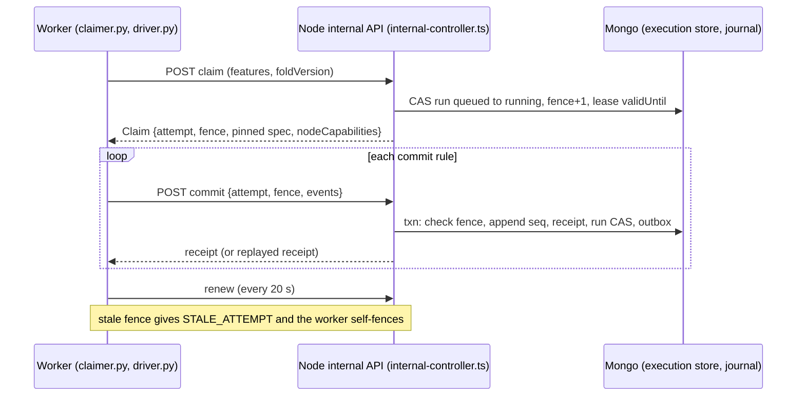

# Master test plan: integration

**Status:** plan. Levels **I** (one component against real infrastructure) and **X** (two or more processes over their real wire) as defined in [00](00-scope-and-strategy.md) §3; the component graph is in [01](01-component-map.md) and its data in `data/components.json`.

An **integration contract** here is what one component relies on from another across a port, a route, an event or a wire: the shape that crosses, what happens when the other side is slow, down or wrong, whether a repeat is safe, what order is guaranteed, and what happens when the two sides run different versions. Unit and contract suites (U, K) prove each side alone; this file lists the cases that prove the two sides together, and the gaps.

Reading guide:

- §1 is the full catalogue: one row per dependency edge in `data/components.json` (121 edges). Rows that say "see §2.n" are detailed in §2.
- §2 details the 23 edges that carry the most risk, with numbered cases `IX-<edge>-n`.
- §3 covers the cross-language contracts, §4 version skew in rolling deploys, §5 degraded dependencies.
- §6 lists the gaps, ranked. They feed [05](05-traceability-and-gaps.md).
- Edges into control-plane components (CAT, POL, CST, PIN, NTF, CPA, and the config half of AUD) describe the designed contract in [`docs/control-plane/02-lld.md`](../control-plane/02-lld.md) and [`03-interfaces.md`](../control-plane/03-interfaces.md), plus today's stand-in. CPD-0/1/2 and LAT1 are in flight and not merged; CPS (R2 F3–F7, F13, F16) was merged into integration at `a168c7d5c` after this file was written, so the rows that cite CPS as a dependency now have its tests (`narrow-only.test.ts`, `next-run-readmission.test.ts`, `descriptor-pins.test.ts`, `tests/unit/harness/assembly/test_descriptor_pins.py`, `tests/unit/agents/agent_loop/skills/test_skill_visibility.py`).
- Paths in §1 test cells are relative to `backend/nodejs/apps/` for `tests/modules/…`, `tests/contracts/…`, `tests/cohesion/…`, `tests/integration/…`, `tests/stores/…`, and to `backend/python/` for `tests/unit/…`, `tests/contracts/…`, `tests/cohesion/…`, `tests/integration/…`, unless a full path is given; bare `*.test.ts` names are under `backend/nodejs/apps/tests/modules/agent-harness/`.

## 1. Edge catalogue

### CAT Control-plane catalog

| Edge | Contract | Failure and degraded mode | Idempotency and ordering | Skew | Tests that exist | New cases |
|---|---|---|---|---|---|---|
| E-CAT-CST (Control-plane stores and write transaction) | Target: installations reference catalog items by `{itemId, version, digest}`; `CatalogStore` is read inside `ControlPlaneTransaction` when an install is written (03-interfaces §2.2–2.3). Today: none (each domain registry is its own store) | Unknown or yanked item version → install refused `not_installed`/`catalog_item_unknown`; catalog read failure fails the write (closed) | Install keyed by (org, itemId, scope); a repeated install with the same revision is a no-op | Catalog release data newer than Node: unknown fields ignored, unknown kind refused | none (target) | IX-CAT-CST-1 install of a yanked version refused; -2 digest mismatch refused (K, CPD-2) |
| E-CAT-CON (Cross-language contracts and codegen) | Catalog JSON under `contracts/control-plane/catalog/*.json` generated from `ToolsetRegistry`, `MCPRegistry`, skill packs and `harness_engines/allowlist.json`; one canonical-JSON digest scheme | Stale generated catalog → cohesion check fails at build (designed) | Digest invariant under key order | Python and Node compute the same digest (vectors `CP/vectors/digests.json`, planned) | `tests/unit/harness_engines/test_release_registry.py` (allowlist only) | IX-CAT-CON-1 digest vectors both languages; -2 catalog == fresh registry dump (CPD-2) |

### POL Policy engine (dimensions, precedence, narrowing)

| Edge | Contract | Failure and degraded mode | Idempotency and ordering | Skew | Tests that exist | New cases |
|---|---|---|---|---|---|---|
| E-POL-CON (Cross-language contracts and codegen) | Policy dimensions and layers as JSON Schema (`C/core/policy/*`, planned) and today's vectors `contracts/harness/vectors/engine-profiles.json`, `approvals.json` | Invalid layer document → refused at write; at read, fail closed for authority dimensions (NFR-31..34) | Meet is idempotent and commutative (NFR-47) | Python and Node resolvers read the same vectors | `tests/unit/harness_core/engines/test_profile_vectors.py`, `tests/modules/agent-harness/engine-profiles.test.ts`, `approvals-parity.test.ts`, `tests/unit/harness/test_approvals_parity.py` | IX-POL-CON-1 policy-resolve vectors in both languages (CPD-3) |

### CST Control-plane stores and write transaction

| Edge | Contract | Failure and degraded mode | Idempotency and ordering | Skew | Tests that exist | New cases |
|---|---|---|---|---|---|---|
| E-CST-AUD (Audit chain and config audit) | `ControlPlaneTransaction` writes the object and appends `config.changed` to the per-org chain in one Mongo transaction (02-lld §7). Today: admin writes log only (R2 F1); Labs save is CAS since UX2 but unaudited | Audit append failure aborts the write (NFR-36); chain head contention retries inside `withTransaction` | One head bump per write; replayed request with the same `If-Match` gets 409 or the same receipt | Old Node writing without audit during rollout: a window with unaudited writes; verifier must flag gaps | `tests/modules/agent-harness/audit-chain.mongo.itest.ts` (journal events only) | see §2.21 |
| E-CST-JRN (Journal, execution store, outbox and sweepers) | Shares the Mongo client, transaction helper (`adapters/mongo/durable-transaction.ts`) and data-key sealing with the journal | Mongo step-down mid-write → `withTransaction` retry; standalone Mongo → ordered steps + repair (02-lld §6.4) | Revision CAS | Index migrations ordered before code (DUR3 order) | `tests/stores/mongo-transactions.itest.ts` | IX-CST-JRN-1 policy write under primary step-down (I, rs3) |

### PIN Run-config resolver and pinner

| Edge | Contract | Failure and degraded mode | Idempotency and ordering | Skew | Tests that exist | New cases |
|---|---|---|---|---|---|---|
| E-PIN-POL (Policy engine (dimensions, precedence, narrowing)) | `RunConfigPinner.pin` calls `PolicyResolver.resolve(layers)` (03-interfaces §4.1, §4.4). Today: `resolveRunSpec` in `domain/run-spec.ts` with E4a profile narrowing | Unresolvable layer → admission refused `control_plane_unavailable` (retryable) or the named widening | Same snapshot → same digest (pin-replay determinism) | Resolver version recorded in the pin; worker refuses unknown `schemaVersion` (NFR-26) | `tests/modules/agent-harness/spec-pinning.test.ts`, `engine-profile-pinning.test.ts` | IX-PIN-POL-1 pin digest stable across Node instances (K) |
| E-PIN-CST (Control-plane stores and write transaction) | Pinner reads policy layers, installations, grants, bindings by org at the head revision; one batched read per store on a miss (NFR-10) | Store unavailable with warm cache < 30 s → bounded-stale; else fail closed (NFR-31/32) | Head revision check inside the admission transaction | Cache entries keyed by (org, revision); multi-instance Node never cross-serves | none (target) | IX-PIN-CST-1 query counter: 1 round trip warm, 1 per store cold (I); -2 concurrent write during admission sees head mismatch → re-resolve |
| E-PIN-CAT (Control-plane catalog) | Effective set carries descriptor digests of approved items | Item digest drift between pin and claim → `capability_lost` (FR-28) | — | Catalog version bump after pin: run keeps pinned version (FR-35) | `tests/unit/harness/test_pinned_run_spec.py` (digests today are name-based, R2 F4) | IX-PIN-CAT-1 tool schema change between admission and claim → `capability_lost` (X, CPS/CPD-7) |
| E-PIN-ADM (Admission) | Admission calls pin; pinned config stored on the run and copied into `x.pipeshub.resolved` at claim | Pin failure refuses admission with a typed reason; nothing written | Admission idempotency key returns the first pin | Old workers without `resolved_config` never claim a run that requires it (CPD-6) | `spec-pinning.test.ts`, `run-admission-service.test.ts` | see §2.2 |

### AUD Audit chain and config audit

| Edge | Contract | Failure and degraded mode | Idempotency and ordering | Skew | Tests that exist | New cases |
|---|---|---|---|---|---|---|
| E-AUD-JRN (Journal, execution store, outbox and sweepers) | `AuditedJournalStore` appends a metadata-only record to the per-org `prevHash` chain inside the journal transaction; anchorer writes to an insert-only sink | Audit append failure fails the commit (closed); anchor sink down → anchoring retries, commits unaffected | Chain is linear per org; replayed commit writes no second record | Verifier version must read older record shapes | `tests/modules/agent-harness/audit-chain.mongo.itest.ts`, `audit-chain.test.ts`, `audit-projection.test.ts`, `tests/unit/harness/audit/test_auditor_cli.py` | IX-AUD-JRN-1 duplicate commit → one audit record (I); -2 anchor sink down 1 h then catch-up |

### NTF Change notifier and live layer

| Edge | Contract | Failure and degraded mode | Idempotency and ordering | Skew | Tests that exist | New cases |
|---|---|---|---|---|---|---|
| E-NTF-CST (Control-plane stores and write transaction) | Target: after commit, `ChangeNotifier` publishes `{org, objectRef, revisionTo}` on `control-plane-events` (outbox or after-commit publisher shared with LAT1) | Broker down → no event; consumers fall back to 30 s TTL poll (NFR-37) | Per-org ordered; gap detection by revision forces a full refresh | Event schema versioned; unknown event types ignored | none (target) | IX-NTF-CST-1 notifier contract (per-org order, gap rule) in Node and Python (CPD-6) |
| E-NTF-PIN (Run-config resolver and pinner) | Invalidates `ResolvedSnapshotCache` entries and the worker `LiveLayerCache` | Missed event → stale until TTL; narrowing visible ≤ 5 s with notifier, ≤ 30 s without (NFR-23) | Idempotent handlers | — | none (target) | see §2.20 |

### CPA Admin API, authorizer and explain

| Edge | Contract | Failure and degraded mode | Idempotency and ordering | Skew | Tests that exist | New cases |
|---|---|---|---|---|---|---|
| E-CPA-CST (Control-plane stores and write transaction) | Admin routes write through stores with `If-Match` revision; facades over today's `Config*` classes (NFR-41) | 409 on stale revision; validation errors use the one error model (FR-38) | CAS on revision | Old frontend sending no `If-Match`: refused or treated as last-write? Must be decided per route | `approvals-admin.http.test.ts`, `engine-profile-admin.http.test.ts`, `model-access.http.test.ts`, `tests/modules/configuration_manager/ux2-labs-concurrency.test.ts` | IX-CPA-CST-1 two admins save concurrently → one 409 per route (C) |
| E-CPA-PIN (Run-config resolver and pinner) | Preview/explain calls the pinner without admitting; per-run explain reads the pin | Store down → typed error, never a fabricated view (NFR-39) | Read-only | — | `effective-policy.test.ts` (effectivePolicy view only) | IX-CPA-PIN-1 preview equals the pin a following admission writes (K, CPD-5) |
| E-CPA-AUD (Audit chain and config audit) | Every non-GET route reaches `ControlPlaneTransaction` and so the audit log | Missing audit = write refused | — | — | `tests/cohesion/c26-internal-route-guards.test.ts` (guards, not audit) | IX-CPA-AUD-1 behavioural route inventory: each mutating route leaves exactly one `config.changed` (C, CPD-1/11) |

### RTE Chat routes and routing

| Edge | Contract | Failure and degraded mode | Idempotency and ordering | Skew | Tests that exist | New cases |
|---|---|---|---|---|---|---|
| E-RTE-ADM (Admission) | Chat routes (`es_controller.ts`, `session-controller.ts`, `surface-route.ts`) call `RunAdmissionService.decide/admit`; answer is a run or `{admission:null}` (legacy) | Admission refusal → typed error frame; infrastructure fault → legacy fallback (UX3) | Client idempotency key per turn; 409 `RUN_ACTIVE` for a second root run | Old frontend calling `POST …/runs` keeps working (FR-40) | `session-controller.test.ts`, `surface-route.http.test.ts`, `ux3-admission-placement.test.ts`, `ux3-regenerate.mongo.itest.ts` | see §2.1 |
| E-RTE-PRJ (Projection, live bus and streaming) | After admission the route streams from `RunStreamService`; first frame `conversation_created`, terminal `RUN_FINISHED` authored by Node | Projection error → `RUN_ERROR` with a code; stream reconnects with `Last-Event-ID` | Frames carry `id:` for resume; duplicates dropped by the client | Frontend older than Node must accept unknown frame types | `tests/modules/agent-harness/projection/stream.http.test.ts`, `tests/contracts/durable-frames.test.ts`, `sse-golden.test.ts` | IX-RTE-PRJ-1 first frame p95 < 300 ms on the existing route (N-lat) |
| E-RTE-LEG (Legacy query path (today's loop)) | Legacy route proxies the query service's AG-UI stream (`es_controller.ts`) when rollout says legacy | Query service down → `RUN_ERROR`; no durable fallback | Regenerate on legacy creates a new message | — | `tests/modules/enterprise_search/controller/es_controller.streaming.test.ts`, `es_controller.replica-set-streaming.test.ts` | see §2.23 |
| E-RTE-LAB (Labs, flags and rollout) | Rollout reads Labs (`ENABLE_AGENT_HARNESS`, `AGENT_HARNESS_KILL_SWITCH`) and model families through `platform-rollout-settings.ts` | KV unreadable → authority documents serve stale ≤ 15 min, then fail closed; kill switch unknown → closed (NFR-34) | — | Browser keeps cached effective flags until refetch (R1 F26) | `harness-rollout.test.ts`, `tests/modules/configuration_manager/labs-overrides.redis.itest.ts` | IX-RTE-LAB-1 kill switch flipped between two sends: second goes legacy without reload (Es) |

### ADM Admission

| Edge | Contract | Failure and degraded mode | Idempotency and ordering | Skew | Tests that exist | New cases |
|---|---|---|---|---|---|---|
| E-ADM-PIN (Run-config resolver and pinner) | see PIN→ADM; ADM consumes the pin result | — | — | — | as PIN→ADM | see §2.2 |
| E-ADM-JRN (Journal, execution store, outbox and sweepers) | `MongoRunAdmissionStore.admit` writes run, session, `run.admitted`, its audit entry, outbox row and the actor's quota window in one transaction (about 18 operations); the org's quota window is reserved before it and settled after it, and the audit entry is linked onto the org's chain after it (PERF-C) | Transaction abort → nothing visible, the org's place given back; blob written inside the retriable callback can orphan (R3 M8) | Idempotency key; one active root run per session (unique index) | Index migrations must exist before the code relying on them | `tests/integration/agent-harness/mongo-admission.integration.test.ts`, `execution-store.mongo.itest.ts`, `stranded-runs-index.mongo.itest.ts` | see §2.3 |
| E-ADM-LAB (Labs, flags and rollout) | Rollout decision (`HarnessRollout`) per admission; kill switch; Labs flags for collaborator turns, schedules | Unreadable settings: stale then closed | — | Labs `false` stored before DUR3 stays off (DUR3 open item) | `harness-rollout.test.ts`, `tests/modules/configuration_manager/ux1-labs-overrides.test.ts` | IX-ADM-LAB-1 Labs save racing an admission: admission sees old or new, never partial (I) |
| E-ADM-SSN (Shared sessions) | Admission reads session roles and participants; collaborator turns become next runs (`agentNextRuns`) | Participant removed between enqueue and drain → drain must refuse (R2 F6, CPS) | Next run drained once | — | `collaborator-turns.mongo.itest.ts`, `session-participants.mongo.itest.ts` | IX-ADM-SSN-1 drain after the sender lost access → typed refusal (I, CPS) |

### JRN Journal, execution store, outbox and sweepers

| Edge | Contract | Failure and degraded mode | Idempotency and ordering | Skew | Tests that exist | New cases |
|---|---|---|---|---|---|---|
| E-JRN-CON (Cross-language contracts and codegen) | Event envelope and payload schemas (`contracts/harness/core/envelope.schema.json`, `events/`), generated Python models and TS types | Unknown event type → upcast or reject; worker with older fold → `FoldIncompatible`, not claimed | `seq` gap-free; `commitSeq` monotonic | Fold version pinned on the run | `tests/unit/contracts_harness/test_c5_codegen_drift.py`, `test_c2_roundtrip.py`, `tests/cohesion/test_c3_c7_contracts_and_versions.py` | see §3 |

### PRJ Projection, live bus and streaming

| Edge | Contract | Failure and degraded mode | Idempotency and ordering | Skew | Tests that exist | New cases |
|---|---|---|---|---|---|---|
| E-PRJ-JRN (Journal, execution store, outbox and sweepers) | `mongo-journal-tail.ts` change stream on `sessionEvents` (5 s safety poll) feeds `run-projector.ts`; reconnect re-reads from the journal | Change stream lost → safety poll; Mongo down → stream stalls, reconnect after | Frames dedup by event id; projector is a pure function of the journal plus LiveBus | Projector must ignore unknown non-critical events | `projection/stream-service.test.ts`, `stream.http.test.ts`, `tests/contracts/transcript-golden.test.ts` | see §2.9 |
| E-PRJ-CON (Cross-language contracts and codegen) | AG-UI frame vocabulary and transcript shapes (goldens in `tests/contracts/golden/*.sse`, `*.transcript.json`) | — | — | Frontend reducer drift (golden replay in vitest) | `tests/contracts/sse-golden.test.ts`, `backend/python/tests/contracts/test_sse_golden.py` | IX-PRJ-CON-1 vitest golden replay of every `*.sse` (U, FE) |

### WRK Worker, claimer and loop kernel

| Edge | Contract | Failure and degraded mode | Idempotency and ordering | Skew | Tests that exist | New cases |
|---|---|---|---|---|---|---|
| E-WRK-JRN (Journal, execution store, outbox and sweepers) | `NodeJournal` (`app/harness/journal_node/client.py`) → internal routes: claim, pin, renew, commit, control; fenced by attempt; content PUT for > 16 KB | Node down → `JournalUnavailable` backoff; stale fence → `STALE_ATTEMPT`, worker self-fences; non-JSON claim answer handled (FX-1) | Commit receipts make a retried commit a replay; fence strictly increases | `nodeCapabilities` on claim (UX2); worker features in claim | `tests/unit/harness/test_node_journal_contract.py`, `test_run_claimer.py`, `fencing-linearizability.mongo.itest.ts`, `integration-tests/harness/fault/test_crash_points.py` | see §2.4 |
| E-WRK-MGW (Model gateway and transports) | Kernel calls `ModelTransport` (direct transports) for loop runs; usage, output limit, model policy fallback journaled as `model.fallback` | 429/5xx/timeout → retry as new attempt (model policy on) or fail/yield; stall → `ModelStalled` | A resumed run never re-samples a committed `model.response` | Provider state replayed only on its own wire (P4.3) | `tests/unit/harness_core/durable/test_model_policy.py`, `test_model_stall.py`, `test_output_bound_durable.py` | see §2.5 |
| E-WRK-TGW (Tool gateway, effects and invoker) | Kernel dispatches tool calls through `EffectRunner` with `tool.intent`/`tool.outcome`; invoker resolves tool ids | Tool timeout → write is `unknown`, not failed; tool error → outcome error | Intent before effect; idempotency key `org:run:invocation` | Tool catalog changes after pin → `capability_lost` | `tests/unit/harness_core/durable/test_call_effects.py`, `tests/unit/harness_core/effects/test_runner.py`, crash points `write_after_intent`, `write_after_effect_*` | see §2.6 |
| E-WRK-CTX (Context compiler) | With `HARNESS_CONTEXT_COMPILER` the kernel compiles each request from the folded journal; ladder events journaled | Compiler error → run fails with kernel error (should be typed) | `compile(fold(journal))` reproduces the recorded digest | Flag-off byte equality | `tests/unit/harness_core/context/test_compiler_kernel.py`, `test_flag_off_bytes.py`, `tests/contracts/test_durable_context_compiler.py` | IX-WRK-CTX-1 crash after `context.compacted` commit → resume uses the summary, no second summarising call (X) |
| E-WRK-APR (Approvals, interactions, flow guard and unknown effects) | Kernel suspends on an interaction, releases the lease; `interaction_wakeup` / inline hold resumes on resolve | Resolve while worker down → run requeued and claimed later | Interaction consumed once; resume executes the same invocation id | — | `tests/unit/harness_core/durable/test_approval_hold.py`, `tests/unit/harness/test_interaction_wakeup.py`, `test_ux3_inline_wakeup.py` | see §2.7 |
| E-WRK-ENG (Engines and engine controller) | With `HARNESS_ENGINE_RUNS=true` the worker registers the durable engine kernel and serves the tool gateway; it advertises `executor_engine` | Flag off → no `executor_engine`, engine runs wait for a worker that has it | Engine kernel claims like a loop run (same fence) | Worker features gate the claim | `tests/unit/harness_core/engines/durable/test_kernel.py`, `tests/unit/harness/engines/test_real_durable.py` | IX-WRK-ENG-1 mixed fleet (engine and loop-only workers): engine run claimed only by an engine worker (X) |
| E-WRK-MEM (Governed memory) | Loop run renders the pinned memory band and journals proposals | Memory store unreadable at claim → run continues without memories (closed) | Proposal per run settled once | `governed_memory` feature | `tests/unit/harness_core/memories/test_recall.py`, `tests/unit/harness/test_memories.py` | IX-WRK-MEM-1 memory policy turned off mid-run → no new proposals after next claim (X) |
| E-WRK-ART (Artifacts and citations) | Loop publishes artifacts via publish intent, published, presented events | Blob down → artifact intent left, retried at resume | Publish once per intent id | Additive `lifecycle` field | `tests/cohesion/test_c8_artifact_provenance.py`, `tests/unit/harness/artifacts/test_events.py` | IX-WRK-ART-1 crash between publish_intent and published → one artifact (X) |

### CHD Child runs and deep mode

| Edge | Contract | Failure and degraded mode | Idempotency and ordering | Skew | Tests that exist | New cases |
|---|---|---|---|---|---|---|
| E-CHD-ADM (Admission) | Child spawn goes through child admission (`child-run-service.ts`) with narrowed grant, budget share, workspace fork | Child admission refusal → parent tool outcome error with typed reason | `child.spawned{invocationId}` once per invocation | `deep_mode`, `child_runs`, `workspace_forks` worker features | `child-runs.test.ts`, `child-runs.http.test.ts`, `support/child-run-contract.ts` | IX-CHD-ADM-1 crash between spawn commit and child admission → exactly one child (X) |
| E-CHD-WRK (Worker, claimer and loop kernel) | Parent suspends on `join`; child completion carries the result | Child worker killed → child resumes; parent waits | Join consumed once | Parent and child may land on different worker versions | `tests/unit/harness_core/durable/test_child_runs.py`, `tests/contracts/test_durable_deep_recovery.py` | IX-CHD-WRK-1 parent on worker N+1, child on worker N (skew) (X) |
| E-CHD-BUD (Budget ledger) | Child reserves a share of the parent's account | Share exceeds remaining → `CHILD_BUDGET_EXCEEDS_REMAINING` | Reservation keyed per child | — | `tests/contracts/test_durable_deep_budget.py`, `budget-ledger.mongo.itest.ts` | IX-CHD-BUD-1 two children reserving the last share concurrently → one refused (I) |
| E-CHD-WSP (Workspace store, snapshots and warm pool) | Child writes its fork; parent merges at join (`keep_target`) | Merge conflict reported, not lost | Merge once per join | — | `tests/unit/harness_core/workspace/test_forks.py`, `tests/contracts/test_durable_deep_forks.py`, `session-forks.mongo.itest.ts` | IX-CHD-WSP-1 crash mid-merge → merge completes once (X) |
| E-CHD-APR (Approvals, interactions, flow guard and unknown effects) | Child approvals lifted into the parent thread (UX3) | Child waiting while parent stream disconnected → card on reconnect | One decision resolves one child interaction | — | `projection/ux3-child-approvals.test.ts` | see §2.10 |

### CTX Context compiler

| Edge | Contract | Failure and degraded mode | Idempotency and ordering | Skew | Tests that exist | New cases |
|---|---|---|---|---|---|---|
| E-CTX-WRK (Worker, claimer and loop kernel) | Compiler consumes folded state (`HostBands`) provided by the kernel | — | Pure function | — | `tests/unit/harness_core/context/test_fold_context.py` | — |
| E-CTX-MGW (Model gateway and transports) | Compiled request rendered per transport with cache breakpoints; ladder uses provider `usage` | Provider refuses as too large → L8 reduction (`test_request_too_large.py`) | Compaction call metered once | Transport layouts per provider (`test_provider_layouts.py`) | `tests/unit/harness_core/context/test_provider_layouts.py`, `test_compaction_metered.py` | IX-CTX-MGW-1 compiled request through the model gateway wire for each provider (K) |

### MGW Model gateway and transports

| Edge | Contract | Failure and degraded mode | Idempotency and ordering | Skew | Tests that exist | New cases |
|---|---|---|---|---|---|---|
| E-MGW-BUD (Budget ledger) | Every model call reserves at the output limit and settles on usage through the ledger (`NodeBudgetLedger`, internal budget routes) | Ledger unavailable → `budget_unavailable` refusal; reservation leak swept | Reservation id per attempt | Ledger route shape shared by Python client and Node | `tests/unit/harness_core/budget/test_ledger_contracts.py`, `tests/unit/harness/access/test_node_budget.py`, `budget-ledger.http.test.ts` | see §2.11 |
| E-MGW-MAC (Model access routes and accounts) | Model gateway resolves the pinned access route (org key, user key, cloud account) and checks vendor rules and org narrowing at every call | Rule fails verify → fail closed `vendor_rules_invalid`; account revoked → refused | — | Signed vendor rules file version vs code release key | `tests/unit/harness/access/test_access_gateway_e2e.py`, `test_configured_access.py`, `tests/unit/harness_core/access/test_vendor_rules.py` | IX-MGW-MAC-1 org narrows model access mid-run → next gateway call refused (C) |
| E-MGW-JRN (Journal, execution store, outbox and sweepers) | Gateway tokens (`model-grant` route) from Node; refusals journaled as `gateway.refused` | Node down → gateway cannot verify grant → refuse | Refusal events deduped and capped | Token claims version | `tests/unit/harness/gateway/test_tokens.py`, `gateway-token.http.test.ts`, `gateway-refusals.test.ts` | IX-MGW-JRN-1 Node restart during an engine call → gateway re-fetches grant (X) |

### TGW Tool gateway, effects and invoker

| Edge | Contract | Failure and degraded mode | Idempotency and ordering | Skew | Tests that exist | New cases |
|---|---|---|---|---|---|---|
| E-TGW-WRK (Worker, claimer and loop kernel) | Tool gateway endpoint (`harness_core/gateway/endpoint.py`) serves engine tool calls into the worker's effect runner | Worker gone → endpoint refuses; engine sees tool error | Same invocation id on retry | MCP protocol version of the endpoint | `tests/unit/harness_core/gateway/test_endpoint_contract.py`, `test_endpoint_conformance.py` | — |
| E-TGW-APR (Approvals, interactions, flow guard and unknown effects) | Effect runner asks the approval policy (pinned) and flow rule before executing a write | Policy unreadable → ask (fail closed) | Held call executes once after approval with the original args digest | Policy document version | `tests/unit/harness_core/effects/test_flow.py`, `test_policy.py`, `tests/unit/harness/test_sec1_flow_guard_loop.py` | see §2.7 |
| E-TGW-KNW (Knowledge read gate and publications) | Knowledge tools call retrieval through the record-access gate | Graph down → tool error, run continues | Reads re-run on resume | — | `tests/unit/harness/test_read_gate_batch.py`, `tests/integration/graph_db/test_record_access_batch.py` | IX-TGW-KNW-1 knowledge tool on ArangoDB and Neo4j with the same ACL fixture (I) |
| E-TGW-MCP (MCP hub and runners) | MCP tools through the hub (pooled session, approved manifest) | Server down → tools `unavailable`, run continues | Write tools carry effect class; unknown class asks | Manifest drift → tool disabled | `tests/unit/harness/mcp_hub/test_hub_wiring.py`, `tests/unit/harness/assembly/test_mcp_leak.py` | IX-TGW-MCP-1 MCP server restart mid-run → session re-established once (X) |
| E-TGW-TSC (Toolsets and credentials) | Toolset tools lease credentials by reference (`tool_credentials.py`) | Credential missing → item `unavailable`, run continues (T8) | — | — | `tests/unit/harness/credentials/test_tool_credentials.py`, `test_leak.py` | IX-TGW-TSC-1 credential revoked mid-run → next call unavailable, earlier result kept (X) |
| E-TGW-SKL (Skills) | Skills as a tool source in the invoker; skill read tools | Skill missing → tool unavailable | Reads re-run | Skill digest pinned | `tests/unit/harness/assembly/test_durable_skill_learning.py`, `tests/unit/harness_core/skills/test_isolation.py` | IX-TGW-SKL-1 skill tool returns only pinned skill content (K) |

### KNW Knowledge read gate and publications

| Edge | Contract | Failure and degraded mode | Idempotency and ordering | Skew | Tests that exist | New cases |
|---|---|---|---|---|---|---|
| E-KNW-CON (Cross-language contracts and codegen) | Record-access query/answer schemas `contracts/harness/ext/pipeshub/record-access-*.schema.json` | — | — | — | `tests/unit/services/graph_db/test_record_access_contract.py`, `tests/cohesion/test_c27_one_record_access_fake.py` | — |

### MCP MCP hub and runners

| Edge | Contract | Failure and degraded mode | Idempotency and ordering | Skew | Tests that exist | New cases |
|---|---|---|---|---|---|---|
| E-MCP-SBX (Sandbox broker and run_code) | STDIO servers run in per-owner runner sandboxes via the broker (`MCP_STDIO_RUNNERS`) | Broker down → `runner_unavailable`, never a host process | Runner reused per (org, instance, owner) | Runner image vs broker allowlist | `tests/unit/harness/sandbox_broker/test_mcp_runner_docker.py`, `test_mcp_hub_runner_docker.py` | see §2.17 |
| E-MCP-EGR (Egress proxy) | Runner reaches only the hosts its instance declares through the proxy (CONNECT with the tunnels overlay) | Proxy restart → bindings restored from durable state | — | — | `tests/unit/harness/sandbox_broker/test_egress_tunnel_docker.py` | IX-MCP-EGR-1 runner egress to an unlisted host refused (I-docker, exists in part) |
| E-MCP-TSC (Toolsets and credentials) | MCP OAuth/token credentials per instance owner | Refresh failure → instance unavailable | — | — | `tests/unit/agents/mcp/test_token_refresh.py` | — |
| E-MCP-CAT (Control-plane catalog) | Target: MCP servers as catalog items with approved manifest digest; today: manifest approval routes | Unapproved tool → not registered | — | — | `tests/unit/harness_core/mcp_hub/test_manifest.py`, `tests/unit/harness/mcp_hub/test_routes.py` | IX-MCP-CAT-1 manifest digest pinned and checked at claim (CPS) |

### TSC Toolsets and credentials

| Edge | Contract | Failure and degraded mode | Idempotency and ordering | Skew | Tests that exist | New cases |
|---|---|---|---|---|---|---|
| E-TSC-CAT (Control-plane catalog) | Toolset instances reference toolset types from the registry | Unknown type → instance refused | — | — | `tests/unit/agents/test_toolset_registry.py` | — |
| E-TSC-CST (Control-plane stores and write transaction) | Target: bindings in `BindingStore`, vault layout `/services/controlPlane/credentials/…`; today `/services/agentHarness/credentials/*` and toolset KV list | KV down → leases fail closed for that item | Toolset list RMW race (R2 F21) | Migration window reads both paths | `tests/unit/harness/credentials/test_vault.py`, `test_node_vault_interop.py` | IX-TSC-CST-1 concurrent instance creation loses none (I, CPD-7/8) |

### SKL Skills

| Edge | Contract | Failure and degraded mode | Idempotency and ordering | Skew | Tests that exist | New cases |
|---|---|---|---|---|---|---|
| E-SKL-CAT (Control-plane catalog) | Skill packs and bundles; digests | — | — | — | `tests/unit/harness_core/skills/test_digest.py` | — |
| E-SKL-SBX (Sandbox broker and run_code) | Skill materialiser writes bundles into the sandbox | Broker down → skill unavailable | Materialised once per sandbox | Skill runtime image | `tests/unit/harness/sandbox_broker/test_skill_materializer_docker.py` | — |
| E-SKL-PIN (Run-config resolver and pinner) | Run pins skill ids and digests (`run.skills`); engine runs receive `skill_bundles_for` (CPS fixes R2 F7) | Pinned skill deleted → unavailable, not another skill | — | — | `tests/unit/harness/skills/test_pins_end_to_end.py` | IX-SKL-PIN-1 user B's run never loads user A's unshared skill (K, CPS) |

### MEM Governed memory

| Edge | Contract | Failure and degraded mode | Idempotency and ordering | Skew | Tests that exist | New cases |
|---|---|---|---|---|---|---|
| E-MEM-JRN (Journal, execution store, outbox and sweepers) | Memory proposals settled after commit; durable settlement through the run sweeper (FX) | Crash between commit and settle → sweeper settles | Duplicate commit does not discard (FX-4) | — | `memory-store.mongo.itest.ts`, `memory-service.test.ts` | IX-MEM-JRN-1 kill Node between commit and settle → proposal settled once (X) |
| E-MEM-ADM (Admission) | Admission pins memory policy and the memory set | Policy unreadable → off (closed) | — | `governed_memory` worker feature | `memory-admission.test.ts`, `support/memory-admission-contract.ts` | — |
| E-MEM-CST (Control-plane stores and write transaction) | Memory policy document (`/services/agentHarness/memory`) today; policy layer target | Malformed → off | — | — | `memory-controller.test.ts` | — |

### APR Approvals, interactions, flow guard and unknown effects

| Edge | Contract | Failure and degraded mode | Idempotency and ordering | Skew | Tests that exist | New cases |
|---|---|---|---|---|---|---|
| E-APR-TGW (Tool gateway, effects and invoker) | see TGW→APR | — | — | — | — | — |
| E-APR-WRK (Worker, claimer and loop kernel) | see WRK→APR | — | — | — | — | — |
| E-APR-PRJ (Projection, live bus and streaming) | Interactions projected as approval and unknown-effect frames; resolution route `POST …/interactions/:id/responses` | Projection lag → card appears late, never twice | Consume-once on resolve | Frame additive fields | `projection/run-projector-approvals.test.ts`, `projection/ux1-approval-reason.test.ts`, `projection/ux3-unknown-effect.test.ts` | see §2.8 |
| E-APR-AUD (Audit chain and config audit) | `interaction.granted` (conversation grant) should be chained (R2 F1) | — | — | — | none | IX-APR-AUD-1 conversation grant leaves one chained record (I, CPD-1) |

### BUD Budget ledger

| Edge | Contract | Failure and degraded mode | Idempotency and ordering | Skew | Tests that exist | New cases |
|---|---|---|---|---|---|---|
| E-BUD-JRN (Journal, execution store, outbox and sweepers) | Ledger collections in the same Mongo; reservations tied to run ids; swept on terminal | — | Settle once | — | `budget-ledger.mongo.itest.ts` | — |
| E-BUD-MGW (Model gateway and transports) | see MGW→BUD | — | — | — | — | — |
| E-BUD-CHD (Child runs and deep mode) | see CHD→BUD | — | — | — | — | — |

### SBX Sandbox broker and run_code

| Edge | Contract | Failure and degraded mode | Idempotency and ordering | Skew | Tests that exist | New cases |
|---|---|---|---|---|---|---|
| E-SBX-EGR (Egress proxy) | Broker attaches each sandbox to a per-sandbox network whose only route is the egress proxy; registers token bindings | Proxy missing → broker refuses open egress it cannot filter (`egress_firewall_unavailable`) | Binding per sandbox id | Proxy and broker image versions | `tests/unit/harness/sandbox_broker/test_egress_docker.py`, `test_egress_security_docker.py`, `tests/cohesion/test_c13_sandbox_reaches_only_gateways.py`, `test_c28_sandbox_confinement.py` | see §2.15 |
| E-SBX-WSP (Workspace store, snapshots and warm pool) | Broker syncs workspace into and out of sandboxes (tar strategy with warm pool) | Copy-out failure keeps the sandbox (FX M4) | — | — | `tests/unit/harness/sandbox_broker/test_workspace_sync_docker.py` | see §2.16 |

### EGR Egress proxy

| Edge | Contract | Failure and degraded mode | Idempotency and ordering | Skew | Tests that exist | New cases |
|---|---|---|---|---|---|---|
| E-EGR-SBX (Sandbox broker and run_code) | Proxy serves only sandbox networks; control plane bound to `EGRESS_CONTROL_HOST` | — | — | — | `tests/unit/harness_core/sandbox/egress/test_control_bind.py` | — |
| E-EGR-MGW (Model gateway and transports) | Token route to the model gateway | Gateway down → 502 in the wire's shape | — | — | `tests/unit/harness_core/sandbox/egress/test_upstream_wire.py` | see §2.13 |
| E-EGR-TGW (Tool gateway, effects and invoker) | Token route to the worker's tool gateway (8098) | Worker gone → engine tool error | — | — | `tests/unit/harness_core/sandbox/egress/test_proxy.py` | see §2.14 |
| E-EGR-AUD (Audit chain and config audit) | Refusals reported as `gateway.refused` audit events | Node down → refusal reports buffered/capped | Deduped | — | `tests/unit/harness_core/sandbox/egress/test_sec2_refusal_reports.py` | IX-EGR-AUD-1 refused CONNECT shows in `effectivePolicy.blockedRequests` (X) |

### WSP Workspace store, snapshots and warm pool

| Edge | Contract | Failure and degraded mode | Idempotency and ordering | Skew | Tests that exist | New cases |
|---|---|---|---|---|---|---|
| E-WSP-SBX (Sandbox broker and run_code) | see SBX→WSP | — | — | — | — | see §2.16 |
| E-WSP-JRN (Journal, execution store, outbox and sweepers) | Workspace revisions in Mongo, head CAS (`workspace-head-cas.ts`), objects in blob, sealed with session keys | Blob down → save fails, run keeps last revision | Head CAS: of two commits one wins | — | `workspace-store.mongo.itest.ts`, `workspace.http.test.ts`, `tests/unit/harness/test_node_workspace_contract.py` | IX-WSP-JRN-1 two writers commit concurrently → one wins, the loser re-bases (I) |

### ENG Engines and engine controller

| Edge | Contract | Failure and degraded mode | Idempotency and ordering | Skew | Tests that exist | New cases |
|---|---|---|---|---|---|---|
| E-ENG-SBX (Sandbox broker and run_code) | Controller acquires an engine sandbox from the broker (warm pool or cold) | Broker down → `broker_unavailable`, run waits | Acquire keyed per attempt | Engine image digest in allowlist | `tests/unit/harness/engines/test_real_controller.py`, `tests/unit/harness_core/engines/test_controller.py` | see §2.12 |
| E-ENG-WSP (Workspace store, snapshots and warm pool) | Engine writes the workspace under a writer lease; autosave | Lease lost → writer_lost, stop (FX-3) | One writer | — | `tests/unit/harness_core/engines/test_controller_forks.py` | IX-ENG-WSP-1 two attempts of one run never write the same workspace (X) |
| E-ENG-MGW (Model gateway and transports) | Engine reaches the model gateway through the egress proxy with a run token | see §2.13 | — | Engine wire per adapter | `tests/unit/harness/engines/test_e2e3_tool_matrix.py` | see §2.13 |
| E-ENG-TGW (Tool gateway, effects and invoker) | Engine tool calls via MCP to the tool gateway through the proxy | see §2.14 | — | — | `test_e2e3_tool_matrix.py` | see §2.14 |
| E-ENG-MAC (Model access routes and accounts) | Access route pinned per engine run | Route refused → run fails with the gateway's code | — | — | `engine-agent-accounts.test.ts` | — |
| E-ENG-POL (Policy engine (dimensions, precedence, narrowing)) | Engine profile narrowed under the org ceiling (E4a) | Widening refused `ENGINE_PROFILE_WIDENING` | — | — | `engine-profiles.test.ts`, `tests/unit/harness_core/engines/test_profile_narrowing.py` | — |

### MAC Model access routes and accounts

| Edge | Contract | Failure and degraded mode | Idempotency and ordering | Skew | Tests that exist | New cases |
|---|---|---|---|---|---|---|
| E-MAC-CST (Control-plane stores and write transaction) | Model-access policy document today; policy layer target | Unreadable → `access_policy_unavailable` | — | — | `model-access.test.ts` | — |
| E-MAC-TSC (Toolsets and credentials) | Account keys in the vault | — | — | — | `model-account-vault.test.ts`, `model-accounts-leak.test.ts` | — |
| E-MAC-MGW (Model gateway and transports) | see MGW→MAC | — | — | — | — | — |

### SCH Scheduler

| Edge | Contract | Failure and degraded mode | Idempotency and ordering | Skew | Tests that exist | New cases |
|---|---|---|---|---|---|---|
| E-SCH-ADM (Admission) | `ScheduleFirer` admits a durable run as the creating user, re-authorized at each firing, one firing per slot | see §2.18 | — | — | `schedule-firer.test.ts`, `scheduled-run-admission.test.ts` | see §2.18 |
| E-SCH-PIN (Run-config resolver and pinner) | Firing pins like a send (target: `RunConfigPinner`) | — | — | — | none | IX-SCH-PIN-1 schedule fired after the agent's grant narrowed uses the narrowed grant (K) |
| E-SCH-BUD (Budget ledger) | Unattended runs get a cost bound | Bound exceeded → refused | — | Schema 1000 vs domain 5 (R2 F10) | `schedule-budget.test.ts` | — |
| E-SCH-APR (Approvals, interactions, flow guard and unknown effects) | Unattended run that needs approval waits for the creator | Creator absent → expires | — | — | `schedule-approvals.test.ts` | IX-SCH-APR-1 scheduled run held for approval notifies and expires cleanly (Es) |

### ERA Erasure and retention (E7, E7B)

| Edge | Contract | Failure and degraded mode | Idempotency and ordering | Skew | Tests that exist | New cases |
|---|---|---|---|---|---|---|
| E-ERA-JRN (Journal, execution store, outbox and sweepers) | Erasure steps delete journal, runs, receipts, data keys (crypto-shred) | see §2.19 | — | — | `session-erasure.mongo.itest.ts` | see §2.19 |
| E-ERA-WSP (Workspace store, snapshots and warm pool) | Workspaces and objects erased | — | — | — | `session-erasure.test.ts` | see §2.19 |
| E-ERA-SBX (Sandbox broker and run_code) | Broker `POST /v1/erase-session` removes sandbox folders | Broker down → step retried, erasure not marked done | — | — | `tests/unit/harness/sandbox_broker/test_docker_session_erase.py`, `sandbox-folder-erasure.test.ts` | see §2.19 |
| E-ERA-AUD (Audit chain and config audit) | `session.erased` and backfill batches recorded on the audit chain | — | — | — | `erasure-backfill.mongo.itest.ts` | — |

### LAB Labs, flags and rollout

| Edge | Contract | Failure and degraded mode | Idempotency and ordering | Skew | Tests that exist | New cases |
|---|---|---|---|---|---|---|
| E-LAB-CST (Control-plane stores and write transaction) | Labs settings in KV via `ConfigurationService`; CAS since UX2; target policy store | KV down → stale then closed | CAS 409 `labs_changed` | — | `tests/modules/configuration_manager/ux2-labs-concurrency.test.ts`, `labs-overrides.redis.itest.ts` | IX-LAB-CST-1 Labs CAS on etcd (I, kv matrix) |
| E-LAB-AUD (Audit chain and config audit) | Labs save should emit `config.changed` (R2 F1, CPD-1) | — | — | — | none | IX-LAB-AUD-1 kill-switch flip is chained (I, CPD-1) |

### SSN Shared sessions

| Edge | Contract | Failure and degraded mode | Idempotency and ordering | Skew | Tests that exist | New cases |
|---|---|---|---|---|---|---|
| E-SSN-ADM (Admission) | see ADM→SSN | — | — | — | — | — |
| E-SSN-PRJ (Projection, live bus and streaming) | Per-viewer audiences in projection | Viewer removed → stops receiving private turns | — | — | `session-audience.test.ts` | — |
| E-SSN-JRN (Journal, execution store, outbox and sweepers) | `session.participant_changed`, `session.forked` on the session stream | — | Fork once | — | `session-forks.mongo.itest.ts`, `session-participants.mongo.itest.ts` | — |

### LEG Legacy query path (today's loop)

| Edge | Contract | Failure and degraded mode | Idempotency and ordering | Skew | Tests that exist | New cases |
|---|---|---|---|---|---|---|
| E-LEG-KNW (Knowledge read gate and publications) | Legacy loop retrieval through the same record-access gate | see §2.22 | — | — | `tests/unit/utils/test_record_access.py` | see §2.22 |
| E-LEG-MCP (MCP hub and runners) | Legacy MCP per-request sessions (hub off) or hub | Server down → tools missing | — | — | `tests/unit/agents/mcp/test_service.py` | — |
| E-LEG-TSC (Toolsets and credentials) | Legacy resolves toolset credentials per request (`agent.py`) | — | — | — | `tests/unit/connectors/test_toolset_token_refresh_service.py` | — |
| E-LEG-SKL (Skills) | Legacy `SkillManager` per request | Visibility scope None (R2 F3) | — | — | `tests/unit/agents/test_run_definition_skills.py` | IX-LEG-SKL-1 legacy and durable load the same skills for the same user (K, CPS) |
| E-LEG-SBX (Sandbox broker and run_code) | Legacy `run_code` through docker mode or the broker executor | — | — | — | `tests/unit/harness/sandbox_broker/test_legacy_executor_docker.py`, `tests/cohesion/test_c22_run_code_parity.py` | — |

### FEC Frontend chat surfaces

| Edge | Contract | Failure and degraded mode | Idempotency and ordering | Skew | Tests that exist | New cases |
|---|---|---|---|---|---|---|
| E-FEC-RTE (Chat routes and routing) | Chat UI calls chat routes; `createAGUIEventHandler` | Route error → readable message (UX3) | Client idempotency on resend | Frontend vs Node versions | `frontend/app/(main)/chat/__tests__/api.test.ts`, `ux3-chat-paths.test.ts` | — |
| E-FEC-PRJ (Projection, live bus and streaming) | Reducer consumes frames; reconnect with `Last-Event-ID` | — | — | — | `chat/__tests__/durable-run-stream.test.ts`, `streaming-durable.test.ts` | IX-FEC-PRJ-1 live == reload transcript parity (U, fast-check) |
| E-FEC-APR (Approvals, interactions, flow guard and unknown effects) | Approval and unknown-effect cards post decisions | Double click → one decision | — | — | `chat/__tests__/approvals.test.ts` | — |

### FEA Frontend workspace and admin surfaces

| Edge | Contract | Failure and degraded mode | Idempotency and ordering | Skew | Tests that exist | New cases |
|---|---|---|---|---|---|---|
| E-FEA-CPA (Admin API, authorizer and explain) | Admin screens call admin routes | — | — | — | `workspace/approval-policy/__tests__/approval-policy.test.tsx` | — |
| E-FEA-LAB (Labs, flags and rollout) | Labs page | 409 → reload prompt | — | — | `workspace/labs/__tests__/ux2-labs-conflict.test.tsx` | — |
| E-FEA-APR (Approvals, interactions, flow guard and unknown effects) | Inbox approvals, unknown-effects console | — | — | — | `ui/__tests__/inbox.test.tsx`, `workspace/unknown-effects/__tests__/unknown-effects.test.tsx` | — |
| E-FEA-MAC (Model access routes and accounts) | AI access and accounts | — | — | — | `workspace/ai-access/__tests__/org-ai-access.test.tsx` | — |
| E-FEA-SCH (Scheduler) | Schedules page | — | — | — | `workspace/schedules/__tests__/schedules-api.test.ts` | — |
| E-FEA-MEM (Governed memory) | Memories page | — | — | — | `workspace/memories/__tests__/memories.test.tsx` | — |
| E-FEA-MCP (MCP hub and runners) | MCP manifest approval | — | — | — | `workspace/mcp-servers/team/__tests__/mcp-manifest.test.tsx` | — |

### DEP Deployment, migrations and upgrade

| Edge | Contract | Failure and degraded mode | Idempotency and ordering | Skew | Tests that exist | New cases |
|---|---|---|---|---|---|---|
| E-DEP-LAB (Labs, flags and rollout) | Compose, env templates, Helm, install.sh ship the defaults in `flags.json` | Mismatch → C-16 fails | — | — | `tests/cohesion/test_c16_flag_matrix.py`, `compose-defaults.test.ts` | — |

### ART Artifacts and citations

| Edge | Contract | Failure and degraded mode | Idempotency and ordering | Skew | Tests that exist | New cases |
|---|---|---|---|---|---|---|
| E-ART-JRN (Journal, execution store, outbox and sweepers) | Artifact publish intent/published/presented events | — | Publish once per intent | — | `tests/cohesion/test_c8_artifact_provenance.py` | — |
| E-ART-PRJ (Projection, live bus and streaming) | Artifact and citation access per viewer | — | — | — | `projection/artifact-access.test.ts` | — |
| E-ART-WSP (Workspace store, snapshots and warm pool) | Artifacts published from workspace files | — | — | — | `tests/unit/harness/artifacts/test_registry_store.py` | — |
| E-ART-ERA (Erasure and retention (E7, E7B)) | Shared artifact copies erased with the conversation | — | — | — | `tests/modules/enterprise_search/harness-artifact-eraser.test.ts` | — |

### KIT Deterministic test kit

| Edge | Contract | Failure and degraded mode | Idempotency and ordering | Skew | Tests that exist | New cases |
|---|---|---|---|---|---|---|
| E-KIT-CON (Cross-language contracts and codegen) | Fakes pass their port contracts (C-2) | — | — | — | `tests/cohesion/test_c2_port_contracts.py` | — |

---

## 2. High-risk edges in detail

Each subsection: the data flow as it runs today (files are repo paths; `H/` = `backend/nodejs/apps/src/modules/agent-harness/`, `PY/` = `backend/python/`, `NT/` = `backend/nodejs/apps/tests/`, `PT/` = `backend/python/tests/`), then error propagation, idempotency, ordering, skew, degraded dependencies, and the numbered cases. "Exists" cites the test that proves the case today; **new** means it has to be written. Fixture names refer to 00 §4 and the stacks in 06.

Shared fixtures used below:

- **F-RS** Mongo replica set + Redis (the shared `pxh-mongo-rs`/`pxh-redis` containers, or `deployment/docker-compose/tests/docker-compose.agent-harness.test.yml`), Node itests via `mocha --no-config`.
- **F-RS3** three-member replica set (`journal-failover.rs3.itest.ts`, `deployment/docker-compose/tests/agent_harness_journal_failover_test.sh`).
- **F-FAULT** the fault stack (`integration-tests/harness/fault/docker-compose.yml`, `stack.py`): Mongo, Redis, Kafka (profile), Node, worker, scripted model, failpoints, SIGKILL/SIGTERM, per broker.
- **F-DOCKER** the Docker lane (`-m "docker and not slow"`, `PXH_REQUIRE_DOCKER=1`): real sandbox broker, egress proxy, engine images.
- **F-E2E** the Compose e2e stack (`deployment/e2e/run.sh up`): browser → Node → worker → broker → engines → proxy → gateways, `fake_llm`, `fake_saas`.
- **F-TOXI** toxiproxy in front of Mongo, Redis, broker, Node internal port, fake LLM and the broker. **Not in any stack today** (no compose file references toxiproxy; libfaketime is also absent). Cases that need it are marked.

### 2.1 E-RTE-ADM: chat route → admission

Data flow:
1. Browser posts to the existing chat route (`backend/nodejs/apps/src/modules/enterprise_search/routes/es.routes.ts`, `controller/es_controller.ts`) or to `POST …/runs` (`H/transport/session-controller.ts`); Slack and MCP arrive through `H/transport/surface-route.ts` (`surfaceRunMiddleware`).
2. The route calls `RunAdmissionService.decide` (`H/application/run-admission-service.ts`): rollout (`H/domain/rollout.ts` via `H/adapters/configuration/platform-rollout-settings.ts`), agent access (Node → Python run-definition), engine profile, model access, worker features, roles, labels, memory, quotas (`H/domain/admission-quotas.ts`).
3. `admit` writes the run (2.3), then a fire-and-forget inline claim hint (`H/adapters/http/inline-claim-hint.ts`) goes to the query service.
4. The route streams (2.9) or answers `{admission: null}` and the request runs on legacy (2.23). LAT1 (in flight) moves this into one request on the existing routes behind a `RoutingDecider`.

Error propagation: a refusal carries a typed reason (`rollout_legacy`, `kill_switch`, `chat_mode_not_supported`, `RUN_ACTIVE`, quota) and becomes a readable message (UX3); an infrastructure fault falls back to legacy; the Python access call failing must refuse, never admit without the check.
Idempotency: client idempotency key per turn; a retried POST returns the first run; 409 `RUN_ACTIVE` for a second root run in one session.
Ordering: admission must commit before the first frame names the run; the hint may arrive before the commit is visible to the claimer (the claimer tolerates `RunNotClaimable`).
Skew: an old frontend calling `POST …/runs` + `GET …/stream` keeps working after LAT1 (FR-40).
Degraded: Mongo step-down → `withTransaction` retry inside the route timeout; Redis down → no hint wake, claim by poll (≤ 5 s); query service down → hint lost, polled claim; Python access check down → refusal (closed).

| Case | Level | Fixture | Exists |
|---|---|---|---|
| IX-RTE-ADM-1 Each chat mode on the existing route reaches the documented path (durable for quick/auto/react/deep/assistant, legacy for planExecute/Universal/image/project) with the reason in the admission answer | C | in-memory stores | partly: `NT/modules/agent-harness/session-controller.test.ts`, `ux3-admission-placement.test.ts`; LAT1 routing vectors **new** |
| IX-RTE-ADM-2 Regenerate is admitted like a send and pinned (FR-41) | I | F-RS | `NT/modules/agent-harness/ux3-regenerate.mongo.itest.ts` |
| IX-RTE-ADM-3 Same idempotency key posted 50 times concurrently → one run, 49 replays | I | F-RS | `NT/integration/agent-harness/mongo-admission.integration.test.ts` (concurrency); forced 50-way and on the chat route: `NT/modules/agent-harness/qa21-admission-races.mongo.itest.ts` QA21-1, QA21-4; key replay across two Node instances **new** |
| IX-RTE-ADM-4 Python access endpoint returns 500/timeout → refusal, no run document, no outbox row | C | loopback access endpoint | `NT/modules/agent-harness/qa21-admission-races.mongo.itest.ts` QA21-11 |
| IX-RTE-ADM-5 Slack and MCP surfaces through `surfaceRunMiddleware` get the same decision as the web route for the same body | C | in-memory | `NT/modules/agent-harness/surface-route.http.test.ts`, `NT/contracts/surface-parity.test.ts` |
| IX-RTE-ADM-6 Hint lost (query service down): run claimed by the polling claimer within the claim deadline (90 s), waiting frame shown meanwhile | X | F-FAULT | `projection/ux3-queued.test.ts` (frame); end-to-end with the hint dropped **new** |
| IX-RTE-ADM-7 PAT/API client on the existing stream route gets durable for durable modes (after LAT1) | X | F-E2E | **new** (LAT1) |

### 2.2 E-ADM-PIN: admission → resolver and pinner

Data flow today: `run-admission-service.ts` → `resolveRunSpec` (`H/domain/run-spec.ts`) merges agent definition (`H/domain/agent-definition.ts`, from Python `PY/app/agents/run_definition.py`), request, engine profile (`H/domain/engine-profiles.ts`), model access (`H/domain/model-access.ts`) and approvals into a RunSpec v3 written with the run; the worker receives it as `run.spec_pinned` at claim and validates it (`PY/app/harness/contracts/`, `test_pinned_run_spec.py`). Target (CPD-5): `RunConfigPinner.pin(subject)` returns `ResolvedRunConfig` with a digest, written in the admission transaction with a head-revision check and copied to `x.pipeshub.resolved` at claim.

Error propagation: a widening is refused with the dimension named; a store failure with no warm cache refuses `control_plane_unavailable` (retryable).
Idempotency: same snapshot → same digest; wake, resume, retry and child spawn never re-resolve.
Ordering: the pin precedes the first event; `run.spec_pinned` is first in the run.
Skew: workers without `resolved_config` must not claim runs that require it; old pins (v3 without `x.pipeshub.resolved`) replay with today's semantics (NFR-42).
Degraded: KV down → bounded-stale ≤ 30 s, then closed; Python run-definition route down → refusal.

| Case | Level | Fixture | Exists |
|---|---|---|---|
| IX-ADM-PIN-1 Agent definition edited after admission: wake/resume/retry use the pinned spec, resolver spy called 0 times | U+X | F-FAULT | `NT/modules/agent-harness/spec-pinning.test.ts` (U); across a worker kill **new** |
| IX-ADM-PIN-2 Pinned spec is byte-identical in Node and as parsed by Python (golden spec) | K | vectors | `contracts/harness/vectors/pinned-run-spec.json` read by `PT/unit/harness/test_pinned_run_spec.py` and `NT/.../support/golden-run-spec.ts` |
| IX-ADM-PIN-3 Reasoning effort, deadline and budgets above the profile ceiling are refused or clamped (R2 F5) | U | vectors | `backend/nodejs/apps/tests/modules/agent-harness/narrow-only.test.ts` (CPS) |
| IX-ADM-PIN-4 Admin loosens approvals mid-run: running attempt keeps the pinned policy; a tightening applies within NFR-23 | X | F-FAULT | **new** (CPD-6) |
| IX-ADM-PIN-5 Shadow mode: new pinner and today's resolver agree on the replay corpus and the e2e lanes (mismatch counter = 0) | X | F-E2E + corpus | **new** (CPD-5) |
| IX-ADM-PIN-6 Warm cache: one store round trip per admission; cold: one batched read per store (query counter) | I | F-RS | **new** (CPD-5, NFR-10) |
| IX-ADM-PIN-7 Two Node instances, admin write on one, admission on the other: no stale authority beyond the head check | I | F-RS, two Nodes | **new** (CPD-5, NFR-14) |

### 2.3 E-ADM-JRN: admission → journal and execution store

Data flow: `MongoRunAdmissionStore.admit` (`H/adapters/mongo/mongo-run-admission-store.ts`) opens one transaction: session upsert, active-run key, run document, `run.admitted` (sealed by `H/application/sealed-journal-store.ts`, its audit entry committed by `audited-journal-store.ts` and linked onto the chain after the commit), the actor's quota window (the org's is reserved outside the transaction, PERF-C), next-run entries, outbox row (`mongo-dispatch-outbox.ts`); imported history content is stored through `importContent.store()`.

Error propagation: any step failing aborts all; a `WriteConflict` retries inside `withTransaction`; the blob write inside the callback can orphan on abort (R3 M8, open).
Idempotency: unique `activeSessionKey`; admission idempotency key; outbox row relayed once (ids-only payload).
Ordering: `seq` gap-free per session even under concurrent appends; the outbox row is visible only after commit.
Skew: index migrations (`H/adapters/mongo/index-migration.ts`, `harness-migrations.ts`) must run before code that relies on the index (DUR3 order).
Degraded: primary step-down → retry; standalone Mongo → the durable path is unavailable (`infrastructure_unavailable`), never a half write.

| Case | Level | Fixture | Exists |
|---|---|---|---|
| IX-ADM-JRN-1 Failure injected before commit at each of the transaction's steps → no visible document | I | F-RS | `NT/integration/agent-harness/mongo-admission.integration.test.ts` |
| IX-ADM-JRN-2 Execution-store contract on Mongo (claim, renew, commit, control, children) | K/I | F-RS | `NT/modules/agent-harness/execution-store.mongo.itest.ts` + `support/execution-store-contract.ts` |
| IX-ADM-JRN-3 Admission during a primary step-down → one run or a retryable refusal | I | F-RS3 | `NT/modules/agent-harness/journal-failover.rs3.itest.ts` (journal); admission specifically **new** |
| IX-ADM-JRN-4 Admission with imported history aborted after the blob write → no orphan blob after retention sweep | I | F-RS | `NT/modules/agent-harness/qa21-admission-races.mongo.itest.ts` QA21-10 (R3 M8 fixed) |
| IX-ADM-JRN-5 Admission on standalone Mongo → legacy with `infrastructure_unavailable` | I | standalone `mongo:8` | `.github/workflows/agent-harness-infrastructure.yml` `mongodb-replica-set-default` (topology); routing assertion **new** |

### 2.4 E-WRK-JRN: worker → journal (claim, pin, renew, commit, fence)

Data flow: `PY/app/harness/worker/claimer.py` (polled) or `PY/app/harness/inline.py` (inline) calls `PY/app/harness/journal_node/client.py` (`NodeJournal.claim/commit/renew`), which hits `H/transport/internal-routes.ts` → `internal-controller.ts` → `H/application/execution-service.ts` → `mongo-execution-store.ts`. Content over 16 KB goes to the payload store first (`PY/app/harness/adapters/content_store.py`, `mongo-payload-store.ts`). The driver `PY/harness_core/kernel/durable/driver.py` applies the commit rules.

Error propagation: Node unreachable → `JournalUnavailable` with backoff; unreadable claim answer → `JournalError`, slot released (FX-1); stale fence → `STALE_ATTEMPT`; payload store down → yield `payload_store_unavailable` with a 30 s backoff.
Idempotency: commit receipts make a retried commit a replay; FX-4 made a replayed commit end nothing a second time.
Ordering: fence strictly increases; no event under a stale fence; lease expiry → sweeper requeues; holdoff after a DB-time liveness gap.
Skew: `nodeCapabilities` on the claim (UX2) tells a newer worker what its Node accepts; `foldVersion` and worker features gate the claim.
Degraded: Mongo step-down mid-commit; Node restart mid-run (`node_restart_mid_run`); worker SIGKILL (`claim_kill`); full control-plane outage (`test_c13_recovery_after_a_full_control_plane_outage`).

| Case | Level | Fixture | Exists |
|---|---|---|---|
| IX-WRK-JRN-1 Crash at every commit-rule failpoint → completes with one effect per write and K-12 invariants | X | F-FAULT, both brokers | `integration-tests/harness/fault/test_crash_points.py` scenarios `claim_kill`, `model_before_commit`, `model_after_commit`, `read_before_outcome`, `write_after_intent`, `write_after_effect_*`, `after_outcome_ack`, `after_settle_ack` |
| IX-WRK-JRN-2 Linearizable fencing with N ∈ {2,4,8} simulated workers | I | F-RS | `NT/modules/agent-harness/fencing-linearizability.mongo.itest.ts` |
| IX-WRK-JRN-3 Python client against Node's journal contract (shared HTTP server) | K | `support/journal-http-server.ts` | `PT/unit/harness/test_node_journal_contract.py`, `test_node_journal_client.py` |
| IX-WRK-JRN-4 Node restart mid-run, run completes, stream resumes | X | F-FAULT | `test_crash_points.py::node_restart_mid_run` |
| IX-WRK-JRN-5 Commit during a primary step-down (3-member RS, `w:majority`) | I | F-RS3 | `NT/modules/agent-harness/journal-failover.rs3.itest.ts` |
| IX-WRK-JRN-6 Lease expiry with Node up: recovery to runnable ≤ 60 s (SLO #6) measured on every crash scenario | X | F-FAULT | timing recorded by the fault suite; gate on the p100 **new** |
| IX-WRK-JRN-7 Two Node instances behind a balancer, commit retried on the other instance → replayed receipt, memory not discarded | X | F-FAULT, two Nodes | `test_upgrades.py::test_ru4a_…` covers two Nodes; the replay-on-other-instance assertion **new** |
| IX-WRK-JRN-8 Mongo latency +200 ms on the journal (toxiproxy) → commit p99 within SLO #1, no stale-fence storms | X | F-TOXI | **new** (needs toxiproxy) |
| IX-WRK-JRN-9 DB-time leases under host clock skew (worker clock +5 min) | I | F-RS | `NT/modules/agent-harness/db-time-leases.mongo.itest.ts` (Node side); worker-side skew with libfaketime **new** |

### 2.5 E-WRK-MGW: kernel → model transports

Data flow: `driver.py` samples through `ModelTransport` (`PY/harness_core/models/transports/*`), with the output limit (`PY/harness_core/models/output_bound.py`, P4.17), stall watch (`stream_watch.py`), model policy (`policy.py`, `HARNESS_MODEL_POLICY`) and provider state (`provider_state.py`). The response is committed as `model.response` before any tool runs.

Error propagation: 429/5xx/timeout → new model attempt or fallback route (`model.fallback`) when the policy is on, else fail or yield; stall → `ModelStalled`; repetition cut → continue or end with a "cut short" notice.
Idempotency: a committed `model.response` is never re-sampled after a crash (cursor `dispatch_pending`).
Ordering: deltas on LiveBus before the commit; an abandoned attempt's frames never reach the output.
Skew: provider state written by worker N+1 must be ignored by worker N (rawRef only).
Degraded: provider 429 storm; provider hangs mid-stream; fake LLM mid-stream cut (`fake_llm` control endpoint).

| Case | Level | Fixture | Exists |
|---|---|---|---|
| IX-WRK-MGW-1 Crash after `model.response` commit → resume dispatches tools, model calls = 0 on wake | X | F-FAULT | `test_crash_points.py::model_after_commit` |
| IX-WRK-MGW-2 Provider 5xx then success with policy on → one `model.fallback` or retry, one answer | U | ScriptedModel | `PT/unit/harness_core/durable/test_model_policy.py` |
| IX-WRK-MGW-3 Mid-stream cut by the fake LLM → attempt discarded, no duplicate deltas in the transcript | X | F-E2E fake LLM control | **new** |
| IX-WRK-MGW-4 Output limit reached on each wire → continuation, journaled, ledger reserved at the limit | U | wire goldens | `PT/unit/harness_core/models/test_output_limit_wire.py`, `durable/test_output_bound_durable.py` |
| IX-WRK-MGW-5 Every native transport against recorded HTTP cassettes (usage, cache fields, tool calls) | K | respx cassettes | partly (`PT/unit/harness_core/models/*`); a shared `ModelTransport` contract suite over all transports **new** |

### 2.6 E-WRK-TGW: kernel → tool dispatch and effects

Data flow: `driver.py` → `PY/harness_core/effects/runner.py` (intent → execute → outcome) → invoker (`PY/harness_core/invoker/invoker.py`) → tool sources assembled by `PY/app/harness/assembly/assembler.py`. Writes carry the idempotency key `org:run:invocation`; reconcilable writes use hooks (`PY/app/harness/reconcile/`).

Error propagation: tool exception → outcome error; write timeout → `tool.unknown` → reconcile or park (`needs_reconciliation`), shown as a card and in the console (UX3).
Idempotency: at most one executed effect per write intent; `idempotent_write` re-run with its key; `external_write` never executed twice.
Ordering: results returned in call order; `exclusive` runs alone; `serialize_per_resource` never overlaps on a key.
Skew: a tool removed from the catalog after pin → `capability_lost`.
Degraded: fake SaaS loses the ack after committing (`fake_saas` toggle); MCP server down.

| Case | Level | Fixture | Exists |
|---|---|---|---|
| IX-WRK-TGW-1 Recovery table: effect class × crash position | U | FakeToolSource, EffectRecorder | `PT/unit/harness_core/effects/test_runner.py`, `durable/test_recovery.py`, `durable/test_call_effects.py` |
| IX-WRK-TGW-2 Non-idempotent write killed after effect → parked for a person, never re-executed | X | F-FAULT | `test_crash_points.py::write_after_effect_not_idempotent` |
| IX-WRK-TGW-3 Lost ack on a reconcilable Jira create → reconcile by read, one issue in fake SaaS | X | F-E2E fake SaaS | `PT/unit/harness/reconcile/test_connector_hooks.py` (U); with the real fake SaaS **new** |
| IX-WRK-TGW-4 Tool schema changed between admission and claim → `capability_lost`, run quarantined with a reason, not crash-looping | X | F-DOCKER | `PT/unit/harness/engines/test_e2e3_tool_matrix.py` (F4 fix, engines); loop runs **new** |

### 2.7 E-TGW-APR and E-WRK-APR: effect runner → approvals, flow rule; suspend and resume

Data flow: before a write, the runner asks the approval policy (`PY/app/harness/approvals.py`, layered, read live today: R2 F2) and the flow rule (`PY/harness_core/effects/flow.py`, `PY/app/harness/flow_destination.py`, labels `PY/app/harness/labels.py`). A held call writes `interaction.requested`; the kernel suspends and releases the lease (`PY/harness_core/interactions/hold.py`). Node's `H/application/interaction-service.ts` consumes the response once and wakes the run (`H/adapters/redis/redis-run-wakeup.ts`; Python `PY/app/harness/interaction_wakeup.py`, inline hold since UX3).

Error propagation: policy unreadable or malformed → ask (fail closed); deadline passes → `approval_expired`, nothing sent; deny → `tool.denied`, the agent says it was not done.
Idempotency: one decision per interaction (concurrent responses → one 200, others 409); approve executes the original `invocationId` and args digest.
Ordering: decision commits before the execute; a conversation grant ("Allow for this conversation") is rebuilt from the journal for later calls to the same tool and destination.
Skew: older worker without `approval_reasons` gets no reason fields; frontend renders without them.
Degraded: Redis down → wake by poll (1–5 s); worker killed while suspended → resume by any worker.

| Case | Level | Fixture | Exists |
|---|---|---|---|
| IX-TGW-APR-1 Read private record, then Slack post → held with destination and sources; allow once executes exactly once | U + Es | ScriptedModel; F-E2E | `PT/unit/harness/test_sec1_flow_guard_loop.py`, `NT/modules/agent-harness/ux1-conversation-grant.test.ts`; browser: `frontend/tests/e2e/chat/chat-approval-card.spec.ts` (dev lane) |
| IX-TGW-APR-2 Concurrent responses from web and Slack → one `interaction.resolved{by}` | C | in-memory store | `NT/modules/agent-harness/interactions.test.ts` (consume-once); cross-surface race **new** |
| IX-TGW-APR-3 Approver lost permission between request and response → refused | C | in-memory | **new** |
| IX-TGW-APR-4 Worker SIGKILL while suspended, approval arrives, another worker resumes with the same invocation | X | F-FAULT | **new** (no suspend scenario in `test_crash_points.py`) |
| IX-TGW-APR-5 Allow → resume latency p95 ≤ 1 s with Redis up (notify, not poll) | N-lat | F-FAULT | `PT/unit/harness/test_ux3_inline_wakeup.py` (U); latency gate **new** (LAT1) |
| IX-TGW-APR-6 Org deny flow rule overrides a deployment ask; never widened by a lower layer | U | vectors | `PT/unit/harness/test_sec2_flow_per_org.py` |
| IX-TGW-APR-7 Approval policy changed to allow while a call is held → held call still needs a decision (pinned) | X | F-FAULT | **new** (CPD-6) |

### 2.8 E-APR-PRJ: interactions → approval and unknown-effect frames

Data flow: `interaction.requested` and `tool.unknown` events are projected by `H/projection/run-projector.ts` and `H/projection/unknown-effects.ts` into AG-UI frames; the frontend card (`frontend/app/(main)/chat/components/message-area/approval-card.tsx`) posts the decision; the console lists unknown effects at `/admin/unknown-effects`.

Error propagation: projection error must not drop the card silently; a stale card (already resolved) answers 409 and refreshes.
Idempotency: frames keyed by interaction id; reconnect replays a pending card once.
Ordering: the card appears after the tool intent and before any later frame of that run.
Skew: additive reason fields (UX1/UX2) ignored by an older frontend.
Degraded: Redis LiveBus down → card arrives through the journal tail within the safety poll (≤ 5 s).

| Case | Level | Fixture | Exists |
|---|---|---|---|
| IX-APR-PRJ-1 Approval frame with what/where/why and redacted payload | U | goldens | `NT/.../projection/run-projector-approvals.test.ts`, `projection/ux1-approval-reason.test.ts` |
| IX-APR-PRJ-2 Reload with a pending card → one card, decision still works | X | F-E2E | `frontend/tests/e2e/chat/chat-durable-run-ui.spec.ts` (dev lane); in CI **new** |
| IX-APR-PRJ-3 Redaction of the approval payload uses `contracts/harness/vectors/token-patterns.json` | U | vector | **built (QA-11)**: `approval-card-redaction.test.tsx`, `PT/unit/harness/test_qa11_explained_redaction.py` |
| IX-APR-PRJ-4 Unknown effect card + console resolution → run continues with the resolved outcome | C + Es | in-memory; F-E2E | `NT/.../unknown-effects.http.test.ts`, `projection/ux3-unknown-effect.test.ts`; browser **new** |

### 2.9 E-PRJ-JRN: projection ← journal tail, LiveBus and reconnect

Data flow: deltas go worker → Redis (`PY/app/harness/livebus.py`, `XADD` + notify) → Node (`H/adapters/redis/redis-live-bus.ts`, `SUBSCRIBE` + 50 ms `XREAD`); commits reach Node through `H/adapters/mongo/mongo-journal-tail.ts` (change stream, 5 s safety poll); `H/projection/stream-service.ts` merges them; reconnect with `Last-Event-ID` re-reads the journal (R1: whole journal, `stream-service.ts`).

Error propagation: lost deltas are allowed (at-most-once); the journal is authoritative; a terminal frame is always Node-authored.
Idempotency: frames identified by event id; the client drops repeats.
Ordering: per-run order of deltas; committed events after their deltas; live == reload transcript.
Skew: unknown non-critical event types ignored by the projector.
Degraded: Redis down → no live deltas, commits still stream; change stream invalidated by a step-down → safety poll; Node restart → client reconnects (UX3: unlimited while the tab is visible).

| Case | Level | Fixture | Exists |
|---|---|---|---|
| IX-PRJ-JRN-1 Live transport over real Redis: order, coalescing, subscriber loss tolerated | I | F-RS (Redis) | `NT/.../projection/live-transport.redis.itest.ts` |
| IX-PRJ-JRN-2 Golden SSE and transcript per scenario, both languages | K | goldens | `NT/contracts/sse-golden.test.ts`, `transcript-golden.test.ts`, `PT/contracts/test_sse_golden.py` |
| IX-PRJ-JRN-3 Reconnect during a rolling deploy: longest frame gap below the stall bound | X | F-FAULT | `integration-tests/harness/fault/test_upgrades.py::test_ru4a_a_rolling_deploy_under_load_stalls_no_stream_past_the_bound` |
| IX-PRJ-JRN-4 Redis down for 60 s mid-run: no live deltas, answer still delivered complete from commits, reconnect ≤ 3 s after recovery | X | F-FAULT (stop redis) | **new** |
| IX-PRJ-JRN-5 Reconnect resumes from the cursor without re-reading the whole journal (10k-event run) | I | F-RS | **new** (R1 §2.3 #12) |
| IX-PRJ-JRN-6 Change stream invalidated by primary step-down → safety poll delivers within 5 s | I | F-RS3 | **new** |

### 2.10 E-CHD-APR: child approvals lifted to the parent thread

Data flow: a deep-mode sub-agent (child run, `H/application/child-run-service.ts`, `PY/app/harness/assembly/deep.py`) holds a write; Node projects the child's interaction into the parent stream (`H/projection/child-interactions.ts`); the decision resolves the child's interaction; the parent waits on `join`.

| Case | Level | Fixture | Exists |
|---|---|---|---|
| IX-CHD-APR-1 Child approval card in the parent thread; allow resumes the child, parent joins | U | in-memory | `NT/.../projection/ux3-child-approvals.test.ts` |
| IX-CHD-APR-2 Two children ask at once → two cards, decisions routed to the right child | U | in-memory | **new** |
| IX-CHD-APR-3 Child inherits the parent's label: a child of a parent that read private data asks; of one that read nothing does not | U | in-memory | `NT/.../ux2-child-label.test.ts` |
| IX-CHD-APR-4 Parent cancelled while a child waits → child cancelled, card withdrawn | X | F-FAULT | **new** |
| IX-CHD-APR-5 Same in the browser, deep mode with fake LLM | Es | F-E2E | **new** |

### 2.11 E-MGW-BUD: model calls → budget ledger

Data flow: the worker's metered transport (`PY/harness_core/budget/metered.py`) and the model gateway reserve per call through `PY/app/harness/access/budget.py` → Node internal budget routes (`H/transport/budget-controller.ts` → `budget-ledger-service.ts` → `mongo-budget-ledger.ts`), reserving at the output limit and settling on usage.

| Case | Level | Fixture | Exists |
|---|---|---|---|
| IX-MGW-BUD-1 Ledger contract on Mongo (reserve, settle, close, shares) | K/I | F-RS | `NT/.../budget-ledger.mongo.itest.ts` + `support/budget-ledger-contract.ts`; Python `PT/unit/harness_core/budget/test_ledger_contracts.py` |
| IX-MGW-BUD-2 Python client against Node's routes | K | journal HTTP server | `PT/unit/harness/access/test_node_budget.py`; live `test_node_budget_live.py` |
| IX-MGW-BUD-3 Worker killed between reserve and settle → reservation released by sweep, account not double-charged | X | F-FAULT | **new** |
| IX-MGW-BUD-4 Ledger unavailable → `budget_unavailable`, run yields, retries later | X | F-FAULT (stop Node budget route via toxiproxy) | **new** (F-TOXI) |
| IX-MGW-BUD-5 Gateway attempts and retries charged once each (G2) | U | in-memory | `PT/unit/harness_core/gateway/test_g2_budget_attempts.py` |

### 2.12 E-ENG-SBX: engine controller → sandbox broker

Data flow: `PY/harness_core/engines/controller.py` asks the broker client (`PY/app/harness/sandbox/client.py`, remote wire `PY/harness_core/sandbox/remote/`) to acquire an engine sandbox (warm pool `PY/harness_core/sandbox/pool.py` when `SANDBOX_WARM_POOL_MAX` > 0); `PY/app/harness/sandbox/docker_broker.py` creates the container, networks and mounts; the ticker renews the writer lease and autosaves.

| Case | Level | Fixture | Exists |
|---|---|---|---|
| IX-ENG-SBX-1 Remote broker wire contract (create, exec, put/get, destroy) | K | fake + real broker | `PT/unit/harness_core/sandbox/test_remote_broker_contract.py`, `PT/unit/harness/sandbox_broker/test_remote_docker_contract.py` |
| IX-ENG-SBX-2 Real controller with opencode and Codex images | I | F-DOCKER | `PT/unit/harness/engines/test_real_controller.py`, `test_real_codex_controller.py` |
| IX-ENG-SBX-3 Broker restart mid-turn → run resumes on a new sandbox from the last revision, no orphan container | X | F-DOCKER | `PT/unit/harness/engines/test_g4_crash_matrix.py` (`slow`, engine crash nightly) |
| IX-ENG-SBX-4 Exec stream torn mid-frame → `wait()` settles (FX-2) | U | fake reader | FX test in `PT/unit/harness/sandbox_broker/` |
| IX-ENG-SBX-5 gVisor and Kata isolation classes: capabilities truthful, `agent-code` refused below container | I | gVisor/Kata runner | **new**, needs a dedicated runner (lane: harness-isolation) |

### 2.13 E-ENG-MGW via E-EGR-MGW: engine → egress proxy → model gateway

Data flow: inside the sandbox the engine calls its configured base URL; the proxy (`PY/harness_core/sandbox/egress/server.py`) matches the run token route and forwards to the model gateway (`PY/app/model_gateway_main.py`, wires `chat_wire.py`, `responses_wire.py`, `messages_wire.py`), which verifies the gateway token with Node (`model-grant`), applies model access, the output allowance and the ledger, and calls the provider.

| Case | Level | Fixture | Exists |
|---|---|---|---|
| IX-ENG-MGW-1 Each engine through the proxy to the gateway on its wire, real binaries | I | F-DOCKER | `PT/unit/harness/engines/test_e2e3_tool_matrix.py`, `test_real_conformance.py` |
| IX-ENG-MGW-2 Gateway refuses an unserved route or oversize body in the wire's own shape | U | wire servers | `PT/unit/harness_core/gateway/test_sec2_wire_errors.py` |
| IX-ENG-MGW-3 Egress proxy restart mid-call with durable state → binding survives, engine retries once | X | F-DOCKER | `PT/unit/harness/sandbox_broker/test_egress_durable_docker.py` (state survives); mid-call retry **new** |
| IX-ENG-MGW-4 Model gateway down → engine sees a 502 in its wire shape, run fails with the engine's code, not a hang | X | F-E2E (`E2E_FAULT=model-gateway`) | `deployment/e2e/run.sh` supports the fault; assertion spec **new** |
| IX-ENG-MGW-5 Claude Code on the Messages wire | I | F-DOCKER with admitted pin | `PT/unit/harness/engines/test_real_claude_code_controller.py` (Docker lane; 2.1.294 admitted by CC1) |

### 2.14 E-ENG-TGW via E-EGR-TGW: engine → egress proxy → tool gateway

Data flow: the engine's MCP client calls the tool gateway (port 8098, `PY/app/harness/gateway/host.py`, `mcp.py`) through the proxy token route; the gateway hands the call to the effect runner of the run's attempt (2.6, 2.7).

| Case | Level | Fixture | Exists |
|---|---|---|---|
| IX-ENG-TGW-1 Every tool family from every engine (knowledge, MCP runner, Jira toolset, shell code, artifact) | I | F-DOCKER | `PT/unit/harness/engines/test_e2e3_tool_matrix.py` |
| IX-ENG-TGW-2 8098 unreachable from inside the sandbox except through the proxy (no-proxy probe) | I | F-DOCKER | `PT/cohesion/test_c28_sandbox_confinement.py` |
| IX-ENG-TGW-3 Engine write held for approval, card explains `engine_writes`, allow for the conversation | Es | F-E2E | `frontend/tests/e2e/chat/chat-durable-engine-e2e.spec.ts` (dev lane) |
| IX-ENG-TGW-4 Worker attempt fenced while the engine calls a tool → tool refused, engine stops, new attempt continues | X | F-DOCKER | **new** |

### 2.15 E-SBX-EGR: sandbox broker → egress proxy

Data flow: `docker_broker.py` creates a per-sandbox network (`docker_egress.py`, subnets from `SANDBOX_EGRESS_SUBNETS`), attaches the proxy (`SANDBOX_EGRESS_PROXY_CONTAINER`), installs firewall rules for open egress (`egress_firewall.py`), and registers token bindings on the proxy's control port (`EGRESS_CONTROL_HOST`); state is sealed in Redis (`egress_state.py`, `EGRESS_STATE_REQUIRED`).

| Case | Level | Fixture | Exists |
|---|---|---|---|
| IX-SBX-EGR-1 A sandbox reaches only gateways and allowlisted hosts | I | F-DOCKER | `PT/cohesion/test_c13_sandbox_reaches_only_gateways.py`, `test_c28_sandbox_confinement.py` |
| IX-SBX-EGR-2 Private, link-local, metadata and CGNAT addresses refused; IP literal tunnel refused | I | F-DOCKER | `PT/unit/harness/sandbox_broker/test_egress_security_docker.py`, `test_egress_tunnel_docker.py` |
| IX-SBX-EGR-3 Proxy restart: bindings restored from durable state; without state and `EGRESS_STATE_REQUIRED` it refuses to start | I | F-DOCKER | `test_egress_durable_docker.py`, `PT/unit/harness/test_egress_state.py` |
| IX-SBX-EGR-4 Control port not reachable from any sandbox network | I | F-DOCKER | `PT/unit/harness_core/sandbox/egress/test_control_bind.py` (U); C-28 probe |
| IX-SBX-EGR-5 Compose topology: alias only on `sandbox_plane` | Deployment | Compose | `deployment/docker-compose/tests/sandbox_plane_test.sh`, `sandbox_plane_smoke.sh` |
| IX-SBX-EGR-6 Same confinement on K8s (NetworkPolicy instead of Docker networks) | I | K8s cluster | **new**, needs a K8s cluster |

### 2.16 E-WSP-SBX and E-SBX-WSP: workspace sync, copy-out, snapshots

Data flow: the broker materializes the workspace revision into the sandbox (tar strategy with the warm pool; `PY/harness_core/workspace/sync/`), the engine writes, autosave and turn end copy out the changes, the store commits a new revision with a head CAS (`H/adapters/mongo/workspace-head-cas.ts`), and engine snapshots (`HARNESS_ENGINE_SNAPSHOTS`) seal HOME caches.

| Case | Level | Fixture | Exists |
|---|---|---|---|
| IX-WSP-SBX-1 Round trip: in-sandbox tree hash equals the revision hash; only changed bytes move | P/I | fake + F-DOCKER | `PT/unit/harness_core/workspace/test_roundtrip_property.py`, `PT/unit/harness/sandbox_broker/test_workspace_sync_docker.py` |
| IX-WSP-SBX-2 Copy-out fails on an old engine → sandbox kept for the warm sweep, release reports failure (FX M4) | I | F-DOCKER | FX test in `PT/unit/harness/sandbox_broker/test_docker_broker.py` |
| IX-WSP-SBX-3 Snapshot restore on resume and in the session's next run; wrong key refused | I | F-DOCKER | `PT/unit/harness/sandbox_broker/test_docker_snapshots.py` |
| IX-WSP-SBX-4 Warm pool sized from probed memory; a warm sandbox holds scratch mounts only | I | F-DOCKER | `PT/unit/harness/sandbox_broker/test_docker_warm_pool.py` |
| IX-WSP-SBX-5 Blob store down at copy-out → save fails, last revision intact, run told | X | F-DOCKER + blob fault | **new** |

### 2.17 E-MCP-SBX: MCP hub → runner sandboxes

Data flow: with `MCP_STDIO_RUNNERS`, `PY/app/harness/mcp_runner/` asks the broker for a per-owner runner (`PY/harness_core/sandbox/mcp_runner/`), bridges STDIO over the broker exec, and pools the session per (org, instance, credential owner) in the hub (`PY/harness_core/mcp_hub/pool.py`).

| Case | Level | Fixture | Exists |
|---|---|---|---|
| IX-MCP-SBX-1 STDIO server runs in a runner, never as a host process | I | F-DOCKER | `PT/unit/harness/sandbox_broker/test_mcp_runner_docker.py`, `test_mcp_hub_runner_docker.py` |
| IX-MCP-SBX-2 Broker down → `runner_unavailable` load failure with cause, no host fallback | U | fake broker | `PT/unit/harness/mcp_runner/test_routing.py` |
| IX-MCP-SBX-3 Principal B never reuses principal A's pooled session | U | fake MCP | `PT/unit/harness_core/mcp_hub/test_pool.py` |
| IX-MCP-SBX-4 Runner idle TTL and max age: recycled, orphans reaped | I | F-DOCKER + ManualClock where possible | **new** |
| IX-MCP-SBX-5 Runner crash mid-call → tool error, next call gets a new runner | I | F-DOCKER | **new** |

### 2.18 E-SCH-ADM: scheduler → admission

Data flow: `H/application/schedule-firer.ts` (leased tick) claims due slots in `agentScheduleFirings`, re-authorizes the creator (`actor_active`, `agent_access`), and calls `scheduled-run-admission.ts`, which admits a durable run as the creator; webhooks and connector events enter through `H/adapters/messaging/broker-trigger-source.ts`.

| Case | Level | Fixture | Exists |
|---|---|---|---|
| IX-SCH-ADM-1 Schedule store contract on Mongo (slot claimed once) | K/I | F-RS | `NT/.../schedule-store.mongo.itest.ts` + `support/schedule-store-contract.ts` |
| IX-SCH-ADM-2 Two Node instances firing the same slot → one run | I | F-RS, two firers | **new** |
| IX-SCH-ADM-3 Creator disabled → schedule paused with `actor_disabled`; deleted → disabled | U | in-memory | `NT/.../schedule-firer.test.ts`, `scheduled-run-admission.test.ts` |
| IX-SCH-ADM-4 Labs off at firing → refused `scheduled_runs_disabled`, recorded, schedule stays active | U | in-memory | `NT/.../schedules.test.ts` |
| IX-SCH-ADM-5 Webhook firing over Kafka and Redis Streams | I | broker matrix | **new** |
| IX-SCH-ADM-6 Node down across a slot → slot fires once after recovery (or recorded missed per policy) | X | F-FAULT | **new** |
| IX-SCH-ADM-7 Scheduled engine run end to end | I | F-DOCKER | `PT/unit/harness/engines/test_scheduled_durable.py` |

### 2.19 E-ERA-JRN, E-ERA-WSP, E-ERA-SBX: erasure

Data flow: deleting a conversation writes `erasureRequestedAt`; `H/application/session-erasure.ts` runs ordered steps (`session-erasure-steps.ts`): cancel runs, next runs, journal and receipts, payloads, workspaces and objects, sandbox folders (broker `POST /v1/erase-session`), artifacts and citations, data keys (crypto-shred), then `session.erased` on the audit chain; the retention sweeper (`retention-sweeper.ts`) enqueues idle conversations; E7B's CLI (`enterprise_search/ops/erasure-backfill-cli.ts`) backfills pre-upgrade deletions under a digest.

| Case | Level | Fixture | Exists |
|---|---|---|---|
| IX-ERA-1 Every session store erased (C-14 inventory) on Mongo | I | F-RS | `NT/.../session-erasure.mongo.itest.ts`, `NT/.../erasure-census.mongo.itest.ts` (QA-15 census), `NT/cohesion/c14-erasure-coverage.test.ts` |
| IX-ERA-2 Crash between steps → resumed, each step once, live conversation never erased | U/I | in-memory, F-RS | `NT/.../session-erasure-in-transaction.test.ts`, `agent-erasure-crash.test.ts` |
| IX-ERA-3 Broker down during the sandbox step → retried, not marked done | U | stub broker | `NT/.../sandbox-folder-erasure.test.ts` |
| IX-ERA-4 Real broker erases the session's folders and nothing else | I | F-DOCKER | `PT/unit/harness/sandbox_broker/test_docker_session_erase.py` |
| IX-ERA-5 Backfill plan → execute with digest; data changed in between → refused; rerun is a no-op | I | F-RS | `NT/.../erasure-backfill.mongo.itest.ts`, `NT/modules/enterprise_search/erasure-backfill-cli.test.ts` |
| IX-ERA-6 Erasure while a run of the conversation is running → run cancelled first, nothing written after | X | F-FAULT | **partial**: `NT/.../erasure-census.mongo.itest.ts` QA15-4 (I level, QA-15) |
| IX-ERA-7 Crypto-shred reaches other Node instances within the key cache TTL (5 min) | I | F-RS, two Nodes | **new** |

### 2.20 E-NTF-PIN: change notifier → live layer (target)

Designed flow (CPD-6): an admin write commits (2.21), the after-commit publisher sends `{org, objectRef, revisionTo}` on `control-plane-events` through `MessagingFactory` (Kafka or Redis Streams); Node's `ResolvedSnapshotCache` and the Python `LiveLayerCache` drop entries; the gateways and the invoker apply `pin ⊓ live`.

| Case | Level | Fixture | Exists |
|---|---|---|---|
| IX-NTF-PIN-1 Notifier contract: per-org order, gap detection forces a refresh, idempotent handlers | K | in-memory + both brokers | **new** (CPD-6) |
| IX-NTF-PIN-2 Narrowing (disable a tool) visible to a running attempt ≤ 5 s p99 with the notifier | X | F-FAULT | **new** (NFR-23) |
| IX-NTF-PIN-3 Broker down: narrowing visible ≤ 30 s by TTL; admission unaffected | X | F-FAULT | **new** (NFR-37) |
| IX-NTF-PIN-4 Widening never reaches a running attempt | P | live layer | **new** (NFR-24, `pin ⊓ live ⊑ pin`) |
| IX-NTF-PIN-5 Kill switch flip reaches every Node instance's next admission immediately | I | two Nodes | **new** |

### 2.21 E-CST-AUD: control-plane write → audit in one transaction (target)

Designed flow (CPD-1): `ControlPlaneTransaction` writes the object, bumps the org head revision and appends `config.changed` to the `cp:{orgId}` stream of the audit chain in one Mongo transaction; on standalone Mongo, ordered steps plus `ControlPlaneRepair`.

| Case | Level | Fixture | Exists |
|---|---|---|---|
| IX-CST-AUD-1 Audit append fails → write rolled back (in-memory and Mongo) | K/I | F-RS | **new** (CPD-1) |
| IX-CST-AUD-2 Chain verify over mixed journal and config records | I | F-RS | `NT/.../audit-chain.mongo.itest.ts` (journal only); mixed **new** |
| IX-CST-AUD-3 Every mutating admin route and the Labs save leaves exactly one `config.changed` (behavioural inventory) | C | in-memory audit | **new** (CPD-1/11) |
| IX-CST-AUD-4 No secret in an audit record (canary scan) | C | canary credentials | **new** |
| IX-CST-AUD-5 Standalone Mongo: crash between steps → repair completes or reverts | I | standalone | **new** |

### 2.22 E-LEG-KNW: legacy loop → knowledge read gate

Data flow: the query service's agent loop (`PY/app/agents/`) calls retrieval (`PY/app/modules/retrieval/`) and record fetch (`PY/app/utils/` fetch-full-record) which go through the record-access gate (`filter_openable_record_ids`, graph via `IGraphDBProvider`) and publications.

| Case | Level | Fixture | Exists |
|---|---|---|---|
| IX-LEG-KNW-1 Same ACL fixture, same answers on Neo4j and ArangoDB | I | graph matrix | `PT/integration/graph_db/test_record_access_batch.py`, `test_knowledge_publications.py`, `PT/integration/test_record_visibility_e2e.py` |
| IX-LEG-KNW-2 Legacy and durable return the same set for the same user and query | K, I | shared record-access fake (C-27); both graph DBs | `PT/cohesion/test_c27_one_record_access_fake.py`; `PT/integration/graph_db/test_knowledge_read_matrix.py::test_qa27_3_*` (QA-27; the Slack context tools on every path since KN2) |
| IX-LEG-KNW-3 `lookup_record` by id never reveals existence of a denied record, on both paths | U, I | fake graph; both graph DBs | `PT/unit/harness/knowledge/test_read_gate_matrix.py::test_qa27_1_*`, `test_knowledge_read_matrix.py::test_qa27_2_*` (QA-27, loop, durable and engine) |
| IX-LEG-KNW-4 answer_only publication: answers allowed, raw read refused, on both paths | U | fake graph | `PT/unit/modules/retrieval/test_publication_surfaces.py` (source-text assertions, R3 risk 7: replace) |

### 2.23 E-RTE-LEG: routing to the legacy loop

Data flow: rollout says legacy (kill switch, standalone Mongo, model family, `chat_mode_not_supported` for planExecute/Universal/image, project chats decided server-side since UX3) → `es_controller.ts` proxies the query service stream; a later turn of a durable conversation runs legacy with the durable turns as history; queued next runs are refused `kill_switch`.

| Case | Level | Fixture | Exists |
|---|---|---|---|
| IX-RTE-LEG-1 Kill switch mid-flight: running durable run finishes, next turn legacy with history, queued next run refused | I | F-RS | DUR3 kill-switch test (`NT/.../harness-rollout.test.ts`, `collaborator-turns.mongo.itest.ts`); across real processes **new** |
| IX-RTE-LEG-2 Legacy refuses an external write after a read with `approval_unavailable` (UX3) | U | legacy loop | UX3 tests in `PT/unit/agents/` (verify per mode) |
| IX-RTE-LEG-3 Project chat decided by the server even when the client says otherwise | C | in-memory | `frontend/app/(main)/chat/__tests__/project-scope.test.ts` (client); server **new** with LAT1 |
| IX-RTE-LEG-4 Effective flags refetched after a kill-switch admission answer (R1 F26) | U (FE) | vitest | **new** |

---

## 3. Cross-language contracts

| # | Contract | Source of truth | Consumers | Test holding them equal | Gap |
|---|---|---|---|---|---|
| XL-1 | RunSpec, envelope, event payloads, capabilities, tool descriptor, interaction, labels, sink, node/worker capabilities, approval rules, engine profile | `contracts/harness/core/*.schema.json`, `contracts/harness/ext/pipeshub/*.schema.json`, codegen `contracts/harness/generate.sh` | Python generated models, Node `src/modules/agent-harness/contracts/generated` | `PT/unit/contracts_harness/test_c5_codegen_drift.py` (both halves; TS half needs Node in the Python job, R2 F13), `test_c1_schemas.py`, `test_c2_roundtrip.py`, `test_c4_generative.py`; `NT/modules/agent-harness/contracts/generated-barrels.test.ts`, `schemas.test.ts` | TS half of C-5 may skip in CI (verify, CPD-0) |
| XL-2 | Run enums, envelope (hand copies) | generated schemas | `H/transport/schemas.ts:161-193`, `H/domain/execution.ts:275-290`, `PY/harness_core/journal/types.py:17-56`, `H/domain/journal.ts:84` | none | Already drifted (`payload_store_unavailable`, R3 M15); generate them (R3 WP-11) |
| XL-3 | Error and refusal codes | none (two hand lists) | `H/domain/errors.ts:11-40`, `PY/app/harness/journal_node/client.py:73-77,771-793` | C-6 uniqueness in Python only (`test_c3_c7_contracts_and_versions.py::test_c6_refusal_codes_are_unique`) | No cross-language vector; `RUN_NOT_FOUND` never emitted by Node |
| XL-4 | Worker features | Python `PY/app/harness/worker/capabilities.py:27` | Node `H/domain/worker-compat.ts:40` | `test_c3_c7_contracts_and_versions.py::test_c7_node_knows_exactly_the_features_the_worker_advertises` | Not generated; C-7 holds equality |
| XL-5 | Mounts enum, transport DTOs, frontend DTOs | none | `H/transport/schemas.ts:293-305`, `frontend/app/(main)/chat/types.ts`, `workspace/*/types.ts` | `tsc` only | No frontend codegen target (CPD-0 adds one) |
| XL-6 | Canonical JSON and digests | `contracts/harness/vectors/canonical-json.json` | `PY/harness_core/contracts/canonical_json.py`, `H/contracts/canonical-json.ts` | `PT/unit/contracts_harness/test_c3_canonical_vectors.py`, `NT/.../contracts/canonical-json.test.ts` | Three Python copies outside the helper (R3 D10) |
| XL-7 | Approvals | `vectors/approvals.json` | `PY/harness_core/effects/policy.py`, `H/domain/approvals.ts` | `PT/unit/harness/test_approvals_parity.py`, `NT/.../approvals-parity.test.ts` | Policy default and `machineName` not in vectors (R3 D19) |
| XL-8 | Engine profiles and narrowing | `vectors/engine-profiles.json` | `PY/harness_core/engines/profiles.py`, `H/domain/engine-profiles.ts` | `PT/unit/harness_core/engines/test_profile_vectors.py`, `NT/.../engine-profiles.test.ts` | Two implementations of narrowing (R2 F10) until CPD-3 |
| XL-9 | Token patterns (secret redaction) | `vectors/token-patterns.json` (the source) | generated `PY/harness_core/contracts/vectors/token_patterns.py` and `frontend/lib/contracts/harness/vectors/token-patterns.ts` | `PT/unit/harness_core/security/test_token_patterns.py`, `test_qa11_token_vector.py`, C5 `test_qa11_6_*` | Generated since QA-11; every redactor reads it |
| XL-10 | Workspace sealing, workspace ops | `vectors/workspace-sealing.json`, `workspace.json` | `PY/harness_core/workspace/sealing.py`, `H/domain/workspace-sealing.ts`, `workspace.ts` | `PT/unit/harness_core/workspace/test_sealing_vectors.py`, `test_vectors.py`, `NT/.../workspace-domain.test.ts`, `workspace-sealing.test.ts` | — |
| XL-11 | Worker credential | `vectors/worker-credential.json` | `PY/app/harness/journal_node/credentials.py`, Node authority | `PT/unit/harness/test_worker_credential_vector.py`, `NT/.../worker-credential-vector.test.ts` | — |
| XL-12 | Gateway token, model routes, vendor rules, budget ledger, child grants, tool identity, MCP tool names, skill bundles, trace ids, LiveBus frames, durable chat modes, pinned run spec | `contracts/harness/vectors/*.json` | both languages | read by e.g. `PT/unit/harness_core/gateway/test_token.py` + `NT/.../gateway-token.test.ts`; `test_vendor_rules.py` + `model-access.test.ts`; `test_child_grants.py` + `child-runs.test.ts`; `test_livebus.py` + `projection/livebus.test.ts`; `test_durable_chat_modes.py` + `harness-rollout.test.ts` | Each vector should be read by both sides; a cohesion check that every vector file has a reader in each language is **new** |
| XL-13 | Journal replay compatibility | `contracts/harness/vectors/journals`, `replay-corpus/` | Python fold, Node projector | `PT/contracts/test_replay_compat.py`, `NT/contracts/replay-compat.test.ts` (`harness-replay-compat.yml`, also from an older ref) | — |
| XL-14 | AG-UI SSE frames and transcripts | `NT/contracts/golden/*.sse`, `*.transcript.json` | Node projector, Python presenter, frontend reducer, `@pipeshub-ai/mcp` parser | `NT/contracts/sse-golden.test.ts`, `transcript-golden.test.ts`, `mcp-package-parser.test.ts`, `PT/contracts/test_sse_golden.py` | Frontend reducer replay of the goldens in vitest is **new** |
| XL-15 | Internal journal routes (claim, commit, renew, control, content, budget, workspace, memory) | Node routes `H/transport/internal-routes.ts`; OpenAPI | Python `journal_node/client.py`, `access/budget.py`, `workspace/node_store.py` | `PT/unit/harness/test_node_journal_contract.py`, `test_node_workspace_contract.py`, `test_node_interactions.py`; `NT/cohesion/openapi-harness-routes.test.ts` (C-10) | Workspace, memory and budget internal routes have no middleware validation (R3 minor) |
| XL-16 | Model gateway wires (chat completions, Responses, Messages) | OpenAI and Anthropic public wire shapes | engines (opencode, Codex, Claude Code) | `PT/unit/harness_core/gateway/test_chat_wire.py`, `test_responses_wire.py`, `test_messages_wire.py`, `test_sec2_wire_errors.py`; real binaries `test_real_*_conformance.py` | Validators and history code duplicated (R3 D4–D6) |
| XL-17 | Egress proxy wire (data and control) | `PY/harness_core/sandbox/egress/wire.py` | broker (control), sandboxes (data) | `PT/unit/harness_core/sandbox/egress/test_upstream_wire.py`, `test_port_contracts.py` | — |
| XL-18 | Sandbox broker remote wire | `PY/harness_core/sandbox/remote/wire.py` | worker, Node sweeper (reap), erasure | `test_remote_broker_contract.py`, `test_remote_docker_contract.py`; Node `run-sweeper-reap.test.ts` | Node side of the wire (reap, erase-session) checked against stubs only |
| XL-19 | MCP (engine → tool gateway; hub → servers) | MCP 2025-11-25 / 2026-07-28 | engines, hub | `PT/unit/harness_core/gateway/test_endpoint_conformance.py`, `PT/unit/harness/gateway/test_mcp_transport.py` | Both protocol versions against the hub's fake server only |
| XL-20 | Flags | `contracts/harness/flags.json` | Python and Node readers, Compose, Helm, env templates, install.sh, FLAGS.md | `PT/cohesion/test_c16_flag_matrix.py`, `NT/cohesion/c16-flag-matrix.test.ts` | Flags outside the matrix (R2 F13), CPD-0 |
| XL-21 | Control-plane contracts (planned) | `contracts/control-plane/` (`common`, `problem`, `errors.json`, policy, catalog, digests, effective-set, authz vectors) | Node, Python, frontend (generated) | C-5 extended to all roots (CPD-0) | Not merged |

## 4. Version-skew matrix

Deploy order (DUR3): migrations, then workers, then Node. Both orders must still be safe because operators make mistakes and Helm rolls pods independently.

| # | Pair at different versions | What can go wrong | Protection | Test that proves it | Gap |
|---|---|---|---|---|---|
| VS-1 | Worker N+1, Node N | Worker writes an event or field Node refuses or misreads | `nodeCapabilities` on the claim (UX2): the worker writes nothing its Node would refuse | `PT/unit/harness/test_ux2_node_capabilities.py` (`test_vs3_*`), `test_ux2_loop_skew_and_children.py` | Unit-level only; real processes **new** (IX-VS-1) |
| VS-2 | Worker N, Node N+1 | Node pins a run the old worker cannot fold | Worker features and `foldVersion` gate the claim; the run waits for a capable worker, never fails | `integration-tests/harness/fault/test_upgrades.py::test_ru5a_a_rollback_leaves_a_newer_run_waiting_for_a_newer_worker`; `test_vs5_nodes_first_…` | — |
| VS-3 | Rolling deploy of both under load | Streams stall, runs lost | Lease, reconnect with `Last-Event-ID` | `test_upgrades.py::test_ru4a_…` | Runs only with the fault suite (PR + nightly) |
| VS-4 | RunSpec `schemaVersion` / fold version vs worker | Unknown schema folded wrongly | `FoldIncompatible`; upcasters; C-5 one fold version | `test_c3_c7_contracts_and_versions.py::test_c5_one_fold_version_everywhere`, `PT/contracts/test_replay_compat.py`, `NT/contracts/replay-compat.test.ts` (with `--from-ref`) | Engine fold has no `FoldIncompatible` gate (R3 M9) |
| VS-5 | Child on worker N, parent on worker N+1 | Child result shape unreadable | `child_runs`, `deep_mode` features required by both | `test_ux2_loop_skew_and_children.py` | Real processes **new** |
| VS-6 | Model gateway vs worker | Token claims or wire expectations differ | Gateway follows the worker (same image, `MODEL_GATEWAY_ENABLED`) | none | **new**: gateway N with worker N+1 token claims |
| VS-7 | Egress proxy vs broker | Binding registration format changes | Same image | none | **new**: proxy restart onto an older image keeps bindings |
| VS-8 | Sandbox image vs broker | Missing tools or changed user | Image allowlist and digests (`allowlist.json`), image availability check | `PT/unit/harness/sandbox_broker/test_engine_image_availability.py`, `PT/unit/harness_engines/test_engine_image.py` | — |
| VS-9 | Engine binary vs adapter | Event stream shape changes | Pinned versions with digests in the release allowlist; conformance suites | `test_real_conformance.py`, `test_real_codex_conformance.py`, `test_real_claude_code_conformance.py` | — |
| VS-10 | Frontend vs Node | New frames or fields unknown to an open tab | Additive frames; reducer ignores unknown | `frontend/app/(main)/chat/__tests__/agui-durable-handler.test.ts` | Golden replay of an N+1 stream into reducer N **new** |
| VS-11 | Mongo schema and indexes vs code | Query without its index, or a unique constraint missing | Index migrations at startup (`index-migration.ts`), D2 migrations (dry run, apply, revert), C-15 | `NT/.../harness-migrations.mongo.itest.ts`, `index-migrations.test.ts`, `NT/cohesion/c15-index-migrations.test.ts`, `PT/cohesion/test_c15_data_migrations.py`, `stranded-runs-index.mongo.itest.ts` | Upgrade from the last release's data with runs in flight (in-flight upgrade on real data) **new** |
| VS-12 | Release image upgrade (Compose) | Stack does not come back | `deployment/docker-compose/tests/upgrade_smoke.sh` (run by `release-publish.yml`) | upgrade_smoke.sh | It does not hold durable runs in flight across the upgrade (no harness assertions) |
| VS-13 | Control-plane schema and worker feature `resolved_config` (CPD-6) vs worker | Old worker ignores the pinned resolved config and reads live policy | Claim gating on `resolved_config` (F2 rule) | none | **new** with CPD-6 |
| VS-14 | Python vs Node vector versions | One side updated, the other not | Shared vector files read by both | XL-7..XL-12 tests | Vectors without a reader on one side (XL-12) |
| VS-15 | Labs stored values vs new defaults | Saved `false` from before DUR3 keeps durable off | UX1 overrides model (only changed flags stored) | `NT/modules/configuration_manager/ux1-labs-overrides.test.ts` | — |

## 5. Degraded-dependency matrix

"Fault suite" = `integration-tests/harness/fault` via `.github/workflows/harness-fault.yml` (PR and nightly, per broker redis and kafka). The suite today exercises worker kills, failpoints, Node restart, drains, rolling upgrades and a full control-plane outage; QA-17 (`test_degraded.py`, profile `degraded` with toxiproxy) adds IX-DD-1, IX-DD-2, IX-DD-3, IX-DD-4, IX-DD-8, IX-DD-11, IX-DD-12, IX-DD-13 and IX-DD-16 (Mongo, Redis, the broker, the model provider, the sandbox broker, MCP, graph, vector, embedding); every other row's reason is in its open items. libfaketime is not in any stack yet.

| # | Dependency state | Expected behaviour (source) | Test that exists | New case |
|---|---|---|---|---|
| DD-1 | Mongo primary step-down | Commits retry; no stale-fence commit; change stream resumes or safety poll | `journal-failover.rs3.itest.ts` (Node, journal) | IX-DD-1 run in flight across a step-down, F-RS3 + worker (X) |
| DD-2 | Mongo down 60 s | Admission refuses (or legacy if infra probe says so); workers back off; sweeper holdoff after the gap (P1.17) | `sweeper-holdoff.mongo.itest.ts`, `degraded-modes.test.ts` | IX-DD-2 Mongo stopped in the fault stack, run completes after (X) |
| DD-3 | Redis down | No LiveBus deltas (journal still streams); no wake (poll); egress proxy state refuses start when required; KV-on-Redis settings stale ≤ 15 min then closed | `degraded-modes.test.ts` (unit), `PT/unit/harness/test_egress_state.py` | IX-DD-3 redis stopped mid-run in the fault stack; cancel latency < 20 s (SLO #7 Redis-down) (X) |
| DD-4 | Broker (Kafka / Redis Streams) down | Outbox rows stay pending and relay later; inline hint path still claims; no lost dispatch | outbox relay unit tests (`NT/libs` outbox) | IX-DD-4 broker stopped 2 min, every admitted run claimed after (X, both brokers) |
| DD-5 | Node restart | Worker backs off, run completes, stream reconnects | `test_crash_points.py::node_restart_mid_run`, `test_upgrades.py::test_c13_recovery_after_a_full_control_plane_outage` | — |
| DD-6 | Worker SIGKILL | Lease expiry, another worker resumes, ≤ 60 s (SLO #6) | `test_crash_points.py` (`claim_kill`, `chat_claim_kill`, surface kills), `PT/unit/harness_core/durable/test_kill9.py` | IX-DD-6 kill while suspended on approval (IX-TGW-APR-4) |
| DD-7 | Query service restart (inline claimer) | Polled claimer picks the run; claim deadline 90 s holds | none (fault stack runs the worker process) | IX-DD-7 (X) |
| DD-8 | Sandbox broker down | Engine runs wait (`broker_unavailable`); `run_code` unavailable with a reason; MCP runners `runner_unavailable`; erasure step retried | unit stubs (`test_routing.py`, `sandbox-folder-erasure.test.ts`) | IX-DD-8 broker stopped mid engine turn on F-DOCKER (X) |
| DD-9 | Egress proxy restart, with durable state | Bindings restored, sandboxes keep reaching gateways | `test_egress_durable_docker.py` | — |
| DD-10 | Egress proxy restart, without state (`EGRESS_STATE_REQUIRED`) | Refuses to start (`egress_state_unavailable`) instead of serving in-memory | `PT/unit/harness/test_egress_state.py` | IX-DD-10 Compose restarts it until Redis answers (deployment) |
| DD-11 | Model provider 429 / 5xx / timeout / stall | Retries and fallback with policy on; `ModelStalled`; typed `RUN_ERROR` otherwise | `durable/test_model_policy.py`, `test_model_stall.py`; `integration-tests/resilience/test_ai_provider_outage.py` (legacy) | IX-DD-11 fake LLM 429 storm on the durable path (X) |
| DD-12 | MCP server down | Its tools `unavailable`, run continues | hub unit tests | IX-DD-12 server killed mid-run (X) |
| DD-13 | Graph DB down | Knowledge tools error, run continues with an honest answer | `integration-tests/resilience/test_dependency_outages.py` (legacy surfaces) | IX-DD-13 durable run with Neo4j stopped (X) |
| DD-14 | KV (etcd) down | Authority documents stale ≤ 15 min then closed; kill switch unknown → closed (NFR-34) | none on etcd for the harness | IX-DD-14 etcd stopped, admission behaviour (I, kv matrix) |
| DD-15 | Blob store down | Payload store down → yield `payload_store_unavailable` with 30 s backoff; workspace save fails cleanly | `degraded-modes.test.ts`; `integration-tests/resilience/test_storage_unwritable.py` (legacy) | IX-DD-15 S3/MinIO down mid-run (X) |
| DD-16 | Slow network to any of the above (latency, bandwidth, reset) | SLOs degrade gracefully; no stale-fence storms; no duplicate deltas | none | IX-DD-16 toxiproxy profiles (needs F-TOXI) |
| DD-17 | Host clock skew on a worker | DB time decides leases | `db-time-leases.mongo.itest.ts` | IX-DD-17 libfaketime on the worker (needs libfaketime) |

## 6. Gaps

Ranked by score (impact × likelihood, 1–5 each, judged against the risks in [00](00-scope-and-strategy.md) §2).

| Gap | What is missing | Impact | Likelihood | Score | Level | Lane | Proposed test | Depends on |
|---|---|---|---|---|---|---|---|---|
| IX-G1 | Pinning live policies has no cross-process proof: approvals/flow rule/LLM config changed mid-run must not widen a running attempt | 5 | 4 | 20 | X | fault | IX-ADM-PIN-4, IX-TGW-APR-7, IX-NTF-PIN-4 | CPD-6 |
| IX-G2 | Durable browser specs (approval card, durable run UI, engine e2e) run only on the dev-only `deployment/e2e/run.sh`, not in CI | 4 | 4 | 16 | Es | e2e (new CI job) | Run `run.sh` lanes in a nightly workflow; IX-APR-PRJ-2, IX-ENG-TGW-3, IX-CHD-APR-5 | — |
| IX-G3 | Resolver switch (CPD-5) has no shadow-equality gate over the corpus and e2e lanes | 5 | 3 | 15 | X | replay + e2e | IX-ADM-PIN-5 | CPD-5 |
| IX-G4 | No Redis-down, broker-down or Mongo-step-down scenario in the fault suite | 4 | 3 | 12 | X | fault | IX-DD-1, IX-DD-3, IX-DD-4, IX-PRJ-JRN-4 | — |
| IX-G5 | Hand-mirrored run enums, error codes, mounts and frontend DTOs with no cross-language check (already drifted) | 3 | 4 | 12 | K | unit | Generate them; a vector of error codes read by both (XL-2, XL-3, XL-5) | CPD-0 / R3 WP-11 |
| IX-G6 | Frontend approval-card redaction not driven by `token-patterns.json` | 4 | 3 | 12 | U | unit (FE) | IX-APR-PRJ-3 | — |
| IX-G7 | Version skew proven at unit level only for worker N+1/Node N and children; gateway/worker, proxy/broker and frontend/Node not at all | 4 | 3 | 12 | X | fault | IX-VS-1, VS-6, VS-7, VS-10 cases | — |
| IX-G8 | Config writes (admin routes, Labs, conversation grant) not audited; no same-transaction proof | 4 | 3 | 12 | I | itest | IX-CST-AUD-1..4, IX-LAB-AUD-1, IX-APR-AUD-1 | CPD-1 |
| IX-G9 | Notifier and live layer bounds (NFR-23, NFR-37) untested | 4 | 3 | 12 | X | fault | IX-NTF-PIN-1..5 | CPD-6 |
| IX-G10 | Worker killed while suspended on an approval: resume with the same invocation not proven on real processes | 5 | 2 | 10 | X | fault | IX-TGW-APR-4 | — |
| IX-G11 | Erasure racing a running run; crypto-shred reach across Node instances | 5 | 2 | 10 | X | fault | IX-ERA-6, IX-ERA-7 | — |
| IX-G12 | Isolation classes (gVisor, Kata) and K8s network confinement | 5 | 2 | 10 | I | isolation (new runner) | IX-ENG-SBX-5, IX-SBX-EGR-6 | runner with runsc/KVM |
| IX-G13 | Toxiproxy and libfaketime absent: latency, partition and clock-skew cases impossible | 3 | 3 | 9 | X | fault | Add both to the fault stack; IX-DD-16, IX-DD-17, IX-WRK-JRN-8 | — |
| IX-G14 | Reconnect re-reads the whole journal; no test bounds it | 3 | 3 | 9 | I | itest | IX-PRJ-JRN-5 | LAT1 |
| IX-G15 | Mid-stream model cut and 429 storms on the durable path through real processes | 3 | 3 | 9 | X | fault / e2e | IX-WRK-MGW-3, IX-DD-11 | — |
| IX-G16 | Duplicate schedule firing across two Node instances; webhook firing on both brokers | 4 | 2 | 8 | I | itest | IX-SCH-ADM-2, IX-SCH-ADM-5, IX-SCH-ADM-6 | — |
| IX-G17 | Legacy vs durable knowledge parity on a real graph, and existence-oracle check on the legacy path | 4 | 2 | 8 | I | backend matrix | IX-LEG-KNW-2, IX-LEG-KNW-3 | —**closed by QA-27** |
| IX-G18 | Upgrade with durable runs in flight on real release data (upgrade_smoke has no harness assertions) | 4 | 2 | 8 | N-upg | release | Extend `upgrade_smoke.sh` with an in-flight durable run and journal checks (VS-11, VS-12) | — |
| IX-G19 | Budget reservation leak on a worker kill between reserve and settle | 3 | 2 | 6 | X | fault | IX-MGW-BUD-3 | — |
| IX-G20 | MCP runner lifecycle (idle TTL, max age, crash) on real Docker | 3 | 2 | 6 | I | docker | IX-MCP-SBX-4, IX-MCP-SBX-5 | — |
| IX-G21 | Admission blob orphan on transaction retry (R3 M8) | 2 | 3 | 6 | I | itest | IX-ADM-JRN-4 | — |
| IX-G22 | Every vector file read by both languages is not enforced | 3 | 2 | 6 | S | cohesion | Cohesion check: each `contracts/harness/vectors/*.json` has a Python and a Node reader (XL-12) | — |
| IX-G23 | Query-service restart with the inline claimer holding a run | 3 | 2 | 6 | X | fault | IX-DD-7 | — |
| IX-G24 | Python access check failure at admission must refuse (no fail-open) | 5 | 1 | 5 | C | unit | IX-RTE-ADM-4 | — |
